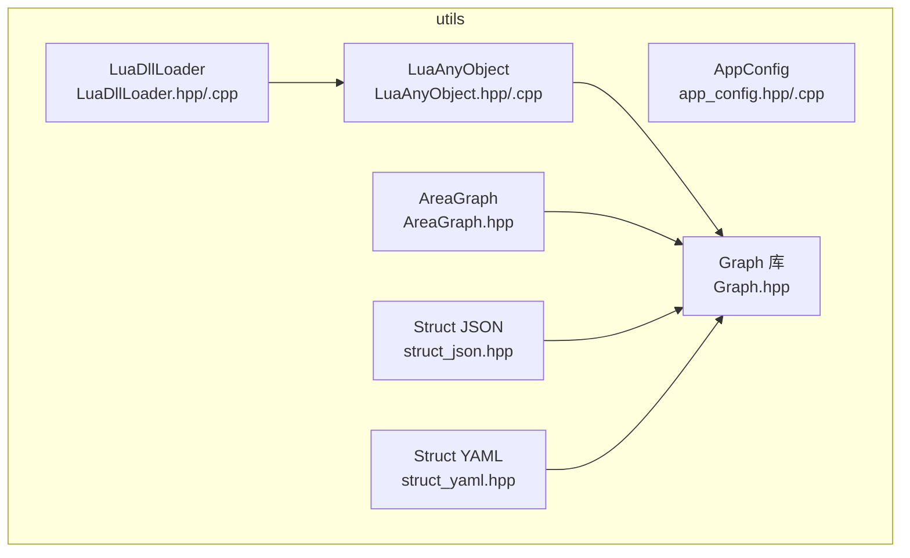
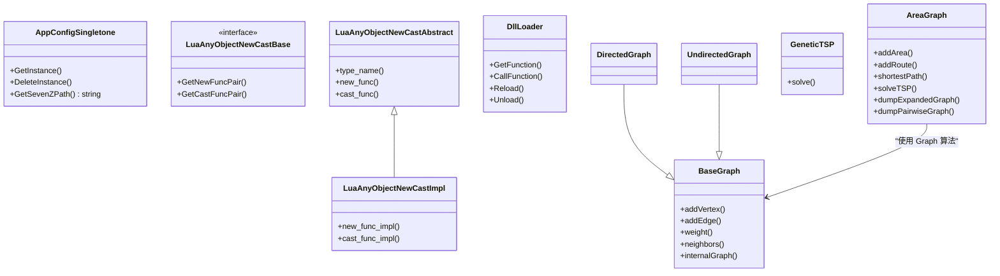
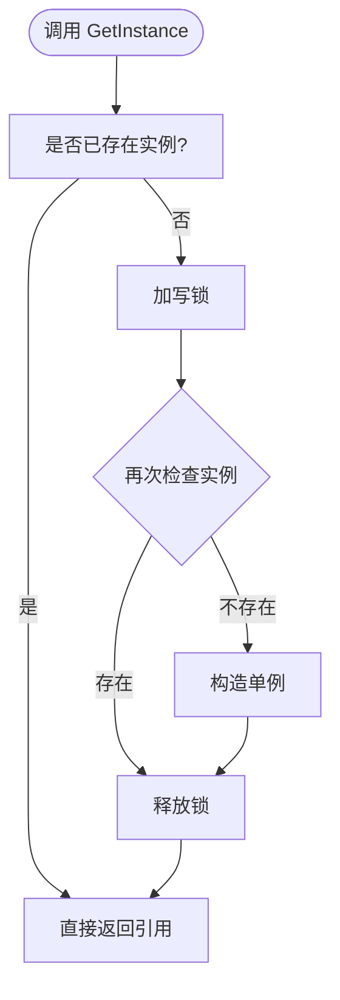
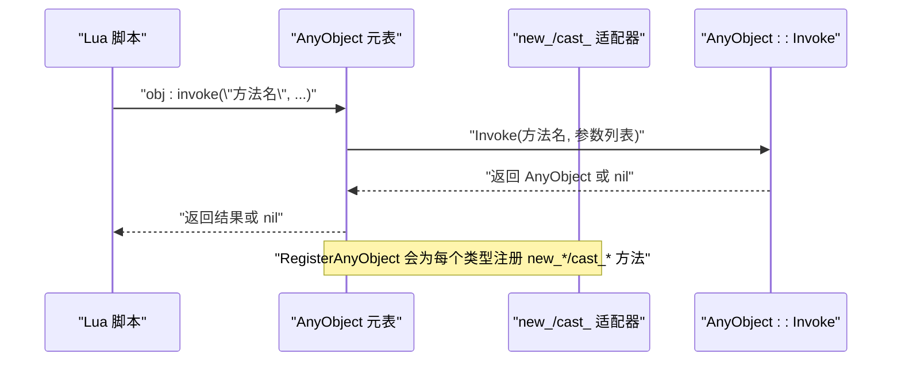
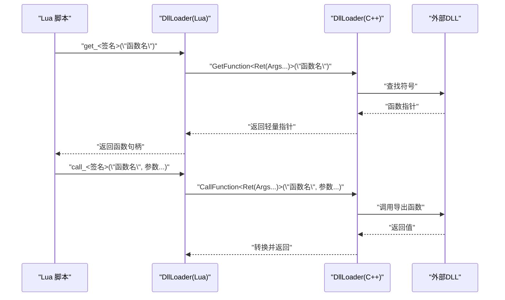
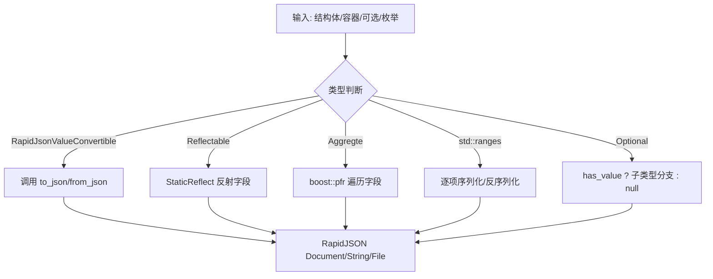
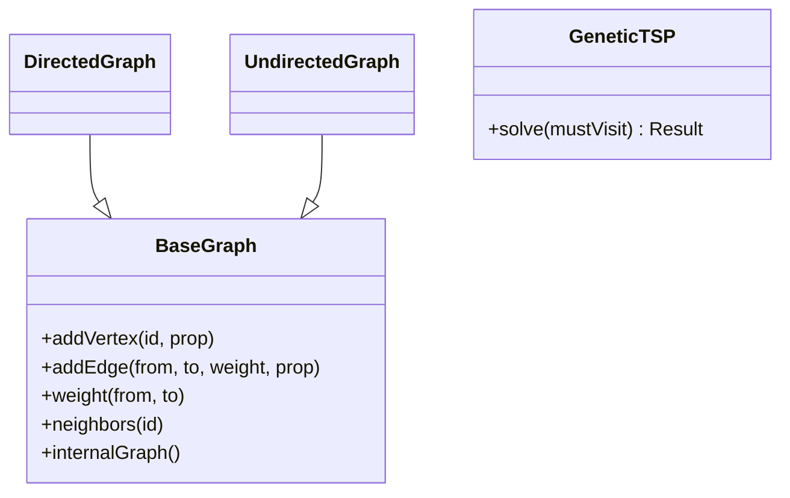
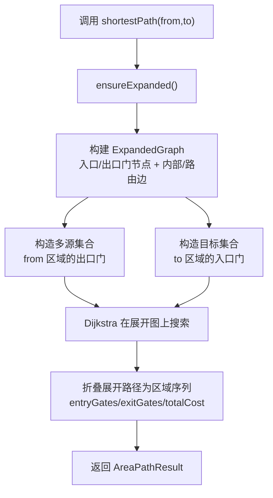
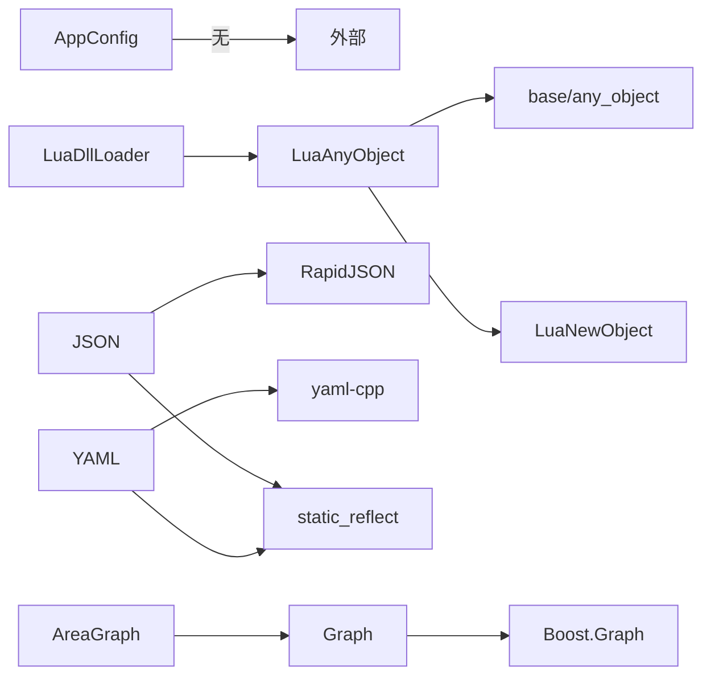

# 工具模块（Utils Module）

<cite>
**本文引用的文件**   
- [app_config.hpp](file://utils/app_config.hpp)
- [app_config.cpp](file://utils/app_config.cpp)
- [LuaAnyObject.hpp](file://utils/LuaAnyObject.hpp)
- [LuaAnyObject.cpp](file://utils/LuaAnyObject.cpp)
- [LuaDllLoader.hpp](file://utils/LuaDllLoader.hpp)
- [LuaDllLoader.cpp](file://utils/LuaDllLoader.cpp)
- [struct_json.hpp](file://utils/struct_json.hpp)
- [struct_yaml.hpp](file://utils/struct_yaml.hpp)
- [Graph.hpp](file://utils/Graph.hpp)
- [AreaGraph.hpp](file://utils/AreaGraph.hpp)
- [path_optimizer.cpp](file://LibHsBaSlicer/Path/path_optimizer.cpp)
</cite>

## 目录
1. [引言](#引言)
2. [项目结构](#项目结构)
3. [核心组件](#核心组件)
4. [架构总览](#架构总览)
5. [详细组件分析](#详细组件分析)
6. [依赖关系分析](#依赖关系分析)
7. [性能与优化建议](#性能与优化建议)
8. [故障排除指南](#故障排除指南)
9. [结论](#结论)
10. [附录：使用示例与集成清单](#附录使用示例与集成清单)

## 引言
本文件面向 HsBaSlicer 的 utils 工具模块，系统性介绍以下能力：
- AppConfig 配置管理：线程安全的单例，提供共享配置访问。
- LuaAnyObject：将 C++ AnyObject 暴露给 Lua，支持 new/cast、invoke、foreach_field 等通用操作。
- LuaDllLoader：在 Lua 中动态加载 DLL、按函数签名解析并调用导出函数。
- JSON/YAML 序列化：基于 RapidJSON 与 yaml-cpp 的结构体反射式序列化/反序列化。
- 图算法库：通用有向/无向图封装、最短路径、最小生成树、连通分量、拓扑排序、最大流、遗传 TSP，以及面向“区域+门”的两层 AreaGraph。

文档以源码为依据，给出接口设计、关键行为、错误处理与性能要点，并提供可操作的集成步骤。

## 项目结构
utils 目录包含若干独立主题的工具头文件与实现：
- 配置与运行时：app_config.*
- Lua 绑定与动态库：LuaAnyObject.*、LuaDllLoader.*
- 数据序列化：struct_json.hpp、struct_yaml.hpp
- 图与算法：Graph.hpp、AreaGraph.hpp

**图表来源**
- [app_config.hpp:1-49](file://utils/app_config.hpp#L1-L49)
- [LuaAnyObject.hpp:1-523](file://utils/LuaAnyObject.hpp#L1-L523)
- [LuaDllLoader.hpp:1-268](file://utils/LuaDllLoader.hpp#L1-L268)
- [struct_json.hpp:1-852](file://utils/struct_json.hpp#L1-L852)
- [struct_yaml.hpp:1-672](file://utils/struct_yaml.hpp#L1-L672)
- [Graph.hpp:1-1088](file://utils/Graph.hpp#L1-L1088)
- [AreaGraph.hpp:1-690](file://utils/AreaGraph.hpp#L1-L690)

**章节来源**
- [app_config.hpp:1-49](file://utils/app_config.hpp#L1-L49)
- [LuaAnyObject.hpp:1-523](file://utils/LuaAnyObject.hpp#L1-L523)
- [LuaDllLoader.hpp:1-268](file://utils/LuaDllLoader.hpp#L1-L268)
- [struct_json.hpp:1-852](file://utils/struct_json.hpp#L1-L852)
- [struct_yaml.hpp:1-672](file://utils/struct_yaml.hpp#L1-L672)
- [Graph.hpp:1-1088](file://utils/Graph.hpp#L1-L1088)
- [AreaGraph.hpp:1-690](file://utils/AreaGraph.hpp#L1-L690)

## 核心组件
本节概述各工具的职责与对外接口形态，便于快速定位。

- AppConfig 配置管理
  - 线程安全单例，提供 GetSevenZPath 等共享配置读取。
  - 通过 GetInstance/DeleteInstance 控制生命周期。

- LuaAnyObject
  - 为 AnyObject 在 Lua 侧注册元表与方法：new、invoke、foreach_field。
  - 提供类型适配器基类与模板实现，支持 int/double/string/bool 等基础类型的 new_/cast_。
  - 通过 RegisterAnyObject 完成 Lua 全局 AnyObject 表与元表注册。

- LuaDllLoader
  - 在 Lua 中创建 DllLoader 对象，支持 get_<name>/call_<name>/unload/reload。
  - 通过 DllGetFunctionAbstract 派生类声明目标函数的返回/参数签名，自动注入到 Lua。

- JSON/YAML 序列化
  - 对聚合类型、静态反射类型、容器、可选、枚举等提供 to_json/from_json、to_yaml/from_yaml。
  - 提供 write/read 系列便捷 API，支持字符串、流、文件。

- 图算法库
  - BaseGraph/DirectedGraph/UndirectedGraph：带顶点/边属性与描述信息的 Boost.Graph 包装。
  - algorithm 命名空间：BFS/DFS、Dijkstra/Bellman-Ford/A*、Prim/Kruskal、连通分量、强连通分量、拓扑排序、最大流、GeneticTSP。
  - AreaGraph：两层“区域+门”图，支持 gate-aware 最短路径与 TSP 规划，并可导出展开图与成对距离矩阵。

**章节来源**
- [app_config.hpp:14-46](file://utils/app_config.hpp#L14-L46)
- [LuaAnyObject.hpp:21-127](file://utils/LuaAnyObject.hpp#L21-L127)
- [LuaAnyObject.cpp:11-178](file://utils/LuaAnyObject.cpp#L11-L178)
- [LuaDllLoader.hpp:24-79](file://utils/LuaDllLoader.hpp#L24-L79)
- [LuaDllLoader.cpp:13-103](file://utils/LuaDllLoader.cpp#L13-L103)
- [struct_json.hpp:32-47](file://utils/struct_json.hpp#L32-L47)
- [struct_yaml.hpp:38-51](file://utils/struct_yaml.hpp#L38-L51)
- [Graph.hpp:153-445](file://utils/Graph.hpp#L153-L445)
- [AreaGraph.hpp:135-149](file://utils/AreaGraph.hpp#L135-L149)

## 架构总览
utils 模块内部职责清晰，彼此耦合度低；Lua 相关组件复用 base/any_object 与 LuaNewObject 基础设施；图算法与 AreaGraph 形成“通用图 + 领域扩展”的分层。

**图表来源**
- [app_config.hpp:19-46](file://utils/app_config.hpp#L19-L46)
- [LuaAnyObject.hpp:32-127](file://utils/LuaAnyObject.hpp#L32-L127)
- [LuaDllLoader.hpp:27-79](file://utils/LuaDllLoader.hpp#L27-L79)
- [Graph.hpp:153-445](file://utils/Graph.hpp#L153-L445)
- [Graph.hpp:878-1084](file://utils/Graph.hpp#L878-L1084)
- [AreaGraph.hpp:135-149](file://utils/AreaGraph.hpp#L135-L149)

## 详细组件分析

### AppConfig 配置管理
- 设计要点
  - 使用 shared_mutex 保护实例指针与配置字段，GetInstance 采用双重检查锁定。
  - 当前暴露 SevenZip 路径读取；可按需扩展更多配置项。
- 关键接口
  - GetInstance / DeleteInstance：获取与销毁单例。
  - GetSevenZPath：返回配置的 7-Zip 可执行路径。
- 使用场景
  - 应用启动时设置外部工具路径；压缩/解压流程读取该路径。
- 错误处理
  - 未初始化或并发访问由互斥锁保证一致性；默认路径为空串。

**图表来源**
- [app_config.cpp:14-26](file://utils/app_config.cpp#L14-L26)

**章节来源**
- [app_config.hpp:19-46](file://utils/app_config.hpp#L19-L46)
- [app_config.cpp:9-42](file://utils/app_config.cpp#L9-L42)

### LuaAnyObject：Lua 与 AnyObject 的桥梁
- 设计要点
  - 通过 LuaAnyObjectNewCastBase/Abstract/Impl 体系，为任意类型提供 new_/cast_ 方法。
  - 预定义 int/long/longlong/size_t/double/float/bool/string/cstring 适配器。
  - RegisterAnyObject 在 Lua 侧注册 AnyObject 元表与全局表，挂载 invoke/foreach_field 与各类型的 new_/cast_。
- 关键行为
  - lua_any_object_invoke：从 Lua 栈收集参数，调用 AnyObject::Invoke，并将结果推回 Lua。
  - lua_any_object_foreach_field：遍历 AnyObject 字段，回调 Lua 函数。
- 典型用法
  - 先在 C++ 注册 TypeInfo（反射），再在 Lua 注册自定义类型元表，最后调用 RegisterAnyObject 注册 AnyObject 系统。
- 错误处理
  - 无效对象指针、类型不匹配、异常均会抛出 Lua 错误消息。

**图表来源**
- [LuaAnyObject.cpp:17-87](file://utils/LuaAnyObject.cpp#L17-L87)
- [LuaAnyObject.cpp:130-178](file://utils/LuaAnyObject.cpp#L130-L178)
- [LuaAnyObject.hpp:32-127](file://utils/LuaAnyObject.hpp#L32-L127)

**章节来源**
- [LuaAnyObject.hpp:21-127](file://utils/LuaAnyObject.hpp#L21-L127)
- [LuaAnyObject.cpp:11-178](file://utils/LuaAnyObject.cpp#L11-L178)

### LuaDllLoader：Lua 中的动态库加载器
- 设计要点
  - DllLoader 封装 boost::dll::shared_library，提供 GetFunction/CallFunction/Reload/Unload。
  - 通过 DllGetFunctionAbstract 派生类声明目标函数签名，自动注入 get_<name>/call_<name> 到 Lua。
  - Lua 侧提供 DllLoader.new/unload/reload 与按签名解析的方法。
- 关键行为
  - lua_dll_get_function：根据 Ret(Args...) 签名解析符号，返回轻量用户数据指针。
  - lua_dll_call_function：校验参数个数，按签名解包 Lua 栈参数并调用，返回算术/字符串/AnyObject。
- 使用场景
  - 在 Lua 中按需加载插件 DLL，并以强类型方式调用导出函数。

**图表来源**
- [LuaDllLoader.hpp:122-245](file://utils/LuaDllLoader.hpp#L122-L245)
- [LuaDllLoader.cpp:13-103](file://utils/LuaDllLoader.cpp#L13-L103)

**章节来源**
- [LuaDllLoader.hpp:24-79](file://utils/LuaDllLoader.hpp#L24-L79)
- [LuaDllLoader.hpp:113-263](file://utils/LuaDllLoader.hpp#L113-L263)
- [LuaDllLoader.cpp:13-103](file://utils/LuaDllLoader.cpp#L13-L103)

### JSON/YAML 序列化
- 设计要点
  - JSON：RapidJsonValueConvertible 概念 + 聚合类型 + 静态反射类型 + 容器/可选/枚举。
  - YAML：YAMLValueConvertible 概念 + 相同泛化策略。
  - 提供 to_json/from_json、write_json/read_json、to_yaml/from_yaml、write_yaml/read_yaml 等 API。
- 关键行为
  - 递归处理嵌套结构与容器；Optional 空值映射为 null。
  - 文件 I/O 失败抛 IOError；JSON 解析失败抛 RuntimeError。
- 使用场景
  - 配置持久化、流水线参数交换、日志记录。

**图表来源**
- [struct_json.hpp:32-47](file://utils/struct_json.hpp#L32-L47)
- [struct_json.hpp:301-317](file://utils/struct_json.hpp#L301-L317)
- [struct_json.hpp:449-470](file://utils/struct_json.hpp#L449-L470)
- [struct_yaml.hpp:46-51](file://utils/struct_yaml.hpp#L46-L51)
- [struct_yaml.hpp:269-285](file://utils/struct_yaml.hpp#L269-L285)
- [struct_yaml.hpp:444-452](file://utils/struct_yaml.hpp#L444-L452)

**章节来源**
- [struct_json.hpp:32-47](file://utils/struct_json.hpp#L32-L47)
- [struct_json.hpp:473-852](file://utils/struct_json.hpp#L473-L852)
- [struct_yaml.hpp:38-51](file://utils/struct_yaml.hpp#L38-L51)
- [struct_yaml.hpp:455-672](file://utils/struct_yaml.hpp#L455-L672)

### 图算法库（Graph.hpp）
- 设计要点
  - BaseGraph 封装 Boost.Graph，维护 id↔descriptor 双向映射，支持顶点/边属性与可选描述。
  - DirectedGraph/UndirectedGraph 固定方向标签。
  - algorithm 命名空间提供 BFS/DFS、Dijkstra/Bellman-Ford/A*、Prim/Kruskal、连通分量、强连通分量、拓扑排序、最大流、GeneticTSP。
- 关键行为
  - genericDijkstra/genericDijkstraPath 仅要求权重满足 TSPWeight（可加、可比、可默认构造）。
  - Boost 原生算法（Dijkstra/Bellman-Ford/A*/MST/最大流）要求算术权重。
  - maxFlow 将边权重视为容量，内部重建流网络，不修改原图。
- 使用场景
  - 路径规划、支撑/填充阶段的最短路、区域访问顺序求解（结合 AreaGraph）。

**图表来源**
- [Graph.hpp:153-445](file://utils/Graph.hpp#L153-L445)
- [Graph.hpp:878-1084](file://utils/Graph.hpp#L878-L1084)

**章节来源**
- [Graph.hpp:153-445](file://utils/Graph.hpp#L153-L445)
- [Graph.hpp:448-875](file://utils/Graph.hpp#L448-L875)
- [Graph.hpp:878-1084](file://utils/Graph.hpp#L878-L1084)

### AreaGraph：区域+门两图层
- 设计要点
  - 将每个区域展开为“入口/出口门”节点，构建 ExpandedGraph，计算 gate-aware 最短路径。
  - 支持 solveTSP：先缓存所有点对最短路径，压缩为完全图，再用 GeneticTSP 求解近似最优环游。
  - 提供 dumpExpandedGraph/dumpPairwiseGraph 以便外部算法（如 Lua 脚本）在完整组合图上做二次优化。
- 关键行为
  - shortestPath(from,to)：源区域从每个可出发的门出发，初始成本为区域内“入口→该出口”的最小内部成本；到达目标区域任一可进入的门即结束。
  - ensureExpanded 惰性构建展开图，避免重复计算。
- 使用场景
  - 多区域路径规划、SLA/SLS/WAAM 等工艺的阶段间移动优化。

**图表来源**
- [AreaGraph.hpp:238-296](file://utils/AreaGraph.hpp#L238-L296)
- [AreaGraph.hpp:500-561](file://utils/AreaGraph.hpp#L500-L561)
- [AreaGraph.hpp:631-685](file://utils/AreaGraph.hpp#L631-L685)

**章节来源**
- [AreaGraph.hpp:32-132](file://utils/AreaGraph.hpp#L32-L132)
- [AreaGraph.hpp:135-149](file://utils/AreaGraph.hpp#L135-L149)
- [AreaGraph.hpp:157-236](file://utils/AreaGraph.hpp#L157-L236)
- [AreaGraph.hpp:238-306](file://utils/AreaGraph.hpp#L238-L306)
- [AreaGraph.hpp:308-386](file://utils/AreaGraph.hpp#L308-L386)
- [AreaGraph.hpp:400-450](file://utils/AreaGraph.hpp#L400-L450)
- [AreaGraph.hpp:500-561](file://utils/AreaGraph.hpp#L500-L561)
- [AreaGraph.hpp:631-685](file://utils/AreaGraph.hpp#L631-L685)

## 依赖关系分析
- 组件内聚性
  - AppConfig 自包含，无外部逻辑依赖。
  - LuaAnyObject 依赖 base/any_object 与 LuaNewObject；LuaDllLoader 依赖 LuaAnyObject 用于返回 AnyObject。
  - JSON/YAML 序列化依赖 RapidJSON/yaml-cpp 与 base/static_reflect、base/concepts。
  - Graph/Algorithm 依赖 Boost.Graph；AreaGraph 依赖 Graph。
- 外部耦合点
  - Lua 环境：LuaAnyObject/LuaDllLoader 需要 lua_State。
  - 第三方库：Boost、RapidJSON、yaml-cpp。
- 潜在循环依赖
  - utils 内部无循环依赖；AreaGraph 仅单向依赖 Graph。

**图表来源**
- [LuaAnyObject.hpp:8-9](file://utils/LuaAnyObject.hpp#L8-L9)
- [LuaDllLoader.hpp:7-15](file://utils/LuaDllLoader.hpp#L7-L15)
- [struct_json.hpp:11-27](file://utils/struct_json.hpp#L11-L27)
- [struct_yaml.hpp:9-26](file://utils/struct_yaml.hpp#L9-L26)
- [Graph.hpp:32-47](file://utils/Graph.hpp#L32-L47)
- [AreaGraph.hpp:9-13](file://utils/AreaGraph.hpp#L9-L13)

**章节来源**
- [LuaAnyObject.hpp:8-9](file://utils/LuaAnyObject.hpp#L8-L9)
- [LuaDllLoader.hpp:7-15](file://utils/LuaDllLoader.hpp#L7-L15)
- [struct_json.hpp:11-27](file://utils/struct_json.hpp#L11-L27)
- [struct_yaml.hpp:9-26](file://utils/struct_yaml.hpp#L9-L26)
- [Graph.hpp:32-47](file://utils/Graph.hpp#L32-L47)
- [AreaGraph.hpp:9-13](file://utils/AreaGraph.hpp#L9-L13)

## 性能与优化建议
- AppConfig
  - 读路径使用 shared_lock，适合高并发只读场景；写入应集中管理，避免频繁更新。
- LuaAnyObject
  - 优先使用 cast_new 避免 _gc 双重析构；批量 Invoke 时复用参数向量以减少分配。
  - 在多次注册场景中，参考 LibHsBaSlicer 的幂等注册模式，避免重复重建全局表。
- LuaDllLoader
  - 复用 DllLoader 实例，避免频繁 load/unload；仅在必要时 reload。
  - 使用 call_<签名> 而非 get 后手动调用，减少桥接开销。
- JSON/YAML
  - 大对象序列化优先使用 write_pretty_json 调试，生产用紧凑格式；尽量复用 Document/Allocator。
  - Optional 字段缺失时保持 null，避免多余成员。
- Graph/Algorithm
  - 使用 internalGraph 直接调用 Boost 算法时注意拷贝/映射开销；避免频繁重建图。
  - GeneticTSP 为非确定性启发式，可通过固定种群规模与代数获得稳定对比结果。
- AreaGraph
  - 利用 ensureExpanded 惰性构建；批量查询前一次性构建展开图。
  - 使用 dumpPairwiseGraph 缓存区域间最短路径，供上层优化器复用。

[本节为通用指导，不直接分析具体文件]

## 故障排除指南
- LuaAnyObject
  - 现象：Lua 端调用 obj:invoke(...) 返回 nil 或报错。
  - 排查：确认已在 C++ 注册 TypeInfo；确认 RegisterAnyObject 已调用；检查参数类型与数量。
  - 参考：lua_any_object_invoke 的参数收集与异常处理。
- LuaDllLoader
  - 现象：get_<签名> 或 call_<签名> 报“Invalid DllLoader object”或参数个数不匹配。
  - 排查：确认 DllLoader 对象有效；核对 Ret(Args...) 签名与传入参数个数一致。
- JSON/YAML
  - 现象：read_json_from_file/read_yaml_from_file 抛 IOError。
  - 排查：检查文件路径与权限；确保文件格式正确。
  - 现象：JSON 解析失败抛 RuntimeError。
  - 排查：检查 JSON 文本合法性与编码。
- Graph/Algorithm
  - 现象：查询顶点/边不存在抛 RuntimeError。
  - 排查：确认 addVertex/addEdge 已调用；ID 类型一致。
  - 现象：maxFlow 结果为 0。
  - 排查：确认边权重作为容量合理；检查源汇点可达性。
- AreaGraph
  - 现象：shortestPath 抛“Source area has no exit gates”或“Target area has no entry gates”。
  - 排查：检查 AreaConfig.gates 的 canExit/canEnter 配置；确保 addRoute 的 gate 对存在。

**章节来源**
- [LuaAnyObject.cpp:17-87](file://utils/LuaAnyObject.cpp#L17-L87)
- [LuaDllLoader.hpp:160-245](file://utils/LuaDllLoader.hpp#L160-L245)
- [struct_json.hpp:800-852](file://utils/struct_json.hpp#L800-L852)
- [struct_yaml.hpp:628-672](file://utils/struct_yaml.hpp#L628-L672)
- [Graph.hpp:183-194](file://utils/Graph.hpp#L183-L194)
- [Graph.hpp:261-275](file://utils/Graph.hpp#L261-L275)
- [Graph.hpp:829-875](file://utils/Graph.hpp#L829-L875)
- [AreaGraph.hpp:238-296](file://utils/AreaGraph.hpp#L238-L296)

## 结论
utils 模块提供了贯穿 HsBaSlicer 的基础设施：
- AppConfig 提供统一配置入口；
- LuaAnyObject 与 LuaDllLoader 打通 C++ 与 Lua 的双向交互与动态扩展；
- JSON/YAML 序列化简化配置与数据交换；
- Graph/Algorithm 与 AreaGraph 为路径与区域规划提供高效、可扩展的算法底座。

这些工具共同降低了跨语言集成、数据持久化与复杂路径优化的开发成本，同时具备良好的错误处理与性能优化空间。

[本节为总结，不直接分析具体文件]

## 附录：使用示例与集成清单

### 集成清单
- 初始化 Lua 环境
  - 注册基础类型与 AnyObject：调用 RegisterAnyObject，并传入需要的类型适配器。
  - 注册 DLL 加载器：准备 DllGetFunctionAbstract 派生对象，调用 RegisterLuaDllLoader。
- 配置外部工具
  - 通过 AppConfigSingletone::GetInstance().GetSevenZPath() 获取 7-Zip 路径。
- 序列化配置
  - 使用 write_json/write_yaml 输出配置；使用 read_json_from_file/read_yaml_from_file 读取。
- 图与区域规划
  - 使用 DirectedGraph/UndirectedGraph 建模；使用 algorithm 提供的算法求解。
  - 使用 AreaGraph 建模区域与门，调用 shortestPath/solveTSP 或导出展开图进行二次优化。

**章节来源**
- [LuaAnyObject.cpp:130-178](file://utils/LuaAnyObject.cpp#L130-L178)
- [LuaDllLoader.cpp:55-103](file://utils/LuaDllLoader.cpp#L55-L103)
- [app_config.hpp:34-39](file://utils/app_config.hpp#L34-L39)
- [struct_json.hpp:726-751](file://utils/struct_json.hpp#L726-L751)
- [struct_yaml.hpp:560-600](file://utils/struct_yaml.hpp#L560-L600)
- [Graph.hpp:448-875](file://utils/Graph.hpp#L448-L875)
- [AreaGraph.hpp:238-306](file://utils/AreaGraph.hpp#L238-L306)

### 实际集成参考：路径优化器使用 AreaGraph
- 路径优化器通过 AreaGraph 的 dumpPairwiseGraph 与 dumpExpandedGraph 提取区域级距离矩阵与展开图，供上层优化器使用。

**章节来源**
- [path_optimizer.cpp:248-288](file://LibHsBaSlicer/Path/path_optimizer.cpp#L248-L288)