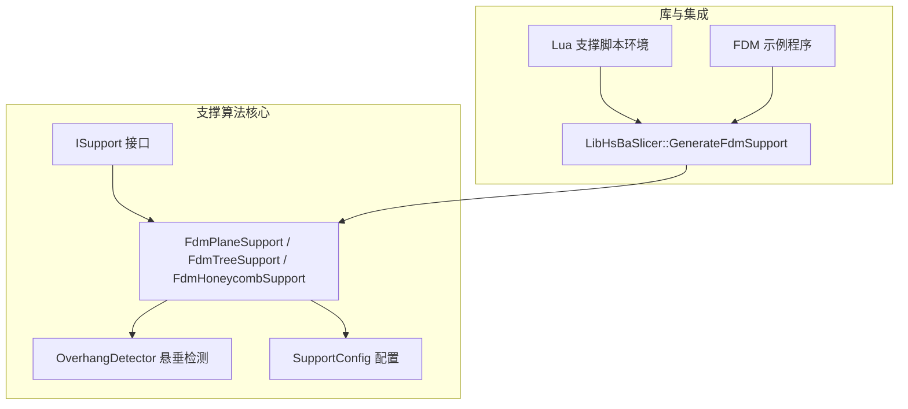
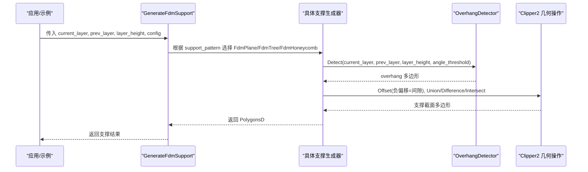
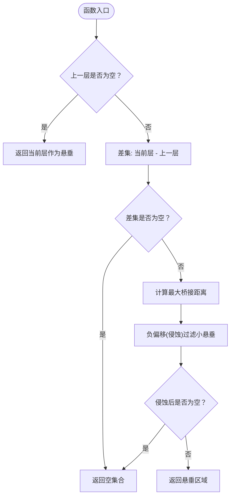
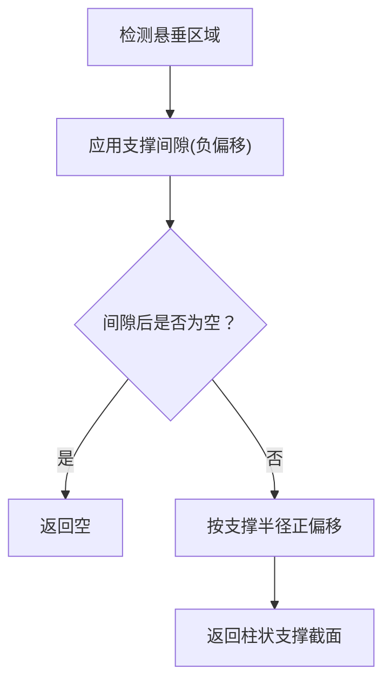
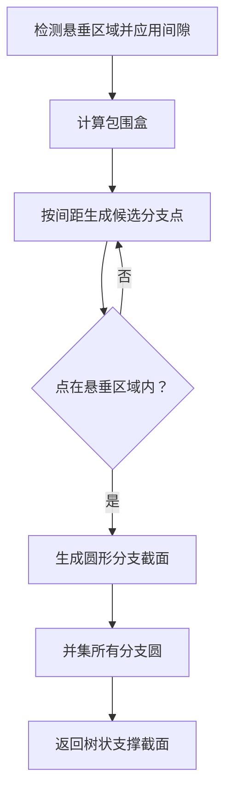
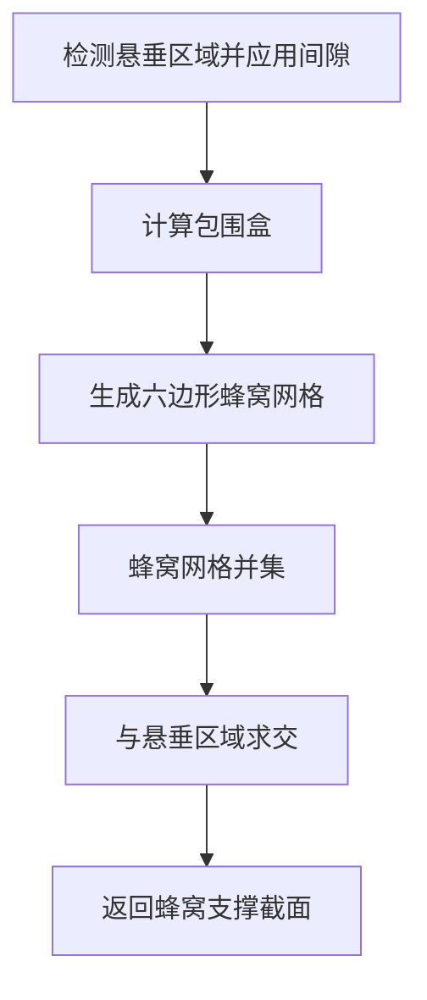
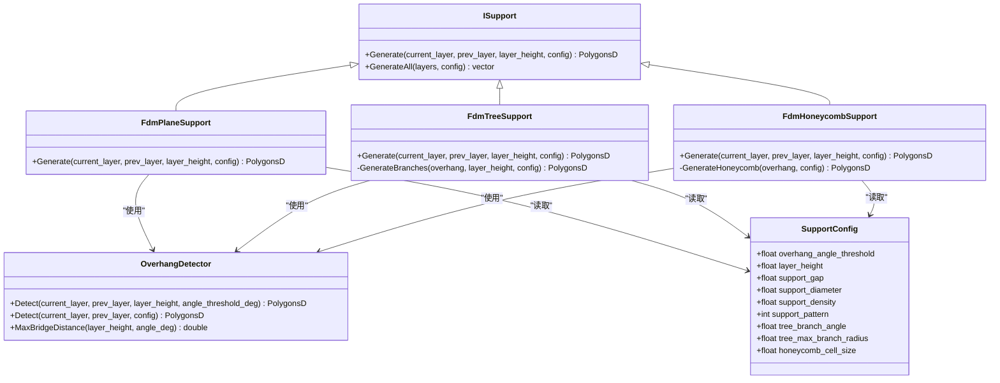
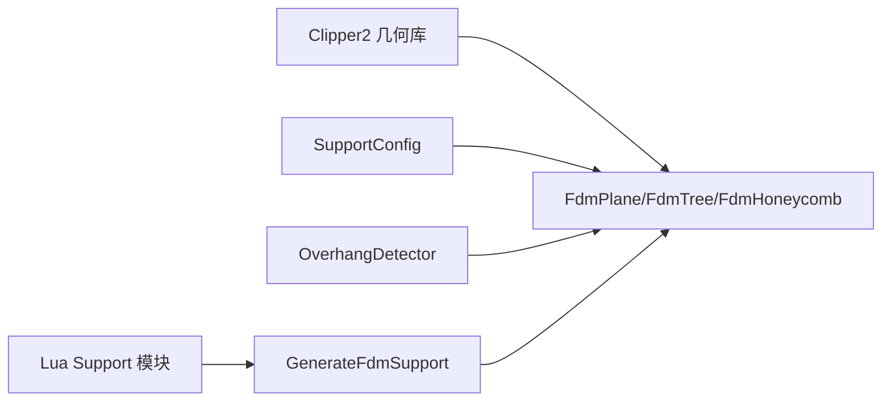

# FDM 支撑算法

<cite>
**本文引用的文件**   
- [FdmSupport.hpp](file://support/FdmSupport.hpp)
- [FdmSupport.cpp](file://support/FdmSupport.cpp)
- [ISupport.hpp](file://support/ISupport.hpp)
- [ISupport.cpp](file://support/ISupport.cpp)
- [SupportConfig.hpp](file://support/SupportConfig.hpp)
- [OverhangDetector.hpp](file://support/OverhangDetector.hpp)
- [OverhangDetector.cpp](file://support/OverhangDetector.cpp)
- [fdm_support.cpp](file://LibHsBaSlicer/Support/fdm_support.cpp)
- [hsba_pipeline.d.lua](file://types/hsba_pipeline.d.lua)
- [my_support.lua](file://samples/FDM/scripts/my_support.lua)
- [main.cpp](file://samples/FDM/main.cpp)
- [fdm_pipeline.proto](file://proto/fdm_pipeline.proto)
</cite>

## 目录
1. [引言](#引言)
2. [项目结构](#项目结构)
3. [核心组件](#核心组件)
4. [架构总览](#架构总览)
5. [详细组件分析](#详细组件分析)
6. [依赖关系分析](#依赖关系分析)
7. [性能与质量评估](#性能与质量评估)
8. [故障排除指南](#故障排除指南)
9. [结论](#结论)
10. [附录：参数与配置参考](#附录参数与配置参考)

## 引言
本文面向 FDM 切片系统中的支撑生成算法，系统性梳理并解释以下三类实现：
- 平面支撑：基于悬垂区域膨胀生成柱状支撑截面。
- 树状支撑：在悬垂区域内按间距放置分支点圆，并在层间向上生长、合并形成树形支撑。
- 蜂窝支撑：在悬垂区域内填充六边形蜂窝网格，提供轻量化但具有一定刚性的支撑体。

文档将围绕“悬垂区域检测”“支撑柱直径计算”“分支生长逻辑”等核心算法展开，并结合源码中的几何操作（偏移、差集、并集、交集）说明数据流和关键优化策略，同时给出不同算法的适用场景、调优建议与使用示例。

## 项目结构
支撑相关代码主要位于 support 模块，并通过 LibHsBaSlicer 暴露给上层流水线；Lua 脚本系统也提供了支撑生成入口。

**图表来源**
- [ISupport.hpp:14-45](file://support/ISupport.hpp#L14-L45)
- [FdmSupport.hpp:11-63](file://support/FdmSupport.hpp#L11-L63)
- [OverhangDetector.hpp:12-50](file://support/OverhangDetector.hpp#L12-L50)
- [SupportConfig.hpp:11-43](file://support/SupportConfig.hpp#L11-L43)
- [fdm_support.cpp:14-31](file://LibHsBaSlicer/Support/fdm_support.cpp#L14-L31)
- [hsba_pipeline.d.lua:525-549](file://types/hsba_pipeline.d.lua#L525-L549)
- [main.cpp:167-219](file://samples/FDM/main.cpp#L167-L219)

**章节来源**
- [ISupport.hpp:14-45](file://support/ISupport.hpp#L14-L45)
- [FdmSupport.hpp:11-63](file://support/FdmSupport.hpp#L11-L63)
- [OverhangDetector.hpp:12-50](file://support/OverhangDetector.hpp#L12-L50)
- [SupportConfig.hpp:11-43](file://support/SupportConfig.hpp#L11-L43)
- [fdm_support.cpp:14-31](file://LibHsBaSlicer/Support/fdm_support.cpp#L14-L31)
- [hsba_pipeline.d.lua:525-549](file://types/hsba_pipeline.d.lua#L525-L549)
- [main.cpp:167-219](file://samples/FDM/main.cpp#L167-L219)

## 核心组件
- ISupport：定义每层支撑生成的统一接口，并提供默认的全层遍历实现。
- SupportConfig：通用支撑配置，包含悬垂角度阈值、层高、间隙、支撑直径、密度、图案类型、树分支角度、蜂窝单元尺寸等。
- OverhangDetector：根据当前层与上一层轮廓计算需要支撑的悬垂区域，支持角度阈值过滤。
- FdmPlaneSupport：对悬垂区域应用间隙收缩后，再按支撑半径膨胀得到柱状支撑截面。
- FdmTreeSupport：在悬垂区域内按固定间距采样分支点，生成圆形分支截面，层间通过 GenerateAll 累积生长。
- FdmHoneycombSupport：在悬垂区域内生成六边形蜂窝网格并与悬垂区域求交，得到蜂窝支撑截面。

**章节来源**
- [ISupport.hpp:14-45](file://support/ISupport.hpp#L14-L45)
- [ISupport.cpp:9-21](file://support/ISupport.cpp#L9-L21)
- [SupportConfig.hpp:11-43](file://support/SupportConfig.hpp#L11-L43)
- [OverhangDetector.hpp:14-50](file://support/OverhangDetector.hpp#L14-L50)
- [FdmSupport.hpp:13-63](file://support/FdmSupport.hpp#L13-L63)

## 架构总览
FDM 支撑算法在库层由 GenerateFdmSupport 根据配置选择具体实现，再由各算法调用 OverhangDetector 进行悬垂检测，并使用 Clipper2 几何操作完成偏移、差集、并集、交集等处理。Lua 脚本可通过 Support 模块直接调用这些能力。

**图表来源**
- [fdm_support.cpp:14-31](file://LibHsBaSlicer/Support/fdm_support.cpp#L14-L31)
- [FdmSupport.cpp:48-76](file://support/FdmSupport.cpp#L48-L76)
- [FdmSupport.cpp:145-168](file://support/FdmSupport.cpp#L145-L168)
- [FdmSupport.cpp:244-267](file://support/FdmSupport.cpp#L244-L267)
- [OverhangDetector.cpp:41-81](file://support/OverhangDetector.cpp#L41-L81)

## 详细组件分析

### 悬垂区域检测（OverhangDetector）
- 输入：当前层轮廓、上一层轮廓、层高、悬垂角度阈值。
- 逻辑要点：
  - 若上一层为空，则当前层整体视为悬垂。
  - 使用差集计算当前层未被上一层覆盖的区域。
  - 根据层高与角度阈值计算最大桥接距离，并对差集区域执行负偏移（侵蚀）以过滤可桥接的小悬垂。
  - 最终返回经侵蚀后的悬垂区域多边形。
- 复杂度与性能：
  - 主要开销来自 Clipper2 的多边形差集与偏移操作，时间复杂度与多边形顶点数相关。
  - 通过整数化与 Round Join 平滑角点，减少数值误差带来的拓扑问题。

**图表来源**
- [OverhangDetector.cpp:41-81](file://support/OverhangDetector.cpp#L41-L81)

**章节来源**
- [OverhangDetector.hpp:14-50](file://support/OverhangDetector.hpp#L14-L50)
- [OverhangDetector.cpp:23-39](file://support/OverhangDetector.cpp#L23-L39)
- [OverhangDetector.cpp:41-81](file://support/OverhangDetector.cpp#L41-L81)

### 平面支撑（FdmPlaneSupport）
- 生成逻辑：
  - 调用 OverhangDetector 获取悬垂区域。
  - 应用支撑间隙（负偏移）。
  - 按支撑直径的一半进行正偏移，形成柱状支撑截面。
- 关键点：
  - 支撑柱直径决定支撑接触面积与强度。
  - 间隙控制模型与支撑之间的分离距离，影响表面质量和移除难度。
- 适用场景：
  - 简单悬垂、大面积平坦支撑需求。
  - 打印速度快、支撑材料用量适中。

**图表来源**
- [FdmSupport.cpp:48-76](file://support/FdmSupport.cpp#L48-L76)

**章节来源**
- [FdmSupport.hpp:13-24](file://support/FdmSupport.hpp#L13-L24)
- [FdmSupport.cpp:48-76](file://support/FdmSupport.cpp#L48-L76)

### 树状支撑（FdmTreeSupport）
- 生成逻辑：
  - 同样先检测悬垂区域并应用间隙。
  - 在悬垂区域的包围盒内按固定间距采样候选分支点。
  - 对每个候选点判断是否在悬垂区域内，若是则生成圆形分支截面。
  - 将所有分支圆并集，得到该层的支撑截面。
- 分支生长与合并：
  - 单层的 GenerateBranches 仅生成分支截面；层间的生长与合并由 GenerateAll 迭代累积。
  - 分支半径取支撑直径的一半，分支间距为支撑直径的倍数，避免过度密集。
- 适用场景：
  - 复杂悬垂、需要轻量化且高稳定性的支撑结构。
  - 适合大跨度悬垂或分散支撑点的需求。

**图表来源**
- [FdmSupport.cpp:81-143](file://support/FdmSupport.cpp#L81-L143)
- [FdmSupport.cpp:145-168](file://support/FdmSupport.cpp#L145-L168)

**章节来源**
- [FdmSupport.hpp:26-44](file://support/FdmSupport.hpp#L26-L44)
- [FdmSupport.cpp:81-143](file://support/FdmSupport.cpp#L81-L143)
- [FdmSupport.cpp:145-168](file://support/FdmSupport.cpp#L145-L168)

### 蜂窝支撑（FdmHoneycombSupport）
- 生成逻辑：
  - 检测悬垂区域并应用间隙。
  - 在悬垂区域包围盒内生成 flat-top 六边形蜂窝网格。
  - 将蜂窝网格与悬垂区域求交，得到蜂窝支撑截面。
- 关键点：
  - 蜂窝单元尺寸控制支撑密度与刚性。
  - 通过并集+交集组合，确保支撑仅在悬垂区域内。
- 适用场景：
  - 需要轻量化且具有一定刚性的支撑结构。
  - 适合中等悬垂面积，追求支撑材料与强度的平衡。

**图表来源**
- [FdmSupport.cpp:173-242](file://support/FdmSupport.cpp#L173-L242)
- [FdmSupport.cpp:244-267](file://support/FdmSupport.cpp#L244-L267)

**章节来源**
- [FdmSupport.hpp:46-63](file://support/FdmSupport.hpp#L46-L63)
- [FdmSupport.cpp:173-242](file://support/FdmSupport.cpp#L173-L242)
- [FdmSupport.cpp:244-267](file://support/FdmSupport.cpp#L244-L267)

### 类关系图

**图表来源**
- [ISupport.hpp:14-45](file://support/ISupport.hpp#L14-L45)
- [FdmSupport.hpp:13-63](file://support/FdmSupport.hpp#L13-L63)
- [OverhangDetector.hpp:14-50](file://support/OverhangDetector.hpp#L14-L50)
- [SupportConfig.hpp:11-43](file://support/SupportConfig.hpp#L11-L43)

## 依赖关系分析
- 几何库依赖：
  - 大量使用 Clipper2 进行多边形运算（Union、Difference、Offset、PointInPolygons）。
  - 通过 Integerization/UnIntegerization 在浮点与整数坐标之间转换，提升布尔运算稳定性。
- 配置依赖：
  - 所有算法均依赖 SupportConfig 提供的参数，如悬垂角度阈值、层高、间隙、直径、密度、图案类型等。
- 集成依赖：
  - LibHsBaSlicer::GenerateFdmSupport 根据 support_pattern 选择具体实现。
  - Lua 脚本通过 Support 模块调用内置生成器与悬垂检测。

**图表来源**
- [FdmSupport.cpp:1-13](file://support/FdmSupport.cpp#L1-L13)
- [fdm_support.cpp:14-31](file://LibHsBaSlicer/Support/fdm_support.cpp#L14-L31)
- [hsba_pipeline.d.lua:525-549](file://types/hsba_pipeline.d.lua#L525-L549)

**章节来源**
- [FdmSupport.cpp:1-13](file://support/FdmSupport.cpp#L1-L13)
- [fdm_support.cpp:14-31](file://LibHsBaSlicer/Support/fdm_support.cpp#L14-L31)
- [hsba_pipeline.d.lua:525-549](file://types/hsba_pipeline.d.lua#L525-L549)

## 性能与质量评估
- 平面支撑：
  - 优点：实现简单、计算快、支撑材料用量可控。
  - 缺点：在大跨度悬垂时可能不够稳定。
  - 指标：支撑体积、打印时间、悬垂稳定性。
- 树状支撑：
  - 优点：轻量化、分支点分布灵活、跨区支撑能力强。
  - 缺点：分支点过多会增加几何运算量。
  - 指标：支撑体积、分支密度、悬垂覆盖率。
- 蜂窝支撑：
  - 优点：结构均匀、刚度较好、材料用量适中。
  - 缺点：蜂窝尺寸过小会导致计算开销增大。
  - 指标：支撑密度、蜂窝单元数量、支撑强度。

调优建议：
- 调整 support_diameter 控制支撑柱粗细与强度。
- 调整 support_gap 控制模型与支撑的分离距离，影响表面质量与移除难度。
- 调整 honeycomb_cell_size 控制蜂窝密度与刚性。
- 调整 overhang_angle_threshold 控制悬垂检测敏感度。
- 对于树状支撑，合理设置分支间距与半径，避免过密导致计算与打印负担。

[本节为通用指导，不直接分析具体文件]

## 故障排除指南
常见问题与排查思路：
- 无支撑输出：
  - 检查悬垂角度阈值是否过高，导致悬垂区域被过滤。
  - 检查支撑间隙是否过大，导致间隙后区域为空。
  - 确认 support_pattern 是否正确配置。
- 支撑不稳定：
  - 增加支撑直径或降低蜂窝单元尺寸。
  - 调整悬垂角度阈值，使更多区域被识别为悬垂。
- 计算缓慢：
  - 减少分支点密度或蜂窝单元数量。
  - 检查多边形顶点数是否过大，必要时简化模型。

**章节来源**
- [FdmSupport.cpp:48-76](file://support/FdmSupport.cpp#L48-L76)
- [FdmSupport.cpp:145-168](file://support/FdmSupport.cpp#L145-L168)
- [FdmSupport.cpp:244-267](file://support/FdmSupport.cpp#L244-L267)
- [OverhangDetector.cpp:41-81](file://support/OverhangDetector.cpp#L41-L81)

## 结论
FDM 支撑算法通过统一的 ISupport 接口与 OverhangDetector 悬垂检测，结合 Clipper2 几何操作实现了平面、树状与蜂窝三种支撑策略。不同算法在支撑体积、稳定性与计算开销上各有权衡。实际使用中应根据模型悬垂特征、打印质量要求与性能约束选择合适的支撑模式，并通过调整支撑直径、间隙、蜂窝单元尺寸与悬垂角度阈值进行精细化调优。

[本节为总结性内容，不直接分析具体文件]

## 附录：参数与配置参考
- SupportConfig 字段：
  - overhang_angle_threshold：悬垂角度阈值（度）。
  - layer_height：层高（mm）。
  - support_gap：支撑与模型间隙（mm）。
  - support_diameter：支撑柱直径（mm）。
  - support_density：支撑填充密度 [0,1]。
  - support_pattern：支撑图案类型（0=平面，1=树状，2=蜂窝）。
  - tree_branch_angle：树分支角度（度）。
  - tree_max_branch_radius：树最大分支半径（mm）。
  - honeycomb_cell_size：蜂窝单元尺寸（mm）。
- FdmSupportConfig 扩展字段：
  - interface_layers：界面层数。
  - interface_density：界面层填充密度。
- SLA 专用字段（对比参考）：
  - tip_diameter：支撑尖端直径（mm）。
  - raft_thickness：底板厚度（mm）。

**章节来源**
- [SupportConfig.hpp:11-43](file://support/SupportConfig.hpp#L11-L43)