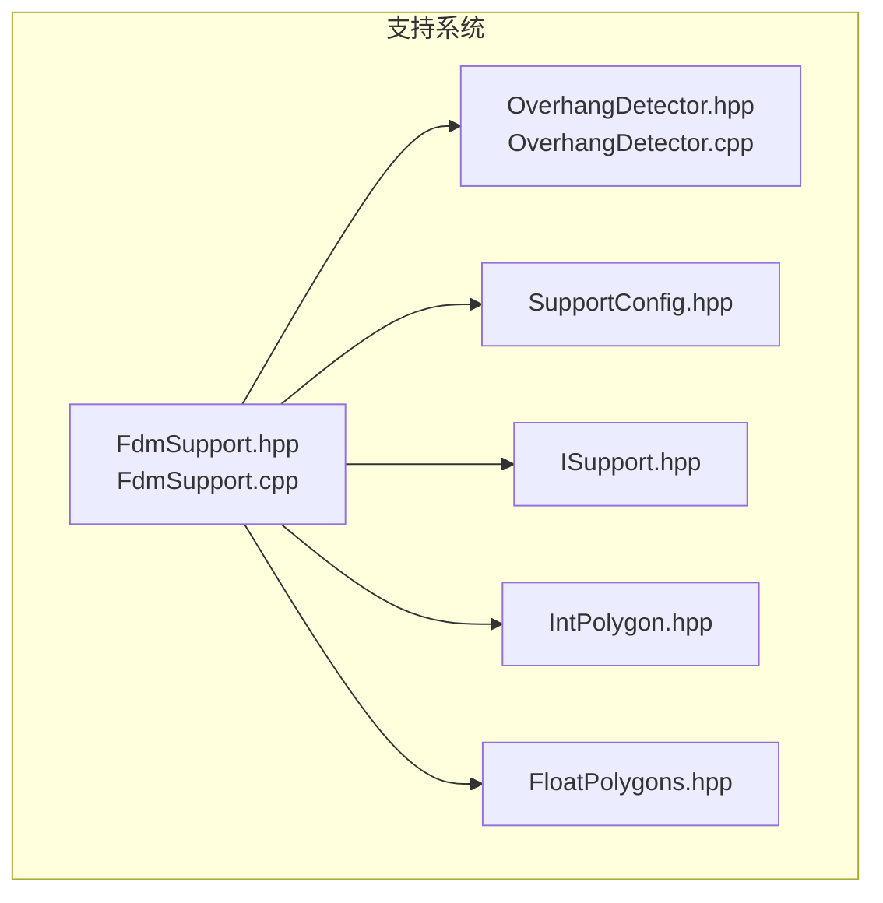
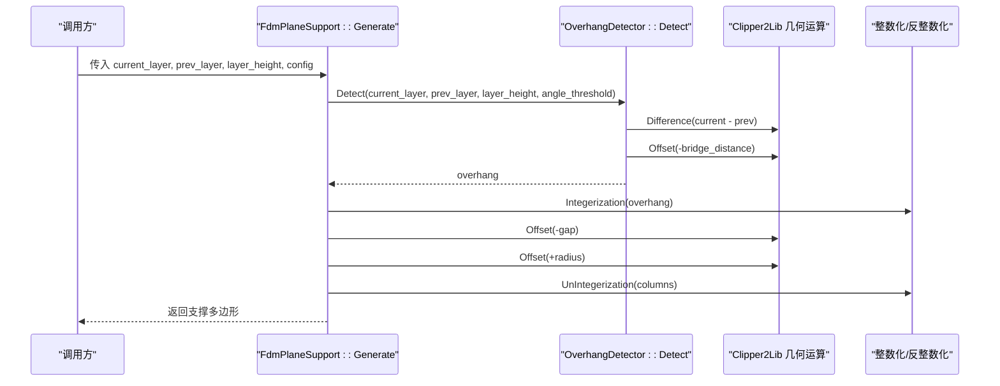
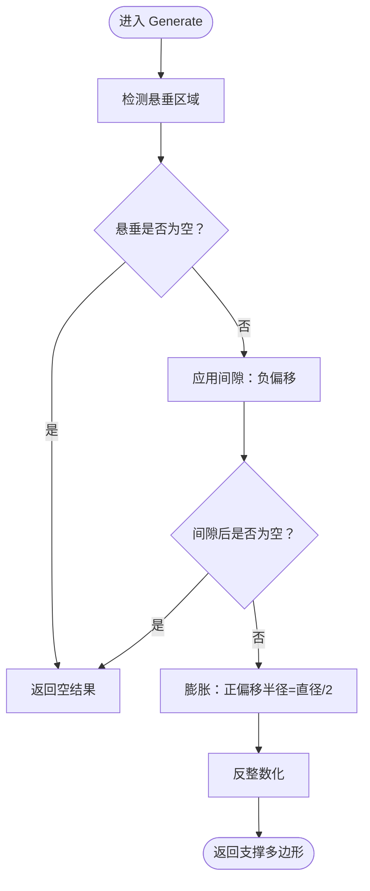
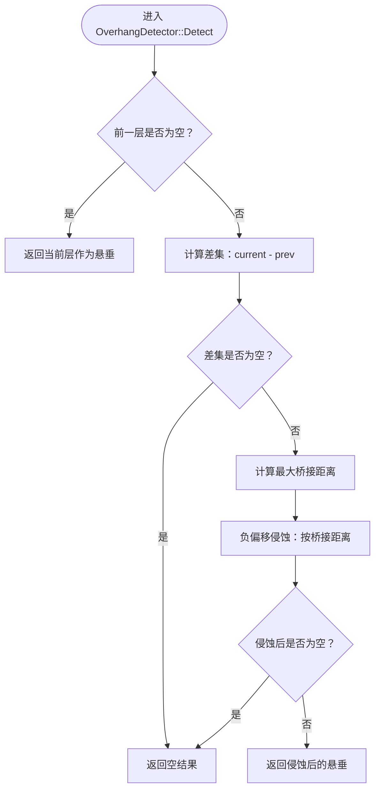
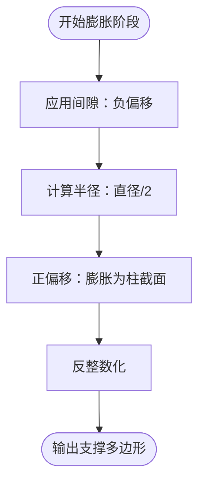
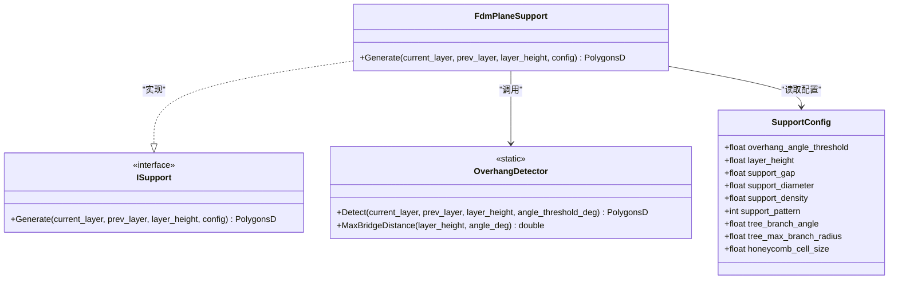
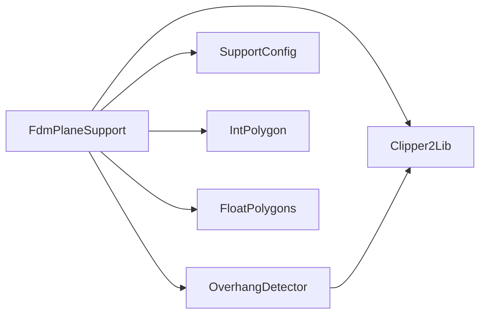

# 平面支撑算法

<cite>
**本文引用的文件**   
- [FdmSupport.hpp](file://support/FdmSupport.hpp)
- [FdmSupport.cpp](file://support/FdmSupport.cpp)
- [OverhangDetector.hpp](file://support/OverhangDetector.hpp)
- [OverhangDetector.cpp](file://support/OverhangDetector.cpp)
- [SupportConfig.hpp](file://support\SupportConfig.hpp)
- [ISupport.hpp](file://support/ISupport.hpp)
- [IntPolygon.hpp](file://2D/IntPolygon.hpp)
- [FloatPolygons.hpp](file://2D/FloatPolygons.hpp)
- [support_test.cpp](file://tests\Support\support_test.cpp)
</cite>

## 目录
1. [简介](#简介)
2. [项目结构](#项目结构)
3. [核心组件](#核心组件)
4. [架构总览](#架构总览)
5. [详细组件分析](#详细组件分析)
6. [依赖关系分析](#依赖关系分析)
7. [性能与复杂度](#性能与复杂度)
8. [适用场景与调优建议](#适用场景与调优建议)
9. [故障排除](#故障排除)
10. [结论](#结论)

## 简介
本文面向 FDM 切片系统中的“平面支撑”生成算法，重点解析 `FdmPlaneSupport` 类的实现原理与数据流。该算法基于相邻两层的多边形轮廓，检测悬垂区域，应用模型与支撑之间的间隙，再通过膨胀将悬垂区域转换为圆柱形支撑柱的横截面多边形。文档同时说明 `Generate` 方法的参数含义、关键几何计算流程，并给出流程图与示例路径，帮助读者理解算法在工程中的使用方式与调优要点。

## 项目结构
平面支撑相关代码位于支持系统模块中，主要包含以下文件：
- 接口与实现：`FdmSupport.hpp`、`FdmSupport.cpp`
- 悬垂检测：`OverhangDetector.hpp`、`OverhangDetector.cpp`
- 配置结构体：`SupportConfig.hpp`
- 基础几何类型：`IntPolygon.hpp`、`FloatPolygons.hpp`
- 单元测试：`support_test.cpp`

**图表来源**
- [FdmSupport.hpp:11-24](file://support/FdmSupport.hpp#L11-L24)
- [FdmSupport.cpp:48-76](file://support/FdmSupport.cpp#L48-L76)
- [OverhangDetector.hpp:14-49](file://support/OverhangDetector.hpp#L14-L49)
- [SupportConfig.hpp:14-25](file://support\SupportConfig.hpp#L14-L25)

**章节来源**
- [FdmSupport.hpp:1-67](file://support/FdmSupport.hpp#L1-L67)
- [FdmSupport.cpp:1-269](file://support/FdmSupport.cpp#L1-L269)
- [OverhangDetector.hpp:1-54](file://support/OverhangDetector.hpp#L1-L54)
- [OverhangDetector.cpp:1-89](file://support/OverhangDetector.cpp#L1-L89)
- [SupportConfig.hpp:1-47](file://support\SupportConfig.hpp#L1-L47)

## 核心组件
- `FdmPlaneSupport`：平面支撑生成器，负责从悬垂区域生成柱状支撑横截面。
- `OverhangDetector`：悬垂区域检测器，根据当前层与前一层轮廓及层高、角度阈值计算需要支撑的区域。
- `SupportConfig`：通用支撑配置，包括悬垂角度阈值、层高、间隙、支撑直径、密度、模式等。
- `ISupport`：支撑生成器的统一接口基类。

这些组件共同构成一个清晰的流水线：输入两层多边形 → 检测悬垂 → 应用间隙 → 膨胀为支撑柱 → 输出支撑多边形。

**章节来源**
- [FdmSupport.hpp:13-24](file://support/FdmSupport.hpp#L13-L24)
- [OverhangDetector.hpp:14-49](file://support/OverhangDetector.hpp#L14-L49)
- [SupportConfig.hpp:14-25](file://support\SupportConfig.hpp#L14-L25)
- [ISupport.hpp](file://support/ISupport.hpp)

## 架构总览
下图展示平面支撑生成的整体流程，以及各组件之间的调用关系。

**图表来源**
- [FdmSupport.cpp:48-76](file://support/FdmSupport.cpp#L48-L76)
- [OverhangDetector.cpp:41-80](file://support/OverhangDetector.cpp#L41-L80)

**章节来源**
- [FdmSupport.cpp:48-76](file://support/FdmSupport.cpp#L48-L76)
- [OverhangDetector.cpp:41-80](file://support/OverhangDetector.cpp#L41-L80)

## 详细组件分析

### FdmPlaneSupport 类与 Generate 方法
`FdmPlaneSupport::Generate` 是平面支撑的核心入口，其处理步骤如下：
1. 调用 `OverhangDetector::Detect` 检测悬垂区域。
2. 若悬垂为空，直接返回空结果。
3. 应用间隙：对悬垂进行负偏移（收缩），以在模型与支撑之间留出空隙。
4. 膨胀：以支撑半径（支撑直径的一半）对已应用间隙的区域进行正偏移，形成柱状支撑横截面。
5. 反整数化后返回最终支撑多边形。

**图表来源**
- [FdmSupport.cpp:48-76](file://support/FdmSupport.cpp#L48-L76)

#### 参数说明
- `current_layer`：当前层的多边形集合，表示当前切片层的实体轮廓。
- `prev_layer`：前一层的多边形集合，用于判断哪些区域没有下层支撑。
- `layer_height`：层高，影响悬垂角度的最大桥接距离计算。
- `config`：支撑配置，包含：
  - `overhang_angle_threshold`：悬垂角度阈值（度）。
  - `layer_height`：层高（毫米）。
  - `support_gap`：模型与支撑之间的间隙（毫米）。
  - `support_diameter`：支撑柱直径（毫米）。

**章节来源**
- [FdmSupport.cpp:48-76](file://support/FdmSupport.cpp#L48-L76)
- [SupportConfig.hpp:14-25](file://support\SupportConfig.hpp#L14-L25)

### 悬垂区域检测机制
`OverhangDetector::Detect` 通过比较当前层与前一层的多边形差异来识别悬垂区域：
- 如果无前一层，则整个当前层被视为悬垂。
- 否则，计算当前层与前一层的差集，得到未被支撑的区域。
- 根据层高和角度阈值计算最大桥接距离，并对差集执行负偏移（侵蚀）以过滤可桥接的小悬垂。
- 返回经侵蚀后的悬垂区域。

**图表来源**
- [OverhangDetector.cpp:41-80](file://support/OverhangDetector.cpp#L41-L80)

#### 几何计算示例
- 最大桥接距离公式：`max_bridge = layer_height / tan(angle_rad)`
- 当角度 ≥ 90° 时，无悬垂；当角度 ≤ 0° 时，全部视为悬垂。
- 差集与侵蚀均通过 Clipper2 的几何运算完成，确保数值稳定性与边界一致性。

**章节来源**
- [OverhangDetector.cpp:23-39](file://support/OverhangDetector.cpp#L23-L39)
- [OverhangDetector.cpp:41-80](file://support/OverhangDetector.cpp#L41-L80)

### 支撑柱直径计算与膨胀算法
平面支撑将悬垂区域先收缩（应用间隙），再膨胀（应用支撑半径），从而得到柱状支撑的横截面：
- 间隙：`Offset(overhang_int, -gap * integerization)`
- 半径：`radius = support_diameter / 2`
- 膨胀：`Offset(gapped, radius * integerization)`

**图表来源**
- [FdmSupport.cpp:59-75](file://support/FdmSupport.cpp#L59-L75)

**章节来源**
- [FdmSupport.cpp:59-75](file://support/FdmSupport.cpp#L59-L75)

### 间隙处理机制
间隙通过在悬垂区域上执行负偏移来实现，目的是避免支撑与模型直接接触，便于打印后移除或减少粘连风险。具体实现：
- 将悬垂多边形整数化，提高几何运算精度。
- 使用 Clipper2 的 `Offset` 函数执行负偏移。
- 若间隙过大导致区域消失，则返回空结果。

**章节来源**
- [FdmSupport.cpp:59-68](file://support/FdmSupport.cpp#L59-L68)

### 类图：FdmPlaneSupport 及其依赖

**图表来源**
- [FdmSupport.hpp:19-24](file://support/FdmSupport.hpp#L19-L24)
- [OverhangDetector.hpp:20-49](file://support/OverhangDetector.hpp#L20-L49)
- [SupportConfig.hpp:14-25](file://support\SupportConfig.hpp#L14-L25)

**章节来源**
- [FdmSupport.hpp:19-24](file://support/FdmSupport.hpp#L19-L24)
- [OverhangDetector.hpp:20-49](file://support/OverhangDetector.hpp#L20-L49)
- [SupportConfig.hpp:14-25](file://support\SupportConfig.hpp#L14-L25)

## 依赖关系分析
- `FdmPlaneSupport` 依赖 `OverhangDetector` 进行悬垂检测。
- 两者都依赖 Clipper2 库进行多边形布尔运算与偏移操作。
- `SupportConfig` 提供统一的配置项，被多个支撑生成器共享。
- 几何类型来自 `IntPolygon` 与 `FloatPolygons`，分别用于整数坐标与浮点坐标的多边形表示。

**图表来源**
- [FdmSupport.cpp:11-12](file://support/FdmSupport.cpp#L11-L12)
- [OverhangDetector.cpp:10](file://support/OverhangDetector.cpp#L10)

**章节来源**
- [FdmSupport.cpp:11-12](file://support/FdmSupport.cpp#L11-L12)
- [OverhangDetector.cpp:10](file://support/OverhangDetector.cpp#L10)

## 性能与复杂度
- 时间复杂度主要取决于多边形布尔运算与偏移操作的规模，通常与悬垂区域的顶点数量成正比。
- 空间复杂度受中间多边形集合大小影响，尤其是差集与偏移后的临时结果。
- 优化建议：
  - 合理设置 `support_gap` 与 `support_diameter`，避免过小导致区域消失或过大导致支撑过多。
  - 调整 `overhang_angle_threshold` 以控制悬垂敏感度，减少不必要的支撑生成。
  - 对于大规模模型，可考虑分层并行处理或裁剪无关区域以减少计算量。

[本节为一般性指导，不直接分析具体文件]

## 适用场景与调优建议
- 适用场景：
  - 简单悬垂结构的快速支撑生成。
  - 对支撑强度要求不高但希望易于移除的场景。
  - 与树状或蜂窝支撑组合使用时，作为基础支撑策略之一。
- 调优建议：
  - 增大 `support_diameter` 可提高支撑强度，但会增加材料消耗与移除难度。
  - 增大 `support_gap` 可降低粘连风险，但可能降低支撑稳定性。
  - 调整 `overhang_angle_threshold` 以平衡支撑覆盖率与打印质量。
  - 结合测试用例验证不同配置下的支撑面积与形态，参考单元测试中的断言范围。

**章节来源**
- [support_test.cpp:112-128](file://tests\Support\support_test.cpp#L112-L128)

## 故障排除
- 问题：支撑结果为空
  - 可能原因：悬垂区域过小或被完全桥接；间隙过大导致区域消失。
  - 排查方法：检查 `overhang_angle_threshold` 与 `support_gap` 的设置；确认 `current_layer` 与 `prev_layer` 的差异是否足够。
- 问题：支撑与模型粘连
  - 可能原因：`support_gap` 过小。
  - 解决方法：适当增大间隙值，或调整支撑直径以降低接触压力。
- 问题：支撑强度不足
  - 可能原因：`support_diameter` 过小。
  - 解决方法：增大支撑直径，或改用树状/蜂窝支撑策略。

**章节来源**
- [FdmSupport.cpp:59-75](file://support/FdmSupport.cpp#L59-L75)
- [OverhangDetector.cpp:41-80](file://support/OverhangDetector.cpp#L41-L80)

## 结论
`FdmPlaneSupport` 提供了一种简洁高效的平面支撑生成方案，通过悬垂检测、间隙处理与膨胀算法，将复杂几何问题转化为稳定的多边形运算流程。该算法适用于多种 FDM 打印场景，并通过可调参数实现灵活的性能与质量平衡。在实际工程中，建议结合具体模型特征与打印需求，合理配置悬垂角度阈值、间隙与支撑直径，以获得最佳的支撑效果与打印体验。

[本节为总结性内容，不直接分析具体文件]