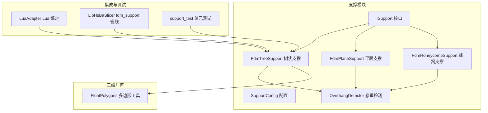
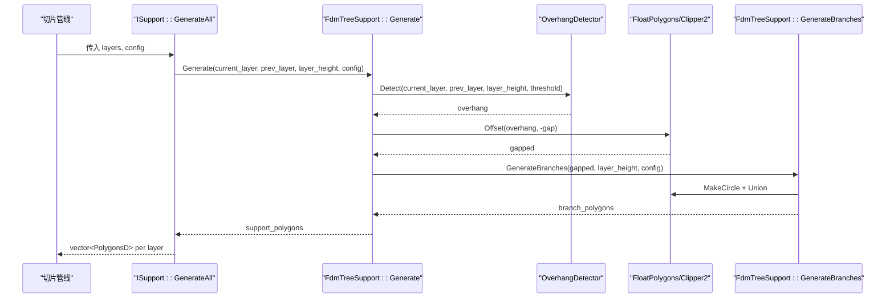
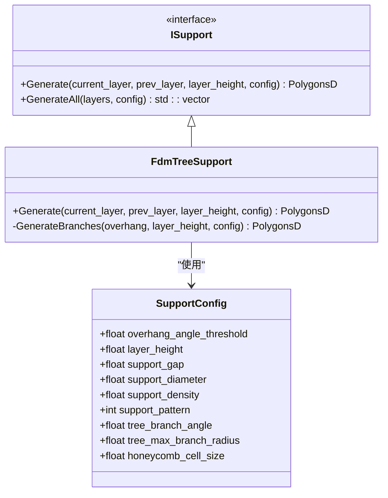
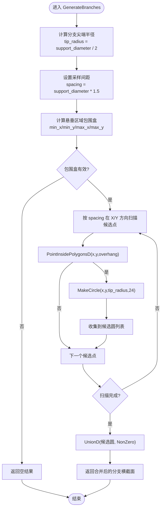
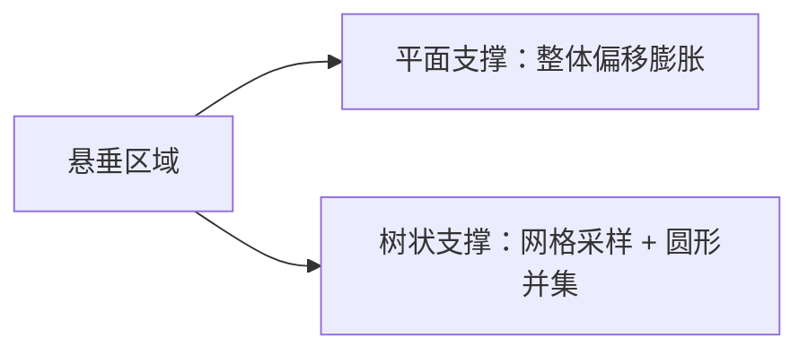
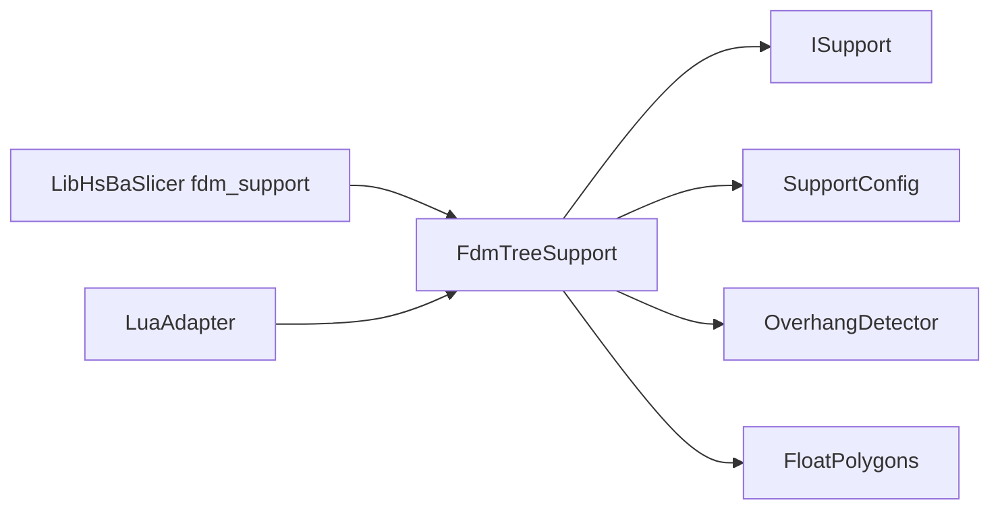
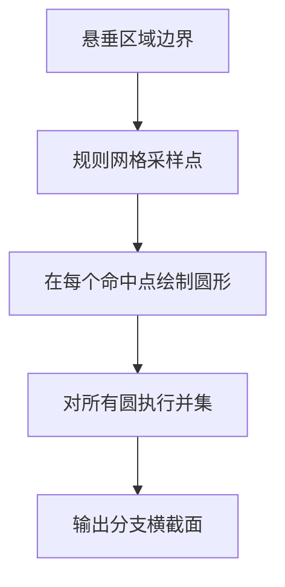

# 树状支撑算法

<cite>
**本文引用的文件**   
- [FdmSupport.hpp](file://support/FdmSupport.hpp)
- [FdmSupport.cpp](file://support/FdmSupport.cpp)
- [ISupport.hpp](file://support/ISupport.hpp)
- [ISupport.cpp](file://support/ISupport.cpp)
- [SupportConfig.hpp](file://support\SupportConfig.hpp)
- [FloatPolygons.hpp](file://2D/FloatPolygons.hpp)
- [OverhangDetector.hpp](file://support/OverhangDetector.hpp)
- [LuaAdapter.hpp](file://support/LuaAdapter.hpp)
- [fdm_support.cpp](file://LibHsBaSlicer\Support\fdm_support.cpp)
- [support_test.cpp](file://tests\Support\support_test.cpp)
</cite>

## 目录
1. [引言](#引言)
2. [项目结构](#项目结构)
3. [核心组件](#核心组件)
4. [架构总览](#架构总览)
5. [详细组件分析](#详细组件分析)
6. [依赖关系分析](#依赖关系分析)
7. [性能与复杂度](#性能与复杂度)
8. [可视化示例](#可视化示例)
9. [故障排除指南](#故障排除指南)
10. [结论](#结论)

## 引言
本文面向 FDM（熔融沉积成型）切片系统中的“树状支撑”算法，聚焦 `FdmTreeSupport` 类的实现。该算法从悬垂区域生成树枝横截面：在二维截面上以等间距网格采样点放置圆形分支尖端，并通过几何并集合并相邻圆；在层间迭代中，这些圆形支点向下连接形成树状支撑结构。文档将系统说明：
- 分支生长方向、分支角度控制与半径渐变策略在当前代码中的实际状态
- `GenerateBranches` 静态方法的工作原理
- 与平面支撑相比的优势与计算复杂度
- 关键流程的可视化图示与可定位的代码片段路径

## 项目结构
本仓库采用按功能域划分的模块化组织方式。与树状支撑直接相关的代码位于以下位置：
- `support/`：支撑算法核心实现与配置
- `2D/`：二维多边形基础类型与布尔运算封装
- `LibHsBaSlicer/Support/`：对外暴露的管线集成入口
- `tests/Support/`：单元测试覆盖支撑生成逻辑

图表来源
- [ISupport.hpp:22-44](file://support/ISupport.hpp#L22-L44)
- [FdmSupport.hpp:19-63](file://support/FdmSupport.hpp#L19-L63)
- [FloatPolygons.hpp:18-25](file://2D/FloatPolygons.hpp#L18-L25)
- [LuaAdapter.hpp:18-18](file://support/LuaAdapter.hpp#L18-L18)
- [fdm_support.cpp:22-42](file://LibHsBaSlicer\Support\fdm_support.cpp#L22-L42)
- [support_test.cpp:137-159](file://tests\Support\support_test.cpp#L137-L159)

章节来源
- [FdmSupport.hpp:1-67](file://support/FdmSupport.hpp#L1-L67)
- [ISupport.hpp:1-49](file://support/ISupport.hpp#L1-L49)
- [FloatPolygons.hpp:1-271](file://2D/FloatPolygons.hpp#L1-L271)

## 核心组件
- `ISupport`：定义每层支撑生成的统一接口，并提供跨层迭代的默认实现 `GenerateAll`。
- `SupportConfig`：支撑参数集合，包含悬垂角度阈值、层高、间隙、直径、密度、模式、树状分支角度与最大半径、蜂窝单元尺寸等。
- `FdmTreeSupport`：树状支撑实现，提供 `Generate` 和私有静态方法 `GenerateBranches`。
- `OverhangDetector`：根据当前层与上一层轮廓计算悬垂区域。
- `FloatPolygons`：基于 Clipper2 的多边形类型与布尔运算封装，用于偏移、并集、交集等操作。

章节来源
- [ISupport.hpp:22-44](file://support/ISupport.hpp#L22-L44)
- [ISupport.cpp:9-21](file://support/ISupport.cpp#L9-L21)
- [SupportConfig.hpp:14-25](file://support\SupportConfig.hpp#L14-L25)
- [FdmSupport.hpp:33-44](file://support/FdmSupport.hpp#L33-L44)

## 架构总览
树状支撑的整体调用链如下：上层切片管线调用 `ISupport::GenerateAll` 遍历所有层，逐层调用具体支撑实现的 `Generate`；对于树状支撑，`Generate` 先检测悬垂区域，应用模型与支撑之间的间隙，再调用 `GenerateBranches` 生成分支横截面。

图表来源
- [ISupport.cpp:9-21](file://support/ISupport.cpp#L9-L21)
- [FdmSupport.cpp:145-167](file://support/FdmSupport.cpp#L145-L167)
- [FdmSupport.cpp:81-143](file://support/FdmSupport.cpp#L81-L143)
- [FloatPolygons.hpp:147-155](file://2D/FloatPolygons.hpp#L147-L155)

## 详细组件分析

### FdmTreeSupport 类与接口契约
`FdmTreeSupport` 继承自 `ISupport`，实现单层的 `Generate` 方法，并在内部通过静态方法 `GenerateBranches` 完成分支横截面生成。该类注释明确说明：分支从构建平台向上生长，相遇时合并；在二维截面上表现为分支尖端的圆形支撑点，随向下方向半径增大。

图表来源
- [ISupport.hpp:22-44](file://support/ISupport.hpp#L22-L44)
- [FdmSupport.hpp:33-44](file://support/FdmSupport.hpp#L33-L44)
- [SupportConfig.hpp:14-25](file://support\SupportConfig.hpp#L14-L25)

章节来源
- [FdmSupport.hpp:33-44](file://support/FdmSupport.hpp#L33-L44)

### 悬垂检测与间隙处理
树状支撑首先调用 `OverhangDetector::Detect` 获取悬垂区域，然后对悬垂区域进行负向偏移以创建模型与支撑之间的间隙。若间隙后为空，则直接返回空结果。

- 悬垂检测：依据当前层与上一层轮廓以及悬垂角度阈值计算需要支撑的区域。
- 间隙处理：将悬垂区域向内偏移 `support_gap`，避免支撑与模型直接接触。

章节来源
- [FdmSupport.cpp:145-167](file://support/FdmSupport.cpp#L145-L167)
- [OverhangDetector.hpp](file://support/OverhangDetector.hpp)

### GenerateBranches 静态方法：分支横截面生成
`GenerateBranches` 的核心步骤如下：
1. 计算分支尖端半径：取 `support_diameter / 2`。
2. 设定采样间距：取 `support_diameter * 1.5`，用于在悬垂区域内生成规则网格。
3. 计算悬垂区域的包围盒，并在 X/Y 方向上以固定步长扫描候选点。
4. 对每个候选点执行点是否在悬垂区域内的判断。
5. 对命中点生成圆形多边形（近似圆），加入候选列表。
6. 对所有候选圆执行并集操作，得到最终分支横截面集合。

图表来源
- [FdmSupport.cpp:81-143](file://support/FdmSupport.cpp#L81-L143)
- [FloatPolygons.hpp:147-155](file://2D/FloatPolygons.hpp#L147-L155)

章节来源
- [FdmSupport.cpp:81-143](file://support/FdmSupport.cpp#L81-L143)
- [FloatPolygons.hpp:147-155](file://2D/FloatPolygons.hpp#L147-L155)

### 分支生长方向、分支角度控制与半径渐变
- 生长方向：注释说明分支从构建平台向上生长，并在二维截面上表现为圆形支点；实际的“向下扩展”由层间迭代驱动，而非在本函数内显式建模。
- 分支角度控制：配置项 `tree_branch_angle` 存在但当前 `GenerateBranches` 未使用该值；分支角度控制逻辑尚未体现在横截面生成中。
- 半径渐变：配置项 `tree_max_branch_radius` 存在但当前 `GenerateBranches` 未使用该值；分支半径在横截面中固定为 `support_diameter / 2`，渐变逻辑未在二维截面中实现。

这意味着当前实现更偏向于“在悬垂区域均匀放置等径圆”，而真正的三维树状结构与半径渐变需结合层间数据流与后续处理阶段。

章节来源
- [FdmSupport.hpp:26-33](file://support/FdmSupport.hpp#L26-L33)
- [SupportConfig.hpp:22-24](file://support\SupportConfig.hpp#L22-L24)
- [FdmSupport.cpp:81-90](file://support/FdmSupport.cpp#L81-L90)

### 与平面支撑的差异
- 平面支撑：对悬垂区域整体进行偏移膨胀，形成柱状支撑截面。
- 树状支撑：在悬垂区域内规则采样点并生成圆形分支，随后合并相邻圆，形成分散的支撑点网络。

图表来源
- [FdmSupport.cpp:48-76](file://support/FdmSupport.cpp#L48-L76)
- [FdmSupport.cpp:81-143](file://support/FdmSupport.cpp#L81-L143)

章节来源
- [FdmSupport.cpp:48-76](file://support/FdmSupport.cpp#L48-L76)
- [FdmSupport.cpp:81-143](file://support/FdmSupport.cpp#L81-L143)

## 依赖关系分析
- `FdmTreeSupport` 依赖 `ISupport` 接口与 `SupportConfig` 配置。
- 几何操作依赖 `FloatPolygons` 提供的多边形类型与布尔运算（并集、偏移）。
- 悬垂检测依赖 `OverhangDetector`。
- 外部集成通过 `LibHsBaSlicer/Support/fdm_support.cpp` 创建 `FdmTreeSupport` 实例。
- Lua 绑定通过 `LuaAdapter` 暴露 `new_tree()` 工厂方法。

图表来源
- [FdmSupport.hpp:33-44](file://support/FdmSupport.hpp#L33-L44)
- [fdm_support.cpp:22-42](file://LibHsBaSlicer\Support\fdm_support.cpp#L22-L42)
- [LuaAdapter.hpp:18-18](file://support/LuaAdapter.hpp#L18-L18)

章节来源
- [FdmSupport.hpp:33-44](file://support/FdmSupport.hpp#L33-L44)
- [fdm_support.cpp:22-42](file://LibHsBaSlicer\Support\fdm_support.cpp#L22-L42)
- [LuaAdapter.hpp:18-18](file://support/LuaAdapter.hpp#L18-L18)

## 性能与复杂度
- 时间复杂度：
  - 悬垂检测：取决于悬垂区域面积与几何复杂度。
  - 网格采样：O(Nx × Ny)，其中 Nx、Ny 分别为 X/Y 方向上的采样点数，与包围盒尺寸和间距相关。
  - 点包含判断：每次采样调用 `PointInsidePolygonsD`，复杂度与多边形顶点数相关。
  - 并集操作：对候选圆进行并集，复杂度与圆数量及 Clipper2 布尔运算效率相关。
- 空间复杂度：
  - 存储候选圆集合与中间几何对象，主要受悬垂区域大小与采样密度影响。
- 优化建议：
  - 调整 `spacing` 以降低采样密度，减少候选圆数量。
  - 对悬垂区域进行预处理（如简化多边形）以减少点包含判断开销。
  - 利用空间索引或栅格化加速点包含判断。

[本节为通用性能讨论，不直接分析具体文件]

## 可视化示例
下图展示树状支撑在单个二维截面上的典型形态：悬垂区域内规则分布的圆形分支，相邻圆合并形成连续支撑区域。

[此图为概念性示意，不映射到具体源码结构]

## 故障排除指南
- 无悬垂时无支撑：当 `current_layer` 与 `prev_layer` 完全一致或未超过悬垂阈值时，`OverhangDetector` 返回空，`Generate` 直接返回空结果。
- 间隙过大导致无支撑：若 `support_gap` 设置过大，偏移后悬垂区域可能为空，导致无分支生成。
- 采样过密导致性能问题：`spacing` 过小会显著增加候选圆数量，降低并集性能。
- 分支角度与半径渐变未生效：当前实现未使用 `tree_branch_angle` 与 `tree_max_branch_radius`，如需启用需在 `GenerateBranches` 中扩展逻辑。

章节来源
- [FdmSupport.cpp:145-167](file://support/FdmSupport.cpp#L145-L167)
- [FdmSupport.cpp:81-143](file://support/FdmSupport.cpp#L81-L143)
- [SupportConfig.hpp:22-24](file://support\SupportConfig.hpp#L22-L24)

## 结论
`FdmTreeSupport` 在当前实现中提供了基于悬垂区域规则采样的树状支撑横截面生成能力。其核心优势在于通过分散的圆形支点网络提升支撑结构的稳定性与材料利用率；然而，分支角度控制与半径渐变尚未在二维截面中体现，需结合层间数据流与后续处理阶段完善三维树状结构。相较平面支撑，树状支撑更适合复杂悬垂与大面积悬垂场景，但在计算复杂度上需关注采样密度与几何布尔运算的性能影响。

[本节为总结性内容，不直接分析具体文件]