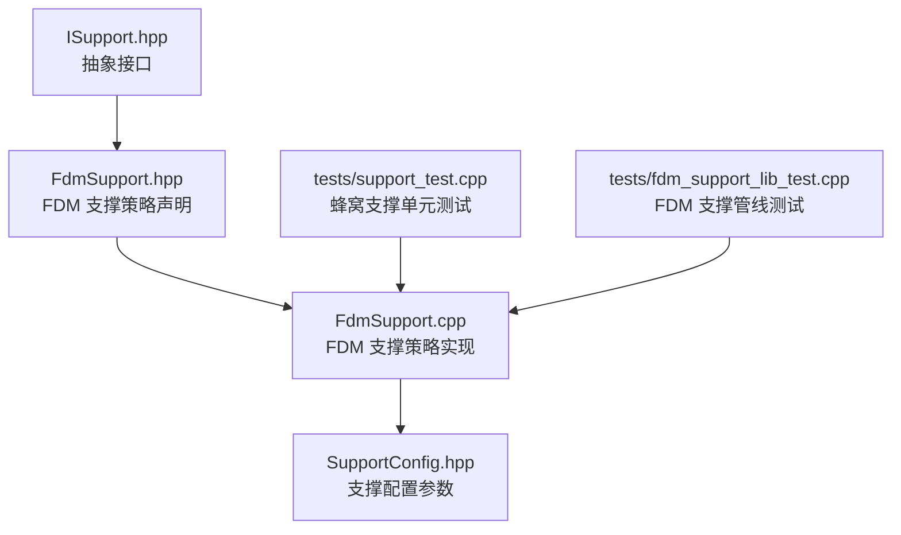
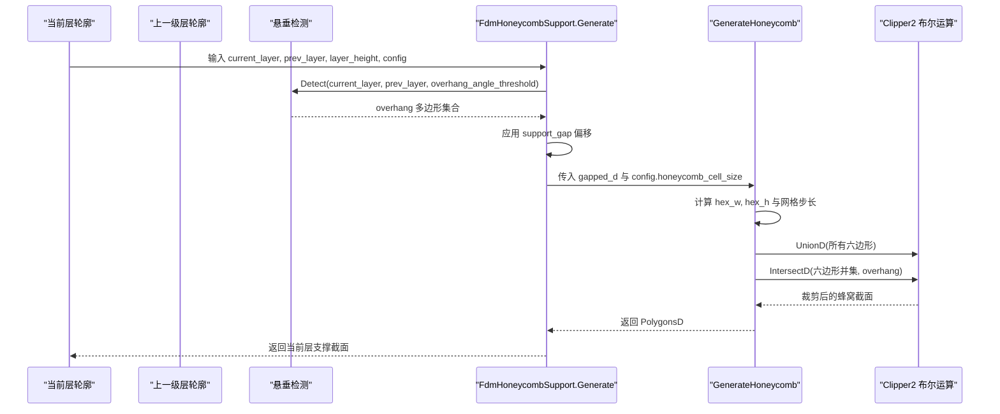
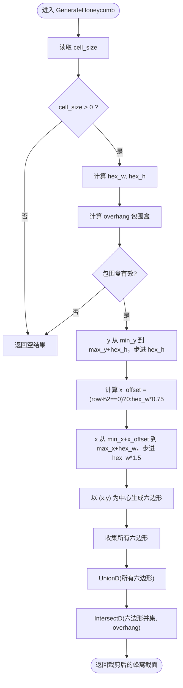
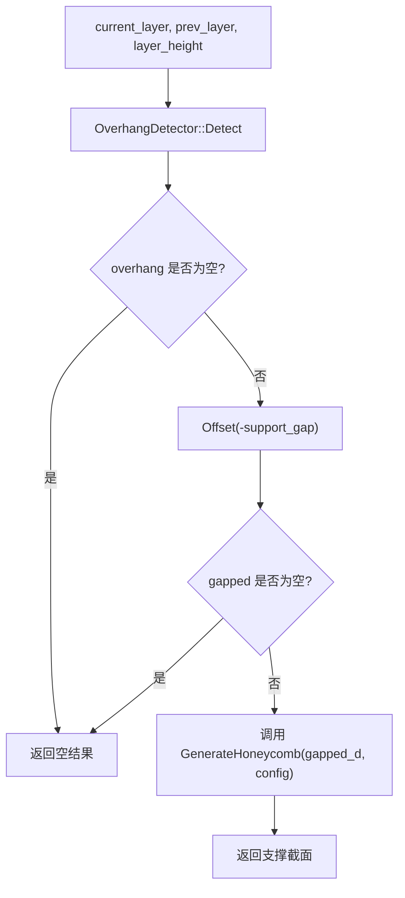
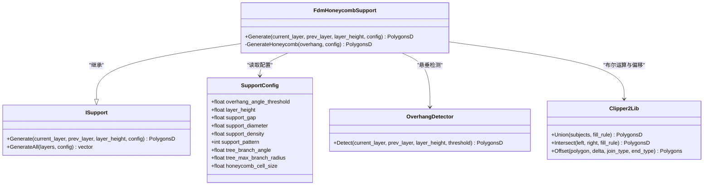

# 蜂窝支撑算法

<cite>
**本文引用的文件**   
- [FdmSupport.hpp](file://support/FdmSupport.hpp)
- [FdmSupport.cpp](file://support/FdmSupport.cpp)
- [ISupport.hpp](file://support/ISupport.hpp)
- [SupportConfig.hpp](file://support\SupportConfig.hpp)
- [fdm_support_lib_test.cpp](file://tests\Support\fdm_support_lib_test.cpp)
- [support_test.cpp](file://tests\Support\support_test.cpp)
</cite>

## 目录
1. [引言](#引言)
2. [项目结构](#项目结构)
3. [核心组件](#核心组件)
4. [架构总览](#架构总览)
5. [详细组件分析](#详细组件分析)
6. [依赖关系分析](#依赖关系分析)
7. [性能与复杂度](#性能与复杂度)
8. [故障排除指南](#故障排除指南)
9. [结论](#结论)
10. [附录：数学公式与几何变换](#附录数学公式与几何变换)

## 引言
本文聚焦 FDM 切片系统中的蜂窝支撑算法，重点解析 `FdmHoneycombSupport` 类及其静态方法 `GenerateHoneycomb`。文档将说明六边形蜂窝图案的生成流程、蜂窝单元尺寸计算、排列规则、边界裁剪策略，以及悬垂区域填充与密度控制机制。同时给出蜂窝图案生成的关键数学公式与几何变换示例，并在最后对比蜂窝支撑与其他两种支撑类型（平面柱状支撑、树状支撑）的材料使用量与强度特性。

## 项目结构
本功能位于 support 模块中，围绕 ISupport 抽象接口实现三种 FDM 支撑策略：平面支撑、树状支撑与蜂窝支撑。蜂窝支撑的核心代码集中在 FdmSupport.hpp 与 FdmSupport.cpp 中，配置参数由 SupportConfig.hpp 提供，测试用例在 tests\Support 下验证行为。

**图表来源**
- [ISupport.hpp:22-44](file://support/ISupport.hpp#L22-L44)
- [FdmSupport.hpp:19-63](file://support/FdmSupport.hpp#L19-L63)
- [FdmSupport.cpp:173-266](file://support/FdmSupport.cpp#L173-L266)
- [SupportConfig.hpp:14-25](file://support\SupportConfig.hpp#L14-L25)
- [support_test.cpp:168-190](file://tests\Support\support_test.cpp#L168-L190)
- [fdm_support_lib_test.cpp:39-56](file://tests\Support\fdm_support_lib_test.cpp#L39-L56)

**章节来源**
- [FdmSupport.hpp:19-63](file://support/FdmSupport.hpp#L19-L63)
- [FdmSupport.cpp:173-266](file://support/FdmSupport.cpp#L173-L266)
- [SupportConfig.hpp:14-25](file://support\SupportConfig.hpp#L14-L25)
- [support_test.cpp:168-190](file://tests\Support\support_test.cpp#L168-L190)
- [fdm_support_lib_test.cpp:39-56](file://tests\Support\fdm_support_lib_test.cpp#L39-L56)

## 核心组件
- ISupport：定义每层支撑生成的统一接口，包含 Generate 与 GenerateAll 两个主要方法。
- FdmPlaneSupport：基于悬垂区域膨胀生成柱状支撑截面。
- FdmTreeSupport：在悬垂区域内按间距采样点并生成圆形分支截面，随后合并。
- FdmHoneycombSupport：在悬垂区域内生成六边形蜂窝图案，并通过布尔运算裁剪到目标区域。
- SupportConfig：通用支撑配置，包括悬垂角度阈值、层高、间隙、直径、密度、图案选择、蜂窝单元尺寸等。

**章节来源**
- [ISupport.hpp:22-44](file://support/ISupport.hpp#L22-L44)
- [FdmSupport.hpp:19-63](file://support/FdmSupport.hpp#L19-L63)
- [SupportConfig.hpp:14-25](file://support\SupportConfig.hpp#L14-L25)

## 架构总览
FDM 支撑生成管线以 ISupport 为抽象入口，具体策略通过支持图案枚举选择。蜂窝支撑在检测到悬垂后，先应用模型与支撑之间的间隙偏移，再调用 GenerateHoneycomb 生成六边形网格，最终与悬垂区域进行交集裁剪。

**图表来源**
- [FdmSupport.cpp:244-266](file://support/FdmSupport.cpp#L244-L266)
- [FdmSupport.cpp:173-241](file://support/FdmSupport.cpp#L173-L241)

## 详细组件分析

### FdmHoneycombSupport 类与 GenerateHoneycomb 静态方法
- 职责：根据悬垂区域与蜂窝单元尺寸，生成六边形蜂窝图案，并裁剪到悬垂区域。
- 输入：悬垂区域多边形集合 overhang，配置 SupportConfig。
- 输出：当前层支撑截面 PolygonsD。

关键步骤：
1. 读取蜂窝单元尺寸 cell_size；若小于等于 0，直接返回空结果。
2. 计算六边形宽度 hex_w = cell_size，高度 hex_h = cell_size * sqrt(3)/2。
3. 遍历 overhang 的所有顶点，计算包围盒 min_x/min_y/max_x/max_y。
4. 按行 y 步进 hex_h，偶数行 x_offset=0，奇数行 x_offset=hex_w*0.75；列 x 步进 hex_w*1.5。
5. 对每个中心 (x,y)，以半径 cell_size/2 和六个角度 i*pi/3（i=0..5）构造正六边形顶点。
6. 将所有六边形做并集，再与 overhang 做交集，得到最终蜂窝截面。

**图表来源**
- [FdmSupport.cpp:173-241](file://support/FdmSupport.cpp#L173-L241)

**章节来源**
- [FdmSupport.cpp:173-241](file://support/FdmSupport.cpp#L173-L241)

### 悬垂检测与间隙处理
- 悬垂检测：使用 OverhangDetector::Detect，依据 overhang_angle_threshold 判断当前层相对上一级的悬垂区域。
- 间隙处理：对 overhang 执行 Offset(-gap)，使支撑与模型之间保持一定距离，避免粘连。
- 整数化与浮点转换：内部使用 Integerization/UnIntegerization 与 Clipper2Lib 的多边形布尔运算。

**图表来源**
- [FdmSupport.cpp:244-266](file://support/FdmSupport.cpp#L244-L266)

**章节来源**
- [FdmSupport.cpp:244-266](file://support/FdmSupport.cpp#L244-L266)

### 蜂窝单元尺寸计算与排列规则
- 六边形宽度：hex_w = cell_size。
- 六边形高度：hex_h = cell_size * sqrt(3)/2。
- 行偏移：偶数行 x_offset=0，奇数行 x_offset=hex_w*0.75。
- 列步进：hex_w*1.5。
- 六边形顶点：以中心 (x,y) 为基准，角度 i*pi/3（i=0..5），半径 r = cell_size/2。

这些参数确保六边形紧密排列且相邻行交错，形成稳定的蜂窝结构。

**章节来源**
- [FdmSupport.cpp:181-224](file://support/FdmSupport.cpp#L181-L224)

### 边界处理算法
- 包围盒裁剪：先计算 overhang 的最小/最大坐标，仅在包围盒范围内生成六边形，减少无效计算。
- 布尔交集：将全部六边形并集后与 overhang 做交集，自动处理边界处的部分六边形，保证支撑形状贴合悬垂区域。

**章节来源**
- [FdmSupport.cpp:186-241](file://support/FdmSupport.cpp#L186-L241)

### 悬垂区域的填充策略与密度控制
- 填充策略：蜂窝支撑通过在悬垂区域内铺满六边形单元来提供轻量但刚性的支撑结构。
- 密度控制：当前实现未显式使用 support_density 字段来控制蜂窝密度；实际密度由蜂窝单元尺寸 cell_size 决定——cell_size 越小，单位面积内六边形数量越多，材料用量越大。
- 其他相关配置：support_gap 控制支撑与模型的分离距离；overhang_angle_threshold 控制悬垂判定灵敏度。

**章节来源**
- [SupportConfig.hpp:14-25](file://support\SupportConfig.hpp#L14-L25)
- [FdmSupport.cpp:173-241](file://support/FdmSupport.cpp#L173-L241)

### 与其他支撑类型的对比
- 平面柱状支撑（FdmPlaneSupport）：
  - 生成方式：对悬垂区域应用 gap 后，按 support_diameter/2 膨胀成柱状截面。
  - 材料使用量：通常较高，因为支撑区域被连续填充。
  - 强度特性：整体刚性较好，但材料浪费较多。
- 树状支撑（FdmTreeSupport）：
  - 生成方式：在悬垂区域内按间距采样点，生成圆形分支截面并合并。
  - 材料使用量：中等，分支结构分散支撑点，减少连续填充。
  - 强度特性：分支可向上生长并在底部合并，具有较好的抗弯能力。
- 蜂窝支撑（FdmHoneycombSupport）：
  - 生成方式：在悬垂区域内生成六边形蜂窝图案并裁剪。
  - 材料使用量：随 cell_size 变化；较小 cell_size 会增加材料用量，较大 cell_size 会减少材料但降低局部刚度。
  - 强度特性：蜂窝结构在面内具有较高的比刚度，适合轻量化支撑。

注意：上述对比基于各支撑的实现逻辑与常见工程经验；本项目中蜂窝支撑未直接使用 support_density 字段，因此其“密度”主要由 cell_size 控制。

**章节来源**
- [FdmSupport.cpp:48-76](file://support/FdmSupport.cpp#L48-L76)
- [FdmSupport.cpp:81-167](file://support/FdmSupport.cpp#L81-L167)
- [FdmSupport.cpp:173-241](file://support/FdmSupport.cpp#L173-L241)
- [SupportConfig.hpp:14-25](file://support\SupportConfig.hpp#L14-L25)

## 依赖关系分析
- FdmHoneycombSupport 依赖：
  - ISupport：继承抽象接口，实现 Generate。
  - SupportConfig：读取 honeycomb_cell_size、support_gap、overhang_angle_threshold 等参数。
  - OverhangDetector：用于悬垂区域检测。
  - Clipper2Lib：用于多边形布尔运算（Union、Intersect）与偏移（Offset）。
- 测试依赖：
  - support_test.cpp：验证无悬垂时不生成支撑、有悬垂时生成蜂窝支撑。
  - fdm_support_lib_test.cpp：验证 FDM 支撑管线在不同图案下的行为。

**图表来源**
- [ISupport.hpp:22-44](file://support/ISupport.hpp#L22-L44)
- [FdmSupport.hpp:52-63](file://support/FdmSupport.hpp#L52-L63)
- [SupportConfig.hpp:14-25](file://support\SupportConfig.hpp#L14-L25)
- [FdmSupport.cpp:244-266](file://support/FdmSupport.cpp#L244-L266)
- [FdmSupport.cpp:173-241](file://support/FdmSupport.cpp#L173-L241)

**章节来源**
- [ISupport.hpp:22-44](file://support/ISupport.hpp#L22-L44)
- [FdmSupport.hpp:52-63](file://support/FdmSupport.hpp#L52-L63)
- [SupportConfig.hpp:14-25](file://support\SupportConfig.hpp#L14-L25)
- [FdmSupport.cpp:173-266](file://support/FdmSupport.cpp#L173-L266)

## 性能与复杂度
- 时间复杂度：
  - 悬垂检测：O(N) 或 O(N log N)，取决于实现细节（N 为轮廓顶点数）。
  - 包围盒计算：O(V)，V 为 overhang 顶点总数。
  - 六边形生成：O(R*C)，R 为行数，C 为列数，近似与覆盖面积成正比。
  - 布尔运算：Union 与 Intersect 的时间复杂度与多边形边数和拓扑复杂度相关，通常接近 O(E log E) 或更高，E 为总边数。
- 空间复杂度：
  - 存储六边形集合与中间多边形集合，空间与 R*C 及布尔运算中间结果相关。
- 优化建议：
  - 预计算 hex_w、hex_h 与步进值，避免重复计算。
  - 对过大的 overhang 区域进行分块处理，降低单次布尔运算规模。
  - 使用更高效的网格生成策略（如增量插入与早停条件）。

[本节为一般性指导，不直接分析具体文件]

## 故障排除指南
- 问题：无悬垂时仍生成支撑。
  - 检查 overhang_angle_threshold 是否过小，导致误判。
  - 确认 current_layer 与 prev_layer 是否正确传入。
- 问题：蜂窝支撑为空。
  - 检查 honeycomb_cell_size 是否大于 0。
  - 检查 support_gap 是否过大，导致 gapped 区域为空。
  - 确认 overhang 非空且包围盒有效。
- 问题：支撑与模型粘连。
  - 增大 support_gap，确保 Offset(-gap) 后仍有有效区域。
- 问题：支撑强度不足。
  - 减小 honeycomb_cell_size，增加蜂窝密度。
  - 调整 overhang_angle_threshold，提高悬垂检测灵敏度。

**章节来源**
- [FdmSupport.cpp:173-241](file://support/FdmSupport.cpp#L173-L241)
- [FdmSupport.cpp:244-266](file://support/FdmSupport.cpp#L244-L266)
- [support_test.cpp:168-190](file://tests\Support\support_test.cpp#L168-L190)

## 结论
FdmHoneycombSupport 通过六边形蜂窝图案在悬垂区域提供轻量而刚性的支撑结构。其核心在于 GenerateHoneycomb 的几何生成与布尔裁剪流程，配合 SupportConfig 中的蜂窝单元尺寸与间隙参数，实现对支撑密度与强度的灵活控制。相比平面柱状支撑与树状支撑，蜂窝支撑在材料使用量上更具可调性，且在面内刚度方面表现良好，适合需要轻量化支撑的工程场景。

[本节为总结性内容，不直接分析具体文件]

## 附录：数学公式与几何变换
- 六边形宽度与高度：
  - hex_w = cell_size
  - hex_h = cell_size * sqrt(3)/2
- 行偏移与列步进：
  - x_offset(row) = (row % 2 == 0) ? 0 : hex_w * 0.75
  - x_step = hex_w * 1.5
- 六边形顶点生成：
  - 中心 (x, y)
  - 半径 r = cell_size / 2
  - 角度 θ_i = i * π / 3，i ∈ {0, 1, 2, 3, 4, 5}
  - 顶点 P_i = (x + r * cos(θ_i), y + r * sin(θ_i))
- 边界裁剪：
  - 先对所有六边形做并集 U = ∪ H_i
  - 再与 overhang 做交集 S = U ∩ overhang

这些公式与变换直接对应 FdmSupport.cpp 中的实现逻辑，可用于复现与验证蜂窝图案生成过程。

**章节来源**
- [FdmSupport.cpp:181-224](file://support/FdmSupport.cpp#L181-L224)
- [FdmSupport.cpp:232-241](file://support/FdmSupport.cpp#L232-L241)