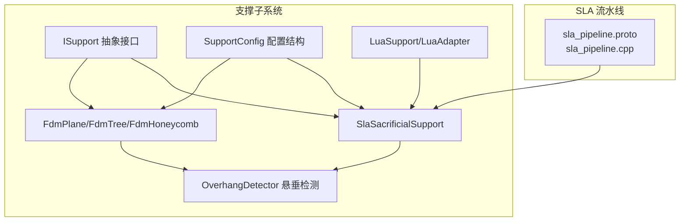
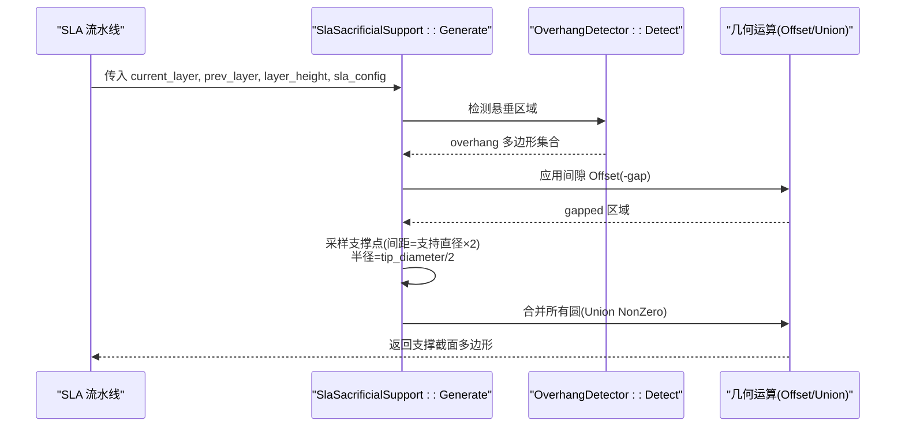
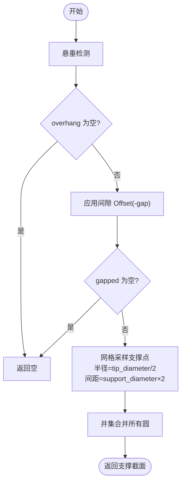
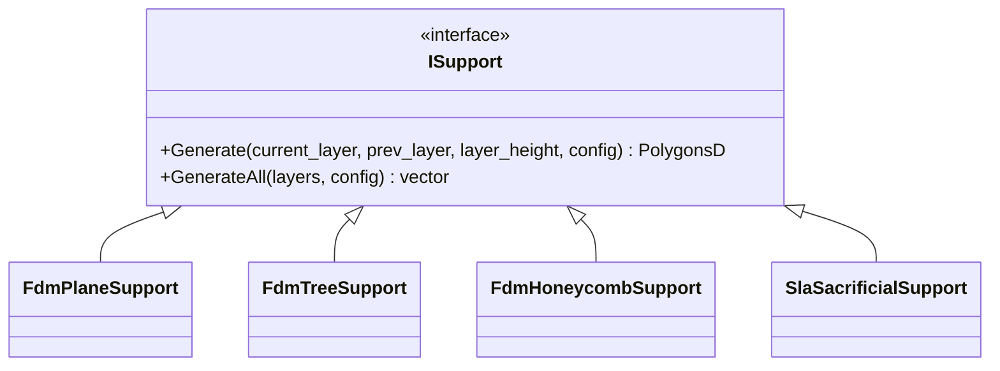
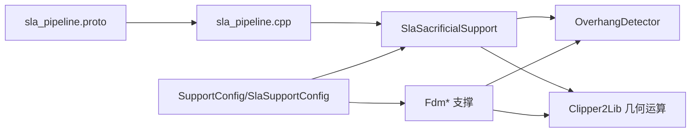

# SLA 支撑算法

<cite>
**本文引用的文件**   
- [SlaSupport.hpp](file://support/SlaSupport.hpp)
- [SlaSupport.cpp](file://support/SlaSupport.cpp)
- [FdmSupport.hpp](file://support/FdmSupport.hpp)
- [FdmSupport.cpp](file://support/FdmSupport.cpp)
- [ISupport.hpp](file://support/ISupport.hpp)
- [ISupport.cpp](file://support/ISupport.cpp)
- [SupportConfig.hpp](file://support/SupportConfig.hpp)
- [OverhangDetector.hpp](file://support/OverhangDetector.hpp)
- [OverhangDetector.cpp](file://support/OverhangDetector.cpp)
- [LuaSupport.hpp](file://support/LuaSupport.hpp)
- [LuaSupport.cpp](file://support/LuaSupport.cpp)
- [my_sla_support.lua](file://samples/SLA/scripts/my_sla_support.lua)
- [sla_pipeline.proto](file://proto/sla_pipeline.proto)
- [sla_pipeline.cpp](file://DllHsBaSlicer/sla_pipeline.cpp)
</cite>

## 目录
1. [简介](#简介)
2. [项目结构](#项目结构)
3. [核心组件](#核心组件)
4. [架构总览](#架构总览)
5. [详细组件分析](#详细组件分析)
6. [依赖关系分析](#依赖关系分析)
7. [性能与复杂度](#性能与复杂度)
8. [配置参数与调优指南](#配置参数与调优指南)
9. [故障排除](#故障排除)
10. [结论](#结论)

## 简介
本文件面向光敏树脂打印（SLA/DLP/LCD）的支撑生成算法，聚焦牺牲型细柱支撑的设计与实现。文档从系统架构、数据流、关键算法到参数调优进行系统化说明，并对比 FDM 支撑的差异，帮助读者在支撑密度、连接强度、表面质量与移除友好性之间做出合理权衡。

## 项目结构
支撑相关代码集中在 support 目录，包含抽象接口、通用配置、悬垂检测、FDM 与 SLA 两类支撑实现，以及 Lua 扩展入口；SLA 流水线通过 DllHsBaSlicer 将外部配置映射到内部支撑配置。

图示来源
- [ISupport.hpp:14-45](file://support/ISupport.hpp#L14-L45)
- [SupportConfig.hpp:14-43](file://support/SupportConfig.hpp#L14-L43)
- [SlaSupport.hpp:11-42](file://support/SlaSupport.hpp#L11-L42)
- [FdmSupport.hpp:11-63](file://support/FdmSupport.hpp#L11-L63)
- [sla_pipeline.proto:5-9](file://proto/sla_pipeline.proto#L5-L9)
- [sla_pipeline.cpp:391-413](file://DllHsBaSlicer/sla_pipeline.cpp#L391-L413)

章节来源
- [ISupport.hpp:14-45](file://support/ISupport.hpp#L14-L45)
- [SupportConfig.hpp:14-43](file://support/SupportConfig.hpp#L14-L43)
- [SlaSupport.hpp:11-42](file://support/SlaSupport.hpp#L11-L42)
- [FdmSupport.hpp:11-63](file://support/FdmSupport.hpp#L11-L63)
- [sla_pipeline.proto:5-9](file://proto/sla_pipeline.proto#L5-L9)
- [sla_pipeline.cpp:391-413](file://DllHsBaSlicer/sla_pipeline.cpp#L391-L413)

## 核心组件
- 抽象接口 ISupport：定义逐层支撑生成接口与全层批量生成的默认实现。
- 配置 SupportConfig/SlaSupportConfig：统一支撑参数，SLA 特有 tip_diameter、raft_thickness。
- 悬垂检测 OverhangDetector：基于相邻层轮廓计算需要支撑的区域。
- FDM 支撑族：平面柱、树状分支、蜂窝填充三种策略。
- SLA 牺牲支撑 SlaSacrificialSupport：小尖端直径、规则间距采样点阵，合并为支撑截面。
- Lua 扩展：LuaSupport/LuaAdapter 暴露 SLA 支撑生成能力给脚本。

章节来源
- [ISupport.hpp:14-45](file://support/ISupport.hpp#L14-L45)
- [ISupport.cpp:9-21](file://support/ISupport.cpp#L9-L21)
- [SupportConfig.hpp:14-43](file://support/SupportConfig.hpp#L14-L43)
- [SlaSupport.hpp:11-42](file://support/SlaSupport.hpp#L11-L42)
- [FdmSupport.hpp:11-63](file://support/FdmSupport.hpp#L11-L63)
- [LuaSupport.hpp](file://support/LuaSupport.hpp)
- [LuaSupport.cpp](file://support/LuaSupport.cpp)

## 架构总览
SLA 支撑生成流程以“当前层/上一层轮廓 + 层高 + 配置”为输入，经悬垂检测得到待支撑区域，再按 SLA 策略采样支撑点并合并输出。

图示来源
- [SlaSupport.cpp:81-124](file://support/SlaSupport.cpp#L81-L124)
- [OverhangDetector.hpp](file://support/OverhangDetector.hpp)
- [OverhangDetector.cpp](file://support/OverhangDetector.cpp)

## 详细组件分析

### SLA 牺牲支撑算法
- 设计目标
  - 小尖端直径便于去除，降低接触面损伤。
  - 规则间距的点阵支撑，避免过度材料堆积。
  - 通过间隙控制减少模型表面粘连。
- 关键步骤
  - 悬垂检测：根据角度阈值识别需支撑区域。
  - 间隙处理：对悬垂区域做负偏移，形成支撑与模型的分离距离。
  - 点阵采样：在包围盒内按固定步长扫描，若点在区域内则放置圆形支撑点。
  - 合并输出：对所有圆执行并集，得到最终支撑截面。
- 复杂度
  - 设包围盒尺寸为 W×H，采样步长为 s，最坏情况 O((W/s)·(H/s)) 次点包含测试。
  - 并集操作取决于圆数量与 Clipper2 实现复杂度。

图示来源
- [SlaSupport.cpp:38-124](file://support/SlaSupport.cpp#L38-L124)

章节来源
- [SlaSupport.hpp:11-42](file://support/SlaSupport.hpp#L11-L42)
- [SlaSupport.cpp:38-124](file://support/SlaSupport.cpp#L38-L124)

### FDM 支撑族对比
- 平面支撑：对悬垂区域膨胀 support_diameter/2 形成柱体截面。
- 树状支撑：在悬垂区按间距放置分支端点圆，层间向上生长并在 2D 截面表现为圆点集合。
- 蜂窝支撑：用六边形单元填充悬垂区域，提供轻量但刚性的支撑结构。

图示来源
- [ISupport.hpp:14-45](file://support/ISupport.hpp#L14-L45)
- [FdmSupport.hpp:11-63](file://support/FdmSupport.hpp#L11-L63)
- [SlaSupport.hpp:11-42](file://support/SlaSupport.hpp#L11-L42)

章节来源
- [FdmSupport.cpp:48-76](file://support/FdmSupport.cpp#L48-L76)
- [FdmSupport.cpp:145-168](file://support/FdmSupport.cpp#L145-L168)
- [FdmSupport.cpp:173-267](file://support/FdmSupport.cpp#L173-L267)

### Lua 扩展与自定义支撑
- LuaSupport/LuaAdapter 暴露 SLA 支撑生成能力，供 my_sla_support.lua 等脚本调用。
- 脚本可通过 Support.new_sla() 创建 SLA 牺牲支撑生成器，并使用 Support.generate(...) 生成支撑。
- 该机制允许用户在不修改 C++ 的情况下定制支撑逻辑。

章节来源
- [LuaSupport.hpp](file://support/LuaSupport.hpp)
- [LuaSupport.cpp](file://support/LuaSupport.cpp)
- [my_sla_support.lua:1-29](file://samples/SLA/scripts/my_sla_support.lua#L1-L29)

### SLA 流水线集成
- sla_pipeline.proto 定义了 SLA 支撑模式枚举（牺牲支撑、锥形支撑）。
- sla_pipeline.cpp 将外部配置映射到 SlaSupportConfig，并支持通过 Lua 脚本生成支撑。

章节来源
- [sla_pipeline.proto:5-9](file://proto/sla_pipeline.proto#L5-L9)
- [sla_pipeline.cpp:391-413](file://DllHsBaSlicer/sla_pipeline.cpp#L391-L413)

## 依赖关系分析
- 低耦合：各支撑实现均依赖 ISupport 接口与 SupportConfig 配置，便于替换与扩展。
- 几何库：大量使用 Clipper2Lib 进行 Offset/Union/Intersect 等布尔运算。
- 悬垂检测：由 OverhangDetector 统一提供，支撑算法无需重复实现悬垂判断。
- 外部集成：SLA 流水线负责将 proto 配置转换为内部 SlaSupportConfig，并桥接 Lua 脚本。

图示来源
- [sla_pipeline.proto:5-9](file://proto/sla_pipeline.proto#L5-L9)
- [sla_pipeline.cpp:391-413](file://DllHsBaSlicer/sla_pipeline.cpp#L391-L413)
- [SlaSupport.cpp:81-124](file://support/SlaSupport.cpp#L81-L124)
- [FdmSupport.cpp:48-76](file://support/FdmSupport.cpp#L48-L76)
- [SupportConfig.hpp:14-43](file://support/SupportConfig.hpp#L14-L43)

## 性能与复杂度
- 悬垂检测：通常与层面积和边界长度相关，具体复杂度取决于实现。
- SLA 支撑采样：O((W/s)·(H/s)) 次点包含测试；并集复杂度与圆数量线性或近似线性相关（取决于 Clipper2 实现）。
- 优化建议
  - 调整 spacing 与 tip_radius 平衡精度与速度。
  - 对极小悬垂区域直接跳过，避免无意义几何运算。
  - 利用包围盒裁剪减少无效采样。

[本节为一般性讨论，不直接分析具体文件]

## 配置参数与调优指南

### 通用支撑参数（SupportConfig）
- overhang_angle_threshold：悬垂角度阈值（度），越小越保守，支撑越多。
- layer_height：层高（mm），影响悬垂判定与支撑高度。
- support_gap：支撑与模型间隙（mm），越大越易移除，但可能影响表面质量。
- support_diameter：支撑柱直径（mm），影响支撑强度与材料用量。
- support_density：支撑填充密度 [0,1]，用于控制整体填充量（不同策略解释略有差异）。
- support_pattern：支撑模式（0=平面，1=树，2=蜂窝），SLA 中可映射为牺牲/锥形。
- tree_branch_angle / tree_max_branch_radius：树支撑分支角度与最大半径。
- honeycomb_cell_size：蜂窝单元尺寸。

章节来源
- [SupportConfig.hpp:14-25](file://support/SupportConfig.hpp#L14-L25)

### SLA 专属参数（SlaSupportConfig）
- tip_diameter：支撑尖端直径（mm），越小越易去除，适合精细表面。
- raft_thickness：底板厚度（mm），与构建板附着相关。

章节来源
- [SupportConfig.hpp:36-43](file://support/SupportConfig.hpp#L36-L43)

### 参数调优建议
- 表面质量优先
  - 增大 support_gap，减小 tip_diameter。
  - 适当提高 overhang_angle_threshold 以减少不必要的支撑。
- 移除友好性优先
  - 进一步减小 tip_diameter，保持较小 support_diameter。
  - 适度增加 support_gap，避免粘模。
- 强度与稳定性优先
  - 增大 support_diameter，必要时提高 support_density。
  - 对于大悬垂，考虑使用树支撑（FDM）或在 SLA 中采用更密点阵（减小 spacing）。
- 材料与工艺适配
  - 高收缩/脆性树脂：增大 gap 与 tip_diameter 的平衡，避免断裂残留。
  - 高粘度树脂：适当增大 tip_diameter 保证固化连通性。
  - 高精度打印：减小 tip_diameter 与 spacing，提升细节还原。

[本节为一般性指导，不直接分析具体文件]

## 故障排除
- 无支撑生成
  - 检查 overhang_angle_threshold 是否过大导致未检测到悬垂。
  - 确认 support_gap 过大导致 gapped 区域为空。
- 支撑过密或过疏
  - 调整 spacing（实现中使用 support_diameter×2）与 tip_diameter。
- 支撑难以去除
  - 减小 tip_diameter，增大 support_gap。
- 表面留痕明显
  - 增大 support_gap，减小 tip_diameter，必要时降低 support_density。
- Lua 脚本无法加载
  - 检查脚本路径与内容是否为空，参考 sla_pipeline.cpp 的错误处理分支。

章节来源
- [SlaSupport.cpp:81-124](file://support/SlaSupport.cpp#L81-L124)
- [sla_pipeline.cpp:400-413](file://DllHsBaSlicer/sla_pipeline.cpp#L400-L413)

## 结论
SLA 牺牲支撑以“小尖端+规则点阵+间隙控制”为核心设计，兼顾移除友好性与表面质量。与 FDM 相比，SLA 支撑更注重接触面优化与去除体验，而非体积填充与分支拓扑。通过合理配置 overhang_angle_threshold、support_gap、support_diameter、tip_diameter 等参数，可在不同材料与工艺条件下取得稳定可靠的支撑效果。Lua 扩展为用户提供了灵活的二次开发空间，便于针对特定场景定制支撑策略。