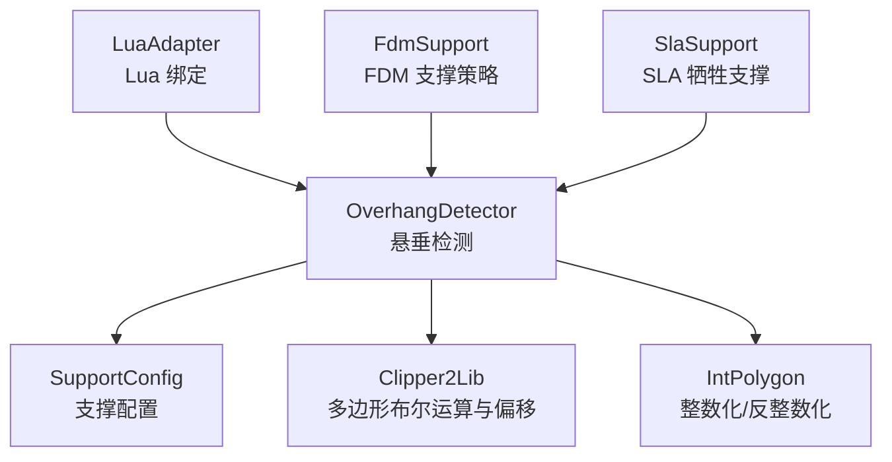
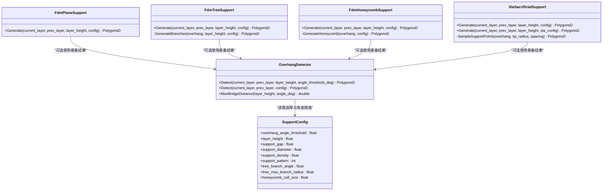
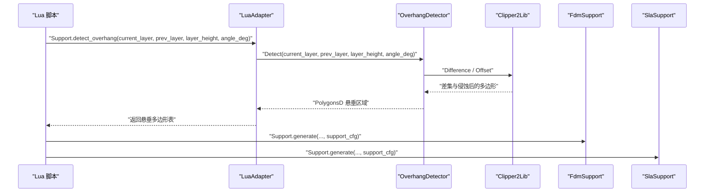
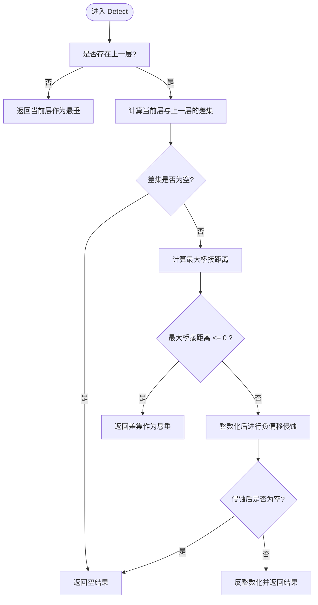
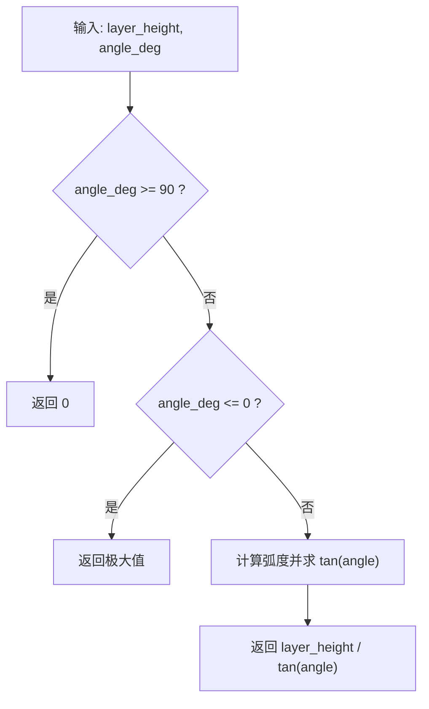
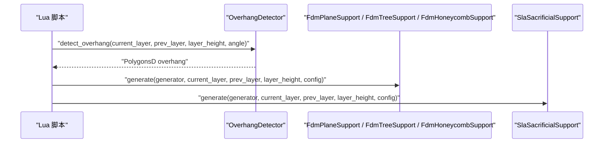
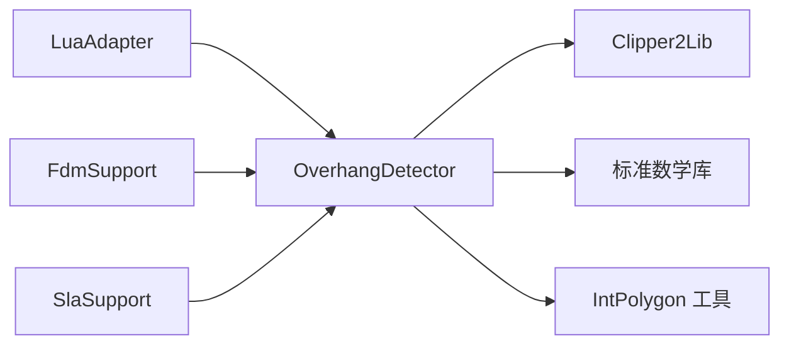

# 悬垂检测器

<cite>
**本文引用的文件**   
- [OverhangDetector.hpp](file://support/OverhangDetector.hpp)
- [OverhangDetector.cpp](file://support/OverhangDetector.cpp)
- [SupportConfig.hpp](file://support/SupportConfig.hpp)
- [LuaAdapter.cpp](file://support/LuaAdapter.cpp)
- [FdmSupport.hpp](file://support/FdmSupport.hpp)
- [SlaSupport.hpp](file://support/SlaSupport.hpp)
- [my_fdm_support.lua](file://samples/FDM/scripts/my_support.lua)
- [my_sla_support.lua](file://samples/SLA/scripts/my_sla_support.lua)
</cite>

## 目录
1. [简介](#简介)
2. [项目结构中的定位](#项目结构中的定位)
3. [核心组件与接口](#核心组件与接口)
4. [架构总览](#架构总览)
5. [悬垂检测算法详解](#悬垂检测算法详解)
6. [阈值参数与精度控制](#阈值参数与精度控制)
7. [悬垂检测与支撑生成的关系](#悬垂检测与支撑生成的关系)
8. [依赖关系分析](#依赖关系分析)
9. [调试方法与常见问题排查](#调试方法与常见问题排查)
10. [性能优化建议](#性能优化建议)
11. [结论](#结论)

## 简介
本技术文档聚焦 HsBaSlicer 中的悬垂检测器，重点说明 `OverhangDetector` 的核心算法、悬垂区域识别逻辑、阈值参数配置、精度控制方式，以及检测结果如何传递给 FDM 与 SLA 支撑生成流程。文档同时提供面向实际使用的调试方法和性能优化建议，帮助开发者在切片流水线中稳定使用悬垂检测能力。

## 项目结构中的定位
悬垂检测器位于支撑模块中，是支撑生成前的关键预处理步骤：
- 核心实现：`support/OverhangDetector.{hpp,cpp}`
- 支撑通用配置：`support/SupportConfig.hpp`
- Lua 脚本绑定：`support/LuaAdapter.cpp`
- FDM 支撑策略接口：`support/FdmSupport.hpp`
- SLA 牺牲支撑策略接口：`support/SlaSupport.hpp`
- 示例脚本：`samples/FDM/scripts/my_support.lua`、`samples/SLA/scripts/my_sla_support.lua`

**图表来源**
- [OverhangDetector.hpp:12-50](file://support/OverhangDetector.hpp#L12-L50)
- [OverhangDetector.cpp:10-22](file://support/OverhangDetector.cpp#L10-L22)
- [SupportConfig.hpp:14-25](file://support/SupportConfig.hpp#L14-L25)
- [LuaAdapter.cpp:202-213](file://support/LuaAdapter.cpp#L202-L213)
- [FdmSupport.hpp:13-63](file://support/FdmSupport.hpp#L13-L63)
- [SlaSupport.hpp:13-42](file://support/SlaSupport.hpp#L13-L42)

**章节来源**
- [OverhangDetector.hpp:1-53](file://support/OverhangDetector.hpp#L1-L53)
- [OverhangDetector.cpp:1-89](file://support/OverhangDetector.cpp#L1-L89)
- [SupportConfig.hpp:1-47](file://support/SupportConfig.hpp#L1-L47)
- [LuaAdapter.cpp:1-278](file://support/LuaAdapter.cpp#L1-L278)
- [FdmSupport.hpp:1-67](file://support/FdmSupport.hpp#L1-L67)
- [SlaSupport.hpp:1-46](file://support/SlaSupport.hpp#L1-L46)

## 核心组件与接口
`OverhangDetector` 提供静态方法用于相邻层之间的悬垂检测，并暴露最大桥接距离计算工具函数：
- `Detect(current_layer, prev_layer, layer_height, angle_threshold_deg)`
- `Detect(current_layer, prev_layer, config)`
- `MaxBridgeDistance(layer_height, angle_deg)`

这些接口直接返回需要支撑的悬垂区域多边形集合，供上层支撑生成器消费。

**图表来源**
- [OverhangDetector.hpp:20-50](file://support/OverhangDetector.hpp#L20-L50)
- [SupportConfig.hpp:14-25](file://support/SupportConfig.hpp#L14-L25)
- [FdmSupport.hpp:13-63](file://support/FdmSupport.hpp#L13-L63)
- [SlaSupport.hpp:13-42](file://support/SlaSupport.hpp#L13-L42)

**章节来源**
- [OverhangDetector.hpp:20-50](file://support/OverhangDetector.hpp#L20-L50)
- [SupportConfig.hpp:14-25](file://support/SupportConfig.hpp#L14-L25)

## 架构总览
悬垂检测在支撑生成管线中的位置如下：
- Lua 脚本通过 `Support.detect_overhang` 调用 C++ 实现的 `OverhangDetector::Detect`
- 检测结果为 `PolygonsD`，即浮点多边形集合
- FDM 与 SLA 支撑生成器根据业务需求选择是否直接使用悬垂区域，或进一步采样、填充、分支生长

**图表来源**
- [LuaAdapter.cpp:202-213](file://support/LuaAdapter.cpp#L202-L213)
- [OverhangDetector.cpp:41-87](file://support/OverhangDetector.cpp#L41-L87)
- [FdmSupport.hpp:13-63](file://support/FdmSupport.hpp#L13-L63)
- [SlaSupport.hpp:13-42](file://support/SlaSupport.hpp#L13-L42)

## 悬垂检测算法详解
### 基本思路
悬垂检测基于相邻两层的多边形轮廓：
- 如果当前层存在上一未覆盖的区域，则可能是悬垂
- 通过“角度阈值”换算成“最大水平桥接距离”，对差异区域进行负偏移（侵蚀）以过滤可桥接的小悬垂
- 最终返回需要支撑的悬垂区域多边形集合

### 关键步骤
1. **无上一层处理**：若没有上一层，则整个当前层视为悬垂。
2. **层间差异计算**：使用多边形差集得到当前层未被上一层覆盖的区域。
3. **最大桥接距离计算**：根据层高和角度阈值计算允许的水平跨度。
4. **负偏移过滤**：将差异区域转换为整数坐标后执行负偏移（侵蚀），消除小于阈值的悬垂。
5. **结果还原**：将侵蚀后的整数多边形转换回浮点坐标输出。

**图表来源**
- [OverhangDetector.cpp:41-87](file://support/OverhangDetector.cpp#L41-L87)

### 角度与法向量说明
当前实现并未显式计算面法向量或逐三角面片角度；而是采用“层间几何差异 + 角度阈值换算的最大桥接距离”这一更稳健的工程近似：
- 角度阈值用于判断“悬垂是否严重到无法桥接”
- 层高决定垂直方向尺度，结合角度换算出水平方向允许跨度
- 负偏移等价于对悬垂区域做形态学腐蚀，从而剔除小悬垂

这种设计避免了复杂法向量分析带来的数值不稳定性和额外开销，更适合切片流水线的高效需求。

**章节来源**
- [OverhangDetector.cpp:23-87](file://support/OverhangDetector.cpp#L23-L87)

## 阈值参数与精度控制
### 主要参数
- `overhang_angle_threshold`：悬垂角度阈值（度）。默认值来自 `SupportConfig`。
- `layer_height`：层厚（毫米）。影响最大桥接距离计算。
- `integerization`：内部用于将浮点多边形转换为整数坐标，再进行 Clipper2Lib 的布尔运算与偏移，最后再反整数化。

### 最大桥接距离公式
- 当角度大于等于 90 度时，认为不存在悬垂，最大桥接距离为 0。
- 当角度小于等于 0 度时，认为所有差异都是悬垂，最大桥接距离设为极大值。
- 其他情况按层高除以角度的正切值计算水平跨度。

**图表来源**
- [OverhangDetector.cpp:23-39](file://support/OverhangDetector.cpp#L23-L39)

### 精度控制要点
- 浮点多边形先整数化，再执行 Clipper2Lib 的差集与偏移操作，以减少浮点误差。
- 负偏移半径由最大桥接距离乘以整数化比例因子得到。
- 最终结果反整数化回浮点多边形，保持与上层数据格式一致。

**章节来源**
- [OverhangDetector.cpp:66-80](file://support/OverhangDetector.cpp#L66-L80)
- [SupportConfig.hpp:14-25](file://support/SupportConfig.hpp#L14-L25)

## 悬垂检测与支撑生成的关系
### 数据传递机制
- Lua 脚本通过 `Support.detect_overhang` 获取悬垂区域。
- 返回值是 `PolygonsD`，可直接传给 FDM 或 SLA 支撑生成器。
- FDM 支撑策略可选择：
  - 平面支撑：从悬垂区域生成柱状支撑
  - 树状支撑：从悬垂区域生长分支
  - 蜂窝支撑：在悬垂区域内填充六边形网格
- SLA 牺牲支撑：从悬垂区域采样支撑点，生成细尖支撑柱

**图表来源**
- [LuaAdapter.cpp:202-213](file://support/LuaAdapter.cpp#L202-L213)
- [FdmSupport.hpp:13-63](file://support/FdmSupport.hpp#L13-L63)
- [SlaSupport.hpp:13-42](file://support/SlaSupport.hpp#L13-L42)

### 示例脚本用法
- FDM 示例脚本会先调用 `Support.detect_overhang`，然后根据 `support_pattern` 选择平面、树状或蜂窝支撑生成器。
- SLA 示例脚本会先调用 `Support.detect_overhang`，然后使用内置 SLA 支撑生成器，并可按面积阈值过滤支撑区域。

**章节来源**
- [my_fdm_support.lua:32-82](file://samples/FDM/scripts/my_support.lua#L32-L82)
- [my_sla_support.lua:34-75](file://samples/SLA/scripts/my_sla_support.lua#L34-L75)

## 依赖关系分析
### 外部库依赖
- Clipper2Lib：用于多边形差集与偏移操作
- 标准数学库：用于角度转弧度与正切计算
- 内部整数多边形工具：用于坐标整数化与反整数化

### 模块耦合
- `OverhangDetector` 与 `SupportConfig` 解耦良好，仅读取必要字段
- Lua 绑定层统一暴露 `detect_overhang` 与 `generate`，便于脚本扩展
- FDM 与 SLA 支撑生成器独立实现，可复用悬垂检测结果

**图表来源**
- [OverhangDetector.cpp:7-10](file://support/OverhangDetector.cpp#L7-L10)
- [LuaAdapter.cpp:1-16](file://support/LuaAdapter.cpp#L1-L16)

**章节来源**
- [OverhangDetector.cpp:7-22](file://support/OverhangDetector.cpp#L7-L22)
- [LuaAdapter.cpp:1-16](file://support/LuaAdapter.cpp#L1-L16)

## 调试方法与常见问题排查
### 调试建议
- 在 Lua 脚本中打印悬垂区域的面积与数量，确认是否符合预期。
- 调整 `overhang_angle_threshold`，观察悬垂区域变化趋势。
- 检查 `layer_height` 是否与切片设置一致，避免桥接距离计算偏差。
- 使用最小面积阈值过滤微小支撑区域，减少噪声支撑。

### 常见问题
- **悬垂过多**：角度阈值过低或层厚过大导致桥接距离偏大，应提高角度阈值或降低层厚。
- **悬垂过少**：角度阈值过高或层厚过小，导致可桥接范围被误判为无需支撑。
- **支撑形状异常**：检查整数化与偏移半径是否合理，必要时调整支撑直径或密度。
- **性能瓶颈**：复杂模型或多层切片时，Clipper2Lib 布尔运算可能成为热点，可考虑分层并行或简化模型。

**章节来源**
- [my_fdm_support.lua:62-79](file://samples/FDM/scripts/my_support.lua#L62-L79)
- [my_sla_support.lua:62-72](file://samples/SLA/scripts/my_sla_support.lua#L62-L72)

## 性能优化建议
- **批量处理**：对多层切片循环调用 `Detect` 时，尽量复用中间数据结构，减少重复分配。
- **阈值预计算**：对固定层厚与角度阈值组合，可缓存最大桥接距离。
- **几何简化**：对复杂悬垂区域先进行简化或合并，再执行偏移操作。
- **并行化**：不同层之间相互独立，可在支持线程池的环境中并行处理。
- **精度权衡**：适当降低整数化精度可减少 Clipper2Lib 计算量，但需平衡几何保真度。

[本节为通用性能指导，不直接分析具体源码文件]

## 结论
`OverhangDetector` 通过层间几何差异与角度阈值换算的最大桥接距离，提供了高效且稳定的悬垂检测能力。其设计避免复杂的法向量分析，转而采用工程上更鲁棒的形态学侵蚀策略，适合大规模切片流水线。配合 FDM 与 SLA 支撑生成器，用户可通过 Lua 脚本灵活定制支撑策略，并通过阈值调参与精度控制获得理想的支撑质量与性能表现。