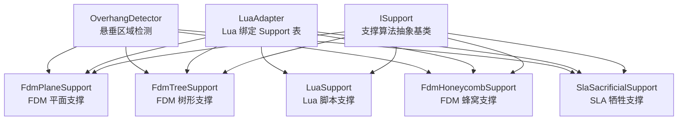
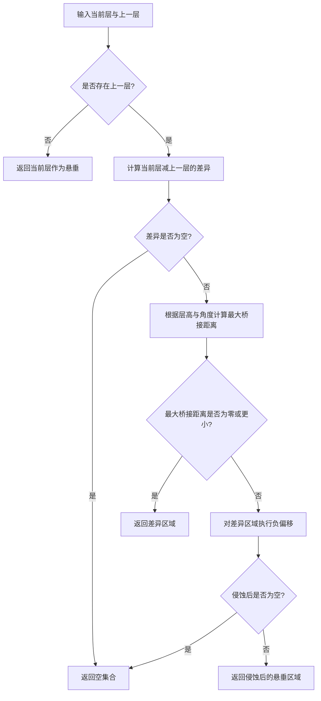
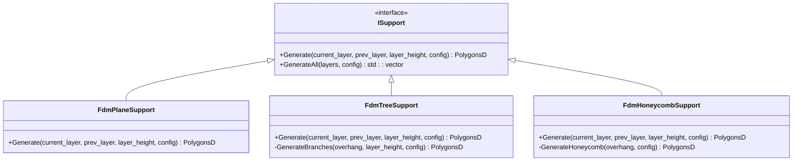
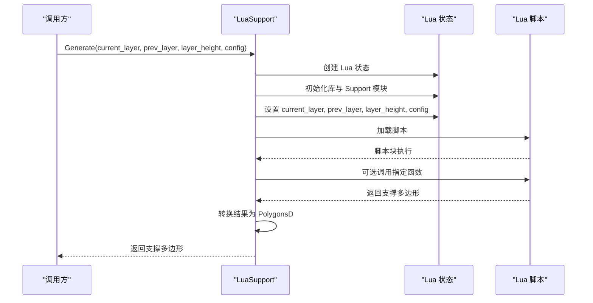
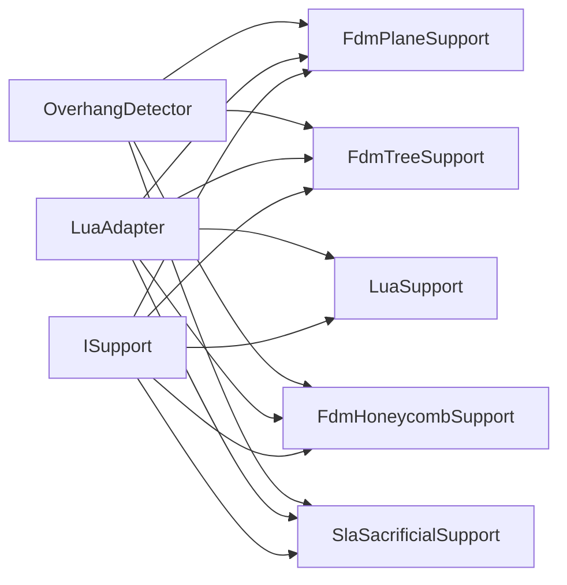

# 支撑接口抽象 (Support Interface)

<cite>
**本文引用的文件**   
- [ISupport.hpp](file://support/ISupport.hpp)
- [ISupport.cpp](file://support/ISupport.cpp)
- [SupportConfig.hpp](file://support/SupportConfig.hpp)
- [FdmSupport.hpp](file://support/FdmSupport.hpp)
- [FdmSupport.cpp](file://support/FdmSupport.cpp)
- [SlaSupport.hpp](file://support/SlaSupport.hpp)
- [SlaSupport.cpp](file://support/SlaSupport.cpp)
- [LuaSupport.hpp](file://support/LuaSupport.hpp)
- [LuaSupport.cpp](file://support/LuaSupport.cpp)
- [LuaAdapter.hpp](file://support/LuaAdapter.hpp)
- [LuaAdapter.cpp](file://support/LuaAdapter.cpp)
- [OverhangDetector.hpp](file://support/OverhangDetector.hpp)
- [OverhangDetector.cpp](file://support/OverhangDetector.cpp)
- [2D LuaAdapter.cpp](file://2D/LuaAdapter.cpp)
</cite>

## 目录
1. [项目概述与快速开始](#项目概述与快速开始)
2. [架构总览](#架构总览)
3. [核心概念](#核心概念)
4. [核心模块详解](#核心模块详解)
5. [高级主题](#高级主题)
6. [Lua 脚本系统](#lua-脚本系统)
7. [API 参考文档](#api-参考文档)
8. [集成指南](#集成指南)
9. [开发测试与贡献](#开发测试与贡献)
10. [扩展开发指南](#扩展开发指南)
11. [示例与教程](#示例与教程)
12. [部署故障排除与FAQ](#部署故障排除与faq)
13. [附录](#附录)

## 项目概述与快速开始
支撑接口抽象层为切片系统中的支撑生成算法提供统一抽象。所有支撑算法，包括 FDM 平面、树形、蜂窝填充、SLA 牺牲支撑以及用户自定义 Lua 支撑，都通过同一个基类暴露接口。这样上层流水线无需关心具体实现细节，只需调用统一的 Generate 方法即可。

快速开始要点：
- 使用 ISupport 作为支撑算法的统一入口。
- 内置实现包括 FdmPlaneSupport、FdmTreeSupport、FdmHoneycombSupport、SlaSacrificialSupport。
- 支持通过 LuaSupport 替换或扩展支撑算法。
- 配置结构 SupportConfig 控制悬垂检测、间隙、直径、密度、图案等参数。

本节不直接分析具体源码文件，因此不提供章节来源。

## 架构总览
支撑子系统围绕 ISupport 基类构建，形成“策略 + 适配器”的清晰分层：
- 抽象层：ISupport 定义单层支撑生成接口和全层批量生成默认实现。
- 算法层：FDM 与 SLA 的具体支撑策略继承 ISupport。
- 脚本层：LuaSupport 将 C++ 支撑算法暴露给 Lua 脚本，并允许用户脚本完全替代内置算法。
- 适配层：LuaAdapter 在 Lua 中注册 Support 全局表，提供工厂函数、通用 generate 调用和悬垂检测工具。
- 几何层：OverhangDetector 负责根据当前层与上一层轮廓计算需要支撑的区域。

**图表来源**
- [ISupport.hpp:22-45](file://support/ISupport.hpp#L22-L45)
- [FdmSupport.hpp:19-63](file://support/FdmSupport.hpp#L19-L63)
- [SlaSupport.hpp:20-42](file://support/SlaSupport.hpp#L20-L42)
- [LuaSupport.hpp:40-81](file://support/LuaSupport.hpp#L40-L81)
- [LuaAdapter.hpp:13-30](file://support/LuaAdapter.hpp#L13-L30)
- [OverhangDetector.hpp:20-38](file://support/OverhangDetector.hpp#L20-L38)

**章节来源**
- [ISupport.hpp:22-45](file://support/ISupport.hpp#L22-L45)
- [LuaAdapter.hpp:13-30](file://support/LuaAdapter.hpp#L13-L30)
- [OverhangDetector.hpp:20-38](file://support/OverhangDetector.hpp#L20-L38)

## 核心概念
### ISupport 基类设计模式
ISupport 采用纯虚接口加默认实现的组合模式：
- 单层生成接口 Generate 是纯虚函数，要求子类实现当前层的支撑多边形输出。
- 全层生成接口 GenerateAll 提供默认实现，按层迭代调用 Generate，并将上一层轮廓作为 prev_layer 传入。
- 析构函数为默认虚析构，保证派生类正确释放资源。

这种设计让新增支撑算法时只需要关注单层逻辑，而不必重复处理层间迭代。

### 支撑算法统一接口
Generate 的参数规范如下：
- current_layer：当前层的多边形轮廓集合。
- prev_layer：上一层的多边形轮廓集合；第一层为空。
- layer_height：层高，单位毫米。
- config：支撑配置对象，包含悬垂角度阈值、层高、支撑间隙、支撑直径、密度、图案、树分支角度、蜂窝单元尺寸等。

返回值规范：
- 返回当前层的支撑多边形集合 PolygonsD。
- 若无支撑需求，可返回空集合。

### 配置体系
SupportConfig 是所有支撑算法共享的配置结构，包含：
- overhang_angle_threshold：悬垂角度阈值。
- layer_height：层高。
- support_gap：模型与支撑之间的间隙。
- support_diameter：支撑柱直径。
- support_density：支撑填充密度。
- support_pattern：支撑图案编号。
- tree_branch_angle：树形支撑分支角度。
- tree_max_branch_radius：树形支撑最大分支半径。
- honeycomb_cell_size：蜂窝支撑单元尺寸。

SLA 专用配置 SlaSupportConfig 继承 SupportConfig，增加 tip_diameter 和 raft_thickness。

**章节来源**
- [ISupport.hpp:22-45](file://support/ISupport.hpp#L22-L45)
- [ISupport.cpp:9-21](file://support/ISupport.cpp#L9-L21)
- [SupportConfig.hpp:14-43](file://support/SupportConfig.hpp#L14-L43)

## 核心模块详解
### 悬垂检测模块
OverhangDetector 根据当前层与上一层的差异计算悬垂区域：
- 若没有上一层，则整个当前层被视为悬垂。
- 否则计算当前层减去上一层的差异区域。
- 根据层高和悬垂角度阈值计算最大桥接距离。
- 对差异区域进行负偏移（侵蚀）以过滤可桥接的小悬垂。
- 最终返回需要支撑的多边形区域。

该模块被所有内置支撑算法复用，确保悬垂判断一致。

**图表来源**
- [OverhangDetector.cpp:41-81](file://support/OverhangDetector.cpp#L41-L81)

**章节来源**
- [OverhangDetector.hpp:20-38](file://support/OverhangDetector.hpp#L20-L38)
- [OverhangDetector.cpp:23-81](file://support/OverhangDetector.cpp#L23-L81)

### FDM 支撑算法
FdmPlaneSupport：
- 检测悬垂区域。
- 应用支撑间隙缩小悬垂区域。
- 按支撑直径膨胀生成柱状支撑截面。

FdmTreeSupport：
- 检测悬垂区域并应用间隙。
- 在悬垂区域内按间距采样点，生成圆形分支尖端。
- 合并重叠圆形得到树形支撑截面。

FdmHoneycombSupport：
- 检测悬垂区域并应用间隙。
- 在边界框内生成六边形蜂窝网格。
- 与悬垂区域求交得到蜂窝支撑截面。

**图表来源**
- [ISupport.hpp:22-45](file://support/ISupport.hpp#L22-L45)
- [FdmSupport.hpp:19-63](file://support/FdmSupport.hpp#L19-L63)

**章节来源**
- [FdmSupport.hpp:19-63](file://support/FdmSupport.hpp#L19-L63)
- [FdmSupport.cpp:48-76](file://support/FdmSupport.cpp#L48-L76)
- [FdmSupport.cpp:81-168](file://support/FdmSupport.cpp#L81-L168)
- [FdmSupport.cpp:173-267](file://support/FdmSupport.cpp#L173-L267)

### SLA 支撑算法
SlaSacrificialSupport：
- 检测悬垂区域并应用间隙。
- 在悬垂区域内按间距采样支撑点，生成小直径圆形支撑。
- 合并所有支撑点圆形得到 SLA 牺牲支撑截面。
- 提供重载接口接受 SLA 专用配置。

**章节来源**
- [SlaSupport.hpp:20-42](file://support/SlaSupport.hpp#L20-L42)
- [SlaSupport.cpp:38-79](file://support/SlaSupport.cpp#L38-L79)
- [SlaSupport.cpp:81-133](file://support/SlaSupport.cpp#L81-L133)

## 高级主题
### 生命周期管理
ISupport 的默认 GenerateAll 实现负责逐层调用 Generate，并在循环中维护 prev_layer。每个具体实现应假设其生命周期由上层调度器管理，不应持有跨层状态，除非明确设计为有状态算法。

LuaSupport 的生命周期：
- 构造时确定脚本来源（内联或文件）和目标函数名。
- 每次 Generate 创建独立 Lua 状态，避免脚本副作用污染。
- 支持外部注册函数注入，用于扩展 2D 与 3D 能力。

### 内存优化策略
- 使用整数化多边形进行几何运算，减少浮点误差。
- 预分配结果容器，例如 reserve 避免多次重分配。
- 及时释放中间多边形集合，避免不必要的拷贝。
- Lua 侧通过 unique_ptr 包装 ISupport 实现，利用元表 __gc 自动释放。

### 错误处理
- LuaSupport 在 Lua 状态创建失败、脚本加载失败、运行时错误、函数调用失败时抛出 RuntimeError。
- LuaAdapter 在 C++ 异常发生时捕获并转换为 Lua 错误字符串。
- 悬垂检测与几何操作在空输入或无效参数时返回空集合，避免崩溃。

**章节来源**
- [ISupport.cpp:9-21](file://support/ISupport.cpp#L9-L21)
- [LuaSupport.cpp:113-178](file://support/LuaSupport.cpp#L113-L178)
- [LuaAdapter.cpp:174-200](file://support/LuaAdapter.cpp#L174-L200)

## Lua 脚本系统
### LuaSupport 如何暴露 C++ 支撑算法
LuaSupport 在每个 Generate 调用中：
1. 创建新的 Lua 状态。
2. 初始化标准库、2D 多边形操作函数、Support 模块。
3. 将 current_layer、prev_layer、layer_height、config 推入全局变量。
4. 执行外部注册函数。
5. 加载并执行脚本块。
6. 如果指定函数名，则调用该函数。
7. 从 Lua 栈或全局 support_polys 读取结果并转换为 PolygonsD。

类型转换：
- PushPolygonsDToLua 将 C++ 多边形转换为 Lua 表数组。
- LuaTableToPolygonsD 将 Lua 表数组转换为 C++ 多边形。
- SupportConfig 字段通过 ReadConfigFromTable 读取，缺失字段保持默认值。

性能考虑：
- 每次调用创建新 Lua 状态，隔离脚本环境，但带来开销。
- 避免在脚本中进行大量几何计算，优先使用已注册的 2D 辅助函数。
- 合理设置支撑直径与间距，减少输出多边形数量。

错误处理：
- 脚本加载失败抛出带错误消息的 RuntimeError。
- 脚本运行时错误同样抛出 RuntimeError。
- 指定函数不存在时忽略，退回脚本块返回值或全局 support_polys。

**图表来源**
- [LuaSupport.cpp:113-178](file://support/LuaSupport.cpp#L113-L178)
- [2D LuaAdapter.cpp:347-356](file://2D/LuaAdapter.cpp#L347-L356)

**章节来源**
- [LuaSupport.hpp:40-81](file://support/LuaSupport.hpp#L40-L81)
- [LuaSupport.cpp:19-90](file://support/LuaSupport.cpp#L19-L90)
- [LuaSupport.cpp:113-178](file://support/LuaSupport.cpp#L113-L178)
- [2D LuaAdapter.cpp:347-356](file://2D/LuaAdapter.cpp#L347-L356)

## API 参考文档
### ISupport 接口
- 构造函数：无公开构造，通常通过派生类实例化。
- 析构函数：virtual ~ISupport() = default。
- Generate：纯虚函数，接收当前层、上一层、层高、配置，返回支撑多边形。
- GenerateAll：默认实现，遍历层并调用 Generate。

### 配置结构
- SupportConfig：通用支撑配置。
- FdmSupportConfig：FDM 专用配置。
- SlaSupportConfig：SLA 专用配置。

### LuaAdapter 暴露的 Support 表
- Support.new_plane()：创建 FDM 平面支撑对象。
- Support.new_tree()：创建 FDM 树形支撑对象。
- Support.new_honeycomb()：创建 FDM 蜂窝支撑对象。
- Support.new_sla()：创建 SLA 牺牲支撑对象。
- Support.new_lua(script[, funcName])：创建基于内联脚本的支撑对象。
- Support.new_lua_file(path, funcName)：创建基于脚本文件的支撑对象。
- Support.generate(support_obj, current_layer, prev_layer, layer_height, config_table)：调用支撑对象的 Generate。
- Support.detect_overhang(current_layer, prev_layer, layer_height, angle_deg)：检测悬垂区域。
- Support.default_config()：返回默认配置表。

**章节来源**
- [ISupport.hpp:22-45](file://support/ISupport.hpp#L22-L45)
- [SupportConfig.hpp:14-43](file://support/SupportConfig.hpp#L14-L43)
- [LuaAdapter.hpp:13-30](file://support/LuaAdapter.hpp#L13-L30)
- [LuaAdapter.cpp:110-276](file://support/LuaAdapter.cpp#L110-L276)

## 集成指南
### 在 C++ 中使用内置支撑算法
- 选择合适的具体实现，如 FdmPlaneSupport 或 SlaSacrificialSupport。
- 准备 SupportConfig，设置悬垂角度、层高、间隙、直径等参数。
- 调用 Generate 获取当前层支撑多边形。
- 如需全层生成，可使用 ISupport::GenerateAll。

### 在 Lua 中使用支撑模块
- 调用 Support.new_* 创建支撑对象。
- 准备当前层、上一层、层高、配置表。
- 调用 Support.generate 执行支撑生成。
- 或使用 Support.detect_overhang 仅检测悬垂区域。

### 自定义支撑算法
- 继承 ISupport 并实现 Generate。
- 复用 OverhangDetector 检测悬垂区域。
- 使用 2D 几何工具进行多边形操作。
- 通过 LuaAdapter 暴露给 Lua 脚本。

**章节来源**
- [ISupport.cpp:9-21](file://support/ISupport.cpp#L9-L21)
- [LuaAdapter.cpp:174-200](file://support/LuaAdapter.cpp#L174-L200)

## 开发测试与贡献
### 测试建议
- 针对 ISupport::GenerateAll 验证层间 prev_layer 传递是否正确。
- 针对 OverhangDetector 验证不同悬垂角度下的悬垂区域。
- 针对 LuaSupport 验证脚本加载、函数调用、错误处理。
- 针对 LuaAdapter 验证类型转换与默认配置。

### 贡献规范
- 新增支撑算法时遵循 ISupport 接口约定。
- 保持配置结构向后兼容。
- 在 LuaAdapter 中注册新算法工厂函数。
- 提供单元测试覆盖关键路径。

**章节来源**
- [ISupport.cpp:9-21](file://support/ISupport.cpp#L9-L21)
- [LuaAdapter.cpp:253-276](file://support/LuaAdapter.cpp#L253-L276)

## 扩展开发指南
### 自定义支撑算法实现步骤
1. 新建类继承 ISupport。
2. 实现 Generate 方法，接收当前层、上一层、层高、配置。
3. 使用 OverhangDetector 检测悬垂区域。
4. 应用支撑间隙与几何变换生成支撑多边形。
5. 返回支撑多边形集合。

### 最佳实践
- 避免在 Generate 中持有长期状态。
- 使用整数化多边形进行几何运算。
- 预分配结果容器以减少内存分配。
- 对空输入和无效参数进行防御性检查。
- 在 Lua 侧避免频繁创建大型临时表。

### 完整代码示例路径
- 自定义 FDM 平面支撑参考：[FdmSupport.cpp:48-76](file://support/FdmSupport.cpp#L48-L76)
- 自定义 SLA 牺牲支撑参考：[SlaSupport.cpp:81-133](file://support/SlaSupport.cpp#L81-L133)
- Lua 脚本支撑参考：[LuaSupport.cpp:113-178](file://support/LuaSupport.cpp#L113-L178)

**章节来源**
- [FdmSupport.cpp:48-76](file://support/FdmSupport.cpp#L48-L76)
- [SlaSupport.cpp:81-133](file://support/SlaSupport.cpp#L81-L133)
- [LuaSupport.cpp:113-178](file://support/LuaSupport.cpp#L113-L178)

## 示例与教程
### 使用 Lua 脚本替换内置支撑算法
- 编写 Lua 脚本，返回支撑多边形表或定义 generate_support 函数。
- 使用 Support.new_lua 或 Support.new_lua_file 创建 LuaSupport 对象。
- 调用 Support.generate 执行脚本支撑生成。
- 通过 Support.default_config 获取默认配置并修改。

### 调试支撑生成问题
- 打印当前层与上一层轮廓。
- 使用 Support.detect_overhang 检查悬垂区域。
- 调整支撑直径、间隙、密度等参数。
- 查看 Lua 错误日志定位脚本问题。

**章节来源**
- [LuaAdapter.cpp:215-241](file://support/LuaAdapter.cpp#L215-L241)
- [LuaAdapter.cpp:202-213](file://support/LuaAdapter.cpp#L202-L213)

## 部署故障排除与FAQ
### 常见问题
- Lua 脚本加载失败：检查脚本路径与语法。
- 支撑生成结果为空：检查悬垂角度阈值与层高设置。
- 性能问题：减少脚本中的复杂几何计算，使用内置 2D 函数。
- 内存泄漏：确保 LuaSupport 对象正确销毁，避免持有长生命周期引用。

### 解决方案
- 使用 Support.default_config 获取默认配置。
- 逐步调整参数并观察输出。
- 在 Lua 侧添加日志输出。
- 使用单元测试验证算法行为。

**章节来源**
- [LuaSupport.cpp:141-155](file://support/LuaSupport.cpp#L141-L155)
- [LuaAdapter.cpp:195-199](file://support/LuaAdapter.cpp#L195-L199)

## 附录
### 依赖关系图

**图表来源**
- [ISupport.hpp:22-45](file://support/ISupport.hpp#L22-L45)
- [FdmSupport.hpp:19-63](file://support/FdmSupport.hpp#L19-L63)
- [SlaSupport.hpp:20-42](file://support/SlaSupport.hpp#L20-L42)
- [LuaSupport.hpp:40-81](file://support/LuaSupport.hpp#L40-L81)
- [LuaAdapter.hpp:13-30](file://support/LuaAdapter.hpp#L13-L30)
- [OverhangDetector.hpp:20-38](file://support/OverhangDetector.hpp#L20-L38)