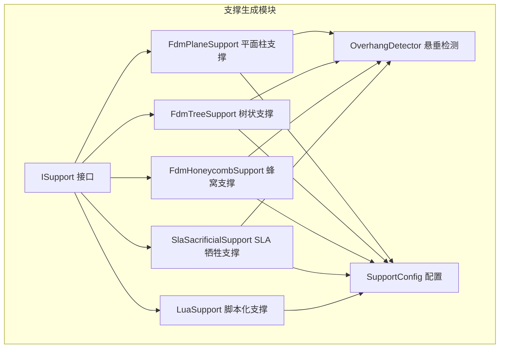
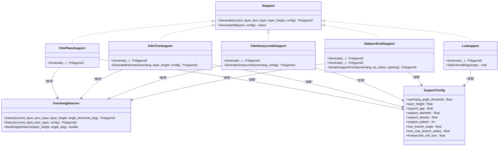
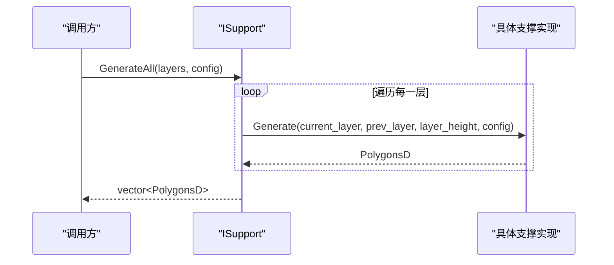
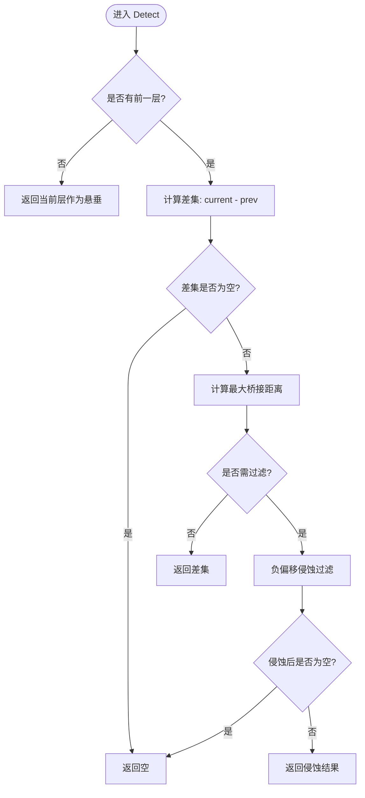
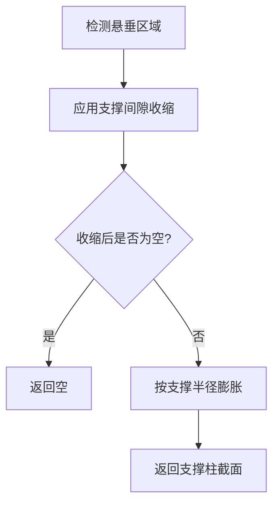
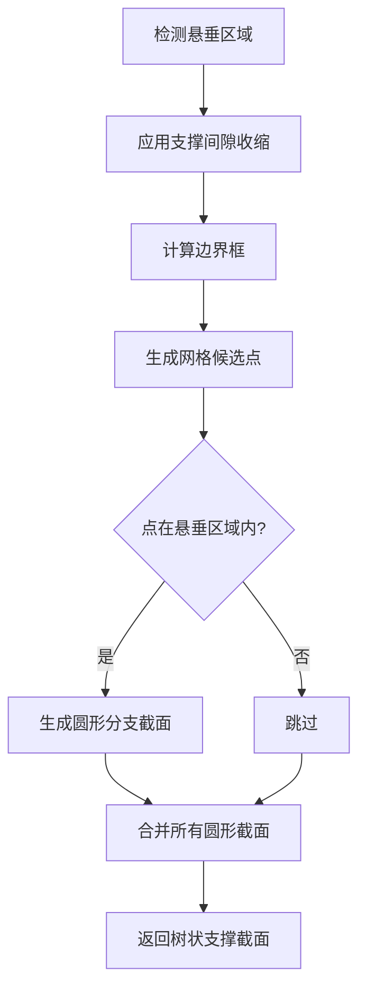
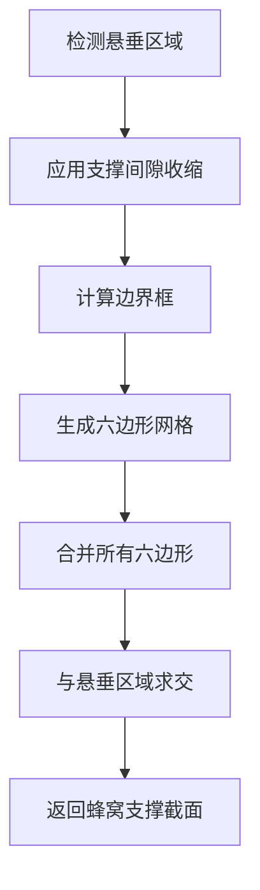
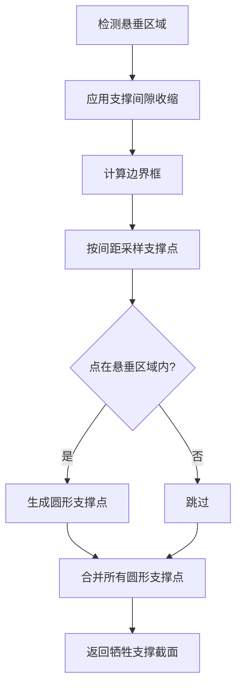
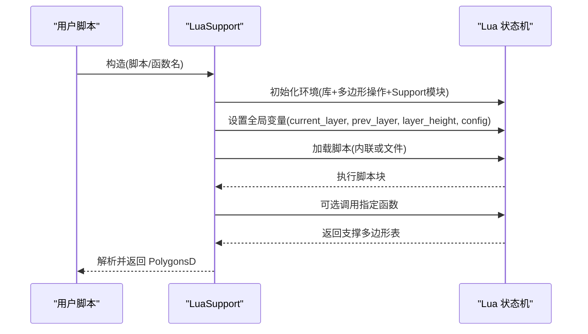
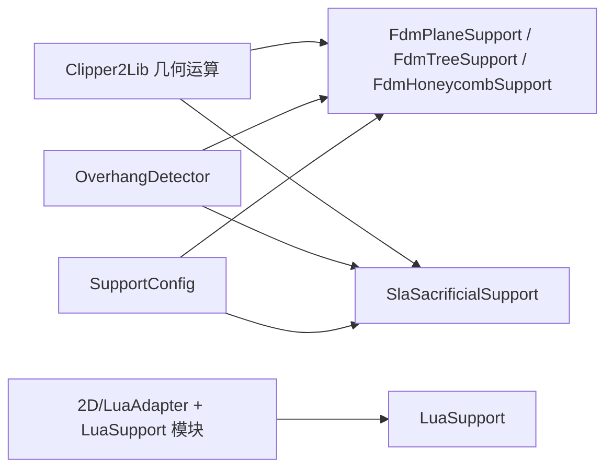

# 支撑生成 (Support Generation)

<cite>
**本文引用的文件**   
- [ISupport.hpp](file://support/ISupport.hpp)
- [ISupport.cpp](file://support/ISupport.cpp)
- [FdmSupport.hpp](file://support/FdmSupport.hpp)
- [FdmSupport.cpp](file://support/FdmSupport.cpp)
- [SlaSupport.hpp](file://support/SlaSupport.hpp)
- [SlaSupport.cpp](file://support/SlaSupport.cpp)
- [OverhangDetector.hpp](file://support/OverhangDetector.hpp)
- [OverhangDetector.cpp](file://support/OverhangDetector.cpp)
- [SupportConfig.hpp](file://support/SupportConfig.hpp)
- [LuaSupport.hpp](file://support/LuaSupport.hpp)
- [LuaSupport.cpp](file://support/LuaSupport.cpp)
</cite>

## 目录
1. [简介](#简介)
2. [项目结构](#项目结构)
3. [核心概念](#核心概念)
4. [架构总览](#架构总览)
5. [核心组件详解](#核心组件详解)
6. [依赖关系分析](#依赖关系分析)
7. [性能与质量评估](#性能与质量评估)
8. [API 参考](#api-参考)
9. [故障排除与常见问题](#故障排除与常见问题)
10. [结论](#结论)

## 简介
本页面聚焦 HsBaSlicer 的支撑生成模块，系统介绍 support 子模块提供的智能支撑结构生成能力。该模块为 FDM 和 SLA 等不同打印技术提供可插拔的支撑算法实现，并通过统一的 ISupport 接口暴露层级的支撑截面生成 API；同时提供 OverhangDetector 悬垂检测器、SupportConfig 配置体系以及 LuaSupport 脚本化扩展机制，便于用户自定义支撑策略和优化支撑结构。

## 项目结构
支撑生成相关代码集中在 support 目录下，采用“接口抽象 + 多实现 + 工具类”的组织方式：
- 接口与通用逻辑：ISupport、SupportConfig
- 悬垂检测：OverhangDetector
- FDM 支撑实现：FdmPlaneSupport、FdmTreeSupport、FdmHoneycombSupport
- SLA 支撑实现：SlaSacrificialSupport
- 脚本化扩展：LuaSupport

图表来源
- [ISupport.hpp:14-45](file://support/ISupport.hpp#L14-L45)
- [FdmSupport.hpp:13-63](file://support/FdmSupport.hpp#L13-L63)
- [SlaSupport.hpp:13-42](file://support/SlaSupport.hpp#L13-L42)
- [OverhangDetector.hpp:14-50](file://support/OverhangDetector.hpp#L14-L50)
- [SupportConfig.hpp:14-43](file://support/SupportConfig.hpp#L14-L43)
- [LuaSupport.hpp:21-81](file://support/LuaSupport.hpp#L21-L81)

章节来源
- [ISupport.hpp:14-45](file://support/ISupport.hpp#L14-L45)
- [FdmSupport.hpp:13-63](file://support/FdmSupport.hpp#L13-L63)
- [SlaSupport.hpp:13-42](file://support/SlaSupport.hpp#L13-L42)
- [OverhangDetector.hpp:14-50](file://support/OverhangDetector.hpp#L14-L50)
- [SupportConfig.hpp:14-43](file://support/SupportConfig.hpp#L14-L43)
- [LuaSupport.hpp:21-81](file://support/LuaSupport.hpp#L21-L81)

## 核心概念
- ISupport 接口：定义单层的支撑截面生成接口 Generate 与批量接口 GenerateAll，所有具体支撑算法均实现该接口。
- OverhangDetector：基于相邻两层轮廓计算需要支撑的悬垂区域，支持角度阈值与桥接距离过滤。
- SupportConfig：支撑生成的通用配置，包括悬垂角度阈值、层高、支撑间隙、支撑直径、密度、图案类型等；并提供 FDM 与 SLA 的特化配置。
- FDM 支撑策略：
  - 平面柱支撑：在悬垂区域生成圆柱形支撑柱，通过偏移膨胀形成截面。
  - 树状支撑：在悬垂区域内采样分支点，生成圆形分支截面，并在层间合并。
  - 蜂窝支撑：在悬垂区域内填充六边形蜂窝网格，兼顾轻量化与刚性。
- SLA 支撑策略：牺牲支撑，使用小尖端直径与大基底直径，逐层生成圆形支撑点并合并。
- LuaSupport：允许用户通过 Lua 脚本完全替换内置支撑算法，提供当前层、前一层、层高与配置的上下文，并返回支撑多边形。

章节来源
- [ISupport.hpp:14-45](file://support/ISupport.hpp#L14-L45)
- [OverhangDetector.hpp:14-50](file://support/OverhangDetector.hpp#L14-L50)
- [SupportConfig.hpp:14-43](file://support/SupportConfig.hpp#L14-L43)
- [FdmSupport.hpp:13-63](file://support/FdmSupport.hpp#L13-L63)
- [SlaSupport.hpp:13-42](file://support/SlaSupport.hpp#L13-L42)
- [LuaSupport.hpp:21-81](file://support/LuaSupport.hpp#L21-L81)

## 架构总览
支撑生成模块以 ISupport 为统一入口，各具体算法（FDM/SLA/Lua）实现相同接口，内部依赖 OverhangDetector 进行悬垂检测，并使用 Clipper2Lib 进行几何布尔运算与偏移操作。

图表来源
- [ISupport.hpp:14-45](file://support/ISupport.hpp#L14-L45)
- [FdmSupport.hpp:13-63](file://support/FdmSupport.hpp#L13-L63)
- [SlaSupport.hpp:13-42](file://support/SlaSupport.hpp#L13-L42)
- [OverhangDetector.hpp:14-50](file://support/OverhangDetector.hpp#L14-L50)
- [SupportConfig.hpp:14-43](file://support/SupportConfig.hpp#L14-L43)
- [LuaSupport.hpp:21-81](file://support/LuaSupport.hpp#L21-L81)

## 核心组件详解

### ISupport 接口与批量生成
- 职责：定义每层支撑截面的生成接口，并提供默认的全层迭代实现。
- 关键方法：
  - Generate：输入当前层与前一层轮廓、层高与配置，输出当前层支撑多边形。
  - GenerateAll：对全部层迭代调用 Generate，返回每层支撑多边形集合。

图表来源
- [ISupport.cpp:9-21](file://support/ISupport.cpp#L9-L21)
- [ISupport.hpp:27-44](file://support/ISupport.hpp#L27-L44)

章节来源
- [ISupport.hpp:14-45](file://support/ISupport.hpp#L14-L45)
- [ISupport.cpp:9-21](file://support/ISupport.cpp#L9-L21)

### OverhangDetector 悬垂检测器
- 职责：根据相邻两层轮廓与角度阈值，计算需要支撑的悬垂区域。
- 关键方法：
  - Detect：计算当前层相对于前一层的差集，并按最大桥接距离进行侵蚀过滤。
  - MaxBridgeDistance：根据层高与角度阈值计算最大水平桥接距离。

图表来源
- [OverhangDetector.cpp:23-87](file://support/OverhangDetector.cpp#L23-L87)

章节来源
- [OverhangDetector.hpp:14-50](file://support/OverhangDetector.hpp#L14-L50)
- [OverhangDetector.cpp:23-87](file://support/OverhangDetector.cpp#L23-L87)

### FDM 支撑算法

#### FdmPlaneSupport 平面柱支撑
- 策略：检测悬垂区域，应用支撑间隙收缩，再按支撑半径膨胀生成柱体截面。
- 流程要点：
  - 使用 OverhangDetector 获取悬垂区域。
  - 使用 Offset 负偏移应用 gap，正偏移膨胀得到支撑柱。
  - 返回整数坐标到浮点坐标转换后的多边形集合。

图表来源
- [FdmSupport.cpp:48-76](file://support/FdmSupport.cpp#L48-L76)

章节来源
- [FdmSupport.hpp:13-24](file://support/FdmSupport.hpp#L13-L24)
- [FdmSupport.cpp:48-76](file://support/FdmSupport.cpp#L48-L76)

#### FdmTreeSupport 树状支撑
- 策略：在悬垂区域内按间距采样分支点，生成圆形分支截面，并在层间合并。
- 流程要点：
  - 检测悬垂区域并应用 gap。
  - 在过盈区域内生成规则网格候选点，判断是否在区域内。
  - 将候选点转换为圆形多边形并合并。

图表来源
- [FdmSupport.cpp:81-167](file://support/FdmSupport.cpp#L81-L167)

章节来源
- [FdmSupport.hpp:26-44](file://support/FdmSupport.hpp#L26-L44)
- [FdmSupport.cpp:81-167](file://support/FdmSupport.cpp#L81-L167)

#### FdmHoneycombSupport 蜂窝支撑
- 策略：在悬垂区域内生成六边形蜂窝网格，并与悬垂区域求交，得到轻量但刚性的支撑结构。
- 流程要点：
  - 检测悬垂区域并应用 gap。
  - 生成 flat-top 六边形单元，按行错位排列。
  - 将所有六边形合并后与悬垂区域求交。

图表来源
- [FdmSupport.cpp:173-266](file://support/FdmSupport.cpp#L173-L266)

章节来源
- [FdmSupport.hpp:46-63](file://support/FdmSupport.hpp#L46-L63)
- [FdmSupport.cpp:173-266](file://support/FdmSupport.cpp#L173-L266)

### SLA 支撑算法

#### SlaSacrificialSupport SLA 牺牲支撑
- 策略：针对树脂打印，生成小尖端直径的牺牲支撑，逐层采样支撑点并合并。
- 流程要点：
  - 检测悬垂区域并应用 gap。
  - 使用 tip_diameter 作为支撑尖端半径，按 support_diameter*2 的间距采样。
  - 将采样点转换为圆形多边形并合并。

图表来源
- [SlaSupport.cpp:38-133](file://support/SlaSupport.cpp#L38-L133)

章节来源
- [SlaSupport.hpp:13-42](file://support/SlaSupport.hpp#L13-L42)
- [SlaSupport.cpp:38-133](file://support/SlaSupport.cpp#L38-L133)

### LuaSupport 脚本化支撑
- 策略：允许用户通过 Lua 脚本完全替换内置支撑算法，提供当前层、前一层、层高与配置的上下文，并返回支撑多边形。
- 关键点：
  - 构造支持内联脚本或外部脚本文件。
  - 初始化 Lua 环境，注册 2D 多边形操作与 Support 模块函数。
  - 执行脚本并解析返回值（支持直接返回表或指定函数名）。
  - 支持注入外部注册函数以扩展脚本能力。

图表来源
- [LuaSupport.cpp:19-177](file://support/LuaSupport.cpp#L19-L177)
- [LuaSupport.hpp:21-81](file://support/LuaSupport.hpp#L21-L81)

章节来源
- [LuaSupport.hpp:21-81](file://support/LuaSupport.hpp#L21-L81)
- [LuaSupport.cpp:19-177](file://support/LuaSupport.cpp#L19-L177)

## 依赖关系分析
- 几何基础：所有支撑算法依赖 2D 多边形操作（Clipper2Lib），包括 Union、Intersect、Difference、Offset 等。
- 悬垂检测：所有支撑算法依赖 OverhangDetector 计算悬垂区域。
- 配置共享：所有算法读取 SupportConfig，FDM/SLA 特化配置分别继承通用配置。
- 脚本扩展：LuaSupport 依赖 2D/LuaAdapter 与 LuaSupport 模块注册，提供脚本侧的多边形操作能力。

图表来源
- [FdmSupport.cpp:1-269](file://support/FdmSupport.cpp#L1-L269)
- [SlaSupport.cpp:1-135](file://support/SlaSupport.cpp#L1-L135)
- [OverhangDetector.cpp:1-89](file://support/OverhangDetector.cpp#L1-L89)
- [LuaSupport.cpp:1-180](file://support/LuaSupport.cpp#L1-L180)

章节来源
- [FdmSupport.cpp:1-269](file://support/FdmSupport.cpp#L1-L269)
- [SlaSupport.cpp:1-135](file://support/SlaSupport.cpp#L1-L135)
- [OverhangDetector.cpp:1-89](file://support/OverhangDetector.cpp#L1-L89)
- [LuaSupport.cpp:1-180](file://support/LuaSupport.cpp#L1-L180)

## 性能与质量评估
- 悬垂检测复杂度：主要受差集与偏移操作影响，建议使用合理的角度阈值避免过度侵蚀导致支撑缺失。
- FDM 平面支撑：偏移次数较少，性能较好；支撑密度由后续填充控制。
- FDM 树状支撑：网格采样与圆并集可能产生较多几何对象，建议调整间距与分支半径平衡覆盖率与性能。
- FDM 蜂窝支撑：六边形网格生成与求交开销较大，cell_size 越大性能越好但覆盖越稀疏。
- SLA 牺牲支撑：采样点数量与 tip_diameter 直接影响最终对象数；spacing 越大对象越少但支撑强度下降。
- Lua 脚本：脚本执行与对象转换存在额外开销，建议在脚本中尽量复用已有多边形操作以减少重复计算。

[本节为通用指导，不直接分析具体文件]

## API 参考

### ISupport 接口
- Generate(current_layer, prev_layer, layer_height, config) -> PolygonsD
- GenerateAll(layers, config) -> vector<PolygonsD>

章节来源
- [ISupport.hpp:27-44](file://support/ISupport.hpp#L27-L44)
- [ISupport.cpp:9-21](file://support/ISupport.cpp#L9-L21)

### OverhangDetector
- Detect(current_layer, prev_layer, layer_height, angle_threshold_deg) -> PolygonsD
- Detect(current_layer, prev_layer, config) -> PolygonsD
- MaxBridgeDistance(layer_height, angle_deg) -> double

章节来源
- [OverhangDetector.hpp:23-49](file://support/OverhangDetector.hpp#L23-L49)
- [OverhangDetector.cpp:23-87](file://support/OverhangDetector.cpp#L23-L87)

### SupportConfig 与特化配置
- SupportConfig
  - overhang_angle_threshold : float（默认 45.0）
  - layer_height : float（默认 0.2）
  - support_gap : float（默认 0.5）
  - support_diameter : float（默认 2.0）
  - support_density : float（默认 0.3）
  - support_pattern : int（0=平面，1=树，2=蜂窝）
  - tree_branch_angle : float（默认 30.0）
  - tree_max_branch_radius : float（默认 5.0）
  - honeycomb_cell_size : float（默认 5.0）
- FdmSupportConfig（继承 SupportConfig）
  - interface_layers : int（默认 2）
  - interface_density : float（默认 0.5）
- SlaSupportConfig（继承 SupportConfig）
  - tip_diameter : float（默认 0.3）
  - raft_thickness : float（默认 0.5）

章节来源
- [SupportConfig.hpp:14-43](file://support/SupportConfig.hpp#L14-L43)

### FDM 支撑实现
- FdmPlaneSupport::Generate(...)
- FdmTreeSupport::Generate(...)
- FdmHoneycombSupport::Generate(...)

章节来源
- [FdmSupport.hpp:13-63](file://support/FdmSupport.hpp#L13-L63)
- [FdmSupport.cpp:48-266](file://support/FdmSupport.cpp#L48-L266)

### SLA 支撑实现
- SlaSacrificialSupport::Generate(current_layer, prev_layer, layer_height, SlaSupportConfig) -> PolygonsD
- SlaSacrificialSupport::Generate(current_layer, prev_layer, layer_height, SupportConfig) -> PolygonsD

章节来源
- [SlaSupport.hpp:20-42](file://support/SlaSupport.hpp#L20-L42)
- [SlaSupport.cpp:81-133](file://support/SlaSupport.cpp#L81-L133)

### LuaSupport
- 构造
  - LuaSupport(script)
  - LuaSupport(script, funcName)
  - LuaSupport(script_file, funcName)
- 方法
  - SetExternalRegs(regs)
  - Generate(current_layer, prev_layer, layer_height, config) -> PolygonsD

章节来源
- [LuaSupport.hpp:43-81](file://support/LuaSupport.hpp#L43-L81)
- [LuaSupport.cpp:93-177](file://support/LuaSupport.cpp#L93-L177)

## 故障排除与常见问题
- 无支撑生成
  - 检查 OverhangDetector 的角度阈值是否过大，导致悬垂被过滤。
  - 确认 support_gap 是否过大，导致悬垂区域经负偏移后为空。
- 支撑过多或过密
  - 调整 FDM 树状支撑的间距与分支半径，或增大蜂窝 cell_size。
  - 对于 SLA 牺牲支撑，增大 spacing 或减小 tip_diameter。
- 脚本错误
  - LuaSupport 抛出 RuntimeError 时，检查脚本语法与返回值格式。
  - 确保脚本返回的是多边形表或定义了指定函数并返回多边形表。
- 性能问题
  - 减少不必要的几何对象数量，合理设置参数以避免大量小对象合并。
  - 在 Lua 脚本中复用已有多边形操作，避免重复计算。

章节来源
- [OverhangDetector.cpp:23-87](file://support/OverhangDetector.cpp#L23-L87)
- [FdmSupport.cpp:48-266](file://support/FdmSupport.cpp#L48-L266)
- [SlaSupport.cpp:38-133](file://support/SlaSupport.cpp#L38-L133)
- [LuaSupport.cpp:113-177](file://support/LuaSupport.cpp#L113-L177)

## 结论
HsBaSlicer 的支撑生成模块通过统一的 ISupport 接口与灵活的配置体系，为 FDM 与 SLA 提供了多种支撑策略实现，并借助 OverhangDetector 精确识别悬垂区域。LuaSupport 进一步开放了脚本化扩展能力，便于用户定制支撑算法。在实际应用中，应根据打印技术与模型特征选择合适的支撑策略，并通过调整配置参数在支撑质量与性能之间取得平衡。

[本节为总结性内容，不直接分析具体文件]