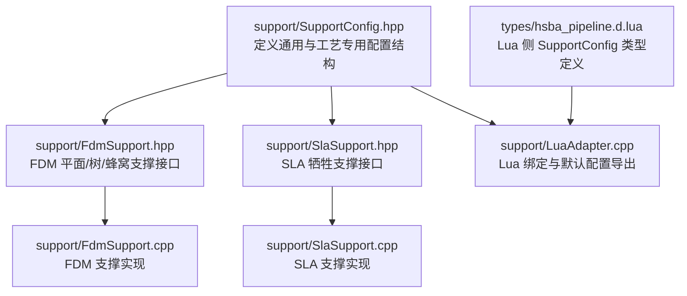
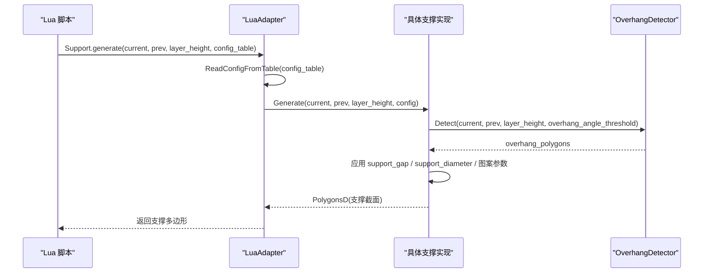
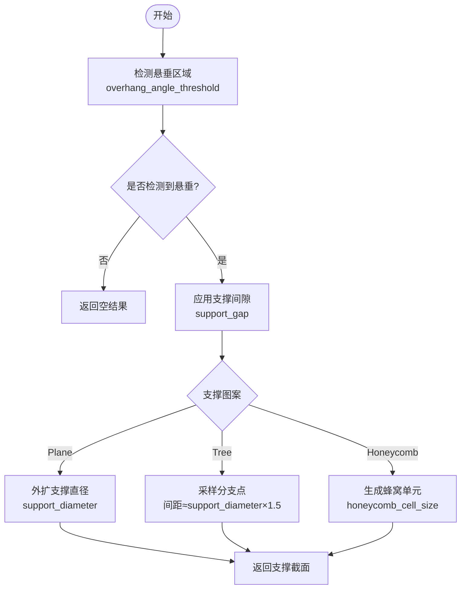
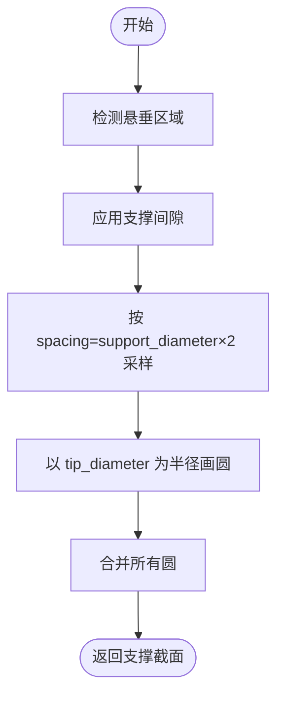
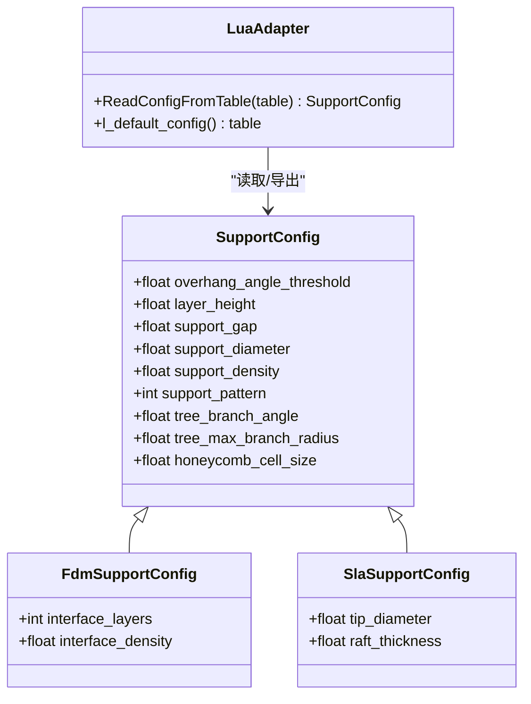
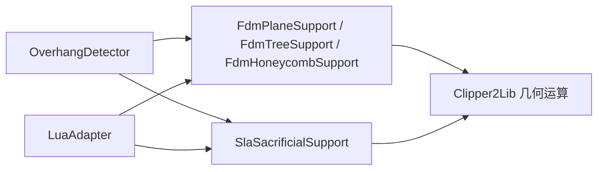

# 支撑配置管理

<cite>
**本文引用的文件**   
- [support/SupportConfig.hpp](file://support/SupportConfig.hpp)
- [support/FdmSupport.hpp](file://support/FdmSupport.hpp)
- [support/FdmSupport.cpp](file://support/FdmSupport.cpp)
- [support/SlaSupport.hpp](file://support/SlaSupport.hpp)
- [support/SlaSupport.cpp](file://support/SlaSupport.cpp)
- [support/LuaAdapter.cpp](file://support/LuaAdapter.cpp)
- [types/hsba_pipeline.d.lua](file://types/hsba_pipeline.d.lua)
</cite>

## 目录
1. [引言](#引言)
2. [项目结构](#项目结构)
3. [核心组件](#核心组件)
4. [架构总览](#架构总览)
5. [详细组件分析](#详细组件分析)
6. [依赖关系分析](#依赖关系分析)
7. [性能与复杂度](#性能与复杂度)
8. [参数验证、继承与动态调整](#参数验证继承与动态调整)
9. [默认值与推荐设置](#默认值与推荐设置)
10. [优化最佳实践](#优化最佳实践)
11. [常见问题与排错](#常见问题与排错)
12. [结论](#结论)

## 引言
本文面向 HsBaSlicer 的支撑生成子系统，聚焦于支撑配置管理。目标包括：
- 全面说明 SupportConfig 及其派生配置的字段含义、单位、取值范围与影响。
- 梳理 FDM 与 SLA 两种打印技术下的默认值与推荐设置。
- 解释配置参数的读取、校验、继承与在 Lua 脚本中的动态调整机制。
- 提供针对不同模型特征的调参指南与常见问题解决方案。

## 项目结构
支撑配置相关代码集中在 support 目录，并通过 Lua 绑定暴露给脚本系统；类型定义同时出现在 C++ 头文件与 Lua 类型声明中，便于 IDE 提示与静态检查。

**图示来源**
- [support/SupportConfig.hpp:14-43](file://support/SupportConfig.hpp#L14-L43)
- [support/FdmSupport.hpp:19-63](file://support/FdmSupport.hpp#L19-L63)
- [support/SlaSupport.hpp:20-42](file://support/SlaSupport.hpp#L20-L42)
- [support/FdmSupport.cpp:48-76](file://support/FdmSupport.cpp#L48-L76)
- [support/SlaSupport.cpp:81-133](file://support/SlaSupport.cpp#L81-L133)
- [support/LuaAdapter.cpp:43-108](file://support/LuaAdapter.cpp#L43-L108)
- [types/hsba_pipeline.d.lua:115-141](file://types/hsba_pipeline.d.lua#L115-L141)

**章节来源**
- [support/SupportConfig.hpp:14-43](file://support/SupportConfig.hpp#L14-L43)
- [support/FdmSupport.hpp:19-63](file://support/FdmSupport.hpp#L19-L63)
- [support/SlaSupport.hpp:20-42](file://support/SlaSupport.hpp#L20-L42)
- [support/LuaAdapter.cpp:43-108](file://support/LuaAdapter.cpp#L43-L108)
- [types/hsba_pipeline.d.lua:115-141](file://types/hsba_pipeline.d.lua#L115-L141)

## 核心组件
- SupportConfig：通用支撑配置基类，包含悬垂角度阈值、层高、支撑间隙、支撑直径、填充密度、支撑图案及图案相关参数。
- FdmSupportConfig：FDM 专用扩展，增加界面层数与界面层填充密度。
- SlaSupportConfig：SLA 专用扩展，增加针尖直径与底板厚度。
- FdmPlaneSupport / FdmTreeSupport / FdmHoneycombSupport：FDM 三种支撑策略的实现。
- SlaSacrificialSupport：SLA 牺牲支撑实现。
- LuaAdapter：将 SupportConfig 与支撑对象暴露给 Lua，并提供 default_config() 返回默认配置表。
- hsba_pipeline.d.lua：Lua 侧对 SupportConfig 的类型注解，用于 IDE 补全与文档导航。

**章节来源**
- [support/SupportConfig.hpp:14-43](file://support/SupportConfig.hpp#L14-L43)
- [support/FdmSupport.hpp:19-63](file://support/FdmSupport.hpp#L19-L63)
- [support/SlaSupport.hpp:20-42](file://support/SlaSupport.hpp#L20-L42)
- [support/LuaAdapter.cpp:43-108](file://support/LuaAdapter.cpp#L43-L108)
- [types/hsba_pipeline.d.lua:115-141](file://types/hsba_pipeline.d.lua#L115-L141)

## 架构总览
支撑生成的典型流程如下：
- 上层调用 Support.generate(...)，传入当前层、上一层、层高与配置表。
- LuaAdapter 解析配置表为 C++ SupportConfig。
- 具体支撑算法（平面/树/蜂窝/SLA）根据 overhang_angle_threshold 检测悬垂区域，再应用 support_gap 和 support_diameter 等参数生成支撑截面多边形。

**图示来源**
- [support/LuaAdapter.cpp:174-200](file://support/LuaAdapter.cpp#L174-L200)
- [support/LuaAdapter.cpp:43-108](file://support/LuaAdapter.cpp#L43-L108)
- [support/FdmSupport.cpp:48-76](file://support/FdmSupport.cpp#L48-L76)
- [support/SlaSupport.cpp:81-133](file://support/SlaSupport.cpp#L81-L133)

## 详细组件分析

### SupportConfig 字段语义与取值范围
| 字段 | 类型 | 含义 | 单位 | 默认值 | 有效范围与建议 |
|---|---:|---|---:|---:|---|
| overhang_angle_threshold | float | 悬垂角度阈值，超过该角度的区域需要支撑 | 度 | 45.0 | 通常 30–60；越小越保守，支撑越多 |
| layer_height | float | 切片层高 | mm | 0.2 | 正数；需与切片层高一致 |
| support_gap | float | 支撑与模型之间的间隙 | mm | 0.5 | 正数；过小易粘连，过大易塌陷 |
| support_diameter | float | 支撑柱直径（或分支/采样点半径的基础） | mm | 2.0 | 正数；与喷嘴/激光光斑匹配 |
| support_density | float | 支撑填充密度 | [0,1] | 0.3 | 越大越密实但耗材更多 |
| support_pattern | int | 支撑图案：0=Plane，1=Tree，2=Honeycomb | 枚举 | 0 | 仅作为标识，实际由具体实现选择 |
| tree_branch_angle | float | 树状支撑分支角度 | 度 | 30.0 | 正数；控制分支扩散程度 |
| tree_max_branch_radius | float | 树状支撑最大分支半径 | mm | 5.0 | 正数；限制分支粗细上限 |
| honeycomb_cell_size | float | 蜂窝支撑单元尺寸 | mm | 5.0 | 正数；决定蜂窝密度与强度 |

补充：
- FdmSupportConfig 新增 interface_layers（界面层数，默认 2）与 interface_density（界面层密度，默认 0.5）。
- SlaSupportConfig 新增 tip_diameter（针尖直径，默认 0.3）与 raft_thickness（底板厚度，默认 0.5）。

**章节来源**
- [support/SupportConfig.hpp:14-43](file://support/SupportConfig.hpp#L14-L43)
- [types/hsba_pipeline.d.lua:115-141](file://types/hsba_pipeline.d.lua#L115-L141)

### FDM 支撑策略与配置使用
- FdmPlaneSupport：基于悬垂区域外扩形成柱状支撑，关键参数为 support_gap 与 support_diameter。
- FdmTreeSupport：在悬垂区域内按间距采样放置圆形分支尖端，间距约为 support_diameter × 1.5，分支尖端半径为 support_diameter / 2。
- FdmHoneycombSupport：在悬垂区域内生成蜂窝网格并与其交集，关键参数为 honeycomb_cell_size。

**图示来源**
- [support/FdmSupport.cpp:48-76](file://support/FdmSupport.cpp#L48-L76)
- [support/FdmSupport.cpp:145-168](file://support/FdmSupport.cpp#L145-L168)
- [support/FdmSupport.cpp:173-242](file://support/FdmSupport.cpp#L173-L242)

**章节来源**
- [support/FdmSupport.cpp:48-76](file://support/FdmSupport.cpp#L48-L76)
- [support/FdmSupport.cpp:145-168](file://support/FdmSupport.cpp#L145-L168)
- [support/FdmSupport.cpp:173-242](file://support/FdmSupport.cpp#L173-L242)

### SLA 牺牲支撑与配置使用
- SlaSacrificialSupport：在悬垂区域内按 spacing = support_diameter × 2 采样支撑点，每个点以 tip_diameter 为半径画圆，最后合并所有圆。
- 支持从 SupportConfig 构造 SlaSupportConfig，缺失字段采用默认值。

**图示来源**
- [support/SlaSupport.cpp:38-79](file://support/SlaSupport.cpp#L38-L79)
- [support/SlaSupport.cpp:81-133](file://support/SlaSupport.cpp#L81-L133)

**章节来源**
- [support/SlaSupport.cpp:38-79](file://support/SlaSupport.cpp#L38-L79)
- [support/SlaSupport.cpp:81-133](file://support/SlaSupport.cpp#L81-L133)

### Lua 绑定与默认配置
- LuaAdapter.ReadConfigFromTable：从 Lua 表逐项读取 SupportConfig 字段，未提供的字段保持默认值。
- LuaAdapter.l_default_config：构造 SupportConfig 并将其字段写入 Lua 表，供脚本获取默认配置。
- types/hsba_pipeline.d.lua：声明 SupportConfig 字段类型，辅助 IDE 自动补全。

**图示来源**
- [support/SupportConfig.hpp:14-43](file://support/SupportConfig.hpp#L14-L43)
- [support/LuaAdapter.cpp:43-108](file://support/LuaAdapter.cpp#L43-L108)
- [support/LuaAdapter.cpp:215-241](file://support/LuaAdapter.cpp#L215-L241)
- [types/hsba_pipeline.d.lua:115-141](file://types/hsba_pipeline.d.lua#L115-L141)

**章节来源**
- [support/LuaAdapter.cpp:43-108](file://support/LuaAdapter.cpp#L43-L108)
- [support/LuaAdapter.cpp:215-241](file://support/LuaAdapter.cpp#L215-L241)
- [types/hsba_pipeline.d.lua:115-141](file://types/hsba_pipeline.d.lua#L115-L141)

## 依赖关系分析
- 支撑实现依赖 OverhangDetector 进行悬垂区域检测。
- FDM 与 SLA 实现均使用 Clipper2Lib 进行几何偏移、求交与合并。
- LuaAdapter 依赖 ISupport 接口统一抽象，内部持有具体实现实例。

**图示来源**
- [support/FdmSupport.cpp:48-76](file://support/FdmSupport.cpp#L48-L76)
- [support/SlaSupport.cpp:81-133](file://support/SlaSupport.cpp#L81-L133)
- [support/LuaAdapter.cpp:174-200](file://support/LuaAdapter.cpp#L174-L200)

**章节来源**
- [support/FdmSupport.cpp:48-76](file://support/FdmSupport.cpp#L48-L76)
- [support/SlaSupport.cpp:81-133](file://support/SlaSupport.cpp#L81-L133)
- [support/LuaAdapter.cpp:174-200](file://support/LuaAdapter.cpp#L174-L200)

## 性能与复杂度
- 悬垂检测：与当前层与上一层的多边形规模相关，通常为 O(n)。
- 平面支撑：对悬垂区域进行偏移与膨胀，复杂度取决于几何运算规模。
- 树支撑：在包围盒内按固定间距采样，时间复杂度近似 O((W/spacing) × (H/spacing))，其中 W/H 为包围盒宽高。
- 蜂窝支撑：生成蜂窝网格并与悬垂区域相交，复杂度与蜂窝数量及几何运算相关。
- SLA 支撑：同样在包围盒内采样并按间距生成圆，再进行合并。

优化建议：
- 合理设置 support_diameter 与 spacing，避免过密的采样导致计算量激增。
- 对于大悬垂区域，优先使用蜂窝或树支撑以减少材料消耗与计算开销。

[本节为一般性讨论，不直接分析具体文件]

## 参数验证、继承与动态调整

### 参数验证机制
- 当前实现未对 SupportConfig 字段做显式边界校验（如负数、零值），而是由算法内部处理异常输入（例如 cell_size <= 0 时直接返回空）。
- 建议在外部封装一层校验逻辑，确保：
  - overhang_angle_threshold ∈ (0, 90]
  - layer_height > 0
  - support_gap ≥ 0
  - support_diameter > 0
  - support_density ∈ [0, 1]
  - honeycomb_cell_size > 0
  - tree_branch_angle > 0
  - tree_max_branch_radius > 0
  - interface_layers ≥ 0
  - interface_density ∈ [0, 1]
  - tip_diameter > 0
  - raft_thickness > 0

**章节来源**
- [support/FdmSupport.cpp:173-179](file://support/FdmSupport.cpp#L173-L179)

### 继承关系
- FdmSupportConfig 与 SlaSupportConfig 均继承自 SupportConfig，复用通用字段。
- SLA 实现提供重载方法，可从 SupportConfig 构造 SlaSupportConfig，缺失字段取默认值。

**章节来源**
- [support/SupportConfig.hpp:30-43](file://support/SupportConfig.hpp#L30-L43)
- [support/SlaSupport.cpp:126-133](file://support/SlaSupport.cpp#L126-L133)

### 动态调整能力
- Lua 脚本可通过 Support.default_config() 获取默认配置表，然后按需修改字段后传递给 Support.generate(...)。
- ReadConfigFromTable 只读取存在的字段，未提供的字段保留默认值，从而实现“部分覆盖”的动态调整。

**章节来源**
- [support/LuaAdapter.cpp:215-241](file://support/LuaAdapter.cpp#L215-L241)
- [support/LuaAdapter.cpp:43-108](file://support/LuaAdapter.cpp#L43-L108)

## 默认值与推荐设置

### 通用默认值（来自 SupportConfig）
- overhang_angle_threshold = 45.0
- layer_height = 0.2
- support_gap = 0.5
- support_diameter = 2.0
- support_density = 0.3
- support_pattern = 0（Plane）
- tree_branch_angle = 30.0
- tree_max_branch_radius = 5.0
- honeycomb_cell_size = 5.0

### FDM 推荐设置
- 小悬垂、薄壁件：
  - overhang_angle_threshold ≈ 45–50
  - support_gap ≈ 0.3–0.5
  - support_diameter ≈ 1.0–1.5（匹配喷嘴直径）
  - support_pattern = 0（Plane）或 1（Tree）
- 大悬垂、复杂曲面：
  - overhang_angle_threshold ≈ 35–45
  - support_pattern = 1（Tree）或 2（Honeycomb）
  - honeycomb_cell_size ≈ 3–6
  - support_density ≈ 0.2–0.4

### SLA 推荐设置
- 精细模型：
  - tip_diameter ≈ 0.2–0.4
  - support_diameter ≈ 0.8–1.2
  - support_gap ≈ 0.2–0.4
  - raft_thickness ≈ 0.3–0.6
- 大型模型：
  - support_diameter ≈ 1.0–1.5
  - spacing ≈ support_diameter × 2
  - tip_diameter 保持较小以便去除

注意：以上推荐值为经验值，需结合设备能力与材料特性微调。

**章节来源**
- [support/SupportConfig.hpp:14-43](file://support/SupportConfig.hpp#L14-L43)
- [support/SlaSupport.cpp:104-108](file://support/SlaSupport.cpp#L104-L108)

## 优化最佳实践
- 分层调参：
  - 先确定 overhang_angle_threshold，控制支撑区域范围。
  - 再调整 support_gap，平衡支撑强度与可移除性。
  - 最后根据模型特征选择支撑图案与密度。
- 针对模型特征：
  - 细长悬臂：优先树支撑，减小 tip_diameter 以降低残留。
  - 大面积悬垂：优先蜂窝支撑，提高刚度并减少材料。
  - 薄壁件：降低 support_diameter，避免过度侵蚀表面。
- 性能优化：
  - 增大 spacing（通过 support_diameter 间接控制）以减少采样点数量。
  - 对超大模型分块处理，避免单次包围盒过大。

[本节为一般性指导，不直接分析具体文件]

## 常见问题与排错
- 无支撑生成：
  - 检查 overhang_angle_threshold 是否过小，导致未检测到悬垂。
  - 确认 layer_height 与切片层高一致。
- 支撑与模型粘连：
  - 增大 support_gap。
  - 减小 support_diameter。
- 支撑强度不足：
  - 增大 support_density。
  - 改用树或蜂窝支撑。
- 计算耗时过长：
  - 增大 spacing（通过 support_diameter）。
  - 减小 honeycomb_cell_size 的影响范围（合理设置 cell_size）。
- Lua 配置未生效：
  - 确认 Support.default_config() 返回的字段名正确。
  - 检查 ReadConfigFromTable 是否读取到对应字段。

**章节来源**
- [support/LuaAdapter.cpp:43-108](file://support/LuaAdapter.cpp#L43-L108)
- [support/FdmSupport.cpp:173-179](file://support/FdmSupport.cpp#L173-L179)

## 结论
SupportConfig 提供了支撑生成的核心参数集，并通过 FdmSupportConfig 与 SlaSupportConfig 扩展至不同打印技术。FDM 与 SLA 的具体实现分别利用这些参数完成悬垂检测、间隙处理与图案生成。Lua 绑定允许脚本动态调整配置，配合默认配置导出，便于快速迭代与优化。在实际应用中，应结合模型特征与设备能力，选择合适的参数组合，并在必要时引入外部校验以提升鲁棒性。