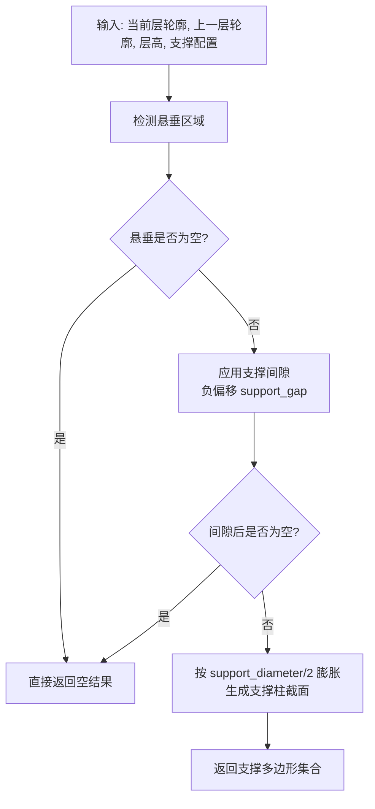
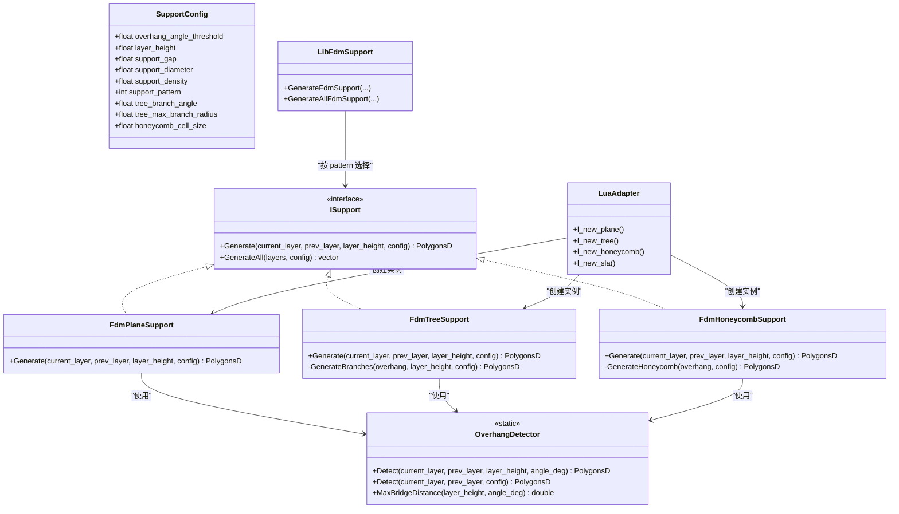
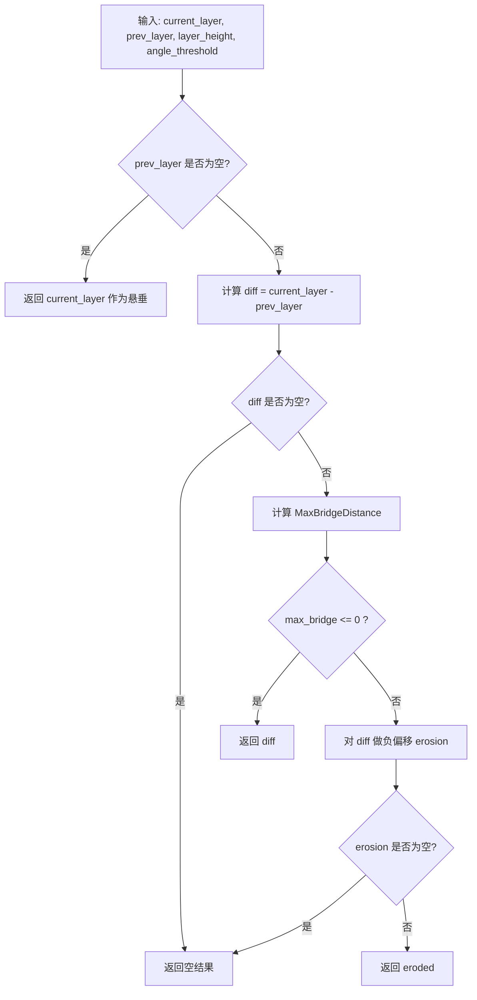
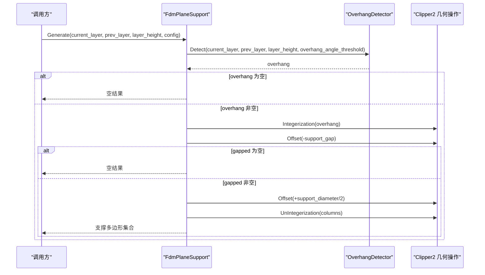
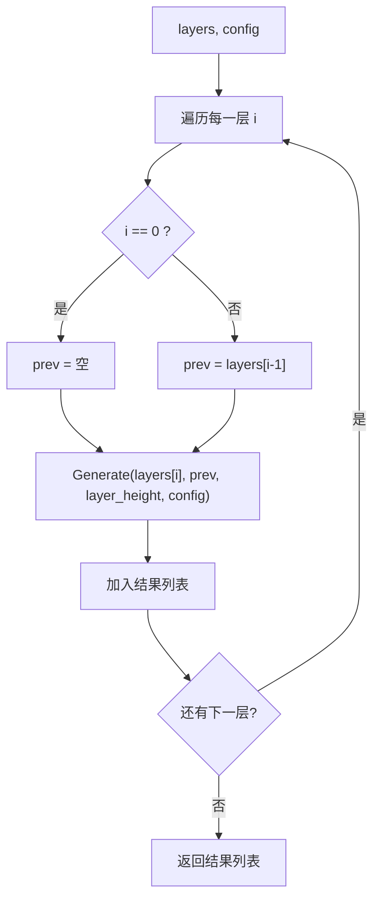
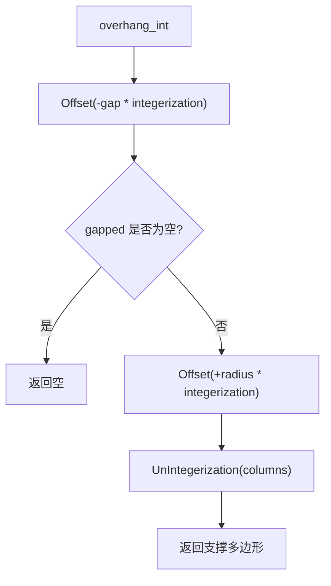
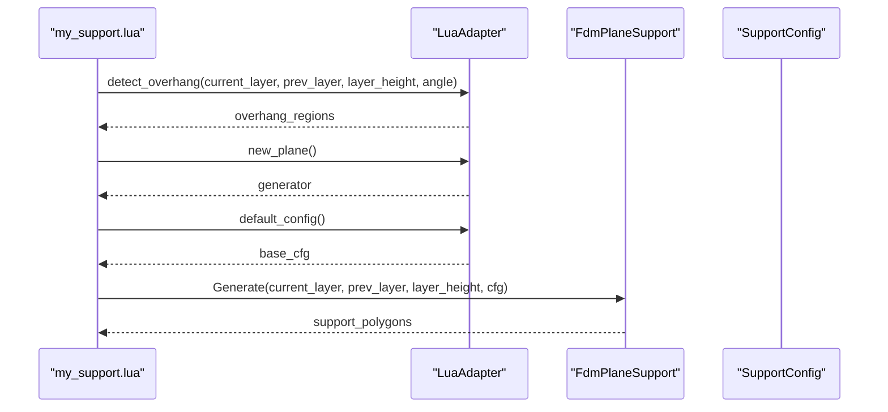
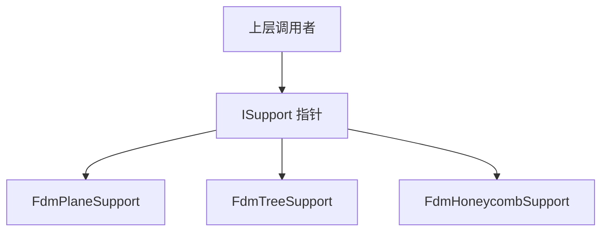
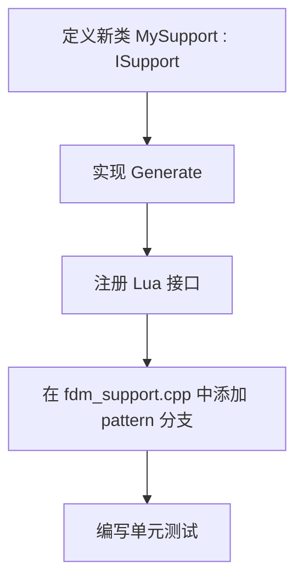

# FDM 平面支撑生成器

<cite>
**本文引用的文件**   
- [FdmSupport.hpp](file://support/FdmSupport.hpp)
- [FdmSupport.cpp](file://support/FdmSupport.cpp)
- [ISupport.hpp](file://support/ISupport.hpp)
- [ISupport.cpp](file://support/ISupport.cpp)
- [SupportConfig.hpp](file://support\SupportConfig.hpp)
- [OverhangDetector.hpp](file://support\OverhangDetector.hpp)
- [OverhangDetector.cpp](file://support\OverhangDetector.cpp)
- [LuaAdapter.cpp](file://support/LuaAdapter.cpp)
- [fdm_support.cpp](file://LibHsBaSlicer\Support\fdm_support.cpp)
- [my_support.lua](file://samples\FDM\scripts\my_support.lua)
- [support_test.cpp](file://tests\Support\support_test.cpp)
</cite>

## 目录
1. [项目概述与快速开始](#项目概述与快速开始)
2. [架构总览](#架构总览)
3. [核心概念](#核心概念)
4. [核心模块详解](#核心模块详解)
5. [高级主题](#高级主题)
6. [Lua 脚本系统](#lua-脚本系统)
7. [API 参考文档](#api-参考文档)
8. [集成指南](#集成指南)
9. [开发·测试与贡献](#开发·测试与贡献)
10. [扩展开发指南](#扩展开发指南)
11. [示例与教程](#示例与教程)
12. [部署·故障排除与FAQ](#部署·故障排除与faq)
13. [附录](#附录)

## 项目概述与快速开始
本页面聚焦 FDM 切片管线中的平面支撑生成器，核心目标是解释 `FdmPlaneSupport` 的实现原理、悬垂区域检测机制、支撑柱膨胀算法、间隙处理策略，以及 `support_diameter` 和 `support_gap` 对最终支撑几何的影响。同时给出使用 `Generate` 方法生成平面支撑的代码路径、参数配置建议、与 `ISupport` 接口的集成方式，以及性能优化与常见问题排查思路。

在 HsBaSlicer 中，支撑生成采用“接口 + 多实现”的设计：所有支撑生成器都实现 `ISupport::Generate`，而 `FdmPlaneSupport` 是其中一种面向 FDM 的简单柱状支撑策略。它的工作流程可以概括为：
- 根据当前层与上一层轮廓计算悬垂区域；
- 按 `support_gap` 收缩悬垂区域，使支撑与模型之间留出间隙；
- 按 `support_diameter / 2` 膨胀剩余区域，形成圆形截面支撑柱；
- 返回当前层的支撑多边形集合。

**图表来源**
- [FdmSupport.cpp:48-76](file://support/FdmSupport.cpp#L48-L76)
- [OverhangDetector.cpp:41-80](file://support/OverhangDetector.cpp#L41-L80)

**章节来源**
- [FdmSupport.hpp:13-24](file://support/FdmSupport.hpp#L13-L24)
- [FdmSupport.cpp:48-76](file://support/FdmSupport.cpp#L48-L76)

## 架构总览
FDM 支撑子系统围绕 `ISupport` 抽象接口组织，`FdmPlaneSupport`、`FdmTreeSupport`、`FdmHoneycombSupport` 分别提供不同支撑模式。公共配置由 `SupportConfig` 描述，悬垂检测由 `OverhangDetector` 完成，Lua 绑定通过 `LuaAdapter.cpp` 暴露给脚本层，上层 C++ API 通过 `LibHsBaSlicer/support/fdm_support.cpp` 选择具体实现并调用。

**图表来源**
- [ISupport.hpp:22-45](file://support/ISupport.hpp#L22-L45)
- [FdmSupport.hpp:19-63](file://support/FdmSupport.hpp#L19-L63)
- [SupportConfig.hpp:14-43](file://support/SupportConfig.hpp#L14-L43)
- [OverhangDetector.hpp:20-50](file://support/OverhangDetector.hpp#L20-L50)
- [LuaAdapter.cpp:110-144](file://support/LuaAdapter.cpp#L110-L144)
- [fdm_support.cpp:14-31](file://LibHsBaSlicer\Support\fdm_support.cpp#L14-L31)

**章节来源**
- [ISupport.hpp:16-45](file://support/ISupport.hpp#L16-L45)
- [ISupport.cpp:9-20](file://support/ISupport.cpp#L9-L20)
- [FdmSupport.hpp:13-63](file://support/FdmSupport.hpp#L13-L63)
- [SupportConfig.hpp:14-43](file://support/SupportConfig.hpp#L14-L43)
- [OverhangDetector.hpp:14-50](file://support/OverhangDetector.hpp#L14-L50)
- [LuaAdapter.cpp:110-144](file://support/LuaAdapter.cpp#L110-L144)
- [fdm_support.cpp:14-31](file://LibHsBaSlicer\Support\fdm_support.cpp#L14-L31)

## 核心概念
### 悬垂区域检测
悬垂区域定义为当前层中存在但未被上一层有效覆盖的区域，并根据角度阈值判断是否需要支撑。`OverhangDetector::Detect` 的核心逻辑如下：
- 若没有上一层，则整个当前层都被视为悬垂；
- 否则计算当前层与上一层的差集；
- 根据层高与角度阈值计算最大桥接距离；
- 对差集执行负偏移（侵蚀），过滤掉可桥接的小悬垂；
- 返回需要支撑的多边形集合。

**图表来源**
- [OverhangDetector.cpp:23-38](file://support/OverhangDetector.cpp#L23-L38)
- [OverhangDetector.cpp:41-80](file://support/OverhangDetector.cpp#L41-L80)

**章节来源**
- [OverhangDetector.hpp:14-50](file://support/OverhangDetector.hpp#L14-L50)
- [OverhangDetector.cpp:23-80](file://support/OverhangDetector.cpp#L23-L80)

### 支撑直径与半径关系
`FdmPlaneSupport` 将悬垂区域先按 `support_gap` 收缩，再按 `support_diameter / 2` 膨胀，从而得到支撑柱的横截面。因此：
- `support_diameter` 直接决定支撑柱半径：半径等于直径的一半；
- 增大 `support_diameter` 会使支撑柱更粗，提升支撑强度，但也增加材料消耗和移除难度；
- 减小 `support_diameter` 会使支撑柱更细，降低材料用量，但可能削弱支撑稳定性。

**章节来源**
- [FdmSupport.cpp:70-73](file://support/FdmSupport.cpp#L70-L73)
- [SupportConfig.hpp:18-20](file://support/SupportConfig.hpp#L18-L20)

### 层间间隙处理机制
`support_gap` 用于在支撑与模型之间留出空隙，避免支撑直接接触模型表面。实现上，它对悬垂区域执行负偏移，偏移量为 `support_gap`。该机制的意义包括：
- 防止支撑粘连模型表面，便于打印后去除；
- 控制支撑接触面大小，影响表面质量与支撑强度；
- 当 `support_gap` 过大时，可能导致支撑与模型脱节，降低支撑有效性；
- 当 `support_gap` 过小或为零时，支撑可能与模型融合，增加后处理难度。

**章节来源**
- [FdmSupport.cpp:59-68](file://support/FdmSupport.cpp#L59-L68)
- [SupportConfig.hpp:18-18](file://support/SupportConfig.hpp#L18-L18)

## 核心模块详解
### FdmPlaneSupport 类分析
`FdmPlaneSupport` 继承自 `ISupport`，其 `Generate` 方法实现平面支撑的核心算法：
1. 调用 `OverhangDetector::Detect` 获取悬垂区域；
2. 若悬垂为空，直接返回空结果；
3. 将悬垂区域转换为整数坐标，并按 `-support_gap` 进行负偏移；
4. 若间隙处理后为空，返回空结果；
5. 将间隙后的区域按 `support_diameter / 2` 正偏移，生成支撑柱截面；
6. 将整数坐标转回浮点坐标并返回。

**图表来源**
- [FdmSupport.cpp:48-76](file://support/FdmSupport.cpp#L48-L76)
- [OverhangDetector.cpp:41-80](file://support/OverhangDetector.cpp#L41-L80)

**章节来源**
- [FdmSupport.hpp:19-24](file://support/FdmSupport.hpp#L19-L24)
- [FdmSupport.cpp:48-76](file://support/FdmSupport.cpp#L48-L76)

### ISupport 接口与批量生成
`ISupport` 定义了单层支撑生成接口 `Generate`，并提供默认批量生成实现 `GenerateAll`。`GenerateAll` 会遍历所有层，逐层调用 `Generate`，并将第一层的 `prev_layer` 设为空。

**图表来源**
- [ISupport.cpp:9-20](file://support/ISupport.cpp#L9-L20)

**章节来源**
- [ISupport.hpp:22-45](file://support/ISupport.hpp#L22-L45)
- [ISupport.cpp:9-20](file://support/ISupport.cpp#L9-L20)

### 支撑配置结构
`SupportConfig` 是所有支撑生成器共享的配置结构，包含悬垂角度阈值、层高、支撑间隙、支撑直径、填充密度、支撑模式等字段。`FdmSupportConfig` 在此基础上扩展了界面层数量和界面层密度。

| 字段 | 类型 | 默认值 | 说明 |
|---|---:|---:|---|
| `overhang_angle_threshold` | float | 45.0 | 悬垂角度阈值（度） |
| `layer_height` | float | 0.2 | 层高（毫米） |
| `support_gap` | float | 0.5 | 支撑与模型之间的间隙（毫米） |
| `support_diameter` | float | 2.0 | 支撑柱直径（毫米） |
| `support_density` | float | 0.3 | 支撑填充密度 [0,1] |
| `support_pattern` | int | 0 | 0=平面, 1=树状, 2=蜂窝 |
| `tree_branch_angle` | float | 30.0 | 树状支撑分支角度（度） |
| `tree_max_branch_radius` | float | 5.0 | 树状支撑最大分支半径（毫米） |
| `honeycomb_cell_size` | float | 5.0 | 蜂窝支撑单元尺寸（毫米） |
| `interface_layers` | int | 2 | FDM 界面层数量 |
| `interface_density` | float | 0.5 | FDM 界面层填充密度 |

**章节来源**
- [SupportConfig.hpp:14-43](file://support/SupportConfig.hpp#L14-L43)

## 高级主题
### 支撑柱膨胀算法细节
`FdmPlaneSupport` 使用 Clipper2 的 `Offset` 函数完成膨胀与收缩：
- 负偏移用于应用 `support_gap`；
- 正偏移用于按 `support_diameter / 2` 生成支撑柱；
- 使用 `JoinType::Round` 和 `EndType::Polygon` 保证圆角连接和多边形闭合；
- 中间过程使用整数坐标以提高几何运算精度，最后再转回浮点坐标。

**图表来源**
- [FdmSupport.cpp:60-75](file://support/FdmSupport.cpp#L60-L75)

**章节来源**
- [FdmSupport.cpp:60-75](file://support/FdmSupport.cpp#L60-L75)

### 性能特征与优化建议
- 悬垂检测依赖几何差集与偏移操作，复杂度与多边形顶点数相关；
- 大模型或多复杂悬垂区域会增加 Clipper2 运算时间；
- 建议：
  - 合理设置 `support_gap`，避免过小的间隙导致过多小碎片；
  - 合理设置 `support_diameter`，避免过大的直径产生过多重叠支撑；
  - 使用 `support_pattern` 选择合适的支撑模式，蜂窝或树状支撑在大面积悬垂下更高效；
  - 分层批量生成时使用 `GenerateAll`，避免重复代码；
  - 对超大模型可考虑预处理简化轮廓或分块处理。

[本节为通用性能讨论，不直接分析具体文件]

## Lua 脚本系统
Lua 脚本层通过 `LuaAdapter.cpp` 暴露 `Support.new_plane()`、`Support.new_tree()`、`Support.new_honeycomb()`、`Support.generate()` 等接口。示例脚本 `my_support.lua` 展示了如何：
- 使用 `Support.detect_overhang` 检测悬垂；
- 根据 `config.support_pattern` 选择支撑生成器；
- 设置 `support_gap`、`support_diameter`、`support_density` 等配置；
- 调用 `Support.generate` 生成支撑；
- 可选地对结果进行多边形偏移调整。

**图表来源**
- [LuaAdapter.cpp:110-144](file://support/LuaAdapter.cpp#L110-L144)
- [my_support.lua:32-79](file://samples/FDM/scripts/my_support.lua#L32-L79)

**章节来源**
- [LuaAdapter.cpp:110-144](file://support/LuaAdapter.cpp#L110-L144)
- [my_support.lua:1-83](file://samples/FDM/scripts/my_support.lua#L1-L83)

## API 参考文档
### FdmPlaneSupport.Generate
- **输入**:
  - `current_layer`: 当前层多边形集合；
  - `prev_layer`: 上一层多边形集合；
  - `layer_height`: 层高；
  - `config`: 支撑配置，至少包含 `overhang_angle_threshold`、`support_gap`、`support_diameter`。
- **输出**: 当前层支撑多边形集合。
- **行为**:
  - 检测悬垂区域；
  - 应用间隙；
  - 按直径一半膨胀生成支撑柱；
  - 返回支撑多边形。

**章节来源**
- [FdmSupport.hpp:22-24](file://support/FdmSupport.hpp#L22-L24)
- [FdmSupport.cpp:48-76](file://support/FdmSupport.cpp#L48-L76)

### ISupport.GenerateAll
- **输入**:
  - `layers`: 从底到顶的所有层轮廓；
  - `config`: 支撑配置。
- **输出**: 每层对应的支撑多边形集合列表。
- **行为**: 逐层调用 `Generate`，首层 `prev_layer` 为空。

**章节来源**
- [ISupport.hpp:38-45](file://support/ISupport.hpp#L38-L45)
- [ISupport.cpp:9-20](file://support/ISupport.cpp#L9-L20)

### SupportConfig 字段
见“支撑配置结构”表格。

**章节来源**
- [SupportConfig.hpp:14-43](file://support/SupportConfig.hpp#L14-L43)

### OverhangDetector.Detect
- **输入**:
  - `current_layer`: 当前层轮廓；
  - `prev_layer`: 上一层轮廓；
  - `layer_height`: 层高；
  - `angle_threshold_deg`: 悬垂角度阈值。
- **输出**: 需要支撑的悬垂区域多边形集合。

**章节来源**
- [OverhangDetector.hpp:23-41](file://support/OverhangDetector.hpp#L23-L41)
- [OverhangDetector.cpp:41-80](file://support/OverhangDetector.cpp#L41-L80)

## 集成指南
### 与 ISupport 接口的集成
`FdmPlaneSupport` 继承 `ISupport`，可直接替换其他支撑实现。上层可通过 `std::unique_ptr<ISupport>` 持有任意支撑生成器，并通过统一接口调用 `Generate` 或 `GenerateAll`。

**图表来源**
- [ISupport.hpp:22-45](file://support/ISupport.hpp#L22-L45)
- [FdmSupport.hpp:19-63](file://support/FdmSupport.hpp#L19-L63)

**章节来源**
- [ISupport.hpp:22-45](file://support/ISupport.hpp#L22-L45)
- [FdmSupport.hpp:19-63](file://support/FdmSupport.hpp#L19-L63)

### 通过 LibHsBaSlicer 选择支撑模式
`LibHsBaSlicer/support/fdm_support.cpp` 根据 `config.support_pattern` 选择具体支撑生成器：
- 0：平面支撑；
- 1：树状支撑；
- 2：蜂窝支撑。

**章节来源**
- [fdm_support.cpp:14-31](file://LibHsBaSlicer\Support\fdm_support.cpp#L14-L31)

## 开发·测试与贡献
### 单元测试示例
测试用例展示了如何使用 `FdmPlaneSupport` 生成多层支撑，并验证首层、悬垂层和无悬垂层的行为。

**章节来源**
- [support_test.cpp:319-336](file://tests\Support\support_test.cpp#L319-L336)

### 最佳实践建议
- 对于大面积悬垂，优先尝试蜂窝或树状支撑；
- 对于精细表面要求，适当增大 `support_gap` 以减少粘连；
- 对于高强度支撑需求，适当增大 `support_diameter`；
- 使用 `GenerateAll` 批量生成，避免重复逻辑；
- 在 Lua 脚本中结合多边形偏移工具微调支撑接触面。

[本节为通用开发建议，不直接分析具体文件]

## 扩展开发指南
### 自定义支撑生成器
要实现新的支撑模式，只需：
1. 新建一个类继承 `ISupport`；
2. 实现 `Generate` 方法；
3. 在 `LuaAdapter.cpp` 中注册新构造器；
4. 在 `fdm_support.cpp` 中根据 `support_pattern` 选择新实现；
5. 编写单元测试验证行为。

[本节为通用扩展指导，不直接分析具体文件]

## 示例与教程
### 使用 Generate 方法生成平面支撑
以下路径展示了如何在测试中使用 `FdmPlaneSupport` 生成多层支撑：
- 设置 `support_gap = 0.0`、`support_diameter = 2.0`；
- 调用 `GenerateAll`；
- 验证首层、悬垂层和无悬垂层的结果。

**章节来源**
- [support_test.cpp:319-336](file://tests\Support\support_test.cpp#L319-L336)

### Lua 脚本示例
示例脚本 `my_support.lua` 展示了完整流程：
- 检测悬垂；
- 选择支撑生成器；
- 设置配置；
- 生成支撑；
- 可选地调整支撑接触面。

**章节来源**
- [my_support.lua:32-79](file://samples/FDM/scripts/my_support.lua#L32-L79)

## 部署·故障排除与FAQ
### 常见问题
- **支撑未生成**:
  - 检查 `overhang_angle_threshold` 是否过高；
  - 检查 `support_gap` 是否过大导致悬垂被完全收缩；
  - 确认 `current_layer` 与 `prev_layer` 是否正确传入。
- **支撑与模型粘连**:
  - 增大 `support_gap`；
  - 检查是否误将 `support_gap` 设置为零或负值。
- **支撑强度不足**:
  - 增大 `support_diameter`；
  - 改用树状或蜂窝支撑；
  - 提高 `support_density`。
- **生成速度慢**:
  - 简化模型轮廓；
  - 减少悬垂区域复杂度；
  - 使用合适的支撑模式避免过度膨胀。

**章节来源**
- [FdmSupport.cpp:48-76](file://support/FdmSupport.cpp#L48-L76)
- [OverhangDetector.cpp:41-80](file://support/OverhangDetector.cpp#L41-L80)
- [SupportConfig.hpp:14-43](file://support/SupportConfig.hpp#L14-L43)

## 附录
### 关键参数影响总结
| 参数 | 影响方向 | 推荐场景 |
|---|---|---|
| `overhang_angle_threshold` | 越大越难触发悬垂 | 高精度模型可减少支撑 |
| `support_gap` | 越大支撑越不粘连 | 表面质量要求高 |
| `support_diameter` | 越大支撑越粗强 | 需要高强度支撑 |
| `support_pattern` | 0=平面, 1=树状, 2=蜂窝 | 大面积悬垂用蜂窝/树状 |
| `layer_height` | 影响悬垂检测灵敏度 | 与模型精度匹配 |

[本节为通用信息汇总，不直接分析具体文件]