# FDM 支撑生成器

<cite>
**本文引用的文件**   
- [FdmSupport.hpp](file://support/FdmSupport.hpp)
- [FdmSupport.cpp](file://support/FdmSupport.cpp)
- [ISupport.hpp](file://support/ISupport.hpp)
- [ISupport.cpp](file://support/ISupport.cpp)
- [SupportConfig.hpp](file://support/SupportConfig.hpp)
- [OverhangDetector.hpp](file://support/OverhangDetector.hpp)
- [OverhangDetector.cpp](file://support/OverhangDetector.cpp)
- [fdm_support.cpp](file://LibHsBaSlicer/Support/fdm_support.cpp)
- [ModuleHsBaSlicer hsba_slicer.cppm](file://ModuleHsBaSlicer/hsba_slicer.cppm)
- [fdm_pipeline.h](file://DllHsBaSlicer/fdm_pipeline.h)
- [fdm_pipeline.cpp](file://DllHsBaSlicer/fdm_pipeline.cpp)
- [fdm_pipeline.proto](file://proto/fdm_pipeline.proto)
- [PipelineConfig2Msg.cpp](file://convert/PipelineConfig2Msg.cpp)
- [LuaAdapter.cpp](file://support/LuaAdapter.cpp)
- [fdm_support_lib_test.cpp](file://tests\Support\fdm_support_lib_test.cpp)
</cite>

## 目录
1. [项目概述与快速开始](#项目概述与快速开始)
2. [架构总览](#架构总览)
3. [核心概念](#核心概念)
4. [核心模块详解](#核心模块详解)
5. [高级主题](#高级主题)
6. [Lua 脚本系统](#lua-脚本系统)
7. [API 参考文档](#api-参考文档)
8. [集成指南](#集成指南)
9. [开发·测试与贡献](#开发·测试与贡献)
10. [扩展开发指南](#扩展开发指南)
11. [示例与教程](#示例与教程)
12. [部署·故障排除与FAQ](#部署·故障排除与faq)
13. [附录](#附录)

## 项目概述与快速开始
本页面聚焦 HsBaSlicer 中 FDM 切片流程的支撑生成子系统，重点解释三种核心支撑算法：
- 平面支撑：基于悬垂区域膨胀生成柱状支撑截面。
- 树形支撑：在悬垂区域内按间距采样圆形分支点，并在层间向上生长、合并。
- 蜂窝支撑：用六边形网格填充悬垂区域，形成轻量但刚性的支撑结构。

快速理解方式：
- 输入：当前层轮廓、上一层轮廓、层高、支撑配置。
- 中间：检测悬垂区域；应用模型与支撑之间的间隙。
- 输出：当前层的支撑多边形集合。

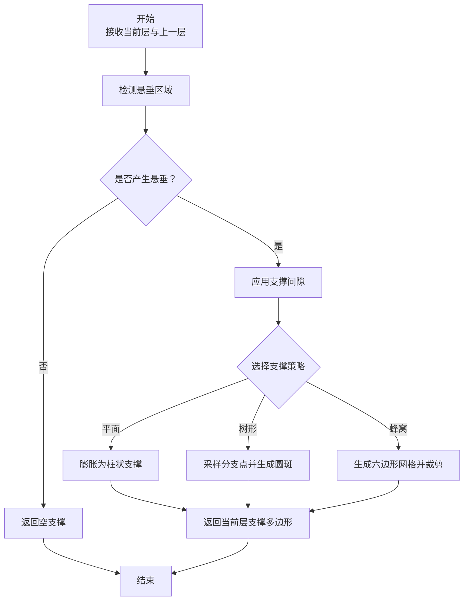

**图示来源** 
- [FdmSupport.cpp:48-76](file://support/FdmSupport.cpp#L48-L76)
- [FdmSupport.cpp:145-168](file://support/FdmSupport.cpp#L145-L168)
- [FdmSupport.cpp:244-267](file://support/FdmSupport.cpp#L244-L267)
- [OverhangDetector.cpp:41-87](file://support/OverhangDetector.cpp#L41-L87)

**章节来源**
- [FdmSupport.hpp:13-63](file://support/FdmSupport.hpp#L13-L63)
- [FdmSupport.cpp:48-76](file://support/FdmSupport.cpp#L48-L76)
- [FdmSupport.cpp:145-168](file://support/FdmSupport.cpp#L145-L168)
- [FdmSupport.cpp:244-267](file://support/FdmSupport.cpp#L244-L267)
- [OverhangDetector.cpp:41-87](file://support/OverhangDetector.cpp#L41-L87)

## 架构总览
FDM 支撑生成器位于支撑子系统中，通过统一抽象接口暴露单层与全层生成能力，并由上层管道（C ABI、C++ 模块、Lua）调用。

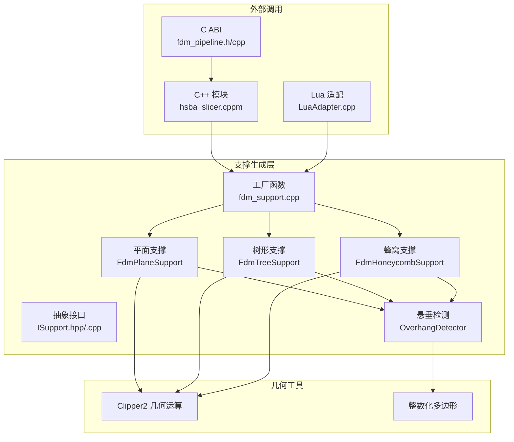

**图示来源** 
- [fdm_pipeline.h:17-39](file://DllHsBaSlicer/fdm_pipeline.h#L17-L39)
- [fdm_pipeline.cpp:17-27](file://DllHsBaSlicer/fdm_pipeline.cpp#L17-L27)
- [ModuleHsBaSlicer hsba_slicer.cppm:640-661](file://ModuleHsBaSlicer/hsba_slicer.cppm#L640-L661)
- [fdm_support.cpp:14-32](file://LibHsBaSlicer/Support/fdm_support.cpp#L14-L32)
- [ISupport.hpp:22-45](file://support/ISupport.hpp#L22-L45)
- [FdmSupport.hpp:19-63](file://support/FdmSupport.hpp#L19-L63)
- [OverhangDetector.hpp:20-49](file://support/OverhangDetector.hpp#L20-L49)

**章节来源**
- [fdm_pipeline.h:17-39](file://DllHsBaSlicer/fdm_pipeline.h#L17-L39)
- [fdm_pipeline.cpp:17-27](file://DllHsBaSlicer/fdm_pipeline.cpp#L17-L27)
- [ModuleHsBaSlicer hsba_slicer.cppm:640-661](file://ModuleHsBaSlicer/hsba_slicer.cppm#L640-L661)
- [fdm_support.cpp:14-32](file://LibHsBaSlicer/Support/fdm_support.cpp#L14-L32)
- [ISupport.hpp:22-45](file://support/ISupport.hpp#L22-L45)
- [FdmSupport.hpp:19-63](file://support/FdmSupport.hpp#L19-L63)
- [OverhangDetector.hpp:20-49](file://support/OverhangDetector.hpp#L20-L49)

## 核心概念
- 悬垂检测：比较当前层与上一层轮廓差异，根据角度阈值计算最大桥接距离，对差异区域进行负偏移（侵蚀）过滤可桥接的小悬垂。
- 支撑间隙：在模型与支撑之间留出间隙，避免支撑粘连模型表面。
- 支撑直径：决定柱状或分支支撑的半径大小。
- 支撑密度：用于控制支撑内部填充密度的参数（具体填充由后续填充阶段处理）。
- 支撑图案：枚举值 0=平面、1=树形、2=蜂窝。
- 蜂窝单元尺寸：控制六边形网格的大小。

关键配置字段默认值与含义如下：

| 配置项 | 类型 | 默认值 | 含义 |
|---|---:|---:|---|
| overhang_angle_threshold | float | 45.0 | 悬垂角度阈值（度） |
| layer_height | float | 0.2 | 层高（毫米） |
| support_gap | float | 0.5 | 支撑与模型间隙（毫米） |
| support_diameter | float | 2.0 | 支撑柱/分支直径（毫米） |
| support_density | float | 0.3 | 支撑填充密度 [0,1] |
| support_pattern | int | 0 | 支撑图案：0=平面，1=树形，2=蜂窝 |
| tree_branch_angle | float | 30.0 | 树形分支角度（度） |
| tree_max_branch_radius | float | 5.0 | 树形最大分支半径（毫米） |
| honeycomb_cell_size | float | 5.0 | 蜂窝单元尺寸（毫米） |

**章节来源**
- [SupportConfig.hpp:14-25](file://support/SupportConfig.hpp#L14-L25)
- [OverhangDetector.cpp:23-39](file://support/OverhangDetector.cpp#L23-L39)

## 核心模块详解

### 抽象接口与批量生成
ISupport 定义每层支撑生成的统一接口，并提供默认的全层遍历实现。

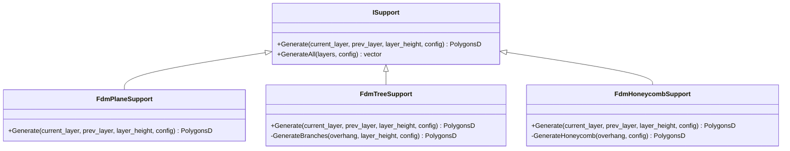

**图示来源** 
- [ISupport.hpp:22-45](file://support/ISupport.hpp#L22-L45)
- [ISupport.cpp:9-21](file://support/ISupport.cpp#L9-L21)
- [FdmSupport.hpp:19-63](file://support/FdmSupport.hpp#L19-L63)

**章节来源**
- [ISupport.hpp:22-45](file://support/ISupport.hpp#L22-L45)
- [ISupport.cpp:9-21](file://support/ISupport.cpp#L9-L21)

### 悬垂检测
悬垂检测通过两层轮廓差集与角度阈值计算，得到需要支撑的区域。

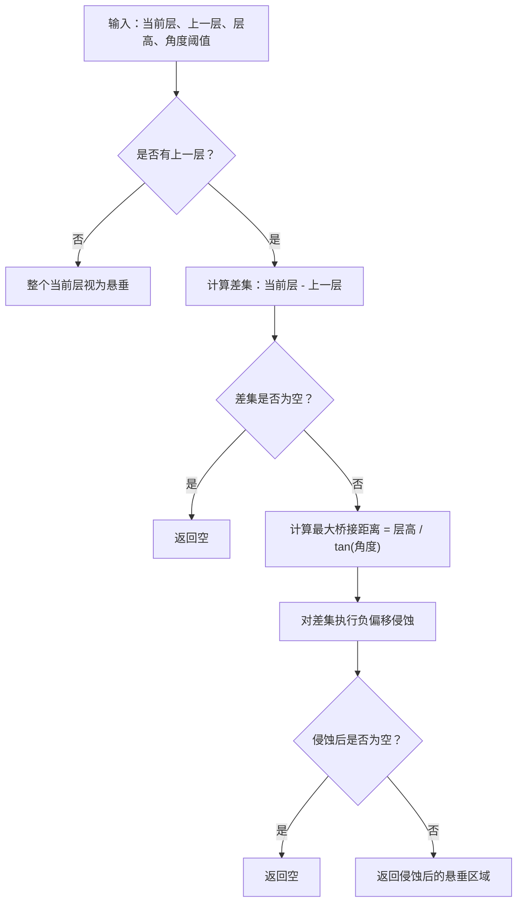

**图示来源** 
- [OverhangDetector.cpp:41-87](file://support/OverhangDetector.cpp#L41-L87)

**章节来源**
- [OverhangDetector.hpp:20-49](file://support/OverhangDetector.hpp#L20-L49)
- [OverhangDetector.cpp:23-39](file://support/OverhangDetector.cpp#L23-L39)
- [OverhangDetector.cpp:41-87](file://support/OverhangDetector.cpp#L41-L87)

### 平面支撑（FdmPlaneSupport）
平面支撑将悬垂区域先应用间隙收缩，再按支撑直径的一半向外膨胀，形成柱状支撑截面。

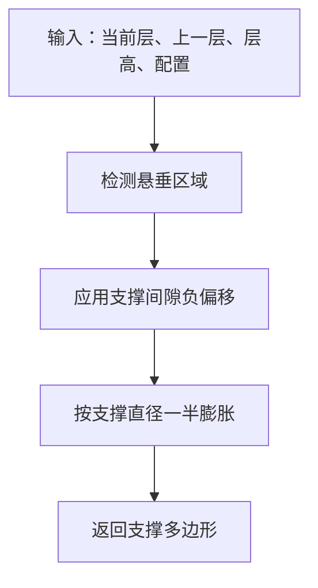

**图示来源** 
- [FdmSupport.cpp:48-76](file://support/FdmSupport.cpp#L48-L76)

**章节来源**
- [FdmSupport.hpp:13-24](file://support/FdmSupport.hpp#L13-L24)
- [FdmSupport.cpp:48-76](file://support/FdmSupport.cpp#L48-L76)

### 树形支撑（FdmTreeSupport）
树形支撑在悬垂区域内按固定间距采样候选分支点，若点在悬垂区域内则生成圆形分支截面，并对所有圆进行并集合并。

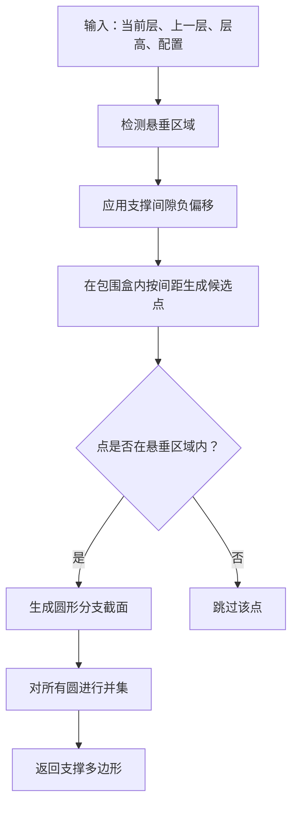

**图示来源** 
- [FdmSupport.cpp:81-143](file://support/FdmSupport.cpp#L81-L143)
- [FdmSupport.cpp:145-168](file://support/FdmSupport.cpp#L145-L168)

**章节来源**
- [FdmSupport.hpp:26-44](file://support/FdmSupport.hpp#L26-L44)
- [FdmSupport.cpp:81-143](file://support/FdmSupport.cpp#L81-L143)
- [FdmSupport.cpp:145-168](file://support/FdmSupport.cpp#L145-L168)

### 蜂窝支撑（FdmHoneycombSupport）
蜂窝支撑使用平顶六边形网格填充悬垂区域，先构建六边形集合，再与悬垂区域求交集。

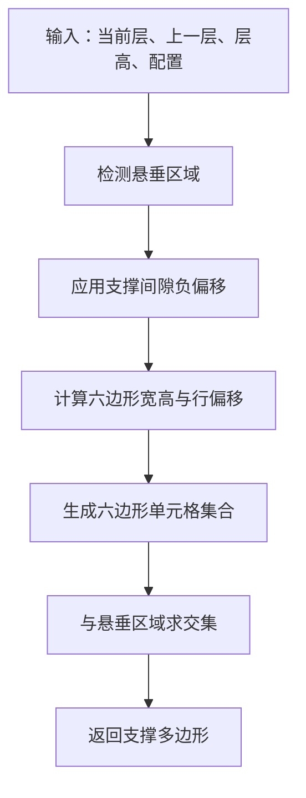

**图示来源** 
- [FdmSupport.cpp:173-242](file://support/FdmSupport.cpp#L173-L242)
- [FdmSupport.cpp:244-267](file://support/FdmSupport.cpp#L244-L267)

**章节来源**
- [FdmSupport.hpp:46-63](file://support/FdmSupport.hpp#L46-L63)
- [FdmSupport.cpp:173-242](file://support/FdmSupport.cpp#L173-L242)
- [FdmSupport.cpp:244-267](file://support/FdmSupport.cpp#L244-L267)

## 高级主题

### 支撑数据流与切片结果集成
支撑生成器通常作为切片流水线的一个阶段，与切片、填充、路径生成协同工作。

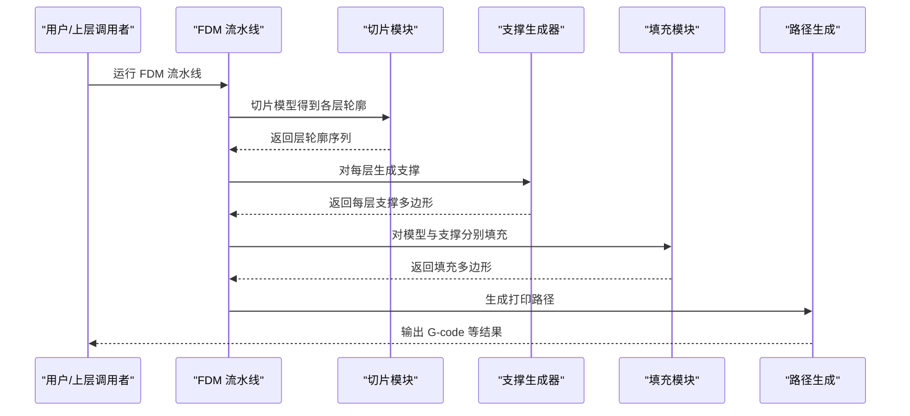

**图示来源** 
- [fdm_pipeline.h:23-35](file://DllHsBaSlicer/fdm_pipeline.h#L23-L35)
- [fdm_pipeline.cpp:17-27](file://DllHsBaSlicer/fdm_pipeline.cpp#L17-L27)
- [ModuleHsBaSlicer hsba_slicer.cppm:640-661](file://ModuleHsBaSlicer/hsba_slicer.cppm#L640-L661)

**章节来源**
- [fdm_pipeline.h:23-35](file://DllHsBaSlicer/fdm_pipeline.h#L23-L35)
- [fdm_pipeline.cpp:17-27](file://DllHsBaSlicer/fdm_pipeline.cpp#L17-L27)
- [ModuleHsBaSlicer hsba_slicer.cppm:640-661](file://ModuleHsBaSlicer/hsba_slicer.cppm#L640-L661)

### 性能特性与优化建议
- 几何运算复杂度：主要依赖 Clipper2 的多边形布尔运算（并集、交集、差集、偏移），时间复杂度与多边形顶点数量相关。
- 整数化与浮点转换：为避免精度问题，几何运算前会进行整数化，结束后再转回浮点。
- 稀疏采样：树形支撑采用网格采样，可通过调整间距减少候选点数量。
- 早返回：当悬垂为空或间隙收缩后为空时直接返回，避免无意义计算。
- 预分配：批量生成时对结果向量进行 reserve，减少动态扩容开销。

[本节为通用性能讨论，不直接分析具体代码文件]

### 错误处理与边界情况
- 无上一层：整个当前层被视为悬垂。
- 角度阈值极端值：角度≥90°时无悬垂；角度≤0°时全部悬垂。
- 间隙过大：负偏移后可能使悬垂区域消失，返回空支撑。
- 蜂窝单元尺寸非正：直接返回空结果。

**章节来源**
- [OverhangDetector.cpp:23-39](file://support/OverhangDetector.cpp#L23-L39)
- [OverhangDetector.cpp:41-87](file://support/OverhangDetector.cpp#L41-L87)
- [FdmSupport.cpp:173-179](file://support/FdmSupport.cpp#L173-L179)

## Lua 脚本系统
Lua 脚本可通过支持适配器注册自定义支撑生成器，或直接调用内置支撑生成函数。Lua 脚本中的 cfg 字段与 C++ 配置结构一致，包括悬垂角度、层高、间隙、直径、密度、图案、树形角度、树形最大分支半径、蜂窝单元尺寸等。

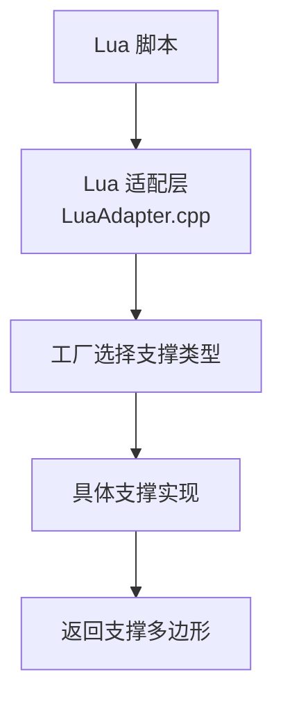

**图示来源** 
- [LuaAdapter.cpp:115-133](file://support/LuaAdapter.cpp#L115-L133)
- [fdm_support.cpp:14-32](file://LibHsBaSlicer/Support/fdm_support.cpp#L14-L32)

**章节来源**
- [LuaAdapter.cpp:115-133](file://support/LuaAdapter.cpp#L115-L133)
- [fdm_support.cpp:14-32](file://LibHsBaSlicer/Support/fdm_support.cpp#L14-L32)

## API 参考文档

### 公共接口
- ISupport::Generate：单层支撑生成接口。
- ISupport::GenerateAll：全层支撑生成默认实现。
- OverhangDetector::Detect：悬垂区域检测。
- OverhangDetector::MaxBridgeDistance：计算最大桥接距离。
- GenerateFdmSupport：根据配置选择具体支撑实现并生成单层支撑。
- GenerateAllFdmSupport：根据配置选择具体支撑实现并生成全层支撑。

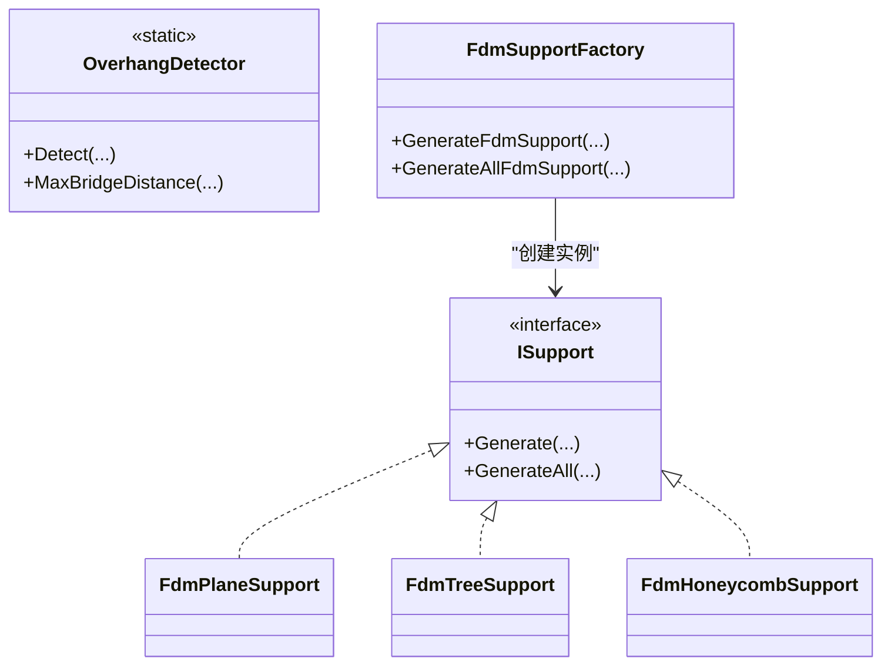

**图示来源** 
- [ISupport.hpp:22-45](file://support/ISupport.hpp#L22-L45)
- [OverhangDetector.hpp:20-49](file://support/OverhangDetector.hpp#L20-L49)
- [fdm_support.cpp:14-32](file://LibHsBaSlicer/Support/fdm_support.cpp#L14-L32)

**章节来源**
- [ISupport.hpp:22-45](file://support/ISupport.hpp#L22-L45)
- [OverhangDetector.hpp:20-49](file://support/OverhangDetector.hpp#L20-L49)
- [fdm_support.cpp:14-32](file://LibHsBaSlicer/Support/fdm_support.cpp#L14-L32)

### 配置与协议映射
FDM 管线配置中的支撑字段与 SupportConfig 字段对应关系如下：

| 协议字段 | 配置字段 | 说明 |
|---|---|---|
| fdm_pipe_config_support_angle | overhang_angle_threshold | 悬垂角度阈值 |
| fdm_pipe_config_support_gap | support_gap | 支撑间隙 |
| fdm_pipe_config_support_support_diameter | support_diameter | 支撑直径 |
| fdm_pipe_config_support_density | support_density | 支撑密度 |
| fdm_pipe_config_support_pattern | support_pattern | 支撑图案 |
| fdm_pipe_config_interface_layers | interface_layers | 界面层数（FDM） |
| fdm_pipe_config_interface_density | interface_density | 界面密度（FDM） |

**章节来源**
- [fdm_pipeline.proto:12-48](file://proto/fdm_pipeline.proto#L12-L48)
- [PipelineConfig2Msg.cpp:33-38](file://convert/PipelineConfig2Msg.cpp#L33-L38)
- [SupportConfig.hpp:14-34](file://support/SupportConfig.hpp#L14-L34)

## 集成指南

### 在 C++ 模块中使用支撑生成
FdmPipeline 提供 generateSupports 方法，将上层配置映射到 Support::FdmSupportConfig，并调用 GenerateAllFdmSupport。

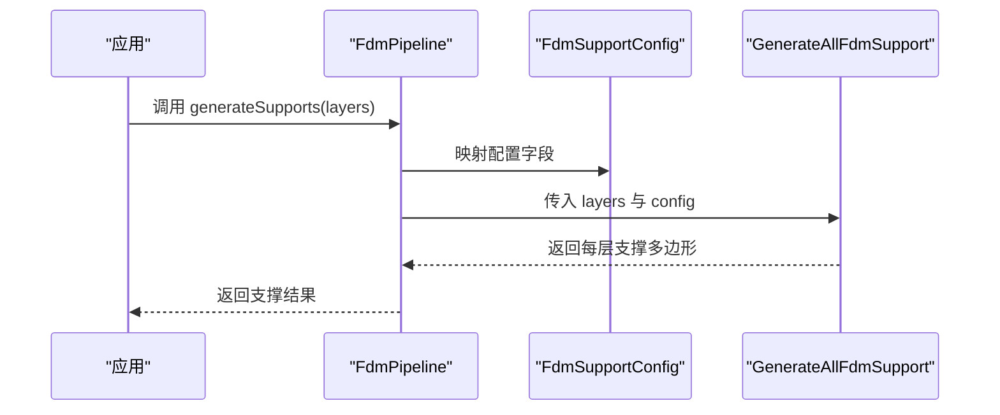

**图示来源** 
- [ModuleHsBaSlicer hsba_slicer.cppm:640-661](file://ModuleHsBaSlicer/hsba_slicer.cppm#L640-L661)
- [fdm_support.cpp:34-50](file://LibHsBaSlicer/Support/fdm_support.cpp#L34-L50)

**章节来源**
- [ModuleHsBaSlicer hsba_slicer.cppm:640-661](file://ModuleHsBaSlicer/hsba_slicer.cppm#L640-L661)
- [fdm_support.cpp:34-50](file://LibHsBaSlicer/Support/fdm_support.cpp#L34-L50)

### 在 C ABI 中调用 FDM 流水线
C ABI 暴露 HsBaRunFdmPipeline 等同步/异步接口，内部包含切片、支撑、填充、路径生成阶段。

**章节来源**
- [fdm_pipeline.h:23-39](file://DllHsBaSlicer/fdm_pipeline.h#L23-L39)
- [fdm_pipeline.cpp:17-27](file://DllHsBaSlicer/fdm_pipeline.cpp#L17-L27)

## 开发·测试与贡献

### 单元测试要点
- 不同支撑图案的生成结果非空验证。
- 全层生成返回层数与输入一致。
- 第一层无上一层时，整个足迹被视为悬垂。

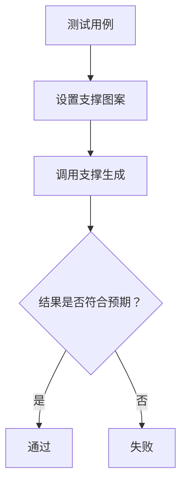

**图示来源** 
- [fdm_support_lib_test.cpp:41-71](file://tests\Support\fdm_support_lib_test.cpp#L41-L71)

**章节来源**
- [fdm_support_lib_test.cpp:41-71](file://tests\Support\fdm_support_lib_test.cpp#L41-L71)

## 扩展开发指南

### 自定义支撑算法扩展方法
- 继承 ISupport 并实现 Generate。
- 在工厂函数中注册新图案编号，或在 Lua 适配层注册自定义实现。
- 复用 OverhangDetector 与几何工具（Offset、Union、Intersect、Integerization）。

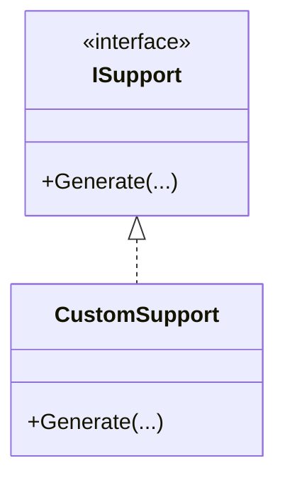

**图示来源** 
- [ISupport.hpp:22-45](file://support/ISupport.hpp#L22-L45)
- [LuaAdapter.cpp:115-133](file://support/LuaAdapter.cpp#L115-L133)

**章节来源**
- [ISupport.hpp:22-45](file://support/ISupport.hpp#L22-L45)
- [LuaAdapter.cpp:115-133](file://support/LuaAdapter.cpp#L115-L133)

### 性能调优技巧
- 调整支撑直径与间距以平衡支撑强度与材料用量。
- 合理设置悬垂角度阈值，避免过度支撑。
- 对大模型分块处理或使用并行切片（由上层流水线负责）。
- 避免过小的蜂窝单元尺寸，防止几何运算开销过大。

[本节为通用调优建议，不直接分析具体代码文件]

## 示例与教程

### 基本用法
- 使用默认配置运行 FDM 流水线。
- 设置支撑开启与图案类型。
- 观察每层支撑多边形输出。

**章节来源**
- [samples\FDM\main.cpp:1-51](file://samples\FDM\main.cpp#L1-L51)

### 代码片段路径
- 平面支撑生成：[FdmSupport.cpp:48-76](file://support/FdmSupport.cpp#L48-L76)
- 树形支撑分支生成：[FdmSupport.cpp:81-143](file://support/FdmSupport.cpp#L81-L143)
- 蜂窝支撑网格生成：[FdmSupport.cpp:173-242](file://support/FdmSupport.cpp#L173-L242)
- 悬垂检测主流程：[OverhangDetector.cpp:41-87](file://support/OverhangDetector.cpp#L41-L87)
- 工厂选择支撑类型：[fdm_support.cpp:14-32](file://LibHsBaSlicer/Support/fdm_support.cpp#L14-L32)

## 部署·故障排除与FAQ

### 常见问题
- 支撑未生成：检查悬垂角度阈值是否过高；确认支撑间隙未导致悬垂区域被完全收缩。
- 支撑过多：降低悬垂角度阈值或增大支撑直径以减少分支点密度。
- 蜂窝支撑空洞：增大蜂窝单元尺寸或减小间隙。
- 性能瓶颈：减少候选点数量（树形支撑）、避免过小几何单元（蜂窝支撑）。

**章节来源**
- [OverhangDetector.cpp:41-87](file://support/OverhangDetector.cpp#L41-L87)
- [FdmSupport.cpp:81-143](file://support/FdmSupport.cpp#L81-L143)
- [FdmSupport.cpp:173-242](file://support/FdmSupport.cpp#L173-L242)

## 附录

### 类关系图（支撑子系统）
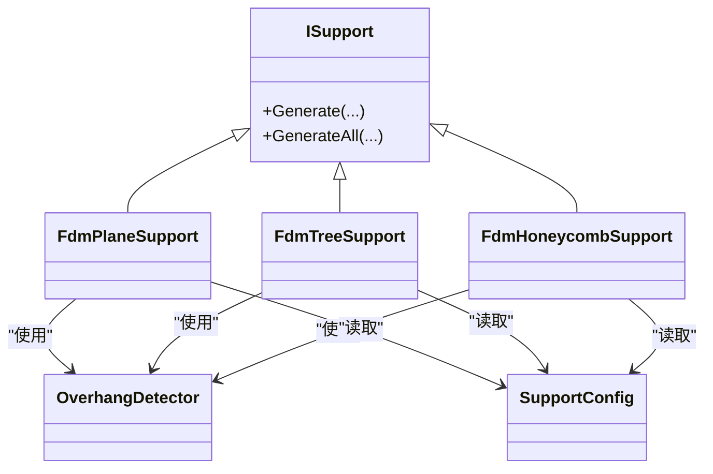

**图示来源** 
- [ISupport.hpp:22-45](file://support/ISupport.hpp#L22-L45)
- [FdmSupport.hpp:19-63](file://support/FdmSupport.hpp#L19-L63)
- [OverhangDetector.hpp:20-49](file://support/OverhangDetector.hpp#L20-L49)
- [SupportConfig.hpp:14-34](file://support/SupportConfig.hpp#L14-L34)