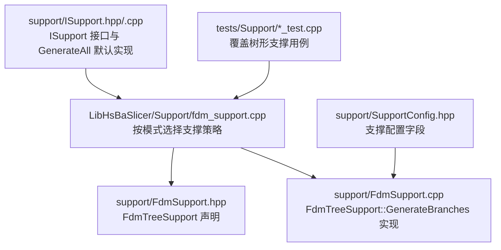
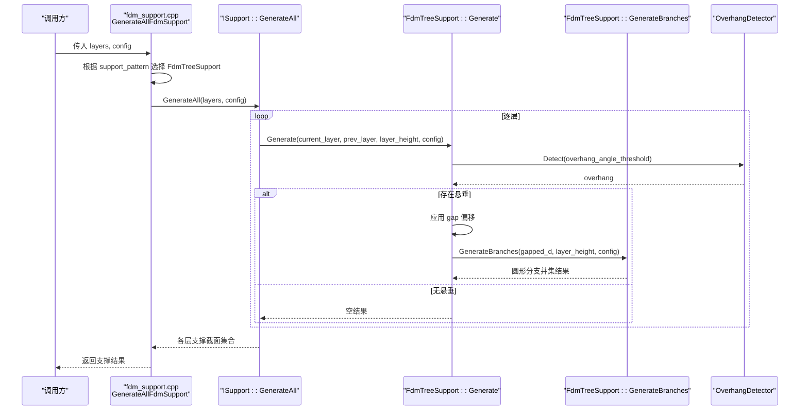
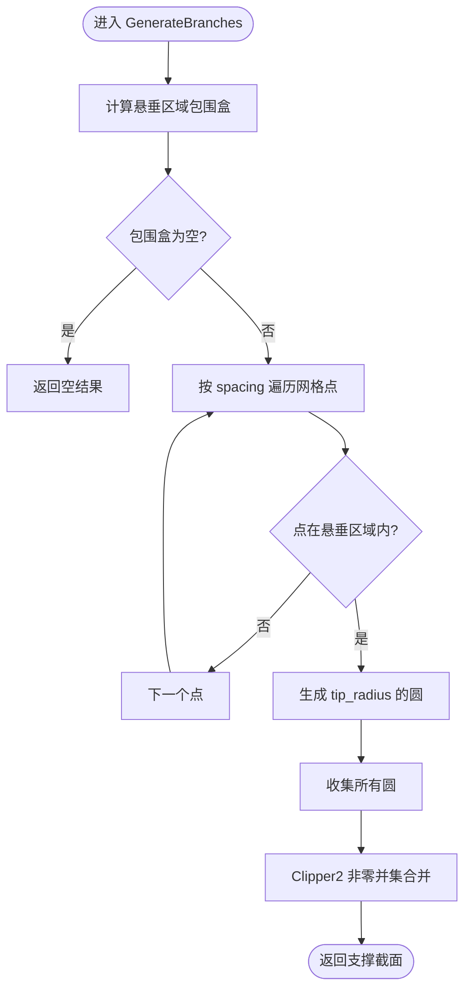
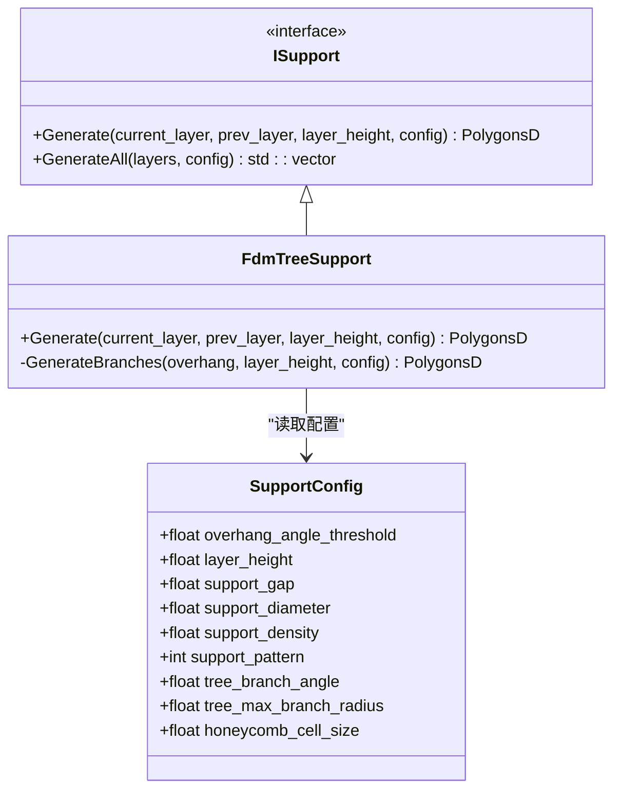
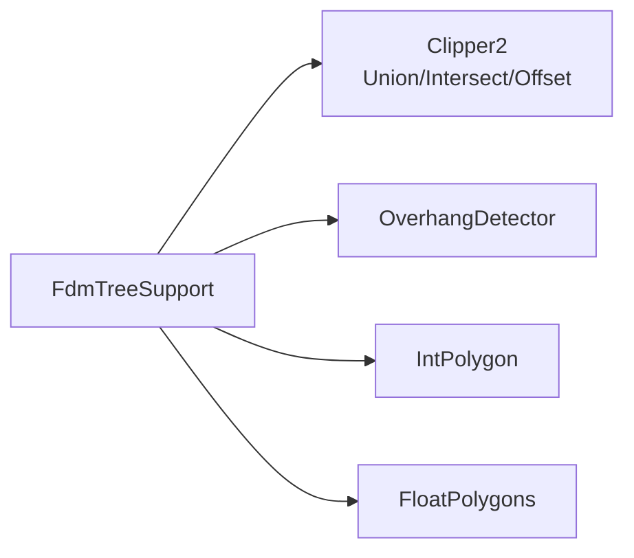

# FDM 树形支撑生成器

<cite>
**本文引用的文件**   
- [FdmSupport.hpp](file://support/FdmSupport.hpp)
- [FdmSupport.cpp](file://support/FdmSupport.cpp)
- [ISupport.hpp](file://support/ISupport.hpp)
- [ISupport.cpp](file://support/ISupport.cpp)
- [SupportConfig.hpp](file://support/SupportConfig.hpp)
- [fdm_support.hpp](file://LibHsBaSlicer/Support/fdm_support.hpp)
- [fdm_support.cpp](file://LibHsBaSlicer/Support/fdm_support.cpp)
- [support_test.cpp](file://tests\Support\support_test.cpp)
- [fdm_support_lib_test.cpp](file://tests\Support\fdm_support_lib_test.cpp)
</cite>

## 目录
1. [引言](#引言)
2. [项目结构](#项目结构)
3. [核心组件](#核心组件)
4. [架构总览](#架构总览)
5. [详细组件分析](#详细组件分析)
6. [依赖关系分析](#依赖关系分析)
7. [性能与参数调优](#性能与参数调优)
8. [故障排除指南](#故障排除指南)
9. [结论](#结论)
10. [附录：扩展自定义分支算法](#附录：扩展自定义分支算法)

## 引言
本文聚焦于 FDM 树形支撑生成器的实现，重点解释 `FdmTreeSupport` 类的分支生长思路与当前二维截面实现。文档将说明悬垂区域检测、分支起点采样、圆形分支尖端的并集合并流程，以及层间调用链如何驱动整个支撑生成过程。同时对比树形支撑与平面支撑在材料用量、移除便利性与表面质量方面的差异，并给出关键参数的配置方法与效果建议。最后提供扩展自定义分支算法和性能调优的实践路径。

## 项目结构
围绕 FDM 支撑生成的代码主要分布在以下位置：
- 支撑策略接口与具体实现：`support/ISupport.*`、`support/FdmSupport.*`、`support/SupportConfig.hpp`
- 对外 C++ API 分发层：`LibHsBaSlicer/Support/fdm_support.*`
- 单元测试：`tests/Support/support_test.cpp`、`tests/Support/fdm_support_lib_test.cpp`

**图表来源**
- [fdm_support.cpp:14-51](file://LibHsBaSlicer/Support/fdm_support.cpp#L14-L51)
- [FdmSupport.hpp:26-44](file://support/FdmSupport.hpp#L26-L44)
- [FdmSupport.cpp:78-168](file://support/FdmSupport.cpp#L78-L168)
- [ISupport.hpp:16-45](file://support/ISupport.hpp#L16-L45)
- [ISupport.cpp:9-21](file://support/ISupport.cpp#L9-L21)
- [SupportConfig.hpp:14-25](file://support/SupportConfig.hpp#L14-L25)

**章节来源**
- [fdm_support.cpp:14-51](file://LibHsBaSlicer/Support/fdm_support.cpp#L14-L51)
- [FdmSupport.hpp:26-44](file://support/FdmSupport.hpp#L26-L44)
- [FdmSupport.cpp:78-168](file://support/FdmSupport.cpp#L78-L168)
- [ISupport.hpp:16-45](file://support/ISupport.hpp#L16-L45)
- [ISupport.cpp:9-21](file://support/ISupport.cpp#L9-L21)
- [SupportConfig.hpp:14-25](file://support/SupportConfig.hpp#L14-L25)

## 核心组件
- `ISupport`：定义单层的支撑生成接口 `Generate` 与批量生成默认实现 `GenerateAll`。
- `FdmTreeSupport`：继承 `ISupport`，实现树形支撑的每层截面生成；内部静态方法 `GenerateBranches` 负责从悬垂区域采样并生成圆形分支尖端。
- `SupportConfig` / `FdmSupportConfig`：支撑通用与 FDM 专用配置，包含悬垂角度阈值、层高、间隙、直径、密度、图案类型、树形分支角度与最大半径等。
- `LibHsBaSlicer/Support/fdm_support.*`：对外暴露 `GenerateFdmSupport` 与 `GenerateAllFdmSupport`，根据 `support_pattern` 分派到平面、树形或蜂窝支撑。

**章节来源**
- [ISupport.hpp:16-45](file://support/ISupport.hpp#L16-L45)
- [ISupport.cpp:9-21](file://support/ISupport.cpp#L9-L21)
- [FdmSupport.hpp:26-44](file://support/FdmSupport.hpp#L26-L44)
- [SupportConfig.hpp:14-25](file://support/SupportConfig.hpp#L14-L25)
- [fdm_support.hpp:19-37](file://LibHsBaSlicer/Support/fdm_support.hpp#L19-L37)

## 架构总览
FDM 支撑生成采用“策略 + 分发”的轻量架构：上层通过统一 API 传入当前层与前一层的轮廓，由分发函数依据配置选择具体支撑策略（平面/树形/蜂窝），再由策略对象计算该层支撑截面。

**图表来源**
- [fdm_support.cpp:34-51](file://LibHsBaSlicer/Support/fdm_support.cpp#L34-L51)
- [ISupport.cpp:9-21](file://support/ISupport.cpp#L9-L21)
- [FdmSupport.cpp:145-168](file://support/FdmSupport.cpp#L145-L168)
- [FdmSupport.cpp:81-143](file://support/FdmSupport.cpp#L81-L143)

## 详细组件分析

### FdmTreeSupport 类与 GenerateBranches 静态方法
`FdmTreeSupport` 在当前实现中，以二维截面方式工作：对每一层检测悬垂区域，应用间隙后，在悬垂区域内按固定间距采样点，为每个有效点生成一个圆形分支尖端，最终对这些圆进行并集合并得到该层支撑截面。

关键点：
- 悬垂检测：使用 `OverhangDetector::Detect`，基于当前层与前一层轮廓及悬垂角度阈值。
- 间隙处理：对悬垂区域做负向偏移，形成模型与支撑之间的分离距离。
- 分支采样：在悬垂区域的包围盒内按 `spacing = support_diameter * 1.5` 的网格采样，判断点是否在悬垂区域内。
- 分支尖端：每个采样点生成半径为 `support_diameter / 2` 的多边形圆（24 段）。
- 合并逻辑：将所有分支圆收集后，使用 Clipper2 的非零填充规则进行并集，得到最终的支撑截面多边形集合。

注意：当前实现并未显式建模“向上生长策略”和“分支合并逻辑”，而是通过层间迭代与每层的圆并集间接体现“向下扩张”的效果。真正的三维分支生长、角度控制与合并需要在更高层或后续版本中补充。

**图表来源**
- [FdmSupport.cpp:81-143](file://support/FdmSupport.cpp#L81-L143)

**章节来源**
- [FdmSupport.cpp:81-143](file://support/FdmSupport.cpp#L81-L143)
- [FdmSupport.cpp:145-168](file://support/FdmSupport.cpp#L145-L168)

### 分层调用链与默认批量生成
`ISupport::GenerateAll` 提供默认实现：从底层到顶层逐层调用 `Generate`，首层无前一层轮廓。`FdmTreeSupport::Generate` 先检测悬垂、应用间隙，再调用 `GenerateBranches` 生成该层支撑截面。

**图表来源**
- [ISupport.hpp:16-45](file://support/ISupport.hpp#L16-L45)
- [FdmSupport.hpp:26-44](file://support/FdmSupport.hpp#L26-L44)
- [SupportConfig.hpp:14-25](file://support/SupportConfig.hpp#L14-L25)

**章节来源**
- [ISupport.cpp:9-21](file://support/ISupport.cpp#L9-L21)
- [FdmSupport.cpp:145-168](file://support/FdmSupport.cpp#L145-L168)

### 悬垂点检测与分支起点确定
- 悬垂检测：`OverhangDetector::Detect` 接收当前层、前一层的轮廓与悬垂角度阈值，输出悬垂区域。
- 分支起点：在悬垂区域的包围盒内按固定间距采样，若采样点位于悬垂区域内则作为分支起点。
- 分支半径：分支尖端半径等于 `support_diameter / 2`。
- 分支密度：由 `spacing = support_diameter * 1.5` 决定，即分支点间距约为直径的 1.5 倍。

**章节来源**
- [FdmSupport.cpp:145-168](file://support/FdmSupport.cpp#L145-L168)
- [FdmSupport.cpp:81-143](file://support/FdmSupport.cpp#L81-L143)
- [SupportConfig.hpp:14-25](file://support/SupportConfig.hpp#L14-L25)

### 向上生长策略与分支合并逻辑
- 向上生长策略：当前实现未显式建模“向上生长”。实际效果通过层间迭代与每层圆并集间接体现：随着层数下降，相邻层的圆会因偏移与并集而逐渐连接，形成类似“向下扩张”的视觉效果。
- 分支合并逻辑：通过 Clipper2 的非零填充规则对所有分支圆执行并集，使相邻圆融合成连续支撑截面。

需要指出的是，当前实现没有直接使用 `tree_branch_angle` 与 `tree_max_branch_radius` 这两个配置字段；它们属于通用配置，但未被树形支撑分支算法消费。未来可在分支采样或半径计算中引入这些参数以实现更真实的三维分支形态。

**章节来源**
- [FdmSupport.cpp:81-143](file://support/FdmSupport.cpp#L81-L143)
- [SupportConfig.hpp:14-25](file://support/SupportConfig.hpp#L14-L25)

## 依赖关系分析
- 外部几何库：Clipper2 用于点面包含测试、多边形偏移、并集与交集运算。
- 悬垂检测：`OverhangDetector` 提供悬垂区域计算。
- 整数化与浮点转换：`Integerization` / `UnIntegerization` 用于精度与性能平衡。
- 2D 几何工具：`IntPolygon` 与 `FloatPolygons` 提供基础多边形操作。

**图表来源**
- [FdmSupport.cpp:1-13](file://support/FdmSupport.cpp#L1-L13)
- [FdmSupport.cpp:18-43](file://support/FdmSupport.cpp#L18-L43)

**章节来源**
- [FdmSupport.cpp:1-13](file://support/FdmSupport.cpp#L1-L13)
- [FdmSupport.cpp:18-43](file://support/FdmSupport.cpp#L18-L43)

## 性能与参数调优
- 分支密度：由 `spacing = support_diameter * 1.5` 控制。增大 `support_diameter` 会降低分支密度，减少并集计算量；减小则会提高密度但增加几何复杂度。
- 分支角度与最大半径：当前实现未使用 `tree_branch_angle` 与 `tree_max_branch_radius`。若需真实三维分支形态，可在分支半径计算与方向向量中使用这些参数。
- 最小分支长度：当前实现未显式过滤短分支。可通过在采样阶段加入最小长度阈值来避免过密或无效分支。
- 间隙与直径：`support_gap` 影响悬垂区域收缩程度；`support_diameter` 决定分支尖端大小与间距。
- 悬垂角度阈值：`overhang_angle_threshold` 越大，越容易判定悬垂，支撑面积可能增大。

建议：
- 对于大悬垂区域，适当增大 `support_diameter` 以降低分支数量，提升性能。
- 对表面质量要求高的区域，可减小 `support_gap` 以获得更贴合的支撑接触面。
- 若希望减少支撑材料，可降低 `support_density`（虽然当前树形分支不直接使用该字段）或通过稀疏采样降低分支密度。

**章节来源**
- [FdmSupport.cpp:81-143](file://support/FdmSupport.cpp#L81-L143)
- [SupportConfig.hpp:14-25](file://support/SupportConfig.hpp#L14-L25)

## 故障排除指南
- 无支撑输出：检查悬垂检测是否返回空结果；确认 `overhang_angle_threshold` 设置合理。
- 支撑过密或性能差：增大 `support_diameter` 以减少分支点数；或调整采样间距。
- 支撑与模型粘连：增大 `support_gap` 以避免支撑与模型直接接触。
- 分支未合并：确认 Clipper2 并集规则为非零填充；检查输入多边形是否闭合且有效。

**章节来源**
- [FdmSupport.cpp:145-168](file://support/FdmSupport.cpp#L145-L168)
- [FdmSupport.cpp:81-143](file://support/FdmSupport.cpp#L81-L143)

## 结论
当前 FDM 树形支撑生成器以二维截面为核心，通过悬垂检测、间隙处理与网格采样生成圆形分支尖端，并使用 Clipper2 并集合并得到支撑截面。其优势在于实现简洁、易于集成与调试；不足在于尚未完整实现三维分支生长、角度控制与分支合并逻辑。未来可在现有基础上引入 `tree_branch_angle` 与 `tree_max_branch_radius`，并结合层间状态管理实现更真实的树形支撑结构。

[本节不直接分析具体源码文件]

## 附录：扩展自定义分支算法
若要扩展自定义分支算法，推荐以下步骤：
1. 新增支撑策略类：继承 `ISupport`，实现 `Generate` 方法。
2. 在分发层注册新策略：修改 `fdm_support.cpp` 中的 `switch (config.support_pattern)`，为新策略添加分支。
3. 在配置中新增字段：在 `SupportConfig` 或 `FdmSupportConfig` 中添加必要参数。
4. 编写单元测试：参考 `tests/Support/fdm_support_lib_test.cpp` 与 `tests/Support/support_test.cpp`，验证新策略的正确性。

示例扩展点：
- 在 `FdmTreeSupport::GenerateBranches` 中引入分支方向向量与角度控制。
- 在层间迭代中维护分支树结构，实现真正的向上生长与合并逻辑。
- 引入最小分支长度过滤与自适应密度控制。

**章节来源**
- [fdm_support.cpp:14-51](file://LibHsBaSlicer/Support/fdm_support.cpp#L14-L51)
- [SupportConfig.hpp:14-25](file://support/SupportConfig.hpp#L14-L25)
- [fdm_support_lib_test.cpp:24-71](file://tests\Support\fdm_support_lib_test.cpp#L24-L71)
- [support_test.cpp:137-153](file://tests\Support\support_test.cpp#L137-L153)