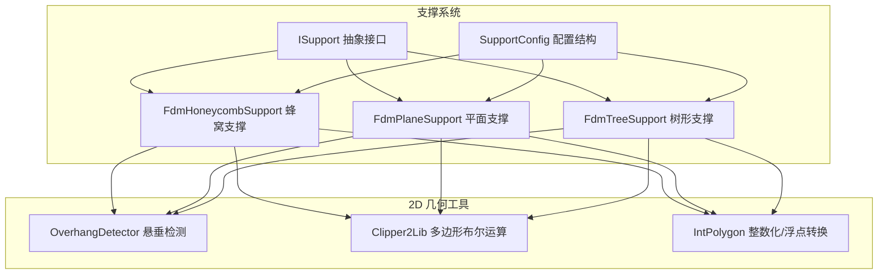
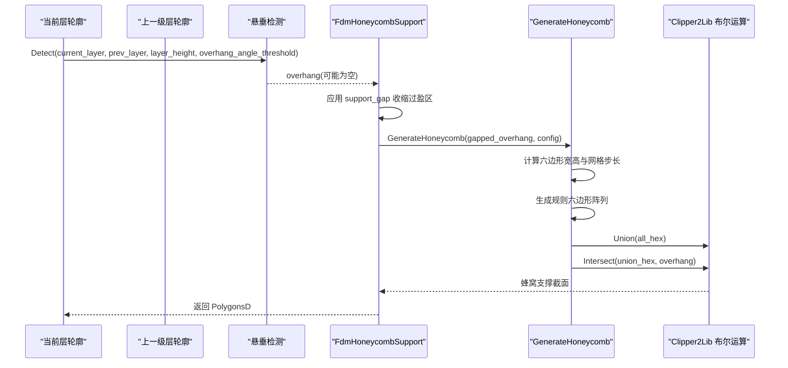
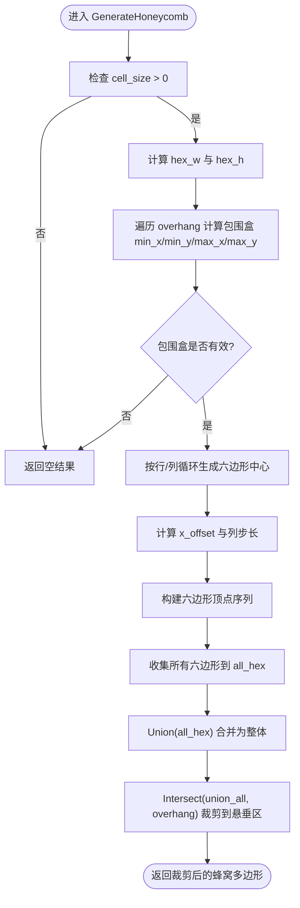
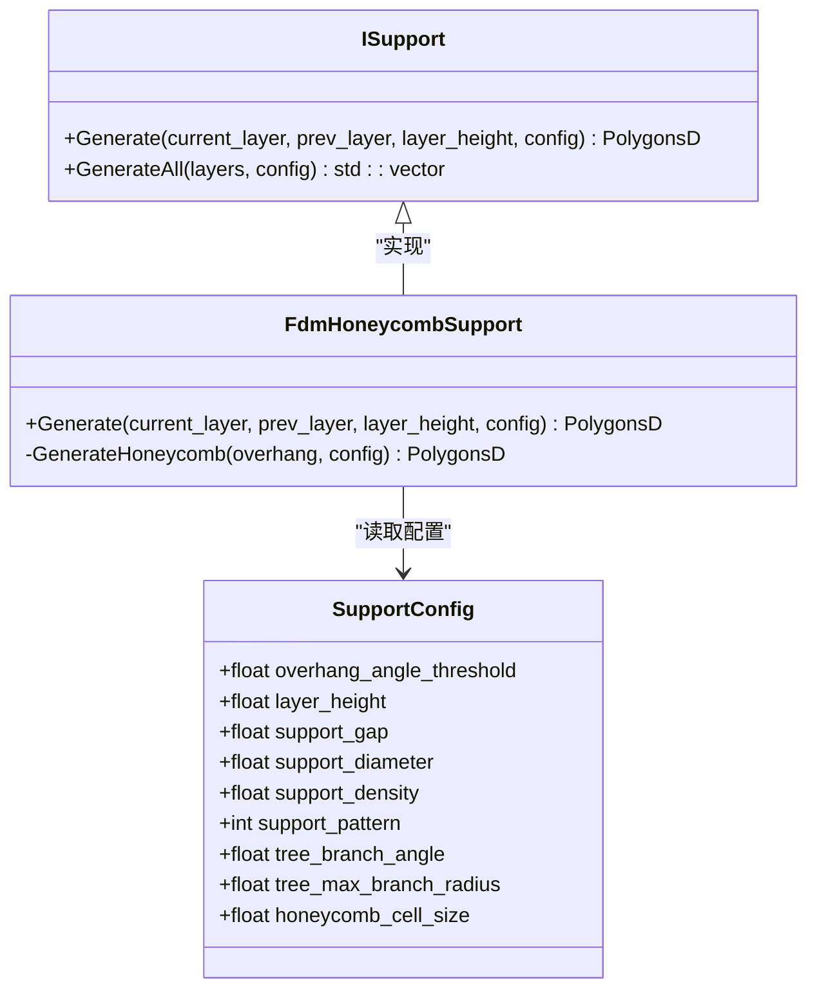
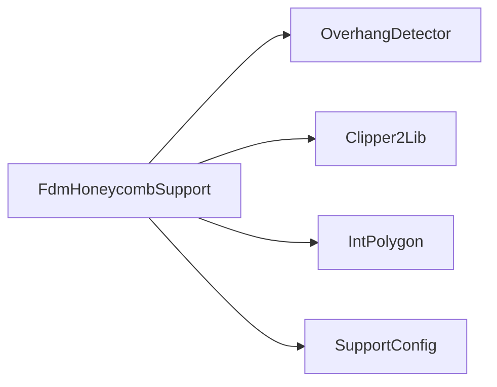

# FDM 蜂窝支撑生成器

<cite>
**本文引用的文件**   
- [FdmSupport.hpp](file://support/FdmSupport.hpp)
- [FdmSupport.cpp](file://support/FdmSupport.cpp)
- [ISupport.hpp](file://support/ISupport.hpp)
- [SupportConfig.hpp](file://support/SupportConfig.hpp)
- [support_test.cpp](file://tests\Support\support_test.cpp)
- [fdm_support_lib_test.cpp](file://tests\Support\fdm_support_lib_test.cpp)
</cite>

## 目录
1. [引言](#引言)
2. [项目结构](#项目结构)
3. [核心组件](#核心组件)
4. [架构总览](#架构总览)
5. [详细组件分析](#详细组件分析)
6. [依赖关系分析](#依赖关系分析)
7. [性能与复杂度](#性能与复杂度)
8. [参数配置与视觉效果](#参数配置与视觉效果)
9. [自定义扩展与适配策略](#自定义扩展与适配策略)
10. [故障排除指南](#故障排除指南)
11. [结论](#结论)

## 引言
本文件面向 FDM 切片与支撑系统，聚焦蜂窝支撑生成器。目标包括：
- 深入解释 FdmHoneycombSupport 类的六边形网格填充算法与 GenerateHoneycomb 静态方法实现细节。
- 说明蜂窝结构的几何构造原理：六边形单元尺寸控制、网格对齐策略与边界处理机制。
- 阐述蜂窝支撑的结构优势：轻量化设计、高刚度与良好支撑性能。
- 提供单元格大小、壁厚（通过后续路径生成阶段控制）、旋转角度等参数的配置方法与可视化对比思路。
- 给出蜂窝图案的自定义扩展方法与对不同模型形状的适配策略。

## 项目结构
与蜂窝支撑直接相关的代码位于 support 模块，包含接口定义、具体实现与通用配置；测试用例覆盖行为验证。

图表来源
- [FdmSupport.hpp:19-63](file://support/FdmSupport.hpp#L19-L63)
- [ISupport.hpp:22-45](file://support/ISupport.hpp#L22-L45)
- [SupportConfig.hpp:14-25](file://support/SupportConfig.hpp#L14-L25)

章节来源
- [FdmSupport.hpp:1-67](file://support/FdmSupport.hpp#L1-L67)
- [ISupport.hpp:1-49](file://support/ISupport.hpp#L1-L49)
- [SupportConfig.hpp:1-47](file://support/SupportConfig.hpp#L1-L47)

## 核心组件
- ISupport：定义每层支撑生成的统一接口，支持单层的 Generate 与批量 GenerateAll。
- SupportConfig：支撑系统的通用配置，包含悬垂角度阈值、层高、间隙、直径、密度、图案类型、树形分支角度与半径、蜂窝单元尺寸等。
- FdmHoneycombSupport：基于悬垂区域生成蜂窝状支撑截面，核心为 GenerateHoneycomb 静态方法。

章节来源
- [ISupport.hpp:22-45](file://support/ISupport.hpp#L22-L45)
- [SupportConfig.hpp:14-25](file://support/SupportConfig.hpp#L14-L25)
- [FdmSupport.hpp:52-63](file://support/FdmSupport.hpp#L52-L63)

## 架构总览
FDM 支撑生成流程遵循“悬垂检测 → 间隙处理 → 图案生成”的统一范式。蜂窝支撑与其他两种支撑（平面、树形）共享同一接口与配置体系，差异在于图案生成阶段。

图表来源
- [FdmSupport.cpp:173-266](file://support/FdmSupport.cpp#L173-L266)
- [FdmSupport.cpp:244-267](file://support/FdmSupport.cpp#L244-L267)

## 详细组件分析

### FdmHoneycombSupport 类与 GenerateHoneycomb 静态方法
- 职责：在给定悬垂区域上生成蜂窝状支撑截面。
- 输入：
  - overhang：由 OverhangDetector 输出的悬垂区域（已应用间隙）。
  - config：包含 honeycomb_cell_size 等参数。
- 输出：PolygonsD，即蜂窝支撑的多边形集合。

关键实现要点：
- 单元格尺寸控制：cell_size 来自 config.honeycomb_cell_size；若小于等于 0，直接返回空结果。
- 六边形几何：采用平顶六边形（flat-top），宽度 hex_w = cell_size，高度 hex_h = cell_size × √3 / 2。
- 网格对齐策略：行间距为 hex_h；偶数行 x_offset = 0，奇数行 x_offset = hex_w × 0.75；列间距为 hex_w × 1.5，形成交错蜂窝排布。
- 六边形顶点生成：以 (x, y) 为中心，按 π/3 步进角度，半径取 cell_size × 0.5，依次计算六个顶点。
- 边界处理机制：先生成大量六边形并合并为一个整体多边形集，再与原始 overhang 做交集，从而自动裁剪到悬垂区域内。
- 间隙处理：在调用 GenerateHoneycomb 前，先对 overhang 执行 Offset(-gap)，确保支撑与模型之间保持指定间隙。

图表来源
- [FdmSupport.cpp:173-241](file://support/FdmSupport.cpp#L173-L241)

章节来源
- [FdmSupport.cpp:173-266](file://support/FdmSupport.cpp#L173-L266)
- [FdmSupport.hpp:52-63](file://support/FdmSupport.hpp#L52-L63)

### 与 ISupport 接口的集成
- FdmHoneycombSupport 继承自 ISupport，实现 Generate 方法，内部委托给 GenerateHoneycomb。
- 标准流程：
  1) 使用 OverhangDetector::Detect 获取悬垂区域。
  2) 根据 support_gap 对悬垂区域进行收缩（Offset）。
  3) 将收缩后的区域传入 GenerateHoneycomb 生成蜂窝图案。
  4) 返回最终的多边形集合。

图表来源
- [ISupport.hpp:22-45](file://support/ISupport.hpp#L22-L45)
- [FdmSupport.hpp:52-63](file://support/FdmSupport.hpp#L52-L63)
- [SupportConfig.hpp:14-25](file://support/SupportConfig.hpp#L14-L25)

章节来源
- [FdmSupport.cpp:244-267](file://support/FdmSupport.cpp#L244-L267)
- [ISupport.hpp:22-45](file://support/ISupport.hpp#L22-L45)
- [SupportConfig.hpp:14-25](file://support/SupportConfig.hpp#L14-L25)

## 依赖关系分析
- 外部库与工具：
  - Clipper2Lib：用于多边形并集与交集运算，保证蜂窝图案与悬垂区域的精确裁剪。
  - IntPolygon：负责浮点多边形与整型多边形的相互转换，提升布尔运算精度与性能。
  - OverhangDetector：检测悬垂区域，作为支撑生成的输入。
- 内部耦合：
  - FdmHoneycombSupport 与 OverhangDetector、Clipper2Lib、IntPolygon 存在强依赖。
  - 与 FdmPlaneSupport、FdmTreeSupport 无直接耦合，但共享 ISupport 接口与 SupportConfig 配置。

图表来源
- [FdmSupport.cpp:173-266](file://support/FdmSupport.cpp#L173-L266)
- [FdmSupport.hpp:52-63](file://support/FdmSupport.hpp#L52-L63)
- [SupportConfig.hpp:14-25](file://support/SupportConfig.hpp#L14-L25)

章节来源
- [FdmSupport.cpp:173-266](file://support/FdmSupport.cpp#L173-L266)

## 性能与复杂度
- 时间复杂度：
  - 六边形网格生成：O(R×C)，其中 R 为行数，C 为列数，取决于悬垂区域包围盒与 hex_w/hex_h。
  - 多边形并集与交集：由 Clipper2Lib 实现，通常接近 O(N log N) 或更优，N 为参与运算的边数。
- 空间复杂度：
  - 存储所有六边形与中间多边形集合，随悬垂区域面积与 cell_size 变化。
- 优化建议：
  - 合理设置 honeycomb_cell_size，避免过小导致网格过密。
  - 利用包围盒快速判断空区域，减少无效计算。
  - 复用 Clipper2Lib 的 FillRule 与非零填充策略，提高布尔运算效率。

[本节为一般性讨论，不直接分析具体文件]

## 参数配置与视觉效果
- honeycomb_cell_size：蜂窝单元尺寸，单位 mm。值越大，单元越稀疏；值越小，单元越密集。默认值为 5.0f。
- support_gap：支撑与模型之间的间隙，单位 mm。默认值为 0.5f。
- support_diameter：主要用于平面与树形支撑；蜂窝支撑中不直接影响单元尺寸，但影响其他支撑类型的柱体直径。
- support_density：支撑填充密度，范围 [0,1]，用于控制支撑实体体积比例（具体由路径生成阶段决定）。
- support_pattern：选择支撑图案类型，0=Plane，1=Tree，2=Honeycomb。

视觉效果对比思路：
- 小 cell_size（如 3mm）：蜂窝细密，支撑面更均匀，材料用量增加，适合高精度表面。
- 大 cell_size（如 8mm）：蜂窝稀疏，材料用量减少，支撑刚度下降，适合粗加工或大跨度悬垂。
- 增大 support_gap：支撑与模型分离更明显，便于移除，但可能降低支撑接触稳定性。
- 不同 support_pattern：
  - Plane：简单柱状支撑，易于打印与移除。
  - Tree：树枝状支撑，接触点少，材料省，但需要层间连接逻辑。
  - Honeycomb：蜂窝状支撑，轻量化且刚性好，适合大面积悬垂。

章节来源
- [SupportConfig.hpp:14-25](file://support/SupportConfig.hpp#L14-L25)
- [support_test.cpp:168-190](file://tests\Support\support_test.cpp#L168-L190)
- [fdm_support_lib_test.cpp:39-56](file://tests\Support\fdm_support_lib_test.cpp#L39-L56)

## 自定义扩展与适配策略
- 自定义蜂窝图案：
  - 可替换 GenerateHoneycomb 中的六边形生成逻辑，改为菱形、三角形或其他周期性图案。
  - 调整 x_offset 与列步长，实现不同的交错排列方式。
  - 引入旋转角度参数，对每个六边形施加旋转变换，以获得不同视觉与力学效果。
- 与不同模型形状适配：
  - 对于复杂边界，保持 Union+Intersect 的两阶段策略，确保图案被精确裁剪到悬垂区域。
  - 对薄壁或窄悬垂区域，适当增大 cell_size 以避免过多碎片多边形。
  - 对曲面悬垂，结合层间信息（layer_height）与悬垂角度阈值，动态调整蜂窝密度。
- 与路径生成阶段联动：
  - 蜂窝支撑的“壁厚”并非在 GenerateHoneycomb 中直接设定，而是由后续路径生成阶段根据 support_diameter 与 support_density 控制。
  - 可通过调整 support_diameter 与 support_density 来改变实际打印壁厚与支撑强度。

[本节为概念性指导，不直接分析具体文件]

## 故障排除指南
- 问题：未生成任何支撑。
  - 可能原因：
    - overhang 为空（悬垂检测未命中）。
    - cell_size <= 0（GenerateHoneycomb 直接返回空）。
    - support_gap 过大，导致 Offset 后区域为空。
  - 排查步骤：
    - 检查 OverhangDetector 的输出是否为空。
    - 确认 honeycomb_cell_size > 0。
    - 减小 support_gap 或检查层高分辨率。
- 问题：蜂窝图案不完整或出现空洞。
  - 可能原因：
    - 六边形网格未覆盖全部悬垂区域。
    - 多边形布尔运算失败或 FillRule 设置不当。
  - 排查步骤：
    - 检查包围盒计算与行列步长是否正确。
    - 确认 Union 与 Intersect 使用的 FillRule 一致。
- 问题：支撑过于稀疏或过于密集。
  - 调整 honeycomb_cell_size 与 support_density。
  - 对于大面积悬垂，适当增大 cell_size 以减少材料消耗。

章节来源
- [FdmSupport.cpp:173-266](file://support/FdmSupport.cpp#L173-L266)
- [support_test.cpp:168-190](file://tests\Support\support_test.cpp#L168-L190)

## 结论
FdmHoneycombSupport 通过规则的六边形网格与精确的多边形布尔运算，实现了轻量且高刚度的蜂窝支撑。其核心在于：
- 明确的几何构造：平顶六边形、行错位与列步长控制。
- 稳健的边界处理：Union+Intersect 两阶段裁剪。
- 灵活的参数配置：honeycomb_cell_size、support_gap、support_density 等。
在实际应用中，可根据模型形状与打印需求调参，并结合路径生成阶段的壁厚控制，达到最佳支撑效果。

[本节为总结性内容，不直接分析具体文件]