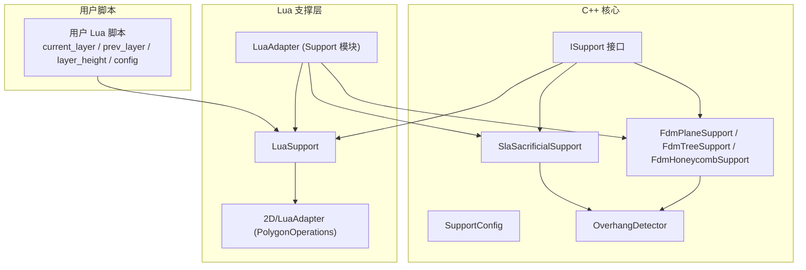
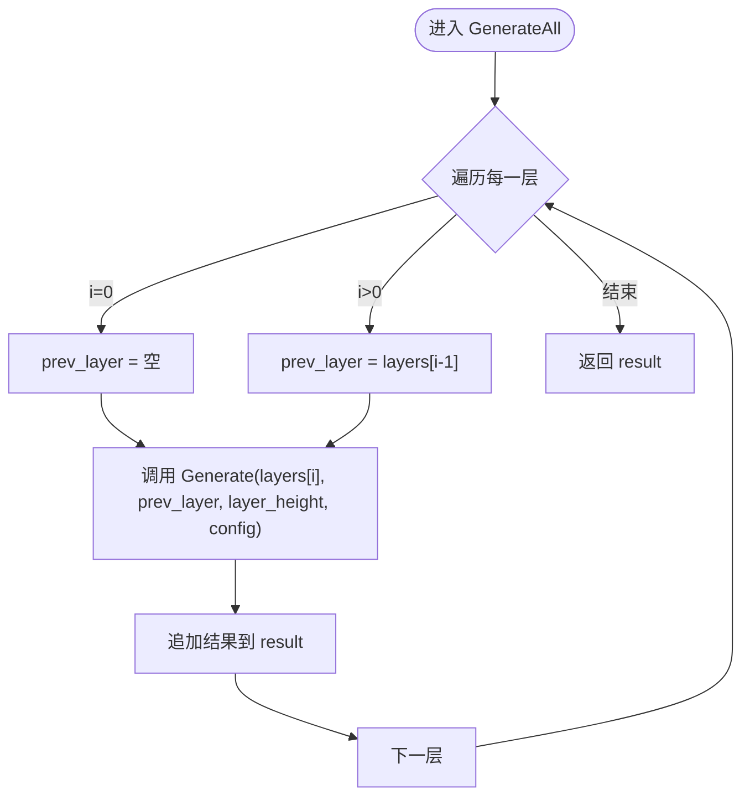
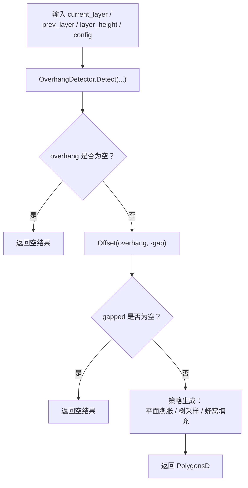
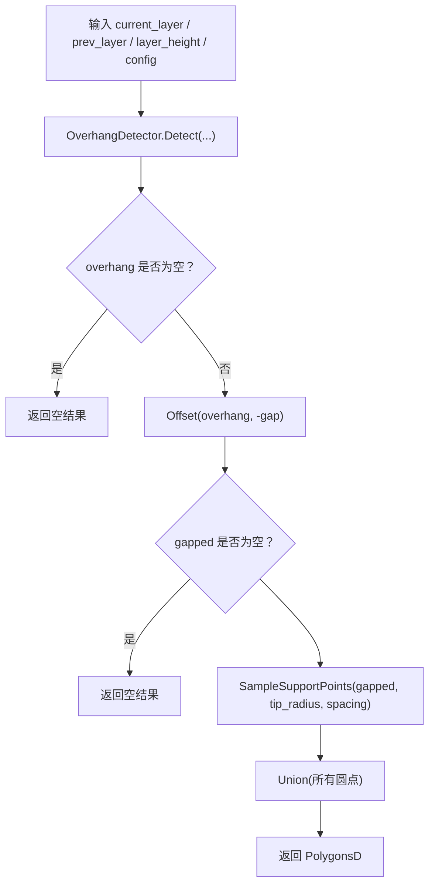
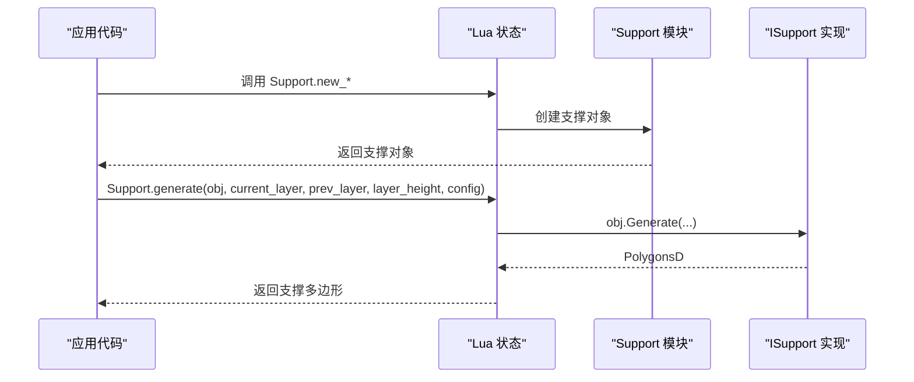
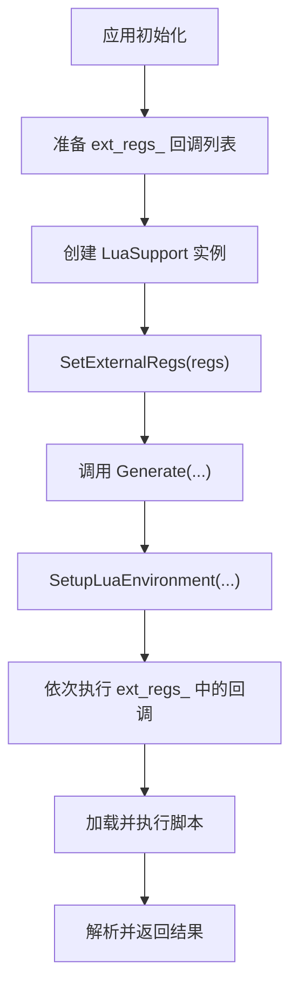
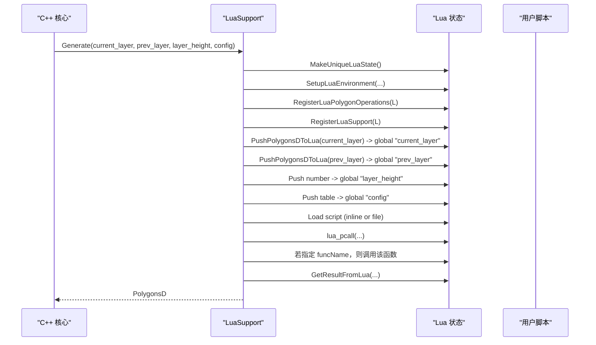
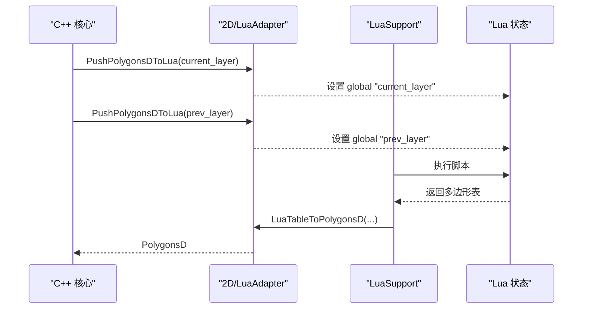
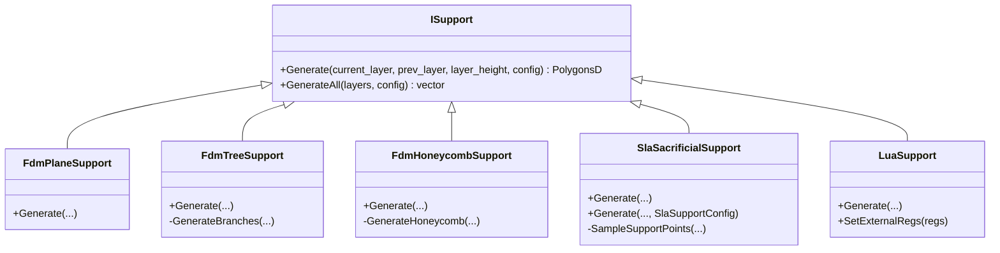

# Lua 支撑集成

<cite>
**本文引用的文件**   
- [support/LuaSupport.hpp](file://support/LuaSupport.hpp)
- [support/LuaSupport.cpp](file://support/LuaSupport.cpp)
- [support/LuaAdapter.hpp](file://support/LuaAdapter.hpp)
- [support/LuaAdapter.cpp](file://support/LuaAdapter.cpp)
- [support/ISupport.hpp](file://support/ISupport.hpp)
- [support/ISupport.cpp](file://support/ISupport.cpp)
- [support/FdmSupport.hpp](file://support/FdmSupport.hpp)
- [support/FdmSupport.cpp](file://support/FdmSupport.cpp)
- [support/SlaSupport.hpp](file://support/SlaSupport.hpp)
- [support/SlaSupport.cpp](file://support/SlaSupport.cpp)
- [support/SupportConfig.hpp](file://support/SupportConfig.hpp)
- [2D/LuaAdapter.hpp](file://2D/LuaAdapter.hpp)
- [2D/LuaAdapter.cpp](file://2D/LuaAdapter.cpp)
</cite>

## 目录
1. [项目概述与快速开始](#项目概述与快速开始)
2. [架构总览](#架构总览)
3. [核心概念](#核心概念)
4. [核心模块详解](#核心模块详解)
5. [高级主题](#高级主题)
6. [Lua 脚本系统](#lua-脚本系统)
7. [API 参考文档](#api-参考文档)
8. [集成指南](#集成指南)
9. [开发·测试与贡献](#开发测试与贡献)
10. [扩展开发指南](#扩展开发指南)
11. [示例与教程](#示例与教程)
12. [部署·故障排除与FAQ](#部署故障排除与faq)
13. [附录](#附录)

## 项目概述与快速开始
本页面聚焦 HsBaSlicer 的 Lua 支撑集成子系统，说明如何通过 Lua 脚本替换或增强内置支撑算法、动态注册支撑生成器，以及在运行时切换支撑类型。读者将了解：
- 支撑抽象接口与实现（FDM、SLA、Lua 自定义）
- Lua 支撑对象的生命周期与配置传递
- 支撑生成流程、错误处理与调试技巧
- 与 C++ 核心的交互方式及性能注意事项

快速上手要点：
- 使用 Support.new_lua 或 Support.new_lua_file 创建 Lua 支撑对象
- 在脚本中返回多边形表，或通过全局变量 support_polys 输出结果
- 通过 Support.generate 调用具体支撑对象的 Generate 方法
- 使用 Support.default_config 获取默认配置表并修改字段

[本节不直接分析具体源码文件]

## 架构总览
Lua 支撑系统由以下层次组成：
- 抽象层：ISupport 定义统一的支撑生成接口
- 实现层：FdmPlaneSupport、FdmTreeSupport、FdmHoneycombSupport、SlaSacrificialSupport
- 脚本层：LuaSupport 封装 Lua 环境、加载脚本、执行并解析结果
- 绑定层：LuaAdapter 暴露 Support 模块到 Lua，提供 new_* 工厂函数和 generate/detect_overhang/default_config 等 API
- 数据层：SupportConfig 统一配置结构；2D/LuaAdapter 负责多边形与 Lua 表的互转

**图示来源**
- [support/ISupport.hpp:22-45](file://support/ISupport.hpp#L22-L45)
- [support/LuaSupport.hpp:40-81](file://support/LuaSupport.hpp#L40-L81)
- [support/LuaAdapter.cpp:253-276](file://support/LuaAdapter.cpp#L253-L276)
- [support/FdmSupport.hpp:19-63](file://support/FdmSupport.hpp#L19-L63)
- [support/SlaSupport.hpp:20-42](file://support/SlaSupport.hpp#L20-L42)
- [support/SupportConfig.hpp:14-43](file://support/SupportConfig.hpp#L14-L43)

**章节来源**
- [support/ISupport.hpp:22-45](file://support/ISupport.hpp#L22-L45)
- [support/LuaSupport.hpp:40-81](file://support/LuaSupport.hpp#L40-L81)
- [support/LuaAdapter.cpp:253-276](file://support/LuaAdapter.cpp#L253-L276)
- [support/FdmSupport.hpp:19-63](file://support/FdmSupport.hpp#L19-L63)
- [support/SlaSupport.hpp:20-42](file://support/SlaSupport.hpp#L20-L42)
- [support/SupportConfig.hpp:14-43](file://support/SupportConfig.hpp#L14-L43)

## 核心概念
- 支撑生成器：实现 ISupport 接口的类，接收当前层与上一层轮廓，输出当前层的支撑横截面多边形
- 悬垂检测：基于角度阈值识别需要支撑的区域
- 支撑策略：平面柱状、树状分支、蜂窝填充、SLA 牺牲支撑
- Lua 支撑：通过 Lua 脚本完全替换内置算法，支持内联脚本或外部脚本文件
- 配置对象：SupportConfig 及其派生结构用于控制支撑参数

关键数据结构：
- PolygonsD：双精度多边形集合
- PolygonD：双精度多边形点序列
- SupportConfig：通用支撑配置（角度阈值、层高、间隙、直径、密度、图案、树角度、蜂窝尺寸等）

**章节来源**
- [support/ISupport.hpp:22-45](file://support/ISupport.hpp#L22-L45)
- [support/SupportConfig.hpp:14-43](file://support/SupportConfig.hpp#L14-L43)

## 核心模块详解

### 抽象接口与批量生成
ISupport 定义了单层的 Generate 方法与默认的 GenerateAll 迭代实现。GenerateAll 按层顺序调用 Generate，并将上一层作为 prev_layer 传入。

**图示来源**
- [support/ISupport.cpp:9-21](file://support/ISupport.cpp#L9-L21)

**章节来源**
- [support/ISupport.hpp:22-45](file://support/ISupport.hpp#L22-L45)
- [support/ISupport.cpp:9-21](file://support/ISupport.cpp#L9-L21)

### FDM 支撑实现
- FdmPlaneSupport：从悬垂区域生成柱状支撑，应用间隙后膨胀为圆形截面
- FdmTreeSupport：在悬垂区域内采样网格点，生成树状分支圆点并合并
- FdmHoneycombSupport：在悬垂区域内生成蜂窝六边形单元并与悬垂区域相交

共同流程：
1. 使用 OverhangDetector 检测悬垂区域
2. 应用 support_gap 收缩
3. 根据策略生成支撑截面（膨胀、采样、蜂窝）
4. 返回 PolygonsD

**图示来源**
- [support/FdmSupport.cpp:48-76](file://support/FdmSupport.cpp#L48-L76)
- [support/FdmSupport.cpp:145-168](file://support/FdmSupport.cpp#L145-L168)
- [support/FdmSupport.cpp:244-267](file://support/FdmSupport.cpp#L244-L267)

**章节来源**
- [support/FdmSupport.hpp:19-63](file://support/FdmSupport.hpp#L19-L63)
- [support/FdmSupport.cpp:48-76](file://support/FdmSupport.cpp#L48-L76)
- [support/FdmSupport.cpp:145-168](file://support/FdmSupport.cpp#L145-L168)
- [support/FdmSupport.cpp:244-267](file://support/FdmSupport.cpp#L244-L267)

### SLA 牺牲支撑实现
SlaSacrificialSupport 在悬垂区域内采样小半径圆点，间距由 support_diameter 决定，最终合并为支撑截面。提供重载以接受 SupportConfig 或 SlaSupportConfig。

**图示来源**
- [support/SlaSupport.cpp:81-124](file://support/SlaSupport.cpp#L81-L124)
- [support/SlaSupport.cpp:126-133](file://support/SlaSupport.cpp#L126-L133)

**章节来源**
- [support/SlaSupport.hpp:20-42](file://support/SlaSupport.hpp#L20-L42)
- [support/SlaSupport.cpp:81-124](file://support/SlaSupport.cpp#L81-L124)
- [support/SlaSupport.cpp:126-133](file://support/SlaSupport.cpp#L126-L133)

### 配置对象与字段映射
SupportConfig 包含通用支撑参数；FdmSupportConfig 与 SlaSupportConfig 分别扩展 FDM 与 SLA 特定字段。Lua 侧通过 table 字段读取或写入这些值。

字段概览：
- overhang_angle_threshold：悬垂角度阈值（度）
- layer_height：层高（mm）
- support_gap：支撑与模型间隙（mm）
- support_diameter：支撑柱直径（mm）
- support_density：支撑填充密度 [0,1]
- support_pattern：支撑图案（0=平面，1=树，2=蜂窝）
- tree_branch_angle：树分支角度（度）
- tree_max_branch_radius：树最大分支半径（mm）
- honeycomb_cell_size：蜂窝单元尺寸（mm）
- interface_layers / interface_density：FDM 界面层参数
- tip_diameter / raft_thickness：SLA 牺牲支撑参数

**章节来源**
- [support/SupportConfig.hpp:14-43](file://support/SupportConfig.hpp#L14-L43)

## 高级主题

### 运行时支撑类型切换
通过 Support.new_* 工厂函数创建不同类型的支撑对象，并在运行期选择：
- Support.new_plane()：平面柱状支撑
- Support.new_tree()：树状分支支撑
- Support.new_honeycomb()：蜂窝填充支撑
- Support.new_sla()：SLA 牺牲支撑
- Support.new_lua(script[, funcName])：内联 Lua 脚本支撑
- Support.new_lua_file(path, funcName)：外部 Lua 脚本支撑

切换逻辑：
- 用户代码根据场景或配置选择不同工厂函数
- 生成的支撑对象通过 Support.generate 调用，内部转发至对应 ISupport::Generate

**图示来源**
- [support/LuaAdapter.cpp:110-172](file://support/LuaAdapter.cpp#L110-L172)
- [support/LuaAdapter.cpp:174-200](file://support/LuaAdapter.cpp#L174-L200)

**章节来源**
- [support/LuaAdapter.cpp:110-172](file://support/LuaAdapter.cpp#L110-L172)
- [support/LuaAdapter.cpp:174-200](file://support/LuaAdapter.cpp#L174-L200)

### 外部回调注册机制
LuaSupport 支持 SetExternalRegs 注入额外的 Lua 注册函数，在 Lua 状态初始化时执行，便于扩展 2D/3D 能力。典型用法：
- 在应用启动时准备一组 std::function<void(lua_State*)> 回调
- 调用 LuaSupport.SetExternalRegs(regs)
- 每次 Generate 前，Lua 环境会执行这些回调，从而注入新的全局函数或模块

**图示来源**
- [support/LuaSupport.hpp:66-81](file://support/LuaSupport.hpp#L66-L81)
- [support/LuaSupport.cpp:108-128](file://support/LuaSupport.cpp#L108-L128)

**章节来源**
- [support/LuaSupport.hpp:66-81](file://support/LuaSupport.hpp#L66-L81)
- [support/LuaSupport.cpp:108-128](file://support/LuaSupport.cpp#L108-L128)

## Lua 脚本系统

### Lua 环境与全局变量
每次 Generate 会创建独立的 Lua 状态，并设置以下全局变量：
- current_layer：当前层多边形表（1-based 数组，元素为 {x,y}）
- prev_layer：上一层多边形表
- layer_height：层高（mm）
- config：支撑配置表（字段见 SupportConfig）

脚本可：
- 在主块返回多边形表
- 定义函数（默认名称 generate_support），返回多边形表
- 使用 PolygonOperations 提供的几何操作工具

**图示来源**
- [support/LuaSupport.cpp:19-90](file://support/LuaSupport.cpp#L19-L90)
- [support/LuaSupport.cpp:113-177](file://support/LuaSupport.cpp#L113-L177)

**章节来源**
- [support/LuaSupport.cpp:19-90](file://support/LuaSupport.cpp#L19-L90)
- [support/LuaSupport.cpp:113-177](file://support/LuaSupport.cpp#L113-L177)

### 多边形与 Lua 表转换
2D/LuaAdapter 提供双向转换：
- PushPolygonDToLua / PushPolygonsDToLua：C++ -> Lua
- LuaTableToPolygonD / LuaTableToPolygonsD：Lua -> C++

多边形点在 Lua 中表示为 {x=..., y=...} 的表，PolygonsD 表示为 1-based 数组。

**章节来源**
- [2D/LuaAdapter.hpp:21-58](file://2D/LuaAdapter.hpp#L21-L58)
- [2D/LuaAdapter.cpp:332-434](file://2D/LuaAdapter.cpp#L332-L434)

### 内置几何操作函数
PolygonOperations 暴露常用几何操作：
- booleanOperation(op, left, right)：union / intersection / difference / xor
- union(left, right)
- intersection(left, right)
- difference(left, right)
- xor(left, right)
- offsetOperation(polys, delta)
- convexHullOperation(polys)
- concaveHullOperation(polys, additional_points)
- area(poly)
- makeRectangle(x, y, width, height)
- makeCircle(cx, cy, radius [, segments])
- makeEllipse(cx, cy, rx, ry [, segments [, rotation]])
- makeRegularPolygon(cx, cy, radius, sides [, rotation])
- textToPolygons(text, font_file, font_size [, x [, y [, curve_segments]]])

这些函数在 Lua 支撑脚本中可直接调用，用于构造或变换支撑形状。

**章节来源**
- [2D/LuaAdapter.cpp:22-329](file://2D/LuaAdapter.cpp#L22-L329)
- [2D/LuaAdapter.cpp:487-491](file://2D/LuaAdapter.cpp#L487-L491)

### 支撑模块 API
Support 模块提供：
- new_plane()
- new_tree()
- new_honeycomb()
- new_sla()
- new_lua(script[, funcName])
- new_lua_file(path, funcName)
- generate(support_obj, current_layer, prev_layer, layer_height, config_table)
- detect_overhang(current_layer, prev_layer, layer_height, angle_deg)
- default_config()

其中 generate 内部调用具体 ISupport::Generate，detect_overhang 调用 OverhangDetector::Detect，default_config 返回 SupportConfig 默认值。

**章节来源**
- [support/LuaAdapter.hpp:13-30](file://support/LuaAdapter.hpp#L13-L30)
- [support/LuaAdapter.cpp:110-276](file://support/LuaAdapter.cpp#L110-L276)

## API 参考文档

### Support 模块（Lua）
- Support.new_plane()
  - 用途：创建平面柱状支撑对象
  - 返回：支撑对象 userdata
- Support.new_tree()
  - 用途：创建树状分支支撑对象
  - 返回：支撑对象 userdata
- Support.new_honeycomb()
  - 用途：创建蜂窝填充支撑对象
  - 返回：支撑对象 userdata
- Support.new_sla()
  - 用途：创建 SLA 牺牲支撑对象
  - 返回：支撑对象 userdata
- Support.new_lua(script[, funcName])
  - 用途：用内联脚本创建支撑对象
  - 参数：script（字符串）、funcName（可选，默认 "generate_support"）
  - 返回：支撑对象 userdata
- Support.new_lua_file(path, funcName)
  - 用途：用外部脚本文件创建支撑对象
  - 参数：path（路径）、funcName（函数名）
  - 返回：支撑对象 userdata
- Support.generate(support_obj, current_layer, prev_layer, layer_height, config_table)
  - 用途：调用支撑对象的 Generate 方法
  - 参数：support_obj（userdata）、current_layer（多边形表）、prev_layer（多边形表）、layer_height（数字）、config_table（配置表）
  - 返回：多边形表
- Support.detect_overhang(current_layer, prev_layer, layer_height, angle_deg)
  - 用途：检测悬垂区域
  - 参数：current_layer、prev_layer、layer_height、angle_deg（角度）
  - 返回：多边形表
- Support.default_config()
  - 用途：获取默认配置表
  - 返回：配置表

**章节来源**
- [support/LuaAdapter.cpp:110-276](file://support/LuaAdapter.cpp#L110-L276)

### 配置表字段（Lua）
- overhang_angle_threshold：数值
- layer_height：数值
- support_gap：数值
- support_diameter：数值
- support_density：数值
- support_pattern：整数（0/1/2）
- tree_branch_angle：数值
- tree_max_branch_radius：数值
- honeycomb_cell_size：数值

**章节来源**
- [support/LuaAdapter.cpp:43-108](file://support/LuaAdapter.cpp#L43-L108)
- [support/LuaAdapter.cpp:215-241](file://support/LuaAdapter.cpp#L215-L241)
- [support/SupportConfig.hpp:14-43](file://support/SupportConfig.hpp#L14-L43)

### 几何操作函数（Lua）
- PolygonOperations.booleanOperation(op, left, right)
- PolygonOperations.union(left, right)
- PolygonOperations.intersection(left, right)
- PolygonOperations.difference(left, right)
- PolygonOperations.xor(left, right)
- PolygonOperations.offsetOperation(polys, delta)
- PolygonOperations.convexHullOperation(polys)
- PolygonOperations.concaveHullOperation(polys, additional_points)
- PolygonOperations.area(poly)
- PolygonOperations.makeRectangle(x, y, width, height)
- PolygonOperations.makeCircle(cx, cy, radius [, segments])
- PolygonOperations.makeEllipse(cx, cy, rx, ry [, segments [, rotation]])
- PolygonOperations.makeRegularPolygon(cx, cy, radius, sides [, rotation])
- PolygonOperations.textToPolygons(text, font_file, font_size [, x [, y [, curve_segments]]])

**章节来源**
- [2D/LuaAdapter.cpp:22-329](file://2D/LuaAdapter.cpp#L22-L329)

## 集成指南

### 在应用中启用 Lua 支撑
步骤：
1. 准备支撑配置表（可使用 Support.default_config 并修改字段）
2. 选择支撑类型：
   - 内置：new_plane / new_tree / new_honeycomb / new_sla
   - 自定义：new_lua / new_lua_file
3. 调用 Support.generate 获取支撑多边形
4. 如需扩展 Lua 能力，使用 LuaSupport.SetExternalRegs 注入回调

示例流程（无代码，仅步骤）：
- 创建配置表 cfg = Support.default_config()
- 修改 cfg.support_pattern 或 cfg.tree_branch_angle 等字段
- 选择支撑对象 obj = Support.new_lua("脚本内容", "generate_support")
- 调用 polys = Support.generate(obj, current_layer, prev_layer, layer_height, cfg)

**章节来源**
- [support/LuaAdapter.cpp:215-276](file://support/LuaAdapter.cpp#L215-L276)
- [support/LuaSupport.cpp:108-177](file://support/LuaSupport.cpp#L108-L177)

### 与 C++ 核心的交互
- 数据流：C++ 将 PolygonsD 转换为 Lua 表，脚本处理后返回 Lua 表，再转回 PolygonsD
- 异常传播：C++ 抛出 RuntimeError，LuaAdapter 捕获并转为 Lua error
- 生命周期：每个 Generate 创建独立 Lua 状态，避免跨层状态污染

**图示来源**
- [support/LuaSupport.cpp:67-90](file://support/LuaSupport.cpp#L67-L90)
- [support/LuaSupport.cpp:113-177](file://support/LuaSupport.cpp#L113-L177)
- [2D/LuaAdapter.cpp:332-434](file://2D/LuaAdapter.cpp#L332-L434)

**章节来源**
- [support/LuaSupport.cpp:67-90](file://support/LuaSupport.cpp#L67-L90)
- [support/LuaSupport.cpp:113-177](file://support/LuaSupport.cpp#L113-L177)
- [2D/LuaAdapter.cpp:332-434](file://2D/LuaAdapter.cpp#L332-L434)

## 开发·测试与贡献

### 编写 Lua 支撑脚本的最佳实践
- 明确返回形式：主块返回多边形表，或定义 generate_support 函数返回多边形表
- 使用 PolygonOperations 进行几何运算，避免重复造轮子
- 合理设置 config 字段，确保支撑密度、间隙、角度阈值符合工艺要求
- 对复杂脚本建议拆分为外部文件，并通过 Support.new_lua_file 加载

### 调试技巧
- 使用 Support.detect_overhang 验证悬垂检测结果
- 利用 PolygonOperations.area 检查支撑面积是否合理
- 在脚本中打印中间结果（如多边形数量、边界框）辅助定位问题
- 逐步缩小范围：先用简单几何（矩形、圆）验证脚本逻辑，再引入复杂形状

### 错误处理机制
- Lua 加载失败：抛出 RuntimeError，包含 Lua 错误信息
- 脚本执行失败：抛出 RuntimeError，包含 Lua 错误信息
- 函数调用失败：抛出 RuntimeError，包含 Lua 错误信息
- 支撑对象无效：LuaAdapter.l_generate 抛出 Lua error

**章节来源**
- [support/LuaSupport.cpp:130-177](file://support/LuaSupport.cpp#L130-L177)
- [support/LuaAdapter.cpp:174-200](file://support/LuaAdapter.cpp#L174-L200)

## 扩展开发指南

### 自定义支撑类实现指南
- 继承 ISupport 并实现 Generate 方法
- 复用 OverhangDetector 检测悬垂区域
- 使用 2D 几何库（Clipper2Lib）进行偏移、求交、并集等操作
- 在 LuaAdapter 中注册新工厂函数，以便 Lua 侧创建自定义支撑对象

**图示来源**
- [support/ISupport.hpp:22-45](file://support/ISupport.hpp#L22-L45)
- [support/FdmSupport.hpp:19-63](file://support/FdmSupport.hpp#L19-L63)
- [support/SlaSupport.hpp:20-42](file://support/SlaSupport.hpp#L20-L42)
- [support/LuaSupport.hpp:40-81](file://support/LuaSupport.hpp#L40-L81)

**章节来源**
- [support/ISupport.hpp:22-45](file://support/ISupport.hpp#L22-L45)
- [support/FdmSupport.hpp:19-63](file://support/FdmSupport.hpp#L19-L63)
- [support/SlaSupport.hpp:20-42](file://support/SlaSupport.hpp#L20-L42)
- [support/LuaSupport.hpp:40-81](file://support/LuaSupport.hpp#L40-L81)

### 在 LuaAdapter 中注册新工厂函数
- 新增 l_new_xxx 函数，创建对应 ISupport 实例并包装为 userdata
- 在 supportLib 表中注册新函数名
- 在 RegisterLuaSupport 中完成元表与全局模块注册

**章节来源**
- [support/LuaAdapter.cpp:110-172](file://support/LuaAdapter.cpp#L110-L172)
- [support/LuaAdapter.cpp:253-276](file://support/LuaAdapter.cpp#L253-L276)

## 示例与教程

### 示例一：使用内置支撑
- 目标：生成平面柱状支撑
- 步骤：
  1. 获取默认配置 cfg = Support.default_config()
  2. 设置 cfg.support_pattern = 0（平面）
  3. 创建 obj = Support.new_plane()
  4. 调用 polys = Support.generate(obj, current_layer, prev_layer, layer_height, cfg)

### 示例二：使用 Lua 脚本自定义支撑
- 目标：在悬垂区域生成随机分布的小圆点支撑
- 步骤：
  1. 编写脚本，使用 PolygonOperations.makeCircle 生成圆点
  2. 在脚本中返回多边形表或定义 generate_support 函数
  3. 使用 Support.new_lua(script, "generate_support") 创建对象
  4. 调用 Support.generate 获取结果

### 示例三：检测悬垂区域
- 目标：可视化或统计悬垂区域
- 步骤：
  1. 调用 overhang = Support.detect_overhang(current_layer, prev_layer, layer_height, angle)
  2. 使用 PolygonOperations.area 计算面积
  3. 根据面积调整支撑策略或参数

[本节为概念性示例，不直接分析具体源码文件]

## 部署·故障排除与FAQ

### 常见问题
- 脚本未返回多边形：检查主块返回值或 generate_support 函数返回值
- 配置字段缺失：使用 Support.default_config 获取完整字段后再修改
- 几何操作参数错误：确保传入的多边形表格式正确（{x,y} 数组）
- 性能问题：减少不必要的几何运算，优先使用内置函数

### 性能考虑
- 每层独立 Lua 状态：避免跨层状态共享，降低耦合但增加开销
- 多边形转换成本：尽量在脚本中减少多边形表的大小与复杂度
- 几何运算优化：合理使用 offset、union、intersection，避免过度细分

### 调试建议
- 分阶段验证：先验证悬垂检测，再验证几何操作，最后验证整体支撑生成
- 日志输出：在脚本中记录关键参数与中间结果
- 最小化复现：使用简单几何形状复现问题，逐步增加复杂度

**章节来源**
- [support/LuaSupport.cpp:130-177](file://support/LuaSupport.cpp#L130-L177)
- [support/LuaAdapter.cpp:174-200](file://support/LuaAdapter.cpp#L174-L200)

## 附录

### 数据流总结
- 输入：current_layer、prev_layer、layer_height、config
- 处理：悬垂检测 -> 间隙应用 -> 策略生成（平面/树/蜂窝/SLA/Lua）
- 输出：PolygonsD（支撑横截面）

### 关键依赖关系
- OverhangDetector：悬垂检测
- Clipper2Lib：几何运算（偏移、求交、并集）
- 2D/LuaAdapter：多边形与 Lua 表互转
- SupportConfig：配置结构

**章节来源**
- [support/FdmSupport.cpp:48-76](file://support/FdmSupport.cpp#L48-L76)
- [support/FdmSupport.cpp:145-168](file://support/FdmSupport.cpp#L145-L168)
- [support/FdmSupport.cpp:244-267](file://support/FdmSupport.cpp#L244-L267)
- [support/SlaSupport.cpp:81-124](file://support/SlaSupport.cpp#L81-L124)
- [2D/LuaAdapter.cpp:332-434](file://2D/LuaAdapter.cpp#L332-L434)