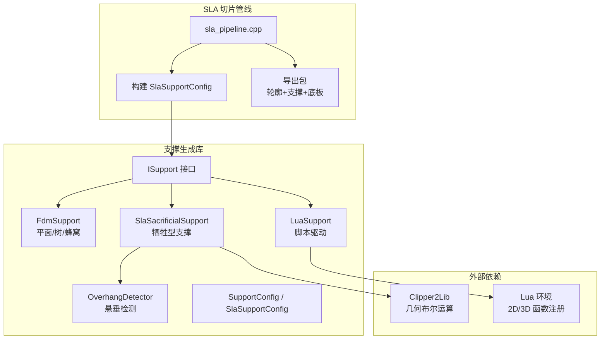
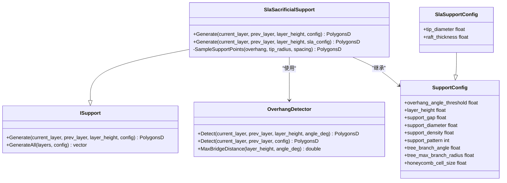
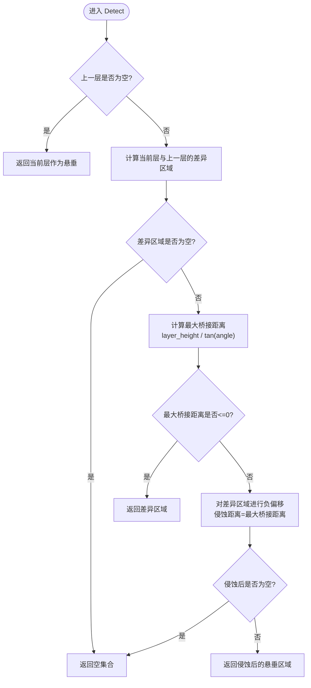
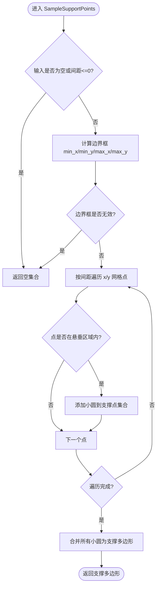
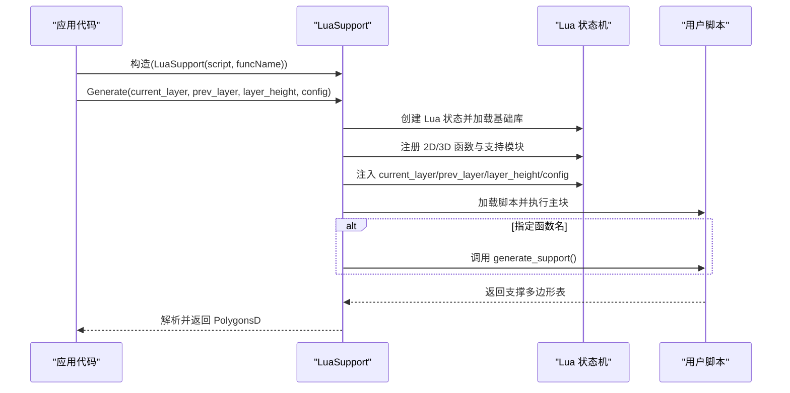
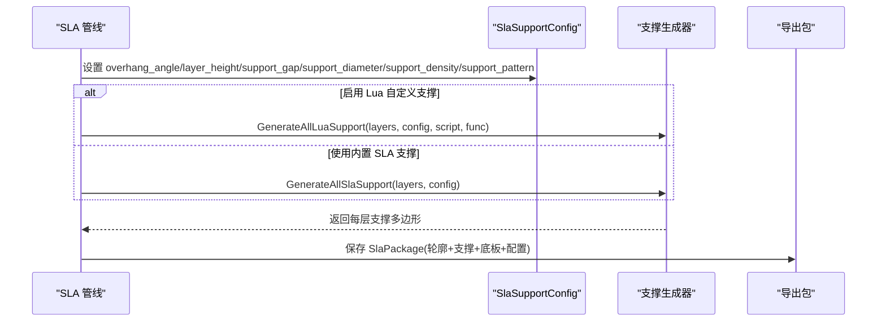

# SLA 支撑生成器

<cite>
**本文引用的文件**   
- [SlaSupport.hpp](file://support/SlaSupport.hpp)
- [SlaSupport.cpp](file://support/SlaSupport.cpp)
- [OverhangDetector.hpp](file://support/OverhangDetector.hpp)
- [OverhangDetector.cpp](file://support/OverhangDetector.cpp)
- [SupportConfig.hpp](file://support/SupportConfig.hpp)
- [ISupport.hpp](file://support/ISupport.hpp)
- [ISupport.cpp](file://support/ISupport.cpp)
- [LuaSupport.hpp](file://support/LuaSupport.hpp)
- [LuaSupport.cpp](file://support/LuaSupport.cpp)
- [LuaAdapter.hpp](file://support/LuaAdapter.hpp)
- [LuaAdapter.cpp](file://support/LuaAdapter.cpp)
- [fdm_support.cpp](file://LibHsBaSlicer\Support\fdm_support.cpp)
- [sla_pipeline.cpp](file://DllHsBaSlicer\sla_pipeline.cpp)
- [main.cpp](file://samples\SLA\main.cpp)
</cite>

## 目录
1. [项目概述与快速开始](#项目概述与快速开始)
2. [架构总览](#架构总览)
3. [核心概念](#核心概念)
4. [核心模块详解](#核心模块详解)
5. [高级主题](#高级主题)
6. [Lua 脚本系统](#lua-脚本系统)
7. [API 参考文档](#api-参考文档)
8. [集成指南](#集成指南)
9. [开发·测试与贡献](#开发·测试与贡献)
10. [扩展开发指南](#扩展开发指南)
11. [示例与教程](#示例与教程)
12. [部署·故障排除与FAQ](#部署·故障排除与faq)
13. [附录](#附录)

## 项目概述与快速开始
本章节面向初次接触 SLA 支撑生成器的用户，说明 SLA 牺牲型支撑的目标、适用场景与基本使用方式。SLA 牺牲型支撑通过在当前层悬垂区域采样小直径圆形支撑点，并合并为支撑截面多边形，从而在光固化打印中提供可移除的细柱状支撑结构。

快速开始要点：
- 配置 SLA 支撑参数：悬垂角度阈值、层高、支撑间隙、支撑直径、支撑密度等。
- 选择内置 SLA 支撑或 Lua 自定义支撑。
- 将支撑结果与切片轮廓、底板一起打包导出。

本节不直接分析具体源码文件，因此不提供“章节来源”。

## 架构总览
SLA 支撑生成器以 ISupport 抽象接口为核心，支持多种实现：FDM 平面/树形/蜂窝支撑、SLA 牺牲型支撑以及 Lua 自定义支撑。SLA 管线在切片阶段调用支撑生成器，输出每层的支撑多边形，并与轮廓、底板数据一起导出。

**图表来源**
- [sla_pipeline.cpp:386-420](file://DllHsBaSlicer\sla_pipeline.cpp#L386-L420)
- [ISupport.hpp:22-45](file://support/ISupport.hpp#L22-L45)
- [SlaSupport.hpp:20-42](file://support/SlaSupport.hpp#L20-L42)
- [OverhangDetector.hpp:20-50](file://support/OverhangDetector.hpp#L20-L50)
- [SupportConfig.hpp:14-43](file://support/SupportConfig.hpp#L14-L43)

**章节来源**
- [sla_pipeline.cpp:386-420](file://DllHsBaSlicer\sla_pipeline.cpp#L386-L420)
- [ISupport.hpp:22-45](file://support/ISupport.hpp#L22-L45)

## 核心概念
- SLA 牺牲型支撑：以小直径顶部、较大底部直径的柱体作为支撑截面，便于去除且保证平台附着力。
- 悬垂检测：基于当前层与上一层轮廓差异，结合悬垂角度阈值计算最大桥接距离，过滤可自支撑的小悬垂。
- 接触区域与支撑点分布：对悬垂区域进行负偏移（间隙）后，按间距网格采样支撑点，并以小圆表示支撑截面，最终合并为支撑多边形。
- 关键参数：
  - overhang_angle_threshold：悬垂角度阈值（度），控制哪些区域需要支撑。
  - layer_height：层高（mm）。
  - support_gap：支撑与模型间隙（mm）。
  - support_diameter：支撑直径（mm），用于决定采样间距。
  - support_density：支撑填充密度（[0,1]），影响内部填充策略（SLA 牺牲型主要体现为点阵密度）。
  - tip_diameter：支撑顶部直径（mm），越小越易去除。
  - raft_thickness：底板厚度（mm），与底板生成相关。

本节为概念性内容，不直接分析具体源码文件，因此不提供“章节来源”。

## 核心模块详解

### SLA 牺牲型支撑类
SlaSacrificialSupport 继承自 ISupport，提供两层 API：
- Generate(current_layer, prev_layer, layer_height, config)：根据通用 SupportConfig 转换为 SlaSupportConfig 后调用专用生成逻辑。
- Generate(current_layer, prev_layer, layer_height, sla_config)：执行 SLA 专属流程：悬垂检测 → 间隙处理 → 支撑点采样 → 圆合并。

**图表来源**
- [ISupport.hpp:22-45](file://support/ISupport.hpp#L22-L45)
- [SlaSupport.hpp:20-42](file://support/SlaSupport.hpp#L20-L42)
- [OverhangDetector.hpp:20-50](file://support/OverhangDetector.hpp#L20-L50)
- [SupportConfig.hpp:14-43](file://support/SupportConfig.hpp#L14-L43)

**章节来源**
- [SlaSupport.hpp:20-42](file://support/SlaSupport.hpp#L20-L42)
- [SlaSupport.cpp:81-133](file://support/SlaSupport.cpp#L81-L133)
- [ISupport.hpp:22-45](file://support/ISupport.hpp#L22-L45)

### 悬垂检测算法
OverhangDetector 负责在两相邻层之间识别需要支撑的区域：
- 若上一层为空，则当前层全部视为悬垂。
- 计算当前层与上一层的差异区域。
- 根据层高与悬垂角度阈值计算最大桥接距离，并对差异区域进行负偏移（侵蚀）以过滤可自支撑的小悬垂。
- 返回经处理的悬垂多边形。

**图表来源**
- [OverhangDetector.cpp:41-80](file://support/OverhangDetector.cpp#L41-L80)

**章节来源**
- [OverhangDetector.cpp:23-39](file://support/OverhangDetector.cpp#L23-L39)
- [OverhangDetector.cpp:41-80](file://support/OverhangDetector.cpp#L41-L80)

### 支撑点采样与合并
SlaSacrificialSupport::SampleSupportPoints 在悬垂区域的边界框内按间距网格采样点，判断点是否在悬垂区域内，若是则生成小圆（代表支撑截面），最后将所有圆合并为一个支撑多边形。

**图表来源**
- [SlaSupport.cpp:38-79](file://support/SlaSupport.cpp#L38-L79)
- [SlaSupport.cpp:115-123](file://support/SlaSupport.cpp#L115-L123)

**章节来源**
- [SlaSupport.cpp:38-79](file://support/SlaSupport.cpp#L38-L79)
- [SlaSupport.cpp:115-123](file://support/SlaSupport.cpp#L115-L123)

### 支撑数据结构与复杂度
- 输入：当前层与上一层的多边形集合（PolygonsD）。
- 中间结果：差异区域、侵蚀后的悬垂区域、支撑点集合（小圆）。
- 输出：合并后的支撑多边形集合（PolygonsD）。
- 时间复杂度：
  - 悬垂检测：差异计算与偏移操作依赖于 Clipper2Lib，通常为 O(n log n) 级别（n 为顶点数）。
  - 支撑点采样：O(k)，k 为网格点数；点包含测试取决于多边形数量与顶点数。
  - 圆合并：O(m log m)，m 为支撑圆数量。
- 空间复杂度：与多边形顶点数和支撑圆数量线性相关。

本节为性能分析内容，不直接分析具体源码文件，因此不提供“章节来源”。

## 高级主题

### SLA 与传统 FDM 支撑的差异
- 支撑形态：SLA 牺牲型支撑以小圆点阵为主，易于去除；FDM 常用平面、树形或蜂窝填充，强调结构强度与材料用量平衡。
- 接触面：SLA 支撑与模型保持固定间隙，避免粘附过强；FDM 常设置界面层以改善附着与去除体验。
- 参数侧重：SLA 更关注 tip_diameter、support_gap；FDM 更关注 interface_layers、interface_density、branch_angle 等。

本节为对比分析内容，不直接分析具体源码文件，因此不提供“章节来源”。

### 支撑密度、角度阈值、最小支撑尺寸的配置与效果
- overhang_angle_threshold：增大阈值会减少需要支撑的区域，降低支撑量但可能增加悬垂风险；减小阈值会增加支撑覆盖范围。
- support_gap：增大间隙可减少模型表面粘连，但可能导致支撑与模型接触不足；减小间隙可提高接触稳定性但增加去除难度。
- support_diameter：增大直径会增加支撑点间距，减少支撑密度；减小直径可增加支撑密度但提升打印时间与材料消耗。
- tip_diameter：减小顶部直径使支撑更易去除，但过小可能影响支撑强度。
- raft_thickness：影响底板厚度，与支撑基础附着力相关。

本节为配置指导内容，不直接分析具体源码文件，因此不提供“章节来源”。

## Lua 脚本系统
LuaSupport 允许用户通过 Lua 脚本完全替换内置支撑算法。脚本可访问当前层、上一层、层高与配置表，并可调用 2D/3D 辅助函数。

**图表来源**
- [LuaSupport.cpp:113-177](file://support/LuaSupport.cpp#L113-L177)
- [LuaAdapter.cpp:265-276](file://support/LuaAdapter.cpp#L265-L276)

**章节来源**
- [LuaSupport.hpp:40-81](file://support/LuaSupport.hpp#L40-L81)
- [LuaSupport.cpp:19-49](file://support/LuaSupport.cpp#L19-L49)
- [LuaSupport.cpp:113-177](file://support/LuaSupport.cpp#L113-L177)
- [LuaAdapter.cpp:43-108](file://support/LuaAdapter.cpp#L43-L108)
- [LuaAdapter.cpp:265-276](file://support/LuaAdapter.cpp#L265-L276)

## API 参考文档

### 支撑配置结构
- SupportConfig：通用支撑配置，包含悬垂角度阈值、层高、间隙、直径、密度、图案类型及树/蜂窝相关参数。
- FdmSupportConfig：FDM 专属配置，包含界面层层数与密度。
- SlaSupportConfig：SLA 专属配置，包含顶部直径与底板厚度。

字段说明：
- overhang_angle_threshold：悬垂角度阈值（度）。
- layer_height：层高（mm）。
- support_gap：支撑与模型间隙（mm）。
- support_diameter：支撑直径（mm）。
- support_density：支撑填充密度（[0,1]）。
- support_pattern：支撑图案类型（0=平面，1=树，2=蜂窝）。
- tree_branch_angle：树支撑分支角度（度）。
- tree_max_branch_radius：树支撑最大分支半径（mm）。
- honeycomb_cell_size：蜂窝单元尺寸（mm）。
- tip_diameter：SLA 支撑顶部直径（mm）。
- raft_thickness：SLA 底板厚度（mm）。

**章节来源**
- [SupportConfig.hpp:14-43](file://support/SupportConfig.hpp#L14-L43)

### 支撑生成接口
- ISupport::Generate：单层支撑生成接口。
- ISupport::GenerateAll：全层支撑生成默认实现，逐层调用 Generate。
- SlaSacrificialSupport::Generate：SLA 专属生成接口。
- OverhangDetector::Detect：悬垂检测接口。
- OverhangDetector::MaxBridgeDistance：计算最大桥接距离。

**章节来源**
- [ISupport.hpp:22-45](file://support/ISupport.hpp#L22-L45)
- [ISupport.cpp:9-21](file://support/ISupport.cpp#L9-L21)
- [SlaSupport.hpp:20-42](file://support/SlaSupport.hpp#L20-L42)
- [OverhangDetector.hpp:20-50](file://support/OverhangDetector.hpp#L20-L50)

### Lua 绑定 API
- Support.new_plane/new_tree/new_honeycomb/new_sla/new_lua/new_lua_file：创建不同支撑对象。
- Support.generate：调用支撑对象的 Generate 方法。
- Support.detect_overhang：调用悬垂检测。
- Support.default_config：返回默认配置表。

**章节来源**
- [LuaAdapter.hpp:13-30](file://support/LuaAdapter.hpp#L13-L30)
- [LuaAdapter.cpp:110-172](file://support/LuaAdapter.cpp#L110-L172)
- [LuaAdapter.cpp:174-241](file://support/LuaAdapter.cpp#L174-L241)
- [LuaAdapter.cpp:265-276](file://support/LuaAdapter.cpp#L265-L276)

## 集成指南

### SLA 管线中的支撑生成
SLA 管线在切片阶段构建 SlaSupportConfig，并根据是否启用 Lua 自定义支撑选择内置 SLA 支撑或 Lua 支撑。最终将轮廓、支撑、底板与配置 JSON 打包导出。

**图表来源**
- [sla_pipeline.cpp:392-419](file://DllHsBaSlicer\sla_pipeline.cpp#L392-L419)
- [fdm_support.cpp:54-75](file://LibHsBaSlicer\Support\fdm_support.cpp#L54-L75)

**章节来源**
- [sla_pipeline.cpp:386-420](file://DllHsBaSlicer\sla_pipeline.cpp#L386-L420)
- [fdm_support.cpp:54-75](file://LibHsBaSlicer\Support\fdm_support.cpp#L54-L75)

### 示例程序
示例程序展示了如何配置 SLA 管线参数、启用支撑、使用 Lua 自定义支撑与导出结果。

**章节来源**
- [main.cpp:118-125](file://samples\SLA\main.cpp#L118-L125)
- [main.cpp:162-168](file://samples\SLA\main.cpp#L162-L168)

## 开发·测试与贡献
- 新增支撑算法：实现 ISupport 接口并在 LibHsBaSlicer 暴露生成函数。
- 扩展 Lua 绑定：在 LuaAdapter 中注册新函数或对象。
- 单元测试：针对悬垂检测、支撑点采样与合并编写用例，验证边界条件与性能。

本节为开发指导内容，不直接分析具体源码文件，因此不提供“章节来源”。

## 扩展开发指南
- 自定义支撑模式：通过 LuaSupport 提供完整算法替换能力，适合实验性支撑策略。
- 外部函数注册：使用 SetExternalRegs 注入 2D/3D 函数，增强脚本能力。
- 配置映射：确保 Lua 配置表字段与 SupportConfig 字段一致，避免运行时错误。

**章节来源**
- [LuaSupport.cpp:108-111](file://support/LuaSupport.cpp#L108-L111)
- [LuaAdapter.cpp:43-108](file://support/LuaAdapter.cpp#L43-L108)

## 示例与教程
- 基础 SLA 管线：设置模型路径、输出路径并运行同步流水线。
- 自定义参数：调整层高、曝光、底板与支撑参数。
- Lua 自定义：配置 floor_lua_script/support_lua_script/export_lua_script 与对应函数名。
- 异步流水线：使用回调获取结果。

**章节来源**
- [main.cpp:52-84](file://samples\SLA\main.cpp#L52-L84)
- [main.cpp:89-144](file://samples\SLA\main.cpp#L89-L144)
- [main.cpp:149-191](file://samples\SLA\main.cpp#L149-L191)
- [main.cpp:217-239](file://samples\SLA\main.cpp#L217-L239)

## 部署·故障排除与FAQ
常见问题与排查建议：
- 支撑为空：检查悬垂角度阈值是否过大、支撑间隙是否过大导致侵蚀后无区域。
- 支撑过多：降低 overhang_angle_threshold 或增大 support_diameter 以减少支撑密度。
- 支撑难以去除：增大 tip_diameter 或增大 support_gap。
- Lua 脚本错误：确认脚本语法、函数名与返回数据类型正确，检查错误消息。

**章节来源**
- [OverhangDetector.cpp:23-39](file://support/OverhangDetector.cpp#L23-L39)
- [SlaSupport.cpp:91-100](file://support/SlaSupport.cpp#L91-L100)
- [LuaSupport.cpp:141-155](file://support/LuaSupport.cpp#L141-L155)

## 附录
- 术语表：
  - 悬垂（Overhang）：当前层超出上一层支撑的区域。
  - 桥接距离（Bridge Distance）：由层高与角度阈值决定的最大水平悬挑距离。
  - 侵蚀（Erosion）：负偏移操作，用于过滤小悬垂。
  - 牺牲型支撑（Sacrificial Support）：设计为易去除的临时支撑结构。

本节为附录内容，不直接分析具体源码文件，因此不提供“章节来源”。