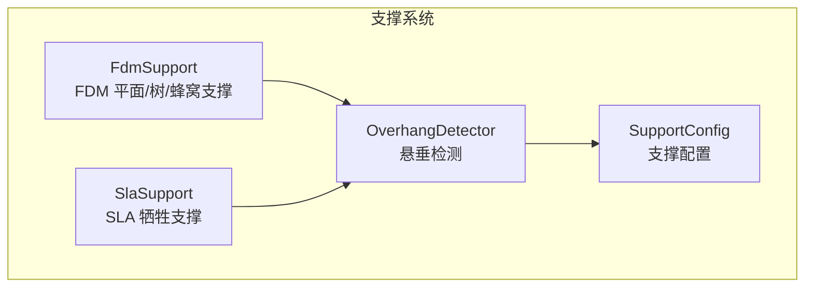
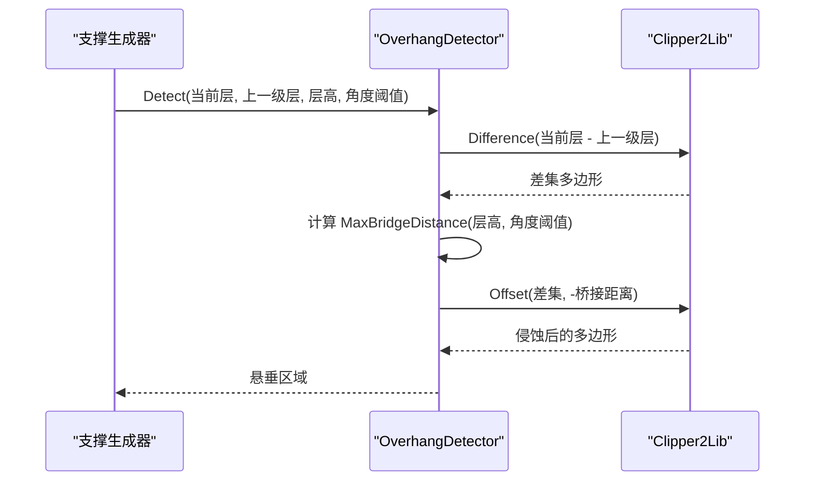
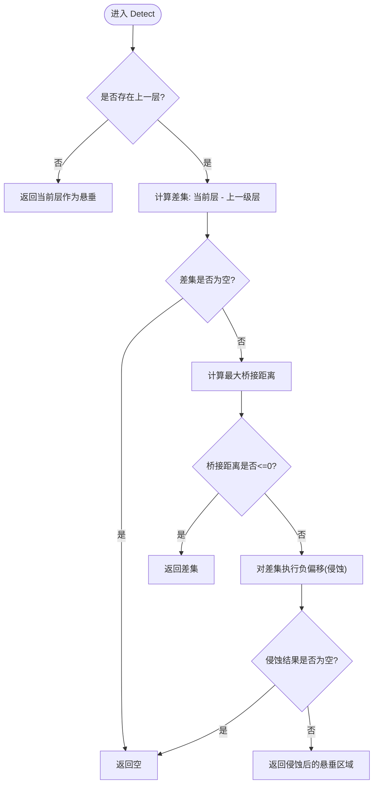
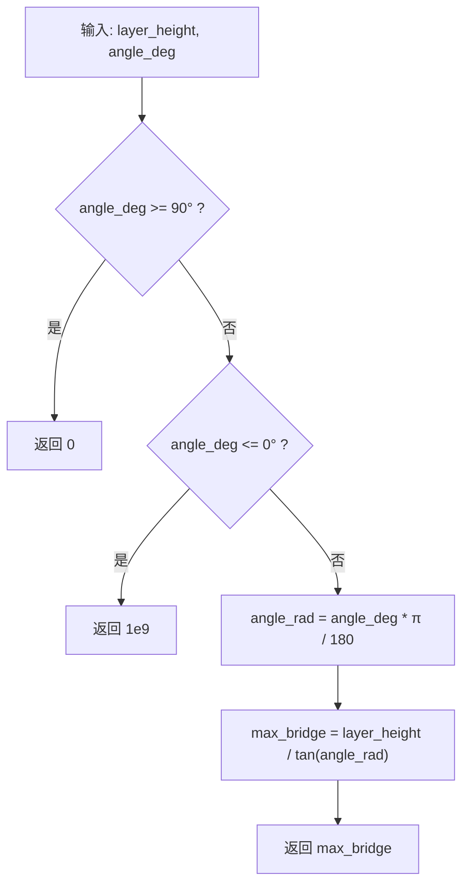
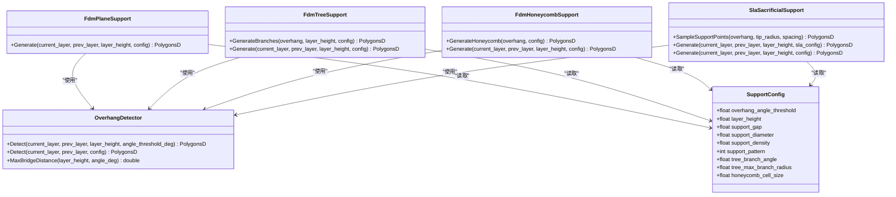
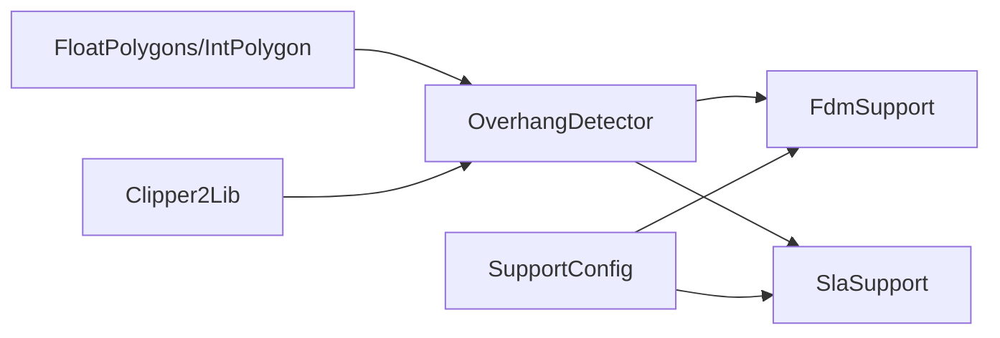

# 悬垂检测器

<cite>
**本文引用的文件**   
- [OverhangDetector.hpp](file://support/OverhangDetector.hpp)
- [OverhangDetector.cpp](file://support/OverhangDetector.cpp)
- [SupportConfig.hpp](file://support\SupportConfig.hpp)
- [FdmSupport.cpp](file://support\FdmSupport.cpp)
- [SlaSupport.cpp](file://support\SlaSupport.cpp)
- [support_test.cpp](file://tests\Support\support_test.cpp)
</cite>

## 目录
1. [引言](#引言)
2. [项目结构](#项目结构)
3. [核心组件](#核心组件)
4. [架构总览](#架构总览)
5. [详细组件分析](#详细组件分析)
6. [依赖关系分析](#依赖关系分析)
7. [性能与精度](#性能与精度)
8. [故障排除指南](#故障排除指南)
9. [结论](#结论)
10. [附录](#附录)

## 引言
本文件面向 HsBaSlicer 的悬垂检测子系统，系统性说明相邻层间悬垂区域的识别算法、角度阈值与桥接距离计算、几何差集与偏移（侵蚀）流程，以及与 FDM/SLA 支撑生成器的协作方式。文档同时给出关键参数配置方法、效果对比建议、扩展自定义检测逻辑的思路与性能优化技巧，帮助读者从理论与实现两个层面掌握悬垂检测。

## 项目结构
悬垂检测相关代码集中在 support 目录：
- OverhangDetector：提供相邻层悬垂区域检测的核心静态方法与桥接距离计算。
- SupportConfig：定义通用支撑配置，包含悬垂角度阈值、层高、间隙、柱径、密度等。
- FdmSupport/SlaSupport：分别实现 FDM 平面/树/蜂窝支撑与 SLA 牺牲支撑，均依赖 OverhangDetector 输出作为输入。
- tests\Support\support_test.cpp：覆盖无上一层、完全重合、小悬垂过滤、桥接距离计算等用例。

**图示来源**
- [OverhangDetector.hpp:20-50](file://support/OverhangDetector.hpp#L20-L50)
- [SupportConfig.hpp:14-25](file://support\SupportConfig.hpp#L14-L25)
- [FdmSupport.cpp:48-76](file://support\FdmSupport.cpp#L48-L76)
- [SlaSupport.cpp:81-124](file://support\SlaSupport.cpp#L81-L124)

**章节来源**
- [OverhangDetector.hpp:1-53](file://support/OverhangDetector.hpp#L1-L53)
- [OverhangDetector.cpp:1-88](file://support/OverhangDetector.cpp#L1-L88)
- [SupportConfig.hpp:1-47](file://support\SupportConfig.hpp#L1-L47)
- [FdmSupport.cpp:1-269](file://support\FdmSupport.cpp#L1-L269)
- [SlaSupport.cpp:1-135](file://support\SlaSupport.cpp#L1-L135)
- [support_test.cpp:44-78](file://tests\Support\support_test.cpp#L44-L78)

## 核心组件
- OverhangDetector：纯静态类，对外暴露 Detect(current_layer, prev_layer, layer_height, angle_threshold_deg) 与 MaxBridgeDistance(layer_height, angle_deg)。内部使用 Clipper2Lib 进行多边形差集与偏移（侵蚀）。
- SupportConfig：通用支撑配置，默认 overhang_angle_threshold=45°，layer_height=0.2mm，support_gap=0.5mm，support_diameter=2.0mm，support_density=0.3，pattern 支持 Plane/Tree/Honeycomb，并含树支撑与蜂窝支撑的参数。
- FdmSupport/SlaSupport：调用 OverhangDetector 得到悬垂区域后，应用支撑间隙、生成柱体截面或采样点阵，最终通过多边形布尔运算合并为支撑轮廓。

**章节来源**
- [OverhangDetector.hpp:20-50](file://support/OverhangDetector.hpp#L20-L50)
- [SupportConfig.hpp:14-25](file://support\SupportConfig.hpp#L14-L25)
- [FdmSupport.cpp:48-76](file://support\FdmSupport.cpp#L48-L76)
- [SlaSupport.cpp:81-124](file://support\SlaSupport.cpp#L81-L124)

## 架构总览
悬垂检测在支撑管线中的位置如下：
- 输入：当前层 PolygonsD 与上一级层 PolygonsD，以及层高与角度阈值。
- 处理：计算两层差集，按角度阈值换算最大桥接距离，对差集做负偏移（侵蚀）以过滤可桥接的小悬垂。
- 输出：需要支撑的悬垂区域 PolygonsD，供 FDM/SLA 支撑生成器进一步生成具体支撑形状。

**图示来源**
- [OverhangDetector.cpp:41-81](file://support/OverhangDetector.cpp#L41-L81)
- [FdmSupport.cpp:48-76](file://support\FdmSupport.cpp#L48-L76)
- [SlaSupport.cpp:81-124](file://support\SlaSupport.cpp#L81-L124)

## 详细组件分析

### 悬垂检测算法与流程
- 无上一层时：整个当前层视为悬垂，直接返回。
- 有上一层时：
  - 计算差集 diff = current_layer - prev_layer。
  - 若 diff 为空，则无悬垂。
  - 根据角度阈值与层高计算最大桥接距离 max_bridge。
  - 将 diff 转换为整数坐标，执行负偏移（侵蚀）半径为 max_bridge，圆角连接。
  - 若侵蚀后为空，则认为所有悬垂均可桥接，返回空；否则返回侵蚀后的多边形集合。

**图示来源**
- [OverhangDetector.cpp:41-81](file://support/OverhangDetector.cpp#L41-L81)

**章节来源**
- [OverhangDetector.cpp:41-81](file://support/OverhangDetector.cpp#L41-L81)

### 角度阈值与桥接距离计算
- 公式：max_bridge = layer_height / tan(angle_rad)，其中 angle_rad = angle_deg × π / 180。
- 边界情况：
  - angle_deg >= 90°：垂直墙无需悬垂，返回 0。
  - angle_deg <= 0°：全部视为悬垂，返回极大值（1e9），使侵蚀无效。
- 该函数用于将“角度阈值 + 层高”映射为“允许桥接的最大水平跨度”。

**图示来源**
- [OverhangDetector.cpp:23-39](file://support/OverhangDetector.cpp#L23-L39)

**章节来源**
- [OverhangDetector.cpp:23-39](file://support/OverhangDetector.cpp#L23-L39)

### 层间几何关系与法向量说明
- 当前实现基于二维切片多边形，不显式计算三维法向量；悬垂判定通过“上层投影覆盖不足 + 角度阈值换算桥接距离”间接表达。
- 若需引入法向量，可在模型预处理阶段为每个面片计算法向量，并在层切片时结合法向量的 Z 分量与打印方向判断局部倾角，再与角度阈值比较。此扩展思路不在当前源码中实现，但可作为后续增强方向。

[本节为概念性说明，不涉及具体源码行]

### 悬垂数据结构
- 输入/输出均为 PolygonsD（浮点多边形集合），内部由 Clipper2Lib 的多边形类型转换而来。
- 中间过程会转换为整数坐标 Polygons 以执行 Offset/Difference 等布尔运算，最后再转回浮点坐标。

**章节来源**
- [OverhangDetector.cpp:69-80](file://support/OverhangDetector.cpp#L69-L80)

### 与支撑生成器的协作机制
- FDM 平面支撑：
  - 调用 OverhangDetector 得到悬垂区域。
  - 应用支撑间隙（负偏移）。
  - 膨胀 support_diameter/2 形成柱体截面。
- FDM 树支撑：
  - 同样先得到悬垂区域并应用间隙。
  - 在悬垂区域内按间距采样点，生成圆形分支尖端，再合并。
- FDM 蜂窝支撑：
  - 生成平顶六边形网格，与悬垂区域求交。
- SLA 牺牲支撑：
  - 使用较小 tip_diameter 和较大 spacing 采样支撑点，合并为支撑轮廓。

**图示来源**
- [OverhangDetector.hpp:20-50](file://support/OverhangDetector.hpp#L20-L50)
- [SupportConfig.hpp:14-25](file://support\SupportConfig.hpp#L14-L25)
- [FdmSupport.cpp:48-76](file://support\FdmSupport.cpp#L48-L76)
- [FdmSupport.cpp:81-168](file://support\FdmSupport.cpp#L81-L168)
- [FdmSupport.cpp:173-267](file://support\FdmSupport.cpp#L173-L267)
- [SlaSupport.cpp:38-124](file://support\SlaSupport.cpp#L38-L124)

**章节来源**
- [FdmSupport.cpp:48-76](file://support\FdmSupport.cpp#L48-L76)
- [FdmSupport.cpp:81-168](file://support\FdmSupport.cpp#L81-L168)
- [FdmSupport.cpp:173-267](file://support\FdmSupport.cpp#L173-L267)
- [SlaSupport.cpp:38-124](file://support\SlaSupport.cpp#L38-L124)

## 依赖关系分析
- OverhangDetector 依赖 2D 多边形库（FloatPolygons/IntPolygon）与 Clipper2Lib 进行布尔运算与偏移。
- FdmSupport/SlaSupport 依赖 OverhangDetector 与 Clipper2Lib 完成支撑形状生成。
- SupportConfig 被各支撑生成器共享，统一参数入口。

**图示来源**
- [OverhangDetector.cpp:10-21](file://support/OverhangDetector.cpp#L10-L21)
- [FdmSupport.cpp:11-44](file://support\FdmSupport.cpp#L11-L44)
- [SlaSupport.cpp:10-37](file://support\SlaSupport.cpp#L10-L37)

**章节来源**
- [OverhangDetector.cpp:10-21](file://support/OverhangDetector.cpp#L10-L21)
- [FdmSupport.cpp:11-44](file://support\FdmSupport.cpp#L11-L44)
- [SlaSupport.cpp:10-37](file://support\SlaSupport.cpp#L10-L37)

## 性能与精度
- 时间复杂度：
  - 差集与偏移操作主要取决于多边形顶点数量与布尔运算复杂度，通常近似 O(n log n) 到 O(n^2) 之间，受 Clipper2Lib 实现影响。
  - 树支撑与蜂窝支撑涉及网格采样与合并，额外开销与包围盒面积及采样间距成比例。
- 空间复杂度：
  - 中间整数化多边形与临时集合会增加内存占用，建议在大数据量时控制层高与采样间距。
- 精度控制：
  - integerization 缩放因子影响数值稳定性与偏移精度；过小会导致锯齿，过大会增加计算量。
  - 角度阈值越大，桥接距离越小，侵蚀越弱，保留更多悬垂；角度阈值越小，侵蚀越强，可能误判为可桥接。
- 优化建议：
  - 合理设置 support_gap 与 support_diameter，避免过度侵蚀导致支撑缺失。
  - 对大模型分层并行处理，减少单次布尔运算规模。
  - 使用更小的蜂窝单元尺寸或增大树支撑采样间距以平衡密度与性能。

[本节为通用指导，不直接分析具体源码行]

## 故障排除指南
- 现象：无上一层时返回整个当前层。
  - 原因：当前实现将无支撑的顶层整体视为悬垂。
  - 处理：确认切片顺序与层级索引是否正确。
- 现象：相同层输入返回空。
  - 原因：差集为空，无悬垂。
  - 处理：检查层数据一致性。
- 现象：小悬垂未被过滤。
  - 原因：角度阈值过大导致桥接距离过小，侵蚀不足以消除悬垂。
  - 处理：降低 overhang_angle_threshold 或增大 layer_height。
- 现象：支撑间隙导致悬垂区域消失。
  - 原因：support_gap 过大，侵蚀后为空。
  - 处理：减小 support_gap 或调整支撑直径。

**章节来源**
- [support_test.cpp:44-78](file://tests\Support\support_test.cpp#L44-L78)

## 结论
HsBaSlicer 的悬垂检测器以简洁而稳健的二维多边形差集与偏移为核心，结合角度阈值与层高计算桥接距离，有效识别需要支撑的区域。其与 FDM/SLA 支撑生成器的解耦设计便于扩展不同工艺策略。通过合理配置 overhang_angle_threshold、layer_height、support_gap 与 support_diameter，可在支撑质量与打印效率之间取得良好平衡。未来可考虑引入法向量与三维倾角评估，进一步提升复杂曲面的悬垂判定精度。

[本节为总结性内容，不直接分析具体源码行]

## 附录

### 关键参数配置与效果对比
- overhang_angle_threshold：默认 45°。增大阈值 → 桥接距离变小 → 侵蚀减弱 → 更多悬垂保留；减小阈值 → 侵蚀增强 → 更少悬垂。
- layer_height：默认 0.2mm。层高越大 → 桥接距离越大 → 侵蚀更强 → 更易过滤小悬垂。
- support_gap：默认 0.5mm。间隙越大 → 支撑与模型分离更明显，但可能过度侵蚀。
- support_diameter：默认 2.0mm。直径越大 → 支撑柱更粗，覆盖率更高。
- support_density：默认 0.3。密度越高 → 支撑填充更密，强度提升但材料消耗增加。
- support_pattern：0=Plane，1=Tree，2=Honeycomb。不同模式适用于不同支撑需求。
- tree_branch_angle / tree_max_branch_radius：树支撑分支角度与最大半径，影响树支撑展开形态。
- honeycomb_cell_size：蜂窝单元尺寸，影响蜂窝支撑密度与强度。

**章节来源**
- [SupportConfig.hpp:14-25](file://support\SupportConfig.hpp#L14-L25)

### 自定义检测算法扩展方法
- 继承或包装 OverhangDetector：
  - 重写 Detect 接口，注入自定义的差集策略或侵蚀半径计算。
  - 在 FDM/SLA 支撑生成器中替换默认检测逻辑。
- 引入法向量与倾角：
  - 在模型预处理阶段计算面片法向量，结合打印方向（通常为 Z 轴）计算倾角。
  - 将倾角与 overhang_angle_threshold 比较，动态调整桥接距离。
- 多尺度检测：
  - 对不同层高或分辨率下重复检测，取并集或加权融合结果。

[本节为扩展性建议，不直接分析具体源码行]

### 悬垂检测代码示例路径
- 基础检测调用：
  - [OverhangDetector::Detect:41-81](file://support/OverhangDetector.cpp#L41-L81)
- 桥接距离计算：
  - [OverhangDetector::MaxBridgeDistance:23-39](file://support/OverhangDetector.cpp#L23-L39)
- FDM 平面支撑生成：
  - [FdmPlaneSupport::Generate:48-76](file://support/FdmSupport.cpp#L48-L76)
- FDM 树支撑分支生成：
  - [FdmTreeSupport::GenerateBranches:81-143](file://support/FdmSupport.cpp#L81-L143)
- FDM 蜂窝支撑生成：
  - [FdmHoneycombSupport::GenerateHoneycomb:173-242](file://support/FdmSupport.cpp#L173-L242)
- SLA 牺牲支撑采样与生成：
  - [SlaSacrificialSupport::SampleSupportPoints:38-79](file://support/SlaSupport.cpp#L38-L79)
  - [SlaSacrificialSupport::Generate:81-124](file://support/SlaSupport.cpp#L81-L124)