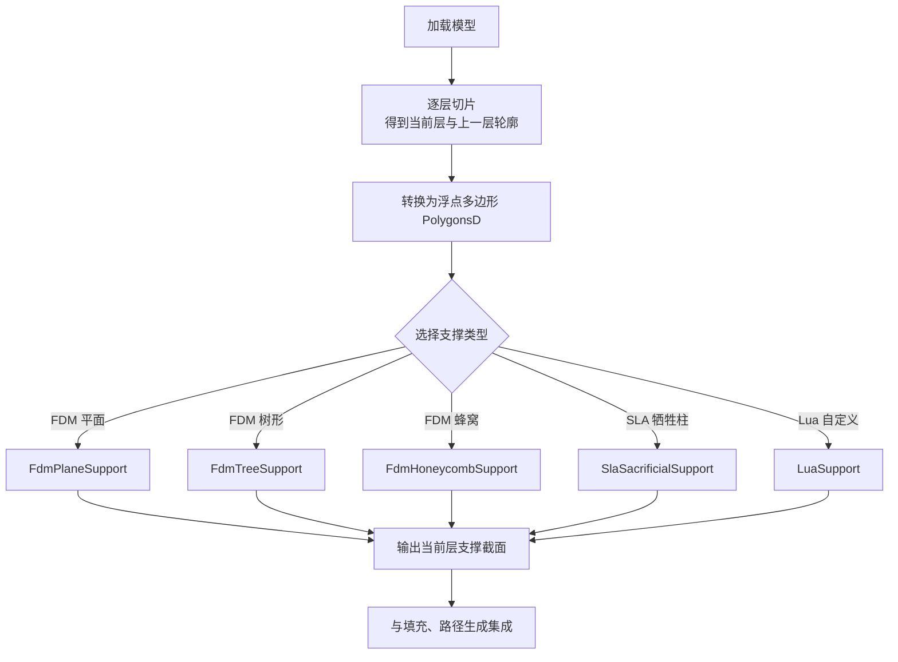
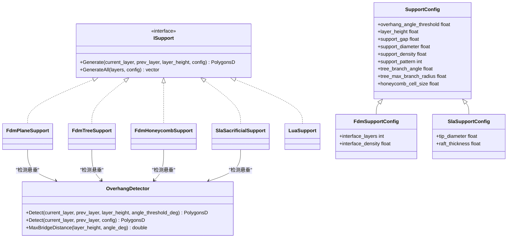
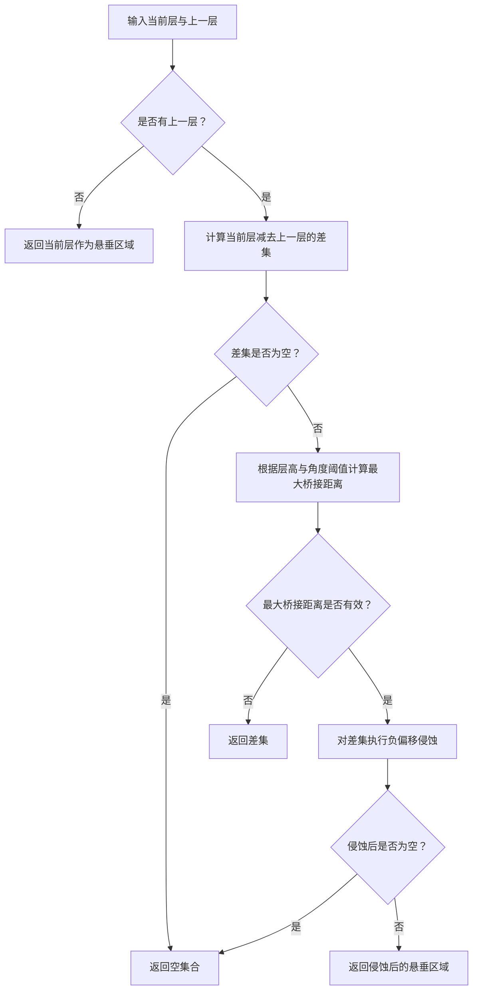
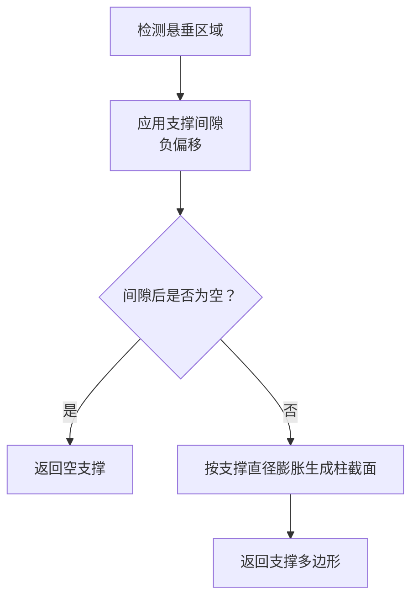
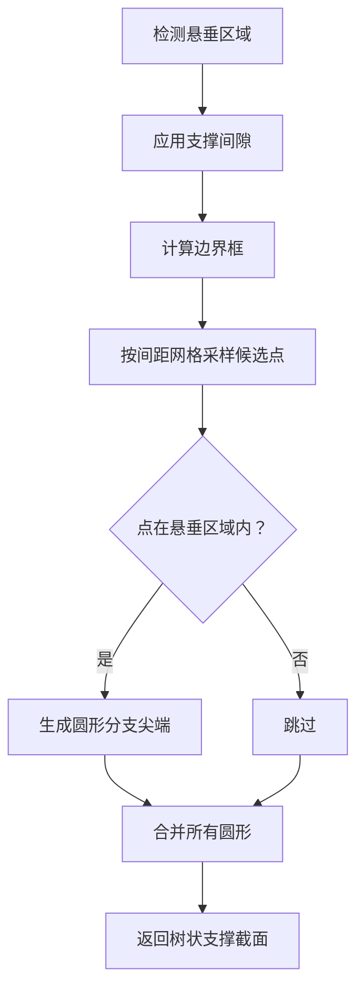
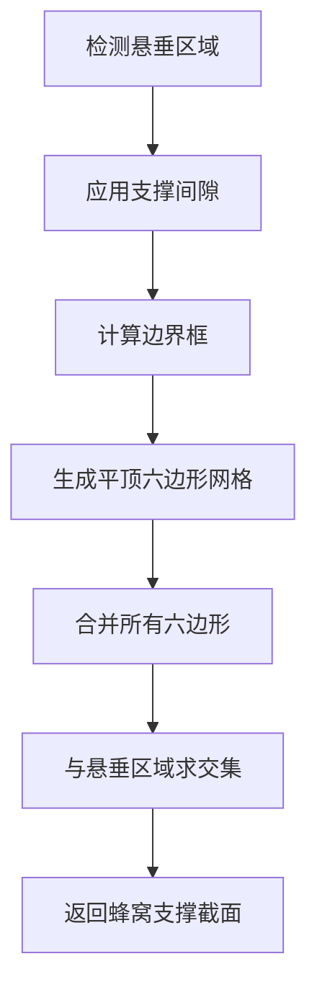
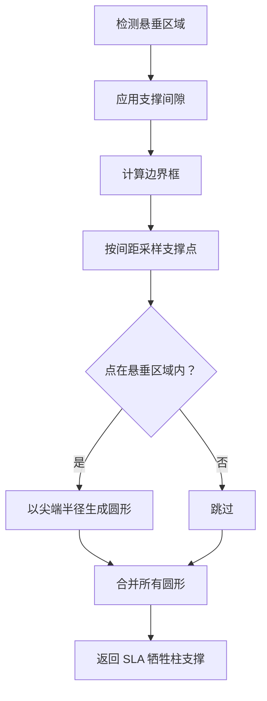
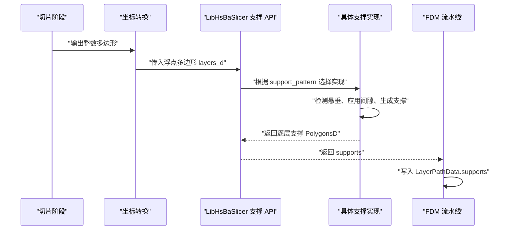
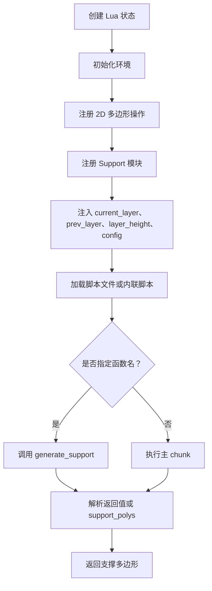
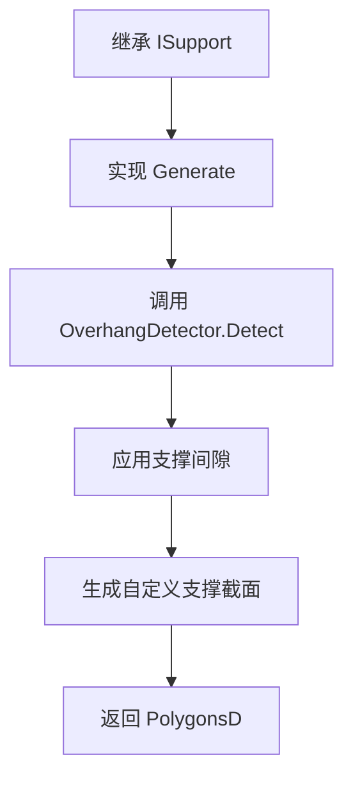

# 支撑生成模块

<cite>
**本文引用的文件**   
- [ISupport.hpp](file://support/ISupport.hpp)
- [SupportConfig.hpp](file://support/SupportConfig.hpp)
- [OverhangDetector.hpp](file://support/OverhangDetector.hpp)
- [OverhangDetector.cpp](file://support/OverhangDetector.cpp)
- [FdmSupport.hpp](file://support/FdmSupport.hpp)
- [FdmSupport.cpp](file://support/FdmSupport.cpp)
- [SlaSupport.hpp](file://support/SlaSupport.hpp)
- [SlaSupport.cpp](file://support/SlaSupport.cpp)
- [LuaSupport.hpp](file://support/LuaSupport.hpp)
- [LuaSupport.cpp](file://support/LuaSupport.cpp)
- [fdm_support.hpp](file://LibHsBaSlicer/Support/fdm_support.hpp)
- [fdm_support.cpp](file://LibHsBaSlicer/Support/fdm_support.cpp)
- [hsba_slicer.cppm](file://ModuleHsBaSlicer/hsba_slicer.cppm)
- [lua_pipeline_api.md](file://docs/en/lua_pipeline_api.md)
- [main_header.cpp](file://samples/LibHsBaSlicer/main_header.cpp)
- [my_sla_support.lua](file://samples/SLA/scripts/my_sla_support.lua)
</cite>

## 目录
1. [项目概述与快速开始](#项目概述与快速开始)
2. [架构总览](#架构总览)
3. [核心概念](#核心概念)
4. [核心模块详解](#核心模块详解)
5. [高级主题](#高级主题)
6. [Lua 脚本系统](#lua-脚本系统)
7. [API 参考文档](#api-参考文档)
8. [集成指南](#集成指南)
9. [开发·测试与贡献](#开发·测试与贡献)
10. [扩展开发指南](#扩展开发指南)
11. [示例与教程](#示例与教程)
12. [部署·故障排除与FAQ](#部署·故障排除与faq)
13. [附录](#附录)

## 项目概述与快速开始
本模块负责在切片结果之间检测悬垂区域，并基于 FDM、SLA 或自定义 Lua 算法生成逐层支撑截面。其设计目标是：
- 提供统一的支撑生成接口，支持平面柱状、树状和蜂窝三种 FDM 策略，以及 SLA 牺牲柱策略。
- 通过配置对象控制悬垂角度阈值、层高、支撑间隙、支撑直径、填充密度、树分支参数和蜂窝单元尺寸等关键参数。
- 暴露 LibHsBaSlicer 层 API，供上层流水线（FDM Pipeline、SLA Pipeline）直接调用。
- 允许用户用 Lua 脚本完全替换内置支撑算法，同时复用 2D 多边形操作与 3D 工具函数。

典型使用流程为：加载模型 → 逐层切片 → 将整数坐标多边形转换为浮点坐标 → 调用支撑生成 API → 将支撑多边形写入每层数据 → 进入填充与路径生成阶段。

**图示来源**   
- [fdm_support.cpp:14-31](file://LibHsBaSlicer/Support/fdm_support.cpp#L14-L31)
- [fdm_support.cpp:54-74](file://LibHsBaSlicer/Support/fdm_support.cpp#L54-L74)
- [hsba_slicer.cppm:704-734](file://ModuleHsBaSlicer/hsba_slicer.cppm#L704-L734)

**章节来源**   
- [fdm_support.cpp:14-74](file://LibHsBaSlicer/Support/fdm_support.cpp#L14-L74)
- [hsba_slicer.cppm:704-734](file://ModuleHsBaSlicer/hsba_slicer.cppm#L704-L734)

## 架构总览
支撑生成模块采用“抽象接口 + 具体实现 + 配置对象 + 外部管线入口”的分层结构：
- ISupport 定义逐层支撑生成的统一接口。
- OverhangDetector 计算需要支撑的悬垂区域。
- FdmPlaneSupport、FdmTreeSupport、FdmHoneycombSupport 实现 FDM 三类支撑。
- SlaSacrificialSupport 实现 SLA 牺牲柱支撑。
- LuaSupport 提供脚本化支撑生成能力。
- LibHsBaSlicer 层根据配置选择具体实现，并对外暴露 GenerateFdmSupport、GenerateAllFdmSupport、GenerateAllSlaSupport、GenerateAllLuaSupport。
- ModuleHsBaSlicer 的 FdmPipeline 将支撑结果与切片、填充、路径生成串联。

**图示来源**   
- [ISupport.hpp:22-44](file://support/ISupport.hpp#L22-L44)
- [OverhangDetector.hpp:20-49](file://support/OverhangDetector.hpp#L20-L49)
- [SupportConfig.hpp:14-43](file://support/SupportConfig.hpp#L14-L43)
- [FdmSupport.hpp:19-63](file://support/FdmSupport.hpp#L19-L63)
- [SlaSupport.hpp:20-42](file://support/SlaSupport.hpp#L20-L42)
- [LuaSupport.hpp:40-81](file://support/LuaSupport.hpp#L40-L81)

**章节来源**   
- [ISupport.hpp:22-44](file://support/ISupport.hpp#L22-L44)
- [OverhangDetector.hpp:20-49](file://support/OverhangDetector.hpp#L20-L49)
- [SupportConfig.hpp:14-43](file://support/SupportConfig.hpp#L14-L43)
- [FdmSupport.hpp:19-63](file://support/FdmSupport.hpp#L19-L63)
- [SlaSupport.hpp:20-42](file://support/SlaSupport.hpp#L20-L42)
- [LuaSupport.hpp:40-81](file://support/LuaSupport.hpp#L40-L81)

## 核心概念
### 悬垂检测
悬垂检测是支撑生成的前置步骤。它比较当前层与上一层的多边形轮廓，找出当前层存在但上一层未覆盖的区域；再根据层高与悬垂角度阈值计算最大可桥接水平距离，并对差集进行负偏移侵蚀，过滤掉可以自然桥接的小悬垂。

关键行为：
- 若没有上一层，则整个当前层都被视为需要支撑。
- 差集为空时，不需要支撑。
- 角度阈值大于等于 90 度时，垂直墙不需要额外悬垂判断。
- 角度阈值小于等于 0 度时，所有差集都视为悬垂。
- 最终对差集执行负偏移，得到真正需要支撑的区域。

**图示来源**   
- [OverhangDetector.cpp:23-39](file://support/OverhangDetector.cpp#L23-L39)
- [OverhangDetector.cpp:41-81](file://support/OverhangDetector.cpp#L41-L81)

**章节来源**   
- [OverhangDetector.hpp:20-49](file://support/OverhangDetector.hpp#L20-L49)
- [OverhangDetector.cpp:23-81](file://support/OverhangDetector.cpp#L23-L81)

### 支撑配置
支撑配置是所有支撑生成器共享的参数载体，包含通用字段与 FDM、SLA 专用字段：
- 通用字段：悬垂角度阈值、层高、支撑间隙、支撑直径、支撑填充密度、支撑模式、树分支角度、树最大分支半径、蜂窝单元尺寸。
- FDM 专用字段：界面层数、界面层填充密度。
- SLA 专用字段：支撑尖端直径、底板厚度。

这些字段直接影响悬垂检测、支撑柱粗细、支撑间距、支撑密度与几何形态。

| 配置类别 | 字段名 | 默认值 | 含义 |
|---|---|---:|---|
| 通用 | overhang_angle_threshold | 45.0 | 悬垂角度阈值，单位度 |
| 通用 | layer_height | 0.2 | 层高，单位毫米 |
| 通用 | support_gap | 0.5 | 支撑与模型之间的间隙，单位毫米 |
| 通用 | support_diameter | 2.0 | 支撑柱直径，单位毫米 |
| 通用 | support_density | 0.3 | 支撑填充密度，取值范围 0 到 1 |
| 通用 | support_pattern | 0 | 支撑模式：0=平面，1=树形，2=蜂窝 |
| 通用 | tree_branch_angle | 30.0 | 树分支角度，单位度 |
| 通用 | tree_max_branch_radius | 5.0 | 树最大分支半径，单位毫米 |
| 通用 | honeycomb_cell_size | 5.0 | 蜂窝单元尺寸，单位毫米 |
| FDM | interface_layers | 2 | 支撑与模型之间的界面层数 |
| FDM | interface_density | 0.5 | 界面层填充密度，取值范围 0 到 1 |
| SLA | tip_diameter | 0.3 | 支撑尖端直径，单位毫米 |
| SLA | raft_thickness | 0.5 | 底板厚度，单位毫米 |

**章节来源**   
- [SupportConfig.hpp:14-43](file://support/SupportConfig.hpp#L14-L43)
- [lua_pipeline_api.md:114-116](file://docs/en/lua_pipeline_api.md#L114-L116)

## 核心模块详解
### FDM 支撑生成
FDM 支撑提供三种策略：平面柱状、树状、蜂窝状。它们都遵循相同的主流程：
1. 调用 OverhangDetector 检测悬垂区域。
2. 应用支撑间隙，对悬垂区域执行负偏移。
3. 根据策略生成支撑截面多边形。

#### 平面支撑
平面支撑将悬垂区域收缩支撑间隙后，按支撑直径的一半向外膨胀，形成近似圆柱形的支撑截面。该策略简单稳定，适合大多数常规悬垂。

**图示来源**   
- [FdmSupport.cpp:48-76](file://support/FdmSupport.cpp#L48-L76)

**章节来源**   
- [FdmSupport.hpp:19-24](file://support/FdmSupport.hpp#L19-L24)
- [FdmSupport.cpp:48-76](file://support/FdmSupport.cpp#L48-L76)

#### 树状支撑
树状支撑在悬垂区域内按固定间距采样候选点，并在每个候选点生成圆形分支尖端；随后合并重叠圆，得到分散但可连接的支撑点集合。代码注释说明分支向下会扩张，但在单层 2D 截面中主要体现为分支尖端圆。

**图示来源**   
- [FdmSupport.cpp:81-143](file://support/FdmSupport.cpp#L81-L143)
- [FdmSupport.cpp:145-168](file://support/FdmSupport.cpp#L145-L168)

**章节来源**   
- [FdmSupport.hpp:33-44](file://support/FdmSupport.hpp#L33-L44)
- [FdmSupport.cpp:81-168](file://support/FdmSupport.cpp#L81-L168)

#### 蜂窝支撑
蜂窝支撑在悬垂区域的边界框内生成平顶六边形网格，然后将所有六边形合并后与悬垂区域求交集，从而得到轻量但具有一定刚性的蜂窝状支撑。

**图示来源**   
- [FdmSupport.cpp:173-242](file://support/FdmSupport.cpp#L173-L242)
- [FdmSupport.cpp:244-267](file://support/FdmSupport.cpp#L244-L267)

**章节来源**   
- [FdmSupport.hpp:52-63](file://support/FdmSupport.hpp#L52-L63)
- [FdmSupport.cpp:173-267](file://support/FdmSupport.cpp#L173-L267)

### SLA 支撑生成
SLA 牺牲柱支撑的目标是生成细尖、易去除的支撑柱。它在悬垂区域采样支撑点，并以较小尖端直径生成圆形截面，支撑点间距通常取支撑直径的两倍。

**图示来源**   
- [SlaSupport.cpp:38-79](file://support/SlaSupport.cpp#L38-L79)
- [SlaSupport.cpp:81-124](file://support/SlaSupport.cpp#L81-L124)

**章节来源**   
- [SlaSupport.hpp:20-42](file://support/SlaSupport.hpp#L20-L42)
- [SlaSupport.cpp:38-133](file://support/SlaSupport.cpp#L38-L133)

### 支撑数据结构与层间集成
支撑生成器的输入是当前层与上一层的多边形轮廓，输出是当前层的支撑多边形。LibHsBaSlicer 层提供单层与全层 API，ModuleHsBaSlicer 的 FdmPipeline 则将支撑结果写入 LayerPathData.supports，并与 outlines、fills 一起进入路径生成。

**图示来源**   
- [fdm_support.cpp:14-51](file://LibHsBaSlicer/Support/fdm_support.cpp#L14-L51)
- [hsba_slicer.cppm:704-734](file://ModuleHsBaSlicer/hsba_slicer.cppm#L704-L734)

**章节来源**   
- [fdm_support.hpp:27-67](file://LibHsBaSlicer/Support/fdm_support.hpp#L27-L67)
- [fdm_support.cpp:14-74](file://LibHsBaSlicer/Support/fdm_support.cpp#L14-L74)
- [hsba_slicer.cppm:704-734](file://ModuleHsBaSlicer/hsba_slicer.cppm#L704-L734)

## 高级主题
### 支撑密度与填充模式
SupportConfig 中的 support_density 表示支撑填充密度，取值范围 0 到 1。当前内置实现主要依赖支撑几何形状（柱、树、蜂窝）与支撑直径、蜂窝单元尺寸来控制支撑体积；density 字段在 Lua 环境配置中可见，可用于脚本自定义支撑密度逻辑。

优化建议：
- 对于大面积悬垂，优先增大蜂窝单元尺寸或降低支撑密度，以减少材料消耗。
- 对于小悬垂或精细结构，优先减小支撑直径、提高支撑密度，以提升支撑稳定性。
- 树状支撑适合长悬臂，可减少底部接触面积，便于后期去除。

**章节来源**   
- [SupportConfig.hpp:14-25](file://support/SupportConfig.hpp#L14-L25)
- [lua_pipeline_api.md:114-116](file://docs/en/lua_pipeline_api.md#L114-L116)

### 角度阈值与桥接距离
OverhangDetector::MaxBridgeDistance 根据层高与角度阈值计算最大桥接距离。角度越大，允许的悬垂越小；角度接近 90 度时几乎不产生悬垂；角度接近 0 度时几乎所有差集都需要支撑。

调参建议：
- 45 度是常见默认值，适合一般 FDM 打印。
- 如果打印机桥接能力较强，可提高角度阈值，减少支撑数量。
- 如果模型悬垂较多且容易塌陷，可降低角度阈值，增加支撑覆盖率。

**章节来源**   
- [OverhangDetector.cpp:23-39](file://support/OverhangDetector.cpp#L23-L39)
- [OverhangDetector.cpp:41-81](file://support/OverhangDetector.cpp#L41-L81)

### 接触区域检测与间隙控制
所有支撑实现都会对悬垂区域应用 support_gap 负偏移，使支撑与模型保持一定间隙，避免支撑粘连模型表面。间隙过大可能导致支撑过粗或悬空；间隙过小可能导致支撑与模型融合。

调参建议：
- 默认 0.5mm 间隙适合多数喷嘴直径。
- 大喷嘴可适当增大间隙。
- 高精度模型可适当减小间隙，但需避免支撑粘连。

**章节来源**   
- [FdmSupport.cpp:59-75](file://support/FdmSupport.cpp#L59-L75)
- [FdmSupport.cpp:155-167](file://support/FdmSupport.cpp#L155-L167)
- [FdmSupport.cpp:254-266](file://support/FdmSupport.cpp#L254-L266)
- [SlaSupport.cpp:91-102](file://support/SlaSupport.cpp#L91-L102)

## Lua 脚本系统
LuaSupport 允许用户用 Lua 脚本完全替换内置支撑算法。脚本运行时会注入以下全局变量：
- current_layer：当前层多边形。
- prev_layer：上一层多边形，首层为空。
- layer_height：层高。
- config：支撑配置表，包含 overhang_angle_threshold、layer_height、support_gap、support_diameter、support_density、support_pattern、tree_branch_angle、tree_max_branch_radius、honeycomb_cell_size。

脚本可以通过主 chunk 返回值或定义 generate_support 函数返回支撑多边形。此外，LuaSupport 还会注册 2D 多边形操作与 Support 模块，并提供外部 2D/3D 函数注册机制。

**图示来源**   
- [LuaSupport.cpp:19-90](file://support/LuaSupport.cpp#L19-L90)
- [LuaSupport.cpp:113-177](file://support/LuaSupport.cpp#L113-L177)

**章节来源**   
- [LuaSupport.hpp:21-81](file://support/LuaSupport.hpp#L21-L81)
- [LuaSupport.cpp:19-177](file://support/LuaSupport.cpp#L19-L177)
- [lua_pipeline_api.md:219-232](file://docs/en/lua_pipeline_api.md#L219-L232)

## API 参考文档
### LibHsBaSlicer 支撑 API
| API | 输入 | 输出 | 说明 |
|---|---|---|---|
| GenerateFdmSupport | current_layer、prev_layer、layer_height、FdmSupportConfig | PolygonsD | 生成单层 FDM 支撑 |
| GenerateAllFdmSupport | layers、FdmSupportConfig | vector<PolygonsD> | 生成全部层 FDM 支撑 |
| GenerateAllSlaSupport | layers、SlaSupportConfig | vector<PolygonsD> | 生成全部层 SLA 牺牲柱支撑 |
| GenerateAllLuaSupport | layers、SupportConfig、script、functionName | vector<PolygonsD> | 使用 Lua 脚本生成全部层支撑 |

**章节来源**   
- [fdm_support.hpp:27-67](file://LibHsBaSlicer/Support/fdm_support.hpp#L27-L67)
- [fdm_support.cpp:14-74](file://LibHsBaSlicer/Support/fdm_support.cpp#L14-L74)

### FDM 流水线集成
FdmPipeline 在 run 方法中依次执行切片、支撑、填充与路径生成，并将支撑多边形写入 LayerPathData.supports。

**章节来源**   
- [hsba_slicer.cppm:704-734](file://ModuleHsBaSlicer/hsba_slicer.cppm#L704-L734)

## 集成指南
### 从切片结果到支撑生成
LibHsBaSlicer 示例展示了完整流程：先切片得到整数多边形，再转换为浮点多边形，然后设置 FdmSupportConfig，最后调用 GenerateAllFdmSupport。

推荐步骤：
1. 使用切片 API 获取每层轮廓。
2. 将整数多边形转换为浮点多边形。
3. 设置支撑配置：层高、悬垂角度、支撑直径、支撑密度、支撑模式。
4. 调用 GenerateAllFdmSupport 或 GenerateAllSlaSupport。
5. 将支撑结果与切片结果、填充结果组合，进入路径生成。

**章节来源**   
- [main_header.cpp:90-122](file://samples/LibHsBaSlicer/main_header.cpp#L90-L122)

### SLA 流水线中的支撑
SLA 流水线在支撑阶段可选择内置 SLA 牺牲柱支撑或 Lua 自定义支撑。若启用 Lua 支撑，则调用 GenerateAllLuaSupport；否则调用 GenerateAllSlaSupport。

**章节来源**   
- [sla_pipeline.cpp:411-446](file://DllHsBaSlicer/sla_pipeline.cpp#L411-L446)

## 开发·测试与贡献
支撑模块的核心逻辑集中在 support 目录，LibHsBaSlicer 层提供对外 API，ModuleHsBaSlicer 将其接入完整流水线。开发者应关注：
- 新增支撑策略时，继承 ISupport 并实现 Generate。
- 新增配置字段时，同步更新 SupportConfig 及其派生结构。
- 新增 Lua 脚本能力时，确保环境变量与返回值解析正确。
- 性能敏感场景下，注意 Clipper2 几何运算的开销，合理控制采样间距与网格密度。

**章节来源**   
- [ISupport.hpp:22-44](file://support/ISupport.hpp#L22-L44)
- [SupportConfig.hpp:14-43](file://support/SupportConfig.hpp#L14-L43)
- [LuaSupport.cpp:113-177](file://support/LuaSupport.cpp#L113-L177)

## 扩展开发指南
### 自定义 FDM 支撑算法
要扩展新的 FDM 支撑算法：
1. 新建类继承 ISupport。
2. 实现 Generate 方法，内部复用 OverhangDetector 检测悬垂。
3. 根据需要应用支撑间隙、生成支撑截面。
4. 在 LibHsBaSlicer 层根据新的 support_pattern 值选择新实现。

**图示来源**   
- [ISupport.hpp:22-44](file://support/ISupport.hpp#L22-L44)
- [FdmSupport.cpp:48-76](file://support/FdmSupport.cpp#L48-L76)

**章节来源**   
- [ISupport.hpp:22-44](file://support/ISupport.hpp#L22-L44)
- [FdmSupport.cpp:48-76](file://support/FdmSupport.cpp#L48-L76)

### 自定义 SLA 支撑算法
SLA 支撑可通过 SlaSacrificialSupport 的静态 Generate 重载接受 SlaSupportConfig。若需要更复杂的 SLA 支撑策略，可参考其采样与合并圆形的实现方式，调整 tip_diameter 与 spacing。

**章节来源**   
- [SlaSupport.hpp:20-42](file://support/SlaSupport.hpp#L20-L42)
- [SlaSupport.cpp:38-133](file://support/SlaSupport.cpp#L38-L133)

### 自定义 Lua 支撑脚本
Lua 支撑脚本应定义 generate_support 函数，或使用全局 support_polys 返回支撑多边形。脚本可使用 PolygonOperations 与 Support 模块提供的函数，例如 offsetOperation、union、difference、intersection、makeCircle、area、detect_overhang 等。

**章节来源**   
- [my_sla_support.lua:1-29](file://samples/SLA/scripts/my_sla_support.lua#L1-L29)
- [lua_pipeline_api.md:219-232](file://docs/en/lua_pipeline_api.md#L219-L232)

## 示例与教程
### FDM 支撑示例
示例代码展示了如何配置 FDM 支撑参数并生成支撑：
- 设置 overhang_angle_threshold、layer_height、support_density、support_pattern。
- 调用 GenerateAllFdmSupport 得到逐层支撑。

**章节来源**   
- [main_header.cpp:103-122](file://samples/LibHsBaSlicer/main_header.cpp#L103-L122)

### SLA 支撑脚本示例
SLA 自定义支撑脚本说明了 Lua 环境中的全局变量与可用函数，包括悬垂角度阈值、层高、支撑间隙、支撑直径、支撑密度、支撑模式等配置字段，以及多边形操作与支撑模块函数。

**章节来源**   
- [my_sla_support.lua:1-29](file://samples/SLA/scripts/my_sla_support.lua#L1-L29)

## 部署·故障排除与FAQ
### 常见问题
- 支撑过多：可能是 overhang_angle_threshold 过低，或 support_gap 过小导致悬垂区域扩大。
- 支撑不足：可能是 overhang_angle_threshold 过高，或 support_diameter 过小。
- 支撑与模型粘连：support_gap 可能太小，或支撑密度过高。
- 支撑难以去除：SLA 支撑的 tip_diameter 可能太大，或支撑点间距过小。
- Lua 支撑报错：检查脚本语法、函数名、返回值格式，以及 config 字段是否正确注入。

### 性能调优技巧
- 减少采样点数：增大支撑点间距或蜂窝单元尺寸。
- 减少几何运算次数：合并多边形时使用非零填充规则，避免重复 Union。
- 分层处理：对复杂模型分区域生成支撑，避免一次性处理超大边界框。
- 缓存中间结果：对同一层多次使用的悬垂区域或间隙后区域进行缓存。

**章节来源**   
- [FdmSupport.cpp:81-143](file://support/FdmSupport.cpp#L81-L143)
- [FdmSupport.cpp:173-242](file://support/FdmSupport.cpp#L173-L242)
- [SlaSupport.cpp:38-79](file://support/SlaSupport.cpp#L38-L79)

## 附录
### 关键实现要点总结
- 悬垂检测基于层间差集与角度阈值，结合负偏移过滤可桥接区域。
- FDM 平面支撑通过膨胀生成柱截面；树状支撑通过采样与合并圆形生成分支点；蜂窝支撑通过六边形网格与交集生成轻量支撑。
- SLA 牺牲柱支撑通过小尖端半径与较大间距生成易去除支撑。
- Lua 支撑提供完全自定义能力，同时复用 2D/3D 工具函数。
- LibHsBaSlicer 层根据配置选择具体实现，ModuleHsBaSlicer 将支撑结果集成到完整切片流水线。

**章节来源**   
- [OverhangDetector.cpp:23-81](file://support/OverhangDetector.cpp#L23-L81)
- [FdmSupport.cpp:48-267](file://support/FdmSupport.cpp#L48-L267)
- [SlaSupport.cpp:38-133](file://support/SlaSupport.cpp#L38-L133)
- [LuaSupport.cpp:19-177](file://support/LuaSupport.cpp#L19-L177)
- [fdm_support.cpp:14-74](file://LibHsBaSlicer/Support/fdm_support.cpp#L14-L74)
- [hsba_slicer.cppm:704-734](file://ModuleHsBaSlicer/hsba_slicer.cppm#L704-L734)