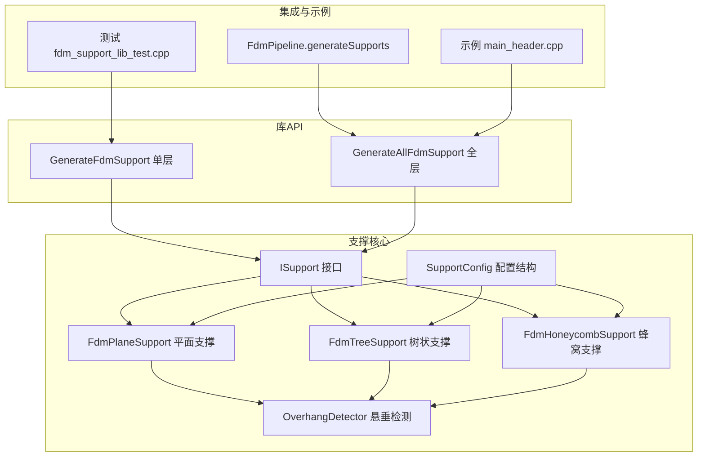
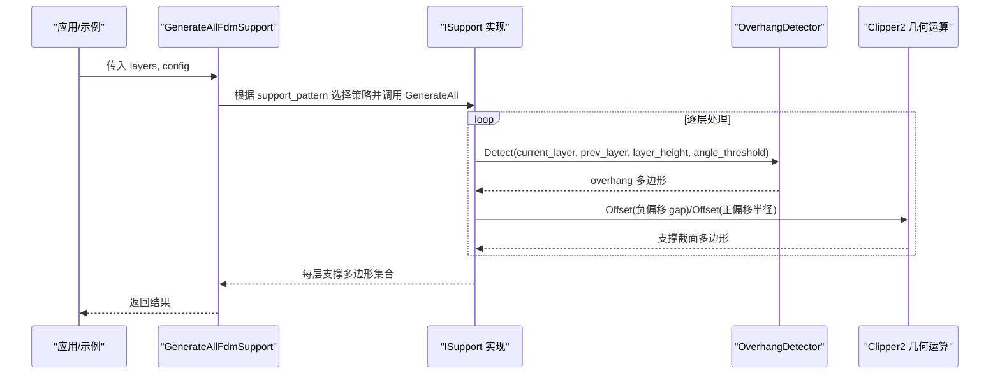
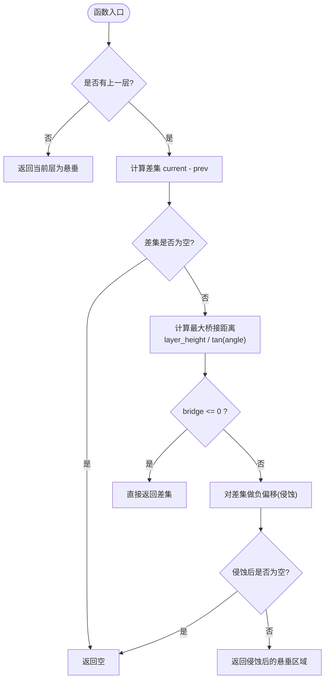
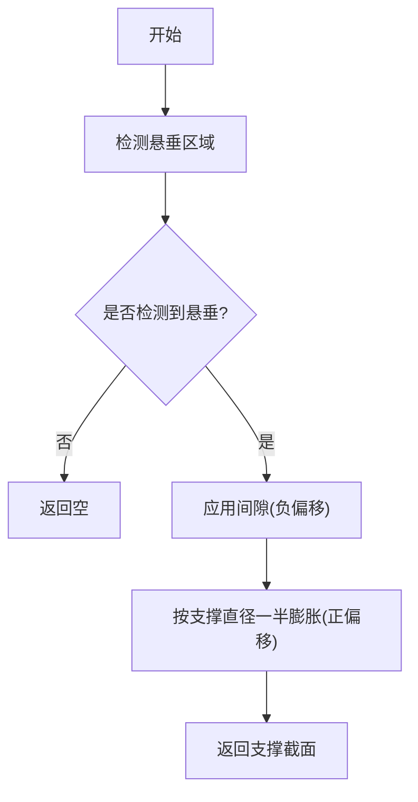
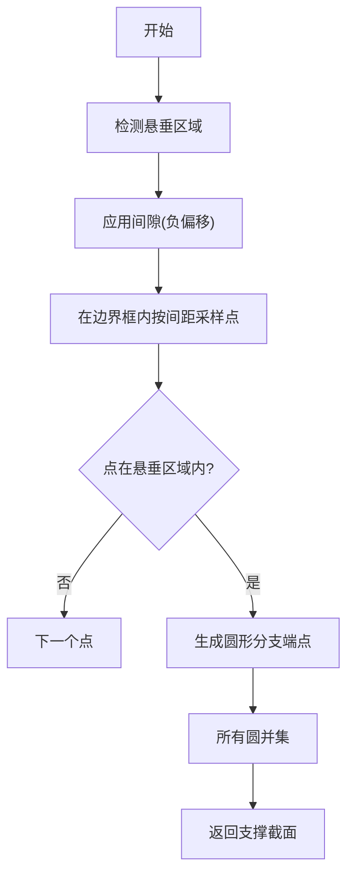
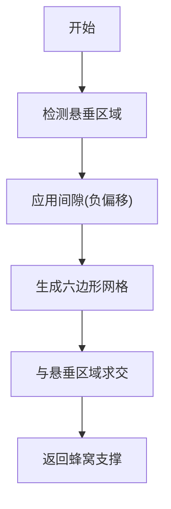
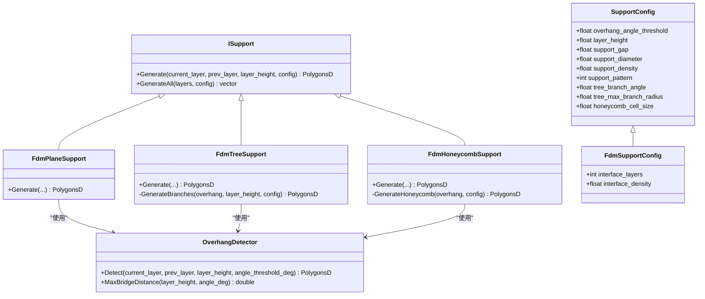
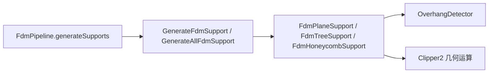

# FDM支撑算法

<cite>
**本文引用的文件**   
- [FdmSupport.hpp](file://support/FdmSupport.hpp)
- [FdmSupport.cpp](file://support/FdmSupport.cpp)
- [OverhangDetector.hpp](file://support/OverhangDetector.hpp)
- [OverhangDetector.cpp](file://support/OverhangDetector.cpp)
- [ISupport.hpp](file://support/ISupport.hpp)
- [ISupport.cpp](file://support/ISupport.cpp)
- [SupportConfig.hpp](file://support/SupportConfig.hpp)
- [fdm_support.hpp](file://LibHsBaSlicer/support/fdm_support.hpp)
- [fdm_support.cpp](file://LibHsBaSlicer/support/fdm_support.cpp)
- [hsba_slicer.cppm](file://ModuleHsBaSlicer/hsba_slicer.cppm)
- [main_header.cpp](file://samples/LibHsBaSlicer/main_header.cpp)
- [fdm_support_lib_test.cpp](file://tests/Support/fdm_support_lib_test.cpp)
</cite>

## 目录
1. [简介](#简介)
2. [项目结构](#项目结构)
3. [核心组件](#核心组件)
4. [架构总览](#架构总览)
5. [详细组件分析](#详细组件分析)
6. [依赖关系分析](#依赖关系分析)
7. [性能与体积优化](#性能与体积优化)
8. [故障排查指南](#故障排查指南)
9. [结论](#结论)
10. [附录：API使用示例](#附录api使用示例)

## 简介
本技术文档面向3D打印工艺工程师与算法开发者，系统性解析 HsBaSlicer 中 FDM 支撑算法的实现。内容覆盖：
- 悬垂角度检测原理、阈值与桥接距离控制
- 平面支撑、树状支撑、蜂窝支撑三类策略的生成逻辑
- 支撑与模型表面的连接策略（间隙控制）、支撑柱直径控制、支撑间距优化
- 支撑密度、界面层等配置对支撑质量的影响
- 支撑体积最小化思路与材料节省策略
- 通过 GenerateFdmSupport 与 GenerateAllFdmSupport 的实际调用方式

## 项目结构
支撑相关代码主要分布在以下模块：
- support：核心算法实现（悬垂检测、支撑生成器接口与具体策略）
- LibHsBaSlicer/support：对外 C++ API 封装（单层/全层生成入口）
- ModuleHsBaSlicer：切片管线集成（将上层配置映射到支撑参数）
- samples：示例程序展示如何调用 API
- tests：单元测试验证不同支撑模式的行为

图表来源
- [ISupport.hpp:16-45](file://support/ISupport.hpp#L16-L45)
- [FdmSupport.hpp:13-63](file://support/FdmSupport.hpp#L13-L63)
- [OverhangDetector.hpp:14-50](file://support/OverhangDetector.hpp#L14-L50)
- [SupportConfig.hpp:14-43](file://support/SupportConfig.hpp#L14-L43)
- [fdm_support.hpp:19-37](file://LibHsBaSlicer/support/fdm_support.hpp#L19-L37)
- [hsba_slicer.cppm:640-661](file://ModuleHsBaSlicer/hsba_slicer.cppm#L640-L661)
- [main_header.cpp:103-123](file://samples/LibHsBaSlicer/main_header.cpp#L103-L123)
- [fdm_support_lib_test.cpp:41-71](file://tests/Support/fdm_support_lib_test.cpp#L41-L71)

章节来源
- [ISupport.hpp:16-45](file://support/ISupport.hpp#L16-L45)
- [FdmSupport.hpp:13-63](file://support/FdmSupport.hpp#L13-L63)
- [OverhangDetector.hpp:14-50](file://support/OverhangDetector.hpp#L14-L50)
- [SupportConfig.hpp:14-43](file://support/SupportConfig.hpp#L14-L43)
- [fdm_support.hpp:19-37](file://LibHsBaSlicer/support/fdm_support.hpp#L19-L37)
- [hsba_slicer.cppm:640-661](file://ModuleHsBaSlicer/hsba_slicer.cppm#L640-L661)
- [main_header.cpp:103-123](file://samples/LibHsBaSlicer/main_header.cpp#L103-L123)
- [fdm_support_lib_test.cpp:41-71](file://tests/Support/fdm_support_lib_test.cpp#L41-L71)

## 核心组件
- ISupport：定义每层支撑生成的统一接口，并提供默认的全层迭代实现。
- OverhangDetector：基于相邻层轮廓差集与角度阈值计算需要支撑的悬垂区域。
- FdmPlaneSupport：在悬垂区域外扩形成圆柱形支撑柱截面。
- FdmTreeSupport：在悬垂区域内按间距采样点生成圆形分支端点，后续层合并成树状结构。
- FdmHoneycombSupport：在悬垂区域内填充六边形蜂窝网格，提供轻量但刚性的支撑。
- SupportConfig / FdmSupportConfig：支撑通用与FDM专用配置项，包括角度阈值、层高、间隙、直径、密度、图案类型、蜂窝尺寸、界面层等。

章节来源
- [ISupport.hpp:16-45](file://support/ISupport.hpp#L16-L45)
- [ISupport.cpp:9-21](file://support/ISupport.cpp#L9-L21)
- [OverhangDetector.hpp:14-50](file://support/OverhangDetector.hpp#L14-L50)
- [OverhangDetector.cpp:23-75](file://support/OverhangDetector.cpp#L23-L75)
- [FdmSupport.hpp:13-63](file://support/FdmSupport.hpp#L13-L63)
- [FdmSupport.cpp:48-234](file://support/FdmSupport.cpp#L48-L234)
- [SupportConfig.hpp:14-43](file://support/SupportConfig.hpp#L14-L43)

## 架构总览
FDM 支撑生成流程从上层切片管线或示例程序进入库 API，再根据配置选择具体支撑策略，最终输出每层的支撑多边形集合。

图表来源
- [fdm_support.cpp:34-52](file://LibHsBaSlicer/support/fdm_support.cpp#L34-L52)
- [ISupport.cpp:9-21](file://support/ISupport.cpp#L9-L21)
- [OverhangDetector.cpp:37-75](file://support/OverhangDetector.cpp#L37-L75)
- [FdmSupport.cpp:48-72](file://support/FdmSupport.cpp#L48-L72)

## 详细组件分析

### 悬垂角度检测算法
- 输入：当前层轮廓 current_layer、上一层轮廓 prev_layer、层高 layer_height、角度阈值 angle_threshold_deg。
- 核心步骤：
  - 若没有上一层，则整个当前层视为悬垂。
  - 计算差集 diff = current_layer - prev_layer。
  - 根据角度阈值计算最大桥接距离 max_bridge = layer_height / tan(angle)。
  - 对 diff 进行负偏移（侵蚀）以过滤可桥接的小悬垂。
  - 返回侵蚀后的过盈区域作为需要支撑的区域。

图表来源
- [OverhangDetector.cpp:23-75](file://support/OverhangDetector.cpp#L23-L75)

关键要点
- 角度阈值越大，允许更陡的悬垂，桥接距离越小，支撑越少。
- 角度阈值越小，更多区域被判定为悬垂，支撑越多。
- 层高越高，相同角度下允许的桥接距离越大，可能减少支撑。

章节来源
- [OverhangDetector.hpp:14-50](file://support/OverhangDetector.hpp#L14-L50)
- [OverhangDetector.cpp:23-75](file://support/OverhangDetector.cpp#L23-L75)

### 平面支撑（FdmPlaneSupport）
- 目标：在悬垂区域生成简单柱状支撑。
- 流程：
  - 调用 OverhangDetector 得到悬垂区域。
  - 应用支持间隙（负偏移），使支撑与模型表面分离。
  - 按支撑直径的一半进行正偏移，形成柱体截面。
  - 返回支撑多边形。

图表来源
- [FdmSupport.cpp:48-72](file://support/FdmSupport.cpp#L48-L72)

章节来源
- [FdmSupport.hpp:13-24](file://support/FdmSupport.hpp#L13-L24)
- [FdmSupport.cpp:48-72](file://support/FdmSupport.cpp#L48-L72)

### 树状支撑（FdmTreeSupport）
- 目标：生成树状分支支撑，分支从构建平台向上生长并在相交处合并。
- 单层截面逻辑：
  - 在悬垂区域内按固定间距采样候选点。
  - 在每个候选点生成圆形分支端点（半径=支撑直径/2）。
  - 对所有圆进行并集合并，得到该层支撑截面。
- 跨层行为：
  - 通过 GenerateAll 逐层处理，分支在不同层之间自然合并，形成树状结构。

图表来源
- [FdmSupport.cpp:77-150](file://support/FdmSupport.cpp#L77-L150)

章节来源
- [FdmSupport.hpp:26-44](file://support/FdmSupport.hpp#L26-L44)
- [FdmSupport.cpp:77-150](file://support/FdmSupport.cpp#L77-L150)

### 蜂窝支撑（FdmHoneycombSupport）
- 目标：在悬垂区域内填充六边形蜂窝网格，提供轻量且刚性的支撑。
- 流程：
  - 根据蜂窝单元尺寸计算六边形宽高。
  - 在悬垂区域的边界框内生成规则六边形网格。
  - 将所有六边形并集后与悬垂区域求交，得到贴合边界的蜂窝支撑。

图表来源
- [FdmSupport.cpp:155-234](file://support/FdmSupport.cpp#L155-L234)

章节来源
- [FdmSupport.hpp:46-63](file://support/FdmSupport.hpp#L46-L63)
- [FdmSupport.cpp:155-234](file://support/FdmSupport.cpp#L155-L234)

### 类关系图

图表来源
- [ISupport.hpp:16-45](file://support/ISupport.hpp#L16-L45)
- [FdmSupport.hpp:13-63](file://support/FdmSupport.hpp#L13-L63)
- [OverhangDetector.hpp:14-50](file://support/OverhangDetector.hpp#L14-L50)
- [SupportConfig.hpp:14-43](file://support/SupportConfig.hpp#L14-L43)

## 依赖关系分析
- 库API层：
  - GenerateFdmSupport：根据 support_pattern 动态创建 FdmPlaneSupport / FdmTreeSupport / FdmHoneycombSupport，并调用其 Generate。
  - GenerateAllFdmSupport：同样选择策略后调用 GenerateAll，内部由 ISupport::GenerateAll 逐层迭代。
- 切片管线层：
  - FdmPipeline::generateSupports：将上层配置映射到 Support::FdmSupportConfig，并调用 GenerateAllFdmSupport 或 Lua 自定义支撑。
- 外部依赖：
  - Clipper2：用于多边形布尔运算（差集、并集、交集）与偏移（Offset）。
  - 整数化/浮点转换：Integerization / UnIntegerization 用于几何运算精度与性能平衡。

图表来源
- [fdm_support.cpp:14-52](file://LibHsBaSlicer/support/fdm_support.cpp#L14-L52)
- [hsba_slicer.cppm:640-661](file://ModuleHsBaSlicer/hsba_slicer.cppm#L640-L661)
- [FdmSupport.cpp:18-44](file://support/FdmSupport.cpp#L18-L44)

章节来源
- [fdm_support.cpp:14-52](file://LibHsBaSlicer/support/fdm_support.cpp#L14-L52)
- [hsba_slicer.cppm:640-661](file://ModuleHsBaSlicer/hsba_slicer.cppm#L640-L661)
- [FdmSupport.cpp:18-44](file://support/FdmSupport.cpp#L18-L44)

## 性能与体积优化
- 悬垂检测优化：
  - 使用差集与负偏移快速过滤可桥接区域，避免不必要的支撑。
  - 角度阈值与层高共同决定桥接距离，合理设置可减少支撑体积。
- 支撑密度控制：
  - support_density 影响支撑填充密度；较低密度可减少材料消耗，但需权衡支撑强度。
- 支撑柱直径与间距：
  - support_diameter 控制柱径；FdmTreeSupport 使用固定间距采样点，增大间距可降低支撑数量。
- 蜂窝单元尺寸：
  - honeycomb_cell_size 越大，蜂窝越稀疏，材料更少但刚性降低。
- 间隙控制：
  - support_gap 控制支撑与模型的分离距离，过大可能导致支撑接触不良，过小可能粘连模型。
- 界面层：
  - interface_layers 与 interface_density 控制支撑与模型之间的过渡层，提升表面质量但增加材料与时间。

建议
- 对于大悬垂面优先使用蜂窝支撑以降低材料。
- 细长悬垂或复杂曲面适合树状支撑以获得更好稳定性。
- 调整 support_gap 与 support_diameter 平衡支撑强度与移除难度。
- 通过单元测试与可视化结果调参，逐步逼近最优支撑体积与质量。

[本节为通用指导，不直接分析具体文件]

## 故障排查指南
常见问题与定位方法：
- 无支撑输出：
  - 检查是否未启用支撑（enable_support）。
  - 确认角度阈值设置过高导致无悬垂区域。
  - 检查层高与角度阈值组合是否使桥接距离过大。
- 支撑与模型粘连：
  - 减小 support_gap 或检查负偏移是否正确执行。
- 支撑强度不足：
  - 增大 support_diameter 或提高 support_density。
  - 切换至树状或蜂窝支撑以提升结构刚度。
- 支撑过多导致材料浪费：
  - 提高 overhang_angle_threshold 或增大 honeycomb_cell_size。
  - 调整 FdmTreeSupport 的采样间距（可通过扩展配置实现）。

章节来源
- [hsba_slicer.cppm:640-661](file://ModuleHsBaSlicer/hsba_slicer.cppm#L640-L661)
- [OverhangDetector.cpp:23-75](file://support/OverhangDetector.cpp#L23-L75)
- [FdmSupport.cpp:48-234](file://support/FdmSupport.cpp#L48-L234)

## 结论
HsBaSlicer 的 FDM 支撑算法以清晰的接口与模块化设计实现了平面、树状与蜂窝三种支撑策略，并通过悬垂角度检测与几何布尔运算确保支撑区域准确、可控。通过合理配置角度阈值、层高、间隙、直径、密度与蜂窝尺寸，可在支撑质量与材料消耗之间取得良好平衡。库 API 提供简洁的单层与全层生成接口，便于上层切片管线与用户程序集成。

[本节为总结性内容，不直接分析具体文件]

## 附录：API使用示例

### 使用 GenerateFdmSupport 生成单层支撑
- 输入：当前层轮廓、上一层轮廓、层高、FdmSupportConfig。
- 行为：根据 support_pattern 选择具体支撑策略并返回该层支撑多边形。
- 参考路径：
  - [fdm_support.cpp:14-32](file://LibHsBaSlicer/support/fdm_support.cpp#L14-L32)
  - [fdm_support_lib_test.cpp:41-56](file://tests/Support/fdm_support_lib_test.cpp#L41-L56)

### 使用 GenerateAllFdmSupport 生成全层支撑
- 输入：从底到顶的所有层轮廓、FdmSupportConfig。
- 行为：选择支撑策略后调用 GenerateAll，逐层生成支撑并返回每层结果。
- 参考路径：
  - [fdm_support.cpp:34-52](file://LibHsBaSlicer/support/fdm_support.cpp#L34-L52)
  - [main_header.cpp:103-123](file://samples/LibHsBaSlicer/main_header.cpp#L103-L123)
  - [fdm_support_lib_test.cpp:58-71](file://tests/Support/fdm_support_lib_test.cpp#L58-L71)

章节来源
- [fdm_support.cpp:14-52](file://LibHsBaSlicer/support/fdm_support.cpp#L14-L52)
- [main_header.cpp:103-123](file://samples/LibHsBaSlicer/main_header.cpp#L103-L123)
- [fdm_support_lib_test.cpp:41-71](file://tests/Support/fdm_support_lib_test.cpp#L41-L71)