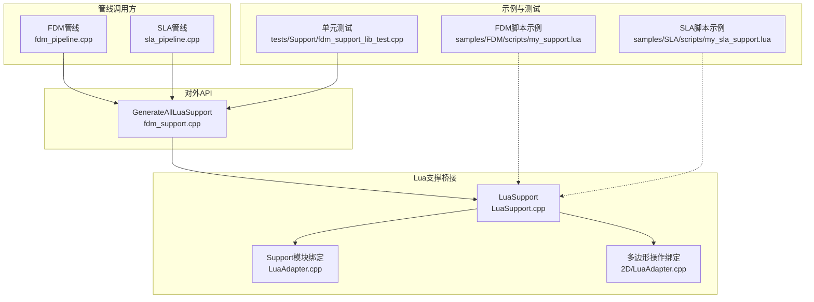
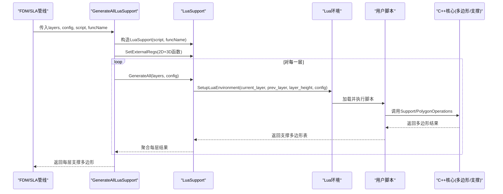
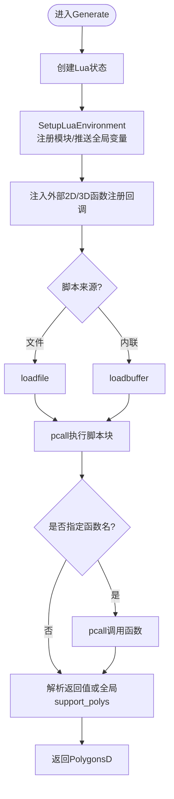
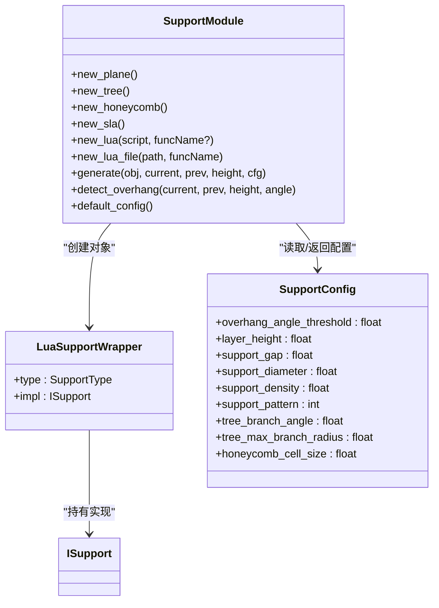
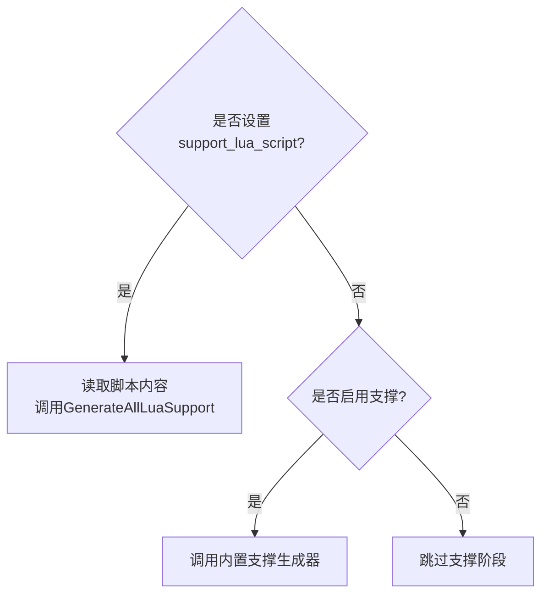
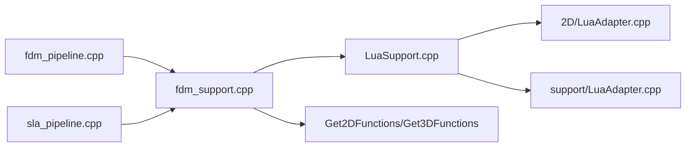

# Lua自定义支撑

<cite>
**本文引用的文件**   
- [fdm_support.hpp](file://LibHsBaSlicer/Support/fdm_support.hpp)
- [fdm_support.cpp](file://LibHsBaSlicer/Support/fdm_support.cpp)
- [LuaSupport.hpp](file://support/LuaSupport.hpp)
- [LuaSupport.cpp](file://support/LuaSupport.cpp)
- [LuaAdapter.cpp](file://support/LuaAdapter.cpp)
- [2D LuaAdapter.cpp](file://2D/LuaAdapter.cpp)
- [SupportConfig.hpp](file://support/SupportConfig.hpp)
- [fdm_pipeline.cpp](file://DllHsBaSlicer/fdm_pipeline.cpp)
- [sla_pipeline.cpp](file://DllHsBaSlicer/sla_pipeline.cpp)
- [my_support.lua](file://samples/FDM/scripts/my_support.lua)
- [my_sla_support.lua](file://samples/SLA/scripts/my_sla_support.lua)
- [fdm_support_lib_test.cpp](file://tests/Support/fdm_support_lib_test.cpp)
</cite>

## 目录
1. [引言](#引言)
2. [项目结构](#项目结构)
3. [核心组件](#核心组件)
4. [架构总览](#架构总览)
5. [详细组件分析](#详细组件分析)
6. [依赖关系分析](#依赖关系分析)
7. [性能与优化建议](#性能与优化建议)
8. [故障排查指南](#故障排查指南)
9. [结论](#结论)
10. [附录：脚本接口与示例](#附录脚本接口与示例)

## 引言
本技术文档面向希望使用 Lua 脚本实现自定义 FDM/SLA 支撑生成算法的开发者与高级用户。文档从系统架构、数据流、接口契约到调试与性能优化，全面解释如何通过 Lua 脚本替换内置支撑算法，并详细说明 GenerateAllLuaSupport 函数的使用方法、脚本编写规范、内置函数参考以及 C++ 核心与 Lua 之间的数据交互方式（包括 PolygonsD 数据结构与配置参数传递）。同时给出简单与复杂两种脚本示例，帮助读者快速上手并扩展自己的支撑策略。

## 项目结构
围绕“Lua 自定义支撑”的关键代码分布在以下模块：
- LibHsBaSlicer/Support：对外暴露的 C++ API，包含 GenerateAllLuaSupport 等函数
- support：Lua 支撑桥接层，封装 Lua 环境、多边形转换、Support 模块注册
- DllHsBaSlicer：FDM/SLA 管线中根据配置选择内置或 Lua 支撑
- samples：FDM/SLA 示例脚本，展示如何使用内置支撑生成器与悬垂检测
- tests：单元测试，验证 GenerateAllLuaSupport 的行为

图表来源
- [fdm_support.cpp:61-74](file://LibHsBaSlicer/Support/fdm_support.cpp#L61-L74)
- [LuaSupport.cpp:112-173](file://support/LuaSupport.cpp#L112-L173)
- [LuaAdapter.cpp:242-253](file://support/LuaAdapter.cpp#L242-L253)
- [2D LuaAdapter.cpp:415-419](file://2D/LuaAdapter.cpp#L415-L419)
- [fdm_pipeline.cpp:282-296](file://DllHsBaSlicer/fdm_pipeline.cpp#L282-L296)
- [sla_pipeline.cpp:381-399](file://DllHsBaSlicer/sla_pipeline.cpp#L381-L399)
- [my_support.lua:1-83](file://samples/FDM/scripts/my_support.lua#L1-L83)
- [my_sla_support.lua:1-76](file://samples/SLA/scripts/my_sla_support.lua#L1-L76)
- [fdm_support_lib_test.cpp:86-102](file://tests/Support/fdm_support_lib_test.cpp#L86-L102)

章节来源
- [fdm_support.cpp:61-74](file://LibHsBaSlicer/Support/fdm_support.cpp#L61-L74)
- [LuaSupport.cpp:112-173](file://support/LuaSupport.cpp#L112-L173)
- [LuaAdapter.cpp:242-253](file://support/LuaAdapter.cpp#L242-L253)
- [2D LuaAdapter.cpp:415-419](file://2D/LuaAdapter.cpp#L415-L419)
- [fdm_pipeline.cpp:282-296](file://DllHsBaSlicer/fdm_pipeline.cpp#L282-L296)
- [sla_pipeline.cpp:381-399](file://DllHsBaSlicer/sla_pipeline.cpp#L381-L399)
- [my_support.lua:1-83](file://samples/FDM/scripts/my_support.lua#L1-L83)
- [my_sla_support.lua:1-76](file://samples/SLA/scripts/my_sla_support.lua#L1-L76)
- [fdm_support_lib_test.cpp:86-102](file://tests/Support/fdm_support_lib_test.cpp#L86-L102)

## 核心组件
- GenerateAllLuaSupport：对外 API，按层执行用户 Lua 脚本，返回每层的支撑截面多边形
- LuaSupport：封装 Lua 状态创建、环境初始化、脚本加载与执行、结果解析
- Support 模块绑定：在 Lua 侧暴露 new_plane/new_tree/new_honeycomb/new_sla/new_lua/new_lua_file/generate/detect_overhang/default_config
- PolygonOperations 绑定：提供 union/intersection/difference/xor/offsetOperation/makeCircle/makeRectangle/makeEllipse/makeRegularPolygon/textToPolygons/area 等
- 配置结构体：SupportConfig/FdmSupportConfig/SlaSupportConfig，定义支撑参数

章节来源
- [fdm_support.hpp:52-67](file://LibHsBaSlicer/Support/fdm_support.hpp#L52-L67)
- [fdm_support.cpp:61-74](file://LibHsBaSlicer/Support/fdm_support.cpp#L61-L74)
- [LuaSupport.hpp:40-81](file://support/LuaSupport.hpp#L40-L81)
- [LuaSupport.cpp:18-89](file://support/LuaSupport.cpp#L18-L89)
- [LuaAdapter.cpp:42-89](file://support/LuaAdapter.cpp#L42-L89)
- [LuaAdapter.cpp:91-253](file://support/LuaAdapter.cpp#L91-L253)
- [2D LuaAdapter.cpp:251-419](file://2D/LuaAdapter.cpp#L251-L419)
- [SupportConfig.hpp:14-43](file://support/SupportConfig.hpp#L14-L43)

## 架构总览
下图展示了从管线调用到 Lua 脚本执行的完整流程，以及数据在各层之间的流转。

图表来源
- [fdm_pipeline.cpp:282-296](file://DllHsBaSlicer/fdm_pipeline.cpp#L282-L296)
- [sla_pipeline.cpp:381-399](file://DllHsBaSlicer/sla_pipeline.cpp#L381-L399)
- [fdm_support.cpp:61-74](file://LibHsBaSlicer/Support/fdm_support.cpp#L61-L74)
- [LuaSupport.cpp:112-173](file://support/LuaSupport.cpp#L112-L173)
- [LuaAdapter.cpp:242-253](file://support/LuaAdapter.cpp#L242-L253)
- [2D LuaAdapter.cpp:415-419](file://2D/LuaAdapter.cpp#L415-L419)

## 详细组件分析

### GenerateAllLuaSupport 函数
- 作用：为所有切片层运行用户提供的 Lua 脚本，替代内置支撑算法
- 输入：
  - layers：自底向上的层轮廓集合（PolygonsD）
  - config：通用支撑配置（SupportConfig）
  - script：内联 Lua 源码字符串
  - functionName：要调用的 Lua 函数名（默认 generate_support）
- 输出：每层的支撑截面多边形集合（std::vector<PolygonsD>）
- 行为要点：
  - 构造 LuaSupport 实例
  - 注入 2D/3D 外部函数注册回调
  - 调用 LuaSupport.GenerateAll，逐层执行脚本并收集结果

章节来源
- [fdm_support.hpp:52-67](file://LibHsBaSlicer/Support/fdm_support.hpp#L52-L67)
- [fdm_support.cpp:61-74](file://LibHsBaSlicer/Support/fdm_support.cpp#L61-L74)

### LuaSupport 类
- 职责：管理 Lua 生命周期、环境初始化、脚本加载与执行、结果解析
- 关键方法：
  - Generate：单层支撑生成
  - SetExternalRegs：注入额外 Lua 函数注册回调（2D/3D）
- 内部流程：
  - 创建独立 Lua 状态
  - 注册 PolygonOperations 与 Support 模块
  - 将 current_layer、prev_layer、layer_height、config 推入全局
  - 加载脚本（文件或内联）
  - 可选调用指定函数（默认 generate_support）
  - 从返回值或全局变量 support_polys 解析 PolygonsD

图表来源
- [LuaSupport.cpp:112-173](file://support/LuaSupport.cpp#L112-L173)
- [LuaSupport.cpp:18-89](file://support/LuaSupport.cpp#L18-L89)

章节来源
- [LuaSupport.hpp:40-81](file://support/LuaSupport.hpp#L40-L81)
- [LuaSupport.cpp:112-173](file://support/LuaSupport.cpp#L112-L173)

### Support 模块（Lua 侧）
- 暴露能力：
  - 工厂：new_plane/new_tree/new_honeycomb/new_sla/new_lua/new_lua_file
  - 执行：generate(obj, current_layer, prev_layer, layer_height, config_table)
  - 工具：detect_overhang(current_layer, prev_layer, layer_height, angle_deg)
  - 配置：default_config() -> table
- 类型包装：LuaSupportWrapper 持有 ISupport 实现指针，支持多种支撑类型
- 配置读取：ReadConfigFromTable 从 Lua table 映射到 SupportConfig

图表来源
- [LuaAdapter.cpp:22-38](file://support/LuaAdapter.cpp#L22-L38)
- [LuaAdapter.cpp:91-253](file://support/LuaAdapter.cpp#L91-L253)
- [SupportConfig.hpp:14-43](file://support/SupportConfig.hpp#L14-L43)

章节来源
- [LuaAdapter.cpp:91-253](file://support/LuaAdapter.cpp#L91-L253)
- [SupportConfig.hpp:14-43](file://support/SupportConfig.hpp#L14-L43)

### PolygonOperations（Lua 侧）
- 提供多边形布尔运算与几何构造工具：
  - booleanOperation(a, b, op)
  - union/intersection/difference/xor
  - offsetOperation(polys, delta)
  - convexHullOperation/polys
  - concaveHullOperation(polys, additional_points)
  - area(poly)
  - makeRectangle/makeCircle/makeEllipse/makeRegularPolygon/textToPolygons
- 数据类型：
  - 点：{x=.., y=..}
  - 多边形：[点数组]
  - 多层多边形：[多边形数组]

章节来源
- [2D LuaAdapter.cpp:251-419](file://2D/LuaAdapter.cpp#L251-L419)

### 配置参数与数据模型
- SupportConfig：通用支撑参数（角度阈值、层高、间隙、直径、密度、模式、树分支角度/半径、蜂窝尺寸）
- FdmSupportConfig：继承 SupportConfig，增加 interface_layers/interface_density
- SlaSupportConfig：继承 SupportConfig，增加 tip_diameter/raft_thickness
- 数据传递机制：
  - C++ 将 PolygonsD 序列化为 Lua table（1-based 索引），点字段为 x/y
  - Lua 侧通过 LuaTableToPolygonsD/LuaTableToPolygonD 反序列化回 C++ 类型
  - 配置通过 PushConfigToLua/ReadConfigFromTable 双向转换

章节来源
- [SupportConfig.hpp:14-43](file://support/SupportConfig.hpp#L14-L43)
- [LuaSupport.cpp:18-48](file://support/LuaSupport.cpp#L18-L48)
- [LuaAdapter.cpp:42-89](file://support/LuaAdapter.cpp#L42-L89)
- [2D LuaAdapter.cpp:272-419](file://2D/LuaAdapter.cpp#L272-L419)

### 管线中的优先级与切换机制
- FDM/SLA 管线在检测到 support_lua_script 非空时，优先使用 Lua 自定义支撑；否则走内置算法
- 若未启用支撑，则跳过支撑阶段
- 该逻辑确保用户脚本可完全替换内置支撑算法

图表来源
- [fdm_pipeline.cpp:282-296](file://DllHsBaSlicer/fdm_pipeline.cpp#L282-L296)
- [sla_pipeline.cpp:381-399](file://DllHsBaSlicer/sla_pipeline.cpp#L381-L399)

章节来源
- [fdm_pipeline.cpp:282-296](file://DllHsBaSlicer/fdm_pipeline.cpp#L282-L296)
- [sla_pipeline.cpp:381-399](file://DllHsBaSlicer/sla_pipeline.cpp#L381-L399)

## 依赖关系分析
- 对外 API 依赖：
  - fdm_support.cpp 依赖 LuaSupport 与 2D/3D 函数注册
- LuaSupport 依赖：
  - 2D/LuaAdapter（多边形操作）
  - support/LuaAdapter（Support 模块）
  - base/error（错误处理）
  - utils/LuaNewObject（Lua userdata 创建）
- 管线依赖：
  - DllHsBaSlicer/fdm_pipeline.cpp 与 sla_pipeline.cpp 均调用 GenerateAllLuaSupport

图表来源
- [fdm_support.cpp:61-74](file://LibHsBaSlicer/Support/fdm_support.cpp#L61-L74)
- [LuaSupport.cpp:9-12](file://support/LuaSupport.cpp#L9-L12)
- [fdm_pipeline.cpp:282-296](file://DllHsBaSlicer/fdm_pipeline.cpp#L282-L296)
- [sla_pipeline.cpp:381-399](file://DllHsBaSlicer/sla_pipeline.cpp#L381-L399)

章节来源
- [fdm_support.cpp:61-74](file://LibHsBaSlicer/Support/fdm_support.cpp#L61-L74)
- [LuaSupport.cpp:9-12](file://support/LuaSupport.cpp#L9-L12)
- [fdm_pipeline.cpp:282-296](file://DllHsBaSlicer/fdm_pipeline.cpp#L282-L296)
- [sla_pipeline.cpp:381-399](file://DllHsBaSlicer/sla_pipeline.cpp#L381-L399)

## 性能与优化建议
- 避免在 Lua 层进行大规模几何计算：尽量复用内置 Support.generate 与 OverhangDetector
- 减少不必要的多边形复制：在 Lua 层合并/过滤支撑区域后再返回
- 控制循环与递归深度：避免在脚本中进行深层递归或重复扫描
- 合理设置密度与间隙：过小的 support_gap 或过高 density 会增加计算量
- 利用缓存：对固定几何区域的支撑结果可在应用层缓存（注意层高变化影响）
- 使用批量操作：优先使用 union/intersection 等批量布尔运算，而非逐点处理

[本节为通用指导，不直接分析具体文件]

## 故障排查指南
- 脚本加载失败：检查脚本路径或内联源码是否正确；查看错误消息
- 运行时错误：确认函数名是否存在且返回值为多边形表或设置全局 support_polys
- 类型不匹配：确保 current_layer/prev_layer 为多边形表，layer_height/config 为数字/表
- 空结果：检查悬垂检测角度阈值与层高是否合理；确认 prev_layer 是否为空（首层）
- 内存与性能问题：减少大对象创建，避免频繁分配；必要时在 C++ 层扩展专用函数

章节来源
- [LuaSupport.cpp:136-173](file://support/LuaSupport.cpp#L136-L173)
- [LuaAdapter.cpp:153-179](file://support/LuaAdapter.cpp#L153-L179)
- [fdm_support_lib_test.cpp:86-102](file://tests/Support/fdm_support_lib_test.cpp#L86-L102)

## 结论
通过 GenerateAllLuaSupport 与 LuaSupport 桥接层，用户可以完全替换内置支撑算法，灵活组合悬垂检测与内置支撑生成器，或使用自定义几何逻辑生成支撑。该机制在 FDM/SLA 管线中具备明确的优先级与切换规则，既保证易用性，又提供强大的扩展能力。结合 PolygonOperations 与 Support 模块，开发者可以在 Lua 层高效构建复杂的支撑策略，并通过调试技巧与性能优化获得稳定高效的支撑生成效果。

[本节为总结，不直接分析具体文件]

## 附录：脚本接口与示例

### 脚本接口定义
- 全局变量：
  - current_layer：当前层多边形表
  - prev_layer：上一层多边形表（首层为空）
  - layer_height：层高（mm）
  - config：支撑配置表（字段见 SupportConfig）
- 可用模块：
  - PolygonOperations：多边形布尔运算与几何构造
  - Support：支撑工厂、执行、悬垂检测、默认配置

章节来源
- [LuaSupport.cpp:66-89](file://support/LuaSupport.cpp#L66-L89)
- [2D LuaAdapter.cpp:415-419](file://2D/LuaAdapter.cpp#L415-L419)
- [LuaAdapter.cpp:242-253](file://support/LuaAdapter.cpp#L242-L253)
- [SupportConfig.hpp:14-43](file://support/SupportConfig.hpp#L14-L43)

### 内置函数参考（节选）
- PolygonOperations：
  - booleanOperation(a, b, op)
  - union/intersection/difference/xor
  - offsetOperation(polys, delta)
  - convexHullOperation/polys
  - concaveHullOperation(polys, additional_points)
  - area(poly)
  - makeRectangle/makeCircle/makeEllipse/makeRegularPolygon/textToPolygons
- Support：
  - new_plane/new_tree/new_honeycomb/new_sla/new_lua/new_lua_file
  - generate(obj, current, prev, height, cfg)
  - detect_overhang(current, prev, height, angle)
  - default_config()

章节来源
- [2D LuaAdapter.cpp:251-419](file://2D/LuaAdapter.cpp#L251-L419)
- [LuaAdapter.cpp:91-253](file://support/LuaAdapter.cpp#L91-L253)

### 简单脚本示例
- 目标：演示如何基于内置支撑生成器与悬垂检测生成支撑
- 关键点：
  - 使用 Support.detect_overhang 获取悬垂区域
  - 根据 config.support_pattern 选择内置生成器
  - 使用 Support.default_config 填充必要参数
  - 可选使用 PolygonOperations.offsetOperation 微调接触面

章节来源
- [my_support.lua:1-83](file://samples/FDM/scripts/my_support.lua#L1-L83)

### 复杂脚本示例（SLA）
- 目标：演示 SLA 牺牲支撑生成与密度过滤
- 关键点：
  - 使用 Support.new_sla 创建 SLA 支撑生成器
  - 根据面积阈值过滤支撑区域
  - 调整 support_gap/support_diameter/support_density 等参数

章节来源
- [my_sla_support.lua:1-76](file://samples/SLA/scripts/my_sla_support.lua#L1-L76)

### 单元测试参考
- 验证 GenerateAllLuaSupport 的行为：
  - 传入固定脚本，返回每层支撑多边形
  - 校验返回层数与每层多边形数量

章节来源
- [fdm_support_lib_test.cpp:86-102](file://tests/Support/fdm_support_lib_test.cpp#L86-L102)