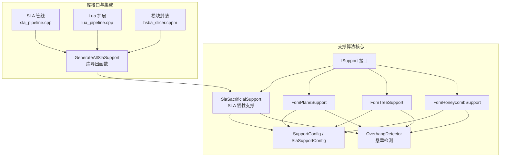
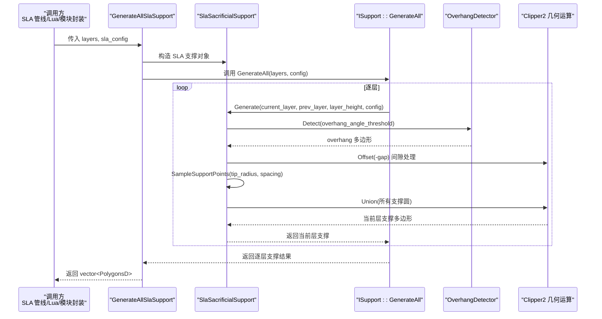
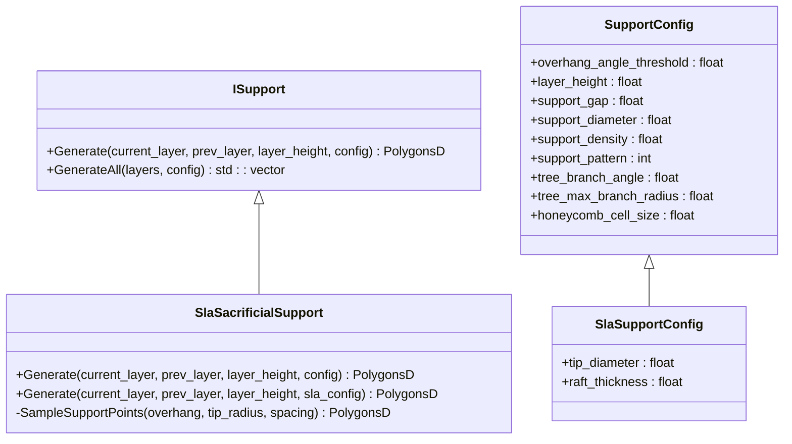
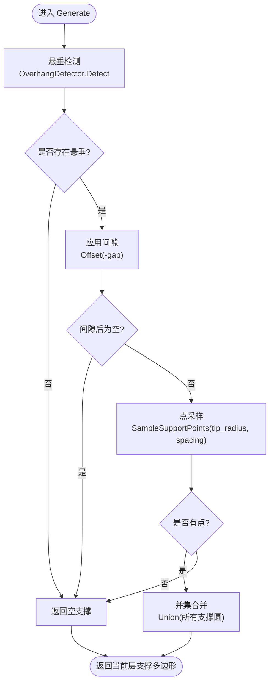
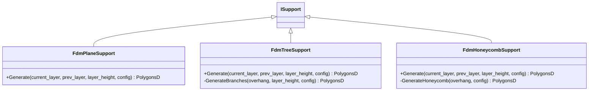
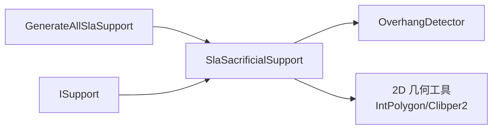

# SLA支撑算法

<cite>
**本文引用的文件**   
- [SlaSupport.hpp](file://support/SlaSupport.hpp)
- [SlaSupport.cpp](file://support/SlaSupport.cpp)
- [ISupport.hpp](file://support/ISupport.hpp)
- [ISupport.cpp](file://support/ISupport.cpp)
- [FdmSupport.hpp](file://support/FdmSupport.hpp)
- [FdmSupport.cpp](file://support/FdmSupport.cpp)
- [SupportConfig.hpp](file://support/SupportConfig.hpp)
- [fdm_support.hpp](file://LibHsBaSlicer/Support/fdm_support.hpp)
- [fdm_support.cpp](file://LibHsBaSlicer/Support/fdm_support.cpp)
- [sla_pipeline.cpp](file://DllHsBaSlicer/sla_pipeline.cpp)
- [lua_pipeline.cpp](file://LibHsBaSlicer/Extends/lua_pipeline.cpp)
- [hsba_slicer.cppm](file://ModuleHsBaSlicer/hsba_slicer.cppm)
- [OverhangDetector.hpp](file://support/OverhangDetector.hpp)
- [IntPolygon.hpp](file://2D/IntPolygon.hpp)
</cite>

## 目录
1. [简介](#简介)
2. [项目结构](#项目结构)
3. [核心组件](#核心组件)
4. [架构总览](#架构总览)
5. [详细组件分析](#详细组件分析)
6. [依赖关系分析](#依赖关系分析)
7. [性能考量](#性能考量)
8. [故障排查指南](#故障排查指南)
9. [结论](#结论)
10. [附录](#附录)

## 简介
本技术文档面向光固化（SLA）工艺专家与算法开发者，系统性阐述 SLA 牺牲性支撑的生成原理、细柱状支撑的设计与实现、SLA 专用支撑配置参数的作用机制，以及与 FDM 支撑的差异。重点包括：
- 牺牲性支撑在每层以细柱圆截面形式生成，便于打印后去除且对表面质量影响小。
- 通过悬垂检测、间隙控制、点采样与并集合并等步骤完成支撑轮廓生成。
- 提供 GenerateAllSlaSupport 函数的使用方式与调用链路说明。
- 对比 SLA 与 FDM 支撑在移除性、表面质量、结构形态等方面的差异。
- 给出支撑点分布优化与强度评估的工程化建议。

## 项目结构
支撑相关代码主要位于 support 目录与 LibHsBaSlicer/Support 暴露接口中，并通过 DllHsBaSlicer 管线与 Lua 扩展进行集成。

图示来源
- [ISupport.hpp:16-45](file://support/ISupport.hpp#L16-L45)
- [SlaSupport.hpp:13-42](file://support/SlaSupport.hpp#L13-L42)
- [FdmSupport.hpp:13-63](file://support/FdmSupport.hpp#L13-L63)
- [SupportConfig.hpp:14-43](file://support/SupportConfig.hpp#L14-L43)
- [fdm_support.hpp:39-50](file://LibHsBaSlicer/Support/fdm_support.hpp#L39-L50)
- [sla_pipeline.cpp:398-398](file://DllHsBaSlicer/sla_pipeline.cpp#L398-L398)
- [lua_pipeline.cpp:503-503](file://LibHsBaSlicer/Extends/lua_pipeline.cpp#L503-L503)
- [hsba_slicer.cppm:827-827](file://ModuleHsBaSlicer/hsba_slicer.cppm#L827-L827)

章节来源
- [SlaSupport.hpp:1-46](file://support/SlaSupport.hpp#L1-L46)
- [SlaSupport.cpp:1-120](file://support/SlaSupport.cpp#L1-L120)
- [ISupport.hpp:1-49](file://support/ISupport.hpp#L1-L49)
- [ISupport.cpp:1-23](file://support/ISupport.cpp#L1-L23)
- [FdmSupport.hpp:1-67](file://support/FdmSupport.hpp#L1-L67)
- [FdmSupport.cpp:1-236](file://support/FdmSupport.cpp#L1-L236)
- [SupportConfig.hpp:1-47](file://support/SupportConfig.hpp#L1-L47)
- [fdm_support.hpp:37-71](file://LibHsBaSlicer/Support/fdm_support.hpp#L37-L71)
- [fdm_support.cpp:36-69](file://LibHsBaSlicer/Support/fdm_support.cpp#L36-L69)
- [sla_pipeline.cpp:398-398](file://DllHsBaSlicer/sla_pipeline.cpp#L398-L398)
- [lua_pipeline.cpp:503-503](file://LibHsBaSlicer/Extends/lua_pipeline.cpp#L503-L503)
- [hsba_slicer.cppm:827-827](file://ModuleHsBaSlicer/hsba_slicer.cppm#L827-L827)

## 核心组件
- ISupport 抽象接口：定义逐层支撑生成接口与默认的全层遍历实现。
- SlaSacrificialSupport：SLA 牺牲支撑实现，基于悬垂区域采样细柱圆点，按层生成支撑截面。
- FdmPlaneSupport / FdmTreeSupport / FdmHoneycombSupport：FDM 平面、树形、蜂窝三种支撑策略，用于对比与参考。
- SupportConfig / SlaSupportConfig：通用与 SLA 专用支撑参数结构体。
- OverhangDetector：悬垂区域检测器，为各支撑策略提供输入。
- 库导出接口 GenerateAllSlaSupport：对外暴露的 SLA 全层支撑生成入口。

章节来源
- [ISupport.hpp:16-45](file://support/ISupport.hpp#L16-L45)
- [ISupport.cpp:9-21](file://support/ISupport.cpp#L9-L21)
- [SlaSupport.hpp:13-42](file://support/SlaSupport.hpp#L13-L42)
- [SlaSupport.cpp:38-118](file://support/SlaSupport.cpp#L38-L118)
- [FdmSupport.hpp:13-63](file://support/FdmSupport.hpp#L13-L63)
- [FdmSupport.cpp:48-72](file://support/FdmSupport.cpp#L48-L72)
- [FdmSupport.cpp:77-150](file://support/FdmSupport.cpp#L77-L150)
- [FdmSupport.cpp:155-233](file://support/FdmSupport.cpp#L155-L233)
- [SupportConfig.hpp:14-43](file://support/SupportConfig.hpp#L14-L43)
- [fdm_support.hpp:39-50](file://LibHsBaSlicer/Support/fdm_support.hpp#L39-L50)
- [fdm_support.cpp:54-59](file://LibHsBaSlicer/Support/fdm_support.cpp#L54-L59)

## 架构总览
SLA 支撑生成的整体流程如下：上层管线或脚本调用库导出函数，内部实例化 SLA 牺牲支撑对象，逐层执行悬垂检测、间隙处理、点采样与并集合并，输出每层支撑多边形集合。

图示来源
- [fdm_support.cpp:54-59](file://LibHsBaSlicer/Support/fdm_support.cpp#L54-L59)
- [ISupport.cpp:9-21](file://support/ISupport.cpp#L9-L21)
- [SlaSupport.cpp:74-118](file://support/SlaSupport.cpp#L74-L118)
- [OverhangDetector.hpp:1-1](file://support/OverhangDetector.hpp#L1-L1)

## 详细组件分析

### SLA 牺牲支撑类 SlaSacrificialSupport
- 设计目标：为树脂打印生成细柱状牺牲支撑，顶部直径小便于去除，底部直径大增强附着。
- 关键方法：
  - Generate(current_layer, prev_layer, layer_height, config)：基于悬垂区域与 SLA 配置生成当前层支撑截面。
  - SampleSupportPoints(overhang, tip_radius, spacing)：在悬垂区域内按间距采样支撑点，并以 tip_radius 生成圆形支撑点。
- 实现要点：
  - 使用 OverhangDetector 检测悬垂区域。
  - 通过 Offset 对悬垂区域应用 gap，避免支撑与模型粘连。
  - 将每个支撑点表示为圆多边形，最后用并集合并得到最终支撑轮廓。
  - 支持从通用 SupportConfig 转换为 SlaSupportConfig 的兼容路径。

图示来源
- [ISupport.hpp:16-45](file://support/ISupport.hpp#L16-L45)
- [SlaSupport.hpp:13-42](file://support/SlaSupport.hpp#L13-L42)
- [SupportConfig.hpp:14-43](file://support/SupportConfig.hpp#L14-L43)

章节来源
- [SlaSupport.hpp:13-42](file://support/SlaSupport.hpp#L13-L42)
- [SlaSupport.cpp:38-118](file://support/SlaSupport.cpp#L38-L118)

### SLA 支撑生成算法流程
该流程体现了 SLA 支撑的核心计算步骤：悬垂检测、间隙处理、点采样、并集合并。

图示来源
- [SlaSupport.cpp:74-118](file://support/SlaSupport.cpp#L74-L118)
- [IntPolygon.hpp:1-1](file://2D/IntPolygon.hpp#L1-L1)

章节来源
- [SlaSupport.cpp:74-118](file://support/SlaSupport.cpp#L74-L118)

### FDM 支撑策略对比
- FdmPlaneSupport：对悬垂区域膨胀 support_diameter/2 形成柱状支撑截面，简单直接。
- FdmTreeSupport：在悬垂区域按间距放置分支端点圆，并在层间向上生长分支（2D 截面表现为圆点）。
- FdmHoneycombSupport：在悬垂区域内填充六边形蜂窝图案，轻量化但刚性较好。

图示来源
- [FdmSupport.hpp:13-63](file://support/FdmSupport.hpp#L13-L63)

章节来源
- [FdmSupport.cpp:48-72](file://support/FdmSupport.cpp#L48-L72)
- [FdmSupport.cpp:77-150](file://support/FdmSupport.cpp#L77-L150)
- [FdmSupport.cpp:155-233](file://support/FdmSupport.cpp#L155-L233)

### 使用示例：GenerateAllSlaSupport
- 入口函数：GenerateAllSlaSupport(layers, sla_config)
- 行为：实例化 SlaSacrificialSupport，调用其 GenerateAll 逐层生成支撑。
- 典型用法：
  - 准备 layers（自底向上的多层轮廓）。
  - 设置 SlaSupportConfig（如 tip_diameter、support_diameter、support_gap 等）。
  - 调用 GenerateAllSlaSupport 获取每层支撑多边形集合。

章节来源
- [fdm_support.hpp:39-50](file://LibHsBaSlicer/Support/fdm_support.hpp#L39-L50)
- [fdm_support.cpp:54-59](file://LibHsBaSlicer/Support/fdm_support.cpp#L54-L59)
- [tests\Support\fdm_support_lib_test.cpp:73-84](file://tests\Support\fdm_support_lib_test.cpp#L73-L84)

## 依赖关系分析
- 组件耦合：
  - SlaSacrificialSupport 依赖 OverhangDetector 与 2D 几何工具（IntPolygon/Clibper2）。
  - ISupport 提供统一接口，降低具体支撑策略的耦合度。
  - 库导出函数 GenerateAllSlaSupport 作为外部调用入口，屏蔽内部实现细节。
- 外部依赖：
  - Clipper2 几何库用于 Offset、Union、Intersect 等布尔运算。
  - 2D 几何类型（PolygonsD、PolygonD）由 2D 模块提供。

图示来源
- [SlaSupport.cpp:7-11](file://support/SlaSupport.cpp#L7-L11)
- [fdm_support.cpp:54-59](file://LibHsBaSlicer/Support/fdm_support.cpp#L54-L59)
- [ISupport.hpp:16-45](file://support/ISupport.hpp#L16-L45)

章节来源
- [SlaSupport.cpp:7-11](file://support/SlaSupport.cpp#L7-L11)
- [fdm_support.cpp:54-59](file://LibHsBaSlicer/Support/fdm_support.cpp#L54-L59)
- [ISupport.hpp:16-45](file://support/ISupport.hpp#L16-L45)

## 性能考量
- 悬垂检测复杂度：取决于层轮廓顶点数量与角度阈值判定，通常线性于顶点数。
- 间隙处理（Offset）：Clipper2 的 Offset 复杂度与轮廓边数和偏移半径相关，合理设置 gap 可显著减少后续计算量。
- 点采样：在 bounding box 内按 spacing 步进，时间复杂度近似 O((W/spacing)*(H/spacing))，其中 W、H 为包围盒尺寸；spacing 越大采样越少，支撑密度越低。
- 并集合并：将所有支撑圆进行 Union，复杂度与圆数量和几何重叠程度相关；可通过提前去重或空间索引优化。
- 内存占用：逐层生成并缓存 PolygonsD，注意层数与轮廓规模对内存的影响。

[本节为通用性能讨论，不直接分析具体文件]

## 故障排查指南
- 无支撑输出：
  - 检查过悬垂角度阈值是否过大导致未检测到悬垂。
  - 确认 support_gap 是否过大导致 Offset 后为空。
  - 验证 tip_diameter 与 spacing 是否过小导致采样点被过滤。
- 支撑与模型粘连：
  - 增大 support_gap，确保 Offset(-gap) 有效分离支撑与模型。
- 支撑过于稀疏或密集：
  - 调整 support_diameter 与 tip_diameter，改变支撑柱直径与采样间距。
  - 调整 overhang_angle_threshold 以改变悬垂区域范围。
- 性能问题：
  - 增大 spacing 以减少采样点数量。
  - 简化层轮廓或降低层分辨率以提升计算速度。

章节来源
- [SlaSupport.cpp:74-118](file://support/SlaSupport.cpp#L74-L118)
- [FdmSupport.cpp:48-72](file://support/FdmSupport.cpp#L48-L72)
- [SupportConfig.hpp:14-43](file://support/SupportConfig.hpp#L14-L43)

## 结论
SLA 牺牲支撑通过细柱状结构在悬垂区域采样生成，具备易去除与低表面损伤的优势。其实现依赖于悬垂检测、间隙控制、点采样与几何并集等步骤。与 FDM 支撑相比，SLA 支撑更注重去除性与表面质量，支撑形态更细密。工程上可通过调节支撑直径、间距、间隙与悬垂阈值来平衡支撑强度、打印效率与后处理成本。

[本节为总结性内容，不直接分析具体文件]

## 附录

### SLA 专用支撑配置参数说明
- overhang_angle_threshold：悬垂角度阈值（度），决定哪些区域需要支撑。
- layer_height：层高（mm），参与悬垂检测与支撑高度计算。
- support_gap：支撑与模型之间的间隙（mm），避免粘连。
- support_diameter：支撑柱直径（mm），影响支撑密度与强度。
- support_density：支撑填充密度（0~1），用于 FDM 填充模式，SLA 中主要用于参考。
- support_pattern：支撑模式选择（0=平面，1=树形，2=蜂窝），SLA 固定使用牺牲支撑。
- tree_branch_angle / tree_max_branch_radius：FDM 树形支撑参数，SLA 不使用。
- honeycomb_cell_size：FDM 蜂窝支撑单元尺寸，SLA 不使用。
- tip_diameter：SLA 支撑顶部直径（mm），越小越易去除。
- raft_thickness：SLA 底板厚度（mm），用于构建板附着。

章节来源
- [SupportConfig.hpp:14-43](file://support/SupportConfig.hpp#L14-L43)

### SLA 与传统 FDM 支撑的差异
- 移除性：SLA 牺牲支撑顶部直径小，易于手工或机械去除；FDM 支撑常需更大接触面，去除难度更高。
- 表面质量：SLA 支撑接触面积小，对模型表面影响较小；FDM 支撑可能留下较明显痕迹。
- 结构形态：SLA 支撑以细柱为主；FDM 支撑可为平面、树形或蜂窝，结构更复杂。
- 强度与稳定性：FDM 树形/蜂窝支撑在悬垂较大时提供更强的支撑能力；SLA 牺牲支撑更侧重易去除与表面质量。

章节来源
- [FdmSupport.hpp:13-63](file://support/FdmSupport.hpp#L13-L63)
- [FdmSupport.cpp:48-72](file://support/FdmSupport.cpp#L48-L72)
- [FdmSupport.cpp:77-150](file://support/FdmSupport.cpp#L77-L150)
- [FdmSupport.cpp:155-233](file://support/FdmSupport.cpp#L155-L233)
- [SlaSupport.hpp:13-42](file://support/SlaSupport.hpp#L13-L42)

### 支撑结构优化建议
- 支撑点分布优化：
  - 根据悬垂区域的曲率与面积自适应调整 spacing，曲率大或面积大的区域加密采样。
  - 使用空间网格或四叉树加速点采样与并集合并。
- 支撑强度计算：
  - 基于悬垂面积与悬垂高度估算所需支撑截面积，动态调整 tip_diameter 与 spacing。
  - 结合材料属性（树脂粘度、固化收缩）与打印参数（层高、曝光能量）修正支撑密度。
- 支撑移除性优化：
  - 保持 tip_diameter 最小化，同时保证支撑连通性以避免断裂。
  - 在支撑根部适当扩大直径以增强附着，提升整体稳定性。

[本节为概念性指导，不直接分析具体文件]