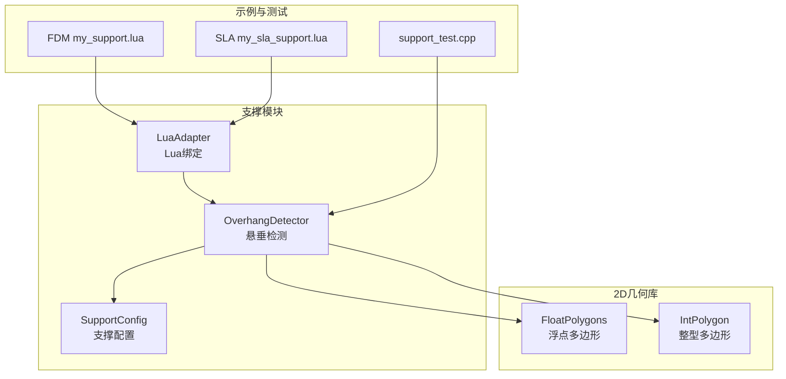
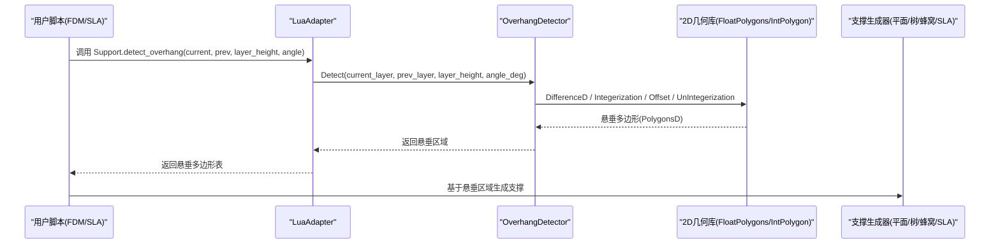
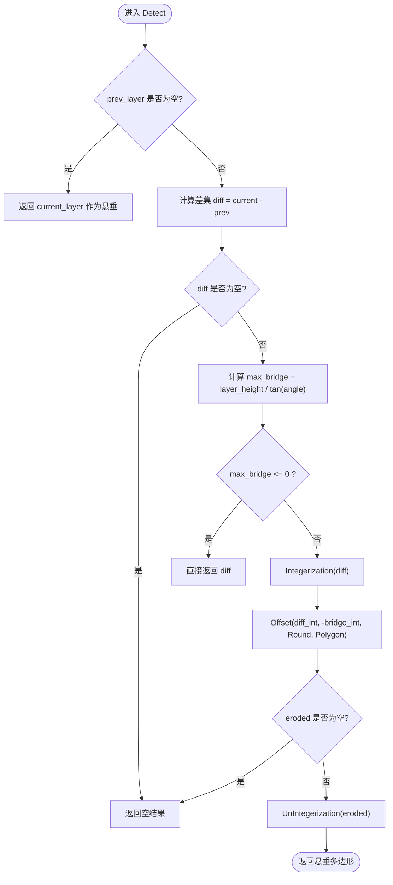
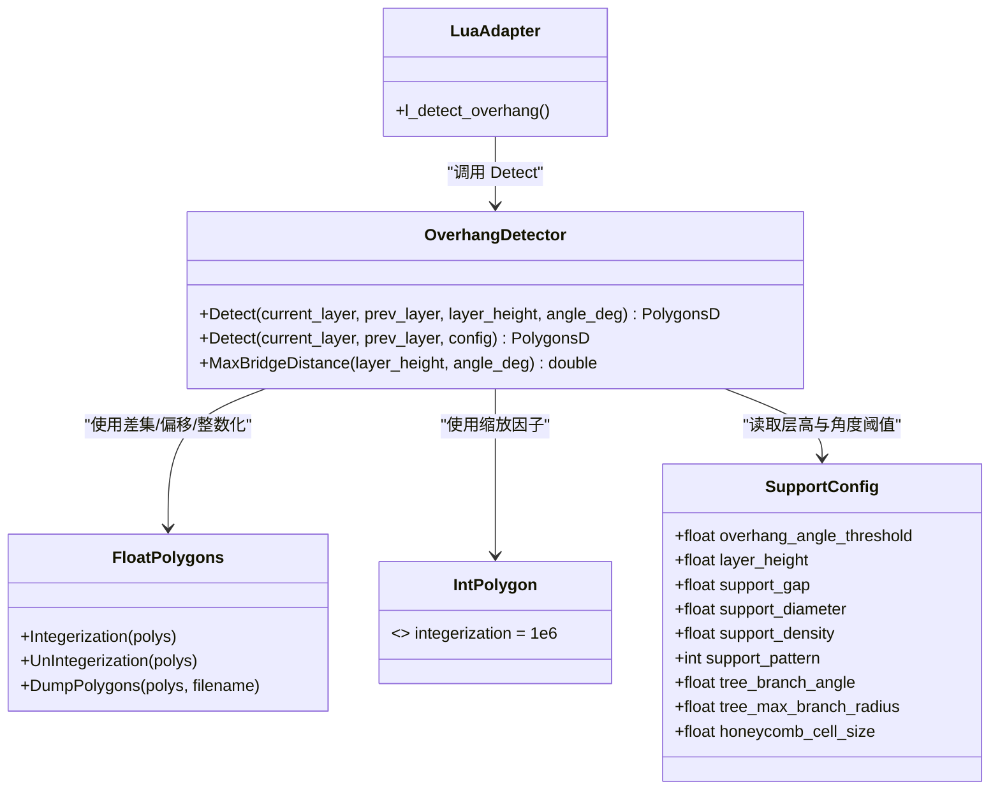
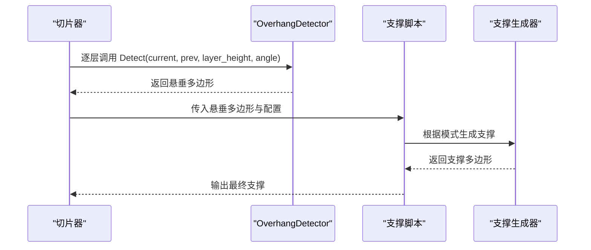

# 悬垂检测算法

<cite>
**本文引用的文件**   
- [OverhangDetector.hpp](file://support/OverhangDetector.hpp)
- [OverhangDetector.cpp](file://support/OverhangDetector.cpp)
- [SupportConfig.hpp](file://support/SupportConfig.hpp)
- [FloatPolygons.hpp](file://2D/FloatPolygons.hpp)
- [FloatPolygons.cpp](file://2D/FloatPolygons.cpp)
- [IntPolygon.hpp](file://2D/IntPolygon.hpp)
- [LuaAdapter.cpp](file://support/LuaAdapter.cpp)
- [my_support.lua](file://samples/FDM/scripts/my_support.lua)
- [my_sla_support.lua](file://samples/SLA/scripts/my_sla_support.lua)
- [support_test.cpp](file://tests\Support\support_test.cpp)
</cite>

## 目录
1. [引言](#引言)
2. [项目结构](#项目结构)
3. [核心组件](#核心组件)
4. [架构总览](#架构总览)
5. [详细组件分析](#详细组件分析)
6. [依赖关系分析](#依赖关系分析)
7. [性能与精度考量](#性能与精度考量)
8. [可视化与调试指南](#可视化与调试指南)
9. [与支撑生成的集成](#与支撑生成的集成)
10. [常见问题排查](#常见问题排查)
11. [结论](#结论)

## 引言
本技术文档面向几何算法开发者与3D打印软件工程师，系统性解析悬垂检测算法在切片层中的应用。文档重点包括：
- 悬垂面的几何定义与数学原理（法向量、角度阈值、桥接距离）
- 逐层检测与全局检测两种策略
- OverhangDetector 类的调用方式与参数影响
- 悬垂区域可视化与调试方法
- 与支撑生成模块的集成关系及后续处理流程

## 项目结构
悬垂检测相关代码位于 support 与 2D 几何库中，并通过 Lua 绑定暴露给脚本层使用；测试用例覆盖典型场景。

**图表来源**
- [OverhangDetector.hpp:1-54](file://support/OverhangDetector.hpp#L1-L54)
- [OverhangDetector.cpp:1-77](file://support/OverhangDetector.cpp#L1-L77)
- [SupportConfig.hpp:1-47](file://support/SupportConfig.hpp#L1-L47)
- [FloatPolygons.hpp:200-239](file://2D/FloatPolygons.hpp#L200-L239)
- [IntPolygon.hpp:17-17](file://2D/IntPolygon.hpp#L17-L17)
- [LuaAdapter.cpp:181-192](file://support/LuaAdapter.cpp#L181-L192)
- [my_support.lua:38-45](file://samples/FDM/scripts/my_support.lua#L38-L45)
- [my_sla_support.lua:40-47](file://samples/SLA/scripts/my_sla_support.lua#L40-L47)
- [support_test.cpp:39-91](file://tests\Support\support_test.cpp#L39-L91)

**章节来源**
- [OverhangDetector.hpp:1-54](file://support/OverhangDetector.hpp#L1-L54)
- [OverhangDetector.cpp:1-77](file://support/OverhangDetector.cpp#L1-L77)
- [SupportConfig.hpp:1-47](file://support/SupportConfig.hpp#L1-L47)
- [FloatPolygons.hpp:200-239](file://2D/FloatPolygons.hpp#L200-L239)
- [IntPolygon.hpp:17-17](file://2D/IntPolygon.hpp#L17-L17)
- [LuaAdapter.cpp:181-192](file://support/LuaAdapter.cpp#L181-L192)
- [my_support.lua:38-45](file://samples/FDM/scripts/my_support.lua#L38-L45)
- [my_sla_support.lua:40-47](file://samples/SLA/scripts/my_sla_support.lua#L40-L47)
- [support_test.cpp:39-91](file://tests\Support\support_test.cpp#L39-L91)

## 核心组件
- OverhangDetector：提供静态接口用于相邻切片层之间的悬垂区域检测，以及根据层高与角度阈值计算最大桥接距离。
- SupportConfig：统一支撑生成配置，包含悬垂角度阈值、层高、支撑间距、直径、密度、模式等参数。
- FloatPolygons/IntPolygon：提供多边形集合的整数化/反整数化、偏移、差集等几何操作，作为悬垂检测的底层几何工具。
- LuaAdapter：将 OverhangDetector::Detect 暴露为 Lua 函数 Support.detect_overhang，便于脚本层调用。
- 示例脚本（FDM/SLA）：演示如何在支撑生成流程中使用悬垂检测结果。
- 单元测试：验证无上一层、相同层、小悬垂过滤、桥接距离计算等关键分支。

**章节来源**
- [OverhangDetector.hpp:20-50](file://support/OverhangDetector.hpp#L20-L50)
- [OverhangDetector.cpp:23-75](file://support/OverhangDetector.cpp#L23-L75)
- [SupportConfig.hpp:14-25](file://support/SupportConfig.hpp#L14-L25)
- [FloatPolygons.hpp:200-239](file://2D/FloatPolygons.hpp#L200-L239)
- [LuaAdapter.cpp:181-192](file://support/LuaAdapter.cpp#L181-L192)
- [my_support.lua:38-45](file://samples/FDM/scripts/my_support.lua#L38-L45)
- [my_sla_support.lua:40-47](file://samples/SLA/scripts/my_sla_support.lua#L40-L47)
- [support_test.cpp:39-91](file://tests\Support\support_test.cpp#L39-L91)

## 架构总览
悬垂检测在支撑生成管线中的位置如下：

**图表来源**
- [LuaAdapter.cpp:181-192](file://support/LuaAdapter.cpp#L181-L192)
- [OverhangDetector.cpp:37-68](file://support/OverhangDetector.cpp#L37-L68)
- [FloatPolygons.hpp:200-239](file://2D/FloatPolygons.hpp#L200-L239)
- [IntPolygon.hpp:17-17](file://2D/IntPolygon.hpp#L17-L17)
- [my_support.lua:38-45](file://samples/FDM/scripts/my_support.lua#L38-L45)
- [my_sla_support.lua:40-47](file://samples/SLA/scripts/my_sla_support.lua#L40-L47)

## 详细组件分析

### OverhangDetector 类
- 职责：对相邻两层的多边形轮廓进行悬垂检测，输出需要支撑的区域。
- 主要接口：
  - Detect(current_layer, prev_layer, layer_height, angle_threshold_deg)
  - Detect(current_layer, prev_layer, config)
  - MaxBridgeDistance(layer_height, angle_deg)

#### 几何定义与数学原理
- 悬垂面定义：当前层中存在但未被上一层支撑的区域即为潜在悬垂。
- 角度阈值判断：通过层高与角度阈值计算最大桥接距离，小于该距离的悬垂可被视作“可桥接”而过滤掉。
- 最大桥接距离公式：max_bridge = layer_height / tan(angle_rad)。当 angle >= 90° 时视为垂直墙，无需桥接；angle <= 0° 时视为全部悬垂。
- 几何操作：
  - 差集：current_layer - prev_layer 得到未支撑区域。
  - 负偏移（侵蚀）：对差集执行负偏移以过滤小悬垂，偏移量即 max_bridge。
  - 整数化/反整数化：为保证数值稳定性与 Clipper2Lib 兼容性，先转换为整型多边形再执行偏移，最后还原为双精度多边形。

**图表来源**
- [OverhangDetector.cpp:37-68](file://support/OverhangDetector.cpp#L37-L68)
- [FloatPolygons.hpp:200-239](file://2D/FloatPolygons.hpp#L200-L239)
- [IntPolygon.hpp:17-17](file://2D/IntPolygon.hpp#L17-L17)

#### 复杂度与数据结构
- 输入：两个 PolygonsD（当前层与上一层）。
- 主要操作：
  - 差集：O(n + m) 近似（取决于多边形顶点数与拓扑复杂度）。
  - 整数化/反整数化：线性遍历顶点。
  - 偏移（侵蚀）：与多边形边数和偏移半径相关，通常近似 O(k log k)，k 为边数。
- 空间：中间结果存储差集与侵蚀后的多边形，整体与输入规模线性相关。

**章节来源**
- [OverhangDetector.hpp:20-50](file://support/OverhangDetector.hpp#L20-L50)
- [OverhangDetector.cpp:23-75](file://support/OverhangDetector.cpp#L23-L75)
- [FloatPolygons.hpp:200-239](file://2D/FloatPolygons.hpp#L200-L239)
- [IntPolygon.hpp:17-17](file://2D/IntPolygon.hpp#L17-L17)

### SupportConfig 配置结构
- overhang_angle_threshold：悬垂角度阈值（度），默认 45°。
- layer_height：层高（mm），默认 0.2 mm。
- 其他支撑参数：support_gap、support_diameter、support_density、support_pattern、tree_branch_angle、tree_max_branch_radius、honeycomb_cell_size。
- 派生结构：FdmSupportConfig、SlaSupportConfig，分别扩展 FDM/SLA 特有参数。

**章节来源**
- [SupportConfig.hpp:14-43](file://support/SupportConfig.hpp#L14-L43)

### 2D 几何工具（FloatPolygons/IntPolygon）
- Integerization/UnIntegerization：在多边形坐标与整型坐标之间转换，缩放因子 integerization = 1e6，保证 Clipper2Lib 运算的数值稳定性。
- DumpPolygon/DumpPolygons：可选 SVG 导出功能，用于调试可视化。
- Offset/Intersection/Difference：常用多边形布尔与偏移操作，供悬垂检测使用。

**章节来源**
- [FloatPolygons.hpp:200-239](file://2D/FloatPolygons.hpp#L200-L239)
- [FloatPolygons.cpp:176-213](file://2D/FloatPolygons.cpp#L176-L213)
- [IntPolygon.hpp:17-17](file://2D/IntPolygon.hpp#L17-L17)

### Lua 绑定与脚本用法
- Lua 接口：Support.detect_overhang(current_layer, prev_layer, layer_height, angle_deg)
- FDM/SLA 示例脚本：
  - 读取配置中的 overhang_angle_threshold 与 layer_height
  - 调用 Support.detect_overhang 获取悬垂区域
  - 根据支持模式选择生成器并生成支撑
  - 可选：对支撑结果做进一步多边形操作（如收缩接触点）

**章节来源**
- [LuaAdapter.cpp:181-192](file://support/LuaAdapter.cpp#L181-L192)
- [my_support.lua:38-45](file://samples/FDM/scripts/my_support.lua#L38-L45)
- [my_support.lua:64-79](file://samples/FDM/scripts/my_support.lua#L64-L79)
- [my_sla_support.lua:40-47](file://samples/SLA/scripts/my_sla_support.lua#L40-L47)
- [my_sla_support.lua:52-72](file://samples/SLA/scripts/my_sla_support.lua#L52-L72)

### 单元测试要点
- 无上一层：整个当前层被视为悬垂。
- 相同层：无悬垂。
- 小悬垂过滤：依据角度阈值与层高计算桥接距离，过滤可桥接的小悬垂。
- 桥接距离计算：45° 时等于层高；90° 时为 0；0° 时趋近无穷大。

**章节来源**
- [support_test.cpp:41-51](file://tests\Support\support_test.cpp#L41-L51)
- [support_test.cpp:53-59](file://tests\Support\support_test.cpp#L53-L59)
- [support_test.cpp:61-76](file://tests\Support\support_test.cpp#L61-L76)
- [support_test.cpp:78-89](file://tests\Support\support_test.cpp#L78-L89)

## 依赖关系分析
- OverhangDetector 依赖：
  - 2D 几何库：FloatPolygons/IntPolygon（差集、偏移、整数化/反整数化）
  - 配置：SupportConfig（层高与角度阈值）
- LuaAdapter 依赖：
  - OverhangDetector（暴露 detect_overhang）
- 示例脚本依赖：
  - LuaAdapter（Support.* 接口）
  - 支撑生成器（平面/树/蜂窝/SLA）

**图表来源**
- [OverhangDetector.hpp:20-50](file://support/OverhangDetector.hpp#L20-L50)
- [SupportConfig.hpp:14-43](file://support/SupportConfig.hpp#L14-L43)
- [FloatPolygons.hpp:200-239](file://2D/FloatPolygons.hpp#L200-L239)
- [IntPolygon.hpp:17-17](file://2D/IntPolygon.hpp#L17-L17)
- [LuaAdapter.cpp:181-192](file://support/LuaAdapter.cpp#L181-L192)

**章节来源**
- [OverhangDetector.hpp:20-50](file://support/OverhangDetector.hpp#L20-L50)
- [SupportConfig.hpp:14-43](file://support/SupportConfig.hpp#L14-L43)
- [FloatPolygons.hpp:200-239](file://2D/FloatPolygons.hpp#L200-L239)
- [IntPolygon.hpp:17-17](file://2D/IntPolygon.hpp#L17-L17)
- [LuaAdapter.cpp:181-192](file://support/LuaAdapter.cpp#L181-L192)

## 性能与精度考量
- 角度容差（overhang_angle_threshold）：
  - 增大角度阈值会减小 max_bridge，从而更严格地过滤小悬垂，减少不必要的支撑。
  - 过小角度阈值会导致更多区域被判定为悬垂，增加支撑体积与计算开销。
- 网格分辨率（integerization）：
  - integerization = 1e6 提供高精度整型坐标，确保 Clipper2Lib 偏移与布尔运算稳定。
  - 过低的分辨率可能导致偏移误差累积，影响悬垂边界精度。
- 层高（layer_height）：
  - 层高越大，max_bridge 越大，能容忍更大的悬垂跨度，减少支撑需求。
  - 层高越小，检测更精细，但可能产生更多微小悬垂，需结合角度阈值控制。
- 几何操作成本：
  - 差集与偏移是主要耗时步骤，建议仅在必要时调用，避免重复计算。
  - 对复杂模型可考虑分层并行或增量更新策略。

[本节为通用指导，不直接分析具体文件]

## 可视化与调试指南
- 使用 DumpPolygons 将悬垂多边形导出为 SVG，便于在图形查看器中检查边界与面积。
- 在单元测试中通过 AreaApprox 与 signedArea 校验悬垂区域的面积是否符合预期。
- 建议在开发阶段开启 HSBA_POLYGON_DUMP 宏以启用 SVG 导出功能。

**章节来源**
- [FloatPolygons.hpp:223-239](file://2D/FloatPolygons.hpp#L223-L239)
- [support_test.cpp:26-33](file://tests\Support\support_test.cpp#L26-L33)
- [support_test.cpp:61-76](file://tests\Support\support_test.cpp#L61-L76)

## 与支撑生成的集成
- 逐层检测：
  - 在每层切片后，调用 OverhangDetector::Detect 比较当前层与上一层，得到该层的悬垂区域。
  - 示例脚本中，首层跳过支撑生成，后续层根据悬垂区域调用对应支撑生成器。
- 全局检测：
  - 可在所有层切片完成后，汇总各层悬垂区域，进行全局优化（如合并支撑、减少冗余）。
  - 当前实现以逐层为主，全局优化可由上层管线负责。
- 后续处理：
  - 对悬垂区域进行多边形操作（如收缩接触点、面积过滤）以提升支撑质量。
  - 根据支撑模式（平面/树/蜂窝/SLA）生成具体支撑结构。

**图表来源**
- [OverhangDetector.cpp:37-75](file://support/OverhangDetector.cpp#L37-L75)
- [my_support.lua:38-79](file://samples/FDM/scripts/my_support.lua#L38-L79)
- [my_sla_support.lua:40-72](file://samples/SLA/scripts/my_sla_support.lua#L40-L72)

**章节来源**
- [OverhangDetector.cpp:37-75](file://support/OverhangDetector.cpp#L37-L75)
- [my_support.lua:38-79](file://samples/FDM/scripts/my_support.lua#L38-L79)
- [my_sla_support.lua:40-72](file://samples/SLA/scripts/my_sla_support.lua#L40-L72)

## 常见问题排查
- 悬垂区域为空：
  - 检查 prev_layer 是否为空；若为空则整个 current_layer 应被视为悬垂。
  - 检查角度阈值是否过大导致所有悬垂被过滤。
- 悬垂区域过大：
  - 检查角度阈值是否过小，导致过多区域被判定为悬垂。
  - 检查层高设置是否合理。
- 数值不稳定或偏移异常：
  - 确认使用了 Integerization/UnIntegerization 进行坐标转换。
  - 检查 integerization 缩放因子是否被修改。
- Lua 调用失败：
  - 确认 Support.detect_overhang 的参数类型与顺序正确。
  - 检查脚本是否正确注册 Support 表。

**章节来源**
- [OverhangDetector.cpp:40-68](file://support/OverhangDetector.cpp#L40-L68)
- [support_test.cpp:41-51](file://tests\Support\support_test.cpp#L41-L51)
- [support_test.cpp:61-76](file://tests\Support\support_test.cpp#L61-L76)
- [LuaAdapter.cpp:181-192](file://support/LuaAdapter.cpp#L181-L192)

## 结论
悬垂检测算法通过相邻层差集与角度阈值驱动的桥接距离过滤，精确识别需要支撑的区域。其实现依赖于稳定的 2D 几何库与统一的支撑配置结构，并通过 Lua 绑定与脚本层无缝集成。开发者可通过调整角度容差、层高与网格分辨率来平衡检测精度与计算效率，并结合可视化与单元测试确保结果可靠。在支撑生成管线中，悬垂检测结果可直接驱动不同模式的支撑生成器，形成从几何检测到路径生成的完整闭环。