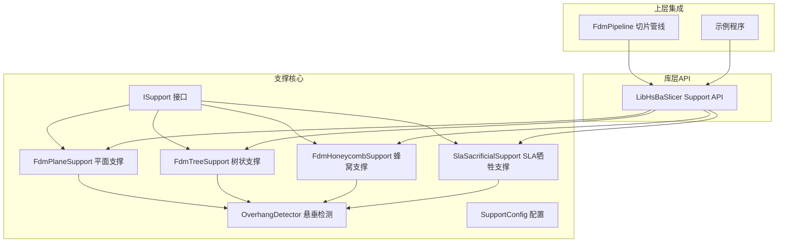
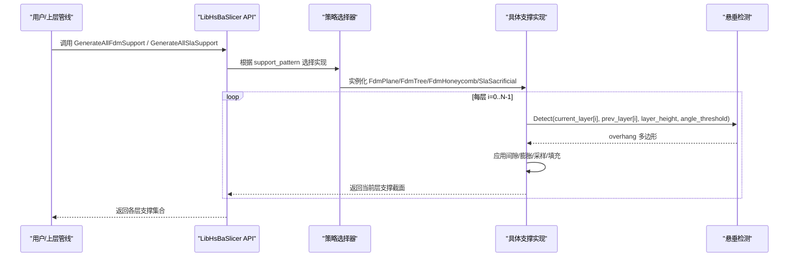
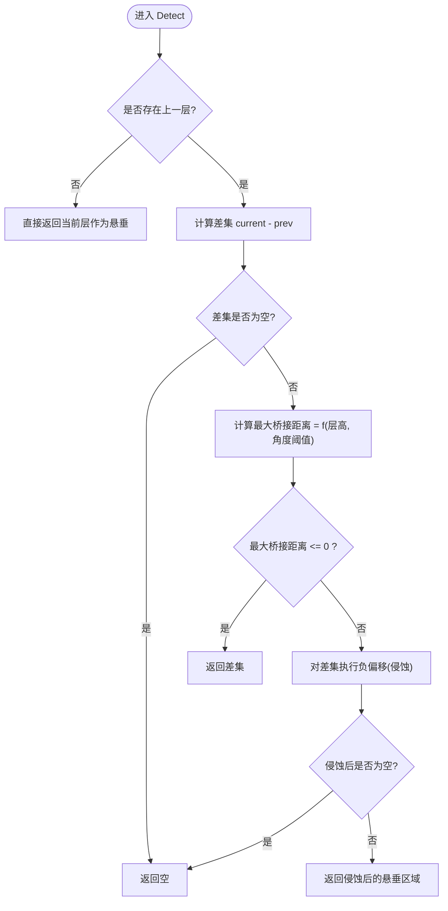
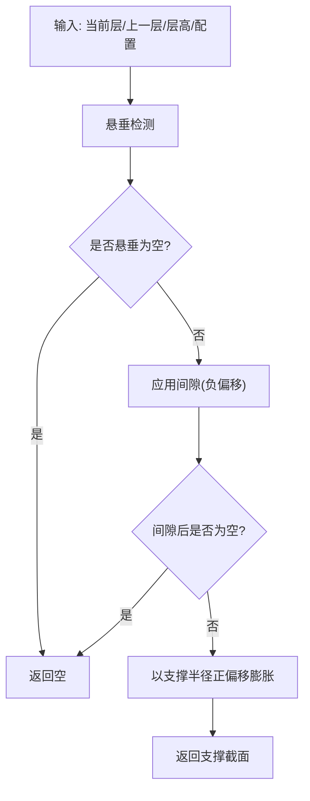
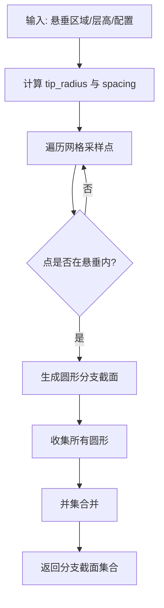
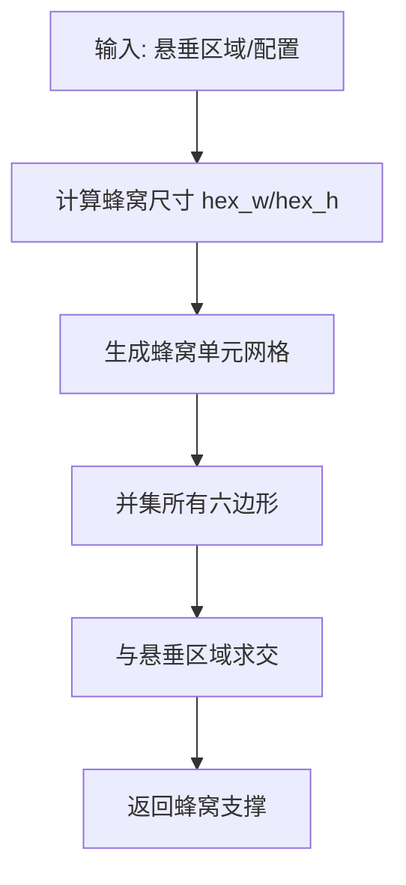
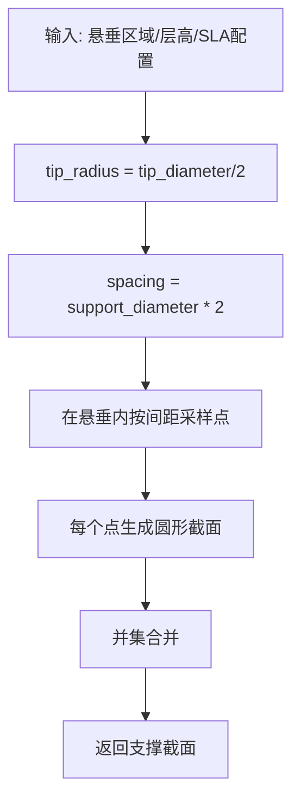
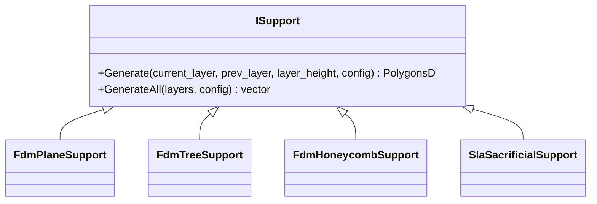
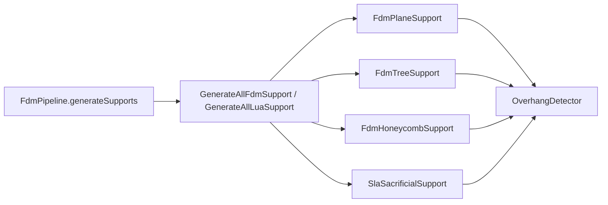

# 支撑系统

<cite>
**本文引用的文件**   
- [FdmSupport.hpp](file://support/FdmSupport.hpp)
- [FdmSupport.cpp](file://support/FdmSupport.cpp)
- [SlaSupport.hpp](file://support/SlaSupport.hpp)
- [SlaSupport.cpp](file://support/SlaSupport.cpp)
- [OverhangDetector.hpp](file://support/OverhangDetector.hpp)
- [OverhangDetector.cpp](file://support/OverhangDetector.cpp)
- [ISupport.hpp](file://support/ISupport.hpp)
- [ISupport.cpp](file://support/ISupport.cpp)
- [SupportConfig.hpp](file://support/SupportConfig.hpp)
- [fdm_support.hpp](file://LibHsBaSlicer/Support/fdm_support.hpp)
- [fdm_support.cpp](file://LibHsBaSlicer/Support/fdm_support.cpp)
- [hsba_slicer.cppm](file://ModuleHsBaSlicer/hsba_slicer.cppm)
- [main_header.cpp](file://samples/LibHsBaSlicer/main_header.cpp)
- [fdm_support_lib_test.cpp](file://tests\Support\fdm_support_lib_test.cpp)
- [support_test.cpp](file://tests\Support/support_test.cpp)
</cite>

## 目录
1. [简介](#简介)
2. [项目结构](#项目结构)
3. [核心组件](#核心组件)
4. [架构总览](#架构总览)
5. [详细组件分析](#详细组件分析)
6. [依赖关系分析](#依赖关系分析)
7. [性能与体积优化](#性能与体积优化)
8. [使用示例与参数调优](#使用示例与参数调优)
9. [故障排查指南](#故障排查指南)
10. [结论](#结论)

## 简介
本技术文档面向支撑算法开发者与3D打印工艺工程师，系统性阐述 HsBaSlicer 的支撑系统。内容覆盖 FDM 与 SLA 两种支撑生成算法的原理与实现差异、悬垂检测机制（角度阈值、桥接距离、密度控制）、树状/平面/蜂窝形支撑的生成逻辑、支撑与模型的连接策略、移除性优化以及支撑体积最小化与材料节省思路。文档同时提供可操作的调用路径、关键参数说明与调优建议，帮助读者快速定位实现细节并指导工程实践。

## 项目结构
支撑系统位于 support 模块，并通过 LibHsBaSlicer 暴露统一 API；上层流水线通过 ModuleHsBaSlicer 将配置注入支撑生成流程。

图表来源
- [ISupport.hpp:14-45](file://support/ISupport.hpp#L14-L45)
- [FdmSupport.hpp:11-63](file://support/FdmSupport.hpp#L11-L63)
- [SlaSupport.hpp:11-42](file://support/SlaSupport.hpp#L11-L42)
- [OverhangDetector.hpp:12-49](file://support/OverhangDetector.hpp#L12-L49)
- [fdm_support.hpp:17-67](file://LibHsBaSlicer/Support/fdm_support.hpp#L17-L67)
- [hsba_slicer.cppm:640-660](file://ModuleHsBaSlicer/hsba_slicer.cppm#L640-L660)

章节来源
- [ISupport.hpp:14-45](file://support/ISupport.hpp#L14-L45)
- [FdmSupport.hpp:11-63](file://support/FdmSupport.hpp#L11-L63)
- [SlaSupport.hpp:11-42](file://support/SlaSupport.hpp#L11-L42)
- [OverhangDetector.hpp:12-49](file://support/OverhangDetector.hpp#L12-L49)
- [fdm_support.hpp:17-67](file://LibHsBaSlicer/Support/fdm_support.hpp#L17-L67)
- [hsba_slicer.cppm:640-660](file://ModuleHsBaSlicer/hsba_slicer.cppm#L640-L660)

## 核心组件
- 抽象接口 ISupport：定义单层 Generate 与全层 GenerateAll 的统一入口，默认实现按层迭代调用。
- 悬垂检测 OverhangDetector：基于相邻层轮廓差集与角度阈值计算需要支撑的区域，支持最大桥接距离过滤。
- FDM 支撑族：
  - FdmPlaneSupport：在悬垂区域外扩形成柱状截面，应用间隙后膨胀为圆形柱。
  - FdmTreeSupport：在悬垂区域内采样分支点，生成圆截面并在层间合并扩张。
  - FdmHoneycombSupport：在悬垂区域内填充蜂窝六边形单元，取交集得到轻量化支撑。
- SLA 支撑族：
  - SlaSacrificialSupport：以较小针尖直径和较大基座直径生成细柱支撑，逐层采样并合并。
- 配置 SupportConfig/FdmSupportConfig/SlaSupportConfig：集中管理角度阈值、层高、间隙、直径、密度、图案类型、蜂窝尺寸、针尖直径等参数。

章节来源
- [ISupport.hpp:14-45](file://support/ISupport.hpp#L14-L45)
- [ISupport.cpp:9-21](file://support/ISupport.cpp#L9-L21)
- [OverhangDetector.hpp:14-49](file://support/OverhangDetector.hpp#L14-L49)
- [FdmSupport.hpp:13-63](file://support/FdmSupport.hpp#L13-L63)
- [SlaSupport.hpp:13-42](file://support/SlaSupport.hpp#L13-L42)
- [SupportConfig.hpp:11-43](file://support/SupportConfig.hpp#L11-L43)

## 架构总览
支撑系统采用“接口+多实现”的策略，由上层管线根据配置选择具体算法，并以统一的层数据驱动。

图表来源
- [fdm_support.cpp:14-59](file://LibHsBaSlicer/Support/fdm_support.cpp#L14-L59)
- [ISupport.cpp:9-21](file://support/ISupport.cpp#L9-L21)
- [OverhangDetector.cpp:37-68](file://support/OverhangDetector.cpp#L37-L68)

## 详细组件分析

### 悬垂检测算法（OverhangDetector）
- 原理：对当前层与上一层做差集，得到未被支撑的区域；根据层高与角度阈值计算最大桥接距离，对该差集进行负偏移（侵蚀），小于阈值的悬垂被过滤掉。
- 关键函数：
  - MaxBridgeDistance：根据层高与角度阈值计算最大水平桥接距离。
  - Detect：执行差集、侵蚀与结果返回。
- 复杂度：主要受 Clipper2 几何运算影响，通常为 O(n log n) 级别的多边形布尔运算。

图表来源
- [OverhangDetector.cpp:23-68](file://support/OverhangDetector.cpp#L23-L68)

章节来源
- [OverhangDetector.hpp:14-49](file://support/OverhangDetector.hpp#L14-L49)
- [OverhangDetector.cpp:23-68](file://support/OverhangDetector.cpp#L23-L68)

### FDM 平面支撑（FdmPlaneSupport）
- 生成逻辑：
  1) 调用悬垂检测获取过悬区域；
  2) 应用间隙（负偏移）使支撑与模型分离；
  3) 以支撑直径的一半为正偏移膨胀，形成柱状截面；
  4) 返回浮点多边形集合。
- 特点：简单可靠，适合大面积悬垂的快速支撑。

图表来源
- [FdmSupport.cpp:48-72](file://support/FdmSupport.cpp#L48-L72)

章节来源
- [FdmSupport.hpp:13-24](file://support/FdmSupport.hpp#L13-L24)
- [FdmSupport.cpp:48-72](file://support/FdmSupport.cpp#L48-L72)

### FDM 树状支撑（FdmTreeSupport）
- 生成逻辑：
  1) 悬垂检测 + 间隙处理；
  2) 在悬垂区域内按间距采样候选点；
  3) 在每个候选点生成圆形分支截面（半径=支撑直径/2）；
  4) 对所有圆形进行并集合并，得到分散但可连接的支撑点阵；
  5) 层间合并扩张（由 GenerateAll 驱动）。
- 特点：支撑点分布均匀，便于后续层间连接与体积控制。

图表来源
- [FdmSupport.cpp:77-129](file://support/FdmSupport.cpp#L77-L129)

章节来源
- [FdmSupport.hpp:26-44](file://support/FdmSupport.hpp#L26-L44)
- [FdmSupport.cpp:77-149](file://support/FdmSupport.cpp#L77-L149)

### FDM 蜂窝支撑（FdmHoneycombSupport）
- 生成逻辑：
  1) 悬垂检测 + 间隙处理；
  2) 在包围盒内生成平顶六边形蜂窝单元；
  3) 将所有六边形并集后与悬垂区域求交，得到轻量化蜂窝支撑。
- 特点：在保证刚性的前提下显著降低材料用量。

图表来源
- [FdmSupport.cpp:155-213](file://support/FdmSupport.cpp#L155-L213)

章节来源
- [FdmSupport.hpp:46-63](file://support/FdmSupport.hpp#L46-L63)
- [FdmSupport.cpp:155-233](file://support/FdmSupport.cpp#L155-L233)

### SLA 牺牲支撑（SlaSacrificialSupport）
- 生成逻辑：
  1) 悬垂检测 + 间隙处理；
  2) 以较小的针尖直径 tip_diameter 生成支撑点；
  3) 使用支撑直径作为采样间距，在悬垂区域内采样并生成圆形；
  4) 并集合并得到支撑截面。
- 特点：针尖小、易去除；基座可通过配置或层间合并获得更大接触面积。

图表来源
- [SlaSupport.cpp:38-108](file://support/SlaSupport.cpp#L38-L108)

章节来源
- [SlaSupport.hpp:13-42](file://support/SlaSupport.hpp#L13-L42)
- [SlaSupport.cpp:38-118](file://support/SlaSupport.cpp#L38-L118)

### 抽象接口与批量生成（ISupport）
- ISupport::GenerateAll 默认实现：从底层到顶层逐层调用 Generate，首层无上一层时视为全悬垂。
- 该设计使得不同支撑算法共享相同的层遍历与上下文传递逻辑。

图表来源
- [ISupport.hpp:14-45](file://support/ISupport.hpp#L14-L45)
- [ISupport.cpp:9-21](file://support/ISupport.cpp#L9-L21)

章节来源
- [ISupport.hpp:14-45](file://support/ISupport.hpp#L14-L45)
- [ISupport.cpp:9-21](file://support/ISupport.cpp#L9-L21)

## 依赖关系分析
- 支撑实现均依赖 OverhangDetector 进行悬垂判定。
- LibHsBaSlicer 层通过 fdm_support.cpp 根据 support_pattern 动态选择 FDM 支撑实现；SLA 支撑通过 GenerateAllSlaSupport 直接调用。
- 上层 FdmPipeline 将配置映射到 SupportConfig 并调用库层 API。

图表来源
- [hsba_slicer.cppm:640-660](file://ModuleHsBaSlicer/hsba_slicer.cppm#L640-L660)
- [fdm_support.cpp:14-59](file://LibHsBaSlicer/Support/fdm_support.cpp#L14-L59)
- [OverhangDetector.cpp:37-68](file://support/OverhangDetector.cpp#L37-L68)

章节来源
- [hsba_slicer.cppm:640-660](file://ModuleHsBaSlicer/hsba_slicer.cppm#L640-L660)
- [fdm_support.cpp:14-59](file://LibHsBaSlicer/Support/fdm_support.cpp#L14-L59)

## 性能与体积优化
- 悬垂过滤：通过角度阈值与最大桥接距离减少不必要的支撑区域，避免微小悬垂导致的支撑冗余。
- 间隙控制：合理设置 support_gap 可减少支撑与模型粘连，提升表面质量与可移除性。
- 密度控制：support_density 用于控制支撑填充密度（在更高层管线中参与填充策略），结合蜂窝支撑可降低总体积。
- 采样间距：树状与 SLA 支撑通过 spacing 控制点阵密度，增大间距可减少材料但需权衡支撑强度。
- 几何操作优化：优先使用整数化坐标与 Clipper2 布尔运算，减少浮点误差与重复计算。

[本节为通用指导，不直接分析具体文件]

## 使用示例与参数调优

### 典型调用路径
- 库层 API：
  - GenerateAllFdmSupport：传入层轮廓向量与 FdmSupportConfig，返回每层支撑截面。
  - GenerateAllSlaSupport：传入层轮廓向量与 SlaSupportConfig，返回每层支撑截面。
- 上层管线：
  - FdmPipeline.generateSupports：将外部配置映射为 SupportConfig 并调用库层 API。
- 示例程序：
  - samples/LibHsBaSlicer/main_header.cpp 展示了切片后转换为浮点多边形并调用 GenerateAllFdmSupport 的流程。

章节来源
- [fdm_support.hpp:17-67](file://LibHsBaSlicer/Support/fdm_support.hpp#L17-L67)
- [fdm_support.cpp:14-59](file://LibHsBaSlicer/Support/fdm_support.cpp#L14-L59)
- [hsba_slicer.cppm:640-660](file://ModuleHsBaSlicer/hsba_slicer.cppm#L640-L660)
- [main_header.cpp:90-122](file://samples/LibHsBaSlicer/main_header.cpp#L90-L122)

### 关键参数与调优建议
- 通用参数（SupportConfig）：
  - overhang_angle_threshold：角度阈值越大，越容易判定为悬垂；过小会漏支，过大则支撑过多。
  - layer_height：层高越小，悬垂判定更精细；与角度阈值共同决定最大桥接距离。
  - support_gap：支撑与模型间隙；过小易粘连，过大可能影响稳定性。
  - support_diameter：支撑柱直径；影响强度与材料用量。
  - support_density：支撑填充密度；配合填充策略控制体积。
  - support_pattern：0=平面，1=树状，2=蜂窝。
  - tree_branch_angle / tree_max_branch_radius：树状支撑分支角度与最大半径（在更高阶扩展中使用）。
  - honeycomb_cell_size：蜂窝单元尺寸；越小越密，刚性越好但材料越多。
- FDM 专属（FdmSupportConfig）：
  - interface_layers / interface_density：支撑与模型之间的界面层数与密度，有助于改善附着与表面质量。
- SLA 专属（SlaSupportConfig）：
  - tip_diameter：针尖直径；越小越易去除，但需保证支撑强度。
  - raft_thickness：底筏厚度；影响底部附着与支撑基础。

章节来源
- [SupportConfig.hpp:11-43](file://support/SupportConfig.hpp#L11-L43)
- [fdm_support_lib_test.cpp:41-71](file://tests\Support\fdm_support_lib_test.cpp#L41-L71)
- [support_test.cpp:112-128](file://tests\Support/support_test.cpp#L112-L128)

### 参数调优指南
- 提高可移除性与表面质量：
  - 适当增大 support_gap；
  - 减小 SLA 的 tip_diameter；
  - 增加 FDM 的 interface_layers 与 interface_density。
- 降低材料与体积：
  - 使用蜂窝支撑（support_pattern=2）；
  - 增大蜂窝单元尺寸（honeycomb_cell_size）；
  - 增大树状支撑采样间距（通过增大 support_diameter 间接影响）。
- 增强支撑强度：
  - 增大 support_diameter；
  - 减小蜂窝单元尺寸；
  - 适度降低 overhang_angle_threshold 以减少漏支。

[本节为通用指导，不直接分析具体文件]

## 故障排查指南
- 无支撑输出：
  - 检查 overhang_angle_threshold 是否过大导致全部悬垂被过滤；
  - 确认 support_gap 是否过大导致间隙后区域为空；
  - 验证层数据是否正确（首层 prev_layer 为空时应产生全悬垂）。
- 支撑与模型粘连：
  - 减小 support_gap；
  - 调整 SLA 的 tip_diameter 或 FDM 的 interface 参数。
- 支撑强度不足：
  - 增大 support_diameter；
  - 改用蜂窝支撑或减小蜂窝单元尺寸；
  - 调整采样间距（树状/SLA）。
- 性能问题：
  - 减少不必要的几何操作（如过度细分）；
  - 合理设置蜂窝单元尺寸与采样间距以降低布尔运算量。

章节来源
- [OverhangDetector.cpp:37-68](file://support/OverhangDetector.cpp#L37-L68)
- [FdmSupport.cpp:48-72](file://support/FdmSupport.cpp#L48-L72)
- [SlaSupport.cpp:74-108](file://support/SlaSupport.cpp#L74-L108)

## 结论
HsBaSlicer 的支撑系统以清晰的接口设计与模块化实现，提供了 FDM 与 SLA 两类主流支撑算法。悬垂检测通过角度阈值与桥接距离精准识别支撑需求，平面、树状与蜂窝三种 FDM 策略满足不同场景的强度与材料平衡，SLA 牺牲支撑则以细小针尖提升可移除性。通过合理的参数调优与几何优化，可在保证打印质量的同时显著降低支撑体积与材料消耗。对于算法开发者，建议在现有框架上扩展更智能的采样与连接策略，并结合工艺特性进一步优化移除性与表面质量。