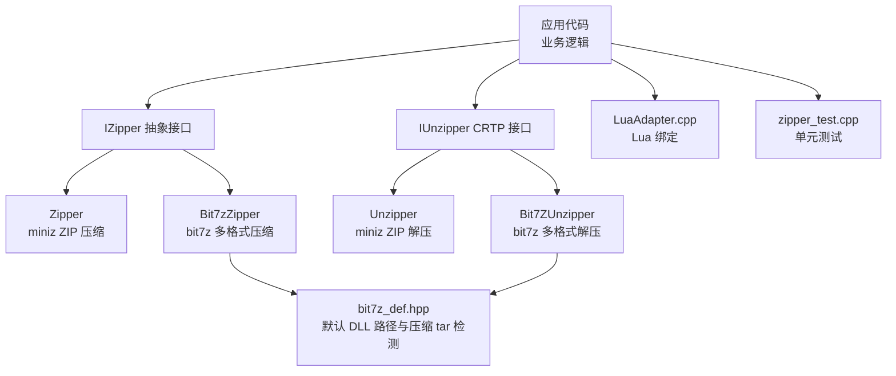
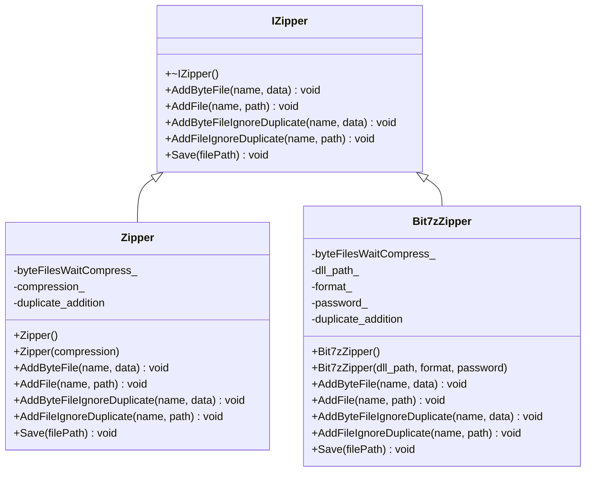
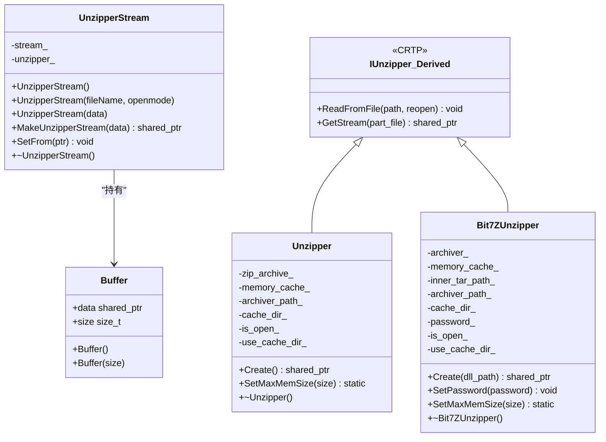
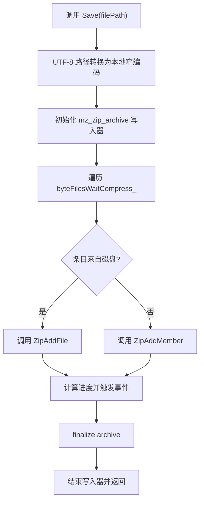
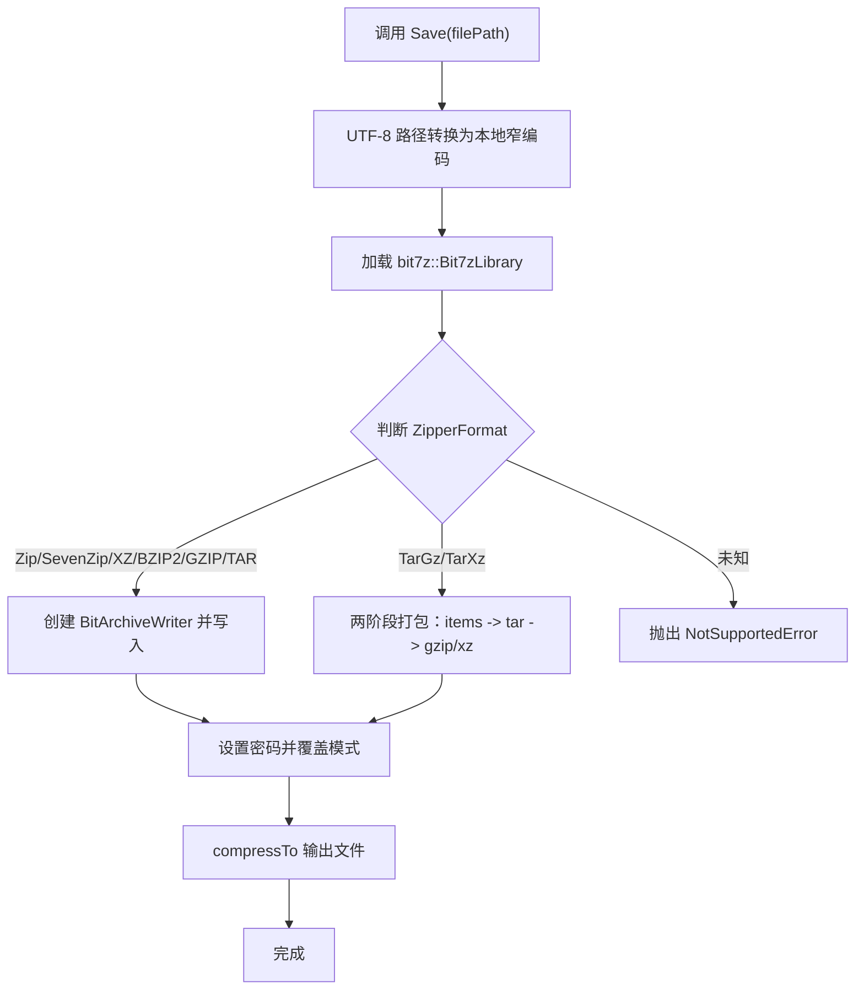
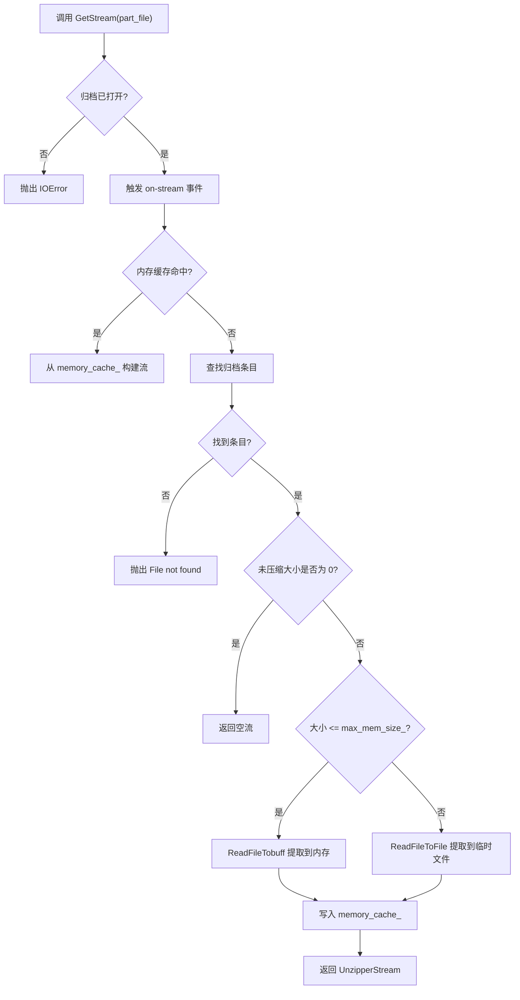
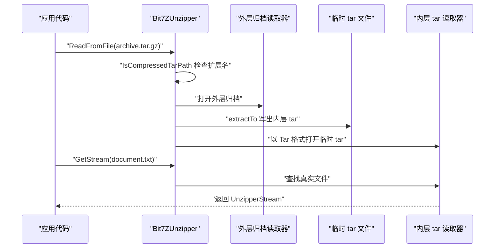
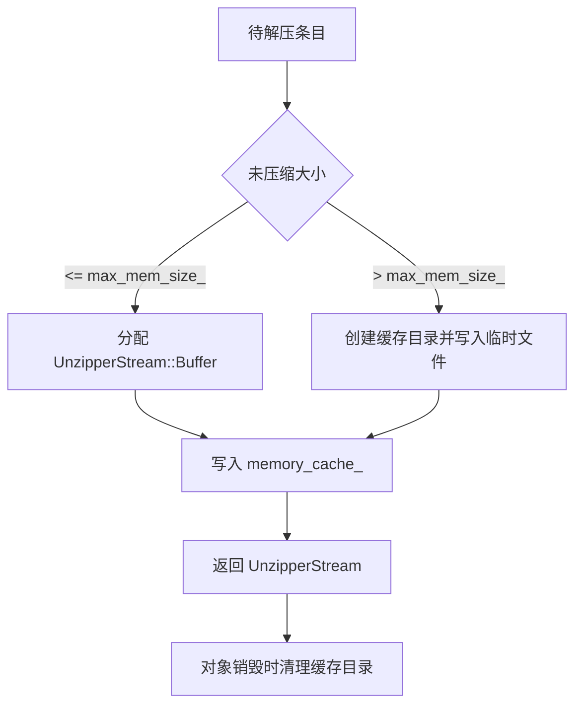
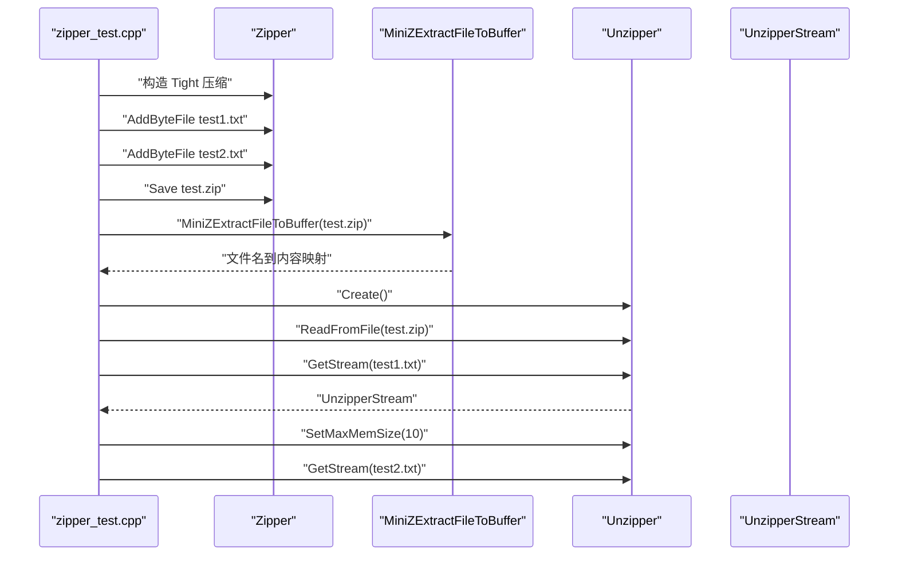

# 压缩解压工具 (Zipper/Unzipper)

<cite>
**本文引用的文件**   
- [IZipper.hpp](file://fileoperator/IZipper.hpp)
- [IUnzipper.hpp](file://fileoperator/IUnzipper.hpp)
- [zipper.hpp](file://fileoperator/zipper.hpp)
- [zipper.cpp](file://fileoperator/zipper.cpp)
- [unzipper.hpp](file://fileoperator/unzipper.hpp)
- [unzipper.cpp](file://fileoperator/unzipper.cpp)
- [bit7z_zipper.hpp](file://fileoperator/bit7z_zipper.hpp)
- [bit7z_zipper.cpp](file://fileoperator/bit7z_zipper.cpp)
- [bit7z_unzipper.hpp](file://fileoperator/bit7z_unzipper.hpp)
- [bit7z_unzipper.cpp](file://fileoperator/bit7z_unzipper.cpp)
- [bit7z_def.hpp](file://fileoperator/bit7z_def.hpp)
- [LuaAdapter.cpp](file://fileoperator/LuaAdapter.cpp)
- [zipper_test.cpp](file://tests/FilesOperator/zipper_test.cpp)
</cite>

## 目录

1. [项目概述与快速开始](#项目概述与快速开始)
2. [架构总览](#架构总览)
3. [核心概念](#核心概念)
4. [核心模块详解](#核心模块详解)
5. [高级主题](#高级主题)
6. [API 参考文档](#api-参考文档)
7. [集成指南](#集成指南)
8. [开发测试与贡献](#开发测试与贡献)
9. [扩展开发指南](#扩展开发指南)
10. [示例与教程](#示例与教程)
11. [部署故障排除与FAQ](#部署故障排除与faq)
12. [附录](#附录)

## 项目概述与快速开始

本仓库中的压缩解压子系统位于 `fileoperator` 目录，提供统一的归档压缩与解压抽象接口，并给出两套实现：

| 组件 | 后端库 | 主要用途 | 是否支持密码 | 典型格式 |
|---|---|---|---:|---|
| `IZipper` / `Zipper` | miniz | ZIP 压缩 | 否 | `.zip` |
| `Bit7zZipper` | bit7z（7-Zip） | 多格式压缩 | 是 | `.zip`、`.7z`、`.xz`、`.bz2`、`.gz`、`.tar`、`.tar.gz`、`.tar.xz` |
| `IUnzipper` / `Unzipper` | miniz | ZIP 解压 | 否 | `.zip` |
| `Bit7ZUnzipper` | bit7z（7-Zip） | 多格式解压 | 是 | `.zip`、`.7z`、`.rar`、`.tar.gz`、`.tgz`、`.tar.xz`、`.txz` |

如果你只需要轻量级 ZIP 压缩与解压，可以直接使用 `Zipper` 和 `Unzipper`；如果需要更多格式、密码保护或压缩 tar 包的一键处理，则应启用 `HSBA_USE_BIT7Z` 并使用 `Bit7zZipper` 与 `Bit7ZUnzipper`。

快速开始建议：

- **只压缩 ZIP**：包含 `fileoperator/zipper.hpp`，构造 `Zipper(MinizCompression::Tight)`，调用 `AddByteFile` 或 `AddFile`，最后调用 `Save`。
- **只解压 ZIP**：包含 `fileoperator/unzipper.hpp`，通过 `Unzipper::Create()` 创建实例，调用 `ReadFromFile`，再用 `GetStream` 读取条目流。
- **需要密码或多格式**：在编译时定义 `HSBA_USE_BIT7Z`，使用 `Bit7zZipper` 指定 `ZipperFormat`，或使用 `Bit7ZUnzipper::Create(HSBA_7Z_DLL)` 并调用 `SetPassword`。
- **批量解压到目录**：使用 `MiniZExtractFile` 或 `Bit7zExtract(archive, outdir, ...)`。
- **批量解压到内存**：使用 `MiniZExtractFileToBuffer` 或 `Bit7zExtract(archive, bufs, ...)`。

**章节来源**
- [zipper.hpp:20-40](file://fileoperator/zipper.hpp#L20-L40)
- [bit7z_zipper.hpp:48-81](file://fileoperator/bit7z_zipper.hpp#L48-L81)
- [unzipper.hpp:19-27](file://fileoperator/unzipper.hpp#L19-L27)
- [bit7z_unzipper.hpp:20-30](file://fileoperator/bit7z_unzipper.hpp#L20-L30)

## 架构总览

压缩解压子系统采用“抽象接口 + 具体实现”的分层设计：

**图表来源**
- [IZipper.hpp:14-64](file://fileoperator/IZipper.hpp#L14-L64)
- [IUnzipper.hpp:160-198](file://fileoperator/IUnzipper.hpp#L160-L198)
- [zipper.hpp:34-87](file://fileoperator/zipper.hpp#L34-L87)
- [bit7z_zipper.hpp:74-126](file://fileoperator/bit7z_zipper.hpp#L74-L126)
- [unzipper.hpp:19-77](file://fileoperator/unzipper.hpp#L19-L77)
- [bit7z_unzipper.hpp:20-104](file://fileoperator/bit7z_unzipper.hpp#L20-L104)
- [bit7z_def.hpp:22-72](file://fileoperator/bit7z_def.hpp#L22-L72)

该架构的关键优势是：

1. **统一压缩接口**：所有压缩器都实现 `IZipper`，上层代码可以按相同方式添加文件、忽略重复名并保存归档。
2. **统一解压接口**：所有解压器都基于 CRTP 模板 `IUnzipper<Derived>`，对外暴露 `ReadFromFile` 和 `GetStream`。
3. **可替换后端**：miniz 实现适合轻量 ZIP 场景；bit7z 实现适合多格式、密码保护和压缩 tar 包。
4. **流式访问**：解压不强制一次性加载整个文件，而是返回 `UnzipperStream`，内部根据大小选择内存缓冲或临时文件缓存。
5. **事件回调**：压缩和解压都继承自 `Utils::EventSource`，可订阅进度或当前处理文件名。

**章节来源**
- [IZipper.hpp:14-64](file://fileoperator/IZipper.hpp#L14-L64)
- [IUnzipper.hpp:160-198](file://fileoperator/IUnzipper.hpp#L160-L198)
- [zipper.hpp:40-87](file://fileoperator/zipper.hpp#L40-L87)
- [bit7z_zipper.hpp:81-126](file://fileoperator/bit7z_zipper.hpp#L81-L126)
- [unzipper.hpp:25-77](file://fileoperator/unzipper.hpp#L25-L77)
- [bit7z_unzipper.hpp:28-104](file://fileoperator/bit7z_unzipper.hpp#L28-L104)

## 核心概念

### 抽象压缩接口 IZipper

`IZipper` 是所有压缩实现的公共接口，定义了四类操作：

| 方法 | 行为 | 重复名策略 |
|---|---|---|
| `AddByteFile(name, data)` | 从内存字符串添加文件 | 重复名抛出异常 |
| `AddFile(name, path)` | 从磁盘路径添加文件 | 重复名抛出异常 |
| `AddByteFileIgnoreDuplicate(name, data)` | 从内存字符串添加文件 | 重复名自动追加 `_duplicate` |
| `AddFileIgnoreDuplicate(name, path)` | 从磁盘路径添加文件 | 重复名自动追加 `_duplicate` |
| `Save(filePath)` | 将所有暂存条目写入归档文件 | 无 |

`IZipper` 没有内置压缩级别、密码或格式参数，这些由具体实现决定：

- `Zipper` 通过构造函数接收 `MinizCompression`。
- `Bit7zZipper` 通过构造函数接收 `dll_path`、`ZipperFormat` 和可选 `password`。

**图表来源**
- [IZipper.hpp:20-64](file://fileoperator/IZipper.hpp#L20-L64)
- [zipper.hpp:40-87](file://fileoperator/zipper.hpp#L40-L87)
- [bit7z_zipper.hpp:81-126](file://fileoperator/bit7z_zipper.hpp#L81-L126)

### 抽象解压接口 IUnzipper 与 UnzipperStream

`IUnzipper` 是一个基于 CRTP 的模板接口，它本身不提供实现，而是把具体行为委托给派生类：

| 公开方法 | 作用 |
|---|---|
| `ReadFromFile(path, reopen = false)` | 打开归档文件，允许后续按名称获取条目流 |
| `GetStream(part_file)` | 返回一个 `std::istream` 风格的 `UnzipperStream` |

`UnzipperStream` 是对 `std::istream` 的封装，支持两种数据源：

| 数据源 | 适用场景 |
|---|---|
| 内存缓冲 `UnzipperStream::Buffer` | 小文件或频繁重复读取的文件 |
| 临时文件路径 `std::string` | 大文件，避免占用过多内存 |

**图表来源**
- [IUnzipper.hpp:24-158](file://fileoperator/IUnzipper.hpp#L24-L158)
- [IUnzipper.hpp:166-198](file://fileoperator/IUnzipper.hpp#L166-L198)
- [unzipper.hpp:25-77](file://fileoperator/unzipper.hpp#L25-L77)
- [bit7z_unzipper.hpp:28-104](file://fileoperator/bit7z_unzipper.hpp#L28-L104)

**章节来源**
- [IZipper.hpp:14-64](file://fileoperator/IZipper.hpp#L14-L64)
- [IUnzipper.hpp:24-198](file://fileoperator/IUnzipper.hpp#L24-L198)

## 核心模块详解

### 压缩流程：从文件到归档

压缩的核心流程分为三个阶段：

1. **暂存阶段**：调用 `AddByteFile`、`AddFile` 或其 IgnoreDuplicate 版本，将条目加入内部映射表。
2. **编码阶段**：`Save` 初始化底层归档写入器，遍历暂存条目并写入。
3. **完成阶段**：关闭归档写入器，释放资源。

#### miniz 压缩流程

`Zipper` 使用 miniz 的 `mz_zip_writer_*` API：

**图表来源**
- [zipper.cpp:114-132](file://fileoperator/zipper.cpp#L114-L132)
- [zipper.cpp:140-177](file://fileoperator/zipper.cpp#L140-L177)

#### bit7z 压缩流程

`Bit7zZipper` 根据 `ZipperFormat` 选择不同的写入器：

| 格式 | 写入方式 |
|---|---|
| `Zip`、`SevenZip`、`XZ`、`BZIP2`、`GZIP`、`TAR` | 直接写入对应 `BitArchiveWriter` |
| `TarGz`、`TarXz` | 先在内存中打包为 tar，再压缩为 gzip/xz |
| 其他值 | 抛出不支持错误 |

**图表来源**
- [bit7z_zipper.cpp:191-257](file://fileoperator/bit7z_zipper.cpp#L191-L257)
- [bit7z_zipper.cpp:259-302](file://fileoperator/bit7z_zipper.cpp#L259-L302)

**章节来源**
- [zipper.cpp:21-132](file://fileoperator/zipper.cpp#L21-L132)
- [zipper.cpp:140-177](file://fileoperator/zipper.cpp#L140-L177)
- [bit7z_zipper.cpp:129-189](file://fileoperator/bit7z_zipper.cpp#L129-L189)
- [bit7z_zipper.cpp:191-302](file://fileoperator/bit7z_zipper.cpp#L191-L302)

### 解压流程：从归档到流

解压的核心流程是：

1. **打开归档**：`ReadFromFile` 初始化底层读取器。
2. **查找条目**：`GetStream` 根据名称定位条目。
3. **选择存储策略**：小于等于 `max_mem_size_` 的条目放入内存缓冲；更大的条目写入临时缓存目录。
4. **返回流**：返回 `UnzipperStream`，上层可按 `std::istream` 方式读取。

**图表来源**
- [unzipper.cpp:91-126](file://fileoperator/unzipper.cpp#L91-L126)
- [unzipper.cpp:135-149](file://fileoperator/unzipper.cpp#L135-L149)
- [unzipper.cpp:188-209](file://fileoperator/unzipper.cpp#L188-L209)
- [bit7z_unzipper.cpp:162-193](file://fileoperator/bit7z_unzipper.cpp#L162-L193)
- [bit7z_unzipper.cpp:202-241](file://fileoperator/bit7z_unzipper.cpp#L202-L241)

**章节来源**
- [unzipper.cpp:49-77](file://fileoperator/unzipper.cpp#L49-L77)
- [unzipper.cpp:91-149](file://fileoperator/unzipper.cpp#L91-L149)
- [unzipper.cpp:159-209](file://fileoperator/unzipper.cpp#L159-L209)
- [bit7z_unzipper.cpp:70-122](file://fileoperator/bit7z_unzipper.cpp#L70-L122)
- [bit7z_unzipper.cpp:162-241](file://fileoperator/bit7z_unzipper.cpp#L162-L241)

### 压缩 tar 包的透明处理

对于 `.tar.gz`、`.tgz`、`.tar.xz`、`.txz`，bit7z 只能看到外层压缩层，内层 tar 会被当作单个条目。因此实现提供了两个层面的处理：

1. **解压侧**：`Bit7ZUnzipper::ReadFromFileImpl` 识别压缩 tar，先将其内层 tar 解压到系统临时目录，再以 TAR 格式重新打开，使真实文件可直接被 `GetStream` 访问。
2. **压缩侧**：`Bit7zZipper::SaveCompressedTar` 先将所有条目打包成内存中的 tar，再将该 tar 作为单一成员压缩进 gzip/xz。

**图表来源**
- [bit7z_unzipper.cpp:70-122](file://fileoperator/bit7z_unzipper.cpp#L70-L122)
- [bit7z_def.hpp:54-72](file://fileoperator/bit7z_def.hpp#L54-L72)
- [bit7z_zipper.cpp:288-302](file://fileoperator/bit7z_zipper.cpp#L288-L302)

**章节来源**
- [bit7z_unzipper.cpp:70-122](file://fileoperator/bit7z_unzipper.cpp#L70-L122)
- [bit7z_zipper.cpp:288-302](file://fileoperator/bit7z_zipper.cpp#L288-L302)
- [bit7z_def.hpp:47-72](file://fileoperator/bit7z_def.hpp#L47-L72)

## 高级主题

### 密码保护

| 组件 | 密码设置方式 | 说明 |
|---|---|---|
| `Bit7zZipper` | 构造函数第三个参数 `password` | 用于加密输出归档 |
| `Bit7ZUnzipper` | `SetPassword(password)` | 用于读取加密归档 |
| `Bit7zExtract` | 函数参数 `password` | 用于自由函数解压 |
| `Zipper` | 无 | miniz ZIP 实现不提供密码字段 |
| `Unzipper` | 无 | miniz ZIP 实现不提供密码字段 |

注意：`Bit7zZipper` 的密码会在 `AddAllWaitFiles` 中设置到底层写入器；`Bit7ZUnzipper` 的密码会保存在成员变量中，并在打开归档时传给 `BitArchiveReader`。

**章节来源**
- [bit7z_zipper.hpp:92-95](file://fileoperator/bit7z_zipper.hpp#L92-L95)
- [bit7z_zipper.cpp:259-274](file://fileoperator/bit7z_zipper.cpp#L259-L274)
- [bit7z_unzipper.hpp:50-61](file://fileoperator/bit7z_unzipper.hpp#L50-L61)
- [bit7z_unzipper.cpp:80-110](file://fileoperator/bit7z_unzipper.cpp#L80-L110)

### 内存管理与大文件处理

`Unzipper` 和 `Bit7ZUnzipper` 都实现了相同的内存策略：

- 静态成员 `max_mem_size_` 默认值为 `GB_SIZE`，即 1 GB。
- 可通过 `SetMaxMemSize(size)` 调整。
- 小于等于阈值的条目使用 `UnzipperStream::Buffer` 存储在内存中。
- 大于阈值的条目写入由 UUID 命名的临时缓存目录。
- 析构时会清理临时缓存目录和内部状态。

**图表来源**
- [unzipper.cpp:121-149](file://fileoperator/unzipper.cpp#L121-L149)
- [unzipper.cpp:159-209](file://fileoperator/unzipper.cpp#L159-L209)
- [unzipper.cpp:21-36](file://fileoperator/unzipper.cpp#L21-L36)
- [bit7z_unzipper.cpp:188-241](file://fileoperator/bit7z_unzipper.cpp#L188-L241)
- [bit7z_unzipper.cpp:22-37](file://fileoperator/bit7z_unzipper.cpp#L22-L37)

**章节来源**
- [unzipper.hpp:40-51](file://fileoperator/unzipper.hpp#L40-L51)
- [unzipper.cpp:21-36](file://fileoperator/unzipper.cpp#L21-L36)
- [unzipper.cpp:121-209](file://fileoperator/unzipper.cpp#L121-L209)
- [bit7z_unzipper.hpp:47-67](file://fileoperator/bit7z_unzipper.hpp#L47-L67)
- [bit7z_unzipper.cpp:22-37](file://fileoperator/bit7z_unzipper.cpp#L22-L37)
- [bit7z_unzipper.cpp:131-148](file://fileoperator/bit7z_unzipper.cpp#L131-L148)

### 线程安全考虑

源码中没有显式的互斥锁来保护 `IZipper`、`Bit7zZipper`、`Zipper`、`IUnzipper`、`Unzipper` 或 `Bit7ZUnzipper` 的内部状态。这意味着：

- 不建议多个线程同时修改同一个压缩器实例。
- 不建议多个线程同时读取同一个解压器实例。
- 不同实例之间没有共享全局可变状态，但 `SetMaxMemSize` 是静态方法，会影响同一进程内所有实例的阈值。
- 临时缓存目录和临时 tar 文件依赖文件系统命名策略，不应假设跨线程绝对隔离。

推荐实践：

- 每个线程使用独立的压缩器或解压器实例。
- 不要在多线程环境中并发调用同一个实例的 `Add*`、`Save`、`ReadFromFile` 或 `GetStream`。
- 如果必须共享配置，应在更高层加锁，而不是依赖压缩解压组件内部同步。

**章节来源**
- [unzipper.hpp:51-51](file://fileoperator/unzipper.hpp#L51-L51)
- [bit7z_unzipper.hpp:67-67](file://fileoperator/bit7z_unzipper.hpp#L67-L67)
- [unzipper.cpp:49-77](file://fileoperator/unzipper.cpp#L49-L77)
- [bit7z_unzipper.cpp:70-122](file://fileoperator/bit7z_unzipper.cpp#L70-L122)

### 性能优化建议

| 场景 | 建议 |
|---|---|
| 大量小文件 ZIP 压缩 | 使用 `Zipper`，避免 bit7z 动态库加载开销 |
| 需要高压缩率 | 使用 `Zipper(MinizCompression::Tight)` 或 `Bit7zZipper` 的 SevenZip/XZ |
| 需要多格式或密码 | 使用 `Bit7zZipper` 或 `Bit7ZUnzipper` |
| 频繁重复读取同一条目 | 保持 `Unzipper`/`Bit7ZUnzipper` 实例存活，利用 `memory_cache_` |
| 超大条目 | 调低 `SetMaxMemSize`，让大文件走临时文件路径 |
| 压缩 tar 包 | 使用 `Bit7zZipper` 的 `TarGz` 或 `TarXz`，避免手动两步打包 |
| 批量解压到目录 | 使用 `MiniZExtractFile` 或 `Bit7zExtract(archive, outdir, ...)` |
| 批量解压到内存 | 使用 `MiniZExtractFileToBuffer` 或 `Bit7zExtract(archive, bufs, ...)` |

**章节来源**
- [zipper.cpp:185-271](file://fileoperator/zipper.cpp#L185-L271)
- [bit7z_zipper.cpp:62-127](file://fileoperator/bit7z_zipper.cpp#L62-L127)
- [unzipper.cpp:121-149](file://fileoperator/unzipper.cpp#L121-L149)
- [bit7z_unzipper.cpp:188-241](file://fileoperator/bit7z_unzipper.cpp#L188-L241)

## API 参考文档

### IZipper 接口

| 方法 | 参数 | 返回值 | 异常 |
|---|---|---|---|
| `AddByteFile` | `name`、`data` | 无 | 重复名时可能抛出 `InvalidArgumentError` |
| `AddFile` | `name`、`path` | 无 | 重复名时可能抛出 `InvalidArgumentError` |
| `AddByteFileIgnoreDuplicate` | `name`、`data` | 无 | 通常不抛异常，重复名自动重命名 |
| `AddFileIgnoreDuplicate` | `name`、`path` | 无 | 通常不抛异常，重复名自动重命名 |
| `Save` | `filePath` | 无 | 归档失败时抛出 `IOError` |

**章节来源**
- [IZipper.hpp:20-64](file://fileoperator/IZipper.hpp#L20-L64)

### Zipper 实现

| 方法 | 说明 |
|---|---|
| `Zipper()` | 默认构造 |
| `Zipper(MinizCompression compression)` | 指定 miniz 压缩级别 |
| `AddByteFile` | 添加内存字节数组 |
| `AddFile` | 添加磁盘文件 |
| `AddByteFileIgnoreDuplicate` | 添加内存字节数组，重复名追加 `_duplicate` |
| `AddFileIgnoreDuplicate` | 添加磁盘文件，重复名追加 `_duplicate` |
| `Save` | 写入 ZIP 文件 |

压缩级别枚举：

| 值 | 含义 |
|---|---|
| `Undefine` | 未定义 |
| `No` | 仅存储，不压缩 |
| `Fast` | 快速压缩 |
| `Tight` | 最大压缩 |
| `Unknown` | 未知 |

**章节来源**
- [zipper.hpp:25-87](file://fileoperator/zipper.hpp#L25-L87)
- [zipper.cpp:21-132](file://fileoperator/zipper.cpp#L21-L132)
- [zipper.cpp:140-177](file://fileoperator/zipper.cpp#L140-L177)

### Bit7zZipper 实现

| 方法 | 说明 |
|---|---|
| `Bit7zZipper()` | 默认使用 7z 格式和平台默认 DLL 路径 |
| `Bit7zZipper(dll_path, format, password)` | 指定 DLL 路径、归档格式和密码 |
| `AddByteFile` | 支持 `std::vector<bit7z::byte_t>` 和 `std::string` |
| `AddFile` | 添加磁盘文件 |
| `AddByteFileIgnoreDuplicate` | 重复名自动重命名 |
| `AddFileIgnoreDuplicate` | 重复名自动重命名 |
| `Save` | 根据 `ZipperFormat` 写入归档 |

支持的 `ZipperFormat`：

| 值 | 说明 |
|---|---|
| `Undefine` | 未定义 |
| `Zip` | ZIP 归档 |
| `SevenZip` | 7z 归档 |
| `XZ` | XZ 压缩 |
| `BZIP2` | BZIP2 压缩 |
| `GZIP` | GZIP 压缩 |
| `TAR` | TAR 归档 |
| `TarGz` | tar 后 gzip 压缩 |
| `TarXz` | tar 后 xz 压缩 |
| `RAR` | 仅解压 |
| `ISO` | 仅解压 |
| `Z` | 仅解压 |
| `Unknown` | 未知 |

**章节来源**
- [bit7z_zipper.hpp:48-126](file://fileoperator/bit7z_zipper.hpp#L48-L126)
- [bit7z_zipper.cpp:129-302](file://fileoperator/bit7z_zipper.cpp#L129-L302)

### IUnzipper 与 UnzipperStream

| 类型 | 关键方法 | 说明 |
|---|---|---|
| `IUnzipper<Derived>` | `ReadFromFile` | 打开归档 |
| `IUnzipper<Derived>` | `GetStream` | 获取条目流 |
| `UnzipperStream` | `MakeUnzipperStream` | 从缓冲或文件路径创建流 |
| `UnzipperStream` | `SetFrom` | 绑定解压器实例，便于生命周期管理 |
| `UnzipperStream::Buffer` | `data`、`size` | 内存缓冲结构 |

**章节来源**
- [IUnzipper.hpp:24-158](file://fileoperator/IUnzipper.hpp#L24-L158)
- [IUnzipper.hpp:166-198](file://fileoperator/IUnzipper.hpp#L166-L198)

### Unzipper 实现

| 方法 | 说明 |
|---|---|
| `Unzipper::Create()` | 工厂方法创建实例 |
| `ReadFromFile` | 打开 ZIP 归档 |
| `GetStream` | 获取条目流 |
| `SetMaxMemSize` | 设置最大内存阈值 |
| `~Unzipper` | 关闭归档并清理临时缓存目录 |

**章节来源**
- [unzipper.hpp:25-77](file://fileoperator/unzipper.hpp#L25-L77)
- [unzipper.cpp:21-77](file://fileoperator/unzipper.cpp#L21-L77)
- [unzipper.cpp:91-209](file://fileoperator/unzipper.cpp#L91-L209)

### Bit7ZUnzipper 实现

| 方法 | 说明 |
|---|---|
| `Bit7ZUnzipper::Create(dll_path)` | 工厂方法创建实例 |
| `SetPassword` | 设置密码 |
| `SetMaxMemSize` | 设置最大内存阈值 |
| `ReadFromFile` | 打开归档，支持压缩 tar 透明处理 |
| `GetStream` | 获取条目流 |
| `~Bit7ZUnzipper` | 清理归档、缓存目录和临时 tar 文件 |

**章节来源**
- [bit7z_unzipper.hpp:28-104](file://fileoperator/bit7z_unzipper.hpp#L28-L104)
- [bit7z_unzipper.cpp:22-122](file://fileoperator/bit7z_unzipper.cpp#L22-L122)
- [bit7z_unzipper.cpp:162-241](file://fileoperator/bit7z_unzipper.cpp#L162-L241)

### 独立解压辅助函数

| 函数 | 输入 | 输出 | 说明 |
|---|---|---|---|
| `MiniZExtractFile` | ZIP 路径、输出目录 | 无 | 解压 ZIP 到目录 |
| `MiniZExtractFileToBuffer` | ZIP 路径 | 文件名到内容的映射 | 解压 ZIP 到内存 |
| `Bit7zExtract(archive, outdir, password, dll_path)` | 归档路径、输出目录、密码、DLL 路径 | 无 | 多格式解压到目录 |
| `Bit7zExtract(archive, bufs, password, dll_path)` | 归档路径、缓冲区映射、密码、DLL 路径 | 无 | 多格式解压到内存 |

**章节来源**
- [zipper.hpp:89-101](file://fileoperator/zipper.hpp#L89-L101)
- [zipper.cpp:185-271](file://fileoperator/zipper.cpp#L185-L271)
- [bit7z_zipper.hpp:26-46](file://fileoperator/bit7z_zipper.hpp#L26-L46)
- [bit7z_zipper.cpp:62-127](file://fileoperator/bit7z_zipper.cpp#L62-L127)

## 集成指南

### C++ 集成步骤

1. **引入头文件**：
   - ZIP 压缩：`fileoperator/zipper.hpp`
   - ZIP 解压：`fileoperator/unzipper.hpp`
   - 多格式压缩：`fileoperator/bit7z_zipper.hpp`
   - 多格式解压：`fileoperator/bit7z_unzipper.hpp`

2. **选择实现**：
   - 轻量 ZIP：使用 `Zipper` 和 `Unzipper`。
   - 多格式与密码：使用 `Bit7zZipper` 和 `Bit7ZUnzipper`。

3. **配置 bit7z**：
   - 编译时定义 `HSBA_USE_BIT7Z`。
   - 使用 `bit7z_def.hpp` 中的 `HSBA_7Z_DLL` 或自定义 DLL 路径。
   - Windows 默认指向 `C:/Program Files/7-Zip/7z.dll`。
   - macOS 默认指向 `/usr/local/lib/7z.dylib`。
   - Linux 默认指向 `/usr/lib/7z.so`。

4. **处理 UTF-8 路径**：
   - `Zipper` 和 `Bit7zZipper` 都会将 UTF-8 路径转换为本地窄编码后再交给底层库。
   - 非 ASCII 路径应避免二次转换。

**章节来源**
- [zipper.hpp:1-18](file://fileoperator/zipper.hpp#L1-L18)
- [unzipper.hpp:1-15](file://fileoperator/unzipper.hpp#L1-L15)
- [bit7z_zipper.hpp:15-22](file://fileoperator/bit7z_zipper.hpp#L15-L22)
- [bit7z_unzipper.hpp:8-14](file://fileoperator/bit7z_unzipper.hpp#L8-L14)
- [bit7z_def.hpp:22-43](file://fileoperator/bit7z_def.hpp#L22-L43)
- [zipper.cpp:114-132](file://fileoperator/zipper.cpp#L114-L132)
- [bit7z_zipper.cpp:191-257](file://fileoperator/bit7z_zipper.cpp#L191-L257)

### Lua 集成

`LuaAdapter.cpp` 中为压缩相关类型提供了 Lua 绑定，包括 `Bit7zZipper` 的格式字符串解析。测试脚本 `test_lua_adapter.lua` 展示了如何检查 Lua 绑定的方法是否存在。

虽然测试脚本主要验证方法存在性，但结合 C++ 接口可知，Lua 侧可以通过类似 `Zipper.new()` 的方式创建压缩器，并通过 `AddFile`、`Save` 等方法参与压缩流程。

**章节来源**
- [LuaAdapter.cpp:142-196](file://fileoperator/LuaAdapter.cpp#L142-L196)
- [fileoperator/test_lua_adapter.lua:1-34](file://fileoperator/test_lua_adapter.lua#L1-L34)

## 开发测试与贡献

### 单元测试

`tests/FilesOperator/zipper_test.cpp` 覆盖了以下场景：

- 使用 `Zipper(MinizCompression::Tight)` 创建压缩包。
- 向压缩包添加两个文本条目。
- 保存为 `test.zip`。
- 使用 `MiniZExtractFileToBuffer` 解压到内存。
- 校验内容是否与原始字符串一致。
- 使用 `Unzipper::Create()` 创建解压器。
- 订阅解压事件。
- 调用 `ReadFromFile` 打开归档。
- 使用 `GetStream` 读取条目流。
- 通过 `seekg` 重置流位置并再次读取。
- 使用 `SetMaxMemSize` 调整内存阈值。

**图表来源**
- [zipper_test.cpp:24-57](file://tests/FilesOperator/zipper_test.cpp#L24-L57)
- [zipper_test.cpp:59-102](file://tests/FilesOperator/zipper_test.cpp#L59-L102)

**章节来源**
- [zipper_test.cpp:24-57](file://tests/FilesOperator/zipper_test.cpp#L24-L57)
- [zipper_test.cpp:59-102](file://tests/FilesOperator/zipper_test.cpp#L59-L102)

## 扩展开发指南

### 新增压缩实现

要新增一种压缩后端，应：

1. 继承 `IZipper`。
2. 实现 `AddByteFile`、`AddFile`、`AddByteFileIgnoreDuplicate`、`AddFileIgnoreDuplicate`、`Save`。
3. 如需进度回调，可继承 `Utils::EventSource<YourZipper, void, double, std::string_view>`。
4. 在 `Save` 中处理 UTF-8 路径到本地编码的转换。
5. 对重复名策略保持一致：严格版本抛异常，IgnoreDuplicate 版本追加 `_duplicate`。

### 新增解压实现

要新增一种解压后端，应：

1. 继承 `IUnzipper<YourUnzipper>`。
2. 实现 `ReadFromFileImpl` 和 `GetStreamImpl`。
3. 如需事件回调，可继承 `Utils::EventSource<YourUnzipper, void, std::string_view, std::string_view>`。
4. 在 `GetStreamImpl` 中返回 `UnzipperStream`。
5. 对小文件使用 `UnzipperStream::Buffer`，对大文件使用临时缓存目录。
6. 在析构时清理临时文件和缓存目录。

**章节来源**
- [IZipper.hpp:20-64](file://fileoperator/IZipper.hpp#L20-L64)
- [IUnzipper.hpp:166-198](file://fileoperator/IUnzipper.hpp#L166-L198)
- [zipper.hpp:40-87](file://fileoperator/zipper.hpp#L40-L87)
- [unzipper.hpp:25-77](file://fileoperator/unzipper.hpp#L25-L77)

## 示例与教程

### 批量文件压缩

推荐流程：

1. 创建压缩器实例。
2. 订阅进度事件。
3. 遍历待压缩文件列表。
4. 对重复名使用 IgnoreDuplicate 版本。
5. 调用 `Save` 生成归档。

参考路径：

- [zipper_test.cpp:24-57](file://tests/FilesOperator/zipper_test.cpp#L24-L57)
- [zipper.cpp:140-177](file://fileoperator/zipper.cpp#L140-L177)
- [bit7z_zipper.cpp:259-286](file://fileoperator/bit7z_zipper.cpp#L259-L286)

### 解压到指定目录

推荐流程：

- ZIP：调用 `MiniZExtractFile(archive_path, output_path)`。
- 多格式：调用 `Bit7zExtract(archive, outdir, password, dll_path)`。

参考路径：

- [zipper.cpp:185-234](file://fileoperator/zipper.cpp#L185-L234)
- [bit7z_zipper.cpp:62-94](file://fileoperator/bit7z_zipper.cpp#L62-L94)

### 解压到内存

推荐流程：

- ZIP：调用 `MiniZExtractFileToBuffer(archive_path)`。
- 多格式：调用 `Bit7zExtract(archive, bufs, password, dll_path)`。

参考路径：

- [zipper.cpp:242-271](file://fileoperator/zipper.cpp#L242-L271)
- [bit7z_zipper.cpp:95-127](file://fileoperator/bit7z_zipper.cpp#L95-L127)

### 处理大文件

推荐流程：

1. 使用 `Unzipper::Create()` 或 `Bit7ZUnzipper::Create(HSBA_7Z_DLL)`。
2. 根据需要调用 `SetMaxMemSize` 限制内存。
3. 调用 `ReadFromFile` 打开归档。
4. 调用 `GetStream` 获取流。
5. 使用标准流读取，避免一次性加载到大容器。

参考路径：

- [zipper_test.cpp:82-102](file://tests/FilesOperator/zipper_test.cpp#L82-L102)
- [unzipper.cpp:121-149](file://fileoperator/unzipper.cpp#L121-L149)
- [bit7z_unzipper.cpp:188-241](file://fileoperator/bit7z_unzipper.cpp#L188-L241)

### 错误恢复

常见错误及处理方式：

| 错误类型 | 触发位置 | 建议处理 |
|---|---|---|
| 重复文件名 | `AddByteFile`、`AddFile` | 使用 IgnoreDuplicate 版本或确保文件名唯一 |
| 归档未打开 | `GetStream` | 先调用 `ReadFromFile` |
| 条目不存在 | `GetStream` | 检查归档清单或捕获异常 |
| 无法打开 ZIP | `MiniZExtractFile`、`MiniZExtractFileToBuffer` | 检查路径和权限 |
| 无法保存 ZIP | `Zipper::Save` | 检查目标路径、磁盘空间和权限 |
| 不支持格式 | `Bit7zZipper::Save` | 检查 `ZipperFormat` |
| 无法打开 bit7z 归档 | `Bit7ZUnzipper::ReadFromFileImpl` | 检查 DLL 路径、密码和归档完整性 |

**章节来源**
- [zipper.cpp:50-73](file://fileoperator/zipper.cpp#L50-L73)
- [zipper.cpp:114-132](file://fileoperator/zipper.cpp#L114-L132)
- [zipper.cpp:185-271](file://fileoperator/zipper.cpp#L185-L271)
- [bit7z_zipper.cpp:248-256](file://fileoperator/bit7z_zipper.cpp#L248-L256)
- [unzipper.cpp:91-126](file://fileoperator/unzipper.cpp#L91-L126)
- [bit7z_unzipper.cpp:162-193](file://fileoperator/bit7z_unzipper.cpp#L162-L193)

## 部署故障排除与FAQ

### 常见问题

**问：为什么 `Bit7zZipper` 或 `Bit7ZUnzipper` 无法加载？**  
答：确认编译时定义了 `HSBA_USE_BIT7Z`，并且 `dll_path` 指向有效的 7z 动态库。Windows 默认路径是 `C:/Program Files/7-Zip/7z.dll`。

**问：为什么 `.tar.gz` 解压后找不到内部文件？**  
答：如果使用纯 bit7z 外部 API 而不经过 `Bit7ZUnzipper` 或 `Bit7zExtract`，可能只能看到外层压缩层。`Bit7ZUnzipper::ReadFromFileImpl` 会自动识别压缩 tar 并展开内层 tar。

**问：为什么解压大文件会占用很多内存？**  
答：默认 `max_mem_size_` 是 1 GB。如果条目小于等于该阈值，会存入内存。可通过 `SetMaxMemSize` 降低阈值，让大文件走临时文件路径。

**问：为什么中文路径乱码？**  
答：`Zipper` 和 `Bit7zZipper` 会将 UTF-8 路径转换为本地窄编码。避免对路径进行二次转换，并确保传入的是 UTF-8。

**问：能否在多线程中共享同一个解压器？**  
答：源码未提供内部锁，不建议共享。应为每个线程创建独立实例。

**章节来源**
- [bit7z_def.hpp:22-43](file://fileoperator/bit7z_def.hpp#L22-L43)
- [bit7z_unzipper.cpp:70-122](file://fileoperator/bit7z_unzipper.cpp#L70-L122)
- [unzipper.cpp:121-149](file://fileoperator/unzipper.cpp#L121-L149)
- [zipper.cpp:114-132](file://fileoperator/zipper.cpp#L114-L132)
- [bit7z_zipper.cpp:191-257](file://fileoperator/bit7z_zipper.cpp#L191-L257)

## 附录

### 关键设计总结

| 维度 | 设计要点 |
|---|---|
| 抽象层 | `IZipper` 统一压缩入口，`IUnzipper` 统一解压入口 |
| 实现层 | miniz 提供轻量 ZIP 能力，bit7z 提供多格式与密码能力 |
| 数据访问 | `UnzipperStream` 屏蔽内存缓冲与临时文件的差异 |
| 大文件策略 | 按未压缩大小选择内存或磁盘缓存 |
| 压缩 tar | 通过扩展名识别并透明处理内层 tar |
| 错误模型 | 使用 `IOError`、`InvalidArgumentError`、`NotSupportedError` 等明确错误类型 |
| 扩展性 | 通过继承接口和 CRTP 模板新增后端 |

**章节来源**
- [IZipper.hpp:14-64](file://fileoperator/IZipper.hpp#L14-L64)
- [IUnzipper.hpp:160-198](file://fileoperator/IUnzipper.hpp#L160-L198)
- [zipper.hpp:34-87](file://fileoperator/zipper.hpp#L34-L87)
- [bit7z_zipper.hpp:74-126](file://fileoperator/bit7z_zipper.hpp#L74-L126)
- [unzipper.hpp:25-77](file://fileoperator/unzipper.hpp#L25-L77)
- [bit7z_unzipper.hpp:28-104](file://fileoperator/bit7z_unzipper.hpp#L28-L104)