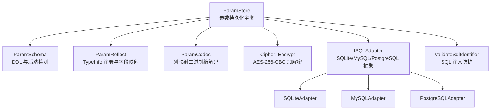
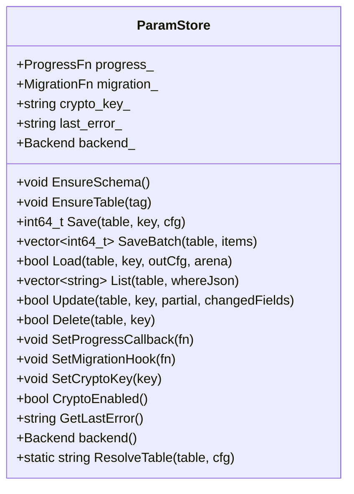
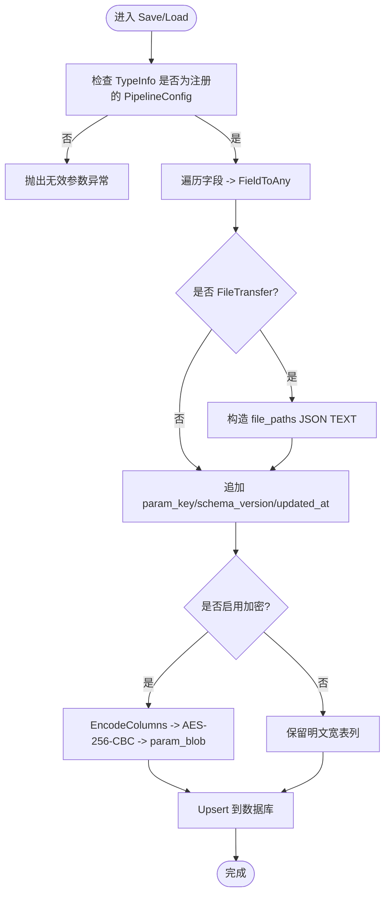
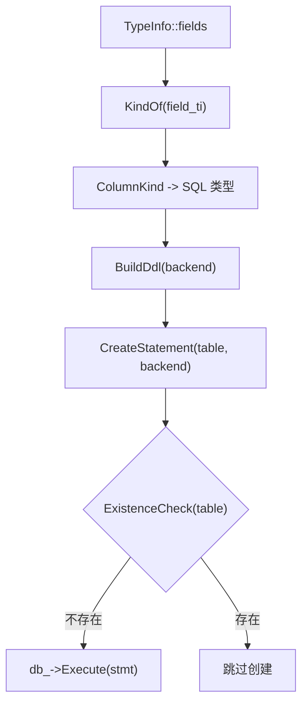
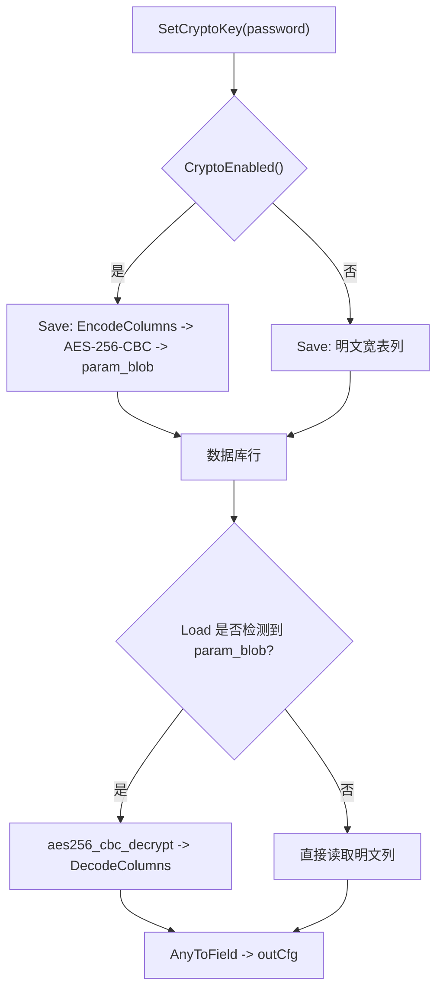
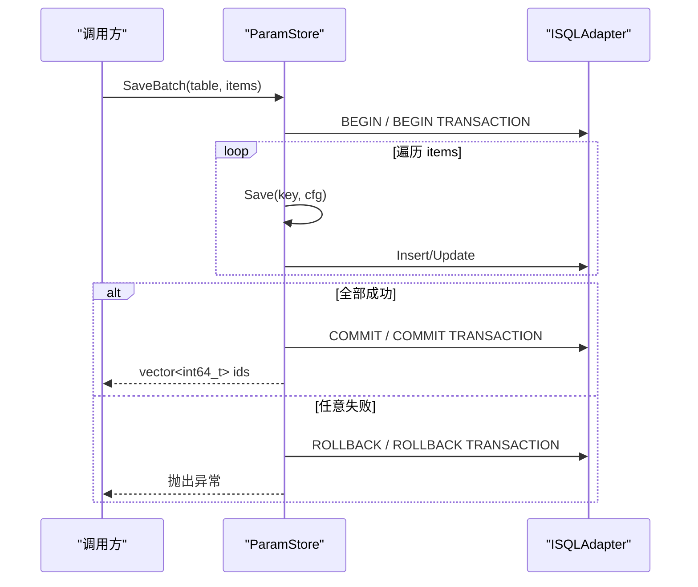
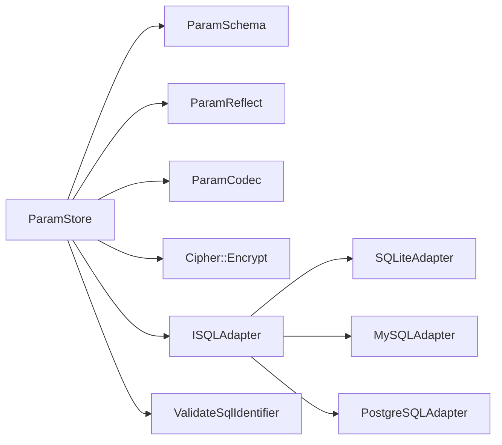

# 参数存储系统 (ParamStore)

<cite>
**本文引用的文件**   
- [param_store.hpp](file://fileoperator/param_store.hpp)
- [param_store.cpp](file://fileoperator/param_store.cpp)
- [param_schema.hpp](file://fileoperator/param_schema.hpp)
- [param_schema.cpp](file://fileoperator/param_schema.cpp)
- [param_reflect.hpp](file://fileoperator/param_reflect.hpp)
- [param_reflect.cpp](file://fileoperator/param_reflect.cpp)
- [param_codec.hpp](file://fileoperator/param_codec.hpp)
- [param_codec.cpp](file://fileoperator/param_codec.cpp)
- [sql_adapter.hpp](file://fileoperator/sql_adapter.hpp)
- [sql_adapter.cpp](file://fileoperator/sql_adapter.cpp)
- [encrypt.hpp](file://cipher/encrypt.hpp)
- [encrypt.cpp](file://cipher/encrypt.cpp)
- [param_store_test.cpp](file://tests/ParamStore\param_store_test.cpp)
</cite>

## 更新摘要
**变更内容**   
- 新增 SQL 注入防护机制，通过 ValidateSqlIdentifier 函数实现标识符白名单验证
- 增强 ResolveTable、List、Delete 操作中的表名和列名验证
- 改进 JSON WHERE 子句处理中的列名验证逻辑
- 添加完整的安全测试用例覆盖 SQL 注入攻击场景

## 目录
1. [简介](#简介)
2. [项目结构](#项目结构)
3. [核心组件](#核心组件)
4. [架构总览](#架构总览)
5. [详细组件分析](#详细组件分析)
6. [安全增强与 SQL 注入防护](#安全增强与-sql-注入防护)
7. [依赖关系分析](#依赖关系分析)
8. [性能与复杂度](#性能与复杂度)
9. [使用示例与最佳实践](#使用示例与最佳实践)
10. [故障排除指南](#故障排除指南)
11. [结论](#结论)

## 简介
ParamStore 是 HsBaSlicer 中面向"流水线配置对象"的参数持久化子系统。它以 `Utils::AnyObject` 为统一入口，通过反射遍历配置结构体字段，将数据映射到 SQL 宽表；同时提供完整的 CRUD、事务化批量保存、加密列存储、进度回调和迁移钩子能力。**最新的安全增强**引入了严格的 SQL 注入防护机制，确保所有 SQL 标识符（表名、列名）都经过白名单验证，防止恶意输入破坏数据库结构。其设计目标是：
- 以类型安全的反射机制驱动字段序列化与反序列化；
- 屏蔽 SQLite / MySQL / PostgreSQL 差异；
- 在启用密钥时，将业务字段折叠进自描述二进制列并做 AES-256-CBC 加密；
- **提供全面的 SQL 注入防护，拒绝非法的 SQL 标识符**；
- 保证错误不被吞掉，调用方可根据 `last_error` 或异常进行恢复。

## 项目结构
ParamStore 相关代码集中在 `fileoperator` 模块，并与 `cipher` 模块的加密能力集成：



**图表来源**
- [param_store.hpp:33-121](file://fileoperator/param_store.hpp#L33-L121)
- [param_schema.hpp:60-100](file://fileoperator/param_schema.hpp#L60-L100)
- [param_reflect.hpp:378-415](file://fileoperator/param_reflect.hpp#L378-L415)
- [param_codec.hpp:22-35](file://fileoperator/param_codec.hpp#L22-L35)
- [sql_adapter.hpp:36-129](file://fileoperator/sql_adapter.hpp#L36-L129)
- [param_store.cpp:43-51](file://fileoperator/param_store.cpp#L43-L51)

**章节来源**
- [param_store.hpp:1-128](file://fileoperator/param_store.hpp#L1-L128)
- [param_schema.hpp:1-104](file://fileoperator/param_schema.hpp#L1-L104)
- [param_reflect.hpp:1-419](file://fileoperator/param_reflect.hpp#L1-L419)
- [param_codec.hpp:1-39](file://fileoperator/param_codec.hpp#L1-L39)
- [sql_adapter.hpp:1-610](file://fileoperator/sql_adapter.hpp#L1-L610)

## 核心组件
- **ParamStore**：对外暴露 `EnsureSchema`、`Save`、`Load`、`List`、`Update`、`Delete`、`SaveBatch`、`SetProgressCallback`、`SetMigrationHook`、`SetCryptoKey`、`CryptoEnabled`、`GetLastError`、`backend()`、`ResolveTable`。
- **ParamSchema**：根据配置结构体的 `TypeInfo::fields` 推导列类型，生成跨后端 DDL，并提供后端自动检测。
- **ParamReflect**：为所有 PipelineConfig 结构体生成 `GetTypeInfo<T>()`，维护 tag、短名、默认表名的集中映射。
- **ParamCodec**：对列映射做紧凑的二进制编码/解码，作为加密列的载体。
- **Cipher::Encrypt**：基于 OpenSSL 实现 AES-256-CBC 等对称加密接口。
- **ISQLAdapter 及具体实现**：统一封装 SQLite / MySQL / PostgreSQL 的连接、查询、插入、更新、删除、建表等操作。
- **ValidateSqlIdentifier**：**新增**的 SQL 注入防护函数，验证 SQL 标识符符合白名单规则。

**章节来源**
- [param_store.hpp:33-121](file://fileoperator/param_store.hpp#L33-L121)
- [param_schema.hpp:60-100](file://fileoperator/param_schema.hpp#L60-L100)
- [param_reflect.hpp:378-415](file://fileoperator/param_reflect.hpp#L378-L415)
- [param_codec.hpp:22-35](file://fileoperator/param_codec.hpp#L22-L35)
- [encrypt.hpp:18-76](file://cipher/encrypt.hpp#L18-L76)
- [sql_adapter.hpp:36-129](file://fileoperator/sql_adapter.hpp#L36-L129)
- [param_store.cpp:43-51](file://fileoperator/param_store.cpp#L43-L51)

## 架构总览
ParamStore 的核心流程围绕"验证 → 反射 → 类型收敛 → 可选加密 → Upsert/Select/Update/Delete"展开，**新增 SQL 标识符验证层**。

```mermaid
sequenceDiagram
participant Caller as "调用方"
participant Store as "ParamStore"
participant Validate as "ValidateSqlIdentifier"
participant Schema as "ParamSchema"
participant Reflect as "ParamReflect"
participant Codec as "ParamCodec"
participant Cipher as "Cipher : : Encrypt"
participant DB as "ISQLAdapter"
Caller->>Store : EnsureSchema()
Store->>Validate : ValidateSqlIdentifier("ResolveTable", tableName)
alt 表名非法
Validate-->>Store : 抛出 SQLAdapterInvalidArgumentError
else 表名合法
Store->>Reflect : RegisterPipelineConfigTypes()
Store->>Schema : forConfig(TypeInfo*)
Store->>DB : ExistenceCheck(table)
alt 表不存在
Store->>DB : CreateStatement(table, backend)
end
end
Caller->>Store : Save(table, key, cfg)
Store->>Store : Validate(cfg)
Store->>Validate : ValidateSqlIdentifier("Save", tableName)
Store->>Reflect : ForeachField -> FieldToAny
alt FileTransfer 特殊列
Store->>Store : 构建 JSON TEXT file_paths
end
opt 启用加密
Store->>Codec : EncodeColumns(fields)
Store->>Cipher : aes256_cbc_encrypt(plain, key)
Store->>DB : Insert/Update with param_blob
else 明文宽表
Store->>DB : Insert/Update with per-field columns
end
```

**图表来源**
- [param_store.cpp:173-279](file://fileoperator/param_store.cpp#L173-L279)
- [param_store.cpp:328-394](file://fileoperator/param_store.cpp#L328-L394)
- [param_schema.cpp:152-210](file://fileoperator/param_schema.cpp#L152-L210)
- [param_codec.cpp:61-105](file://fileoperator/param_codec.cpp#L61-L105)
- [encrypt.cpp:60-138](file://cipher/encrypt.cpp#L60-L138)
- [param_store.cpp:43-51](file://fileoperator/param_store.cpp#L43-L51)

## 详细组件分析

### ParamStore：CRUD、事务、加密与回调
ParamStore 是用户直接使用的 API 门面。它持有数据库适配器引用、后端枚举、进度回调、迁移钩子、加密密钥和最近错误信息。

关键职责：
- 表与模式管理：`EnsureSchema`、`EnsureTable`、`ResolveTable`。
- 单条保存：`Save` 执行校验、反射、类型收敛、可选加密、Upsert。
- 批量保存：`SaveBatch` 包裹显式事务，失败回滚。
- 读取：`Load` 支持明文宽表和加密 blob 两种路径。
- 列表：`List` 解析 JSON where 条件并返回匹配的 `param_key`。
- 增量更新：`Update` 支持明文列更新和加密 blob 的"读-解-改-重加密"循环。
- 删除：`Delete` 按 `param_key` 删除并返回是否命中。
- 错误处理：`Guard` 捕获 `RuntimeError`，写入 `last_error_` 后重新抛出。
- 进度与迁移：`Raise` 触发进度回调；`SetMigrationHook` 保留迁移函数指针（当前仅轻量保留）。



**图表来源**
- [param_store.hpp:33-121](file://fileoperator/param_store.hpp#L33-L121)

**章节来源**
- [param_store.hpp:33-121](file://fileoperator/param_store.hpp#L33-L121)
- [param_store.cpp:102-135](file://fileoperator/param_store.cpp#L102-L135)
- [param_store.cpp:152-185](file://fileoperator/param_store.cpp#L152-L185)
- [param_store.cpp:187-279](file://fileoperator/param_store.cpp#L187-L279)
- [param_store.cpp:281-326](file://fileoperator/param_store.cpp#L281-L326)
- [param_store.cpp:328-394](file://fileoperator/param_store.cpp#L328-L394)
- [param_store.cpp:397-433](file://fileoperator/param_store.cpp#L397-L433)
- [param_store.cpp:436-519](file://fileoperator/param_store.cpp#L436-L519)
- [param_store.cpp:522-540](file://fileoperator/param_store.cpp#L522-L540)

### 字段遍历、反射与类型转换
ParamStore 不直接操作具体结构体，而是通过 `Utils::AnyObject::ForeachField` 遍历字段。每个 PipelineConfig 结构体在 `param_reflect.hpp` 中通过宏注册 `GetTypeInfo<T>()`，填充字段名、偏移、拷贝/移动/销毁语义。

字段类型收敛规则：
- `float` / `double` → `ColumnKind::Double`
- `const char*` / `std::string` → `ColumnKind::Text`
- `int` / `int64_t` / 支持的枚举 → `ColumnKind::Int64`

反射到列映射：
- `ReflectColumns` 调用 `FieldToAny`，把原始字段值转换为 `std::any` 白名单类型。
- 对于 `FileTransfer`，`file_paths` 指针数组不注册为普通字段，而是在 Save 中额外序列化为 JSON TEXT 列。

加载时反序列化：
- `AnyToField` 根据目标字段的 `TypeInfo` 将 `std::any` 写回结构体内存。
- 当某列缺失时，保持目标结构体的原值不变。



**图表来源**
- [param_store.cpp:38-45](file://fileoperator/param_store.cpp#L38-L45)
- [param_store.cpp:201-227](file://fileoperator/param_store.cpp#L201-L227)
- [param_store.cpp:228-255](file://fileoperator/param_store.cpp#L228-L255)
- [param_schema.cpp:87-103](file://fileoperator/param_schema.cpp#L87-L103)
- [param_reflect.hpp:30-48](file://fileoperator/param_reflect.hpp#L30-L48)

**章节来源**
- [param_reflect.hpp:30-48](file://fileoperator/param_reflect.hpp#L30-L48)
- [param_reflect.hpp:55-371](file://fileoperator/param_reflect.hpp#L55-L371)
- [param_reflect.cpp:28-69](file://fileoperator/param_reflect.cpp#L28-L69)
- [param_schema.cpp:87-103](file://fileoperator/param_schema.cpp#L87-L103)
- [param_store.cpp:38-45](file://fileoperator/param_store.cpp#L38-L45)
- [param_store.cpp:201-227](file://fileoperator/param_store.cpp#L201-L227)

### 数据库后端自动检测与 DDL 生成
`ParamSchema` 负责：
- 根据 `TypeInfo::fields` 计算每列的 `ColumnKind`；
- 为 SQLite / MySQL / PostgreSQL 生成不同 DDL；
- 提供 `ExistenceCheck` 探测表是否存在；
- 通过 `dynamic_cast` 检测 `ISQLAdapter` 的具体后端。

列类型映射要点：
- Double：SQLite `REAL`，MySQL `DOUBLE`，PostgreSQL `DOUBLE PRECISION`；
- Int64：统一 `BIGINT`；
- Text：统一 `TEXT`；
- 主键：SQLite `INTEGER PRIMARY KEY AUTOINCREMENT`，MySQL `BIGINT PRIMARY KEY AUTO_INCREMENT`，PostgreSQL `BIGSERIAL PRIMARY KEY`；
- 业务键：MySQL 使用 `VARCHAR(512) NOT NULL UNIQUE`，其他后端使用 `TEXT NOT NULL UNIQUE`；
- 加密列：MySQL `LONGBLOB`，PostgreSQL `BYTEA`，SQLite `BLOB`。



**图表来源**
- [param_schema.cpp:87-103](file://fileoperator/param_schema.cpp#L87-L103)
- [param_schema.cpp:136-150](file://fileoperator/param_schema.cpp#L136-L150)
- [param_schema.cpp:152-210](file://fileoperator/param_schema.cpp#L152-L210)
- [param_schema.cpp:213-232](file://fileoperator/param_schema.cpp#L213-L232)

**章节来源**
- [param_schema.hpp:60-100](file://fileoperator/param_schema.hpp#L60-L100)
- [param_schema.cpp:87-103](file://fileoperator/param_schema.cpp#L87-L103)
- [param_schema.cpp:136-150](file://fileoperator/param_schema.cpp#L136-L150)
- [param_schema.cpp:152-210](file://fileoperator/param_schema.cpp#L152-L210)
- [param_schema.cpp:213-232](file://fileoperator/param_schema.cpp#L213-L232)

### 加密存储与密钥管理
当调用 `SetCryptoKey` 设置非空密钥后，ParamStore 的 Save/Load/Update 会走加密路径：
- Save：过滤元数据列，`EncodeColumns` 得到二进制流，再用 `aes256_cbc_encrypt` 加密后写入 `param_blob`；
- Load：若行包含非空 `param_blob`，则必须设置相同密钥，否则抛错；解密后 `DecodeColumns` 重建列映射；
- Update：在加密模式下，先读取旧行解密，合并变更字段，再重新加密并只更新 `param_blob` 和 `updated_at`。

密钥派生细节：
- `Cipher::Encrypt` 使用 SHA256 派生 AES 密钥和 IV；
- AES-256-CBC 使用 OpenSSL EVP 接口；
- 密钥错误会导致解密失败异常。



**图表来源**
- [param_store.cpp:228-255](file://fileoperator/param_store.cpp#L228-L255)
- [param_store.cpp:346-379](file://fileoperator/param_store.cpp#L346-L379)
- [param_store.cpp:455-503](file://fileoperator/param_store.cpp#L455-L503)
- [encrypt.cpp:24-34](file://cipher/encrypt.cpp#L24-L34)
- [encrypt.cpp:60-138](file://cipher/encrypt.cpp#L60-L138)

**章节来源**
- [param_store.hpp:86-99](file://fileoperator/param_store.hpp#L86-L99)
- [param_store.cpp:228-255](file://fileoperator/param_store.cpp#L228-L255)
- [param_store.cpp:346-379](file://fileoperator/param_store.cpp#L346-L379)
- [param_store.cpp:455-503](file://fileoperator/param_store.cpp#L455-L503)
- [encrypt.hpp:18-76](file://cipher/encrypt.hpp#L18-L76)
- [encrypt.cpp:60-138](file://cipher/encrypt.cpp#L60-L138)

### 事务与批量操作
`SaveBatch` 使用显式事务包装多次 `Save`：
- 根据后端选择 `BEGIN` / `COMMIT` / `ROLLBACK` 语句；
- 任一 `Save` 失败会触发回滚，并重新抛出原始异常；
- 回滚失败不会掩盖原始异常；
- 成功时返回每条记录的 `param_id`。



**图表来源**
- [param_store.cpp:281-326](file://fileoperator/param_store.cpp#L281-L326)

**章节来源**
- [param_store.cpp:281-326](file://fileoperator/param_store.cpp#L281-L326)

### 进度回调与迁移钩子
- 进度回调：`SetProgressCallback` 接收百分比和阶段描述；内部通过 `Raise(percent, stage)` 触发。
- 迁移钩子：`SetMigrationHook` 保留一个函数指针，当前文档未展示实际调用点，但接口允许上层在合适时机执行迁移逻辑。

典型进度阶段：
- Save：validate → reflect & coerce → upsert → updated/inserted；
- Load：mapping → loaded；
- Update：updated；
- Delete：deleted；
- EnsureTable：schema created。

**章节来源**
- [param_store.hpp:36-40](file://fileoperator/param_store.hpp#L36-L40)
- [param_store.hpp:81-84](file://fileoperator/param_store.hpp#L81-L84)
- [param_store.cpp:124-130](file://fileoperator/param_store.cpp#L124-L130)
- [param_store.cpp:152-170](file://fileoperator/param_store.cpp#L152-L170)
- [param_store.cpp:187-279](file://fileoperator/param_store.cpp#L187-L279)
- [param_store.cpp:328-394](file://fileoperator/param_store.cpp#L328-L394)
- [param_store.cpp:436-519](file://fileoperator/param_store.cpp#L436-L519)
- [param_store.cpp:522-540](file://fileoperator/param_store.cpp#L522-L540)

## 安全增强与 SQL 注入防护

**新增功能**：ParamStore 现在实现了全面的 SQL 注入防护机制，通过 `ValidateSqlIdentifier` 函数对所有 SQL 标识符进行严格验证。

### ValidateSqlIdentifier 函数
`ValidateSqlIdentifier` 是新增的核心安全函数，用于验证 SQL 标识符（表名、列名）是否符合白名单规则：

```cpp
void ValidateSqlIdentifier(std::string_view what, const std::string& name)
{
    static const std::regex identifierPattern("[A-Za-z_][A-Za-z0-9_]{0,63}");
    if (!std::regex_match(name, identifierPattern))
    {
        throw SQL::SQLAdapterInvalidArgumentError(std::string("ParamStore::") + std::string(what) +
                                                  ": illegal SQL identifier: '" + name + "'");
    }
}
```

该函数使用正则表达式 `[A-Za-z_][A-Za-z0-9_]{0,63}` 验证标识符：
- 必须以字母或下划线开头
- 只能包含字母、数字和下划线
- 长度限制在 64 字符以内
- 拒绝引号、分号、空格等危险字符

### 增强的表名验证
所有涉及表名的操作现在都会调用 `ValidateSqlIdentifier`：

- **ResolveTable**：验证用户提供的表名
- **Save**：通过 ResolveTable 间接验证表名
- **Load**：通过 ResolveTable 间接验证表名  
- **Update**：通过 ResolveTable 间接验证表名
- **Delete**：直接验证表名
- **List**：直接验证表名

### 增强的列名验证
**List 操作的 JSON WHERE 子句**现在也进行了列名验证：

```cpp
for (auto it = doc.MemberBegin(); it != doc.MemberEnd(); ++it)
{
    // JSON member names become WHERE column names in the concatenated clause.
    std::string colName(it->name.GetString(), it->name.GetStringLength());
    ValidateSqlIdentifier("List", colName);
    where[std::move(colName)] = JsonValueToAny(it->value);
}
```

这确保了 JSON WHERE 子句中的键名（即列名）不会被用作 SQL 注入攻击向量。

### 安全测试覆盖
完整的测试用例覆盖了各种 SQL 注入攻击场景：

```cpp
// 表名注入攻击测试
const std::string evil = R"(x'; DROP TABLE hsba_param_fdm; --)";

// 所有操作都应拒绝恶意表名
BOOST_CHECK_THROW(store.Save(evil, "k1", obj), SQL::SQLAdapterInvalidArgumentError);
BOOST_CHECK_THROW(store.Load(evil, "k1", AnyObject(GetTypeInfo<HsBaFdmPipelineConfig_t>(), &out), arena),
                  SQL::SQLAdapterInvalidArgumentError);
BOOST_CHECK_THROW(store.Update(evil, "k1", obj, {"wall_count"}), SQL::SQLAdapterInvalidArgumentError);
BOOST_CHECK_THROW(store.Delete(evil, "k1"), SQL::SQLAdapterInvalidArgumentError);
BOOST_CHECK_THROW(store.List(evil, ""), SQL::SQLAdapterInvalidArgumentError);

// JSON WHERE 列名注入测试
BOOST_CHECK_THROW(store.List("hsba_param_fdm", R"({"a'; DROP TABLE hsba_param_fdm; --":1})"),
                  SQL::SQLAdapterInvalidArgumentError);

// 正常操作不受影响
BOOST_CHECK(store.Save("hsba_param_fdm", "ok1", obj) > 0);
BOOST_CHECK_NO_THROW(store.List("hsba_param_fdm", R"({"wall_count":3})"));
```

### 安全防护策略
1. **白名单验证**：所有 SQL 标识符必须符合严格的命名规范
2. **参数绑定**：业务数据（如 key 和字段值）始终使用参数绑定，避免注入
3. **早期拒绝**：在 SQL 语句构建前就拒绝非法标识符
4. **全面覆盖**：所有可能暴露 SQL 标识符的 API 都进行了验证

**章节来源**
- [param_store.cpp:43-51](file://fileoperator/param_store.cpp#L43-L51)
- [param_store.cpp:152-168](file://fileoperator/param_store.cpp#L152-L168)
- [param_store.cpp:420-456](file://fileoperator/param_store.cpp#L420-L456)
- [param_store.cpp:544-564](file://fileoperator/param_store.cpp#L544-L564)
- [param_store_test.cpp:658-706](file://tests/ParamStore\param_store_test.cpp#L658-L706)

## 依赖关系分析



**图表来源**
- [param_store.hpp:22-26](file://fileoperator/param_store.hpp#L22-L26)
- [param_store.cpp:16-17](file://fileoperator/param_store.cpp#L16-L17)
- [sql_adapter.hpp:216-328](file://fileoperator/sql_adapter.hpp#L216-L328)
- [param_store.cpp:43-51](file://fileoperator/param_store.cpp#L43-L51)

耦合与内聚：
- ParamStore 高内聚地封装了配置持久化的完整生命周期；
- 通过 ISQLAdapter 解耦具体数据库实现；
- 通过 ParamSchema 解耦 DDL 方言；
- 通过 ParamReflect 解耦具体配置结构体；
- 通过 ParamCodec 和 Cipher 解耦加密列格式与算法；
- **通过 ValidateSqlIdentifier 解耦 SQL 注入防护逻辑**。

潜在风险：
- 反射注册必须与结构体字段保持一致；
- 加密密钥不一致会导致历史数据不可读；
- 批量事务中回滚失败被吞掉，但原始异常仍向上抛出；
- **SQL 标识符验证失败会抛出 SQLAdapterInvalidArgumentError 异常**。

**章节来源**
- [param_store.hpp:22-26](file://fileoperator/param_store.hpp#L22-L26)
- [param_store.cpp:16-17](file://fileoperator/param_store.cpp#L16-L17)
- [sql_adapter.hpp:216-328](file://fileoperator/sql_adapter.hpp#L216-L328)
- [param_store.cpp:43-51](file://fileoperator/param_store.cpp#L43-L51)

## 性能与复杂度
- 反射与类型收敛：每次 Save/Load 都会遍历字段，时间复杂度约为 O(F)，F 为字段数；
- 加密路径：Save 增加一次 `EncodeColumns` 和一次 AES 加密，Load/Update 增加解密和解码；
- 批量事务：N 条记录的事务开销显著低于 N 次独立提交；
- 数据库层：ISQLAdapter 使用预编译语句绑定参数，避免字符串拼接注入风险；
- **SQL 标识符验证：正则表达式匹配的时间复杂度为 O(N)，N 为标识符长度**；
- 内存：`StringArena` 用于承载 `const char*` 字段的生命期，需由调用方确保存活。

优化建议：
- 对超大配置对象可考虑分片保存；
- 对频繁更新的字段可使用 `Update` 而非全量 Save；
- 加密密钥应缓存于安全位置，避免重复派生开销；
- 对大批量 List 查询应结合 whereJson 缩小结果集；
- **合理设计表名和列名，避免过长的标识符名称**。

## 使用示例与最佳实践

### 初始化 ParamStore
- 创建数据库连接（SQLite / MySQL / PostgreSQL）；
- 构造 `ParamStore(db, backend)`，backend 可为空以自动检测；
- 调用 `EnsureSchema()` 创建所有已注册配置类型的表；
- 可选：设置进度回调、迁移钩子、加密密钥。

参考路径：
- [param_store.cpp:132-135](file://fileoperator/param_store.cpp#L132-L135)
- [param_store.cpp:173-185](file://fileoperator/param_store.cpp#L173-L185)
- [param_schema.cpp:213-232](file://fileoperator/param_schema.cpp#L213-L232)

### 保存配置对象
- 准备 `Utils::AnyObject` 包装的目标配置结构体；
- 调用 `Save(table, key, cfg)`；
- 如需批量保存，使用 `SaveBatch(table, items)`；
- 注意 `FileTransfer` 的 `file_paths` 会被特殊处理为 JSON TEXT。

参考路径：
- [param_store.cpp:187-279](file://fileoperator/param_store.cpp#L187-L279)
- [param_store.cpp:281-326](file://fileoperator/param_store.cpp#L281-L326)
- [param_reflect.hpp:348-371](file://fileoperator/param_reflect.hpp#L348-L371)

### 加载配置对象
- 准备空的 `Utils::AnyObject` 和目标结构体；
- 准备 `StringArena` 以承载字符串字段；
- 调用 `Load(table, key, outCfg, arena)`；
- 如果数据是加密存储且未设置密钥，会抛出异常。

参考路径：
- [param_store.cpp:328-394](file://fileoperator/param_store.cpp#L328-L394)

### 批量操作与错误处理
- 使用 `SaveBatch` 获得 `vector<int64_t>` 返回每个记录的 id；
- 捕获 `SQL::SQLAdapterError` 及其子类；
- 通过 `GetLastError()` 获取最近失败消息；
- 注意批量事务失败会回滚，但回滚失败本身不会掩盖原始异常。

参考路径：
- [param_store.cpp:281-326](file://fileoperator/param_store.cpp#L281-L326)
- [param_store.cpp:102-122](file://fileoperator/param_store.cpp#L102-L122)

### 加密密钥管理
- 使用 `SetCryptoKey(password)` 启用加密；
- 同一份数据必须用相同密码才能解密；
- 关闭加密可通过传入空密钥；
- 历史加密数据在未设置密钥时无法读取。

参考路径：
- [param_store.hpp:86-99](file://fileoperator/param_store.hpp#L86-L99)
- [encrypt.cpp:60-138](file://cipher/encrypt.cpp#L60-L138)

### SQL 注入防护最佳实践
- **始终使用合法的表名和列名**：遵循 `[A-Za-z_][A-Za-z0-9_]{0,63}` 命名规范
- **避免动态拼接 SQL 标识符**：使用参数绑定处理业务数据
- **验证用户输入的 JSON WHERE 子句**：确保列名合法
- **捕获 SQLAdapterInvalidArgumentError 异常**：处理标识符验证失败的情况

参考路径：
- [param_store.cpp:43-51](file://fileoperator/param_store.cpp#L43-L51)
- [param_store_test.cpp:658-706](file://tests/ParamStore\param_store_test.cpp#L658-L706)

**章节来源**
- [param_store.cpp:132-185](file://fileoperator/param_store.cpp#L132-L185)
- [param_store.cpp:187-394](file://fileoperator/param_store.cpp#L187-L394)
- [param_store.cpp:281-326](file://fileoperator/param_store.cpp#L281-L326)
- [param_store.hpp:86-99](file://fileoperator/param_store.hpp#L86-L99)
- [encrypt.cpp:60-138](file://cipher/encrypt.cpp#L60-L138)
- [param_store.cpp:43-51](file://fileoperator/param_store.cpp#L43-L51)
- [param_store_test.cpp:658-706](file://tests/ParamStore\param_store_test.cpp#L658-L706)

## 故障排除指南

常见问题与定位方式：
- "config type not registered"：传入的 `AnyObject` 类型未在 `param_reflect.hpp` 中注册；
- "table name required"：`List` 或 `Delete` 未传 table；
- "whereJson must be a JSON object"：`List` 的 where 条件不是合法 JSON 对象；
- "row is encrypted but no crypto key is set"：读取加密数据但未设置密钥；
- "encryption failed / decryption failed"：密钥错误或数据损坏；
- "row vanished after insert"：插入后查询不到对应行，可能是并发或底层异常；
- "unknown tag"：`EnsureTable` 传入未知 tag；
- "unknown ISQLAdapter implementation"：后端检测失败；
- **"illegal SQL identifier"**：**新增**：表名或列名不符合白名单规则，包含非法字符；
- **"ParamStore::Save: config type not registered"**：Save 操作中配置类型未注册。

**新增错误类型**：
- `SQLAdapterInvalidArgumentError`：当 SQL 标识符验证失败时抛出，包含具体的操作名称和非法标识符信息。

错误传播策略：
- 所有业务异常均通过 `Guard` 记录到 `last_error_` 后重新抛出；
- 上层应捕获 `SQL::SQLAdapterError` 或其子类；
- 批量事务失败时优先关注原始异常，回滚失败被有意忽略；
- **SQL 标识符验证失败会立即抛出异常，阻止潜在的 SQL 注入攻击**。

**章节来源**
- [param_store.cpp:102-122](file://fileoperator/param_store.cpp#L102-L122)
- [param_store.cpp:152-170](file://fileoperator/param_store.cpp#L152-L170)
- [param_store.cpp:187-279](file://fileoperator/param_store.cpp#L187-L279)
- [param_store.cpp:281-326](file://fileoperator/param_store.cpp#L281-L326)
- [param_store.cpp:328-394](file://fileoperator/param_store.cpp#L328-L394)
- [param_store.cpp:397-433](file://fileoperator/param_store.cpp#L397-L433)
- [param_store.cpp:436-519](file://fileoperator/param_store.cpp#L436-L519)
- [param_store.cpp:522-540](file://fileoperator/param_store.cpp#L522-L540)
- [param_store.cpp:43-51](file://fileoperator/param_store.cpp#L43-L51)

## 结论
ParamStore 提供了一个类型安全、可扩展、可加密、可观测且**具备全面 SQL 注入防护**的参数持久化方案。它通过反射驱动字段映射，屏蔽多后端差异，并以事务化批量操作提升吞吐。对于敏感配置，可在启用密钥后将业务字段整体加密存储，同时保留元数据列用于查询与列表。**最新的安全增强**通过 `ValidateSqlIdentifier` 函数对所有 SQL 标识符进行严格白名单验证，有效防止 SQL 注入攻击。使用时应重点关注：
- 正确注册配置类型；
- 合理选择 table 与 key；
- 在加密场景下管理密钥一致性；
- 使用批量接口减少事务开销；
- 捕获并处理 SQL 适配器异常；
- **确保所有 SQL 标识符符合白名单命名规范**；
- **警惕用户输入的 JSON WHERE 子句中的列名**。

[本节为总结性内容，不直接分析具体文件]