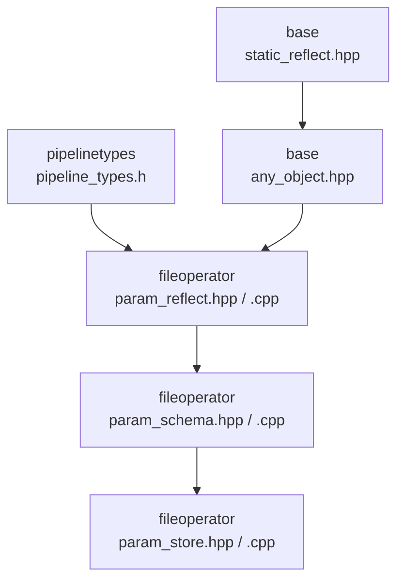
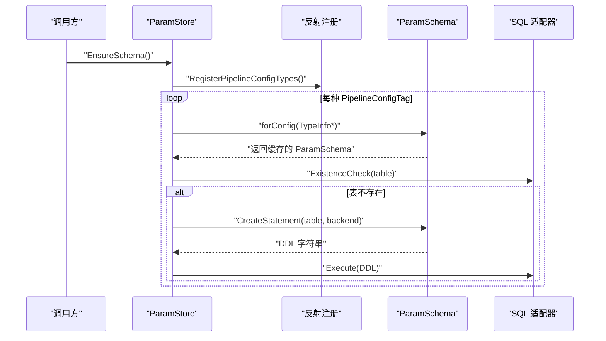
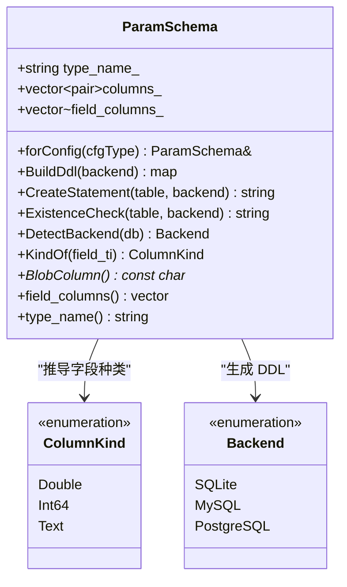
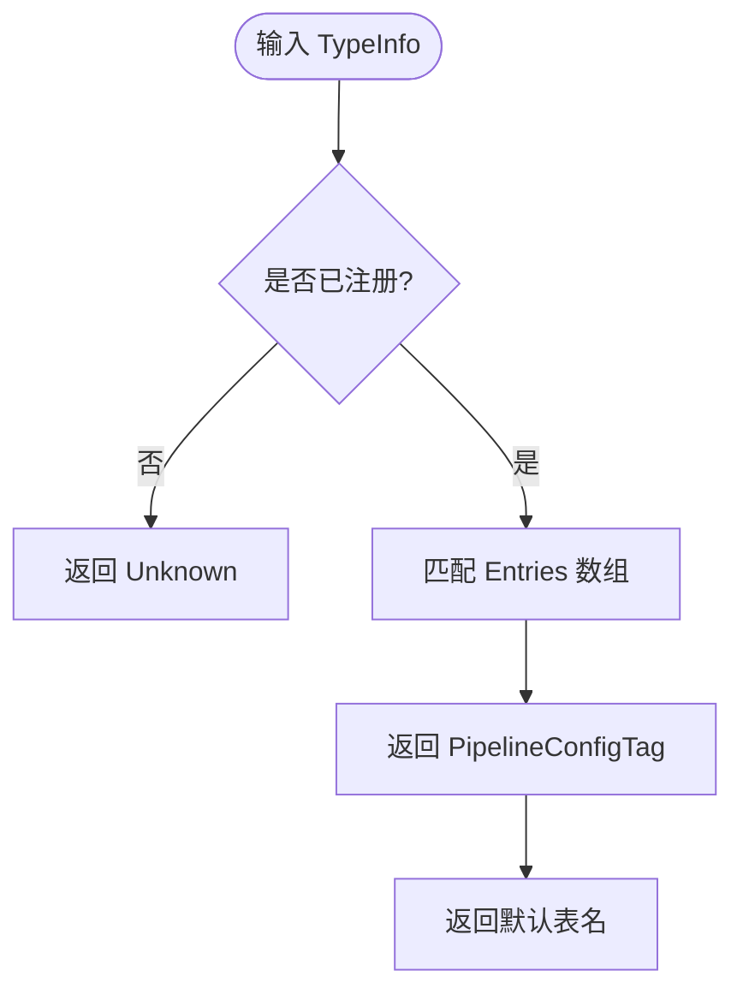
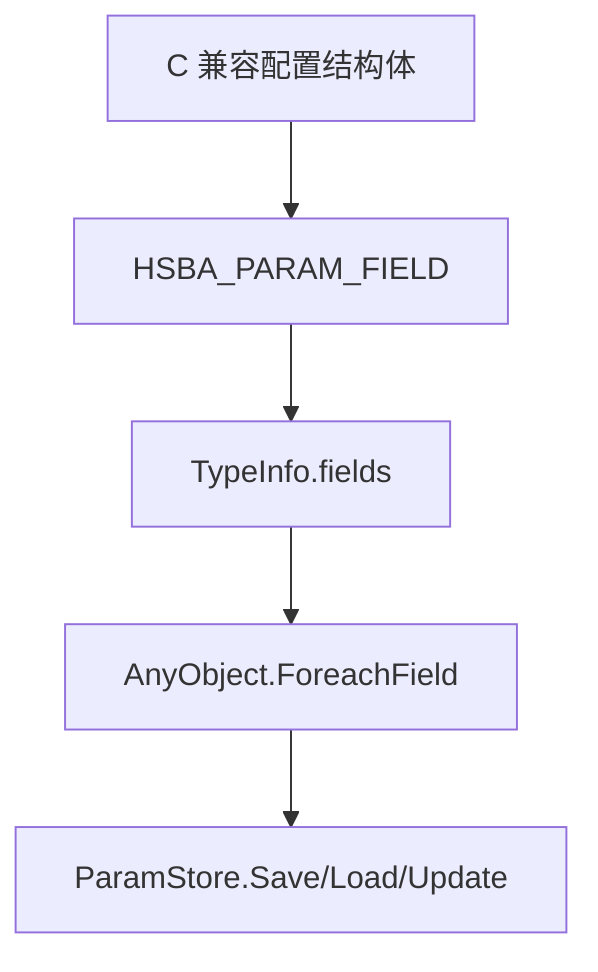
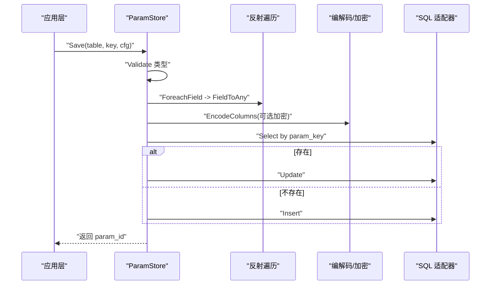
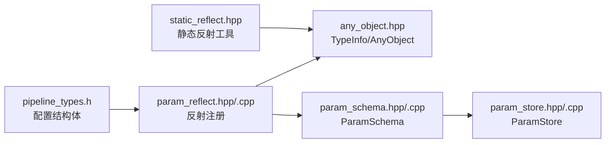
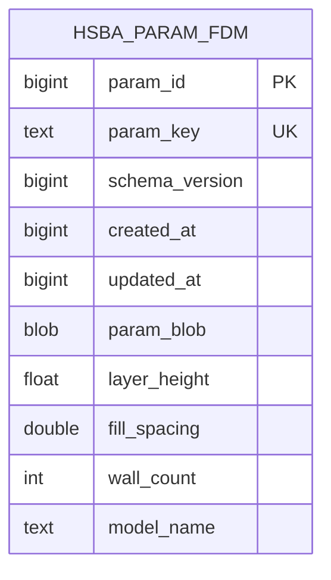
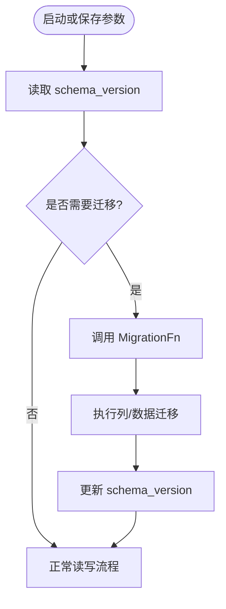
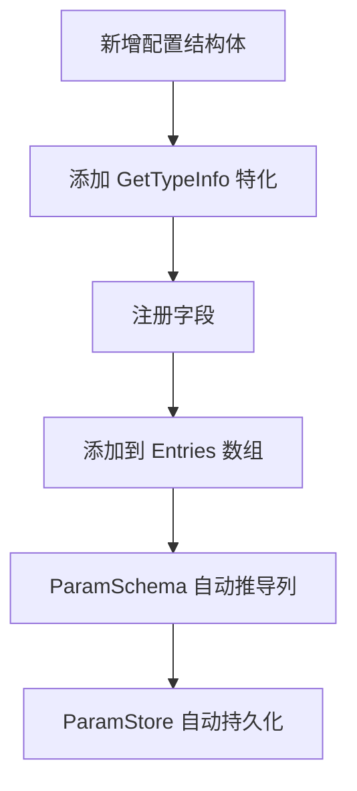

# 参数模式定义 (ParamSchema)

<cite>
**本文引用的文件**   
- [param_schema.hpp](file://fileoperator/param_schema.hpp)
- [param_schema.cpp](file://fileoperator/param_schema.cpp)
- [param_reflect.hpp](file://fileoperator/param_reflect.hpp)
- [param_reflect.cpp](file://fileoperator/param_reflect.cpp)
- [pipeline_types.h](file://pipelinetypes/pipeline_types.h)
- [any_object.hpp](file://base/any_object.hpp)
- [static_reflect.hpp](file://base/static_reflect.hpp)
- [param_store.hpp](file://fileoperator/param_store.hpp)
- [param_store.cpp](file://fileoperator/param_store.cpp)
</cite>

## 目录
1. [引言](#引言)
2. [项目结构定位](#项目结构定位)
3. [核心概念与职责边界](#核心概念与职责边界)
4. [架构总览](#架构总览)
5. [详细组件分析](#详细组件分析)
6. [依赖关系分析](#依赖关系分析)
7. [数据类型映射与约束规则](#数据类型映射与约束规则)
8. [数据库表结构与版本管理](#数据库表结构与版本管理)
9. [向后兼容性与迁移策略](#向后兼容性与迁移策略)
10. [扩展指南：注册新配置类型](#扩展指南注册新配置类型)
11. [性能与并发特性](#性能与并发特性)
12. [故障排除](#故障排除)
13. [结论](#结论)

## 引言
本文聚焦于 HsBaSlicer 的参数持久化体系中的“参数模式定义”能力，重点说明 `ParamSchema` 类如何通过静态反射机制，从 C++ 配置结构体自动推导数据库列定义、生成跨后端 DDL，并与 `ParamStore` 的保存、加载、更新流程协同工作。文档同时解释 `PipelineConfigTag` 枚举、字段映射规则、数据类型转换、加密存储、模式版本以及向后兼容性设计。

该方案的核心思想是：**配置结构体即模式**。开发者只需维护 C/C++ 配置结构体及其反射注册，系统即可自动生成宽表列、元数据列、业务键、模式版本和二进制加密列，从而避免手写 SQL 与手工同步结构体和数据库定义的重复劳动。

## 项目结构定位
参数模式定义相关代码集中在 `fileoperator` 模块，并依赖基础反射与管道类型定义：

**图表来源**
- [pipeline_types.h:1-120](file://pipelinetypes/pipeline_types.h#L1-L120)
- [param_reflect.hpp:1-419](file://fileoperator/param_reflect.hpp#L1-L419)
- [param_schema.hpp:1-104](file://fileoperator/param_schema.hpp#L1-L104)
- [param_store.hpp:1-125](file://fileoperator/param_store.hpp#L1-L125)
- [any_object.hpp:48-115](file://base/any_object.hpp#L48-L115)
- [static_reflect.hpp:1-188](file://base/static_reflect.hpp#L1-L188)

**章节来源**
- [pipeline_types.h:1-120](file://pipelinetypes/pipeline_types.h#L1-L120)
- [param_reflect.hpp:1-419](file://fileoperator/param_reflect.hpp#L1-L419)
- [param_schema.hpp:1-104](file://fileoperator/param_schema.hpp#L1-L104)
- [param_store.hpp:1-125](file://fileoperator/param_store.hpp#L1-L125)
- [any_object.hpp:48-115](file://base/any_object.hpp#L48-L115)
- [static_reflect.hpp:1-188](file://base/static_reflect.hpp#L1-L188)

## 核心概念与职责边界
- `ParamSchema`：负责根据已注册的配置类型反射信息，推导每列的数据种类，并为 SQLite、MySQL、PostgreSQL 生成 DDL 和存在性检查语句。
- `PipelineConfigTag`：为九种内置 Pipeline 配置提供短标签、默认表名和 TypeInfo 映射，是 Lua 层、ParamStore 和 ParamSchema 之间的统一索引。
- `TypeInfo` 与 `AnyObject`：提供运行时可遍历的结构体字段、类型信息和泛型对象包装，是反射驱动持久化的基础。
- `ParamStore`：负责事务、校验、反射、类型强制、加密、Upsert、批量操作和迁移钩子；它调用 `ParamSchema` 创建表，但不承担 DDL 细节。
- `pipeline_types.h`：定义所有 C 兼容的配置结构体，是反射注册和数据类型的唯一权威来源。

**章节来源**
- [param_schema.hpp:27-100](file://fileoperator/param_schema.hpp#L27-L100)
- [param_reflect.hpp:378-416](file://fileoperator/param_reflect.hpp#L378-L416)
- [any_object.hpp:48-115](file://base/any_object.hpp#L48-L115)
- [param_store.hpp:30-121](file://fileoperator/param_store.hpp#L30-L121)
- [pipeline_types.h:1-120](file://pipelinetypes/pipeline_types.h#L1-L120)

## 架构总览
参数模式定义在整体参数持久化流水线中处于“模式到数据库”的关键位置：

**图表来源**
- [param_store.cpp:173-185](file://fileoperator/param_store.cpp#L173-L185)
- [param_store.cpp:152-171](file://fileoperator/param_store.cpp#L152-L171)
- [param_schema.cpp:152-165](file://fileoperator/param_schema.cpp#L152-L165)
- [param_schema.cpp:167-211](file://fileoperator/param_schema.cpp#L167-L211)

## 详细组件分析

### ParamSchema：模式推导与 DDL 生成
`ParamSchema` 的核心职责包括：
- 通过 `forConfig(TypeInfo*)` 获取或缓存某个配置类型的模式实例。
- 将配置结构体的每个字段转换为 `ColumnKind`：浮点类归为 Double，整型/枚举归为 Int64，字符串归为 Text。
- 构建包含固定元数据列和业务字段的列定义映射。
- 按后端差异输出 CREATE TABLE 语句和存在性检查语句。
- 检测当前 SQL 适配器属于 SQLite、MySQL 还是 PostgreSQL。

关键行为要点：
- 元数据列固定为 `param_id`、`param_key`、`schema_version`、`created_at`、`updated_at`，以及可选的 `param_blob`。
- `param_key` 是业务唯一键；SQLite/PostgreSQL 使用 TEXT UNIQUE，MySQL 使用 VARCHAR(512) UNIQUE。
- `param_id` 使用各后端自增主键语义。
- `schema_version` 固定为 BIGINT NOT NULL，用于记录模式版本。
- `param_blob` 用于启用加密时存放序列化后的字段列映射。

**图表来源**
- [param_schema.hpp:27-100](file://fileoperator/param_schema.hpp#L27-L100)
- [param_schema.cpp:16-85](file://fileoperator/param_schema.cpp#L16-L85)
- [param_schema.cpp:87-118](file://fileoperator/param_schema.cpp#L87-L118)
- [param_schema.cpp:136-211](file://fileoperator/param_schema.cpp#L136-L211)

**章节来源**
- [param_schema.hpp:27-100](file://fileoperator/param_schema.hpp#L27-L100)
- [param_schema.cpp:16-85](file://fileoperator/param_schema.cpp#L16-L85)
- [param_schema.cpp:87-118](file://fileoperator/param_schema.cpp#L87-L118)
- [param_schema.cpp:136-211](file://fileoperator/param_schema.cpp#L136-L211)

### PipelineConfigTag：配置类型标签与默认表名
`PipelineConfigTag` 是九个内置配置类型的统一标识，对应 FDM、SLA、SLS、SLM、LOM、TDP、WAAM、Custom、FileTransfer。它与以下信息绑定：
- 短名称：如 `fdm`、`sla`、`custom`、`filetransfer`。
- 默认表名：如 `hsba_param_fdm`、`hsba_param_sla`、`hsba_param_custom`、`hsba_param_filetransfer`。
- TypeInfo：指向对应配置结构体的反射类型信息。

辅助函数提供：
- `IsPipelineConfigType`：判断 TypeInfo 是否属于已知配置类型。
- `TagOf`：从 TypeInfo 得到标签。
- `DefaultTableName(tag)` / `DefaultTableName(ti)`：得到默认表名。
- `TagFromName(name)`：解析 Lua 传入的短标签。
- `TypeInfoOf(tag)`：根据标签取回 TypeInfo。

**图表来源**
- [param_reflect.cpp:28-69](file://fileoperator/param_reflect.cpp#L28-L69)
- [param_reflect.cpp:92-161](file://fileoperator/param_reflect.cpp#L92-L161)

**章节来源**
- [param_reflect.hpp:378-416](file://fileoperator/param_reflect.hpp#L378-L416)
- [param_reflect.cpp:18-69](file://fileoperator/param_reflect.cpp#L18-L69)
- [param_reflect.cpp:92-161](file://fileoperator/param_reflect.cpp#L92-L161)

### 反射注册：从结构体到 TypeInfo.fields
反射注册由 `param_reflect.hpp` 中的宏和模板特化完成：
- `HSBA_PARAM_FIELD`：把结构体字段加入 `TypeInfo::fields`，记录字段名、字段类型和偏移。
- `HSBA_PARAM_DEFINE_CONFIG_TYPEINFO`：为配置结构体生成内联 `GetTypeInfo<T>()` 特化。
- 每个 Pipeline 配置结构体都有独立的 `GetTypeInfo` 实现，依次注册其字段。

注意：
- 所有 `GetTypeInfo<T>()` 必须是 inline，否则跨共享库边界会出现多个独立静态实例。
- `HsBaFileTransferPipelineConfig_t::file_paths` 是指针数组，无法映射为单列，因此不注册为反射字段；`ParamStore` 会将其序列化为 JSON TEXT 列。

**图表来源**
- [param_reflect.hpp:28-48](file://fileoperator/param_reflect.hpp#L28-L48)
- [param_reflect.hpp:55-371](file://fileoperator/param_reflect.hpp#L55-L371)
- [any_object.hpp:101-115](file://base/any_object.hpp#L101-L115)

**章节来源**
- [param_reflect.hpp:28-48](file://fileoperator/param_reflect.hpp#L28-L48)
- [param_reflect.hpp:55-371](file://fileoperator/param_reflect.hpp#L55-L371)
- [param_reflect.cpp:72-90](file://fileoperator/param_reflect.cpp#L72-L90)
- [any_object.hpp:101-115](file://base/any_object.hpp#L101-L115)

### ParamStore：保存、加载、更新与加密
`ParamStore` 是参数持久化的入口，它串联了模式、反射、类型转换、加密和 SQL 操作：
- `EnsureSchema()`：确保所有已注册配置类型的表存在。
- `Save()`：校验类型、反射字段、强制类型、写入元数据、可选加密、Upsert。
- `Load()`：按 key 读取行，解密后反序列化为目标结构体，或从明文宽表列填充。
- `Update()`：支持部分字段更新；加密模式下执行“读-解密-修改-重加密”流程。
- `SetCryptoKey()`：启用或禁用 AES-256-CBC 加密。
- `SetMigrationHook()`：预留迁移钩子，当前仅保留回调指针。

**图表来源**
- [param_store.cpp:187-279](file://fileoperator/param_store.cpp#L187-L279)
- [param_store.cpp:328-395](file://fileoperator/param_store.cpp#L328-L395)
- [param_store.cpp:436-519](file://fileoperator/param_store.cpp#L436-L519)

**章节来源**
- [param_store.hpp:30-121](file://fileoperator/param_store.hpp#L30-L121)
- [param_store.cpp:187-279](file://fileoperator/param_store.cpp#L187-L279)
- [param_store.cpp:328-395](file://fileoperator/param_store.cpp#L328-L395)
- [param_store.cpp:436-519](file://fileoperator/param_store.cpp#L436-L519)

## 依赖关系分析
参数模式定义依赖链如下：

**图表来源**
- [pipeline_types.h:1-120](file://pipelinetypes/pipeline_types.h#L1-L120)
- [param_reflect.hpp:1-419](file://fileoperator/param_reflect.hpp#L1-L419)
- [any_object.hpp:48-115](file://base/any_object.hpp#L48-L115)
- [param_schema.hpp:1-104](file://fileoperator/param_schema.hpp#L1-L104)
- [param_store.hpp:1-125](file://fileoperator/param_store.hpp#L1-L125)
- [static_reflect.hpp:1-188](file://base/static_reflect.hpp#L1-L188)

**章节来源**
- [pipeline_types.h:1-120](file://pipelinetypes/pipeline_types.h#L1-L120)
- [param_reflect.hpp:1-419](file://fileoperator/param_reflect.hpp#L1-L419)
- [any_object.hpp:48-115](file://base/any_object.hpp#L48-L115)
- [param_schema.hpp:1-104](file://fileoperator/param_schema.hpp#L1-L104)
- [param_store.hpp:1-125](file://fileoperator/param_store.hpp#L1-L125)
- [static_reflect.hpp:1-188](file://base/static_reflect.hpp#L1-L188)

## 数据类型映射与约束规则

### 字段到列种类的映射
`ParamSchema::KindOf` 将字段类型收敛为三种列种类：
- `Double`：`float`、`double`。
- `Text`：`const char*`、`std::string`。
- `Int64`：`int`、`int64_t`、枚举类型等整数类。

该映射直接决定数据库列类型：
- Double → SQLite REAL、MySQL DOUBLE、PostgreSQL DOUBLE PRECISION。
- Int64 → BIGINT。
- Text → TEXT。

### 业务键与主键约束
- `param_key`：业务唯一键，TEXT NOT NULL UNIQUE（MySQL 使用 VARCHAR(512) NOT NULL UNIQUE）。
- `param_id`：自增主键，SQLite INTEGER PRIMARY KEY AUTOINCREMENT，MySQL BIGINT PRIMARY KEY AUTO_INCREMENT，PostgreSQL BIGSERIAL PRIMARY KEY。

### 元数据列
- `schema_version`：BIGINT NOT NULL，当前固定为 1。
- `created_at`、`updated_at`：BIGINT，单位秒。
- `param_blob`：当启用加密时，存放序列化后的字段列映射。

### 特殊字段处理
- FileTransfer 的 `file_paths` 不进入反射字段，而是由 `ParamStore` 单独序列化为 JSON TEXT 列。
- 加密模式下，除元数据列外的字段列会被折叠进 `param_blob`，明文字段列留空。

**章节来源**
- [param_schema.cpp:41-84](file://fileoperator/param_schema.cpp#L41-L84)
- [param_schema.cpp:87-103](file://fileoperator/param_schema.cpp#L87-L103)
- [param_store.cpp:205-221](file://fileoperator/param_store.cpp#L205-L221)
- [param_store.cpp:228-255](file://fileoperator/param_store.cpp#L228-L255)

## 数据库表结构与版本管理

### 表结构组成
每个配置类型对应一张宽表，包含：
1. 固定元数据列：`param_id`、`param_key`、`schema_version`、`created_at`、`updated_at`。
2. 可选加密列：`param_blob`。
3. 配置结构体字段列：按反射顺序生成，类型由 `ColumnKind` 决定。

### 模式版本
- 当前模式版本常量定义为 `kSchemaVersion = 1`。
- 每次 Save 时写入 `schema_version`，便于未来进行版本检测和迁移。
- 目前 `ParamStore` 尚未实现自动迁移逻辑，但提供了 `MigrationFn` 钩子和 `EnsureSchema` 扩展点。

### 后端差异
- SQLite：CREATE TABLE IF NOT EXISTS，BLOB 类型。
- MySQL：ENGINE=InnoDB DEFAULT CHARSET=utf8mb4，VARCHAR(512) UNIQUE，LONGBLOB。
- PostgreSQL：先 ExistenceCheck，再 CREATE TABLE，BYTEA，BIGSERIAL。

**图表来源**
- [param_schema.cpp:136-149](file://fileoperator/param_schema.cpp#L136-L149)
- [param_schema.cpp:167-211](file://fileoperator/param_schema.cpp#L167-L211)
- [param_store.cpp:23-36](file://fileoperator/param_store.cpp#L23-L36)

**章节来源**
- [param_schema.cpp:136-211](file://fileoperator/param_schema.cpp#L136-L211)
- [param_store.cpp:23-36](file://fileoperator/param_store.cpp#L23-L36)

## 向后兼容性与迁移策略

### 向后兼容性保证
- 新增字段列不会破坏已有行的读取：Load 时若某列缺失，会跳过该字段，保留目标结构体的原始值。
- 加密模式下，旧明文宽表列与新 `param_blob` 并存兼容：Load 优先检测 `param_blob`，若无则回退到明文列。
- `schema_version` 为未来迁移提供锚点；当前版本为 1，未启用自动迁移。

### 迁移策略现状
- `ParamStore::MigrationFn` 已声明，但目前仅作为回调指针保留，未在执行路径中调用。
- 实际迁移建议：
  - 升级 `kSchemaVersion`。
  - 在 `EnsureSchema` 或 Save/Load 前增加版本比较。
  - 对旧数据执行列迁移、格式转换或重新加密。
  - 使用事务包裹迁移步骤，失败时回滚。

**图表来源**
- [param_store.hpp:39-40](file://fileoperator/param_store.hpp#L39-L40)
- [param_store.cpp:23-36](file://fileoperator/param_store.cpp#L23-L36)

**章节来源**
- [param_store.hpp:39-40](file://fileoperator/param_store.hpp#L39-L40)
- [param_store.cpp:23-36](file://fileoperator/param_store.cpp#L23-L36)

## 扩展指南：注册新配置类型

### 注册新配置类型的步骤
1. 在 `pipeline_types.h` 中定义新的 C 兼容配置结构体。
2. 在 `param_reflect.hpp` 中添加对应的 `GetTypeInfo<NewConfig>()` 特化。
3. 使用 `HSBA_PARAM_FIELD` 注册每个字段。
4. 在 `param_reflect.cpp` 的 `Entries()` 数组中添加新标签、短名称、默认表名和 TypeInfo。
5. 如需自定义表名或额外列，可在 `ParamStore::ResolveTable` 或 `Save` 中扩展。

### 自定义字段映射
当前 `ParamSchema::KindOf` 只支持三类字段。若需要新增复杂类型：
- 扩展 `ColumnKind`。
- 在 `TypeName(kind, backend)` 中增加后端类型映射。
- 在 `FieldToAny` / `AnyToField` 中实现编解码逻辑。
- 在 `ParamStore` 中处理特殊列（如 JSON、数组、嵌套对象）。

### 处理复杂数据类型
- 数组/列表：可序列化为 JSON TEXT 列，类似 FileTransfer 的 `file_paths`。
- 嵌套对象：可递归编码为二进制或 JSON，存入 `param_blob`。
- 大对象：可使用 `param_blob` 或后端 LOB 类型。

**图表来源**
- [param_reflect.hpp:28-48](file://fileoperator/param_reflect.hpp#L28-L48)
- [param_reflect.hpp:55-371](file://fileoperator/param_reflect.hpp#L55-L371)
- [param_reflect.cpp:28-69](file://fileoperator/param_reflect.cpp#L28-L69)
- [param_schema.cpp:87-103](file://fileoperator/param_schema.cpp#L87-L103)

**章节来源**
- [param_reflect.hpp:28-48](file://fileoperator/param_reflect.hpp#L28-L48)
- [param_reflect.hpp:55-371](file://fileoperator/param_reflect.hpp#L55-L371)
- [param_reflect.cpp:28-69](file://fileoperator/param_reflect.cpp#L28-L69)
- [param_schema.cpp:87-103](file://fileoperator/param_schema.cpp#L87-L103)

## 性能与并发特性
- `ParamSchema::forConfig` 使用线程安全的静态缓存，避免重复推导模式。
- `RegisterPipelineConfigTypes` 使用 `std::call_once` 确保反射注册只执行一次。
- `ParamStore::SaveBatch` 使用事务包裹批量保存，失败时回滚。
- 加密操作会增加 CPU 开销，但保持查询列明文，不影响按 `param_key` 查找和列表过滤。

**章节来源**
- [param_schema.cpp:120-134](file://fileoperator/param_schema.cpp#L120-L134)
- [param_reflect.cpp:72-90](file://fileoperator/param_reflect.cpp#L72-L90)
- [param_store.cpp:281-326](file://fileoperator/param_store.cpp#L281-L326)

## 故障排除

### 常见错误与原因
- “config type not registered”：传入的 AnyObject 不是已注册的 PipelineConfig 类型。
- “unknown ISQLAdapter implementation”：`DetectBackend` 无法识别底层 SQL 适配器。
- “encryption failed / decryption failed”：AES-256-CBC 加解密失败，通常因密钥错误或数据损坏。
- “row vanished after insert”：插入后查询不到刚插入的行，可能是并发或事务问题。
- “table name required”：List/Delete 等方法要求显式表名。

### 排查建议
- 确认已调用 `RegisterPipelineConfigTypes()` 或通过 `EnsureSchema()` 触发注册。
- 检查 `PipelineConfigTag` 是否正确映射到 TypeInfo。
- 检查加密密钥是否一致，尤其是 Load/Update 与 Save 使用相同密钥。
- 检查后端是否启用了编译选项（如 `HSBA_USE_MYSQL`、`HSBA_USE_PGSQL`）。
- 查看 `ParamStore::GetLastError()` 获取最近错误消息。

**章节来源**
- [param_store.cpp:192-198](file://fileoperator/param_store.cpp#L192-L198)
- [param_schema.cpp:213-232](file://fileoperator/param_schema.cpp#L213-L232)
- [param_store.cpp:241-255](file://fileoperator/param_store.cpp#L241-L255)
- [param_store.cpp:271-277](file://fileoperator/param_store.cpp#L271-L277)
- [param_store.cpp:397-434](file://fileoperator/param_store.cpp#L397-L434)

## 结论
`ParamSchema` 与 `PipelineConfigTag` 共同构成了 HsBaSlicer 参数模式的自动化基础：通过 C 兼容结构体定义、静态反射注册和统一的类型标签，系统能够自动生成数据库表结构、元数据列、业务键、模式版本和加密列。`ParamStore` 在此基础上提供完整的 CRUD、事务、加密和扩展点，使参数持久化既安全又易于演进。

对于新项目或新配置类型，推荐遵循现有模式：在 `pipeline_types.h` 定义结构体，在 `param_reflect.hpp` 注册反射，在 `param_reflect.cpp` 注册标签和默认表名，然后直接使用 `ParamStore` 完成持久化。未来如需支持更复杂数据类型或自动迁移，可在现有扩展点基础上逐步增强。