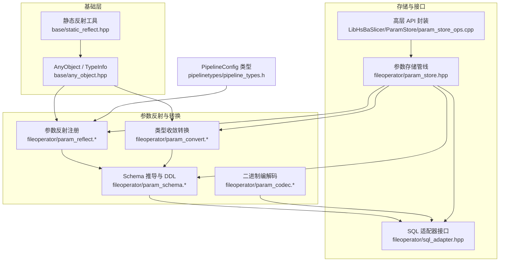
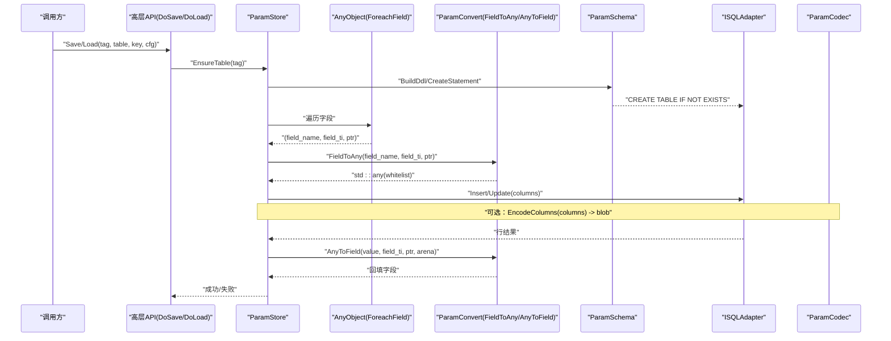
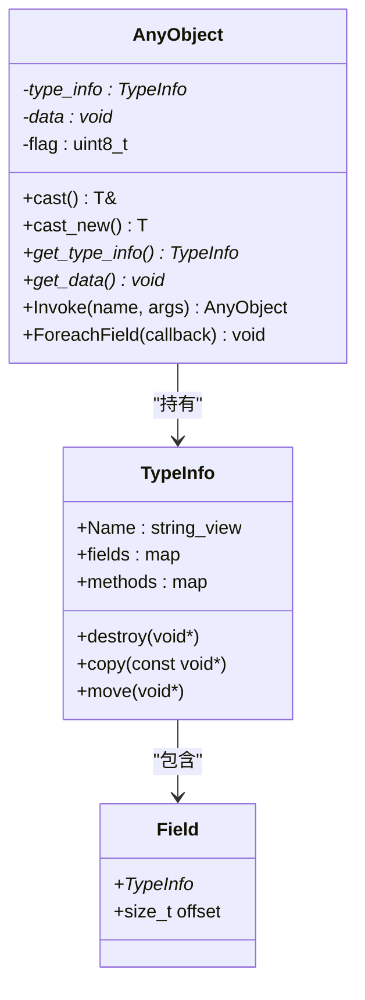
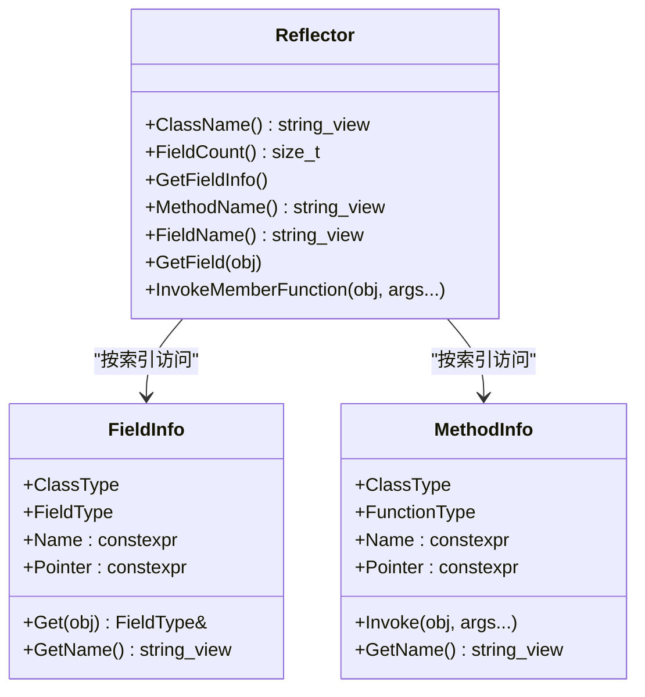
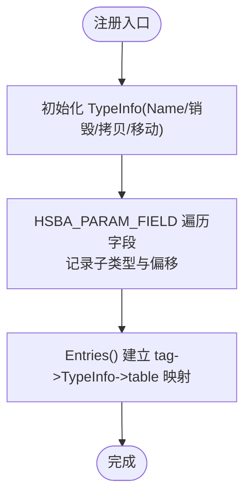
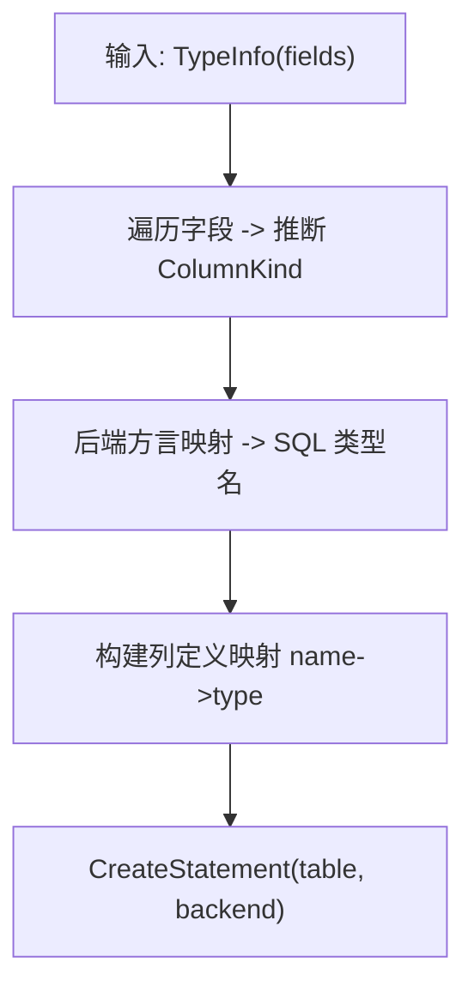
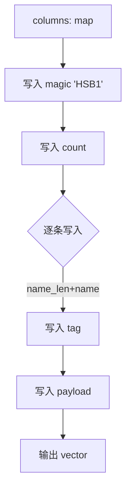
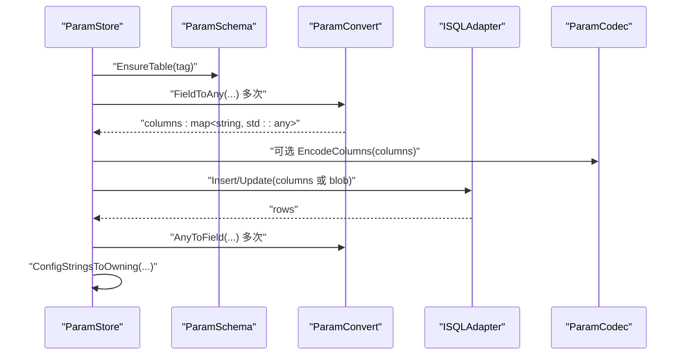
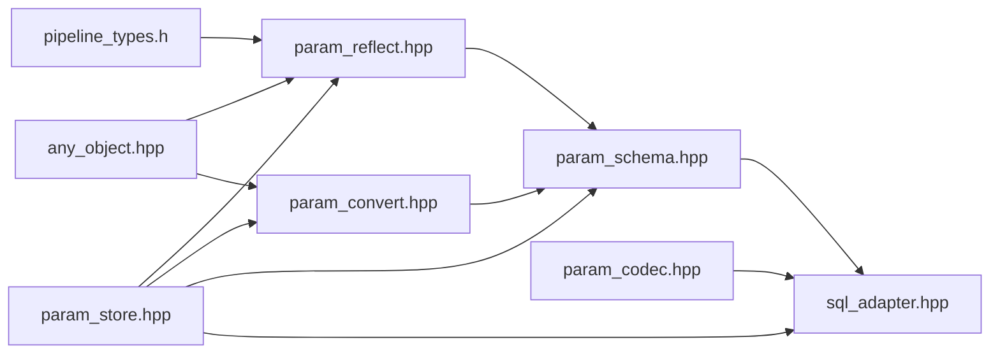

# 参数转换与反射（ParamConvert/ParamReflect）

<cite>
**本文引用的文件**   
- [param_convert.hpp](file://fileoperator/param_convert.hpp)
- [param_convert.cpp](file://fileoperator/param_convert.cpp)
- [param_reflect.hpp](file://fileoperator/param_reflect.hpp)
- [param_reflect.cpp](file://fileoperator/param_reflect.cpp)
- [any_object.hpp](file://base/any_object.hpp)
- [static_reflect.hpp](file://base/static_reflect.hpp)
- [sql_adapter.hpp](file://fileoperator/sql_adapter.hpp)
- [param_schema.hpp](file://fileoperator/param_schema.hpp)
- [param_schema.cpp](file://fileoperator/param_schema.cpp)
- [param_codec.hpp](file://fileoperator/param_codec.hpp)
- [param_codec.cpp](file://fileoperator/param_codec.cpp)
- [pipeline_types.h](file://pipelinetypes/pipeline_types.h)
- [param_store.hpp](file://fileoperator/param_store.hpp)
- [param_store_ops.cpp](file://LibHsBaSlicer/ParamStore/param_store_ops.cpp)
</cite>

## 目录
1. [引言](#引言)
2. [项目结构](#项目结构)
3. [核心组件](#核心组件)
4. [架构总览](#架构总览)
5. [详细组件分析](#详细组件分析)
6. [依赖关系分析](#依赖关系分析)
7. [性能与缓存](#性能与缓存)
8. [错误处理与恢复](#错误处理与恢复)
9. [使用示例与扩展指南](#使用示例与扩展指南)
10. [故障排除](#故障排除)
11. [结论](#结论)

## 引言
本文件系统性梳理 HsBaSlicer 中“参数转换与反射”子系统，重点围绕 ParamConvert 与 ParamReflect 的设计与实现，解释 C++ 结构体字段与数据库列之间的双向转换机制。文档涵盖静态反射基础、AnyObject 运行时反射、字段遍历算法、类型推断与收敛规则、Schema 推导与 DDL 生成、二进制编解码以及 ParamStore 的持久化流程。同时给出注册自定义类型、处理嵌套结构与复杂业务转换的实践建议，并总结性能优化、缓存策略与错误恢复要点。

## 项目结构
该子系统位于 fileoperator 与 base 两个主要区域：
- base：提供通用反射基础设施（AnyObject、TypeInfo、静态反射工具）。
- fileoperator：实现参数反射注册、类型收敛转换、Schema 推导、SQL 适配与参数存储管线。
- pipelinetypes：定义 PipelineConfig 结构体与枚举，作为反射与持久化的目标类型。
- LibHsBaSlicer：对外暴露 Save/Load 等高层 API，封装后端连接与错误收敛。



**图表来源**
- [any_object.hpp:48-115](file://base/any_object.hpp#L48-L115)
- [static_reflect.hpp:23-183](file://base/static_reflect.hpp#L23-L183)
- [param_reflect.hpp:28-48](file://fileoperator/param_reflect.hpp#L28-L48)
- [param_convert.hpp:21-66](file://fileoperator/param_convert.hpp#L21-L66)
- [param_schema.hpp:37-74](file://fileoperator/param_schema.hpp#L37-L74)
- [param_codec.hpp:1-35](file://fileoperator/param_codec.hpp#L1-L35)
- [sql_adapter.hpp:36-129](file://fileoperator/sql_adapter.hpp#L36-L129)
- [param_store.hpp:1-26](file://fileoperator/param_store.hpp#L1-L26)
- [param_store_ops.cpp:48-83](file://LibHsBaSlicer/ParamStore/param_store_ops.cpp#L48-L83)

**章节来源**
- [any_object.hpp:48-115](file://base/any_object.hpp#L48-L115)
- [param_reflect.hpp:28-48](file://fileoperator/param_reflect.hpp#L28-L48)
- [param_convert.hpp:21-66](file://fileoperator/param_convert.hpp#L21-L66)
- [param_schema.hpp:37-74](file://fileoperator/param_schema.hpp#L37-L74)
- [param_codec.hpp:1-35](file://fileoperator/param_codec.hpp#L1-L35)
- [sql_adapter.hpp:36-129](file://fileoperator/sql_adapter.hpp#L36-L129)
- [param_store.hpp:1-26](file://fileoperator/param_store.hpp#L1-L26)
- [param_store_ops.cpp:48-83](file://LibHsBaSlicer/ParamStore/param_store_ops.cpp#L48-L83)

## 核心组件
- AnyObject 与 TypeInfo：运行时类型信息容器，支持字段遍历 ForeachField 与方法调用 Invoke；提供 GetTypeInfo<T>() 单例。
- 静态反射工具：编译期 FieldInfo/MethodInfo 与 Reflector，用于模板元编程场景（非 ParamStore 主路径）。
- ParamReflect：为每个 PipelineConfig 结构体生成 TypeInfo，填充 fields 表（字段名 -> (子类型, 偏移)），并提供标签、默认表名等映射。
- ParamConvert：在 AnyObject 暴露的原始字段值与 ISQLAdapter 白名单类型之间做双向收敛（float/double->double，int/int64/enum->int64_t，const char*/std::string->string，nullptr 语义）。
- ParamSchema：根据 TypeInfo.fields 推导 ColumnKind，生成各后端 CREATE TABLE 语句与存在性检查。
- ParamCodec：将列名到 std::any 的映射序列化为自描述二进制流，供加密大对象列使用。
- ParamStore：组合上述能力，完成 Validate -> Reflect -> Coerce -> Upsert 的保存流程与反向加载流程。
- SQL 适配器：SQLite/MySQL/PostgreSQL 的统一抽象，接受 std::any 值进行 CRUD。

**章节来源**
- [any_object.hpp:48-115](file://base/any_object.hpp#L48-L115)
- [static_reflect.hpp:23-183](file://base/static_reflect.hpp#L23-L183)
- [param_reflect.hpp:28-48](file://fileoperator/param_reflect.hpp#L28-L48)
- [param_convert.hpp:21-66](file://fileoperator/param_convert.hpp#L21-L66)
- [param_schema.hpp:37-74](file://fileoperator/param_schema.hpp#L37-L74)
- [param_codec.hpp:1-35](file://fileoperator/param_codec.hpp#L1-L35)
- [param_store.hpp:1-26](file://fileoperator/param_store.hpp#L1-L26)
- [sql_adapter.hpp:36-129](file://fileoperator/sql_adapter.hpp#L36-L129)

## 架构总览
ParamStore 是参数持久化的编排者：它通过 AnyObject::ForeachField 遍历配置结构体的字段，借助 ParamReflect 提供的 TypeInfo 获取字段类型与偏移，再经 ParamConvert 将字段值收敛为 ISQLAdapter 可接受的 std::any 白名单类型；写入前由 ParamSchema 确保表结构存在；可选地通过 ParamCodec 将宽表列映射编码为二进制 blob 以支持加密。



**图表来源**
- [param_store.hpp:1-26](file://fileoperator/param_store.hpp#L1-L26)
- [param_reflect.hpp:28-48](file://fileoperator/param_reflect.hpp#L28-L48)
- [param_convert.hpp:21-66](file://fileoperator/param_convert.hpp#L21-L66)
- [param_schema.hpp:37-74](file://fileoperator/param_schema.hpp#L37-L74)
- [param_codec.hpp:1-35](file://fileoperator/param_codec.hpp#L1-L35)
- [sql_adapter.hpp:36-129](file://fileoperator/sql_adapter.hpp#L36-L129)

## 详细组件分析

### 运行时反射与字段遍历（AnyObject/TypeInfo）
- TypeInfo 持有 Name、destroy/copy/move 函数指针，以及 fields/methods 两张哈希表。
- AnyObject 包装任意类型实例，提供 cast/cast_new、get_type_info/get_data、Invoke、ForeachField。
- GetTypeInfo<T>() 返回每类型的唯一 TypeInfo 单例；对 std::string 等类型还注册了方法。



**图表来源**
- [any_object.hpp:48-115](file://base/any_object.hpp#L48-L115)
- [any_object.hpp:723-774](file://base/any_object.hpp#L723-L774)

**章节来源**
- [any_object.hpp:48-115](file://base/any_object.hpp#L48-L115)
- [any_object.hpp:723-774](file://base/any_object.hpp#L723-L774)

### 静态反射工具（编译期）
- FieldInfo/MethodInfo 以模板参数携带类类型、字段类型、字段名与成员指针，提供 Get/Invoke 访问器。
- Reflector 基于 Reflectable concept，按索引访问 FieldList/MethodList，支持按名称查找方法并调用。



**图表来源**
- [static_reflect.hpp:23-183](file://base/static_reflect.hpp#L23-L183)

**章节来源**
- [static_reflect.hpp:23-183](file://base/static_reflect.hpp#L23-L183)

### 参数反射注册（ParamReflect）
- 宏 HSBA_PARAM_FIELD 将结构体字段加入 TypeInfo.fields，记录子类型与字节偏移。
- 每个 PipelineConfig 结构体都有 inline GetTypeInfo<T>() 特化，初始化 destroy/copy/move 与 fields。
- param_reflect.cpp 维护 tag <-> TypeInfo <-> short_name <-> default_table 的集中映射，并提供 RegisterPipelineConfigTypes 强制初始化所有 TypeInfo。



**图表来源**
- [param_reflect.hpp:28-48](file://fileoperator/param_reflect.hpp#L28-L48)
- [param_reflect.cpp:28-90](file://fileoperator/param_reflect.cpp#L28-L90)

**章节来源**
- [param_reflect.hpp:28-48](file://fileoperator/param_reflect.hpp#L28-L48)
- [param_reflect.cpp:28-90](file://fileoperator/param_reflect.cpp#L28-L90)

### 类型收敛转换（ParamConvert）
- FieldToAny：读取 AnyObject 暴露的原始字段内存，按 TypeInfo 匹配类型，输出 ISQLAdapter 白名单 std::any：
  - float/double -> double
  - int/int64/enum -> int64_t
  - const char* -> string 或 nullptr
  - std::string -> string
- AnyToField：将查询结果回填到结构体字段，空 any/nullptr 视为 NULL，字符串字段分配 new[] 缓冲并由 StringArena 管理。
- IsEnumFieldType：维护受支持的 C 枚举 TypeInfo 列表，统一按 int64_t 存取。
- ConfigStringsToOwning/FreeConfigStrings：跨 C ABI 安全地将 const char* 转为 malloc 所有权并释放。

```mermaid
flowchart TD
A["FieldToAny(field_name, field_ti, ptr)"] --> B{"匹配 field_ti"}
B --> |float/double| C["double"]
B --> |int/int64/enum| D["int64_t"]
B --> |const char*| E["string 或 nullptr"]
B --> |std::string| F["string"]
B --> |不支持| G["抛出异常"]
H["AnyToField(value, field_ti, ptr, arena)"] --> I{"value 是否为空"}
I --> |是| J["按字段类型赋默认值/清空"]
I --> |否| K{"匹配 field_ti"}
K --> |double|int64_t|string|nullptr| L["写入目标字段"]
K --> |const char*| M["new[] 复制并放入 arena"]
K --> |不支持| N["抛出异常"]
```

**图表来源**
- [param_convert.hpp:21-66](file://fileoperator/param_convert.hpp#L21-L66)
- [param_convert.cpp:18-90](file://fileoperator/param_convert.cpp#L18-L90)
- [param_convert.cpp:93-208](file://fileoperator/param_convert.cpp#L93-L208)
- [param_convert.cpp:210-259](file://fileoperator/param_convert.cpp#L210-L259)

**章节来源**
- [param_convert.hpp:21-66](file://fileoperator/param_convert.hpp#L21-L66)
- [param_convert.cpp:18-90](file://fileoperator/param_convert.cpp#L18-L90)
- [param_convert.cpp:93-208](file://fileoperator/param_convert.cpp#L93-L208)
- [param_convert.cpp:210-259](file://fileoperator/param_convert.cpp#L210-L259)

### Schema 推导与 DDL 生成（ParamSchema）
- ColumnKind：Double/Int64/Text，用于选择列类型。
- BuildDdl/CreateStatement：根据 TypeInfo.fields 推导列类型，结合后端方言生成 CREATE TABLE 语句；支持 metadata 列与 blob 列。
- ExistenceCheck：生成探测表是否存在的查询。



**图表来源**
- [param_schema.hpp:37-74](file://fileoperator/param_schema.hpp#L37-L74)
- [param_schema.cpp:1-50](file://fileoperator/param_schema.cpp#L1-L50)

**章节来源**
- [param_schema.hpp:37-74](file://fileoperator/param_schema.hpp#L37-L74)
- [param_schema.cpp:1-50](file://fileoperator/param_schema.cpp#L1-L50)

### 二进制编解码（ParamCodec）
- EncodeColumns：将列名到 std::any 的映射编码为小端二进制流，带 magic 头与每值的 type tag（null/int64_t/double/string）。
- DecodeColumns：逆向重建列映射，校验 magic 与格式。



**图表来源**
- [param_codec.hpp:1-35](file://fileoperator/param_codec.hpp#L1-L35)
- [param_codec.cpp:1-56](file://fileoperator/param_codec.cpp#L1-L56)

**章节来源**
- [param_codec.hpp:1-35](file://fileoperator/param_codec.hpp#L1-L35)
- [param_codec.cpp:1-56](file://fileoperator/param_codec.cpp#L1-L56)

### 参数存储管线（ParamStore）
- EnsureTable：调用 ParamSchema 创建表。
- Save：遍历字段 -> FieldToAny -> 构造 columns -> Insert/Update；可选 EncodeColumns 写入 blob。
- Load：Select -> AnyToField 回填 -> ConfigStringsToOwning 转换 const char* 所有权。
- 批量操作使用事务包裹，失败时回滚并保留原始异常。



**图表来源**
- [param_store.hpp:1-26](file://fileoperator/param_store.hpp#L1-L26)
- [param_convert.cpp:210-259](file://fileoperator/param_convert.cpp#L210-L259)
- [param_codec.hpp:1-35](file://fileoperator/param_codec.hpp#L1-L35)

**章节来源**
- [param_store.hpp:1-26](file://fileoperator/param_store.hpp#L1-L26)
- [param_convert.cpp:210-259](file://fileoperator/param_convert.cpp#L210-L259)
- [param_codec.hpp:1-35](file://fileoperator/param_codec.hpp#L1-L35)

## 依赖关系分析
- ParamReflect 依赖 any_object.hpp 的 TypeInfo 与 GetTypeInfo<T>()，并引用 pipeline_types.h 中的 PipelineConfig 结构体。
- ParamConvert 依赖 any_object.hpp 与 sql_adapter.hpp 的错误类型，以及 pipeline_types.h 中的枚举类型。
- ParamSchema 依赖 param_convert.hpp 与 param_reflect.hpp，用于字段类型推断。
- ParamCodec 依赖 sql_adapter.hpp 的错误类型。
- ParamStore 组合以上模块，并通过 ISQLAdapter 与具体后端解耦。



**图表来源**
- [param_reflect.hpp:28-48](file://fileoperator/param_reflect.hpp#L28-L48)
- [param_convert.hpp:21-66](file://fileoperator/param_convert.hpp#L21-L66)
- [param_schema.hpp:37-74](file://fileoperator/param_schema.hpp#L37-L74)
- [param_codec.hpp:1-35](file://fileoperator/param_codec.hpp#L1-L35)
- [param_store.hpp:1-26](file://fileoperator/param_store.hpp#L1-L26)
- [sql_adapter.hpp:36-129](file://fileoperator/sql_adapter.hpp#L36-L129)
- [pipeline_types.h:979-1012](file://pipelinetypes/pipeline_types.h#L979-L1012)

**章节来源**
- [param_reflect.hpp:28-48](file://fileoperator/param_reflect.hpp#L28-L48)
- [param_convert.hpp:21-66](file://fileoperator/param_convert.hpp#L21-L66)
- [param_schema.hpp:37-74](file://fileoperator/param_schema.hpp#L37-L74)
- [param_codec.hpp:1-35](file://fileoperator/param_codec.hpp#L1-L35)
- [param_store.hpp:1-26](file://fileoperator/param_store.hpp#L1-L26)
- [sql_adapter.hpp:36-129](file://fileoperator/sql_adapter.hpp#L36-L129)
- [pipeline_types.h:979-1012](file://pipelinetypes/pipeline_types.h#L979-L1012)

## 性能与缓存
- TypeInfo 单例：GetTypeInfo<T>() 使用函数局部 static，避免重复构造；RegisterPipelineConfigTypes 通过 once_flag 保证一次性初始化所有 PipelineConfig 的 fields。
- EnumTypeInfos 表：静态数组缓存受支持的枚举 TypeInfo，减少重复判断开销。
- StringArena：AnyToField 为 const char* 字段分配 new[] 缓冲，集中管理生命周期，避免多次分配/释放。
- 事务批处理：ParamStore 批量 Save 使用事务，减少往返与锁竞争。
- 可选 Blob 编码：当启用加密时，使用 ParamCodec 将多列合并为单一 blob，降低列数过多带来的序列化与传输开销。

[本节为通用性能讨论，不直接分析具体文件]

## 错误处理与恢复
- 统一错误类型：ParamConvert 抛出 SQL::SQLAdapterInvalidArgumentError，指明字段名与方向（FieldToAny/AnyToField）。
- 空值语义：AnyToField 将 empty any 或 nullptr 视为 NULL，按字段类型赋予默认值或清空。
- 跨 ABI 安全：ConfigStringsToOwning 使用 std::malloc 复制 const char*，FreeConfigStrings 用 std::free 释放，避免 new[]/free 混用未定义行为。
- 事务回滚：ParamStore 批量 Save 捕获 SQLAdapterError，执行 rollback 后重新抛出原始异常，确保上层能感知真实错误。

**章节来源**
- [param_convert.cpp:35-40](file://fileoperator/param_convert.cpp#L35-L40)
- [param_convert.cpp:93-208](file://fileoperator/param_convert.cpp#L93-L208)
- [param_convert.cpp:210-259](file://fileoperator/param_convert.cpp#L210-L259)
- [param_store.cpp:300-336](file://fileoperator/param_store.cpp#L300-L336)

## 使用示例与扩展指南

### 注册新的 PipelineConfig 类型
- 在 param_reflect.hpp 中新增 GetTypeInfo<T>() 特化，使用 HSBA_PARAM_FIELD 逐一声明字段。
- 在 param_reflect.cpp 的 Entries() 中添加 tag、short_name、default_table 映射。
- 在 pipeline_types.h 中确保对应结构体与枚举已定义。

参考路径：
- [param_reflect.hpp:55-105](file://fileoperator/param_reflect.hpp#L55-L105)
- [param_reflect.cpp:28-68](file://fileoperator/param_reflect.cpp#L28-L68)
- [pipeline_types.h:979-1012](file://pipelinetypes/pipeline_types.h#L979-L1012)

### 处理嵌套结构
当前 ParamReflect 仅注册 POD/enum/const char* 字段；若需支持嵌套结构，可在 ParamConvert 中扩展 FieldToAny/AnyToField，递归遍历子对象的 fields，或将嵌套结构序列化为 JSON/二进制后再存入 TEXT/BLOB 列。

参考路径：
- [param_convert.cpp:53-90](file://fileoperator/param_convert.cpp#L53-L90)
- [param_convert.cpp:93-208](file://fileoperator/param_convert.cpp#L93-L208)

### 实现复杂的业务逻辑转换
- 在 ParamConvert 中增加自定义类型分支，例如将特定枚举范围映射为业务标志位。
- 在 ParamSchema 中为特殊字段指定 ColumnKind 与后端类型（如 TEXT 存储 JSON）。
- 在 ParamCodec 中扩展 tag 与 payload 格式以支持新类型。

参考路径：
- [param_convert.cpp:18-33](file://fileoperator/param_convert.cpp#L18-L33)
- [param_schema.hpp:37-74](file://fileoperator/param_schema.hpp#L37-L74)
- [param_codec.hpp:1-35](file://fileoperator/param_codec.hpp#L1-L35)

### 高层 API 使用
- DoSave/DoLoad 封装后端连接、表创建、加密密钥设置与错误收敛。
- 调用前需 RegisterPipelineConfigTypes() 以确保 TypeInfo 已初始化。

参考路径：
- [param_store_ops.cpp:48-83](file://LibHsBaSlicer/ParamStore/param_store_ops.cpp#L48-L83)
- [param_store_ops.cpp:85-120](file://LibHsBaSlicer/ParamStore/param_store_ops.cpp#L85-L120)

## 故障排除
- “unsupported field type for FieldToAny/AnyToField”：检查字段类型是否在 ParamConvert 支持列表中；如需新类型，请扩展 FieldToAny/AnyToField 分支。
- “config type not registered”：确认已调用 RegisterPipelineConfigTypes()，且目标结构体已在 param_reflect.hpp/.cpp 中注册。
- “not found: key”：Load 未命中键，检查 key 是否正确或数据是否已保存。
- 后端连接失败：DoSave/DoLoad 会返回 ParamStoreOutcome.error；检查 host/user/password/database/port 或 SQLite 路径。

**章节来源**
- [param_convert.cpp:35-40](file://fileoperator/param_convert.cpp#L35-L40)
- [param_store.cpp:328-336](file://fileoperator/param_store.cpp#L328-L336)
- [param_store_ops.cpp:48-83](file://LibHsBaSlicer/ParamStore/param_store_ops.cpp#L48-L83)
- [param_store_ops.cpp:85-120](file://LibHsBaSlicer/ParamStore/param_store_ops.cpp#L85-L120)

## 结论
ParamConvert 与 ParamReflect 共同构成了 HsBaSlicer 的参数反射与类型收敛桥接层：前者负责将 C++ 结构体字段与数据库列类型进行双向映射，后者负责为 PipelineConfig 结构体生成运行时 TypeInfo 并驱动字段遍历。配合 ParamSchema 与 ParamCodec，系统实现了从结构体到 SQL 表的自动推导与可选的二进制编码，ParamStore 则将这些能力编排成健壮的持久化管线。通过合理的缓存、事务与错误处理策略，系统在可扩展性与性能之间取得了良好平衡。