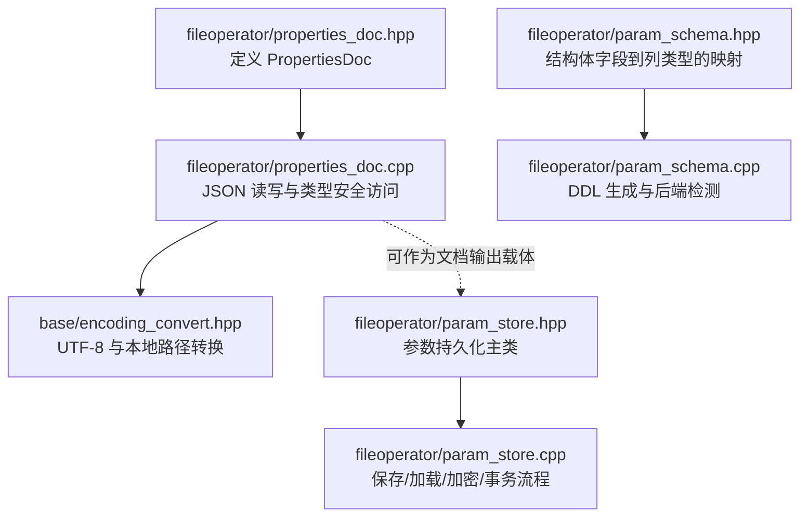
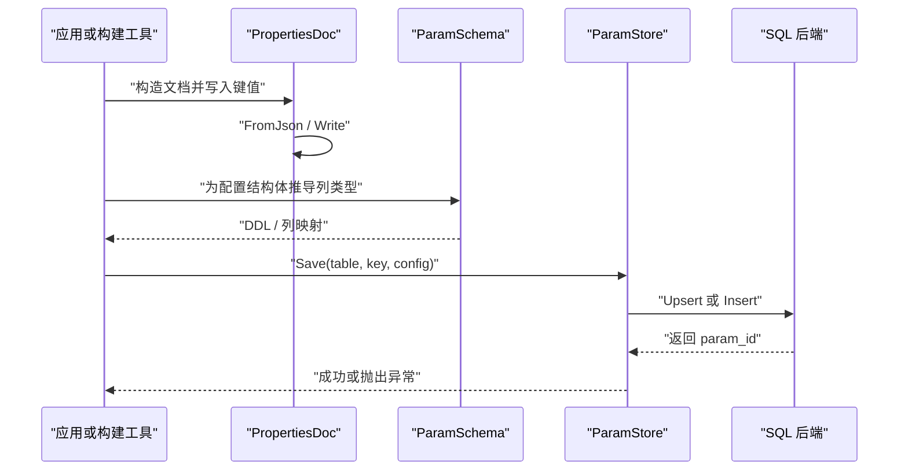
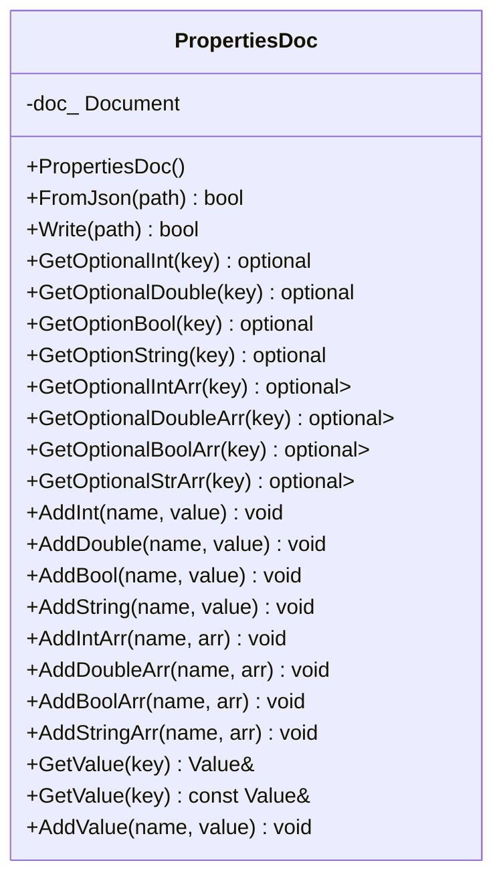
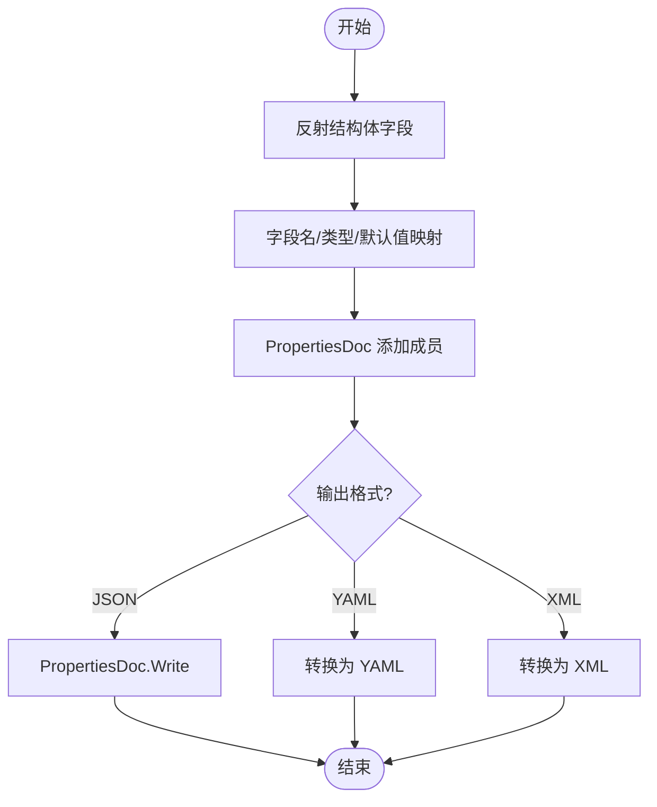
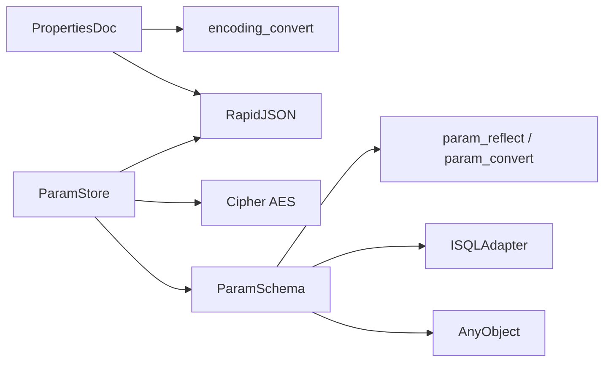
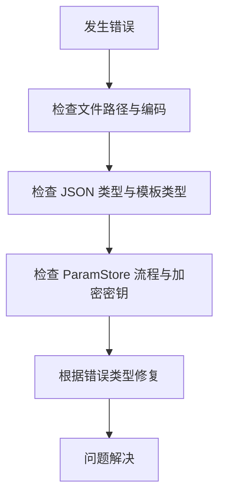

# 属性文档生成 (PropertiesDoc)

<cite>
**本文引用的文件**   
- [fileoperator/properties_doc.hpp](file://fileoperator/properties_doc.hpp)
- [fileoperator/properties_doc.cpp](file://fileoperator/properties_doc.cpp)
- [base/encoding_convert.hpp](file://base/encoding_convert.hpp)
- [fileoperator/param_schema.hpp](file://fileoperator/param_schema.hpp)
- [fileoperator/param_schema.cpp](file://fileoperator/param_schema.cpp)
- [fileoperator/param_store.hpp](file://fileoperator/param_store.hpp)
- [fileoperator/param_store.cpp](file://fileoperator/param_store.cpp)
</cite>

## 目录
1. [引言](#引言)
2. [项目结构定位](#项目结构定位)
3. [核心组件总览](#核心组件总览)
4. [架构与数据流](#架构与数据流)
5. [PropertiesDoc 详细分析](#propertiesdoc-详细分析)
6. [配置结构体到文档的生成方案](#配置结构体到文档的生成方案)
7. [模板、多语言与版本管理](#模板多语言与版本管理)
8. [依赖关系分析](#依赖关系分析)
9. [性能与扩展建议](#性能与扩展建议)
10. [故障排除](#故障排除)
11. [结论](#结论)

## 引言
本技术文档围绕 `PropertiesDoc` 展开，目标是说明它如何作为轻量级 JSON 配置文档载体，配合反射、Schema 和持久化层，形成从“配置结构体”到“可读写文档/配置文件”的完整链路。需要明确的是：当前仓库中的 `PropertiesDoc` 本身是一个基于 RapidJSON 的 JSON 文档容器，并不直接实现“从 C++ 结构体自动抽取字段描述并生成 YAML/XML 文档”的功能；但它可以作为该流程的输出载体或中间格式。真正的“结构体元信息 + 类型推导 + 持久化”能力由 `ParamSchema` 与 `ParamStore` 提供。因此，本文在解释 `PropertiesDoc` 的同时，也会把与之配套的 Schema 与存储机制纳入整体设计，以便读者理解如何在现有代码基础上扩展出完整的“属性文档生成器”。

## 项目结构定位
`PropertiesDoc` 位于 `fileoperator` 模块中，负责 JSON 文档的加载、写入和键值访问；它与编码转换、RapidJSON、以及更上层的参数 Schema/存储系统共同构成配置处理基础设施。

**图表来源**
- [fileoperator/properties_doc.hpp:32-277](file://fileoperator/properties_doc.hpp#L32-L277)
- [fileoperator/properties_doc.cpp:13-30](file://fileoperator/properties_doc.cpp#L13-L30)
- [fileoperator/param_schema.hpp:60-100](file://fileoperator/param_schema.hpp#L60-L100)
- [fileoperator/param_schema.cpp:87-150](file://fileoperator/param_schema.cpp#L87-L150)
- [fileoperator/param_store.hpp:33-121](file://fileoperator/param_store.hpp#L33-L121)
- [fileoperator/param_store.cpp:187-279](file://fileoperator/param_store.cpp#L187-L279)

**章节来源**
- [fileoperator/properties_doc.hpp:1-280](file://fileoperator/properties_doc.hpp#L1-L280)
- [fileoperator/properties_doc.cpp:1-300](file://fileoperator/properties_doc.cpp#L1-L300)

## 核心组件总览
- `PropertiesDoc`：轻量 JSON 文档容器，支持基础类型、数组、模板化读写、原始 `rapidjson::Value` 暴露。
- `ParamSchema`：根据注册的结构体元信息（`TypeInfo`）推导列类型，生成 SQL DDL，并提供后端检测。
- `ParamStore`：面向 PipelineConfig 的参数持久化入口，封装 Validate -> Reflect -> Coerce -> Upsert 流程，支持批量事务、进度回调、迁移钩子、可选 AES 加密。
- `base/encoding_convert.hpp`：提供 UTF-8 与本地路径之间的转换，用于跨平台文件路径处理。

这些组件的职责边界清晰：`PropertiesDoc` 专注 JSON 文档；`ParamSchema` 专注结构体元信息到数据库列的映射；`ParamStore` 专注业务配置对象的持久化生命周期。

**章节来源**
- [fileoperator/properties_doc.hpp:23-277](file://fileoperator/properties_doc.hpp#L23-L277)
- [fileoperator/param_schema.hpp:27-100](file://fileoperator/param_schema.hpp#L27-L100)
- [fileoperator/param_store.hpp:28-121](file://fileoperator/param_store.hpp#L28-L121)

## 架构与数据流
下图展示“配置结构体 -> 文档/配置 -> 持久化”的整体数据流。`PropertiesDoc` 可以作为文档生成器的输出目标；而 `ParamStore` 则负责将结构体实例持久化为数据库行。

**图表来源**
- [fileoperator/properties_doc.cpp:13-30](file://fileoperator/properties_doc.cpp#L13-L30)
- [fileoperator/param_schema.cpp:105-150](file://fileoperator/param_schema.cpp#L105-L150)
- [fileoperator/param_store.cpp:187-279](file://fileoperator/param_store.cpp#L187-L279)

## PropertiesDoc 详细分析
`PropertiesDoc` 的核心价值是提供一个类型安全的 JSON 文档访问接口。它内部维护一个 `rapidjson::Document`，对外暴露：
- 从 JSON 文件加载：`FromJson`
- 写入 JSON 文件：`Write`
- 按 key 获取可选的基础类型值：`GetOptionalInt`、`GetOptionalDouble`、`GetOptionBool`、`GetOptionString`
- 按 key 获取可选数组：`GetOptionalIntArr`、`GetOptionalDoubleArr`、`GetOptionalBoolArr`、`GetOptionalStrArr`
- 添加成员：`AddInt`、`AddDouble`、`AddBool`、`AddString`
- 添加数组：`AddIntArr`、`AddDoubleArr`、`AddBoolArr`、`AddStringArr`
- 模板化通用访问：`GetOptionValue<T>`、`AddMember<T>`、`AddMemberArr<T>`
- 直接暴露底层 `rapidjson::Value`：`GetValue`、`AddValue`

### 关键行为与复杂度
- 读取单个字段：O(1) 查找 + O(1) 类型检查。
- 读取数组字段：O(n)，n 为数组长度。
- 写入单个字段：O(1)。
- 写入数组字段：O(n)。
- 文件 I/O：取决于文件大小和磁盘性能。

**图表来源**
- [fileoperator/properties_doc.hpp:32-277](file://fileoperator/properties_doc.hpp#L32-L277)

**章节来源**
- [fileoperator/properties_doc.hpp:32-277](file://fileoperator/properties_doc.hpp#L32-L277)
- [fileoperator/properties_doc.cpp:13-300](file://fileoperator/properties_doc.cpp#L13-L300)

## 配置结构体到文档的生成方案
当前仓库没有名为“自动生成文档生成器”的独立类；但可以通过组合现有组件实现该目标。推荐方案如下：

1. **使用反射获取结构体字段元信息**  
   通过 `Utils::TypeInfo` 与 `AnyObject` 遍历结构体字段，得到字段名、类型、默认值等元信息。这一步对应 `ParamSchema` 的设计思路。

2. **将结构体字段映射为文档字段**  
   对每个字段调用 `PropertiesDoc::AddMember<T>` 或对应的 `AddXxx` 方法，生成 JSON 文档。若需要数组字段，使用 `AddMemberArr<T>` 或 `AddXxxArr`。

3. **输出文档**  
   调用 `PropertiesDoc::Write` 输出 JSON 文件。如果需要其他格式，可在该步骤前增加格式转换器。

4. **结合 ParamStore 做持久化**  
   如果希望同时生成数据库表结构和数据，可使用 `ParamSchema::forConfig` 推导列类型，并通过 `ParamStore::Save` 持久化。

[此图为概念流程，不直接映射具体源码，故无图表来源]

**章节来源**
- [fileoperator/param_schema.hpp:60-100](file://fileoperator/param_schema.hpp#L60-L100)
- [fileoperator/param_schema.cpp:105-150](file://fileoperator/param_schema.cpp#L105-L150)
- [fileoperator/properties_doc.hpp:194-252](file://fileoperator/properties_doc.hpp#L194-L252)
- [fileoperator/properties_doc.cpp:196-283](file://fileoperator/properties_doc.cpp#L196-L283)

## 模板、多语言与版本管理
### 模板引擎
当前 `PropertiesDoc` 不提供模板引擎。若需要为不同受众生成不同样式的文档，建议在“输出阶段”引入模板：
- 输入：`PropertiesDoc` 生成的结构化数据或 `ParamSchema` 导出的字段元信息。
- 模板：Markdown、HTML、PDF 模板等。
- 渲染：在构建脚本或文档生成工具中完成。

### 多语言支持与国际化
- 字段描述建议使用独立的国际化资源文件（如 JSON/YAML），键为字段名，值为多语言字符串。
- 生成文档时，根据当前语言加载对应资源，填充到模板中。
- 对于文件名、路径等本地化敏感内容，应使用 `utf8_to_local` 进行路径转换，避免跨平台问题。

### 文档版本管理
- 文档版本可与配置版本解耦，也可与 `schema_version` 关联。
- 建议在文档头部记录：文档版本、生成时间、对应配置结构体版本、后端类型（SQLite/MySQL/PostgreSQL）。
- 当结构体字段变更时，更新 `ParamSchema` 推导结果，并同步更新文档版本。

**章节来源**
- [fileoperator/properties_doc.cpp:13-30](file://fileoperator/properties_doc.cpp#L13-L30)
- [fileoperator/param_store.cpp:23-36](file://fileoperator/param_store.cpp#L23-L36)

## 依赖关系分析
`PropertiesDoc` 的直接依赖包括：
- `rapidjson`：JSON 解析与序列化。
- `base/encoding_convert.hpp`：UTF-8 与本地路径转换。
- C++ 标准库：`std::optional`、`std::list`、`std::string_view`、`std::fstream` 等。

`ParamSchema` 与 `ParamStore` 则进一步依赖：
- `base/any_object.hpp`：结构体反射与字段遍历。
- `sql_adapter.hpp`：SQL 后端抽象。
- `cipher/encrypt.hpp`：AES 加密（可选）。
- `param_reflect.hpp`、`param_convert.hpp`、`param_codec.hpp`：字段反射、类型转换、编解码。

**图表来源**
- [fileoperator/properties_doc.cpp:7-9](file://fileoperator/properties_doc.cpp#L7-L9)
- [fileoperator/param_schema.hpp:24-25](file://fileoperator/param_schema.hpp#L24-L25)
- [fileoperator/param_store.cpp:12-17](file://fileoperator/param_store.cpp#L12-L17)

**章节来源**
- [fileoperator/properties_doc.cpp:7-9](file://fileoperator/properties_doc.cpp#L7-L9)
- [fileoperator/param_schema.hpp:24-25](file://fileoperator/param_schema.hpp#L24-L25)
- [fileoperator/param_store.cpp:12-17](file://fileoperator/param_store.cpp#L12-L17)

## 性能与扩展建议
### 性能特性
- JSON 解析与序列化由 RapidJSON 提供，性能较高。
- 数组操作为线性复杂度，适合中等规模配置。
- 文件 I/O 受磁盘性能影响，建议批量写入时使用缓冲策略。

### 扩展建议
- 增加更多基础类型支持：例如枚举、时间戳、UUID。
- 增加验证规则：最小值、最大值、正则表达式、必填项。
- 增加模板输出：Markdown、HTML、PDF。
- 增加多语言字段描述：通过外部资源文件注入。
- 增加文档版本：与 `schema_version` 联动。

**章节来源**
- [fileoperator/properties_doc.cpp:88-194](file://fileoperator/properties_doc.cpp#L88-L194)
- [fileoperator/param_store.cpp:187-279](file://fileoperator/param_store.cpp#L187-L279)

## 故障排除
### 常见问题
1. **JSON 解析失败**  
   - 检查文件路径是否正确，是否包含非法字符。
   - 确认 JSON 格式合法。
   - 参考 `FromJson` 的实现逻辑。

2. **类型不匹配**  
   - 使用 `GetOptionValue<T>` 或对应类型访问方法时，确保 JSON 中的类型与模板类型一致。
   - 若类型不匹配，返回 `std::nullopt`。

3. **路径编码问题**  
   - 使用 `utf8_to_local` 转换路径，避免跨平台路径编码问题。

4. **持久化失败**  
   - 检查 `ParamStore::Save` 的流程：Validate -> Reflect -> Coerce -> Upsert。
   - 查看 `last_error_` 获取最近错误消息。
   - 若启用加密，确保密钥正确设置。

**图表来源**
- [fileoperator/properties_doc.cpp:13-30](file://fileoperator/properties_doc.cpp#L13-L30)
- [fileoperator/param_store.cpp:102-122](file://fileoperator/param_store.cpp#L102-L122)

**章节来源**
- [fileoperator/properties_doc.cpp:13-30](file://fileoperator/properties_doc.cpp#L13-L30)
- [fileoperator/param_store.cpp:102-122](file://fileoperator/param_store.cpp#L102-L122)

## 结论
`PropertiesDoc` 是一个轻量、类型安全的 JSON 文档容器，适合作为配置文档的中间表示或最终输出格式。结合 `ParamSchema` 的结构体元信息推导能力和 `ParamStore` 的持久化流程，可以构建完整的“属性文档生成器”。虽然当前仓库未提供直接的 YAML/XML 模板引擎和多语言文档生成功能，但这些能力可以在现有组件之上扩展实现。建议在实际项目中：
- 使用 `PropertiesDoc` 生成 JSON 文档。
- 使用 `ParamSchema` 推导字段类型和 DDL。
- 使用 `ParamStore` 持久化配置数据。
- 在输出阶段引入模板引擎、多语言资源和版本管理。