# 数据库适配器 (SQLAdapter)

<cite>
**本文引用的文件**   
- [sql_adapter.hpp](file://fileoperator/sql_adapter.hpp)
- [sql_adapter.cpp](file://fileoperator/sql_adapter.cpp)
- [param_schema.hpp](file://fileoperator\param_schema.hpp)
- [param_schema.cpp](file://fileoperator\param_schema.cpp)
- [pipeline_types.h](file://pipelinetypes\pipeline_types.h)
- [param_store_ops.hpp](file://LibHsBaSlicer/ParamStore\param_store_ops.hpp)
</cite>

## 目录
1. [引言](#引言)
2. [项目结构](#项目结构)
3. [核心概念与接口设计](#核心概念与接口设计)
4. [架构总览](#架构总览)
5. [详细组件分析](#详细组件分析)
6. [依赖关系分析](#依赖关系分析)
7. [连接、查询与事务处理](#连接查询与事务处理)
8. [参数绑定与结果集模型](#参数绑定与结果集模型)
9. [错误处理机制](#错误处理机制)
10. [性能与连接池建议](#性能与连接池建议)
11. [数据库迁移与最佳实践](#数据库迁移与最佳实践)
12. [使用示例与调用流程](#使用示例与调用流程)
13. [故障排除](#故障排除)
14. [结论](#结论)

## 引言
本文件面向需要理解和使用 HsBaSlicer 中 SQLAdapter 数据库适配器的开发者。文档围绕 ISQLAdapter 抽象接口，系统说明 SQLite、MySQL、PostgreSQL 三种后端实现的设计思路、连接管理、查询执行、参数绑定、结果集模型、错误处理、以及 Backend 枚举和连接参数的使用方式。同时给出架构图、类图、时序图和流程图，帮助读者从高层到代码层逐步掌握该模块。

## 项目结构
SQLAdapter 相关代码集中在 `fileoperator` 目录中：
- `sql_adapter.hpp`：定义 ISQLAdapter 抽象接口、SQLite/MySQL/PostgreSQL 适配器类声明、管道操作符、SQL 操作结构体、异常类型。
- `sql_adapter.cpp`：实现三种后端的具体逻辑，包括连接、执行、查询、CRUD、建表、删表等。
- `param_schema.hpp` / `param_schema.cpp`：提供 Backend 枚举、列类型映射、DDL 生成、后端检测等能力，用于参数存储的跨后端兼容。
- `pipelinetypes/pipeline_types.h`：暴露 C API 的连接结构体，包含后端选择器和连接字段。
- `LibHsBaSlicer/ParamStore/param_store_ops.hpp`：C++ 侧 ParamStore 连接参数结构体，与 C API 对应。

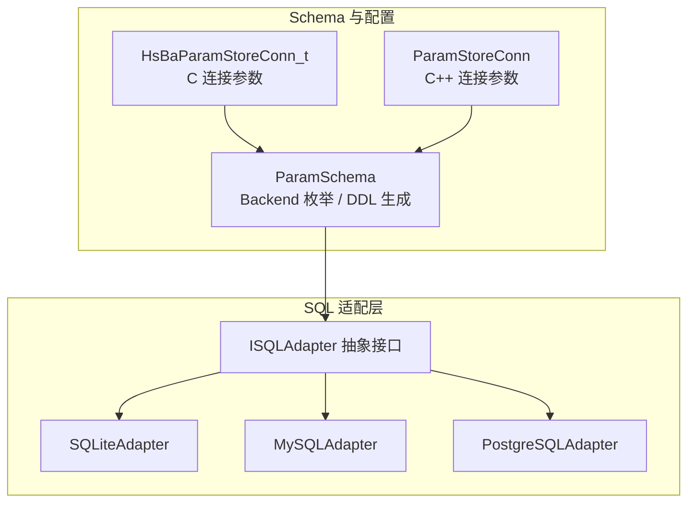

**图表来源**
- [sql_adapter.hpp:36-129](file://fileoperator/sql_adapter.hpp#L36-L129)
- [param_schema.hpp:29-35](file://fileoperator\param_schema.hpp#L29-L35)
- [pipeline_types.h:1009-1031](file://pipelinetypes\pipeline_types.h#L1009-L1031)
- [param_store_ops.hpp:39-57](file://LibHsBaSlicer/ParamStore\param_store_ops.hpp#L39-L57)

**章节来源**
- [sql_adapter.hpp:1-610](file://fileoperator/sql_adapter.hpp#L1-L610)
- [sql_adapter.cpp:1-2191](file://fileoperator/sql_adapter.cpp#L1-L2191)
- [param_schema.hpp:1-103](file://fileoperator\param_schema.hpp#L1-L103)
- [param_schema.cpp:45-234](file://fileoperator\param_schema.cpp#L45-L234)
- [pipeline_types.h:1009-1031](file://pipelinetypes\pipeline_types.h#L1009-L1031)
- [param_store_ops.hpp:39-76](file://LibHsBaSlicer/ParamStore\param_store_ops.hpp#L39-L76)

## 核心概念与接口设计
ISQLAdapter 是统一的 SQL 数据库适配器抽象接口，屏蔽 SQLite、MySQL、PostgreSQL 的差异，对外暴露一致的 CRUD 与查询 API。其核心设计要点如下：
- 统一结果集模型：Rows 类型为“行向量”，每行是一个“列名到 std::any”的无序映射，便于跨后端统一消费。
- 统一连接语义：Connect 方法支持服务器端数据库（host/user/password/database/port），SQLite 重载为文件路径或兼容接口。
- 统一 CRUD 语义：Insert/Delete/Update/Select/CreateTable/RemoveTable 提供一致的方法签名。
- 线程安全：每个适配器内部通过 shared_mutex 保护关键路径，避免并发访问底层句柄。
- 事件通知：适配器继承 EventSource，在连接、执行、查询等操作后触发事件，便于日志、监控或调试。
- 管道操作符：提供 operator| 与 SQLSelect/SQLInsert/SQLDelete/SQLUpdate/SQLCreateTable/SQLRemoveTable 结构体，支持链式风格调用。

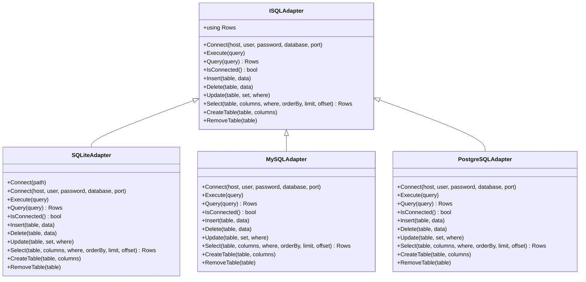

**图表来源**
- [sql_adapter.hpp:36-129](file://fileoperator/sql_adapter.hpp#L36-L129)
- [sql_adapter.hpp:216-328](file://fileoperator/sql_adapter.hpp#L216-L328)

**章节来源**
- [sql_adapter.hpp:36-129](file://fileoperator/sql_adapter.hpp#L36-L129)
- [sql_adapter.hpp:216-328](file://fileoperator/sql_adapter.hpp#L216-L328)

## 架构总览
SQLAdapter 采用“接口 + 多后端实现”的适配器模式，并通过 PIMPL 隐藏具体数据库句柄细节。Schema 层根据 Backend 枚举生成不同方言的 DDL，ParamStore 通过 ISQLAdapter 进行数据持久化。

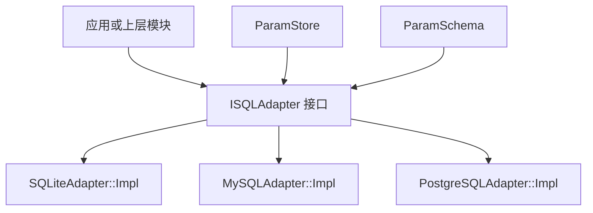

**图表来源**
- [sql_adapter.cpp:42-142](file://fileoperator/sql_adapter.cpp#L42-L142)
- [sql_adapter.cpp:734-844](file://fileoperator/sql_adapter.cpp#L734-L844)
- [sql_adapter.cpp:1649-1761](file://fileoperator/sql_adapter.cpp#L1649-L1761)
- [param_schema.hpp:54-76](file://fileoperator\param_schema.hpp#L54-L76)

## 详细组件分析

### ISQLAdapter 抽象接口
- 职责：定义统一的数据库连接、执行、查询、CRUD、建表、删表接口。
- 结果集：Rows 为 vector<unordered_map<string, any>>，键为列名，值为任意类型，但实现中通常限制为 nullptr/int64_t/double/string/vector<unsigned char>。
- 线程安全：子类通过 shared_mutex 保护关键路径。
- 事件：通过 EventSource 触发连接、执行、查询等事件。

**章节来源**
- [sql_adapter.hpp:36-129](file://fileoperator/sql_adapter.hpp#L36-L129)

### SQLiteAdapter
- 特点：
  - 支持文件路径 Connect(path) 与接口兼容 Connect(host,user,password,database,port)。
  - 所有写操作均使用 sqlite3_prepare_v2 + 参数绑定，防止 SQL 注入。
  - 读操作将整数归一化为 int64_t，字符串、浮点、BLOB 分别映射到 string/double/vector<unsigned char>。
  - 使用 shared_mutex 保护并发访问。
- 关键行为：
  - Execute：非返回语句执行。
  - Query：SELECT 语句执行并返回 Rows。
  - Insert/Delete/Update：动态构建 SQL，按列顺序绑定参数。
  - Select：支持 WHERE、ORDER BY、LIMIT/OFFSET。
  - CreateTable/RemoveTable：DDL 执行。

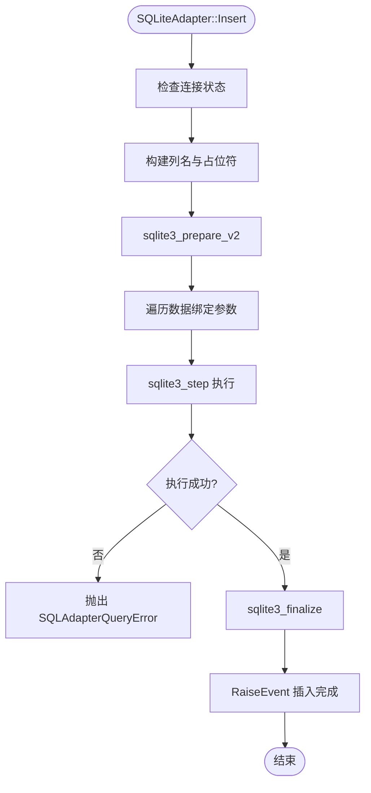

**图表来源**
- [sql_adapter.cpp:191-278](file://fileoperator/sql_adapter.cpp#L191-L278)

**章节来源**
- [sql_adapter.cpp:42-142](file://fileoperator/sql_adapter.cpp#L42-L142)
- [sql_adapter.cpp:149-189](file://fileoperator/sql_adapter.cpp#L149-L189)
- [sql_adapter.cpp:191-278](file://fileoperator/sql_adapter.cpp#L191-L278)
- [sql_adapter.cpp:285-369](file://fileoperator/sql_adapter.cpp#L285-L369)
- [sql_adapter.cpp:371-489](file://fileoperator/sql_adapter.cpp#L371-L489)
- [sql_adapter.cpp:491-665](file://fileoperator/sql_adapter.cpp#L491-L665)
- [sql_adapter.cpp:667-731](file://fileoperator/sql_adapter.cpp#L667-L731)

### MySQLAdapter
- 特点：
  - 使用 mysql_real_connect 建立连接。
  - 写操作使用 MYSQL_STMT 预处理 + MYSQL_BIND 参数绑定。
  - 读操作使用 mysql_stmt_store_result + mysql_stmt_bind_result 读取结果。
  - 支持 LIMIT/OFFSET 分页。
- 关键行为：
  - Connect：初始化连接，失败抛 SQLAdapterConnectionError。
  - Execute/Query：执行非查询与查询语句。
  - Insert/Delete/Update：构建 SQL，绑定参数，执行。
  - Select：构建 SQL，绑定 WHERE 参数，读取元数据与结果。
  - CreateTable/RemoveTable：DDL 执行。

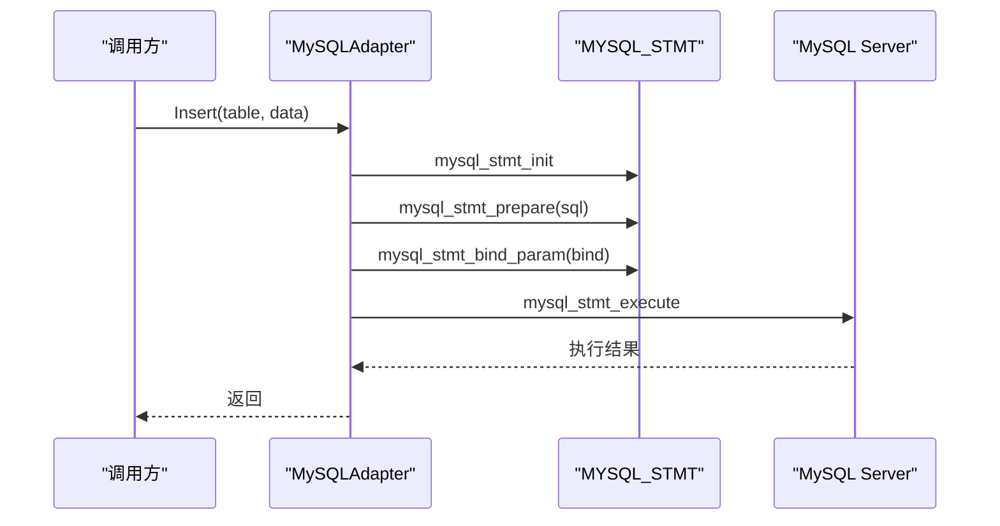

**图表来源**
- [sql_adapter.cpp:880-1016](file://fileoperator/sql_adapter.cpp#L880-L1016)

**章节来源**
- [sql_adapter.cpp:734-844](file://fileoperator/sql_adapter.cpp#L734-L844)
- [sql_adapter.cpp:849-878](file://fileoperator/sql_adapter.cpp#L849-L878)
- [sql_adapter.cpp:880-1016](file://fileoperator/sql_adapter.cpp#L880-L1016)
- [sql_adapter.cpp:1018-1138](file://fileoperator/sql_adapter.cpp#L1018-L1138)
- [sql_adapter.cpp:1140-1297](file://fileoperator/sql_adapter.cpp#L1140-L1297)
- [sql_adapter.cpp:1299-1590](file://fileoperator/sql_adapter.cpp#L1299-L1590)
- [sql_adapter.cpp:1591-1645](file://fileoperator/sql_adapter.cpp#L1591-L1645)

### PostgreSQLAdapter
- 特点：
  - 使用 libpq PQsetdbLogin 建立连接。
  - 写操作直接拼接 SQL 并使用 to_pg_literal 转义值。
  - 读操作使用 PQexec 获取结果，按 OID 映射字段类型。
- 关键行为：
  - Connect：连接失败抛 SQLAdapterConnectionError。
  - Execute/Query：执行非查询与查询语句。
  - Insert/Delete/Update：拼接 SQL，转义参数，执行。
  - Select：拼接 SQL，解析结果集，映射类型。
  - CreateTable/RemoveTable：DDL 执行。

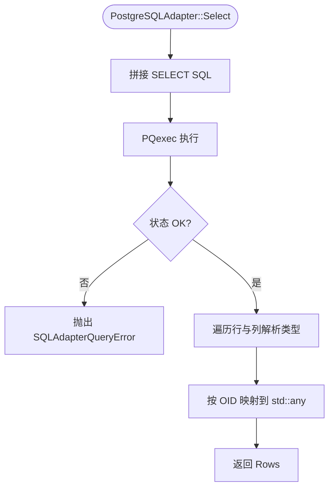

**图表来源**
- [sql_adapter.cpp:1989-2129](file://fileoperator/sql_adapter.cpp#L1989-L2129)

**章节来源**
- [sql_adapter.cpp:1649-1761](file://fileoperator/sql_adapter.cpp#L1649-L1761)
- [sql_adapter.cpp:1766-1794](file://fileoperator/sql_adapter.cpp#L1766-L1794)
- [sql_adapter.cpp:1797-1851](file://fileoperator/sql_adapter.cpp#L1797-L1851)
- [sql_adapter.cpp:1853-1893](file://fileoperator/sql_adapter.cpp#L1853-L1893)
- [sql_adapter.cpp:1894-1931](file://fileoperator/sql_adapter.cpp#L1894-L1931)
- [sql_adapter.cpp:1932-1988](file://fileoperator/sql_adapter.cpp#L1932-L1988)
- [sql_adapter.cpp:1989-2129](file://fileoperator/sql_adapter.cpp#L1989-L2129)
- [sql_adapter.cpp:2130-2189](file://fileoperator/sql_adapter.cpp#L2130-L2189)

## 依赖关系分析
- ISQLAdapter 被 ParamSchema 用于后端检测与 DDL 生成。
- ParamStore 通过 ISQLAdapter 进行参数持久化。
- C API 与 C++ API 的连接结构体分别封装后端选择器与连接参数。

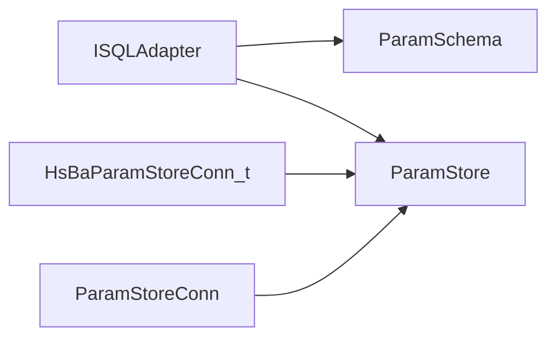

**图表来源**
- [param_schema.hpp:54-76](file://fileoperator\param_schema.hpp#L54-L76)
- [param_schema.cpp:213-234](file://fileoperator\param_schema.cpp#L213-L234)
- [pipeline_types.h:1009-1031](file://pipelinetypes\pipeline_types.h#L1009-L1031)
- [param_store_ops.hpp:39-76](file://LibHsBaSlicer/ParamStore\param_store_ops.hpp#L39-L76)

**章节来源**
- [param_schema.hpp:54-76](file://fileoperator\param_schema.hpp#L54-L76)
- [param_schema.cpp:213-234](file://fileoperator\param_schema.cpp#L213-L234)
- [pipeline_types.h:1009-1031](file://pipelinetypes\pipeline_types.h#L1009-L1031)
- [param_store_ops.hpp:39-76](file://LibHsBaSlicer/ParamStore\param_store_ops.hpp#L39-L76)

## 连接、查询与事务处理
- 连接管理：
  - SQLite：Connect(path) 打开文件；Connect(host,user,password,database,port) 兼容接口。
  - MySQL：Connect(host,user,password,database,port) 使用 mysql_real_connect。
  - PostgreSQL：Connect(host,user,password,database,port) 使用 PQsetdbLogin。
- 查询执行：
  - Execute：执行非返回语句。
  - Query：执行 SELECT 并返回 Rows。
- 事务处理：
  - 当前适配器未提供显式事务 API；如需事务，可在上层封装 BEGIN/COMMIT/ROLLBACK 语句，或使用数据库原生事务控制。

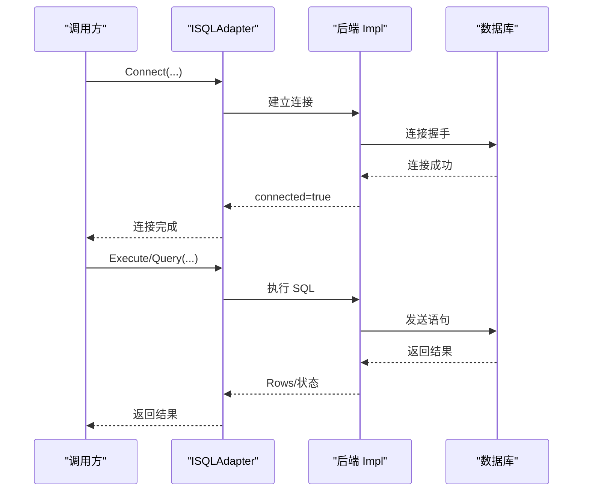

**图表来源**
- [sql_adapter.cpp:58-69](file://fileoperator/sql_adapter.cpp#L58-L69)
- [sql_adapter.cpp:749-770](file://fileoperator/sql_adapter.cpp#L749-L770)
- [sql_adapter.cpp:1664-1680](file://fileoperator/sql_adapter.cpp#L1664-L1680)

**章节来源**
- [sql_adapter.cpp:58-69](file://fileoperator/sql_adapter.cpp#L58-L69)
- [sql_adapter.cpp:749-770](file://fileoperator/sql_adapter.cpp#L749-L770)
- [sql_adapter.cpp:1664-1680](file://fileoperator/sql_adapter.cpp#L1664-L1680)

## 参数绑定与结果集模型
- 参数绑定：
  - SQLite：sqlite3_bind_int64/double/text/blob/null。
  - MySQL：MYSQL_BIND 数组，按类型设置 buffer_type/buffer/length/is_null。
  - PostgreSQL：to_pg_literal 将 std::any 转为 SQL 字面量。
- 结果集模型：
  - Rows：vector<unordered_map<string, any>>。
  - 类型映射：
    - SQLite：INTEGER→int64_t，FLOAT→double，TEXT→string，BLOB→vector<unsigned char>，NULL→std::any(nullptr)。
    - MySQL：LONG/LONGLONG→int64_t，FLOAT/DOUBLE→double，STRING/VAR_STRING→string，BLOB→vector<unsigned char>。
    - PostgreSQL：INT2/INT4/INT8→int64_t，FLOAT4/FLOAT8→double，TEXT/VARCHAR→string，BYTEA→vector<unsigned char>。

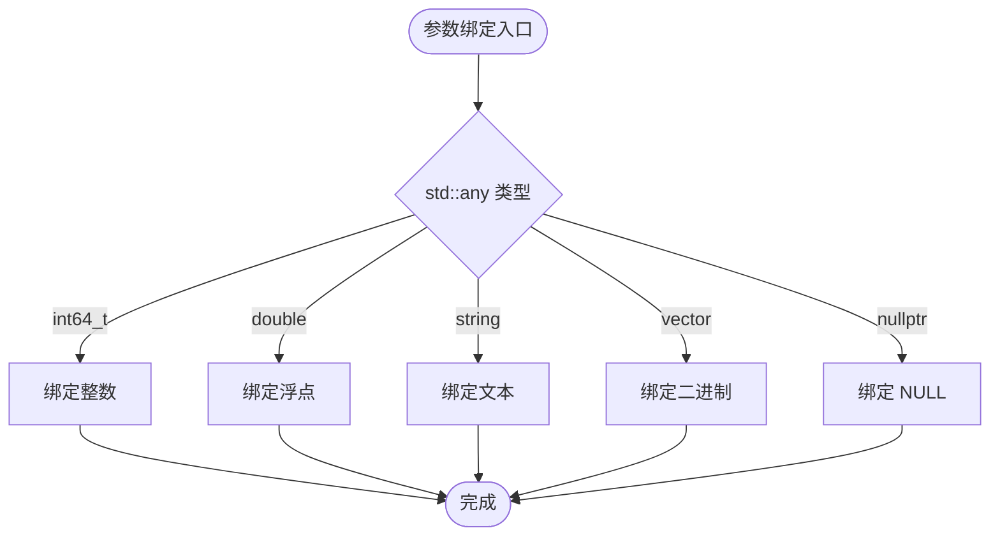

**图表来源**
- [sql_adapter.cpp:230-267](file://fileoperator/sql_adapter.cpp#L230-L267)
- [sql_adapter.cpp:951-1004](file://fileoperator/sql_adapter.cpp#L951-L1004)
- [sql_adapter.cpp:1797-1851](file://fileoperator/sql_adapter.cpp#L1797-L1851)

**章节来源**
- [sql_adapter.cpp:230-267](file://fileoperator/sql_adapter.cpp#L230-L267)
- [sql_adapter.cpp:951-1004](file://fileoperator/sql_adapter.cpp#L951-L1004)
- [sql_adapter.cpp:1797-1851](file://fileoperator/sql_adapter.cpp#L1797-L1851)

## 错误处理机制
- 异常层次：
  - SQLAdapterError：基类，继承自 IOError。
  - SQLAdapterNotConnectedError：未连接时操作抛出。
  - SQLAdapterQueryError：SQL 执行失败抛出。
  - SQLAdapterConnectionError：连接失败抛出。
  - SQLAdapterTimeoutError：超时异常。
  - SQLAdapterPermissionDeniedError：权限拒绝异常。
  - SQLAdapterInvalidArgumentError：参数非法异常。
- 错误传播：
  - 各后端在连接、准备、执行、释放阶段捕获底层错误，转换为上述异常类型。
  - 事件回调中记录操作信息，便于排查。

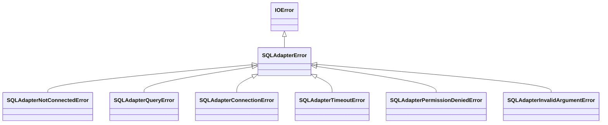

**图表来源**
- [sql_adapter.hpp:136-208](file://fileoperator/sql_adapter.hpp#L136-L208)

**章节来源**
- [sql_adapter.hpp:136-208](file://fileoperator/sql_adapter.hpp#L136-L208)

## 性能与连接池建议
- 当前实现：
  - 每个适配器实例维护一个连接句柄，无内置连接池。
  - 多线程通过 shared_mutex 串行访问，适合轻量并发场景。
- 优化建议：
  - 连接池：在上层封装连接池，复用连接句柄，减少握手开销。
  - 批量写入：对 INSERT 使用批量语句或事务包裹多条语句。
  - 预编译语句：MySQL/SQLite 已使用预处理语句；PostgreSQL 可考虑扩展为参数化查询。
  - 结果集分页：合理使用 LIMIT/OFFSET，避免一次性加载大结果集。
  - 索引与查询优化：在数据库侧添加合适索引，避免全表扫描。

[本节为通用性能指导，不直接分析具体文件]

## 数据库迁移与最佳实践
- Backend 枚举：
  - Backend::SQLite / MySQL / PostgreSQL，用于 Schema 层生成不同方言的 DDL。
- 列类型映射：
  - Double → REAL/DOUBLE/DOUBLE PRECISION
  - Int64 → BIGINT/BIGINT/BIGINT
  - Text → TEXT/TEXT/TEXT
- 主键策略：
  - SQLite：INTEGER PRIMARY KEY AUTOINCREMENT
  - MySQL：BIGINT PRIMARY KEY AUTO_INCREMENT
  - PostgreSQL：BIGSERIAL PRIMARY KEY
- 唯一键策略：
  - MySQL 不支持 TEXT UNIQUE，需使用 VARCHAR(512) NOT NULL UNIQUE。
- 表存在性检查：
  - SQLite/MySQL：CREATE TABLE IF NOT EXISTS
  - PostgreSQL：先探测存在性再创建。

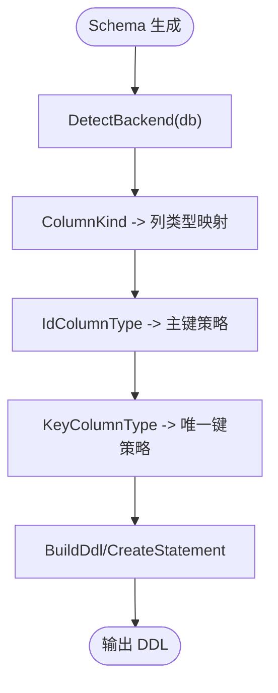

**图表来源**
- [param_schema.cpp:45-84](file://fileoperator\param_schema.cpp#L45-L84)
- [param_schema.cpp:168-211](file://fileoperator\param_schema.cpp#L168-L211)
- [param_schema.cpp:213-234](file://fileoperator\param_schema.cpp#L213-L234)

**章节来源**
- [param_schema.hpp:29-35](file://fileoperator\param_schema.hpp#L29-L35)
- [param_schema.cpp:45-84](file://fileoperator\param_schema.cpp#L45-L84)
- [param_schema.cpp:168-211](file://fileoperator\param_schema.cpp#L168-L211)
- [param_schema.cpp:213-234](file://fileoperator\param_schema.cpp#L213-L234)

## 使用示例与调用流程
以下示例展示如何创建数据库连接、执行 CRUD 操作、处理结果集与异常。为避免泄露源码内容，仅提供调用步骤与路径引用。

- 创建 SQLite 连接：
  - 调用 SQLiteAdapter::Connect(path) 或 Connect(host,user,password,database,port)。
  - 参考路径：[sql_adapter.cpp:149-174](file://fileoperator/sql_adapter.cpp#L149-L174)
- 执行非查询语句：
  - 调用 Execute("INSERT/UPDATE/DELETE ...")。
  - 参考路径：[sql_adapter.cpp:176-181](file://fileoperator/sql_adapter.cpp#L176-L181)
- 执行查询并处理结果：
  - 调用 Query("SELECT ...")，遍历 Rows，按列名取 std::any 值。
  - 参考路径：[sql_adapter.cpp:183-189](file://fileoperator/sql_adapter.cpp#L183-L189)
- 插入数据：
  - 调用 Insert(table, {col1: value1, col2: value2})。
  - 参考路径：[sql_adapter.cpp:191-278](file://fileoperator/sql_adapter.cpp#L191-L278)
- 删除数据：
  - 调用 Delete(table, {where_col: where_value})。
  - 参考路径：[sql_adapter.cpp:285-369](file://fileoperator/sql_adapter.cpp#L285-L369)
- 更新数据：
  - 调用 Update(table, {set_col: new_value}, {where_col: where_value})。
  - 参考路径：[sql_adapter.cpp:371-489](file://fileoperator/sql_adapter.cpp#L371-L489)
- 查询数据：
  - 调用 Select(table, columns, where, orderBy, limit, offset)。
  - 参考路径：[sql_adapter.cpp:491-665](file://fileoperator/sql_adapter.cpp#L491-L665)
- 建表与删表：
  - 调用 CreateTable(table, {col: type}) 与 RemoveTable(table)。
  - 参考路径：[sql_adapter.cpp:667-731](file://fileoperator/sql_adapter.cpp#L667-L731)

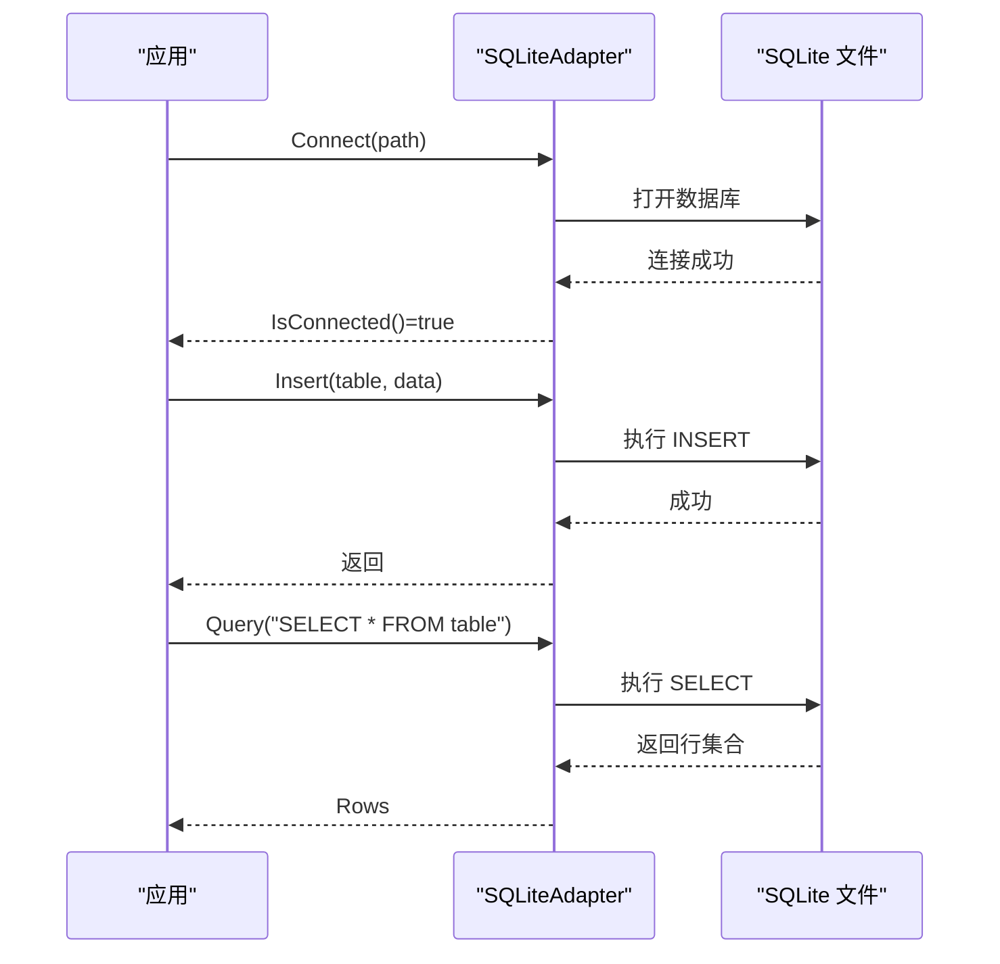

**图表来源**
- [sql_adapter.cpp:149-189](file://fileoperator/sql_adapter.cpp#L149-L189)
- [sql_adapter.cpp:191-278](file://fileoperator/sql_adapter.cpp#L191-L278)
- [sql_adapter.cpp:491-665](file://fileoperator/sql_adapter.cpp#L491-L665)

**章节来源**
- [sql_adapter.cpp:149-189](file://fileoperator/sql_adapter.cpp#L149-L189)
- [sql_adapter.cpp:191-278](file://fileoperator/sql_adapter.cpp#L191-L278)
- [sql_adapter.cpp:491-665](file://fileoperator/sql_adapter.cpp#L491-L665)

## 故障排除
- 常见错误：
  - 未连接：调用 Execute/Query/CRUD 前未 Connect，抛出 SQLAdapterNotConnectedError。
  - SQL 语法错误：prepare/execute 失败，抛出 SQLAdapterQueryError。
  - 连接失败：Connect 失败，抛出 SQLAdapterConnectionError。
  - 参数非法：空路径、空列定义等，抛出 SQLAdapterInvalidArgumentError。
- 排查建议：
  - 检查 IsConnected() 返回值。
  - 捕获 SQLAdapterError 及其派生类，打印 lastError 或异常消息。
  - 使用事件回调记录连接、执行、查询语句，辅助定位问题。

**章节来源**
- [sql_adapter.cpp:70-83](file://fileoperator/sql_adapter.cpp#L70-L83)
- [sql_adapter.cpp:84-141](file://fileoperator/sql_adapter.cpp#L84-L141)
- [sql_adapter.cpp:150-174](file://fileoperator/sql_adapter.cpp#L150-L174)

## 结论
SQLAdapter 通过 ISQLAdapter 抽象接口统一了 SQLite、MySQL、PostgreSQL 的数据库访问能力，提供了线程安全的连接管理、参数化的 CRUD 操作、一致的结果集模型与完善的异常体系。Schema 层基于 Backend 枚举生成跨后端兼容的 DDL，ParamStore 借助该适配器实现参数持久化。对于生产环境，建议在上层引入连接池、事务封装与查询优化，以获得更好的性能与稳定性。