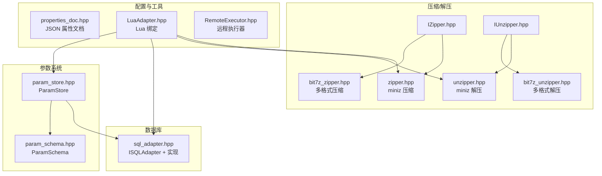
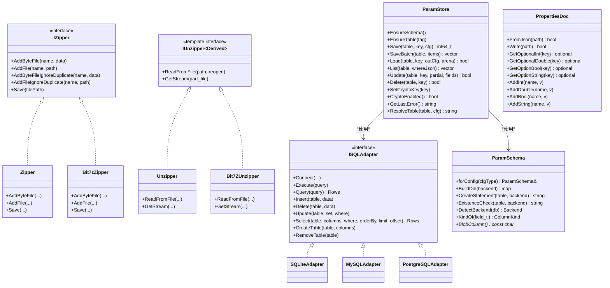
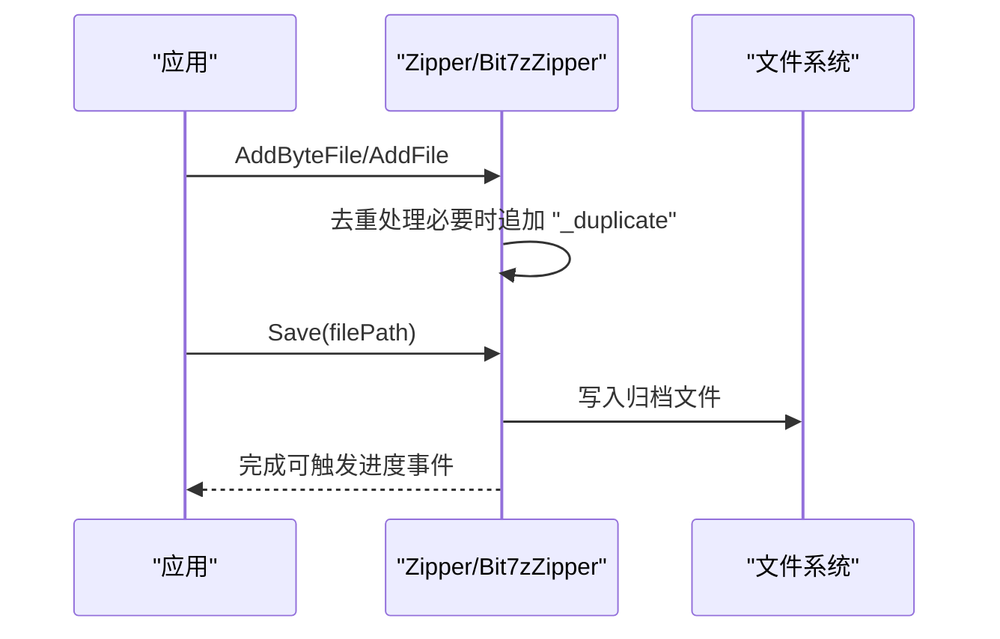
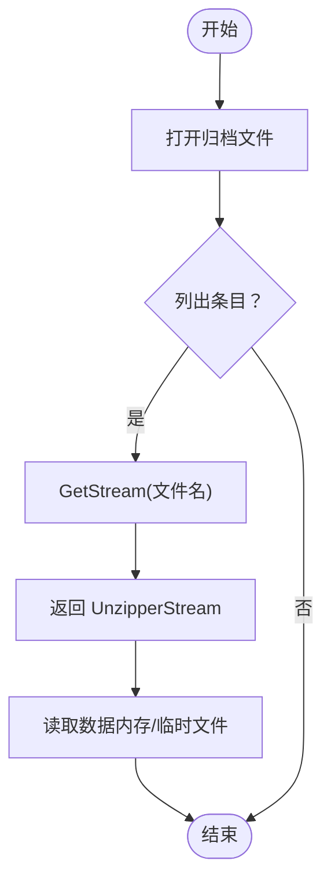
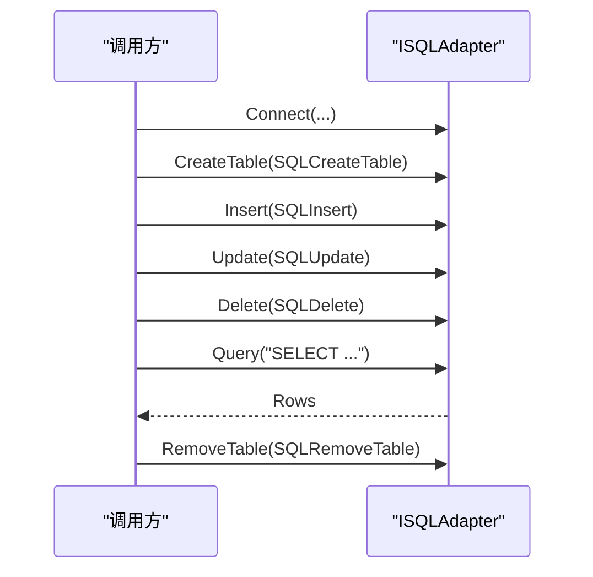
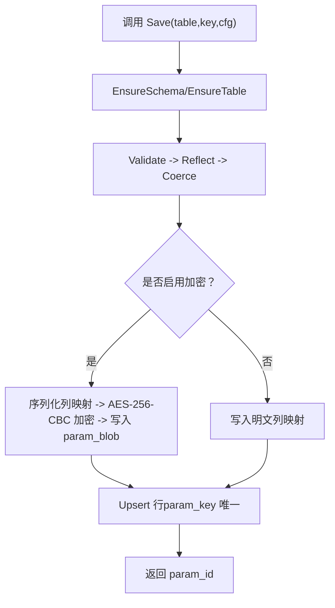
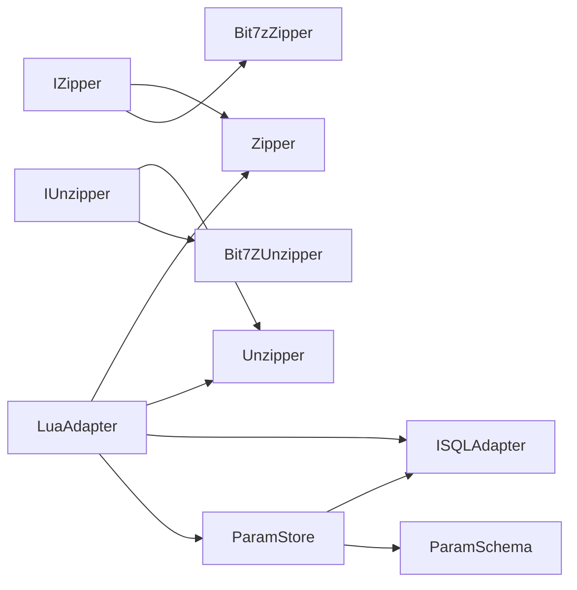

# 文件操作模块（File Operator）

<cite>
**本文引用的文件**   
- [fileoperator/zipper.hpp](file://fileoperator/zipper.hpp)
- [fileoperator/unzipper.hpp](file://fileoperator/unzipper.hpp)
- [fileoperator/IZipper.hpp](file://fileoperator/IZipper.hpp)
- [fileoperator/IUnzipper.hpp](file://fileoperator/IUnzipper.hpp)
- [fileoperator/sql_adapter.hpp](file://fileoperator/sql_adapter.hpp)
- [fileoperator/param_store.hpp](file://fileoperator/param_store.hpp)
- [fileoperator/param_schema.hpp](file://fileoperator/param_schema.hpp)
- [fileoperator/properties_doc.hpp](file://fileoperator/properties_doc.hpp)
- [fileoperator/bit7z_zipper.hpp](file://fileoperator/bit7z_zipper.hpp)
- [fileoperator/bit7z_unzipper.hpp](file://fileoperator/bit7z_unzipper.hpp)
- [fileoperator/LuaAdapter.hpp](file://fileoperator/LuaAdapter.hpp)
- [fileoperator/RemoteExecutor.hpp](file://fileoperator/RemoteExecutor.hpp)
</cite>

## 目录
1. [简介](#简介)
2. [项目结构](#项目结构)
3. [核心组件](#核心组件)
4. [架构总览](#架构总览)
5. [详细组件分析](#详细组件分析)
6. [依赖关系分析](#依赖关系分析)
7. [性能与优化建议](#性能与优化建议)
8. [故障排除指南](#故障排除指南)
9. [结论](#结论)
10. [附录：使用示例与集成要点](#附录使用示例与集成要点)

## 简介
文件操作模块为 HsBaSlicer 提供统一的压缩、解压、数据库访问、参数持久化与属性文档读写能力。其设计强调：
- 抽象接口优先：压缩/解压通过 IZipper/IUnzipper 抽象，支持 miniz 与 bit7z 两种后端；SQL 访问通过 ISQLAdapter 统一 SQLite/MySQL/PostgreSQL。
- 反射驱动的宽表参数存储：ParamStore 基于 ParamSchema 将任意 PipelineConfig 结构映射到 SQL 宽表，支持可选 AES-256-CBC 加密的 param_blob 列。
- 类型安全的 JSON 配置：PropertiesDoc 提供 typed 读取/写入 API，便于轻量配置管理。
- Lua 可插拔：LuaAdapter 暴露 Zipper/Unzipper、SQL Adapter、ParamStore 等能力给脚本层。

## 项目结构
该模块位于 fileoperator 目录，核心头文件组织如下：
- 压缩/解压抽象与实现：IZipper.hpp、IUnzipper.hpp、zipper.hpp、unzipper.hpp、bit7z_zipper.hpp、bit7z_unzipper.hpp
- 数据库适配器：sql_adapter.hpp
- 参数存储与模式：param_store.hpp、param_schema.hpp
- 属性文档：properties_doc.hpp
- Lua 绑定：LuaAdapter.hpp
- 远程执行器：RemoteExecutor.hpp

图表来源
- [fileoperator/IZipper.hpp:1-67](file://fileoperator/IZipper.hpp#L1-L67)
- [fileoperator/IUnzipper.hpp:1-202](file://fileoperator/IUnzipper.hpp#L1-L202)
- [fileoperator/zipper.hpp:1-104](file://fileoperator/zipper.hpp#L1-L104)
- [fileoperator/unzipper.hpp:1-80](file://fileoperator/unzipper.hpp#L1-L80)
- [fileoperator/bit7z_zipper.hpp:1-130](file://fileoperator/bit7z_zipper.hpp#L1-L130)
- [fileoperator/bit7z_unzipper.hpp:1-108](file://fileoperator/bit7z_unzipper.hpp#L1-L108)
- [fileoperator/sql_adapter.hpp:1-610](file://fileoperator/sql_adapter.hpp#L1-L610)
- [fileoperator/param_store.hpp:1-125](file://fileoperator/param_store.hpp#L1-L125)
- [fileoperator/param_schema.hpp:1-104](file://fileoperator/param_schema.hpp#L1-L104)
- [fileoperator/properties_doc.hpp:1-280](file://fileoperator/properties_doc.hpp#L1-L280)
- [fileoperator/LuaAdapter.hpp:1-74](file://fileoperator/LuaAdapter.hpp#L1-L74)
- [fileoperator/RemoteExecutor.hpp:1-103](file://fileoperator/RemoteExecutor.hpp#L1-L103)

章节来源
- [fileoperator/README.md:1-10](file://docs/zh/fileoperator/README.md#L1-L10)

## 核心组件
- 压缩接口与实现
  - IZipper：定义 AddByteFile/AddFile/Save 等通用压缩接口。
  - Zipper：基于 miniz 的 ZIP 压缩实现，支持内存/磁盘文件添加与去重策略。
  - Bit7zZipper：基于 bit7z 的多格式压缩（ZIP/7Z/XZ/BZIP2/GZIP/TAR/TarGz/TarXz/RAR/ISO/Z），支持密码与进度事件。
- 解压接口与实现
  - IUnzipper：CRTP 接口，提供 ReadFromFile/GetStream 等通用解压流式读取。
  - Unzipper：基于 miniz 的 ZIP 解压实现，支持内存缓存与临时文件路径。
  - Bit7ZUnzipper：基于 bit7z 的多格式解压实现，支持密码与内嵌 tar 的一键解压。
- SQL 适配器
  - ISQLAdapter：统一 CRUD 接口（Connect/Execute/Query/Insert/Delete/Update/Select/CreateTable/RemoveTable）。
  - SQLiteAdapter/MySQLAdapter/PostgreSQLAdapter：具体后端实现，线程安全，带管道操作符与结构化查询对象（SQLSelect/SQLInsert/SQLDelete/SQLUpdate/SQLCreateTable/SQLRemoveTable）。
- 参数存储与模式
  - ParamSchema：从反射 TypeInfo 推导宽表列定义，生成 DDL，支持后端检测与 Blob 列名常量。
  - ParamStore：面向 PipelineConfig 的宽表持久化，支持 EnsureSchema/Save/Load/List/Update/Delete，事务批量保存，可选 AES-256-CBC 加密的 param_blob。
- 属性文档
  - PropertiesDoc：基于 RapidJSON 的轻量 JSON 文档读写，提供 typed Get/Add 方法。
- Lua 绑定与远程执行
  - LuaAdapter：注册 Zipper/Unzipper、SQL Adapter、ParamStore 到 Lua。
  - RemoteExecutor：远程任务执行与文件传输连接池。

章节来源
- [fileoperator/IZipper.hpp:1-67](file://fileoperator/IZipper.hpp#L1-L67)
- [fileoperator/IUnzipper.hpp:1-202](file://fileoperator/IUnzipper.hpp#L1-L202)
- [fileoperator/zipper.hpp:1-104](file://fileoperator/zipper.hpp#L1-L104)
- [fileoperator/unzipper.hpp:1-80](file://fileoperator/unzipper.hpp#L1-L80)
- [fileoperator/bit7z_zipper.hpp:1-130](file://fileoperator/bit7z_zipper.hpp#L1-L130)
- [fileoperator/bit7z_unzipper.hpp:1-108](file://fileoperator/bit7z_unzipper.hpp#L1-L108)
- [fileoperator/sql_adapter.hpp:1-610](file://fileoperator/sql_adapter.hpp#L1-L610)
- [fileoperator/param_store.hpp:1-125](file://fileoperator/param_store.hpp#L1-L125)
- [fileoperator/param_schema.hpp:1-104](file://fileoperator/param_schema.hpp#L1-L104)
- [fileoperator/properties_doc.hpp:1-280](file://fileoperator/properties_doc.hpp#L1-L280)
- [fileoperator/LuaAdapter.hpp:1-74](file://fileoperator/LuaAdapter.hpp#L1-L74)
- [fileoperator/RemoteExecutor.hpp:1-103](file://fileoperator/RemoteExecutor.hpp#L1-L103)

## 架构总览
文件操作模块以“抽象接口 + 多后端实现”为核心，上层通过统一接口调用底层能力。ParamStore 作为业务参数持久化的编排层，组合 SQL 适配器与 Schema 推导，形成“反射 -> 宽表 -> 可选加密”的数据通路。

图表来源
- [fileoperator/IZipper.hpp:1-67](file://fileoperator/IZipper.hpp#L1-L67)
- [fileoperator/IUnzipper.hpp:1-202](file://fileoperator/IUnzipper.hpp#L1-L202)
- [fileoperator/zipper.hpp:1-104](file://fileoperator/zipper.hpp#L1-L104)
- [fileoperator/unzipper.hpp:1-80](file://fileoperator/unzipper.hpp#L1-L80)
- [fileoperator/bit7z_zipper.hpp:1-130](file://fileoperator/bit7z_zipper.hpp#L1-L130)
- [fileoperator/bit7z_unzipper.hpp:1-108](file://fileoperator/bit7z_unzipper.hpp#L1-L108)
- [fileoperator/sql_adapter.hpp:1-610](file://fileoperator/sql_adapter.hpp#L1-L610)
- [fileoperator/param_store.hpp:1-125](file://fileoperator/param_store.hpp#L1-L125)
- [fileoperator/param_schema.hpp:1-104](file://fileoperator/param_schema.hpp#L1-L104)
- [fileoperator/properties_doc.hpp:1-280](file://fileoperator/properties_doc.hpp#L1-L280)

## 详细组件分析

### 压缩子系统（Zipper / Bit7zZipper）
- 接口设计
  - IZipper 定义统一的压缩入口，屏蔽后端差异。
  - Zipper 基于 miniz，提供 AddByteFile/AddFile/Save 与重复名称自动追加 “_duplicate” 的策略。
  - Bit7zZipper 支持多容器格式，TarGz/TarXz 采用两阶段打包（先 tar 再压缩），并支持密码与进度事件。
- 数据格式
  - 输入：内存字符串/字节数组或磁盘文件路径。
  - 输出：ZIP/7Z/XZ/BZIP2/GZIP/TAR/TarGz/TarXz 等归档文件。
- 配置选项
  - Zipper：压缩等级枚举 MinizCompression（No/Fast/Tight 等）。
  - Bit7zZipper：目标格式 ZipperFormat、DLL 路径、密码。

图表来源
- [fileoperator/zipper.hpp:1-104](file://fileoperator/zipper.hpp#L1-L104)
- [fileoperator/bit7z_zipper.hpp:1-130](file://fileoperator/bit7z_zipper.hpp#L1-L130)

章节来源
- [fileoperator/IZipper.hpp:1-67](file://fileoperator/IZipper.hpp#L1-L67)
- [fileoperator/zipper.hpp:1-104](file://fileoperator/zipper.hpp#L1-L104)
- [fileoperator/bit7z_zipper.hpp:1-130](file://fileoperator/bit7z_zipper.hpp#L1-L130)

### 解压子系统（Unzipper / Bit7ZUnzipper）
- 接口设计
  - IUnzipper 通过 CRTP 提供 ReadFromFile/GetStream 的统一入口。
  - Unzipper 基于 miniz，支持内存缓存与临时文件路径，可设置最大内存占用。
  - Bit7ZUnzipper 基于 bit7z，支持密码与内嵌 tar 的一键解压（.tar.gz/.tar.xz）。
- 数据流
  - 打开归档 -> 按文件名获取 UnzipperStream -> 以 std::istream 方式读取内容。
- 配置选项
  - 最大内存大小 SetMaxMemSize。
  - Bit7ZUnzipper 支持 SetPassword。

图表来源
- [fileoperator/IUnzipper.hpp:1-202](file://fileoperator/IUnzipper.hpp#L1-L202)
- [fileoperator/unzipper.hpp:1-80](file://fileoperator/unzipper.hpp#L1-L80)
- [fileoperator/bit7z_unzipper.hpp:1-108](file://fileoperator/bit7z_unzipper.hpp#L1-L108)

章节来源
- [fileoperator/IUnzipper.hpp:1-202](file://fileoperator/IUnzipper.hpp#L1-L202)
- [fileoperator/unzipper.hpp:1-80](file://fileoperator/unzipper.hpp#L1-L80)
- [fileoperator/bit7z_unzipper.hpp:1-108](file://fileoperator/bit7z_unzipper.hpp#L1-L108)

### SQL 适配器（ISQLAdapter 及实现）
- 接口设计
  - ISQLAdapter 统一 Connect/Execute/Query/Insert/Delete/Update/Select/CreateTable/RemoveTable。
  - 提供管道操作符与结构化查询对象（SQLSelect/SQLInsert/SQLDelete/SQLUpdate/SQLCreateTable/SQLRemoveTable），便于链式调用。
- 后端实现
  - SQLiteAdapter：本地文件数据库。
  - MySQLAdapter/PostgreSQLAdapter：网络数据库（条件编译 HSBA_USE_MYSQL/HSBA_USE_PGSQL）。
- 错误模型
  - SQLAdapterError 及其派生类（NotConnected/Query/Connection/Timeout/PermissionDenied/InvalidArgument）。

图表来源
- [fileoperator/sql_adapter.hpp:1-610](file://fileoperator/sql_adapter.hpp#L1-L610)

章节来源
- [fileoperator/sql_adapter.hpp:1-610](file://fileoperator/sql_adapter.hpp#L1-L610)

### 参数存储（ParamStore）与参数模式（ParamSchema）
- 参数模式
  - ParamSchema 根据反射 TypeInfo 推导字段类型（Double/Int64/Text），生成各后端 DDL，并提供 ExistenceCheck/DetectBackend/BlobColumn 等工具。
- 参数存储
  - ParamStore 负责宽表的创建、保存、加载、列表、更新、删除；Save 流程包含 Validate -> Reflect -> Coerce -> Upsert；SaveBatch 在事务中执行；支持 AES-256-CBC 加密的 param_blob 列。
- 关键特性
  - 后端自动检测 DetectBackend。
  - 加密开关 SetCryptoKey/CryptoEnabled。
  - 进度回调 SetProgressCallback 与迁移钩子 SetMigrationHook。

图表来源
- [fileoperator/param_store.hpp:1-125](file://fileoperator/param_store.hpp#L1-L125)
- [fileoperator/param_schema.hpp:1-104](file://fileoperator/param_schema.hpp#L1-L104)

章节来源
- [fileoperator/param_store.hpp:1-125](file://fileoperator/param_store.hpp#L1-L125)
- [fileoperator/param_schema.hpp:1-104](file://fileoperator/param_schema.hpp#L1-L104)

### 属性文档（PropertiesDoc）
- 功能概述
  - 基于 RapidJSON 的轻量 JSON 文档读写，提供 typed 读取（GetOptionalInt/Double/Bool/String/Array）与写入（AddInt/Double/Bool/String/Array）。
- 适用场景
  - 轻量配置文件、运行时属性文档、快速原型验证。

章节来源
- [fileoperator/properties_doc.hpp:1-280](file://fileoperator/properties_doc.hpp#L1-L280)

### Lua 绑定与远程执行
- LuaAdapter
  - 注册 Zipper/Unzipper、SQLite/MySQL/PostgreSQL Adapter、ParamStore 到 Lua 环境，供脚本层直接调用。
- RemoteExecutor
  - 提供远程执行服务连接与连接池，用于批量文件发送与任务分发。

章节来源
- [fileoperator/LuaAdapter.hpp:1-74](file://fileoperator/LuaAdapter.hpp#L1-L74)
- [fileoperator/RemoteExecutor.hpp:1-103](file://fileoperator/RemoteExecutor.hpp#L1-L103)

## 依赖关系分析
- 压缩/解压
  - Zipper/Bit7zZipper 均实现 IZipper；Unzipper/Bit7ZUnzipper 均实现 IUnzipper。
- 参数存储
  - ParamStore 依赖 ISQLAdapter 与 ParamSchema；ParamSchema 依赖 ISQLAdapter 进行后端检测。
- Lua 绑定
  - LuaAdapter 聚合 Zipper/Unzipper、SQL Adapter、ParamStore 的注册入口。

图表来源
- [fileoperator/IZipper.hpp:1-67](file://fileoperator/IZipper.hpp#L1-L67)
- [fileoperator/IUnzipper.hpp:1-202](file://fileoperator/IUnzipper.hpp#L1-L202)
- [fileoperator/zipper.hpp:1-104](file://fileoperator/zipper.hpp#L1-L104)
- [fileoperator/unzipper.hpp:1-80](file://fileoperator/unzipper.hpp#L1-L80)
- [fileoperator/bit7z_zipper.hpp:1-130](file://fileoperator/bit7z_zipper.hpp#L1-L130)
- [fileoperator/bit7z_unzipper.hpp:1-108](file://fileoperator/bit7z_unzipper.hpp#L1-L108)
- [fileoperator/sql_adapter.hpp:1-610](file://fileoperator/sql_adapter.hpp#L1-L610)
- [fileoperator/param_store.hpp:1-125](file://fileoperator/param_store.hpp#L1-L125)
- [fileoperator/param_schema.hpp:1-104](file://fileoperator/param_schema.hpp#L1-L104)
- [fileoperator/LuaAdapter.hpp:1-74](file://fileoperator/LuaAdapter.hpp#L1-L74)

章节来源
- [fileoperator/IZipper.hpp:1-67](file://fileoperator/IZipper.hpp#L1-L67)
- [fileoperator/IUnzipper.hpp:1-202](file://fileoperator/IUnzipper.hpp#L1-L202)
- [fileoperator/sql_adapter.hpp:1-610](file://fileoperator/sql_adapter.hpp#L1-L610)
- [fileoperator/param_store.hpp:1-125](file://fileoperator/param_store.hpp#L1-L125)
- [fileoperator/param_schema.hpp:1-104](file://fileoperator/param_schema.hpp#L1-L104)
- [fileoperator/LuaAdapter.hpp:1-74](file://fileoperator/LuaAdapter.hpp#L1-L74)

## 性能与优化建议
- 压缩
  - 选择合适压缩等级：Zipper 的 MinizCompression 可按需求平衡速度与体积。
  - Bit7zZipper 对 TarGz/TarXz 采用两阶段打包，适合大批量小文件的归档。
- 解压
  - Unzipper/Bit7ZUnzipper 支持内存缓存与临时文件路径，合理设置 SetMaxMemSize 避免 OOM。
  - 大文件优先走临时文件路径，减少内存峰值。
- SQL
  - 使用 SaveBatch 在事务中批量写入，降低锁竞争与 IO 开销。
  - Select 使用分页（limit/offset）与 WHERE 过滤，避免全表扫描。
- 参数存储
  - 开启加密时注意 CPU 开销；若无需强安全，关闭加密以提升吞吐。
  - 利用 EnsureSchema/EnsureTable 避免重复建表检查成本。

[本节为通用指导，不直接分析具体文件]

## 故障排除指南
- SQL 连接与权限
  - 未连接：抛出 SQLAdapterNotConnectedError。
  - 连接失败：抛出 SQLAdapterConnectionError。
  - 权限不足：抛出 SQLAdapterPermissionDeniedError。
- 查询与超时
  - 查询失败：抛出 SQLAdapterQueryError。
  - 操作超时：抛出 SQLAdapterTimeoutError。
- 参数错误
  - 非法参数：抛出 SQLAdapterInvalidArgumentError。
- 调试建议
  - 使用 GetLastError 获取最近一次失败的错误消息。
  - 结合日志与事件回调（EventSource）定位问题。

章节来源
- [fileoperator/sql_adapter.hpp:131-208](file://fileoperator/sql_adapter.hpp#L131-L208)
- [fileoperator/param_store.hpp:101-102](file://fileoperator/param_store.hpp#L101-L102)

## 结论
文件操作模块通过抽象接口与多后端实现，提供了稳定可扩展的文件压缩/解压、数据库访问与参数持久化能力。ParamStore 与 ParamSchema 的组合使得任意 PipelineConfig 结构可以便捷地映射到 SQL 宽表，并可选择加密存储。PropertiesDoc 为轻量配置场景提供了类型安全的 JSON 读写。LuaAdapter 与 RemoteExecutor 进一步增强了脚本集成与分布式处理能力。

[本节为总结性内容，不直接分析具体文件]

## 附录：使用示例与集成要点
- 压缩示例（概念流程）
  - 创建 Zipper/Bit7zZipper -> 添加内存/磁盘文件 -> Save 输出归档。
- 解压示例（概念流程）
  - 创建 Unzipper/Bit7ZUnzipper -> ReadFromFile -> GetStream(文件名) -> 读取 UnzipperStream。
- SQL 示例（概念流程）
  - 连接数据库 -> 建表 -> 插入/更新/删除 -> 查询 -> 关闭连接。
- 参数存储示例（概念流程）
  - 初始化 ParamStore -> EnsureSchema -> Save/Load/List/Update/Delete -> 可选 SetCryptoKey 开启加密。
- Lua 集成
  - 通过 LuaAdapter 注册 Zipper/Unzipper、SQL Adapter、ParamStore，在脚本中直接调用。

[本节为概念性说明，不直接分析具体文件]