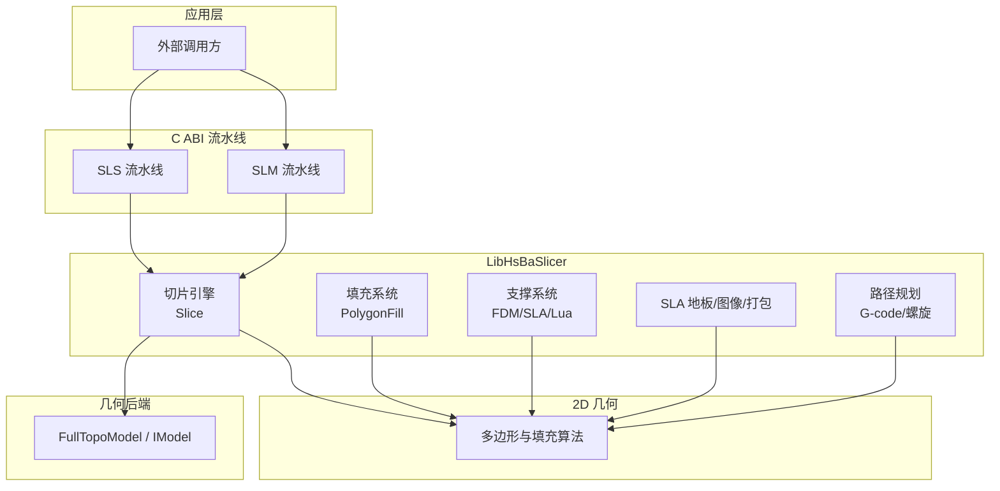
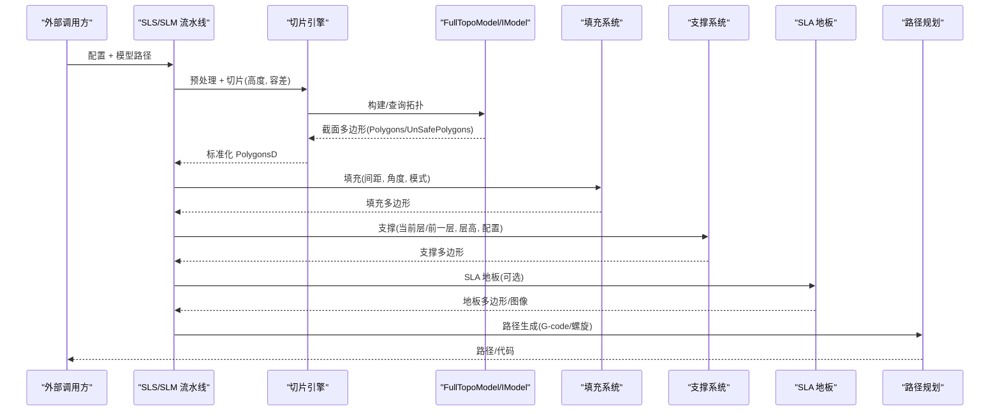
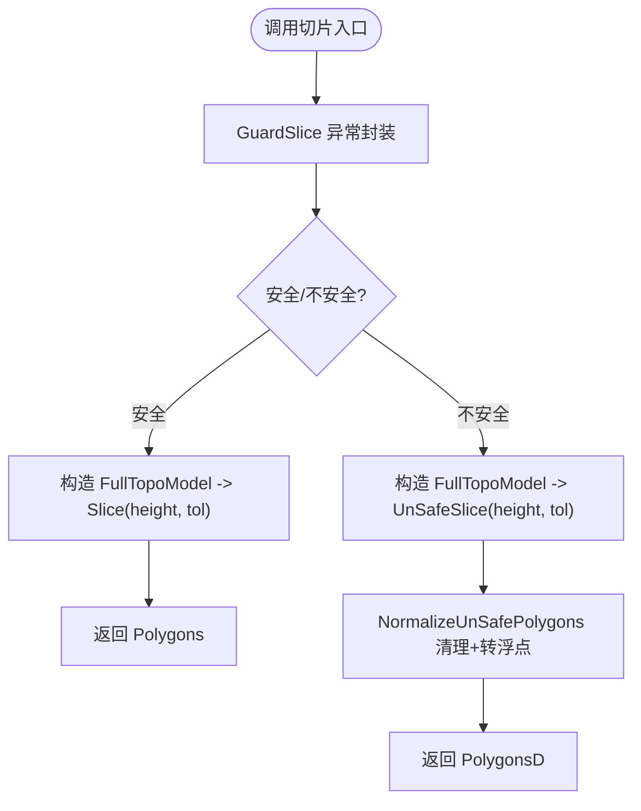
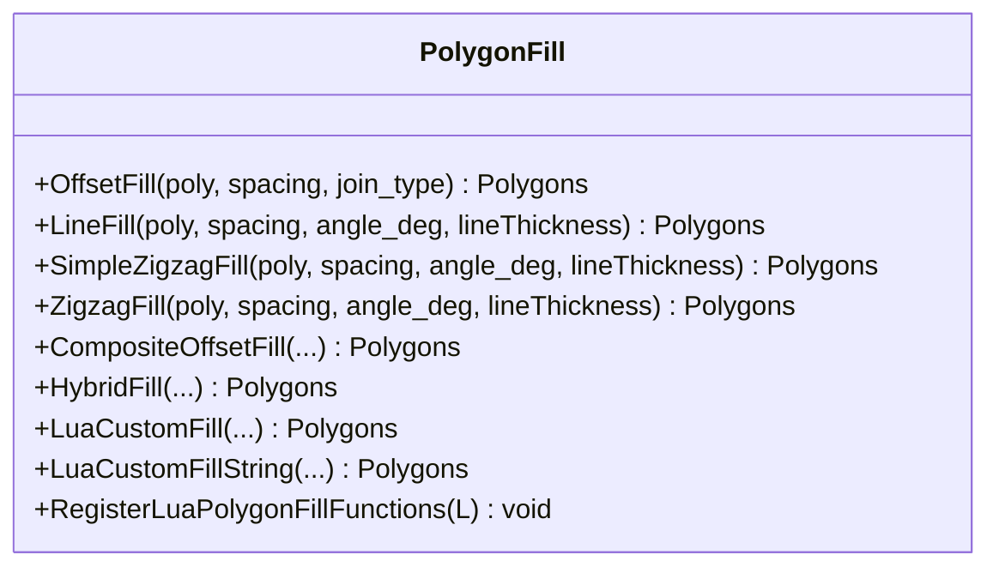
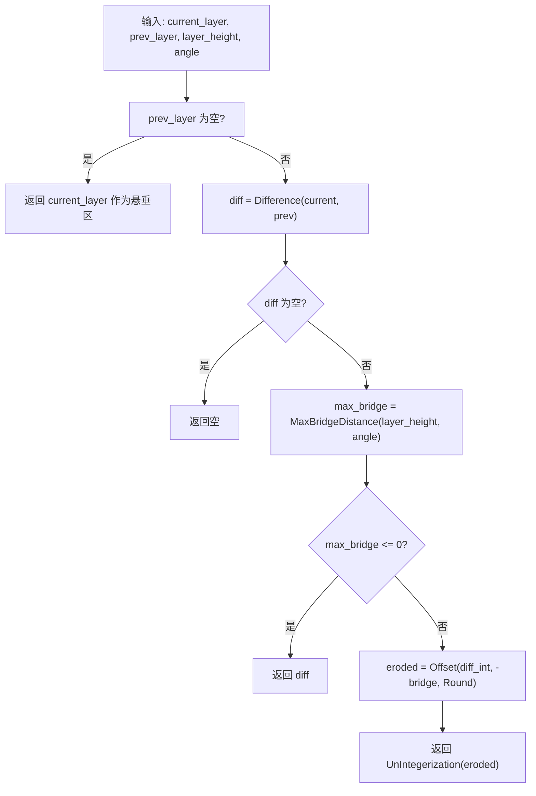
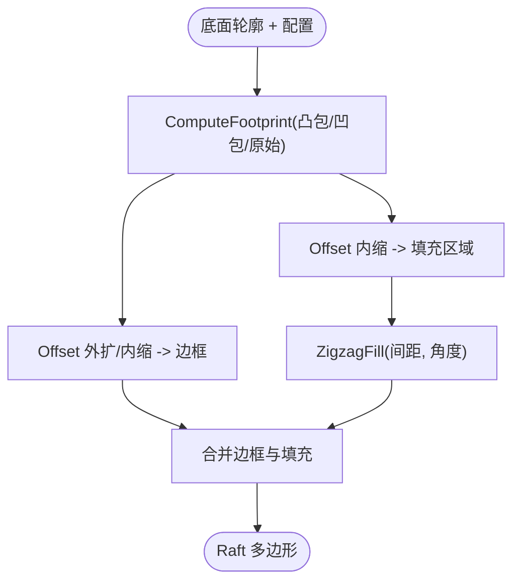
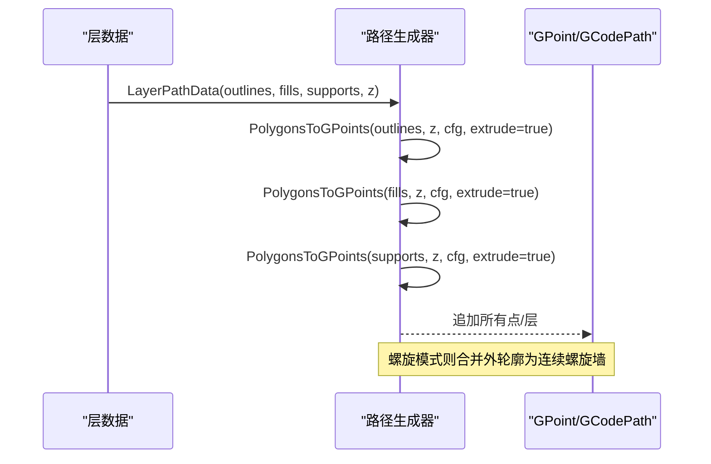
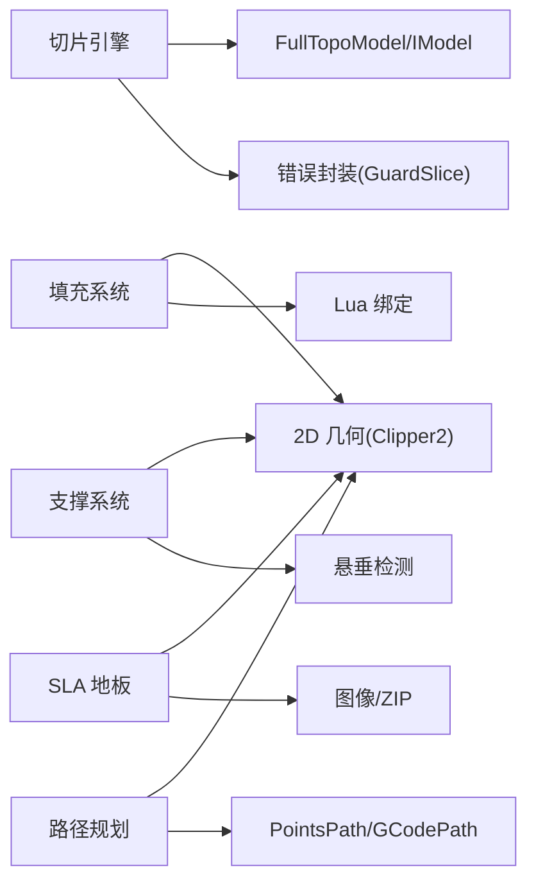

# 核心模块详解

<cite>
**本文引用的文件**   
- [README.md](file://README.md)
- [mesh_slice.hpp](file://LibHsBaSlicer/Slice/mesh_slice.hpp)
- [mesh_slice.cpp](file://LibHsBaSlicer/Slice/mesh_slice.cpp)
- [PolygonFill.hpp](file://2D/PolygonFill.hpp)
- [PolygonFill.cpp](file://2D/PolygonFill.cpp)
- [polygon_fill.hpp](file://LibHsBaSlicer/Fill/polygon_fill.hpp)
- [polygon_fill.cpp](file://LibHsBaSlicer/Fill/polygon_fill.cpp)
- [OverhangDetector.hpp](file://support/OverhangDetector.hpp)
- [OverhangDetector.cpp](file://support/OverhangDetector.cpp)
- [fdm_support.hpp](file://LibHsBaSlicer/Support/fdm_support.hpp)
- [fdm_support.cpp](file://LibHsBaSlicer/Support/fdm_support.cpp)
- [sla_floor.hpp](file://LibHsBaSlicer/Floor/sla_floor.hpp)
- [sla_floor.cpp](file://LibHsBaSlicer/Floor/sla_floor.cpp)
- [path_generator.hpp](file://LibHsBaSlicer/Path/path_generator.hpp)
- [path_generator.cpp](file://LibHsBaSlicer/Path/path_generator.cpp)
- [sls_pipeline.cpp](file://DllHsBaSlicer/sls_pipeline.cpp)
- [slm_pipeline.cpp](file://DllHsBaSlicer/slm_pipeline.cpp)
</cite>

## 目录
1. [引言](#引言)
2. [项目结构](#项目结构)
3. [核心组件](#核心组件)
4. [架构总览](#架构总览)
5. [详细组件分析](#详细组件分析)
6. [依赖关系分析](#依赖关系分析)
7. [性能考虑](#性能考虑)
8. [故障排查指南](#故障排查指南)
9. [结论](#结论)

## 引言
本文件面向 HsBaSlicer 的核心模块开发者与高级用户，系统性梳理模型处理系统、2D 几何算法、切片引擎、填充系统、支撑系统与路径规划等关键模块的职责边界、内部架构与对外接口；给出模块间依赖关系与数据流转图；并提供使用示例、最佳实践、关键算法原理与优化策略、性能调优建议与常见问题解决方案。

## 项目结构
HsBaSlicer 以模块化方式组织：
- base/utils/cipher/fileoperator/logger 等提供基础能力与工具。
- meshmodel/cadmodel/pointcloud 提供多种几何后端。
- 2D 提供多边形几何与填充算法。
- support 提供悬垂检测与支撑生成。
- LibHsBaSlicer 暴露 C++ 全流程 API（切片、填充、支撑、SLA 地板、路径）。
- DllHsBaSlicer 导出 C ABI 的流水线接口（FDM/SLA/SLS/SLM/TDP/WAAM/LOM 等）。

图表来源
- [sls_pipeline.cpp:1-53](file://DllHsBaSlicer/sls_pipeline.cpp#L1-L53)
- [slm_pipeline.cpp:1-50](file://DllHsBaSlicer/slm_pipeline.cpp#L1-L50)
- [mesh_slice.hpp:1-108](file://LibHsBaSlicer/Slice/mesh_slice.hpp#L1-L108)
- [PolygonFill.hpp:1-141](file://2D/PolygonFill.hpp#L1-L141)

章节来源
- [README.md:25-39](file://README.md#L25-L39)

## 核心组件
- 模型处理与切片：提供安全/不安全切片、Lua 驱动切片、可复用拓扑构建与逐层切片。
- 2D 几何与填充：偏移、平行线、简单/改进锯齿填充、复合/混合填充、Lua 自定义填充。
- 支撑系统：FDM 平面/树状/蜂窝支撑、SLA 牺牲支撑、Lua 自定义支撑，以及悬垂区域检测。
- SLA 地板与打包：接触面计算、边框与填充、Lua 自定义地板、图像渲染与 ZIP 打包。
- 路径规划：FDM G-code 点序列、多固件输出、螺旋花瓶模式。

章节来源
- [mesh_slice.hpp:22-103](file://LibHsBaSlicer/Slice/mesh_slice.hpp#L22-L103)
- [PolygonFill.hpp:20-137](file://2D/PolygonFill.hpp#L20-L137)
- [fdm_support.hpp:19-67](file://LibHsBaSlicer/Support/fdm_support.hpp#L19-L67)
- [sla_floor.hpp:21-179](file://LibHsBaSlicer/Floor/sla_floor.hpp#L21-L179)
- [path_generator.hpp:20-91](file://LibHsBaSlicer/Path/path_generator.hpp#L20-L91)

## 架构总览
下图展示从 C ABI 流水线到核心模块的数据流与控制流。

图表来源
- [sls_pipeline.cpp:1-53](file://DllHsBaSlicer/sls_pipeline.cpp#L1-L53)
- [slm_pipeline.cpp:1-50](file://DllHsBaSlicer/slm_pipeline.cpp#L1-L50)
- [mesh_slice.cpp:45-115](file://LibHsBaSlicer/Slice/mesh_slice.cpp#L45-L115)
- [polygon_fill.cpp:13-34](file://LibHsBaSlicer/Fill/polygon_fill.cpp#L13-L34)
- [fdm_support.cpp:14-74](file://LibHsBaSlicer/Support/fdm_support.cpp#L14-L74)
- [sla_floor.cpp:25-108](file://LibHsBaSlicer/Floor/sla_floor.cpp#L25-L108)
- [path_generator.cpp:61-135](file://LibHsBaSlicer/Path/path_generator.cpp#L61-L135)

## 详细组件分析

### 模型处理与切片引擎
职责边界
- 对外提供安全切片（仅闭合轮廓）、不安全切片（含开放轮廓）、Lua 驱动切片、可复用拓扑构建与逐层切片。
- 统一异常转换，避免第三方几何内核异常泄漏到 C ABI 边界。

内部架构
- 入口函数通过 GuardSlice 包装，捕获 std::exception 并转换为 IOError，RuntimeError 透传。
- 基于 FullTopoModel 进行切片；BuildSliceTopology 将拓扑提取为独立对象，供多线程并发读取。
- NormalizeUnSafePolygons 过滤开放折线与非简单多边形，并将整数坐标转为浮点精度。

对外接口
- Slice / UnSafeSlice / SliceLua / UnSafeSliceLua
- NormalizeUnSafePolygons
- BuildSliceTopology / SliceLayer

图表来源
- [mesh_slice.cpp:27-42](file://LibHsBaSlicer/Slice/mesh_slice.cpp#L27-L42)
- [mesh_slice.cpp:45-115](file://LibHsBaSlicer/Slice/mesh_slice.cpp#L45-L115)

章节来源
- [mesh_slice.hpp:22-103](file://LibHsBaSlicer/Slice/mesh_slice.hpp#L22-L103)
- [mesh_slice.cpp:17-115](file://LibHsBaSlicer/Slice/mesh_slice.cpp#L17-L115)

### 2D 几何与填充系统
职责边界
- 提供偏移、平行线、简单/改进锯齿填充、复合/混合填充、Lua 自定义填充。
- 为上层（填充、地板、支撑）提供稳定的 2D 几何原语。

内部架构
- LineFilling 通过投影法扫描行，裁剪矩形条带后提取线段区间并按方向排序。
- OffsetOnly 支持内外偏移步进控制，用于复合/混合填充。
- ZigzagFill 等具备拐角与桥接优化，提升复杂凹形区域的填充质量。
- LuaCustomFill/String 允许脚本扩展填充模式，并通过 RegisterLuaPolygonFillFunctions 注册到 Lua。

对外接口
- OffsetFill / LineFill / SimpleZigzagFill / ZigzagFill
- CompositeOffsetFill / HybridFill
- LuaCustomFill / LuaCustomFillString / RegisterLuaPolygonFillFunctions

图表来源
- [PolygonFill.hpp:20-137](file://2D/PolygonFill.hpp#L20-L137)
- [PolygonFill.cpp:39-137](file://2D/PolygonFill.cpp#L39-L137)

章节来源
- [PolygonFill.hpp:20-137](file://2D/PolygonFill.hpp#L20-L137)
- [PolygonFill.cpp:1-300](file://2D/PolygonFill.cpp#L1-L300)
- [polygon_fill.hpp:17-44](file://LibHsBaSlicer/Fill/polygon_fill.hpp#L17-L44)
- [polygon_fill.cpp:13-34](file://LibHsBaSlicer/Fill/polygon_fill.cpp#L13-L34)

### 支撑系统
职责边界
- 根据当前层与前一层轮廓检测悬垂区域，生成 FDM/SLA 支撑或执行 Lua 自定义支撑。
- 提供单层与全层支撑生成接口。

内部架构
- OverhangDetector 通过两层轮廓差集与最大桥接距离（由层高与角度阈值决定）进行侵蚀过滤，得到需支撑区域。
- FDM 支撑按配置选择平面/树状/蜂窝生成器；SLA 支撑使用牺牲支撑算法；Lua 支撑组合 2D/3D 函数环境。

对外接口
- GenerateFdmSupport / GenerateAllFdmSupport
- GenerateAllSlaSupport
- GenerateAllLuaSupport
- OverhangDetector::Detect / MaxBridgeDistance

图表来源
- [OverhangDetector.cpp:23-68](file://support/OverhangDetector.cpp#L23-L68)

章节来源
- [OverhangDetector.hpp:14-50](file://support/OverhangDetector.hpp#L14-L50)
- [OverhangDetector.cpp:1-77](file://support/OverhangDetector.cpp#L1-L77)
- [fdm_support.hpp:19-67](file://LibHsBaSlicer/Support/fdm_support.hpp#L19-L67)
- [fdm_support.cpp:14-74](file://LibHsBaSlicer/Support/fdm_support.cpp#L14-L74)

### SLA 地板与打包
职责边界
- 计算底面接触面、生成 Raft 边框与内部填充，支持凸包/凹包简化。
- 提供 Lua 自定义地板、图像渲染与 ZIP 打包导出。

内部架构
- ComputeFootprint 支持凸包或凹包模拟简化。
- GenerateFloorBorder/GenerateFloorFill/GenerateFloorRaft 组合 Offset 与 ZigzagFill 完成边框与填充。
- LuaCustomFloorByFile/String 加载脚本、注入 PolygonOperations 与 PolygonFill 库，解析返回的多边形表。
- RenderPolygonsToImage 与 SaveSlaPackage 负责图像与打包。

对外接口
- GenerateFloorContact / GenerateFloorBorder / GenerateFloorFill / GenerateFloorRaft
- LuaCustomFloorByFile / LuaCustomFloorByString
- RenderPolygonsToImage / SaveSlaPackage / SaveSlaPackageLua

图表来源
- [sla_floor.cpp:25-108](file://LibHsBaSlicer/Floor/sla_floor.cpp#L25-L108)

章节来源
- [sla_floor.hpp:21-179](file://LibHsBaSlicer/Floor/sla_floor.hpp#L21-L179)
- [sla_floor.cpp:25-250](file://LibHsBaSlicer/Floor/sla_floor.cpp#L25-L250)

### 路径规划
职责边界
- 将每层的轮廓、填充、支撑多边形转换为 G-code 点序列或 GCodePath 对象。
- 支持普通分层打印与连续螺旋（花瓶）模式。

内部架构
- PolygonsToGPoints 对每个多边形首点插入 G0 移动，后续顶点生成 G1 挤出/移动段，按线宽×层高×段长×倍率计算挤出量。
- GenerateGCodePath 顺序拼接轮廓、填充、支撑。
- GenerateGCodePathV2 使用打印机配置封装层信息。
- GenerateGCodePathSpiral 将所有层外轮廓合并为连续上升螺旋墙。

对外接口
- PolygonsToGPoints
- GenerateGCodePath / GenerateGCodePathV2 / GenerateGCodePathSpiral

图表来源
- [path_generator.cpp:14-135](file://LibHsBaSlicer/Path/path_generator.cpp#L14-L135)

章节来源
- [path_generator.hpp:20-91](file://LibHsBaSlicer/Path/path_generator.hpp#L20-L91)
- [path_generator.cpp:1-139](file://LibHsBaSlicer/Path/path_generator.cpp#L1-L139)

## 依赖关系分析
- 切片引擎依赖几何后端（IModel/FullTopoModel），并对第三方异常进行统一封装。
- 填充系统依赖 2D 几何（Clipper2）与 Lua 绑定。
- 支撑系统依赖 2D 几何（Difference/Offset）与悬垂检测。
- SLA 地板依赖 2D 几何与图像/ZIP 输出。
- 路径规划依赖 2D 几何与路径数据结构（PointsPath/GCodePath）。

图表来源
- [mesh_slice.cpp:17-42](file://LibHsBaSlicer/Slice/mesh_slice.cpp#L17-L42)
- [PolygonFill.cpp:1-300](file://2D/PolygonFill.cpp#L1-L300)
- [OverhangDetector.cpp:1-77](file://support/OverhangDetector.cpp#L1-L77)
- [sla_floor.cpp:1-250](file://LibHsBaSlicer/Floor/sla_floor.cpp#L1-L250)
- [path_generator.cpp:1-139](file://LibHsBaSlicer/Path/path_generator.cpp#L1-L139)

章节来源
- [mesh_slice.cpp:17-115](file://LibHsBaSlicer/Slice/mesh_slice.cpp#L17-L115)
- [PolygonFill.hpp:20-137](file://2D/PolygonFill.hpp#L20-L137)
- [OverhangDetector.hpp:14-50](file://support/OverhangDetector.hpp#L14-L50)
- [sla_floor.hpp:21-179](file://LibHsBaSlicer/Floor/sla_floor.hpp#L21-L179)
- [path_generator.hpp:20-91](file://LibHsBaSlicer/Path/path_generator.hpp#L20-L91)

## 性能考虑
- 切片拓扑复用：对多层切片优先使用 BuildSliceTopology + SliceLayer，避免每层重建拓扑导致的 O(total_faces) 开销。
- 填充参数调优：合理设置间距与角度，避免过小间距导致大量微小片段；在复杂凹形区域启用改进锯齿填充以减少桥接失败。
- 支撑密度与间隙：增大 support_gap 可减少材料用量但可能降低稳定性；support_density 影响支撑面积与强度。
- 路径挤出计算：确保 line_width、layer_height、extrusion_multiplier 一致，避免过度/不足挤出；旅行速度应高于打印速度以提升效率。
- 图像与打包：批量渲染时尽量复用图像尺寸，减少重复计算；ZIP 打包前合并小文件以降低 IO 次数。

[本节为通用指导，不直接分析具体文件]

## 故障排查指南
- 切片异常被转换为 IOError：若出现“Slicing failed: ...”，检查模型是否有效、容差是否过小、几何内核是否抛出异常。
- 不支持的开放轮廓：NormalizeUnSafePolygons 会丢弃开放折线，如需保留请在上层逻辑中处理。
- Lua 脚本错误：地板/填充/支撑的 Lua 接口会在加载或调用阶段抛出 RuntimeError，检查函数名、参数表结构与返回值类型。
- 支撑未生成：确认 prev_layer 是否为空、角度阈值是否过严、层高与角度是否匹配；必要时调整 support_gap 与 support_diameter。
- 路径挤出异常：检查线宽与层高乘积是否与切片配置一致，确认 is_extrude 标志是否正确设置。

章节来源
- [mesh_slice.cpp:27-42](file://LibHsBaSlicer/Slice/mesh_slice.cpp#L27-L42)
- [mesh_slice.cpp:85-103](file://LibHsBaSlicer/Slice/mesh_slice.cpp#L85-L103)
- [sla_floor.cpp:139-250](file://LibHsBaSlicer/Floor/sla_floor.cpp#L139-L250)
- [path_generator.cpp:14-58](file://LibHsBaSlicer/Path/path_generator.cpp#L14-L58)

## 结论
HsBaSlicer 的核心模块围绕“切片—填充—支撑—地板—路径”的主管线展开，各模块职责清晰、接口稳定，并通过 2D 几何与 Lua 扩展机制实现高可定制性。推荐在多层层切场景下复用拓扑、合理配置填充与支撑参数、并使用 V2 路径接口以获得更好的多固件兼容性。遇到问题时，优先检查异常封装与 Lua 脚本错误，再逐步定位几何与参数问题。