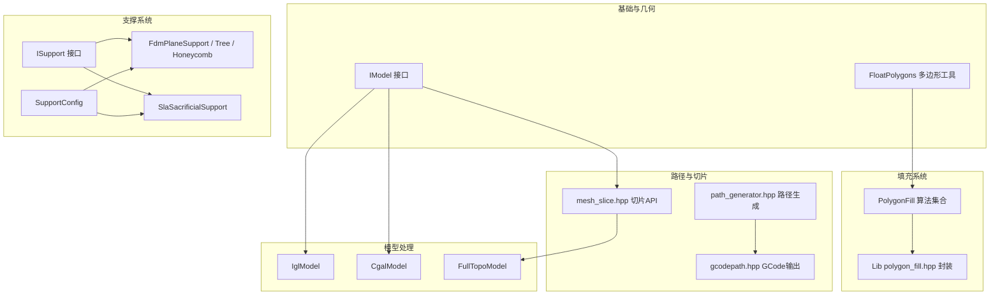
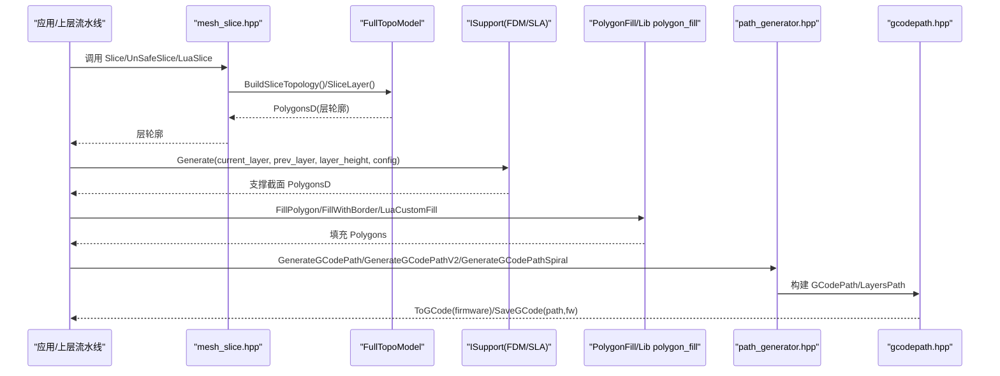
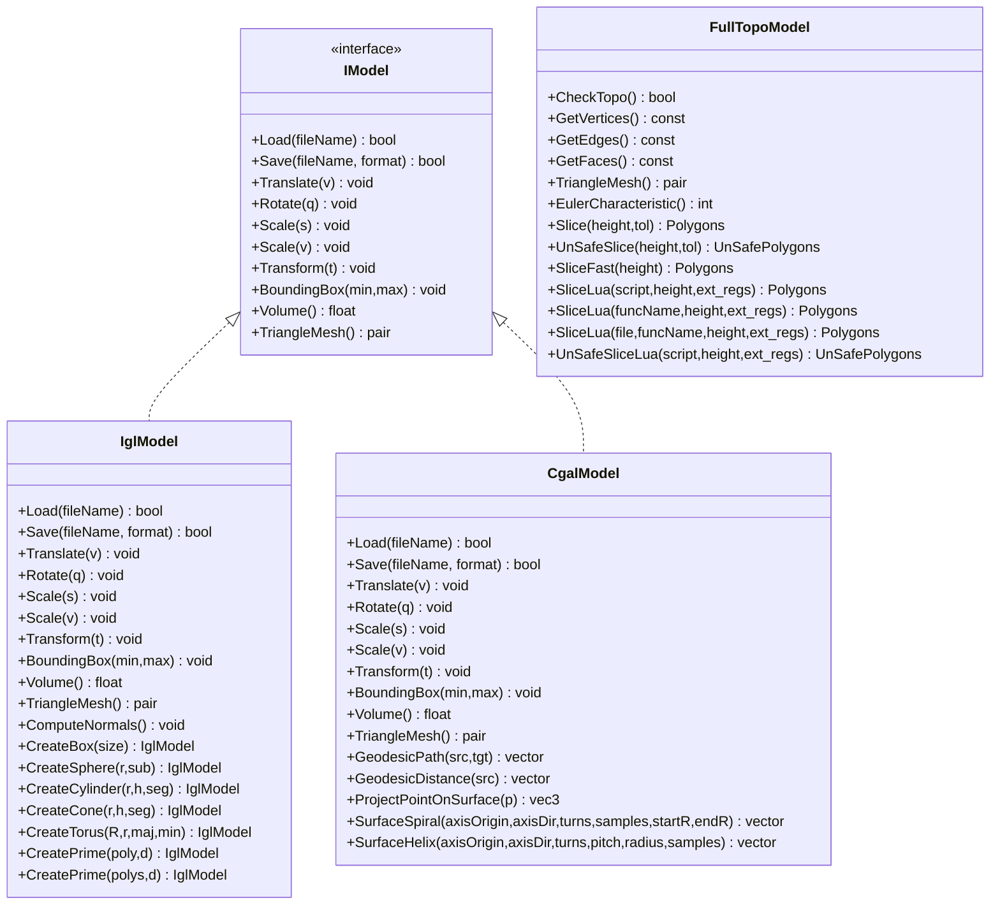
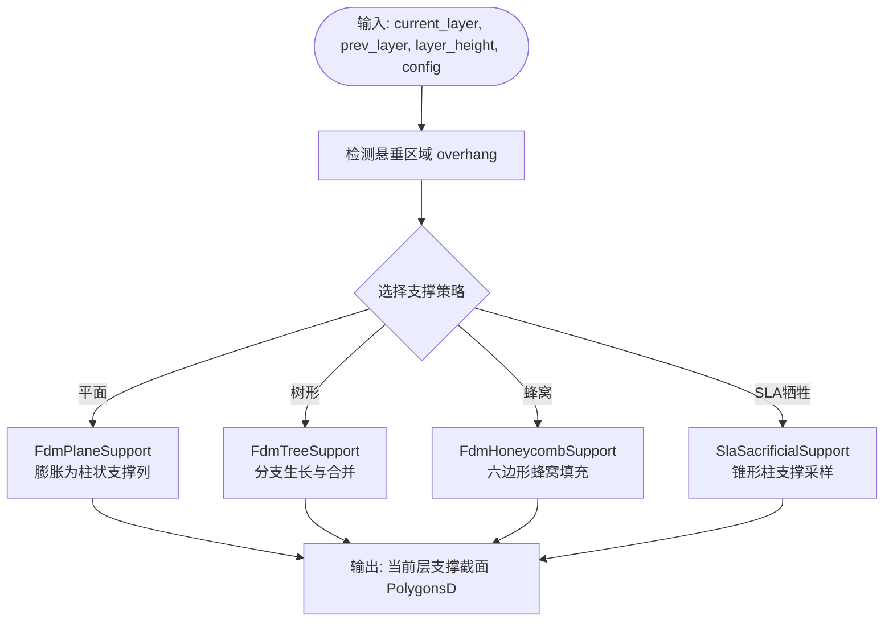
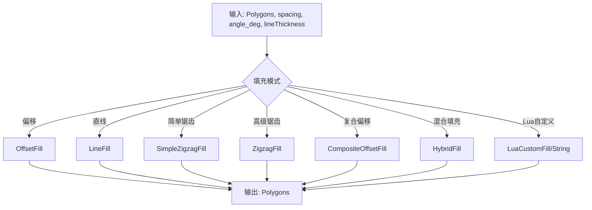
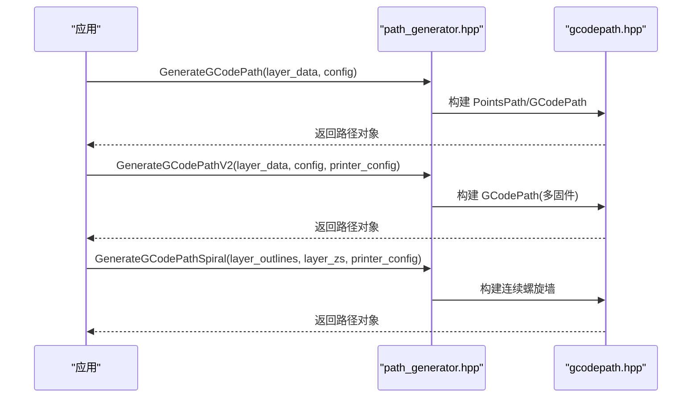
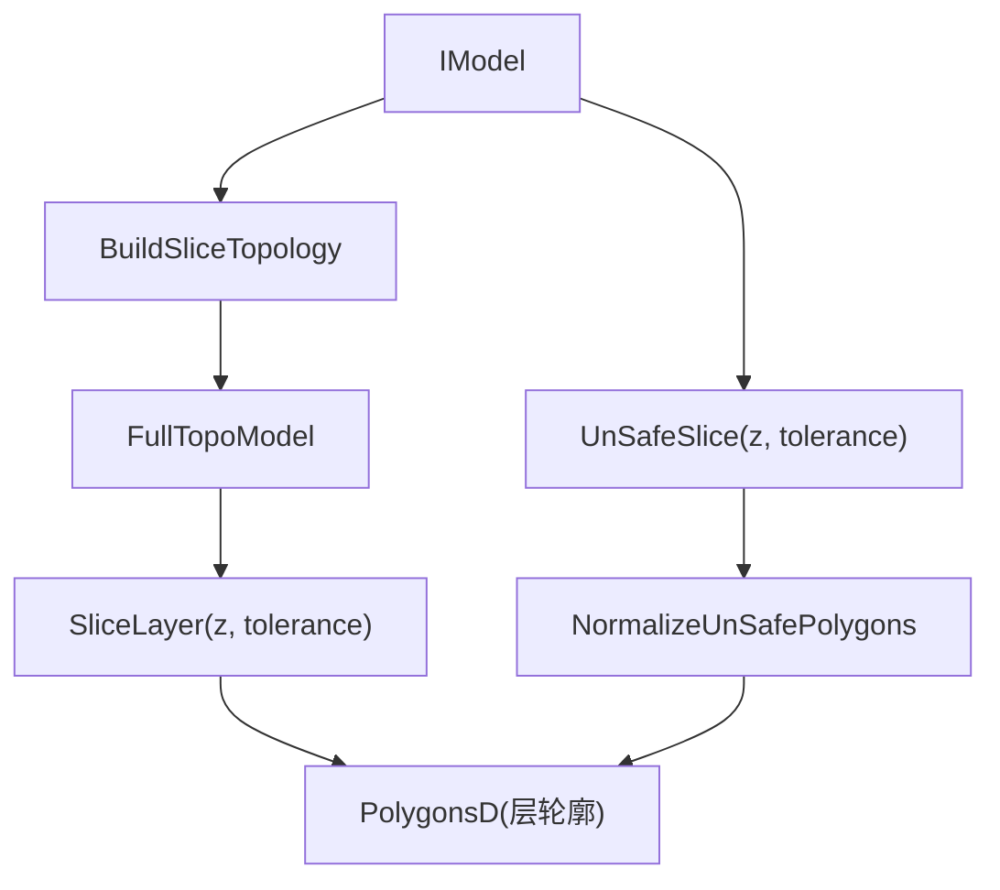
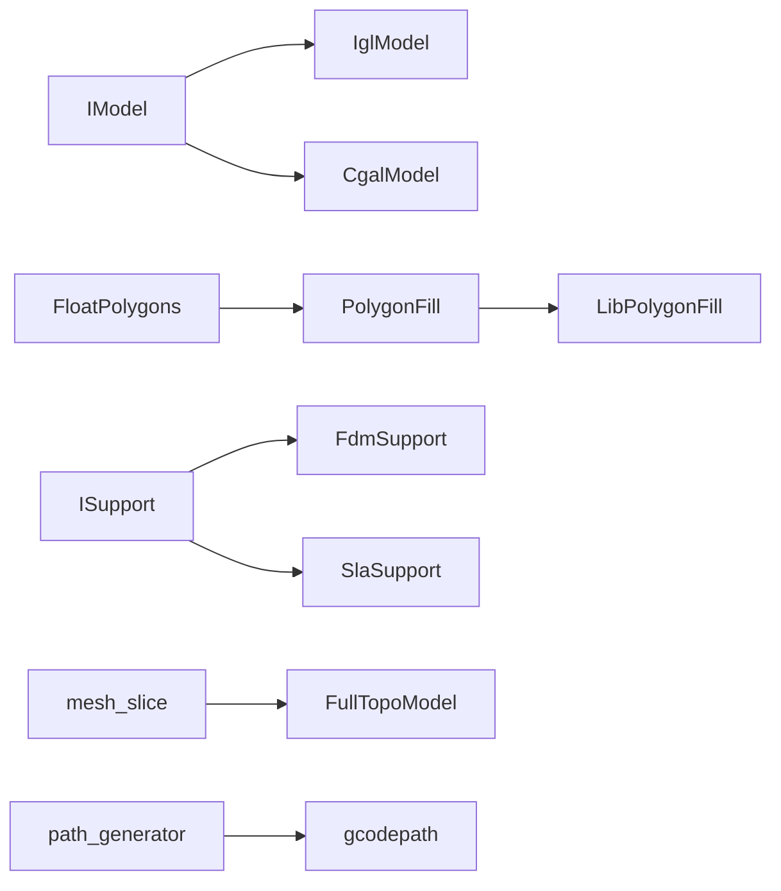

# 核心模块详解

<cite>
**本文引用的文件**   
- [IModel.hpp](file://base/IModel.hpp)
- [IglModel.hpp](file://meshmodel/IglModel.hpp)
- [CgalModel.hpp](file://meshmodel/CgalModel.hpp)
- [FullTopoModel.hpp](file://meshmodel/FullTopoModel.hpp)
- [ISupport.hpp](file://support/ISupport.hpp)
- [FdmSupport.hpp](file://support/FdmSupport.hpp)
- [SlaSupport.hpp](file://support/SlaSupport.hpp)
- [SupportConfig.hpp](file://support/SupportConfig.hpp)
- [FloatPolygons.hpp](file://2D/FloatPolygons.hpp)
- [PolygonFill.hpp](file://2D/PolygonFill.hpp)
- [polygon_fill.hpp](file://LibHsBaSlicer/Fill/polygon_fill.hpp)
- [path_generator.hpp](file://LibHsBaSlicer/Path/path_generator.hpp)
- [gcodepath.hpp](file://paths/gcodepath.hpp)
- [mesh_slice.hpp](file://LibHsBaSlicer/Slice/mesh_slice.hpp)
</cite>

## 目录
1. [引言](#引言)
2. [项目结构](#项目结构)
3. [核心组件](#核心组件)
4. [架构总览](#架构总览)
5. [详细组件分析](#详细组件分析)
6. [依赖关系分析](#依赖关系分析)
7. [性能考虑](#性能考虑)
8. [故障排除指南](#故障排除指南)
9. [结论](#结论)
10. [附录](#附录)

## 引言
本文件面向 HsBaSlicer 的核心模块，聚焦模型处理、支撑生成、填充算法、路径规划与切片引擎五大模块。文档从接口契约、数据结构、算法流程、调用序列、配置参数到性能优化与常见问题进行系统化说明，既适合初学者建立整体认知，也为高级开发者提供实现细节与扩展点。

## 项目结构
围绕切片流水线，核心代码分布在以下区域：
- base：抽象模型接口 IModel 与基础类型
- meshmodel：网格模型实现（IglModel、CgalModel）与拓扑重建 FullTopoModel
- support：支撑生成抽象接口与 FDM/SLA 具体策略
- 2D：二维多边形类型与布尔运算、偏移、面积等几何工具
- LibHsBaSlicer：对外 C++ API（切片、填充、路径生成）
- paths：GCode 输出与层路径容器

图表来源
- [IModel.hpp:110-139](file://base/IModel.hpp#L110-L139)
- [FloatPolygons.hpp:18-26](file://2D/FloatPolygons.hpp#L18-L26)
- [IglModel.hpp:26-121](file://meshmodel/IglModel.hpp#L26-L121)
- [CgalModel.hpp:34-155](file://meshmodel/CgalModel.hpp#L34-L155)
- [FullTopoModel.hpp:53-142](file://meshmodel/FullTopoModel.hpp#L53-L142)
- [ISupport.hpp:22-45](file://support/ISupport.hpp#L22-L45)
- [FdmSupport.hpp:19-63](file://support/FdmSupport.hpp#L19-L63)
- [SlaSupport.hpp:20-42](file://support/SlaSupport.hpp#L20-L42)
- [SupportConfig.hpp:14-43](file://support/SupportConfig.hpp#L14-L43)
- [PolygonFill.hpp:20-136](file://2D/PolygonFill.hpp#L20-L136)
- [polygon_fill.hpp:17-53](file://LibHsBaSlicer/Fill/polygon_fill.hpp#L17-L53)
- [mesh_slice.hpp:22-103](file://LibHsBaSlicer/Slice/mesh_slice.hpp#L22-L103)
- [path_generator.hpp:20-91](file://LibHsBaSlicer/Path/path_generator.hpp#L20-L91)
- [gcodepath.hpp:32-107](file://paths/gcodepath.hpp#L32-L107)

章节来源
- [README.md:25-39](file://README.md#L25-L39)

## 核心组件
本节概述各核心模块的职责与边界：
- 模型处理：IModel 抽象 + IglModel/CgalModel 两种后端 + FullTopoModel 拓扑重建与快速切片
- 支撑生成：ISupport 抽象 + FDM 平面/树/蜂窝 + SLA 牺牲支撑
- 填充算法：PolygonFill 提供偏移、直线、锯齿、复合与混合填充，支持 Lua 自定义
- 路径规划：path_generator 将层轮廓/填充/支撑转换为 GCode 路径，支持螺旋花瓶模式
- 切片引擎：mesh_slice 提供安全/不安全切片、Lua 驱动切片与可复用拓扑切片

章节来源
- [IModel.hpp:110-139](file://base/IModel.hpp#L110-L139)
- [IglModel.hpp:26-121](file://meshmodel/IglModel.hpp#L26-L121)
- [CgalModel.hpp:34-155](file://meshmodel/CgalModel.hpp#L34-L155)
- [FullTopoModel.hpp:53-142](file://meshmodel/FullTopoModel.hpp#L53-L142)
- [ISupport.hpp:22-45](file://support/ISupport.hpp#L22-L45)
- [FdmSupport.hpp:19-63](file://support/FdmSupport.hpp#L19-L63)
- [SlaSupport.hpp:20-42](file://support/SlaSupport.hpp#L20-L42)
- [PolygonFill.hpp:20-136](file://2D/PolygonFill.hpp#L20-L136)
- [polygon_fill.hpp:17-53](file://LibHsBaSlicer/Fill/polygon_fill.hpp#L17-L53)
- [path_generator.hpp:20-91](file://LibHsBaSlicer/Path/path_generator.hpp#L20-L91)
- [mesh_slice.hpp:22-103](file://LibHsBaSlicer/Slice/mesh_slice.hpp#L22-L103)

## 架构总览
下图展示从模型到 GCode 的端到端数据流，以及关键模块间的协作关系。

图表来源
- [mesh_slice.hpp:22-103](file://LibHsBaSlicer/Slice/mesh_slice.hpp#L22-L103)
- [FullTopoModel.hpp:74-127](file://meshmodel/FullTopoModel.hpp#L74-L127)
- [ISupport.hpp:22-45](file://support/ISupport.hpp#L22-L45)
- [PolygonFill.hpp:20-136](file://2D/PolygonFill.hpp#L20-L136)
- [polygon_fill.hpp:17-53](file://LibHsBaSlicer/Fill/polygon_fill.hpp#L17-L53)
- [path_generator.hpp:20-91](file://LibHsBaSlicer/Path/path_generator.hpp#L20-L91)
- [gcodepath.hpp:32-107](file://paths/gcodepath.hpp#L32-L107)

## 详细组件分析

### 模型处理模块（IglModel、CgalModel、FullTopoModel）
- IModel 抽象了加载/保存、变换、包围盒/体积查询与三角网格导出能力，是各模型实现的统一契约。
- IglModel 基于 libigl/Eigen，提供顶点/面片存储、法线计算、布尔操作与基本体工厂方法。
- CgalModel 基于 CGAL Polyhedron/Nef，提供布尔运算、测地线/螺旋/螺旋线等表面几何能力。
- FullTopoModel 在构造时重建完整拓扑（顶点/边/面），提供安全/不安全/快速切片与 Lua 驱动切片，并暴露欧拉特征检测。

图表来源
- [IModel.hpp:110-139](file://base/IModel.hpp#L110-L139)
- [IglModel.hpp:26-121](file://meshmodel/IglModel.hpp#L26-L121)
- [CgalModel.hpp:34-155](file://meshmodel/CgalModel.hpp#L34-L155)
- [FullTopoModel.hpp:53-142](file://meshmodel/FullTopoModel.hpp#L53-L142)

使用要点
- 若需多次切片，优先通过 BuildSliceTopology 构建一次拓扑后复用 SliceLayer，避免每层重复重建拓扑。
- 对需要严格闭合轮廓的场景使用 Slice；对需要保留开放轮廓或调试场景使用 UnSafeSlice。
- IglModel 适合轻量网格与布尔组合；CgalModel 适合复杂布尔与表面几何任务。

章节来源
- [IModel.hpp:110-139](file://base/IModel.hpp#L110-L139)
- [IglModel.hpp:26-121](file://meshmodel/IglModel.hpp#L26-L121)
- [CgalModel.hpp:34-155](file://meshmodel/CgalModel.hpp#L34-L155)
- [FullTopoModel.hpp:53-142](file://meshmodel/FullTopoModel.hpp#L53-L142)
- [mesh_slice.hpp:79-103](file://LibHsBaSlicer/Slice/mesh_slice.hpp#L79-L103)

### 支撑生成模块（FdmSupport、SlaSupport）
- ISupport 定义按层生成支撑截面的统一接口，默认实现提供全层迭代。
- FdmPlaneSupport：根据悬垂区域膨胀为柱状支撑列，设置模型与支撑间隙。
- FdmTreeSupport：自底板向上生长树状分支，分支相交合并，横截面为圆点向下连接。
- FdmHoneycombSupport：在悬垂区域内以六边形蜂窝填充，轻量化且具备一定刚度。
- SlaSacrificialSupport：树脂打印牺牲支撑，尖部直径小便于去除，底部直径大增强附着。

图表来源
- [ISupport.hpp:22-45](file://support/ISupport.hpp#L22-L45)
- [FdmSupport.hpp:19-63](file://support/FdmSupport.hpp#L19-L63)
- [SlaSupport.hpp:20-42](file://support/SlaSupport.hpp#L20-L42)

配置选项
- SupportConfig：悬垂角度阈值、层高、支撑间隙、支撑直径、密度、图案（平面/树/蜂窝）、树分支角、最大分支半径、蜂窝单元尺寸。
- FdmSupportConfig：界面层数、界面层密度。
- SlaSupportConfig：支撑尖部直径、筏板厚度。

章节来源
- [ISupport.hpp:22-45](file://support/ISupport.hpp#L22-L45)
- [FdmSupport.hpp:19-63](file://support/FdmSupport.hpp#L19-L63)
- [SlaSupport.hpp:20-42](file://support/SlaSupport.hpp#L20-L42)
- [SupportConfig.hpp:14-43](file://support/SupportConfig.hpp#L14-L43)

### 填充算法模块（PolygonFill）
- 提供 OffsetFill、LineFill、SimpleZigzagFill、ZigzagFill、CompositeOffsetFill、HybridFill 等填充模式。
- 支持通过 Lua 脚本自定义填充（LuaCustomFill/LuaCustomFillString）。
- LibHsBaSlicer 侧提供 FillPolygon、FillWithBorder、LuaCustomFillByFile 的统一封装。

图表来源
- [PolygonFill.hpp:20-136](file://2D/PolygonFill.hpp#L20-L136)
- [polygon_fill.hpp:17-53](file://LibHsBaSlicer/Fill/polygon_fill.hpp#L17-L53)

参数说明
- spacing：填充线间距
- angle_deg：填充方向角度（度）
- lineThickness：填充线宽
- outwardCount/inwardCount：外扩/内缩偏移层数
- join_type：偏移拐角连接方式（Square 等）

章节来源
- [PolygonFill.hpp:20-136](file://2D/PolygonFill.hpp#L20-L136)
- [polygon_fill.hpp:17-53](file://LibHsBaSlicer/Fill/polygon_fill.hpp#L17-L53)

### 路径规划模块（path_generator）
- 将每层的轮廓、填充、支撑转换为 GCode 路径，支持多固件输出与螺旋花瓶模式。
- FdmPathConfig 控制层高、线宽、速度、挤出倍率与单位。
- LayerPathData 组织单层数据（outlines/fills/supports/z_height）。
- 提供 GenerateGCodePath、GenerateGCodePathV2、GenerateGCodePathSpiral 与辅助函数 PolygonsToGPoints。

图表来源
- [path_generator.hpp:20-91](file://LibHsBaSlicer/Path/path_generator.hpp#L20-L91)
- [gcodepath.hpp:32-107](file://paths/gcodepath.hpp#L32-L107)

配置与返回值
- FdmPathConfig：layer_height、line_width、print_speed、travel_speed、extrusion_multiplier、units
- LayerPathData：outlines、fills、supports、z_height
- 返回值：std::unique_ptr<PointsPath> 或 std::unique_ptr<GCodePath>

章节来源
- [path_generator.hpp:20-91](file://LibHsBaSlicer/Path/path_generator.hpp#L20-L91)

### 切片引擎模块（mesh_slice）
- 提供安全切片 Slice、不安全切片 UnSafeSlice、Lua 驱动切片 SliceLua/UnSafeSliceLua。
- NormalizeUnSafePolygons 用于清理开放折线与非简单多边形，并转为双精度 PolygonsD。
- BuildSliceTopology 一次性构建可复用拓扑，SliceLayer 针对单层高效切片。

图表来源
- [mesh_slice.hpp:22-103](file://LibHsBaSlicer/Slice/mesh_slice.hpp#L22-L103)
- [FullTopoModel.hpp:74-127](file://meshmodel/FullTopoModel.hpp#L74-L127)

章节来源
- [mesh_slice.hpp:22-103](file://LibHsBaSlicer/Slice/mesh_slice.hpp#L22-L103)

## 依赖关系分析
- 模型层：IglModel/CgalModel 均实现 IModel，供切片与布尔操作使用。
- 几何层：FloatPolygons 提供 Clipper2 封装的多边形布尔、偏移、面积与形状生成，被填充与支撑广泛使用。
- 支撑层：ISupport 抽象被 FDM/SLA 具体实现继承，共享 SupportConfig。
- 填充层：PolygonFill 依赖 FloatPolygons 与 IntPolygon，Lib 层提供统一封装。
- 路径层：path_generator 依赖 2D 多边形与 paths 中的 LayersPath/GCodePath。
- 切片层：mesh_slice 依赖 FullTopoModel 与 IModel。

图表来源
- [IModel.hpp:110-139](file://base/IModel.hpp#L110-L139)
- [FloatPolygons.hpp:18-26](file://2D/FloatPolygons.hpp#L18-L26)
- [PolygonFill.hpp:20-136](file://2D/PolygonFill.hpp#L20-L136)
- [polygon_fill.hpp:17-53](file://LibHsBaSlicer/Fill/polygon_fill.hpp#L17-L53)
- [ISupport.hpp:22-45](file://support/ISupport.hpp#L22-L45)
- [FdmSupport.hpp:19-63](file://support/FdmSupport.hpp#L19-L63)
- [SlaSupport.hpp:20-42](file://support/SlaSupport.hpp#L20-L42)
- [mesh_slice.hpp:22-103](file://LibHsBaSlicer/Slice/mesh_slice.hpp#L22-L103)
- [path_generator.hpp:20-91](file://LibHsBaSlicer/Path/path_generator.hpp#L20-L91)
- [gcodepath.hpp:32-107](file://paths/gcodepath.hpp#L32-L107)

## 性能考虑
- 拓扑复用：对于多层切片，优先使用 BuildSliceTopology 构建一次拓扑，再调用 SliceLayer，避免每层重复重建拓扑带来的 O(total_faces) 开销。
- 填充策略：对于大面积薄壁，优先使用偏移+内部填充的组合（Composite/Hybrid），减少无效线段与转角复杂度。
- 支撑密度：合理设置 support_density 与 support_gap，避免过度密集导致填充与路径生成耗时上升。
- 路径优化：使用 GenerateGCodePathV2 指定打印机配置，结合相对挤出/回抽等参数，减少不必要的移动与停顿。
- 螺旋模式：对棱柱类模型使用 GenerateGCodePathSpiral，消除层间停顿，提升打印质量与效率。

[本节为通用指导，不直接分析具体文件]

## 故障排除指南
- 切片结果出现开放折线或非简单多边形：
  - 使用 UnSafeSlice 获取原始结果，再通过 NormalizeUnSafePolygons 清理开放折线与非简单多边形，得到标准 PolygonsD。
- 支撑与模型粘连：
  - 检查 SupportConfig.support_gap 是否过小；适当增大间隙或调整支撑直径与密度。
- 填充出现空洞或重叠：
  - 调整 spacing 与 lineThickness，确保间距小于线宽以避免空洞；必要时增加 outwardCount/inwardCount 以改善边界。
- GCode 异常或挤出异常：
  - 核对 FdmPathConfig 与 GCodePrinterConfig 的单位、线宽、层高、挤出倍率是否一致；确认相对/绝对挤出模式设置正确。

章节来源
- [mesh_slice.hpp:67-77](file://LibHsBaSlicer/Slice/mesh_slice.hpp#L67-L77)
- [SupportConfig.hpp:14-43](file://support/SupportConfig.hpp#L14-L43)
- [PolygonFill.hpp:20-136](file://2D/PolygonFill.hpp#L20-L136)
- [path_generator.hpp:20-91](file://LibHsBaSlicer/Path/path_generator.hpp#L20-L91)
- [gcodepath.hpp:32-107](file://paths/gcodepath.hpp#L32-L107)

## 结论
HsBaSlicer 的核心模块围绕 IModel 抽象与 2D 多边形几何能力展开，通过 FullTopoModel 提供高效的拓扑切片，配合灵活的支撑与填充策略，最终由路径规划模块输出多固件兼容的 GCode。遵循本文的配置建议与性能优化策略，可在保证切片质量的同时显著提升处理效率。

[本节为总结性内容，不直接分析具体文件]

## 附录
- 常用数据结构速查
  - PolygonsD：双精度多边形集合（Clipper2 PathsD）
  - PolygonD：双精度多边形路径（Clipper2 PathD）
  - Point2D：双精度二维点（Clipper2 PointD）
  - LayerPathData：单层路径数据（outlines/fills/supports/z_height）
  - FdmPathConfig：FDM 路径配置（层高/线宽/速度/挤出倍率/单位）
  - GCodePrinterConfig：GCode 打印机配置（喷嘴/耗材/温度/回抽/速度/层高/线宽/挤出倍率/相对挤出）

章节来源
- [FloatPolygons.hpp:18-26](file://2D/FloatPolygons.hpp#L18-L26)
- [path_generator.hpp:20-91](file://LibHsBaSlicer/Path/path_generator.hpp#L20-L91)
- [gcodepath.hpp:32-107](file://paths/gcodepath.hpp#L32-L107)