# 核心模块详解

<cite>
**本文引用的文件**   
- [README.md](file://README.md)
- [base/singleton.hpp](file://base/singleton.hpp)
- [base/thread_pool.hpp](file://base/thread_pool.hpp)
- [base/coroutine.hpp](file://base/coroutine.hpp)
- [utils/app_config.hpp](file://utils/app_config.hpp)
- [fileoperator/param_store.hpp](file://fileoperator/param_store.hpp)
- [meshmodel/FullTopoModel.hpp](file://meshmodel/FullTopoModel.hpp)
- [cadmodel/OcctModel.hpp](file://cadmodel/OcctModel.hpp)
- [pointcloud/OpenVdbModel.hpp](file://pointcloud/OpenVdbModel.hpp)
- [support/FdmSupport.hpp](file://support/FdmSupport.hpp)
- [paths/IPath.hpp](file://paths/IPath.hpp)
- [LibHsBaSlicer/CMakeLists.txt](file://LibHsBaSlicer/CMakeLists.txt)
</cite>

## 目录
1. [引言](#引言)
2. [项目结构](#项目结构)
3. [核心组件](#核心组件)
4. [架构总览](#架构总览)
5. [详细组件分析](#详细组件分析)
6. [依赖关系分析](#依赖关系分析)
7. [性能与优化建议](#性能与优化建议)
8. [故障排除指南](#故障排除指南)
9. [结论](#结论)
10. [附录：API 参考速查](#附录api-参考速查)

## 引言
本文件面向 HsBaSlicer 的核心模块，聚焦以下目标：
- 全面说明 base、utils、fileoperator、meshmodel、cadmodel、pointcloud、support、paths 等模块的职责、接口与使用方式。
- 解释模块间依赖关系与数据流转，给出可视化架构图与流程图。
- 提供 API 参考要点、配置选项说明与常见问题解决方案。
- 结合源码实证，避免臆造 API；所有引用均标注具体文件与行号。

HsBaSlicer 是一个面向增材制造切片的高性能 C++ 框架，模块化、跨平台，适用于研发与生产级流水线。其核心库 LibHsBaSlicer 暴露预处理、切片、支撑、填充、路径生成五大能力；DllHsBaSlicer 提供 C ABI 的运行时流水线接口，便于多语言集成。

**章节来源**
- [README.md:21-39](file://README.md#L21-L39)

## 项目结构
仓库按职责划分多个子模块：
- base：基础类型与通用工具（单例、线程池、协程、委托、反射等）。
- utils：应用配置、序列化、Lua 绑定辅助。
- fileoperator：ZIP/SQLite/属性树/Lua 适配器/参数持久化。
- meshmodel：网格模型（CGAL/IGL/拓扑重建）。
- cadmodel：基于 OpenCascade 的 B-Rep CAD 建模与布尔运算。
- pointcloud：基于 OpenVDB 的点云模型与体素操作。
- support：FDM/SLA 支撑生成与悬垂检测。
- paths：层路径、点路径、图像路径、机器人路径输出。
- LibHsBaSlicer：C++ 全流程切片封装。
- DllHsBaSlicer：C ABI 流水线导出层。

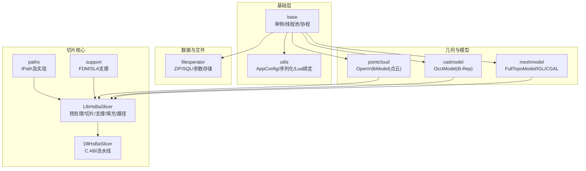

**图表来源**
- [README.md:29-39](file://README.md#L29-L39)
- [LibHsBaSlicer/CMakeLists.txt:87-105](file://LibHsBaSlicer/CMakeLists.txt#L87-L105)

**章节来源**
- [README.md:29-39](file://README.md#L29-L39)
- [LibHsBaSlicer/CMakeLists.txt:87-105](file://LibHsBaSlicer/CMakeLists.txt#L87-L105)

## 核心组件
本节概述各核心模块的职责边界与关键入口：
- base：提供线程安全单例、任务线程池、协程 Task/Generator 与执行器抽象。
- utils：提供 AppConfigSingletone 全局配置访问。
- fileoperator：ParamStore 负责工艺参数的持久化（CRUD、事务、加密列）。
- meshmodel：FullTopoModel 提供拓扑重建与多种切片接口（含 Lua 扩展）。
- cadmodel：OcctModel 实现 IModel，支持 STEP/IGES/VRML/BRep 读写、布尔运算、抽壳、基元创建。
- pointcloud：OpenVdbModel 提供点云体素化、KNN/半径查询、法线估计、网格重建。
- support：FdmPlaneSupport/FdmTreeSupport/FdmHoneycombSupport 提供 FDM 支撑策略。
- paths：IPath 抽象输出路径，支持保存为文件或字符串，并可选 Lua 后处理。

**章节来源**
- [base/singleton.hpp:14-61](file://base/singleton.hpp#L14-L61)
- [base/thread_pool.hpp:25-162](file://base/thread_pool.hpp#L25-L162)
- [base/coroutine.hpp:41-773](file://base/coroutine.hpp#L41-L773)
- [utils/app_config.hpp:12-46](file://utils/app_config.hpp#L12-L46)
- [fileoperator/param_store.hpp:28-121](file://fileoperator/param_store.hpp#L28-L121)
- [meshmodel/FullTopoModel.hpp:43-145](file://meshmodel/FullTopoModel.hpp#L43-L145)
- [cadmodel/OcctModel.hpp:22-124](file://cadmodel/OcctModel.hpp#L22-L124)
- [pointcloud/OpenVdbModel.hpp:20-116](file://pointcloud/OpenVdbModel.hpp#L20-L116)
- [support/FdmSupport.hpp:11-63](file://support/FdmSupport.hpp#L11-L63)
- [paths/IPath.hpp:18-65](file://paths/IPath.hpp#L18-L65)

## 架构总览
下图展示从输入模型到最终路径输出的典型数据流，以及各模块间的调用关系。

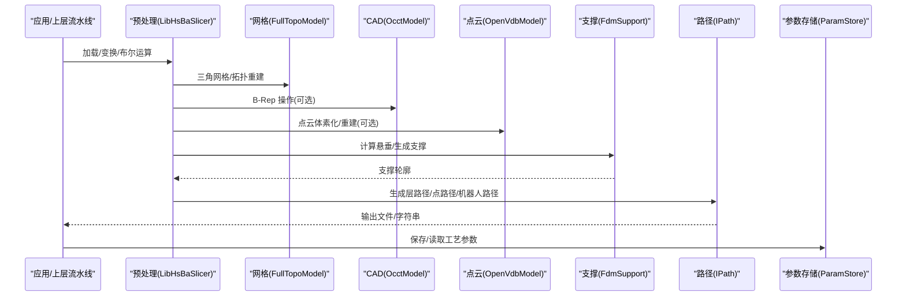

**图表来源**
- [LibHsBaSlicer/CMakeLists.txt:87-105](file://LibHsBaSlicer/CMakeLists.txt#L87-L105)
- [meshmodel/FullTopoModel.hpp:100-127](file://meshmodel/FullTopoModel.hpp#L100-L127)
- [cadmodel/OcctModel.hpp:54-109](file://cadmodel/OcctModel.hpp#L54-L109)
- [pointcloud/OpenVdbModel.hpp:46-83](file://pointcloud/OpenVdbModel.hpp#L46-L83)
- [support/FdmSupport.hpp:19-63](file://support/FdmSupport.hpp#L19-L63)
- [paths/IPath.hpp:34-56](file://paths/IPath.hpp#L34-L56)
- [fileoperator/param_store.hpp:45-79](file://fileoperator/param_store.hpp#L45-L79)

## 详细组件分析

### base 模块：基础类型与工具
- 单例 Singleton<T>：线程安全的单例模板，通过 std::call_once 保证唯一实例构造，对外暴露 GetInstance()。
- 线程池 ThreadPool：管理 worker 线程队列，支持 submit、WaitAll、PendingTasks、ActiveTasks；析构时优雅停止并 join。
- 协程 coroutine：定义 IExecutor/NoopExecutor/AsyncExecutor 执行器抽象，Task<T, Executor> 提供 then/catching/finally 链式回调，CustomAllocatorTask 支持自定义分配器；Generator<T> 提供 yield_value 迭代器语义。

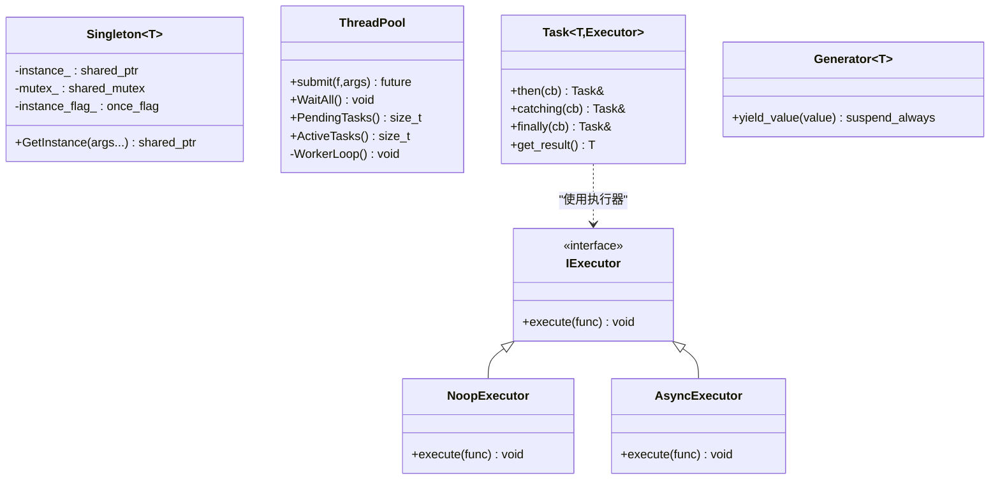

**图表来源**
- [base/singleton.hpp:14-61](file://base/singleton.hpp#L14-L61)
- [base/thread_pool.hpp:25-162](file://base/thread_pool.hpp#L25-L162)
- [base/coroutine.hpp:41-773](file://base/coroutine.hpp#L41-L773)

**章节来源**
- [base/singleton.hpp:14-61](file://base/singleton.hpp#L14-L61)
- [base/thread_pool.hpp:25-162](file://base/thread_pool.hpp#L25-L162)
- [base/coroutine.hpp:41-773](file://base/coroutine.hpp#L41-L773)

### utils 模块：配置管理与 Lua 绑定
- AppConfigSingletone：进程级配置单例，提供外部工具路径（如 7-Zip）访问接口。
- 其他工具（JSON/YAML/XML 序列化、LuaNewObject、PCH 头、日志配置）在 utils 中提供，便于上层流水线与脚本系统复用。

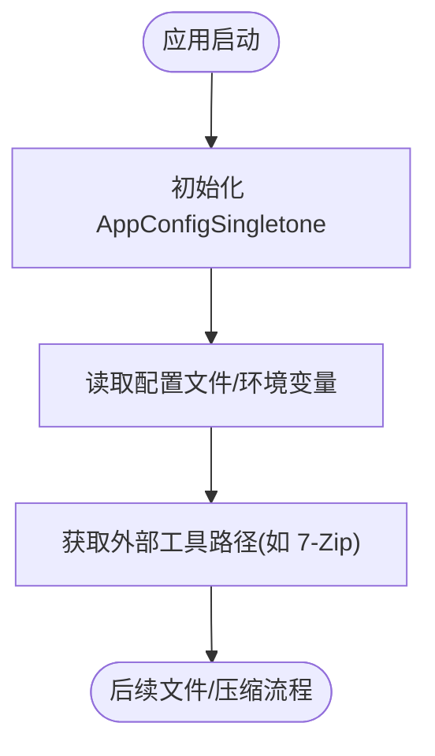

**图表来源**
- [utils/app_config.hpp:12-46](file://utils/app_config.hpp#L12-L46)

**章节来源**
- [utils/app_config.hpp:12-46](file://utils/app_config.hpp#L12-L46)

### fileoperator 模块：文件操作与参数存储
- ParamStore：面向 ISQLAdapter 的参数持久化主类，提供 EnsureSchema/Save/Load/List/Update/Delete 等 CRUD 接口；Save 内部执行 Validate -> Reflect -> Coerce -> Upsert 阶段化流程；批量 SaveBatch 包裹在事务中；支持 SetCryptoKey 启用 AES-256-CBC 列级加密；错误不吞掉，记录 last_error 并抛出异常供调用方处理。

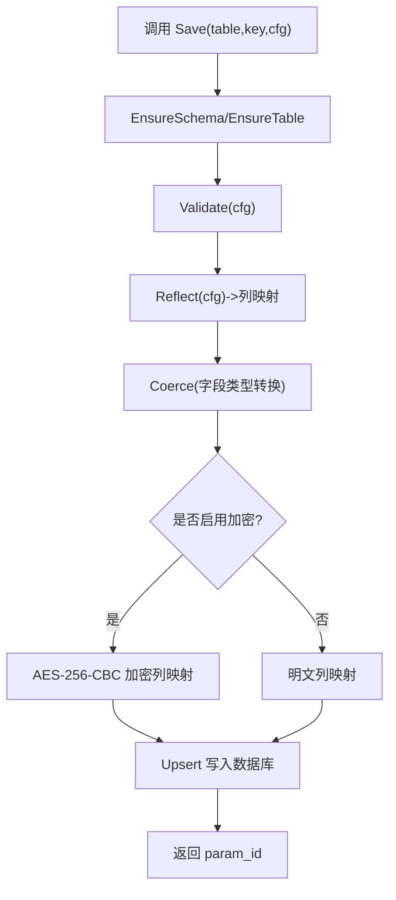

**图表来源**
- [fileoperator/param_store.hpp:30-121](file://fileoperator/param_store.hpp#L30-L121)

**章节来源**
- [fileoperator/param_store.hpp:30-121](file://fileoperator/param_store.hpp#L30-L121)

### meshmodel 模块：网格处理能力
- FullTopoModel：面向切片的完整拓扑重建网格模型，提供 CheckTopo、EulerCharacteristic、Safe/Unsafe/Fast Slice、SliceLua 等接口；支持将顶点/边/面数据推送到 Lua 环境进行自定义切片脚本处理。

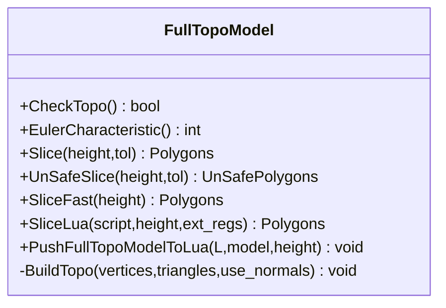

**图表来源**
- [meshmodel/FullTopoModel.hpp:43-145](file://meshmodel/FullTopoModel.hpp#L43-L145)

**章节来源**
- [meshmodel/FullTopoModel.hpp:43-145](file://meshmodel/FullTopoModel.hpp#L43-L145)

### cadmodel 模块：CAD 建模功能
- OcctModel：实现 IModel，封装 TopoDS_Shape，支持 STEP/IGES/VRML/BRep 读写、平移/旋转/缩放/仿射变换、包围盒/体积/三角网格查询、Union/Intersection/Difference/Xor 布尔运算、ThickSolid 抽壳、CreateBox/Sphere/Cylinder/Cone/Torus/CreatePrime 基元工厂。

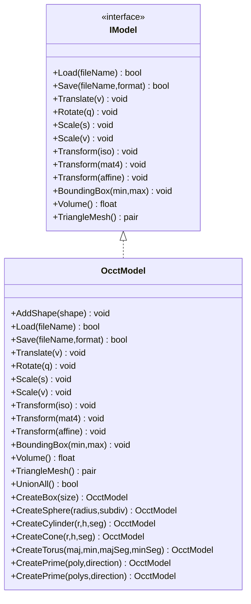

**图表来源**
- [cadmodel/OcctModel.hpp:22-124](file://cadmodel/OcctModel.hpp#L22-L124)

**章节来源**
- [cadmodel/OcctModel.hpp:22-124](file://cadmodel/OcctModel.hpp#L22-L124)

### pointcloud 模块：点云处理
- OpenVdbModel：基于 OpenVDB 体素网格的点云模型，实现 IModel 变换/包围盒/体积/三角网格接口，并提供 AddPoint/AddPoints/Points/PointCount/IsEmpty/Clear/SetFromVertices/ToVertices/ToVerticesFaces/GenerateMesh/Voxelize/NearestNeighbor/KNN/Filter/RadiusSearch/Downsample/VoxelCenters/Centroid/Merge/RemoveStatisticalOutliers/ComputeNormals 等点云专用方法。

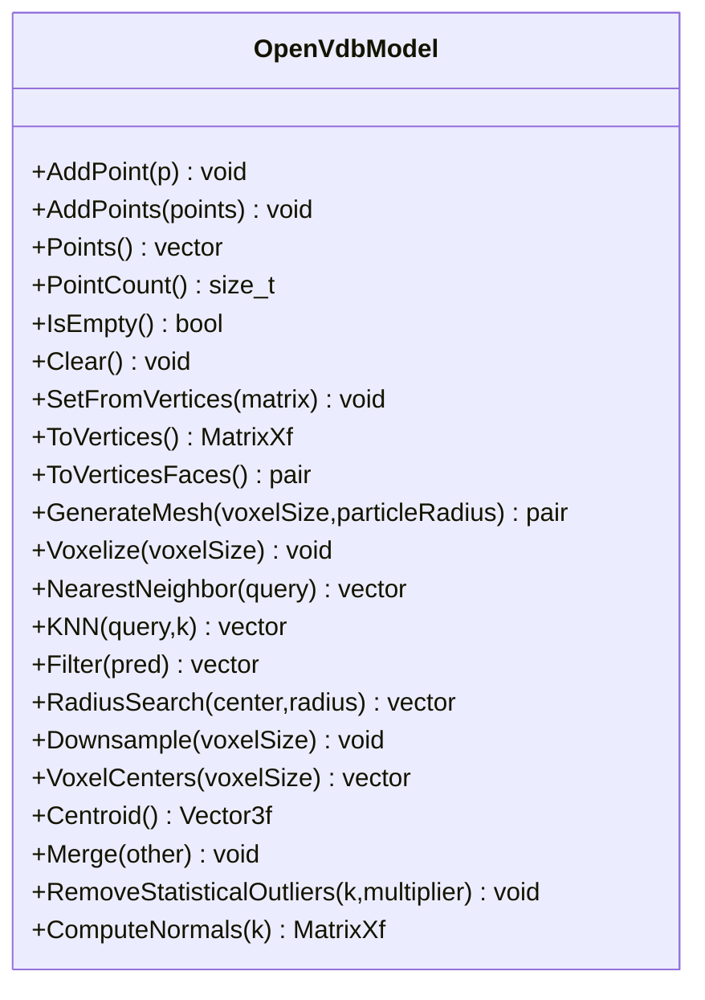

**图表来源**
- [pointcloud/OpenVdbModel.hpp:20-116](file://pointcloud/OpenVdbModel.hpp#L20-L116)

**章节来源**
- [pointcloud/OpenVdbModel.hpp:20-116](file://pointcloud/OpenVdbModel.hpp#L20-L116)

### support 模块：支撑生成算法
- FdmPlaneSupport：平面支撑，根据悬垂区域生成柱状支撑，设置支撑直径与间隙。
- FdmTreeSupport：树形支撑，自底板向上生长分支并在相遇处合并，横截面为圆形支撑点。
- FdmHoneycombSupport：蜂窝支撑，用六边形单元填充悬垂区域，轻量且刚性好。

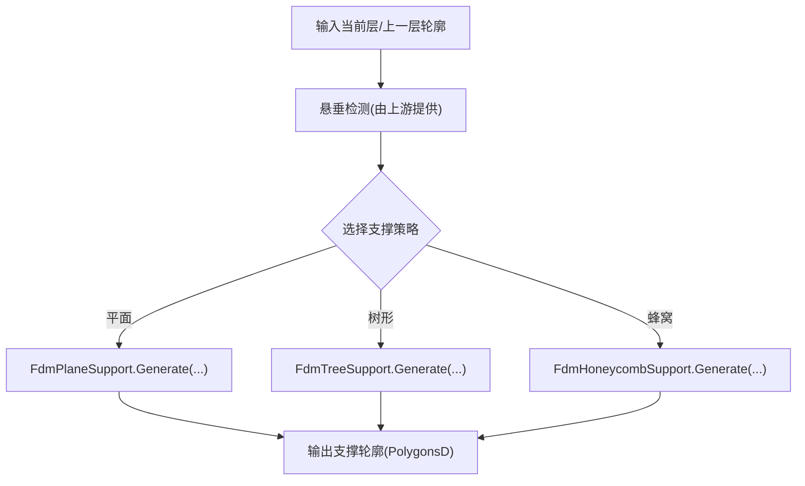

**图表来源**
- [support/FdmSupport.hpp:19-63](file://support/FdmSupport.hpp#L19-L63)

**章节来源**
- [support/FdmSupport.hpp:19-63](file://support/FdmSupport.hpp#L19-L63)

### paths 模块：路径输出管理
- IPath：抽象输出路径接口，支持 Save/ToString 系列重载，允许内联或文件形式的 Lua 脚本作为后处理器，并可注册额外 Lua 函数。
- 常见实现包括 PointsPath、LayersPath、ImagesPath、RobotPath、WeldRobotPath、GCodePath（在 paths 目录下），统一遵循 IPath 契约。

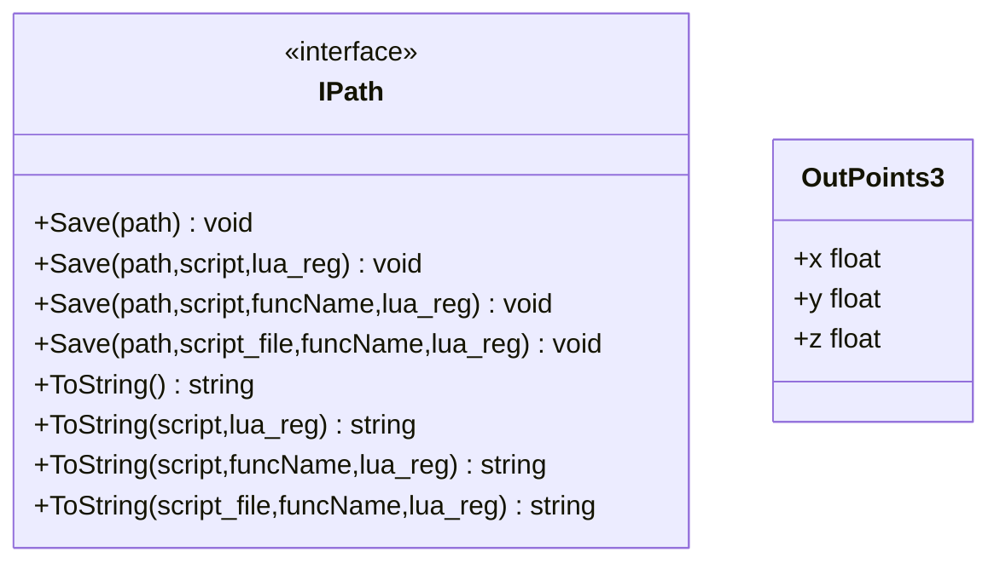

**图表来源**
- [paths/IPath.hpp:18-65](file://paths/IPath.hpp#L18-L65)

**章节来源**
- [paths/IPath.hpp:18-65](file://paths/IPath.hpp#L18-L65)

## 依赖关系分析
LibHsBaSlicer 静态库聚合了核心切片能力，依赖 base、mesh、2D、support、paths 等模块，并在桌面平台且启用 copyleft 内核时链接 CADModel。

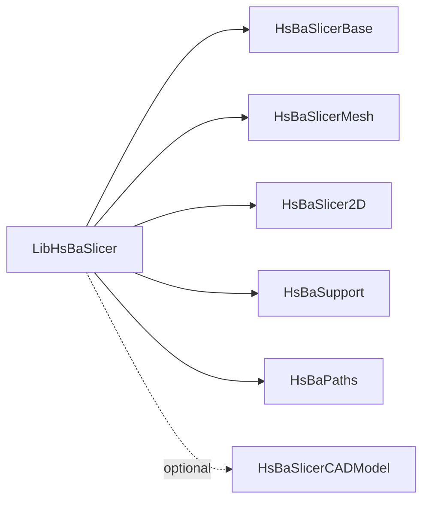

**图表来源**
- [LibHsBaSlicer/CMakeLists.txt:87-105](file://LibHsBaSlicer/CMakeLists.txt#L87-L105)

**章节来源**
- [LibHsBaSlicer/CMakeLists.txt:87-105](file://LibHsBaSlicer/CMakeLists.txt#L87-L105)

## 性能与优化建议
- 线程池与协程
  - 使用 ThreadPool 并行提交独立任务，避免阻塞主线程；合理设置线程数（默认 hardware_concurrency）。
  - 对 IO 密集或 CPU 密集任务分别选择合适的执行器（AsyncExecutor 或 ThreadPoolExecutor）。
- 内存与对象生命周期
  - 使用 Singleton 管理全局资源，避免重复构造开销。
  - 对频繁分配的对象考虑 CustomAllocatorTask 或对象池（base/object_pool.hpp）以减少碎片。
- 网格与 CAD
  - 优先使用 FullTopoModel 的 SliceFast 以利用已重建拓扑；仅在需要开放轮廓时使用 UnSafeSlice。
  - CAD 布尔运算与抽壳可能昂贵，建议在预处理阶段合并/简化模型。
- 点云
  - 先 Downsample 再 ComputeNormals/GenerateMesh，减少体素网格规模。
  - KNN/RadiusSearch 前可先 Voxelize 提升查询效率。
- 参数存储
  - 批量 SaveBatch 使用事务，减少锁竞争与磁盘同步次数。
  - 开启 SetCryptoKey 会引入加解密开销，按需启用。

[本节为通用指导，不直接分析具体文件]

## 故障排除指南
- 线程池提交失败
  - 现象：向已停止的 ThreadPool 提交任务抛出运行时错误。
  - 排查：确认未提前销毁线程池；检查 num_threads > 0。
  - 参考：[base/thread_pool.hpp:37-46](file://base/thread_pool.hpp#L37-L46)、[base/thread_pool.hpp:77-89](file://base/thread_pool.hpp#L77-L89)
- 协程结果未就绪
  - 现象：Task.get_result() 等待完成；若未正确 await 或调度，可能导致死等。
  - 排查：确保使用 then/catching/finally 或显式 get_result；检查 IExecutor 是否正确执行回调。
  - 参考：[base/coroutine.hpp:277-316](file://base/coroutine.hpp#L277-L316)
- 参数存储错误
  - 现象：Save/Load 抛出异常，last_error 非空。
  - 排查：检查 EnsureSchema 是否执行；校验 cfg 字段类型与约束；确认 crypto_key 一致。
  - 参考：[fileoperator/param_store.hpp:45-102](file://fileoperator/param_store.hpp#L45-L102)
- 网格拓扑不完整
  - 现象：SliceFast 抛错或切片结果异常。
  - 排查：先调用 CheckTopo 与 EulerCharacteristic 检查；必要时回退到 Safe/Unsafe Slice。
  - 参考：[meshmodel/FullTopoModel.hpp:80-114](file://meshmodel/FullTopoModel.hpp#L80-L114)
- CAD 模型加载失败
  - 现象：Load 返回 false。
  - 排查：确认文件格式受支持（STEP/IGES/VRML/BRep）；检查路径编码与权限。
  - 参考：[cadmodel/OcctModel.hpp:54-57](file://cadmodel/OcctModel.hpp#L54-L57)

**章节来源**
- [base/thread_pool.hpp:37-89](file://base/thread_pool.hpp#L37-L89)
- [base/coroutine.hpp:277-316](file://base/coroutine.hpp#L277-L316)
- [fileoperator/param_store.hpp:45-102](file://fileoperator/param_store.hpp#L45-L102)
- [meshmodel/FullTopoModel.hpp:80-114](file://meshmodel/FullTopoModel.hpp#L80-L114)
- [cadmodel/OcctModel.hpp:54-57](file://cadmodel/OcctModel.hpp#L54-L57)

## 结论
HsBaSlicer 的核心模块围绕“模型—切片—支撑—路径”的主干流程组织，base/utils/fileoperator 提供基础设施与数据持久化，meshmodel/cadmodel/pointcloud 提供几何与 CAD 能力，support/paths 完成支撑与路径输出。LibHsBaSlicer 将这些能力整合为统一的 C++ 接口，DllHsBaSlicer 进一步暴露 C ABI 以便跨语言集成。通过合理的线程池/协程使用、拓扑检查、点云降采样与参数存储事务化，可在保证正确性的同时获得良好的性能表现。

[本节为总结性内容，不直接分析具体文件]

## 附录：API 参考速查
- base
  - Singleton<T>::GetInstance(...)：线程安全单例构造与获取。
  - ThreadPool::submit(...)/WaitAll()/PendingTasks()/ActiveTasks()：任务提交与状态查询。
  - Task<T,Executor>::then/catching/finally/get_result：协程任务链式回调与结果获取。
  - Generator<T>::yield_value：协程迭代器语义。
- utils
  - AppConfigSingletone::GetInstance/GetSevenZPath：全局配置与外部工具路径。
- fileoperator
  - ParamStore::EnsureSchema/Save/Load/List/Update/Delete/SetCryptoKey/GetLastError：参数持久化 CRUD 与加密开关。
- meshmodel
  - FullTopoModel::CheckTopo/EulerCharacteristic/Slice/UnSafeSlice/SliceFast/SliceLua：拓扑检查与切片（含 Lua 扩展）。
- cadmodel
  - OcctModel::Load/Save/Translate/Rotate/Scale/Transform/BoundingBox/Volume/TriangleMesh/UnionAll/Create*：B-Rep 建模与变换。
- pointcloud
  - OpenVdbModel::AddPoint/AddPoints/Points/PointCount/IsEmpty/Clear/SetFromVertices/ToVertices/ToVerticesFaces/GenerateMesh/Voxelize/NearestNeighbor/KNN/Filter/RadiusSearch/Downsample/VoxelCenters/Centroid/Merge/RemoveStatisticalOutliers/ComputeNormals：点云全量操作。
- support
  - FdmPlaneSupport/FdmTreeSupport/FdmHoneycombSupport::Generate：FDM 支撑策略。
- paths
  - IPath::Save/ToString 系列：路径输出与 Lua 后处理。

**章节来源**
- [base/singleton.hpp:14-61](file://base/singleton.hpp#L14-L61)
- [base/thread_pool.hpp:25-162](file://base/thread_pool.hpp#L25-L162)
- [base/coroutine.hpp:41-773](file://base/coroutine.hpp#L41-L773)
- [utils/app_config.hpp:12-46](file://utils/app_config.hpp#L12-L46)
- [fileoperator/param_store.hpp:30-121](file://fileoperator/param_store.hpp#L30-L121)
- [meshmodel/FullTopoModel.hpp:43-145](file://meshmodel/FullTopoModel.hpp#L43-L145)
- [cadmodel/OcctModel.hpp:22-124](file://cadmodel/OcctModel.hpp#L22-L124)
- [pointcloud/OpenVdbModel.hpp:20-116](file://pointcloud/OpenVdbModel.hpp#L20-L116)
- [support/FdmSupport.hpp:11-63](file://support/FdmSupport.hpp#L11-L63)
- [paths/IPath.hpp:18-65](file://paths/IPath.hpp#L18-L65)