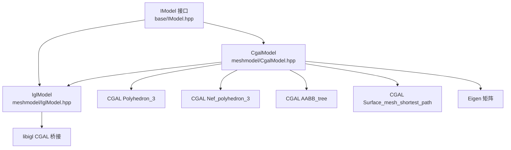
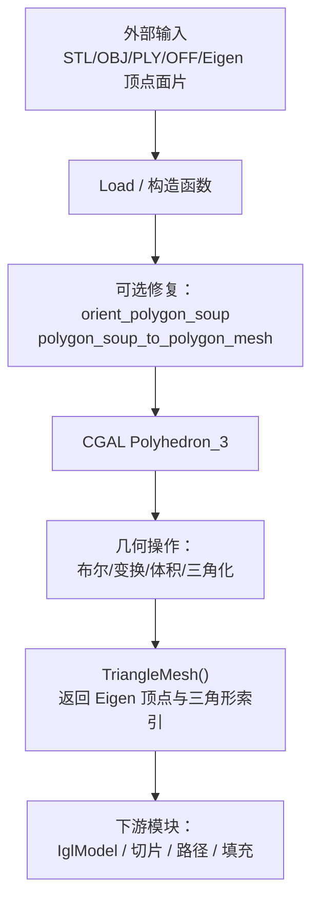
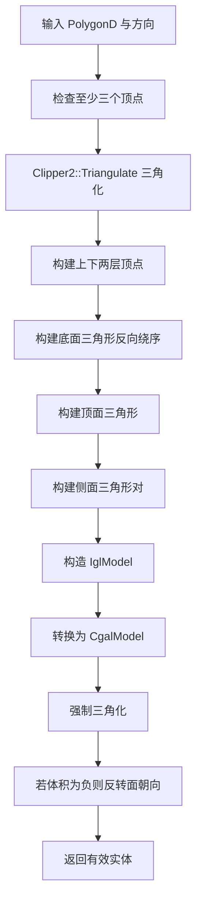
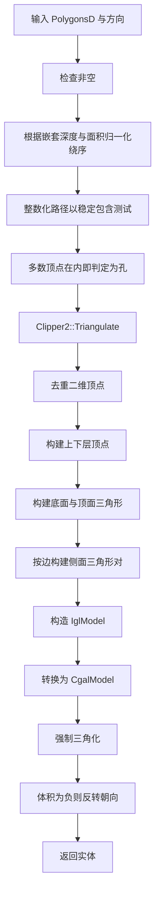
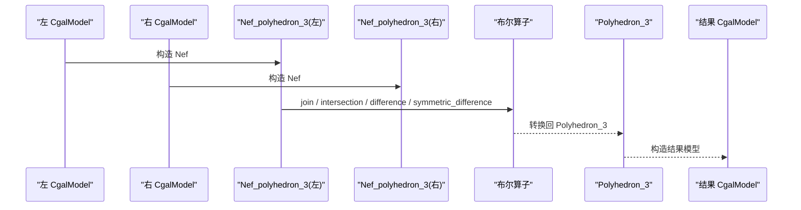
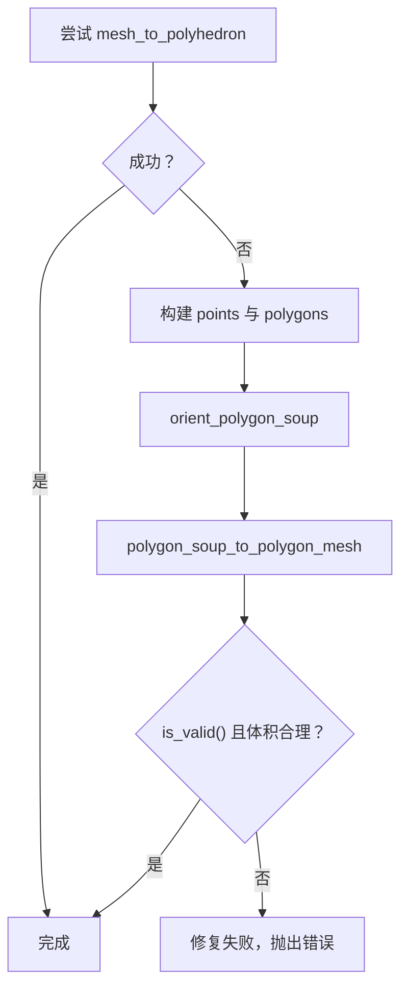
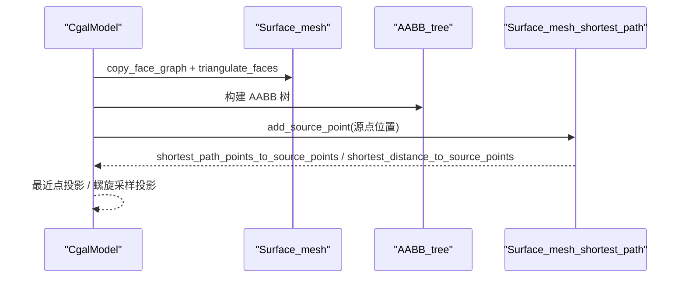
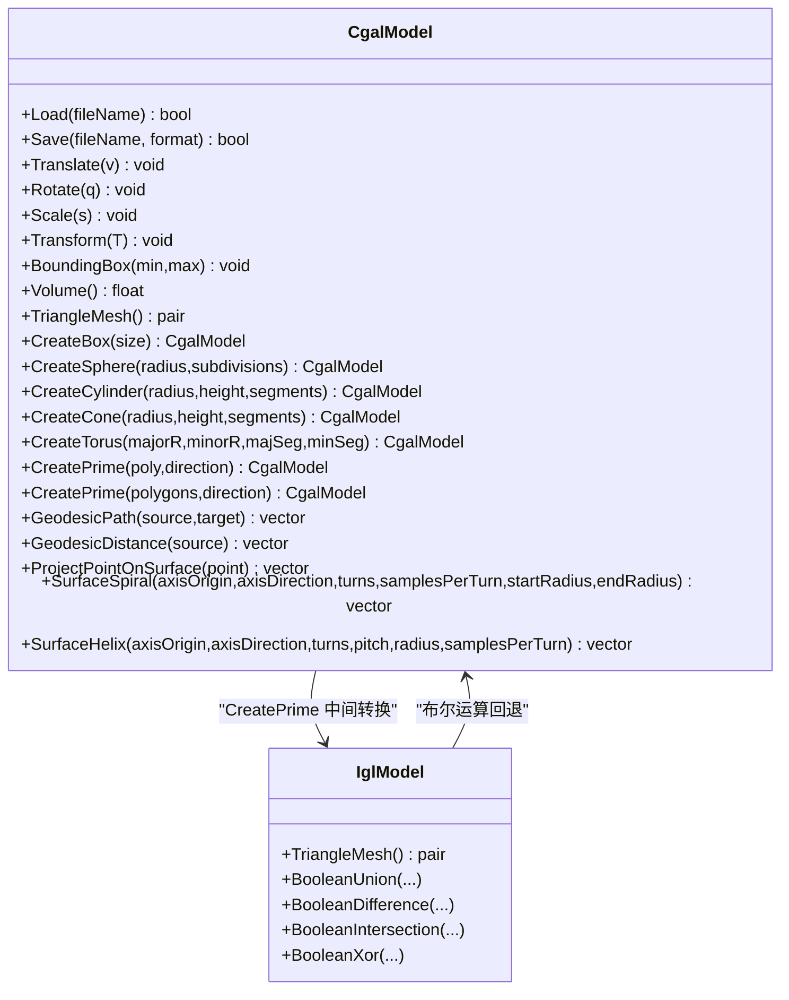
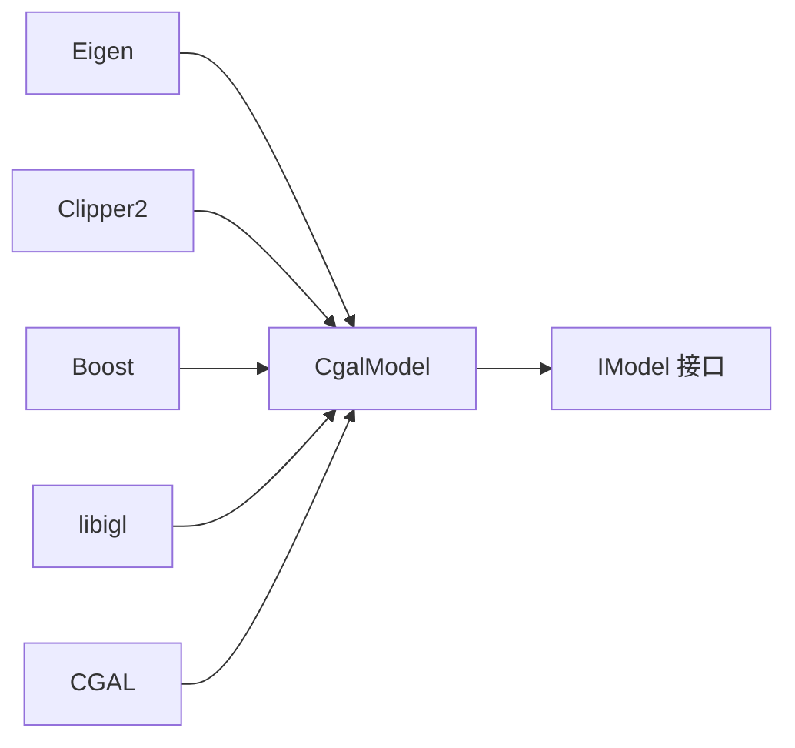
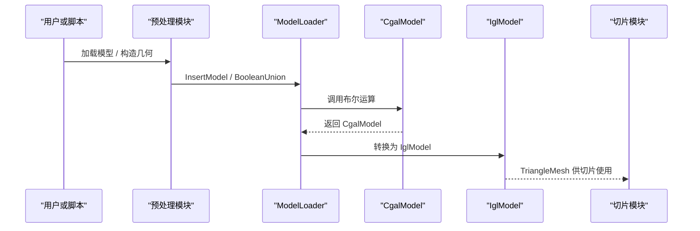

# CgalModel CGAL 几何模型

<cite>
**本文引用的文件**   
- [CgalModel.hpp](file://meshmodel/CgalModel.hpp)
- [CgalModel.cpp](file://meshmodel/CgalModel.cpp)
- [IglModel.cpp](file://meshmodel/IglModel.cpp)
- [cgal_model_test.cpp](file://tests/Models/cgal_model_test.cpp)
- [model_loader_test.cpp](file://tests/Preprocess/model_loader_test.cpp)
- [CMakeLists.txt](file://CMakeLists.txt)
- [vcpkg.json](file://vcpkg.json)
</cite>

## 目录
1. [引言](#引言)
2. [项目结构定位](#项目结构定位)
3. [核心组件总览](#核心组件总览)
4. [架构与数据流](#架构与数据流)
5. [详细实现分析](#详细实现分析)
6. [依赖关系分析](#依赖关系分析)
7. [性能与复杂度](#性能与复杂度)
8. [切片流程中的使用方式](#切片流程中的使用方式)
9. [编译与 CGAL 依赖配置](#编译与-cgal-依赖配置)
10. [常见问题与排错](#常见问题与排错)
11. [结论](#结论)

## 引言
本文件围绕 `HsBaSlicer` 中基于 CGAL 的网格模型实现 `CgalModel`，系统性说明其如何利用 CGAL 提供的精确谓词、Nef 多面体、AABB 树、表面最短路径等能力，完成布尔运算、拓扑校验、三角化、体积计算、边界框查询、拉伸建模以及表面测地线、螺旋和螺旋线生成。文档同时解释 CGAL 数据类型与 HsBaSlicer 内部 Eigen/libigl 数据结构之间的转换机制，并给出在布尔运算、与其他模型类型互操作、以及切片预处理中的应用要点。最后提供 CGAL 依赖配置、编译开关与注意事项。

## 项目结构定位
`CgalModel` 位于 meshmodel 模块，是 `IModel` 接口的一个具体实现，负责封装 CGAL 的 `Polyhedron_3` 并提供面向切片系统的统一 API。它不是孤立的几何库，而是与 libigl、CGAL、Eigen、Clipper2、OCCT（通过其他模型）共同构成 HsBaSlicer 的多内核几何栈。

**图表来源**
- [CgalModel.hpp:14-22](file://meshmodel/CgalModel.hpp#L14-L22)
- [CgalModel.cpp:12-33](file://meshmodel/CgalModel.cpp#L12-L33)
- [IglModel.cpp:24-31](file://meshmodel/IglModel.cpp#L24-L31)

**章节来源**
- [CgalModel.hpp:24-52](file://meshmodel/CgalModel.hpp#L24-L52)
- [CgalModel.cpp:1-34](file://meshmodel/CgalModel.cpp#L1-L34)

## 核心组件总览
`CgalModel` 的核心职责可归纳为以下五类：

| 类别 | 主要能力 | 关键实现位置 |
|---|---|---|
| 几何构造 | 立方体、球体、圆柱、圆锥、圆环、单多边形拉伸、多轮廓拉伸 | `CreateBox` / `CreateSphere` / `CreateCylinder` / `CreateCone` / `CreateTorus` / `CreatePrime` |
| 几何变换 | 平移、旋转、缩放、仿射变换、齐次变换 | `Translate` / `Rotate` / `Scale` / `Transform` |
| 几何查询 | 轴对齐包围盒、有符号体积、三角网格导出 | `BoundingBox` / `Volume` / `TriangleMesh` |
| 布尔运算 | 并集、交集、差集、异或 | `Union` / `Intersection` / `Difference` / `Xor` |
| 表面高级几何 | 测地线路径、顶点测地距离、点投影、表面螺旋、表面螺旋线 | `GeodesicPath` / `GeodesicDistance` / `ProjectPointOnSurface` / `SurfaceSpiral` / `SurfaceHelix` |

这些能力全部建立在 CGAL 的 `Exact_predicates_inexact_constructions_kernel` 之上，并通过 `Polyhedron_3` 作为主存储结构；布尔运算则提升到 `Nef_polyhedron_3` 进行集合运算后再转回 `Polyhedron_3`。

**章节来源**
- [CgalModel.hpp:34-155](file://meshmodel/CgalModel.hpp#L34-L155)
- [CgalModel.cpp:238-276](file://meshmodel/CgalModel.cpp#L238-L276)
- [CgalModel.cpp:278-445](file://meshmodel/CgalModel.cpp#L278-L445)
- [CgalModel.cpp:625-955](file://meshmodel/CgalModel.cpp#L625-L955)
- [CgalModel.cpp:1075-1210](file://meshmodel/CgalModel.cpp#L1075-L1210)

## 架构与数据流
`CgalModel` 的数据流可以概括为“外部输入 → 内部 CGAL 表示 → 算法处理 → 输出到 HsBaSlicer 通用结构”。

**图表来源**
- [CgalModel.cpp:42-119](file://meshmodel/CgalModel.cpp#L42-L119)
- [CgalModel.cpp:121-131](file://meshmodel/CgalModel.cpp#L121-L131)
- [CgalModel.cpp:228-236](file://meshmodel/CgalModel.cpp#L228-L236)

### 关键数据转换路径
1. **Eigen 顶点面片 → CGAL Polyhedron_3**  
   优先调用 libigl 的 `mesh_to_polyhedron`；失败时回退到手动构建 polygon soup，再调用 CGAL 的 `orient_polygon_soup` 与 `polygon_soup_to_polygon_mesh`。
2. **CGAL Polyhedron_3 → Eigen 顶点面片**  
   先强制三角化，再通过 `polyhedron_to_mesh` 输出 libigl 风格结果。
3. **Polyhedron_3 → Nef_polyhedron_3**  
   用于布尔运算；结果再转回 `Polyhedron_3`。
4. **Polyhedron_3 → Surface_mesh**  
   用于表面测地线与最近点查询。

**章节来源**
- [CgalModel.cpp:42-119](file://meshmodel/CgalModel.cpp#L42-L119)
- [CgalModel.cpp:228-236](file://meshmodel/CgalModel.cpp#L228-L236)
- [CgalModel.cpp:238-276](file://meshmodel/CgalModel.cpp#L238-L276)
- [CgalModel.cpp:979-994](file://meshmodel/CgalModel.cpp#L979-L994)

## 详细实现分析

### 1. 几何构造与拉伸建模
`CgalModel` 提供多种原生几何工厂函数：

| 方法 | 输入 | 输出 | 实现要点 |
|---|---|---|---|
| `CreateBox` | 尺寸向量 | 闭合六面体 | 使用 CGAL 的 `Iso_cuboid_3` 与 `make_hexahedron`，随后三角化 |
| `CreateSphere` | 半径、细分等级 | 球面网格 | 按 stacks/slices 参数生成经纬采样点与三角形连接 |
| `CreateCylinder` | 半径、高度、分段数 | 圆柱网格 | 上下底中心点 + 环形侧面三角扇 |
| `CreateCone` | 半径、高度、分段数 | 圆锥网格 | 底面中心 + 顶点 + 侧面三角扇 |
| `CreateTorus` | 大半径、小半径、两段分段数 | 环面网格 | 双参数角度采样生成四边形后拆成三角形 |
| `CreatePrime`（单多边形） | 二维多边形、拉伸方向 | 拉伸实体 | 使用 Clipper2 三角化底面，通过 `IglModel` 构造后再转为 `CgalModel`，并强制三角化与朝向修正 |
| `CreatePrime`（多轮廓） | 多个二维轮廓、拉伸方向 | 带孔拉伸实体 | 使用 Clipper2 判断内外轮廓方向，三角化后构建顶点和侧面，再经 `IglModel` 转 `CgalModel` |

#### 单多边形拉伸流程

**图表来源**
- [CgalModel.cpp:625-733](file://meshmodel/CgalModel.cpp#L625-L733)

#### 多轮廓拉伸流程

**图表来源**
- [CgalModel.cpp:735-955](file://meshmodel/CgalModel.cpp#L735-L955)

**章节来源**
- [CgalModel.cpp:278-445](file://meshmodel/CgalModel.cpp#L278-L445)
- [CgalModel.cpp:625-733](file://meshmodel/CgalModel.cpp#L625-L733)
- [CgalModel.cpp:735-955](file://meshmodel/CgalModel.cpp#L735-L955)

### 2. 几何变换与查询
`CgalModel` 将 Eigen 变换映射到 CGAL 的 `Affine_3`，并通过 `CGAL::Polygon_mesh_processing::transform` 直接修改内部网格。

| 方法 | 输入类型 | 行为 |
|---|---|---|
| `Translate` | `Eigen::Vector3f` | 构造平移变换并应用 |
| `Rotate` | `Eigen::Quaternionf` | 转为旋转矩阵后构造仿射变换 |
| `Scale` | `float` 或 `Eigen::Vector3f` | 均匀或非均匀缩放 |
| `Transform` | `Eigen::Isometry3f` / `Matrix4f` / `Eigen::Transform<float,3,Eigen::Affine>` | 直接传入 4x4 仿射元素 |
| `BoundingBox` | 输出 `min/max` | 遍历所有顶点计算 AABB |
| `Volume` | 无 | 返回 CGAL 计算的有符号体积 |
| `TriangleMesh` | 无 | 三角化后转回 Eigen 顶点与三角形索引 |

**章节来源**
- [CgalModel.cpp:158-204](file://meshmodel/CgalModel.cpp#L158-L204)
- [CgalModel.cpp:206-236](file://meshmodel/CgalModel.cpp#L206-L236)

### 3. 布尔运算与 Nef 多面体
布尔运算通过 `Nef_polyhedron_3` 实现：

| 操作 | 对应函数 | 内部步骤 |
|---|---|---|
| 并集 | `Union` | 左/右模型转 Nef → `join` → 转回 `Polyhedron_3` |
| 交集 | `Intersection` | 左/右模型转 Nef → `intersection` → 转回 |
| 差集 | `Difference` | 左/右模型转 Nef → `difference` → 转回 |
| 异或 | `Xor` | 左/右模型转 Nef → `symmetric_difference` → 转回 |

**图表来源**
- [CgalModel.cpp:238-276](file://meshmodel/CgalModel.cpp#L238-L276)

注意：布尔运算在 Debug 构建下可能被禁用，因为 CGAL 与 IGL 的布尔操作可能较慢且内存占用较高。

**章节来源**
- [CgalModel.cpp:238-276](file://meshmodel/CgalModel.cpp#L238-L276)
- [CMakeLists.txt:294-298](file://CMakeLists.txt#L294-L298)

### 4. 网格修复与三角化
当从 Eigen 顶点面片构造 `CgalModel` 失败时，实现会尝试修复：

1. 将顶点与三角形转换为 CGAL 的 point/polygon soup。
2. 调用 `orient_polygon_soup` 统一法向。
3. 调用 `polygon_soup_to_polygon_mesh` 重建拓扑。
4. 检查 `is_valid()` 与体积符号，必要时反转面朝向。
5. 如果仍失败，抛出运行时错误。

**图表来源**
- [CgalModel.cpp:42-119](file://meshmodel/CgalModel.cpp#L42-L119)

**章节来源**
- [CgalModel.cpp:42-119](file://meshmodel/CgalModel.cpp#L42-L119)

### 5. 表面测地线与最近点
`CgalModel` 将 `Polyhedron_3` 复制到 `Surface_mesh`，构建 AABB 树，并使用 `Surface_mesh_shortest_path` 计算表面最短路径与距离。

| 方法 | 功能 | 关键步骤 |
|---|---|---|
| `GeodesicPath` | 两点间表面最短路径 | 构造源点位置 → 查询目标最近面 → 获取路径点序列 |
| `GeodesicDistance` | 源点到所有顶点的测地距离 | 添加源点后遍历所有顶点查询距离 |
| `ProjectPointOnSurface` | 空间点投影到最近表面点 | AABB 树最近点查询 |
| `SurfaceSpiral` | 沿轴的表面螺旋采样 | 生成候选螺旋点 → 投影到表面 |
| `SurfaceHelix` | 沿轴的表面螺旋线采样 | 固定螺距生成候选点 → 投影到表面 |

**图表来源**
- [CgalModel.cpp:959-1073](file://meshmodel/CgalModel.cpp#L959-L1073)
- [CgalModel.cpp:1075-1210](file://meshmodel/CgalModel.cpp#L1075-L1210)

**章节来源**
- [CgalModel.cpp:959-1073](file://meshmodel/CgalModel.cpp#L959-L1073)
- [CgalModel.cpp:1075-1210](file://meshmodel/CgalModel.cpp#L1075-L1210)

### 6. 与 IglModel 和其他模型的互操作
`CgalModel` 与 `IglModel` 之间存在双向转换：

- `CgalModel` 构造时可从 `IglModel` 的顶点面片转换而来。
- `CreatePrime` 的实现先构造 `IglModel`，再调用 `TriangleMesh` 得到 Eigen 数据，最后构造 `CgalModel`。
- `IglModel` 的布尔运算在 `USE_CGAL` 下优先尝试 `igl::copyleft::cgal::mesh_boolean`，失败后回退到 `CgalModel` 的 Nef 布尔运算。

**图表来源**
- [CgalModel.hpp:34-155](file://meshmodel/CgalModel.hpp#L34-L155)
- [CgalModel.cpp:625-733](file://meshmodel/CgalModel.cpp#L625-L733)
- [IglModel.cpp:195-230](file://meshmodel/IglModel.cpp#L195-L230)

**章节来源**
- [CgalModel.cpp:625-733](file://meshmodel/CgalModel.cpp#L625-L733)
- [IglModel.cpp:195-230](file://meshmodel/IglModel.cpp#L195-L230)

## 依赖关系分析
`CgalModel` 的依赖可分为三层：

| 层级 | 依赖 | 作用 |
|---|---|---|
| 几何内核层 | CGAL | 精确谓词、Nef 多面体、AABB 树、表面最短路径、网格处理 |
| 网格桥接层 | libigl | `mesh_to_polyhedron`、`polyhedron_to_mesh`、布尔运算入口 |
| 工程数据层 | Eigen、Clipper2、Boost | 矩阵运算、二维多边形三角化与包含测试、哈希组合 |

**图表来源**
- [CgalModel.hpp:9-22](file://meshmodel/CgalModel.hpp#L9-L22)
- [CgalModel.cpp:12-33](file://meshmodel/CgalModel.cpp#L12-L33)

**章节来源**
- [CgalModel.hpp:9-22](file://meshmodel/CgalModel.hpp#L9-L22)
- [CgalModel.cpp:12-33](file://meshmodel/CgalModel.cpp#L12-L33)

## 性能与复杂度
- **布尔运算**：基于 Nef 多面体，时间复杂度与多面体复杂度相关，通常显著高于简单网格操作；Debug 构建下默认禁用布尔测试，提示可能慢且内存占用高。
- **网格修复**：polygon soup 构建、定向、合并重复顶点、有效性检查属于 O(n) 到 O(n log n) 级别，取决于 CGAL 内部实现。
- **三角化**：`triangulate_faces` 会对非三角面进行三角化，影响后续 libigl 转换与体积计算。
- **测地线计算**：需要复制为 `Surface_mesh` 并构建 AABB 树，单次查询成本与面数量相关；多次查询建议复用树结构。
- **拉伸建模**：单多边形与多轮廓拉伸都依赖 Clipper2 三角化与顶点/面构建，复杂度与轮廓点数和三角形数量线性相关。

[本节为通用性能讨论，不直接分析具体代码行]

## 切片流程中的使用方式
虽然 `CgalModel` 本身不直接执行切片，但它在切片预处理与模型互操作中扮演重要角色：

1. **布尔运算结果**：通过 `Union` / `Intersection` / `Difference` / `Xor` 生成的 `CgalModel` 可被转换为 `IglModel` 或直接参与后续网格处理。
2. **拉伸建模**：`CreatePrime` 可用于从 2D 轮廓生成 3D 实体，常用于支撑、填充区域、工艺特征等。
3. **网格导出**：`TriangleMesh` 输出 Eigen 顶点与三角形索引，便于 libigl、路径生成、填充算法使用。
4. **预处理集成**：测试用例显示布尔运算可通过 `ModelLoader` 暴露给上层流水线，底层可能路由到 OCCT 或 IGL/CGAL。

**图表来源**
- [model_loader_test.cpp:154-188](file://tests/Preprocess/model_loader_test.cpp#L154-L188)
- [CgalModel.cpp:238-276](file://meshmodel/CgalModel.cpp#L238-L276)
- [CgalModel.cpp:228-236](file://meshmodel/CgalModel.cpp#L228-L236)

**章节来源**
- [model_loader_test.cpp:154-188](file://tests/Preprocess/model_loader_test.cpp#L154-L188)

## 编译与 CGAL 依赖配置

### vcpkg 与 copyleft 特性
CGAL 属于 copyleft 内核，由 vcpkg manifest 的 `copyleft` 特性控制：

- `vcpkg.json` 中定义 `copyleft` 特性，包含 `cgal`、启用 cgal 特性的 `libigl`、以及 `opencascade`。
- 顶层 `CMakeLists.txt` 通过 `HSBA_COPL` 缓存变量自动检测或强制启用 copyleft 内核。
- 当启用 copyleft 且平台允许时，会 `find_package(CGAL CONFIG REQUIRED)` 并定义 `USE_CGAL`。

| 配置项 | 含义 | 默认行为 |
|---|---|---|
| `HSBA_COPL` | 是否链接 copyleft 内核 | AUTO，自动探测 CGAL/OpenCASCADE |
| `USE_CGAL` | 启用 CGAL 相关编译分支 | 仅在桌面平台且 HSBA_COPL 启用时定义 |
| `DISABLE_BOOLEAN_OPERATIONS_TESTS` | 调试模式下跳过布尔测试 | Debug 构建默认定义 |
| `HSBA_MODEL_POOL_SIZE` | 模型池大小 | 启用 copyleft 时为 10，否则为 1 |

**章节来源**
- [vcpkg.json:4-110](file://vcpkg.json#L4-L110)
- [CMakeLists.txt:170-204](file://CMakeLists.txt#L170-L204)
- [CMakeLists.txt:282-306](file://CMakeLists.txt#L282-L306)

### 编译注意事项
1. **确保 CGAL 已安装**：如果使用 vcpkg，需启用 `copyleft` 特性；如果使用系统安装，需保证 `find_package(CGAL CONFIG QUIET)` 能找到。
2. **Debug 模式布尔运算限制**：Debug 构建默认禁用布尔运算测试，避免 CGAL/IGL 布尔操作带来的性能问题。
3. **libigl 与 CGAL 联动**：`IglModel` 的布尔实现依赖 `igl::copyleft::cgal::mesh_boolean`，失败时会回退到 `CgalModel` 的 Nef 布尔。
4. **Windows 平台宏**：部分 CGAL 传播的编译器选项可能需要额外处理，例如 MSVC 的 `/fp:strict` 与 `_SCL_SECURE_NO_WARNINGS`。
5. **许可证变更**：启用 copyleft 内核后，项目许可证会从 MIT 切换到 GPL-3.0-or-later。

**章节来源**
- [CMakeLists.txt:282-306](file://CMakeLists.txt#L282-L306)
- [CMakeLists.txt:170-204](file://CMakeLists.txt#L170-L204)
- [IglModel.cpp:195-230](file://meshmodel/IglModel.cpp#L195-L230)

## 常见问题与排错

| 问题 | 可能原因 | 排查与建议 |
|---|---|---|
| 构造 `CgalModel` 时报空网格错误 | 输入顶点或面片为空 | 检查上游数据是否为空，确认 `v.rows()` 与 `f.rows()` |
| 网格转换失败 | 输入网格拓扑无效或面朝向不一致 | 查看修复流程是否触发；检查是否经过 `orient_polygon_soup` 与 `polygon_soup_to_polygon_mesh` |
| 体积为负 | 面朝向不一致 | 实现中会在体积为负时反转面朝向；也可手动检查 `Volume()` |
| 布尔运算结果为空或失败 | 浮点精度、自相交、退化面、Debug 模式禁用 | 检查输入网格质量；Release 构建；必要时简化或修复网格 |
| 布尔运算速度慢 | CGAL Nef 布尔计算复杂度高 | 减少模型复杂度；避免在 Debug 模式运行布尔测试 |
| 找不到 CGAL | 未启用 copyleft 或未安装 CGAL | 检查 vcpkg manifest 与 `HSBA_COPL`；确认 `USE_CGAL` 已定义 |
| 拉伸模型体积异常 | 多轮廓绕序错误或孔识别错误 | 检查外轮廓 CCW、内轮廓 CW；确认 Clipper2 三角化成功 |

**章节来源**
- [CgalModel.cpp:42-119](file://meshmodel/CgalModel.cpp#L42-L119)
- [CgalModel.cpp:735-955](file://meshmodel/CgalModel.cpp#L735-L955)
- [CMakeLists.txt:294-298](file://CMakeLists.txt#L294-L298)

## 结论
`CgalModel` 是 HsBaSlicer 中基于 CGAL 的高保真几何模型实现，它将 CGAL 的精确几何能力与 HsBaSlicer 的 Eigen/libigl 数据流无缝衔接。其核心价值在于：

- 提供稳定的布尔运算、网格修复、三角化、体积与包围盒查询。
- 支持从 2D 多边形到 3D 实体的拉伸建模，适用于切片前处理与工艺特征生成。
- 通过 Nef 多面体与 Surface_mesh 扩展出测地线、投影、螺旋等高级表面几何能力。
- 与 `IglModel`、OCCT、Clipper2、Eigen 形成多层几何栈，既保证鲁棒性又兼顾性能。

在实际工程中，应优先使用 `CgalModel` 进行高精度布尔与拓扑操作，再通过 `TriangleMesh` 输出到 libigl 或切片管线；同时注意 Debug 模式的布尔测试限制与 CGAL 依赖配置。