# FullTopoModel 完整拓扑模型

<cite>
**本文引用的文件**   
- [FullTopoModel.hpp](file://meshmodel/FullTopoModel.hpp)
- [FullTopoModel.cpp](file://meshmodel/FullTopoModel.cpp)
- [Msg2FullTopoModel.hpp](file://convert/Msg2FullTopoModel.hpp)
- [Msg2FullTopoModel.cpp](file://convert/Msg2FullTopoModel.cpp)
- [FullTopoModel2Msg.hpp](file://convert/FullTopoModel2Msg.hpp)
- [FullTopoModel2Msg.cpp](file://convert/FullTopoModel2Msg.cpp)
- [full_topo_model_test.cpp](file://tests/Models/full_topo_model_test.cpp)
- [mesh_slice.cpp](file://LibHsBaSlicer/Slice/mesh_slice.cpp)
</cite>

## 目录
1. [项目概述与快速开始](#项目概述与快速开始)
2. [架构总览](#架构总览)
3. [核心概念](#核心概念)
4. [核心模块详解](#核心模块详解)
5. [高级主题](#高级主题)
6. [Lua 脚本系统](#lua-脚本系统)
7. [API 参考文档](#api-参考文档)
8. [集成指南](#集成指南)
9. [开发·测试与贡献](#开发·测试与贡献)
10. [扩展开发指南](#扩展开发指南)
11. [示例与教程](#示例与教程)
12. [部署·故障排除与FAQ](#部署·故障排除与faq)
13. [附录](#附录)

## 项目概述与快速开始

FullTopoModel 是一个面向切片算法的完整拓扑三角网格模型。它从原始三角形面片重建顶点、边、面之间的拓扑关系，并提供切片、欧拉特征计算、拓扑完整性检查、以及通过 Lua 脚本进行自定义几何处理的能力。与传统仅保存顶点与三角形索引的简单三角网格不同，FullTopoModel 显式维护边和面的邻接信息，使复杂几何关系维护、拓扑一致性检查和高级几何操作更加可靠。

典型使用方式包括：
- 从任意实现 `IModel` 的模型对象构造 FullTopoModel。
- 调用 `Slice`、`UnSafeSlice`、`SliceFast` 或 `SliceLua` 获取指定高度的二维轮廓。
- 使用 `CheckTopo` 和 `EulerCharacteristic` 判断模型是否接近拓扑流形。
- 将 FullTopoModel 转换为 protobuf 消息，或在 Lua 中直接访问顶点、边、面数据。

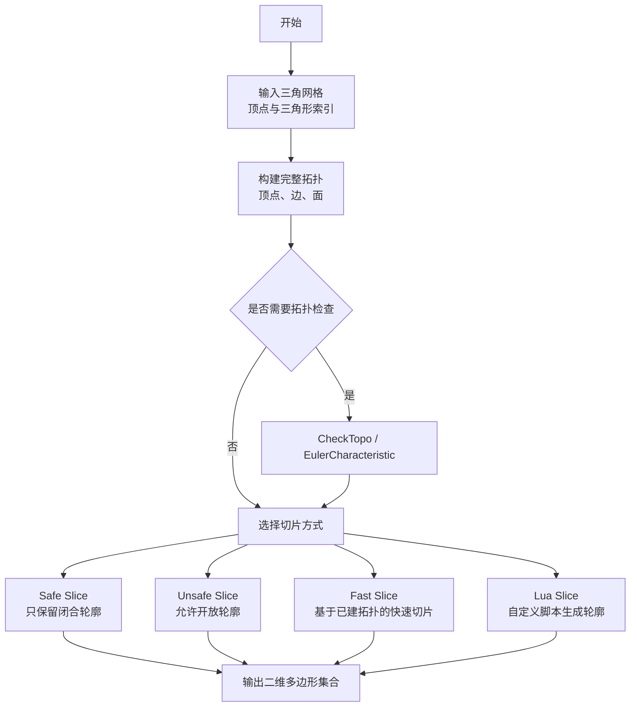

**章节来源**
- [FullTopoModel.hpp:18-52](file://meshmodel/FullTopoModel.hpp#L18-L52)
- [FullTopoModel.cpp:27-48](file://meshmodel/FullTopoModel.cpp#L27-L48)

## 架构总览

FullTopoModel 位于 meshmodel 层，向上为 LibHsBaSlicer 的切片流程，向下依赖 IModel 抽象、Eigen 几何类型、IGL 法线计算、Boost 哈希工具以及 Lua 运行时。同时，convert 层提供与 protobuf 消息的双向转换能力。

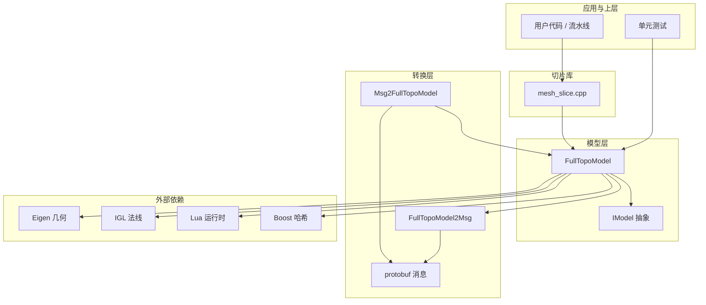

**图表来源**
- [FullTopoModel.hpp:11-16](file://meshmodel/FullTopoModel.hpp#L11-L16)
- [FullTopoModel.cpp:8-23](file://meshmodel/FullTopoModel.cpp#L8-L23)
- [Msg2FullTopoModel.cpp:12-36](file://convert/Msg2FullTopoModel.cpp#L12-L36)
- [FullTopoModel2Msg.cpp:10-39](file://convert/FullTopoModel2Msg.cpp#L10-L39)
- [mesh_slice.cpp:51-81](file://LibHsBaSlicer/Slice/mesh_slice.cpp#L51-L81)

**章节来源**
- [FullTopoModel.hpp:11-16](file://meshmodel/FullTopoModel.hpp#L11-L16)
- [FullTopoModel.cpp:8-23](file://meshmodel/FullTopoModel.cpp#L8-L23)
- [Msg2FullTopoModel.cpp:12-36](file://convert/Msg2FullTopoModel.cpp#L12-L36)
- [FullTopoModel2Msg.cpp:10-39](file://convert/FullTopoModel2Msg.cpp#L10-L39)
- [mesh_slice.cpp:51-81](file://LibHsBaSlicer/Slice/mesh_slice.cpp#L51-L81)

## 核心概念

### 完整拓扑元素

FullTopoModel 的核心是三类拓扑元素：

| 元素 | 主要字段 | 含义 |
|---|---|---|
| 顶点 Vertex | vertex、faces、edges | 三维坐标，以及所属的面索引和边索引 |
| 边 Edge | vertices、faces | 两个顶点索引，以及相邻的两个面索引 |
| 面 Face | triangle、edges、normal | 三个顶点索引，三条边索引，可选面法线 |

这些结构共同构成一个可查询的拓扑图：顶点可以反向查找边和面，边可以查找相邻面，面可以查找顶点和边。这种双向关系使得切片时可以直接遍历边与面的相交情况，而不是反复扫描三角形。

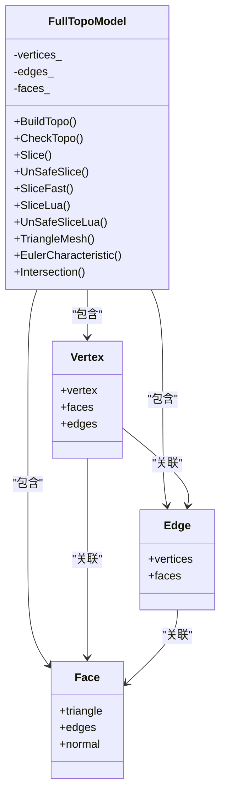

**图表来源**
- [FullTopoModel.hpp:56-72](file://meshmodel/FullTopoModel.hpp#L56-L72)
- [FullTopoModel.hpp:135-142](file://meshmodel/FullTopoModel.hpp#L135-L142)

**章节来源**
- [FullTopoModel.hpp:56-72](file://meshmodel/FullTopoModel.hpp#L56-L72)
- [FullTopoModel.hpp:135-142](file://meshmodel/FullTopoModel.hpp#L135-L142)

### 安全切片与不安全切片

FullTopoModel 提供两类切片结果：

| 方法 | 返回类型 | 特点 |
|---|---|---|
| `Slice` | `Polygons` | 只保留闭合轮廓；开放轮廓被丢弃 |
| `UnSafeSlice` | `UnSafePolygons` | 允许开放轮廓，并标记 `closed` 标志 |
| `SliceFast` | `Polygons` | 先检查拓扑完整性，再基于已建拓扑快速切片 |
| `SliceLua` / `UnSafeSliceLua` | `Polygons` / `UnSafePolygons` | 通过 Lua 脚本自定义切片逻辑 |

安全切片适合大多数切片器下游流程；不安全切片适合需要诊断退化边、悬空边或开放环的场景。

**章节来源**
- [FullTopoModel.hpp:107-132](file://meshmodel/FullTopoModel.hpp#L107-L132)

### 与传统三角网格的区别

传统三角网格通常只保存顶点数组和三角形索引数组，缺少边、面邻接等拓扑信息。FullTopoModel 的优势体现在：

1. **拓扑重建一次，多次切片复用**：构造时完成拓扑重建，后续切片无需重复建立邻接关系。
2. **边级相交检测更快**：`SliceFast` 直接遍历边，利用 `Edge.faces` 和 `Edge.vertices` 快速判断是否与切片平面相交。
3. **拓扑一致性检查**：`CheckTopo` 验证所有顶点、边、面索引是否有效且覆盖完整。
4. **欧拉特征辅助诊断**：`EulerCharacteristic` 可用于初步判断模型是否存在孔洞或非流形结构。
5. **Lua 扩展能力强**：通过 `PushFullTopoModelToLua` 暴露 V、E、F 和 height，便于在脚本中进行复杂几何处理。

**章节来源**
- [FullTopoModel.hpp:43-52](file://meshmodel/FullTopoModel.hpp#L43-L52)
- [FullTopoModel.cpp:875-880](file://meshmodel/FullTopoModel.cpp#L875-L880)
- [FullTopoModel.cpp:241-244](file://meshmodel/FullTopoModel.cpp#L241-L244)

## 核心模块详解

### 拓扑构建过程

`BuildTopo` 是 FullTopoModel 的核心实现。它接收顶点列表和三角形索引列表，然后执行以下关键步骤：

1. 初始化顶点数组，每个顶点初始为空 faces 和 edges。
2. 使用无序映射记录边到边索引的对应关系，键为排序后的两个顶点索引。
3. 遍历每个三角形：
   - 跳过无效顶点索引。
   - 创建 Face，填充 triangle 和 edges。
   - 对三角形的三条边，查找或创建 Edge，并更新 Edge.faces。
   - 将边索引加入两端顶点的 edges 列表。
   - 将面索引加入三个顶点的 faces 列表。
4. 如果启用法线，则调用 IGL 的 per_face_normals 计算每个面的法线。

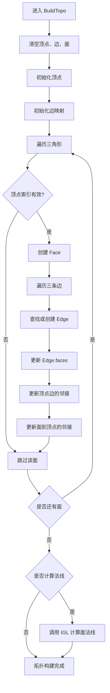

**图表来源**
- [FullTopoModel.cpp:50-158](file://meshmodel/FullTopoModel.cpp#L50-L158)

**章节来源**
- [FullTopoModel.cpp:50-158](file://meshmodel/FullTopoModel.cpp#L50-L158)

### 拓扑完整性检查

`CheckTopo` 检查两个条件：

1. 所有面的顶点索引和边索引有效，并且所有顶点和边都被至少一个面引用。
2. 所有边的顶点索引和面索引有效，并且所有顶点和面都被至少一条边引用。

该检查不是完整的拓扑流形判定，但能发现明显的索引越界、孤立元素或拓扑断裂。

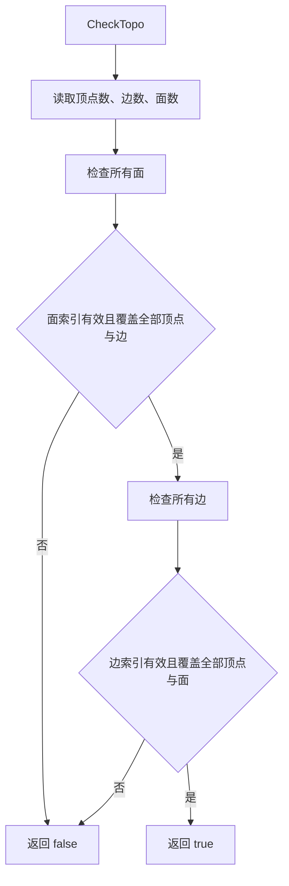

**图表来源**
- [FullTopoModel.cpp:160-218](file://meshmodel/FullTopoModel.cpp#L160-L218)

**章节来源**
- [FullTopoModel.cpp:160-218](file://meshmodel/FullTopoModel.cpp#L160-L218)

### 安全切片算法

`Slice` 的安全切片流程如下：

1. 对每个三角形，计算三条边与切片平面的交点。
2. 将交点整数化，建立原始邻接表。
3. 使用网格哈希和并查集合并相近点，消除浮点误差导致的重复节点。
4. 构建合并后的邻接表。
5. 按入射方向角度最小原则追踪路径，提取闭合多边形。
6. 丢弃长度不足的多边形。

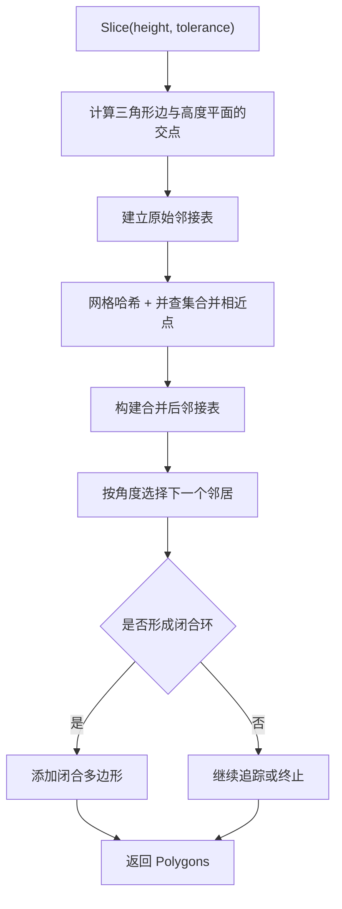

**图表来源**
- [FullTopoModel.cpp:328-600](file://meshmodel/FullTopoModel.cpp#L328-L600)

**章节来源**
- [FullTopoModel.cpp:328-600](file://meshmodel/FullTopoModel.cpp#L328-L600)

### 不安全切片算法

`UnSafeSlice` 与 `Slice` 类似，但允许开放轮廓。其关键差异在于：

- 即使路径未回到起点，只要路径长度足够，也会作为开放轮廓返回。
- 返回类型为 `UnSafePolygons`，每个轮廓带有 `closed` 标志。
- 适用于调试非流形边、悬空边或退化三角形。

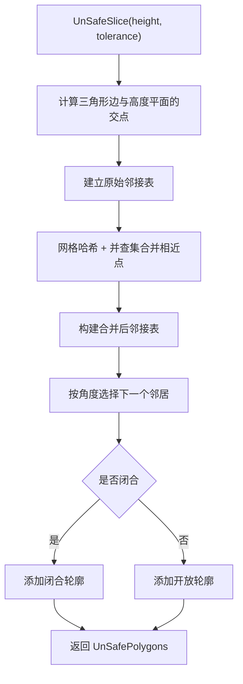

**图表来源**
- [FullTopoModel.cpp:604-873](file://meshmodel/FullTopoModel.cpp#L604-L873)

**章节来源**
- [FullTopoModel.cpp:604-873](file://meshmodel/FullTopoModel.cpp#L604-L873)

### 快速切片算法

`SliceFast` 假设拓扑已经正确构建，因此跳过通用容错流程，直接基于边进行切片：

1. 调用 `CheckTopo`，失败则抛出运行时错误。
2. 遍历所有边，判断是否与切片高度相交。
3. 对每个面，统计与其相交的两条边。
4. 将相交边的交点连接成邻接表。
5. 追踪路径并提取闭合多边形。

这种方式在拓扑稳定的情况下更高效，但也更严格。

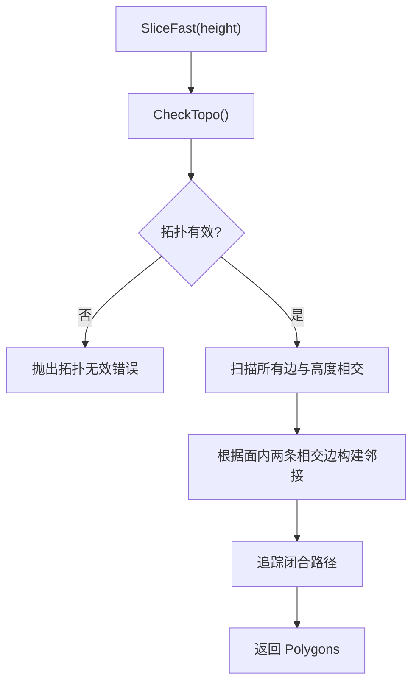

**图表来源**
- [FullTopoModel.cpp:875-1025](file://meshmodel/FullTopoModel.cpp#L875-L1025)

**章节来源**
- [FullTopoModel.cpp:875-1025](file://meshmodel/FullTopoModel.cpp#L875-L1025)

### 几何辅助函数

`Intersection` 计算线段与垂直于 Z 轴的切片平面的交点。它处理了以下情况：

- 两端都在切片平面上方或下方：无交点。
- 两端都在切片平面上：平行情况，可能返回端点或无交点。
- 正常相交：按比例计算交点。

该函数是安全切片和不安全切片的公共几何基础。

**章节来源**
- [FullTopoModel.cpp:246-272](file://meshmodel/FullTopoModel.cpp#L246-L272)

## 高级主题

### 欧拉特征与拓扑诊断

`EulerCharacteristic` 返回顶点数减边数加面数。注释指出，如果结果为奇数或大于 2，模型可能不是拓扑流形，可用于检测孔洞。需要注意的是，该函数不检查拓扑完整性，因此应结合 `CheckTopo` 一起使用。

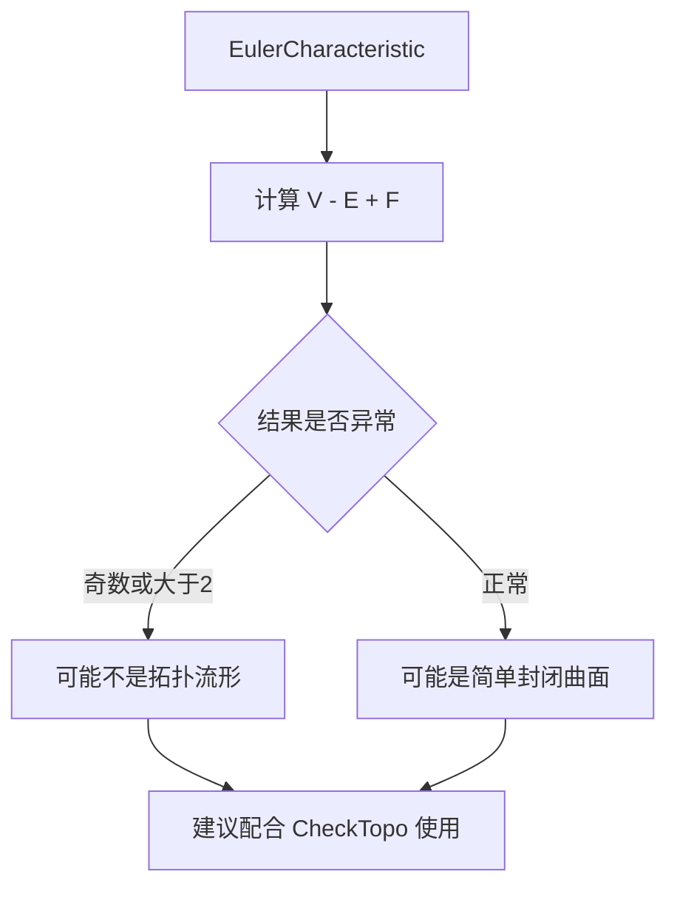

**图表来源**
- [FullTopoModel.cpp:241-244](file://meshmodel/FullTopoModel.cpp#L241-L244)
- [FullTopoModel.hpp:96-98](file://meshmodel/FullTopoModel.hpp#L96-L98)

**章节来源**
- [FullTopoModel.hpp:96-98](file://meshmodel/FullTopoModel.hpp#L96-L98)
- [FullTopoModel.cpp:241-244](file://meshmodel/FullTopoModel.cpp#L241-L244)

### 与其他模型类型的关系

FullTopoModel 不是 CAD 建模器，也不是通用网格编辑模型。官方注释明确建议：

- 使用 IglModel 或 CgalModel 进行网格处理。
- 使用 CADModel 的类和方法处理 CAD 模型。
- FullTopoModel 专注于切片所需的完整拓扑重建。

这意味着 FullTopoModel 更适合“读入三角网格 → 重建拓扑 → 切片”的流程，而不适合频繁修改网格结构的场景。

**章节来源**
- [FullTopoModel.hpp:43-52](file://meshmodel/FullTopoModel.hpp#L43-L52)

### 与 CAD 数据导入的关系

虽然仓库中没有直接展示 STEP、IGES 等 CAD 格式解析代码，但 FullTopoModel 可以从任何实现 `IModel` 的对象构造。CAD 管线通常先将 CAD 几何三角化为三角网格，再通过 `IModel::TriangleMesh` 暴露顶点和三角形索引，最后由 FullTopoModel 重建拓扑。

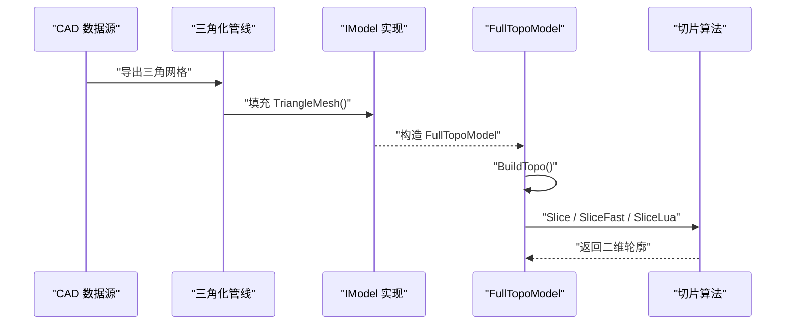

**图表来源**
- [FullTopoModel.cpp:32-48](file://meshmodel/FullTopoModel.cpp#L32-L48)
- [FullTopoModel.cpp:50-158](file://meshmodel/FullTopoModel.cpp#L50-L158)

## Lua 脚本系统

FullTopoModel 支持通过 Lua 脚本访问顶点、边、面和高度信息，从而生成自定义轮廓。

### Lua 全局变量

| 变量 | 类型 | 说明 |
|---|---|---|
| `V` | 1-based 数组 | 顶点数组，每个元素包含 x、y、z |
| `E` | 1-based 数组 | 边数组，每个元素包含两个顶点索引 |
| `F` | 1-based 数组 | 面数组，每个元素包含三个顶点索引 |
| `height` | 数值 | 当前切片高度 |

### 脚本返回值

脚本可以返回一个多边形表，或者设置全局变量 `polys`。返回的多边形会被转换为 `Polygons`。对于 `UnSafeSliceLua`，还会根据路径长度推断是否闭合。

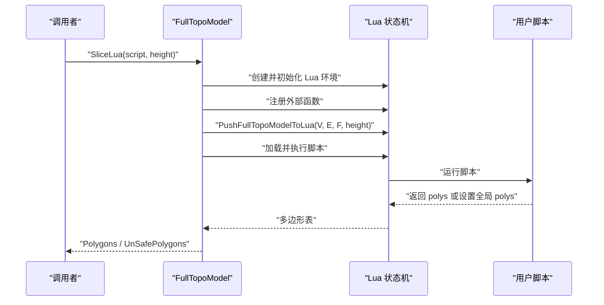

**图表来源**
- [FullTopoModel.cpp:274-324](file://meshmodel/FullTopoModel.cpp#L274-L324)
- [FullTopoModel.cpp:1027-1073](file://meshmodel/FullTopoModel.cpp#L1027-L1073)
- [FullTopoModel.cpp:1075-1130](file://meshmodel/FullTopoModel.cpp#L1075-L1130)

**章节来源**
- [FullTopoModel.cpp:274-324](file://meshmodel/FullTopoModel.cpp#L274-L324)
- [FullTopoModel.cpp:1027-1130](file://meshmodel/FullTopoModel.cpp#L1027-L1130)

## API 参考文档

### 构造函数

| 构造函数 | 参数 | 行为 |
|---|---|---|
| `FullTopoModel(const IModel& model, bool use_normals = false)` | IModel 引用、是否使用法线 | 从 IModel 的 TriangleMesh 构造并重建拓扑 |
| `FullTopoModel(const std::vector<Eigen::Vector3f>& vertices, const std::vector<std::array<int, 3>>& triangles, bool use_normals = false)` | 顶点数组、三角形索引数组、是否使用法线 | 直接从几何数据构造并重建拓扑 |
| `FullTopoModel(IModel&& model, bool use_normals = false)` | 移动语义 IModel | 已删除，不允许移动构造 |

**章节来源**
- [FullTopoModel.hpp:74-78](file://meshmodel/FullTopoModel.hpp#L74-L78)
- [FullTopoModel.cpp:27-48](file://meshmodel/FullTopoModel.cpp#L27-L48)

### 拓扑访问接口

| 方法 | 返回类型 | 说明 |
|---|---|---|
| `GetVertices()` | `const std::vector<Vertex>&` | 获取所有顶点 |
| `GetEdges()` | `const std::vector<Edge>&` | 获取所有边 |
| `GetFaces()` | `const std::vector<Face>&` | 获取所有面 |
| `GetVertex(int index)` | `const Vertex&` | 按索引获取顶点 |
| `GetEdge(int index)` | `const Edge&` | 按索引获取边 |
| `GetFace(int index)` | `const Face&` | 按索引获取面 |

**章节来源**
- [FullTopoModel.hpp:86-92](file://meshmodel/FullTopoModel.hpp#L86-L92)

### 几何与拓扑接口

| 方法 | 返回类型 | 说明 |
|---|---|---|
| `TriangleMesh()` | `std::pair<Eigen::MatrixXf, Eigen::MatrixXi>` | 从拓扑重建顶点矩阵和三角形矩阵 |
| `CheckTopo()` | `bool` | 检查拓扑完整性 |
| `EulerCharacteristic()` | `int` | 计算欧拉特征 |
| `Intersection(v1, v2, height, intersection)` | `static bool` | 计算线段与水平切片平面的交点 |

**章节来源**
- [FullTopoModel.hpp:94-102](file://meshmodel/FullTopoModel.hpp#L94-L102)
- [FullTopoModel.cpp:220-244](file://meshmodel/FullTopoModel.cpp#L220-L244)
- [FullTopoModel.cpp:246-272](file://meshmodel/FullTopoModel.cpp#L246-L272)

### 切片接口

| 方法 | 返回类型 | 说明 |
|---|---|---|
| `Slice(float height, double tolerance = 0.001)` | `Polygons` | 安全切片，只返回闭合轮廓 |
| `UnSafeSlice(float height, double tolerance = 0.001)` | `UnSafePolygons` | 不安全切片，允许开放轮廓 |
| `SliceFast(float height)` | `Polygons` | 快速切片，要求拓扑有效 |
| `SliceLua(...)` | `Polygons` | 通过 Lua 脚本生成闭合轮廓 |
| `UnSafeSliceLua(...)` | `UnSafePolygons` | 通过 Lua 脚本生成可能开放的轮廓 |

**章节来源**
- [FullTopoModel.hpp:107-132](file://meshmodel/FullTopoModel.hpp#L107-L132)
- [FullTopoModel.cpp:328-1241](file://meshmodel/FullTopoModel.cpp#L328-L1241)

### Lua 导出接口

| 函数 | 作用 |
|---|---|
| `PushFullTopoModelToLua(lua_State*, const FullTopoModel&, float height)` | 将 V、E、F、height 推送到 Lua 全局环境 |

**章节来源**
- [FullTopoModel.hpp:144-146](file://meshmodel/FullTopoModel.hpp#L144-L146)
- [FullTopoModel.cpp:274-324](file://meshmodel/FullTopoModel.cpp#L274-L324)

## 集成指南

### 在切片流程中使用 FullTopoModel

LibHsBaSlicer 的切片模块会直接使用 FullTopoModel。典型流程是：

1. 从上层模型获取 `IModel`。
2. 构造 `FullTopoModel`。
3. 调用 `Slice`、`UnSafeSlice`、`SliceFast` 或 `SliceLua`。
4. 将结果传递给支撑生成、填充、路径规划等后续阶段。

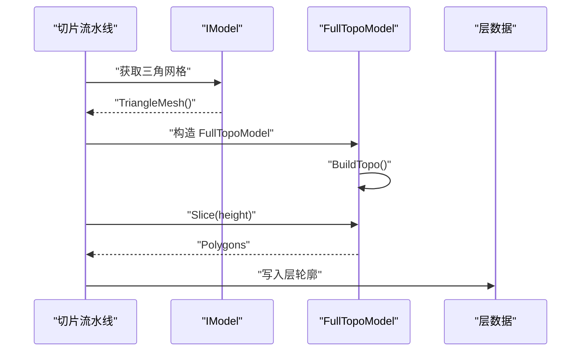

**图表来源**
- [mesh_slice.cpp:51-81](file://LibHsBaSlicer/Slice/mesh_slice.cpp#L51-L81)
- [FullTopoModel.cpp:32-48](file://meshmodel/FullTopoModel.cpp#L32-L48)

**章节来源**
- [mesh_slice.cpp:51-81](file://LibHsBaSlicer/Slice/mesh_slice.cpp#L51-L81)

### 与 protobuf 消息的转换

convert 层提供 FullTopoModel 与 protobuf 消息之间的转换：

- `MsgTopoTrimeshes2FullTopoModel`：从 protobuf 消息重建 FullTopoModel。
- `FullTopoModel2Msg`：将 FullTopoModel 的顶点和面写入 protobuf 消息。

注意：消息转换主要序列化顶点和三角形面，并不直接序列化边和面邻接拓扑。因此，反序列化后如果需要完整拓扑，仍需重新构造 FullTopoModel。

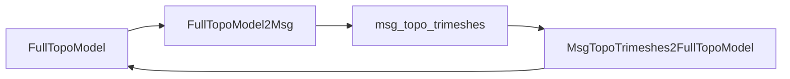

**图表来源**
- [FullTopoModel2Msg.cpp:10-39](file://convert/FullTopoModel2Msg.cpp#L10-L39)
- [Msg2FullTopoModel.cpp:12-36](file://convert/Msg2FullTopoModel.cpp#L12-L36)

**章节来源**
- [FullTopoModel2Msg.cpp:10-39](file://convert/FullTopoModel2Msg.cpp#L10-L39)
- [Msg2FullTopoModel.cpp:12-36](file://convert/Msg2FullTopoModel.cpp#L12-L36)

## 开发·测试与贡献

### 单元测试覆盖

`full_topo_model_test.cpp` 提供了三个关键测试用例：

1. 立方体在 z=0 处的切片，验证安全切片和不安全切片都能得到合理轮廓。
2. 使用 Lua 脚本计算交点并生成凸包，验证 SliceLua 和 UnSafeSliceLua。
3. 四棱锥在中间高度的切片，验证重复顶点闭合路径的处理。

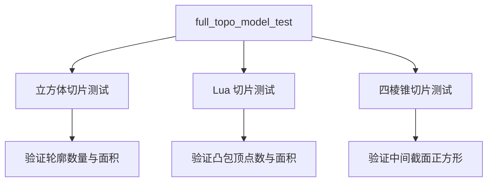

**图表来源**
- [full_topo_model_test.cpp:55-75](file://tests/Models/full_topo_model_test.cpp#L55-L75)
- [full_topo_model_test.cpp:77-142](file://tests/Models/full_topo_model_test.cpp#L77-L142)
- [full_topo_model_test.cpp:144-158](file://tests/Models/full_topo_model_test.cpp#L144-L158)

**章节来源**
- [full_topo_model_test.cpp:55-158](file://tests/Models/full_topo_model_test.cpp#L55-L158)

### 推荐测试策略

针对 FullTopoModel 的新增功能，建议补充以下测试：

- 非流形边测试：共享超过两个面的边。
- 退化三角形测试：共线顶点或零面积三角形。
- 开放边界测试：悬空边和开放环。
- 大模型性能测试：验证 BuildTopo 和 SliceFast 的时间复杂度。
- Lua 脚本错误处理测试：验证脚本加载失败、函数不存在时的错误信息。

[本节为通用开发建议，不直接分析具体源码文件]

## 扩展开发指南

### 自定义切片脚本

开发者可以通过 `SliceLua` 或 `SliceLua(file, funcName, height)` 编写自定义切片逻辑。脚本可以：

- 遍历 `F` 中的每个面。
- 计算每条边与 `height` 的交点。
- 收集交点后自行排序、去重、构建多边形。
- 返回 `polys` 表。

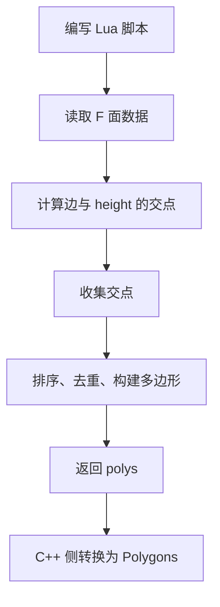

**图表来源**
- [full_topo_model_test.cpp:82-128](file://tests/Models/full_topo_model_test.cpp#L82-L128)
- [FullTopoModel.cpp:1027-1073](file://meshmodel/FullTopoModel.cpp#L1027-L1073)

**章节来源**
- [full_topo_model_test.cpp:82-128](file://tests/Models/full_topo_model_test.cpp#L82-L128)
- [FullTopoModel.cpp:1027-1073](file://meshmodel/FullTopoModel.cpp#L1027-L1073)

### 扩展外部 Lua 函数

`SliceLua` 支持传入 `ext_regs`，用于向 Lua 环境注册额外的 3D 函数。这适合在切片阶段引入距离计算、法线处理、投影变换等高级几何能力。

**章节来源**
- [FullTopoModel.hpp:120-132](file://meshmodel/FullTopoModel.hpp#L120-L132)
- [FullTopoModel.cpp:1027-1073](file://meshmodel/FullTopoModel.cpp#L1027-L1073)

## 示例与教程

### 示例一：从 IModel 构造并进行安全切片

推荐流程：

1. 准备一个实现 `IModel` 的模型对象。
2. 调用 `FullTopoModel(model)` 构造完整拓扑模型。
3. 调用 `topo.Slice(height)` 获取闭合轮廓。
4. 如果模型可能不完整，先调用 `topo.CheckTopo()`。
5. 如果需要更高性能且确信拓扑正确，使用 `topo.SliceFast(height)`。

适用场景：
- CAD 数据导入后的标准切片。
- 需要稳定闭合轮廓的支撑生成和填充。
- 对精度和拓扑稳定性要求较高的生产流程。

**章节来源**
- [FullTopoModel.cpp:32-48](file://meshmodel/FullTopoModel.cpp#L32-L48)
- [FullTopoModel.cpp:328-600](file://meshmodel/FullTopoModel.cpp#L328-L600)
- [FullTopoModel.cpp:875-1025](file://meshmodel/FullTopoModel.cpp#L875-L1025)

### 示例二：使用不安全切片诊断拓扑问题

推荐流程：

1. 构造 FullTopoModel。
2. 调用 `topo.UnSafeSlice(height)`。
3. 检查返回的 `UnSafePolygon.closed`。
4. 对开放轮廓进行分析，定位悬空边或退化三角形。

适用场景：
- 导入模型存在坏面。
- 三角化结果出现非流形边。
- 需要可视化切片过程中的异常路径。

**章节来源**
- [FullTopoModel.cpp:604-873](file://meshmodel/FullTopoModel.cpp#L604-L873)

### 示例三：通过 Lua 脚本实现自定义凸包切片

测试代码展示了如何在 Lua 中：

1. 遍历 `F` 中的面。
2. 计算每条边的交点。
3. 使用叉积实现凸包。
4. 返回单一多边形。

适用场景：
- 需要自定义轮廓构建规则。
- 需要在脚本中进行几何预处理或后处理。
- 需要灵活调整切片策略而不修改 C++ 代码。

**章节来源**
- [full_topo_model_test.cpp:77-142](file://tests/Models/full_topo_model_test.cpp#L77-L142)
- [FullTopoModel.cpp:274-324](file://meshmodel/FullTopoModel.cpp#L274-L324)

## 部署·故障排除与FAQ

### 常见问题

| 问题 | 可能原因 | 建议处理方式 |
|---|---|---|
| `SliceFast` 抛出拓扑无效错误 | 模型存在无效索引、孤立元素或非流形结构 | 先使用 `CheckTopo`，必要时改用 `Slice` 或 `UnSafeSlice` |
| 切片结果为空 | 模型完全在切片平面上方或下方，或拓扑损坏 | 检查模型包围盒和高度范围 |
| 轮廓点数异常 | 浮点误差导致重复点，或三角化对角线退化 | 调整 tolerance，或使用 `UnSafeSlice` 观察开放路径 |
| Lua 脚本报错 | 脚本语法错误或全局函数不存在 | 检查脚本加载错误信息和函数名 |
| 性能较差 | 模型过大或频繁重建拓扑 | 复用 FullTopoModel，避免重复构造 |

**章节来源**
- [FullTopoModel.cpp:875-880](file://meshmodel/FullTopoModel.cpp#L875-L880)
- [FullTopoModel.cpp:1042-1055](file://meshmodel/FullTopoModel.cpp#L1042-L1055)
- [FullTopoModel.cpp:1146-1171](file://meshmodel/FullTopoModel.cpp#L146-L171)

### 性能建议

1. 避免在循环中重复构造 FullTopoModel。
2. 对稳定模型优先使用 `SliceFast`。
3. 对不确定模型使用 `Slice`，容忍度可通过 `tolerance` 调节。
4. 仅在需要诊断时使用 `UnSafeSlice`。
5. 对复杂自定义逻辑使用 Lua 脚本，但注意脚本执行开销。

[本节为通用性能建议，不直接分析具体源码文件]

## 附录

### 关键实现位置索引

| 功能 | 文件 | 行号范围 |
|---|---|---|
| 类定义与数据结构 | [FullTopoModel.hpp](file://meshmodel/FullTopoModel.hpp) | 53-142 |
| 拓扑构建 | [FullTopoModel.cpp](file://meshmodel/FullTopoModel.cpp) | 50-158 |
| 拓扑检查 | [FullTopoModel.cpp](file://meshmodel/FullTopoModel.cpp) | 160-218 |
| 三角形网格重建 | [FullTopoModel.cpp](file://meshmodel/FullTopoModel.cpp) | 220-239 |
| 欧拉特征 | [FullTopoModel.cpp](file://meshmodel/FullTopoModel.cpp) | 241-244 |
| 线段与平面交点 | [FullTopoModel.cpp](file://meshmodel/FullTopoModel.cpp) | 246-272 |
| Lua 数据导出 | [FullTopoModel.cpp](file://meshmodel/FullTopoModel.cpp) | 274-324 |
| 安全切片 | [FullTopoModel.cpp](file://meshmodel/FullTopoModel.cpp) | 328-600 |
| 不安全切片 | [FullTopoModel.cpp](file://meshmodel/FullTopoModel.cpp) | 604-873 |
| 快速切片 | [FullTopoModel.cpp](file://meshmodel/FullTopoModel.cpp) | 875-1025 |
| Lua 切片实现 | [FullTopoModel.cpp](file://meshmodel/FullTopoModel.cpp) | 1027-1241 |
| 消息转 FullTopoModel | [Msg2FullTopoModel.cpp](file://convert/Msg2FullTopoModel.cpp) | 12-36 |
| FullTopoModel 转消息 | [FullTopoModel2Msg.cpp](file://convert/FullTopoModel2Msg.cpp) | 10-39 |
| 单元测试 | [full_topo_model_test.cpp](file://tests/Models/full_topo_model_test.cpp) | 55-158 |
| 切片库集成 | [mesh_slice.cpp](file://LibHsBaSlicer/Slice/mesh_slice.cpp) | 51-81 |

**章节来源**
- [FullTopoModel.hpp:53-142](file://meshmodel/FullTopoModel.hpp#L53-L142)
- [FullTopoModel.cpp:50-1241](file://meshmodel/FullTopoModel.cpp#L50-L1241)
- [Msg2FullTopoModel.cpp:12-36](file://convert/Msg2FullTopoModel.cpp#L12-L36)
- [FullTopoModel2Msg.cpp:10-39](file://convert/FullTopoModel2Msg.cpp#L10-L39)
- [full_topo_model_test.cpp:55-158](file://tests/Models/full_topo_model_test.cpp#L55-L158)
- [mesh_slice.cpp:51-81](file://LibHsBaSlicer/Slice/mesh_slice.cpp#L51-L81)