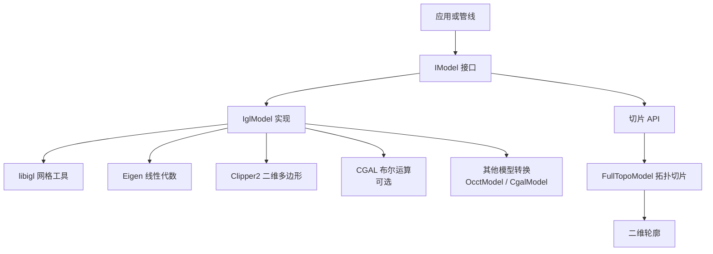
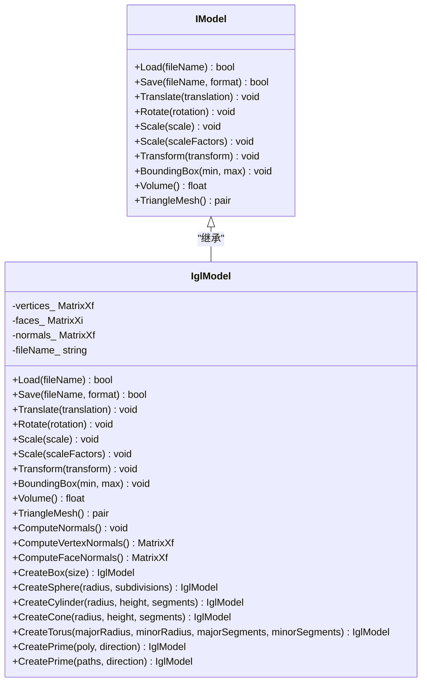
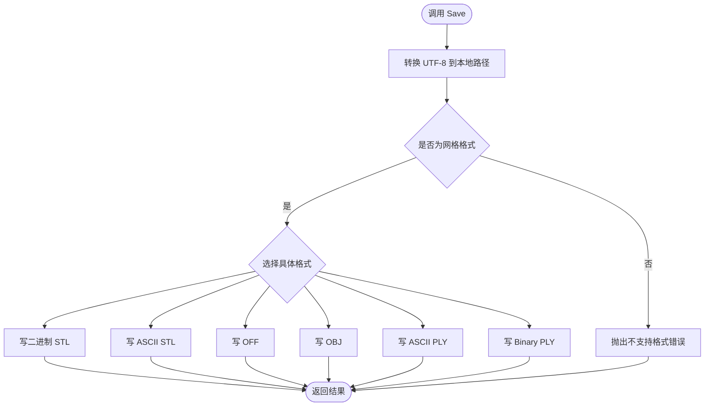
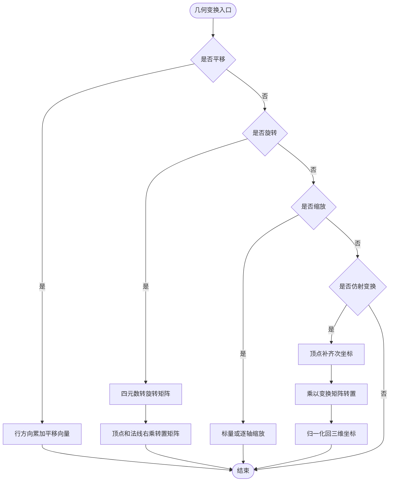
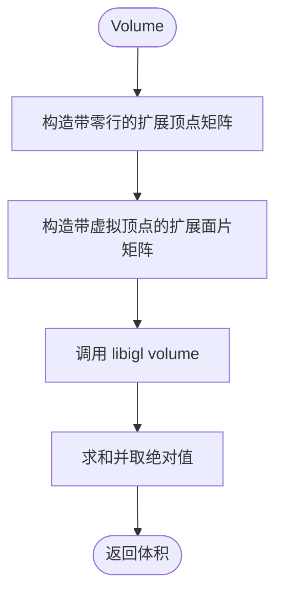
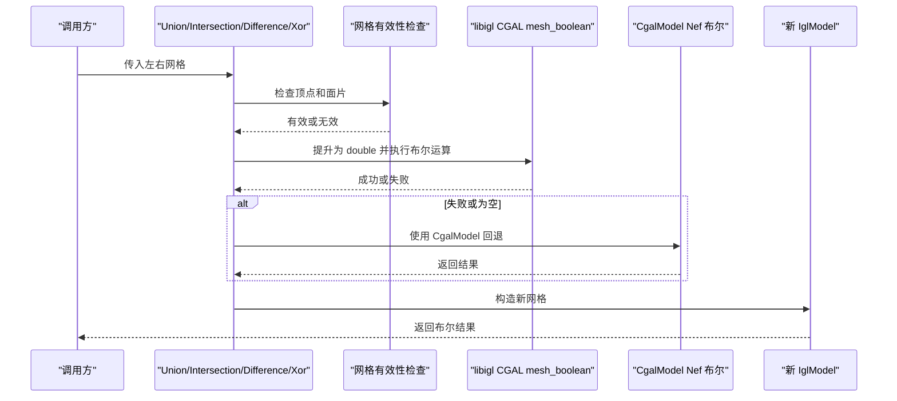
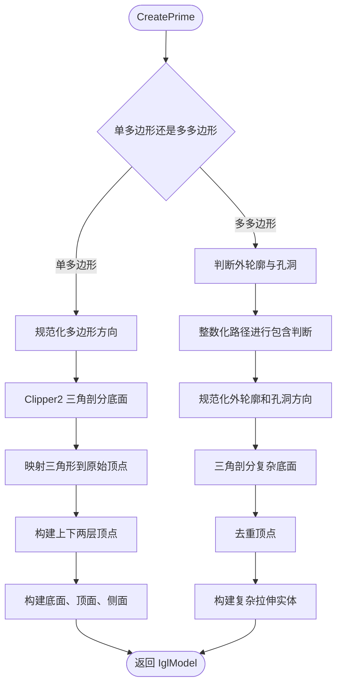
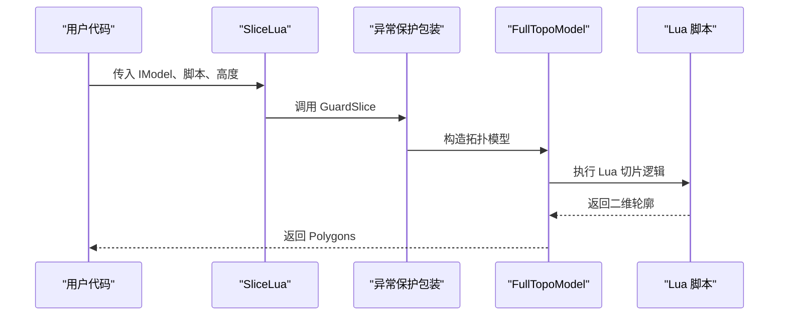
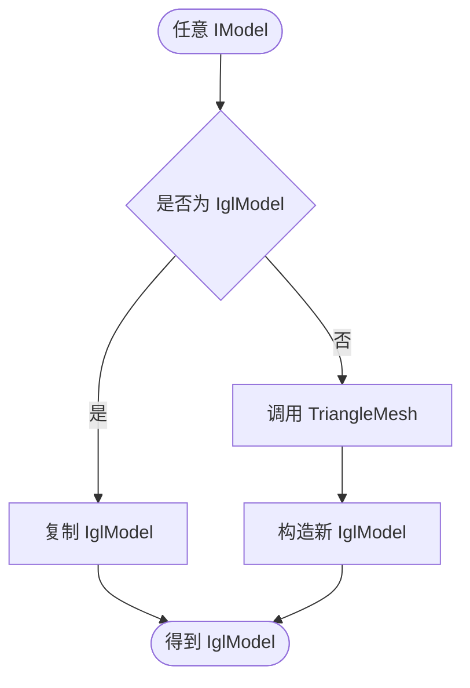
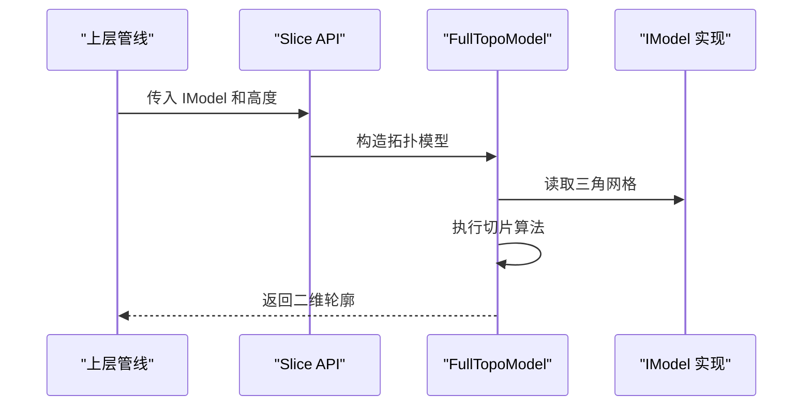

# IglModel 三角网格模型

<cite>
**本文引用的文件**   
- [IglModel.hpp](file://meshmodel/IglModel.hpp)
- [IglModel.cpp](file://meshmodel/IglModel.cpp)
- [IModel.hpp](file://base/IModel.hpp)
- [mesh_slice.hpp](file://LibHsBaSlicer/Slice/mesh_slice.hpp)
- [mesh_slice.cpp](file://LibHsBaSlicer/Slice/mesh_slice.cpp)
- [ModelLoader.cpp](file://preprocess/ModelLoader.cpp)
- [igl_model_test.cpp](file://tests/Models/igl_model_test.cpp)
</cite>

## 目录
1. [项目概述与快速开始](#项目概述与快速开始)
2. [架构总览](#架构总览)
3. [核心概念](#核心概念)
4. [核心模块详解](#核心模块详解)
5. [高级主题](#高级主题)
6. [Lua 脚本系统](#lua-脚本系统)
7. [API 参考文档](#api-参考文档)
8. [集成指南](#集成指南)
9. [开发·测试与贡献](#开发·测试与贡献)
10. [扩展开发指南](#扩展开发指南)
11. [示例与教程](#示例与教程)
12. [部署·故障排除与FAQ](#部署·故障排除与faq)
13. [附录](#附录)

## 项目概述与快速开始

IglModel 是基于 libigl 的三角网格模型实现，它继承自 HsBa Slicer 的通用三维模型接口 IModel。其核心职责是：

- 以 Eigen 矩阵存储顶点、面片索引和可选法线。
- 通过 libigl 提供高效的网格加载、保存、几何变换、边界框计算、体积计算和法线计算。
- 在启用 CGAL 时提供布尔运算能力。
- 从二维多边形生成可切片拉伸实体，用于填充、支撑等后续处理。
- 作为其他模型（如 CAD 模型、点云模型）与切片引擎之间的通用三角网格中间表示。

快速使用方式可以概括为：

1. 通过 `Load` 读取 STL/OBJ/PLY/OFF 等网格文件。
2. 通过 `Translate`、`Rotate`、`Scale`、`Transform` 进行几何变换。
3. 通过 `BoundingBox`、`Volume`、`TriangleMesh` 获取几何信息。
4. 通过 `CreateBox`、`CreateSphere`、`CreateCylinder`、`CreateCone`、`CreateTorus`、`CreatePrime` 创建基础几何体或拉伸实体。
5. 将 IglModel 传入切片 API，由 FullTopoModel 完成拓扑切片并返回二维轮廓。

本节不直接分析具体源码行，因此不提供“章节来源”。

## 架构总览

IglModel 处于 HsBa Slicer 模型抽象层与几何内核之间。上层管线通过 IModel 接口访问模型；底层则依赖 libigl 完成网格读写、法线和体积计算，并在启用 CGAL 时调用布尔运算。

**图表来源**
- [IModel.hpp:110-139](file://base/IModel.hpp#L110-L139)
- [IglModel.hpp:18-121](file://meshmodel/IglModel.hpp#L18-L121)
- [IglModel.cpp:12-31](file://meshmodel/IglModel.cpp#L12-L31)
- [mesh_slice.cpp:46-53](file://LibHsBaSlicer/Slice/mesh_slice.cpp#L46-L53)

**章节来源**
- [IModel.hpp:110-139](file://base/IModel.hpp#L110-L139)
- [IglModel.hpp:18-121](file://meshmodel/IglModel.hpp#L18-L121)
- [IglModel.cpp:12-31](file://meshmodel/IglModel.cpp#L12-L31)
- [mesh_slice.cpp:46-53](file://LibHsBaSlicer/Slice/mesh_slice.cpp#L46-L53)

## 核心概念

### IModel 接口

IModel 是 HsBa Slicer 中所有三维模型的统一抽象。它定义了：

| 类别 | 方法或类型 | 作用 |
|---|---|---|
| 文件操作 | `Load(fileName)` | 从文件加载模型 |
| 文件操作 | `Save(fileName, format)` | 按指定格式保存模型 |
| 几何变换 | `Translate(translation)` | 平移 |
| 几何变换 | `Rotate(rotation)` | 旋转 |
| 几何变换 | `Scale(scale)` | 均匀缩放 |
| 几何变换 | `Scale(scaleFactors)` | 非均匀缩放 |
| 几何变换 | `Transform(transform)` | 仿射、等距、齐次变换 |
| 几何查询 | `BoundingBox(min, max)` | 轴对齐包围盒 |
| 几何查询 | `Volume()` | 有符号体积绝对值 |
| 数据提取 | `TriangleMesh()` | 返回 libigl 风格的顶点和面片 |

IModel 还定义了 `ModelFormat` 枚举，覆盖 PLY、OBJ、STL、OFF、STEP、VRML、VDB 等多种格式标识。

**章节来源**
- [IModel.hpp:65-139](file://base/IModel.hpp#L65-L139)

### IglModel 数据结构

IglModel 内部维护三个核心 Eigen 矩阵和一个文件名缓存：

| 成员 | 类型 | 含义 |
|---|---|---|
| `vertices_` | `Eigen::MatrixXf` | N×3 顶点坐标，行主序存储 |
| `faces_` | `Eigen::MatrixXi` | M×3 三角形顶点索引 |
| `normals_` | `Eigen::MatrixXf` | 可选的法线数据 |
| `fileName_` | `std::string` | 最近一次加载的文件路径 |

这种设计使 IglModel 与 libigl 的数据结构高度一致：libigl 通常也接受 N×3 顶点和 M×3 面片，从而减少拷贝和转换成本。

**章节来源**
- [IglModel.hpp:115-121](file://meshmodel/IglModel.hpp#L115-L121)

### 内存布局与性能要点

IglModel 采用行主序 Eigen 矩阵存储顶点，这意味着：

- 对每个顶点做平移时，需要使用 `rowwise() += translation.transpose()`，而不是直接加向量。
- 对旋转矩阵应用时，需要对转置后的矩阵右乘，因为行向量乘以矩阵需要维度匹配。
- 对仿射变换应用时，需要将顶点补成齐次坐标，再乘以变换矩阵的转置，最后归一化回三维坐标。
- 法线只在存在且列数等于面片数时才更新，避免非法内存访问。

这些细节在 `Translate`、`Rotate`、`Transform` 的实现中体现出来，目的是保证 Release 模式下不会发生越界或未定义行为。

**章节来源**
- [IglModel.cpp:101-150](file://meshmodel/IglModel.cpp#L101-L150)

## 核心模块详解

### IglModel 类关系图

**图表来源**
- [IModel.hpp:110-139](file://base/IModel.hpp#L110-L139)
- [IglModel.hpp:26-121](file://meshmodel/IglModel.hpp#L26-L121)

### 模型加载与保存

`Load` 将 UTF-8 文件名转换为本地编码后调用 libigl 的三角网格读取函数。`Save` 根据 `ModelFormat` 选择对应的 libigl 写入函数，支持二进制 STL、ASCII STL、OFF、OBJ、ASCII PLY、Binary PLY。

如果格式不是支持的网格格式，会抛出 `NotSupportedError`。

**图表来源**
- [IglModel.cpp:72-99](file://meshmodel/IglModel.cpp#L72-L99)

**章节来源**
- [IglModel.cpp:64-99](file://meshmodel/IglModel.cpp#L64-L99)

### 几何变换实现

IglModel 的几何变换分为三类：

1. **平移**：对每行顶点加上平移向量。
2. **旋转**：将四元数转为旋转矩阵，并对顶点和法线右乘转置矩阵。
3. **缩放**：支持标量缩放和逐轴缩放。
4. **仿射变换**：支持 `Isometry3f`、`Matrix4f`、`Affine` 三种变换类型，均通过齐次坐标完成。

**图表来源**
- [IglModel.cpp:101-150](file://meshmodel/IglModel.cpp#L101-L150)

**章节来源**
- [IglModel.cpp:101-150](file://meshmodel/IglModel.cpp#L101-L150)

### 边界框与体积

`BoundingBox` 直接对顶点矩阵按列取最小值和最大值，时间复杂度近似 O(N)，N 为顶点数。

`Volume` 通过将顶点补零、面片追加一个虚拟顶点，调用 libigl 的体积计算函数，然后取绝对值之和。该实现基于封闭三角网格的有符号体积公式。

**图表来源**
- [IglModel.cpp:157-168](file://meshmodel/IglModel.cpp#L157-L168)

**章节来源**
- [IglModel.cpp:152-168](file://meshmodel/IglModel.cpp#L152-L168)

### 法线计算

IglModel 提供三种法线相关能力：

- `ComputeNormals`：计算面法线并存储到 `normals_`。
- `ComputeVertexNormals`：返回逐顶点法线。
- `ComputeFaceNormals`：返回逐面法线。

这些方法都委托给 libigl 的 per-face 和 per-vertex 法线计算函数。

**章节来源**
- [IglModel.cpp:170-185](file://meshmodel/IglModel.cpp#L170-L185)

### 三角网格数据提取

`TriangleMesh` 返回当前顶点和面片的副本，供外部库或转换流程使用。由于 IModel 接口要求返回 libigl 风格数据，IglModel 可以直接复用内部 Eigen 矩阵。

**章节来源**
- [IglModel.cpp:188-193](file://meshmodel/IglModel.cpp#L188-L193)

### 布尔运算

当编译选项启用 `USE_CGAL` 时，IglModel 提供 Union、Intersection、Difference、Xor 四个布尔运算函数。

实现策略如下：

1. 先验证左右两个网格的顶点和面片是否有效。
2. 将 float 顶点提升为 double，调用 libigl 的 CGAL mesh boolean。
3. 如果失败或结果为空，则回退到 CgalModel 的 Nef polyhedron 布尔运算。
4. 最终将结果转回 float 顶点并构造新的 IglModel。

如果没有启用 CGAL，则布尔运算函数抛出 `NotSupportedError`。

**图表来源**
- [IglModel.cpp:195-245](file://meshmodel/IglModel.cpp#L195-L245)
- [IglModel.cpp:248-391](file://meshmodel/IglModel.cpp#L248-L391)
- [IglModel.cpp:392-409](file://meshmodel/IglModel.cpp#L392-L409)

**章节来源**
- [IglModel.cpp:195-409](file://meshmodel/IglModel.cpp#L195-L409)

### 基础几何体工厂

IglModel 提供多种基础几何体创建方法：

| 工厂方法 | 输入参数 | 输出 |
|---|---|---|
| `CreateBox` | 长宽高 | 中心在原点的轴对齐立方体 |
| `CreateSphere` | 半径、细分等级 | UV 球面网格 |
| `CreateCylinder` | 半径、高度、分段数 | 圆柱体 |
| `CreateCone` | 半径、高度、分段数 | 圆锥体 |
| `CreateTorus` | 主轴半径、次轴半径、分段数 | 圆环体 |

这些工厂方法手动构造顶点和面片，并确保法线方向符合外表面约定，以便后续布尔运算和体积计算正确。

**章节来源**
- [IglModel.cpp:411-596](file://meshmodel/IglModel.cpp#L411-L596)

### 拉伸实体 CreatePrime

`CreatePrime` 是从二维多边形生成三维实体的关键方法，也是连接 2D 几何与 3D 切片的重要桥梁。

单多边形版本：

1. 校验多边形至少包含 3 个点。
2. 使用 Clipper2 计算面积并规范化为逆时针。
3. 使用 Clipper2 三角剖分底面。
4. 将原始顶点映射到底面三角形索引。
5. 构建上下两层顶点和侧面四边形。
6. 构造底面、顶面和侧面三角形。

多多边形版本：

1. 判断外轮廓和孔洞。
2. 使用嵌套深度奇偶性判断孔洞。
3. 使用整数化路径进行精确包含判断。
4. 对孔洞和外轮廓分别规范化环绕方向。
5. 三角剖分底面。
6. 去重顶点，构建上下层和侧面。
7. 确保底面法线朝下、顶面法线朝上。

**图表来源**
- [IglModel.cpp:598-713](file://meshmodel/IglModel.cpp#L598-L713)
- [IglModel.cpp:715-930](file://meshmodel/IglModel.cpp#L715-L930)

**章节来源**
- [IglModel.cpp:598-930](file://meshmodel/IglModel.cpp#L598-L930)

## 高级主题

### libigl 数据结构映射

IglModel 直接使用 Eigen 矩阵与 libigl 对接：

- 顶点矩阵为 N×3，行代表顶点，列代表 x、y、z。
- 面片矩阵为 M×3，每行是一个三角形的三个顶点索引。
- 法线矩阵可选，通常为 M×3 或 N×3，取决于计算方式。
- 体积计算通过扩展顶点和面片，将三角网格视为多个四面体组合。

这种映射避免了额外封装层，减少了内存分配和复制开销。

**章节来源**
- [IglModel.cpp:157-168](file://meshmodel/IglModel.cpp#L157-L168)
- [IglModel.cpp:170-185](file://meshmodel/IglModel.cpp#L170-L185)

### 内存管理策略

IglModel 的内存管理特点包括：

- 构造函数支持 const 引用和移动语义，避免不必要的拷贝。
- `TriangleMesh` 返回副本，保证外部修改不会影响内部状态。
- 几何变换直接修改内部顶点矩阵，属于原地更新。
- 布尔运算和拉伸实体会创建新的 IglModel，旧对象保持不变。
- 法线按需计算，避免无谓的计算和内存占用。

**章节来源**
- [IglModel.cpp:37-62](file://meshmodel/IglModel.cpp#L37-L62)
- [IglModel.cpp:188-193](file://meshmodel/IglModel.cpp#L188-L193)

### 性能优化技术

IglModel 的性能优化主要体现在：

1. **行主序 Eigen 矩阵**：与 libigl 默认风格一致，减少转置和广播开销。
2. **原地变换**：平移、旋转、缩放直接修改顶点，避免中间对象。
3. **条件更新法线**：只在法线存在且尺寸合法时更新。
4. **布尔运算双路径**：优先使用 libigl 的 CGAL mesh boolean，失败时回退到 CgalModel。
5. **多边形整数化**：在复杂孔洞判断中使用 Path64 提高包含检测稳定性。
6. **预分配容器**：在基础几何体和拉伸实体中预先估算顶点数和面片数。

**章节来源**
- [IglModel.cpp:101-150](file://meshmodel/IglModel.cpp#L101-L150)
- [IglModel.cpp:195-245](file://meshmodel/IglModel.cpp#L195-L245)
- [IglModel.cpp:715-770](file://meshmodel/IglModel.cpp#L715-L770)

## Lua 脚本系统

虽然本页面聚焦 IglModel，但 IglModel 常与切片系统的 Lua 脚本能力配合使用。切片 API 提供 `SliceLua` 和 `UnSafeSliceLua`，它们将 IModel 转换为 FullTopoModel，并允许用户通过 Lua 脚本控制切片过程。

**图表来源**
- [mesh_slice.cpp:66-73](file://LibHsBaSlicer/Slice/mesh_slice.cpp#L66-L73)

**章节来源**
- [mesh_slice.cpp:66-73](file://LibHsBaSlicer/Slice/mesh_slice.cpp#L66-L73)

## API 参考文档

### IModel 接口摘要

| 方法 | 参数 | 返回值 | 说明 |
|---|---|---|---|
| `Load` | `fileName` | `bool` | 从文件加载模型 |
| `Save` | `fileName`, `format` | `bool` | 按格式保存模型 |
| `Translate` | `translation` | `void` | 平移模型 |
| `Rotate` | `rotation` | `void` | 旋转模型 |
| `Scale` | `scale` | `void` | 均匀缩放 |
| `Scale` | `scaleFactors` | `void` | 非均匀缩放 |
| `Transform` | `transform` | `void` | 仿射变换 |
| `BoundingBox` | `min`, `max` | `void` | 计算包围盒 |
| `Volume` | 无 | `float` | 计算体积 |
| `TriangleMesh` | 无 | `pair` | 提取三角网格 |

**章节来源**
- [IModel.hpp:110-139](file://base/IModel.hpp#L110-L139)

### IglModel 公开方法摘要

| 方法 | 参数 | 返回值 | 说明 |
|---|---|---|---|
| `Load` | `fileName` | `bool` | 加载三角网格 |
| `Save` | `fileName`, `format` | `bool` | 保存为 STL/OBJ/PLY/OFF |
| `Translate` | `translation` | `void` | 平移 |
| `Rotate` | `rotation` | `void` | 旋转 |
| `Scale` | `scale` | `void` | 均匀缩放 |
| `Scale` | `scaleFactors` | `void` | 非均匀缩放 |
| `Transform` | `transform` | `void` | 仿射变换 |
| `BoundingBox` | `min`, `max` | `void` | 包围盒 |
| `Volume` | 无 | `float` | 体积 |
| `TriangleMesh` | 无 | `pair` | 提取网格 |
| `ComputeNormals` | 无 | `void` | 计算面法线 |
| `ComputeVertexNormals` | 无 | `MatrixXf` | 顶点法线 |
| `ComputeFaceNormals` | 无 | `MatrixXf` | 面法线 |
| `CreateBox` | `size` | `IglModel` | 创建立方体 |
| `CreateSphere` | `radius`, `subdivisions` | `IglModel` | 创建球体 |
| `CreateCylinder` | `radius`, `height`, `segments` | `IglModel` | 创建圆柱 |
| `CreateCone` | `radius`, `height`, `segments` | `IglModel` | 创建圆锥 |
| `CreateTorus` | `majorRadius`, `minorRadius`, `majorSegments`, `minorSegments` | `IglModel` | 创建圆环 |
| `CreatePrime` | `poly`, `direction` | `IglModel` | 单多边形拉伸 |
| `CreatePrime` | `paths`, `direction` | `IglModel` | 多多边形拉伸 |

**章节来源**
- [IglModel.hpp:55-113](file://meshmodel/IglModel.hpp#L55-L113)

### 布尔运算函数

| 函数 | 参数 | 返回值 | 说明 |
|---|---|---|---|
| `Union` | `left`, `right` | `IglModel` | 并集 |
| `Intersection` | `left`, `right` | `IglModel` | 交集 |
| `Difference` | `left`, `right` | `IglModel` | 差集 |
| `Xor` | `left`, `right` | `IglModel` | 异或 |

未启用 CGAL 时，这些函数抛出 `NotSupportedError`。

**章节来源**
- [IglModel.cpp:248-409](file://meshmodel/IglModel.cpp#L248-L409)

## 集成指南

### 与其他模型的转换

项目中存在从任意 `IModel` 转换为 `IglModel` 的辅助逻辑：

- 如果已经是 `IglModel`，则直接复制。
- 否则调用 `TriangleMesh` 提取顶点和面片，再构造新的 `IglModel`。

这使得 CAD 模型、点云模型或其他网格模型都可以统一进入 IglModel 的处理流程。

**图表来源**
- [ModelLoader.cpp:136-146](file://preprocess/ModelLoader.cpp#L136-L146)

**章节来源**
- [ModelLoader.cpp:136-146](file://preprocess/ModelLoader.cpp#L136-L146)

### 与切片引擎的集成

切片引擎通过 `Slice`、`UnSafeSlice`、`SliceLua` 等 API 接收 `IModel`。内部会将模型包装为 `FullTopoModel`，然后执行安全切片或非安全切片，最终返回二维轮廓。

**图表来源**
- [mesh_slice.cpp:46-53](file://LibHsBaSlicer/Slice/mesh_slice.cpp#L46-L53)

**章节来源**
- [mesh_slice.cpp:46-53](file://LibHsBaSlicer/Slice/mesh_slice.cpp#L46-L53)

## 开发·测试与贡献

### 单元测试覆盖

`igl_model_test.cpp` 覆盖了以下场景：

- 创建单位立方体并验证顶点数、面片数和体积。
- 验证面法线为单位向量。
- 创建圆柱体并验证体积和包围盒。
- 布尔运算（在启用 CGAL 时）。
- 单多边形拉伸、带孔多边形拉伸、L 形拉伸。
- 非平面拉伸方向下的体积和包围盒。

这些测试表明 IglModel 的几何构造、体积计算和包围盒计算具有确定性预期。

**章节来源**
- [igl_model_test.cpp:11-42](file://tests/Models/igl_model_test.cpp#L11-L42)
- [igl_model_test.cpp:74-107](file://tests/Models/igl_model_test.cpp#L74-L107)
- [igl_model_test.cpp:109-145](file://tests/Models/igl_model_test.cpp#L109-L145)
- [igl_model_test.cpp:147-177](file://tests/Models/igl_model_test.cpp#L147-L177)
- [igl_model_test.cpp:179-203](file://tests/Models/igl_model_test.cpp#L179-L203)

### 布尔运算测试

布尔运算测试使用两个立方体，沿对角线平移以避免共面导致 libigl mesh boolean 返回空结果。测试断言并集、交集、差集、异或的体积接近理论值。

**章节来源**
- [igl_model_test.cpp:44-72](file://tests/Models/igl_model_test.cpp#L44-L72)

## 扩展开发指南

### 自定义模型实现

如果要实现自己的模型类型，应：

1. 继承 `IModel`。
2. 实现文件加载、保存、几何变换、包围盒、体积和三角网格提取。
3. 如果使用 libigl，尽量保持 N×3 顶点和 M×3 面片的数据布局。
4. 如果需要布尔运算，可参考 IglModel 的双路径实现：优先 libigl CGAL，失败回退到 CgalModel。

### 与 2D 多边形系统集成

IglModel 的 `CreatePrime` 展示了如何将 2D 多边形转换为 3D 实体。扩展时可以参考：

- 使用 Clipper2 进行三角剖分和面积计算。
- 使用嵌套深度判断孔洞。
- 使用整数化路径提高包含检测精度。
- 确保底面法线朝下、顶面法线朝上，以保证体积和布尔运算正确。

**章节来源**
- [IglModel.cpp:598-930](file://meshmodel/IglModel.cpp#L598-L930)

## 示例与教程

### 示例一：创建立方体并切片

步骤：

1. 使用 `IglModel::CreateBox` 创建单位立方体。
2. 调用 `Translate` 调整位置。
3. 调用 `Slice` 或 `UnSafeSlice` 进行切片。
4. 获取二维轮廓用于路径规划。

该流程在预处理和布尔运算测试中都有类似用法。

**章节来源**
- [igl_model_test.cpp:11-26](file://tests/Models/igl_model_test.cpp#L11-L26)
- [model_loader_test.cpp:188-206](file://tests/Preprocess/model_loader_test.cpp#L188-L206)

### 示例二：拉伸多边形生成实体

步骤：

1. 构造 `PolygonD` 或 `PolygonsD`。
2. 调用 `IglModel::CreatePrime` 指定拉伸方向。
3. 调用 `Volume` 验证体积。
4. 调用 `BoundingBox` 验证空间范围。
5. 将结果传给切片引擎。

**章节来源**
- [igl_model_test.cpp:74-107](file://tests/Models/igl_model_test.cpp#L74-L107)
- [igl_model_test.cpp:109-145](file://tests/Models/igl_model_test.cpp#L109-L145)

### 示例三：布尔运算

步骤：

1. 创建两个立方体。
2. 对其中一个进行平移。
3. 调用 `Union`、`Intersection`、`Difference` 或 `Xor`。
4. 检查结果网格是否非空。
5. 验证体积是否符合预期。

注意：未启用 CGAL 时布尔运算不可用。

**章节来源**
- [igl_model_test.cpp:44-72](file://tests/Models/igl_model_test.cpp#L44-L72)

## 部署·故障排除与FAQ

### 常见问题

| 问题 | 可能原因 | 解决建议 |
|---|---|---|
| 布尔运算返回空网格 | 输入网格共面、顶点无效、或浮点精度不足 | 检查顶点有限性、索引合法性；避免完全共面；启用 CGAL 并使用回退路径 |
| 布尔运算抛出不支持错误 | 未启用 `USE_CGAL` | 重新编译启用 CGAL，或使用其他布尔方案 |
| 保存文件失败 | 文件格式不受支持 | 使用 STL、OBJ、PLY、OFF 等受支持格式 |
| 体积异常 | 网格不封闭或法线方向错误 | 检查 `CreatePrime` 和基础几何体法线方向；确认网格闭合 |
| 切片失败 | 底层几何内核抛出异常 | 使用 `Slice` 的安全包装；检查模型拓扑质量 |

**章节来源**
- [IglModel.cpp:195-245](file://meshmodel/IglModel.cpp#L195-L245)
- [IglModel.cpp:392-409](file://meshmodel/IglModel.cpp#L392-L409)
- [mesh_slice.cpp:28-43](file://LibHsBaSlicer/Slice/mesh_slice.cpp#L28-L43)

### 性能基准建议

由于仓库未提供统一的基准测试框架，建议在实际使用中自行测量：

- 小模型：顶点数小于 1 万，IglModel 的变换、体积、包围盒计算通常很快。
- 中等模型：顶点数 1 万到 10 万，布尔运算可能成为瓶颈。
- 大模型：顶点数超过 10 万，建议先简化网格，再执行布尔运算或切片。

推荐指标：

- 单次 `Volume` 耗时。
- 单次 `BoundingBox` 耗时。
- 布尔运算成功率与耗时。
- `CreatePrime` 在不同多边形复杂度下的耗时。
- 切片 API 从 IModel 到 Polygons 的端到端耗时。

本节为通用指导，不直接引用具体源码行，因此不提供“章节来源”。

## 结论

IglModel 是 HsBa Slicer 中轻量而实用的三角网格模型实现。它以 Eigen 和 libigl 为核心，提供了完整的模型加载保存、几何变换、几何查询、法线计算、布尔运算和多边形拉伸能力。通过 IModel 接口，它可以无缝接入 CAD 模型、点云模型和切片引擎。

对于大多数切片前处理任务，IglModel 已经足够高效；对于更复杂的 CAD 布尔或高精度 BRep 需求，项目还提供了 OcctModel 和 CgalModel。实际工程中，应根据模型规模、布尔运算需求和 CGAL 编译选项选择合适的模型实现。