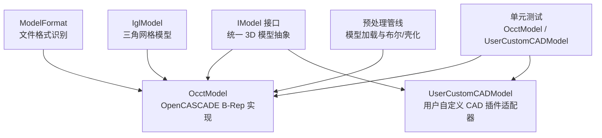
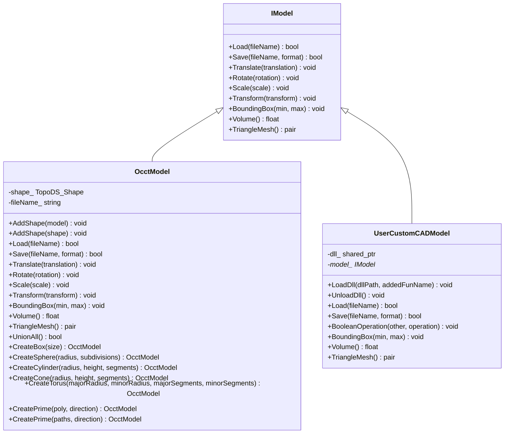
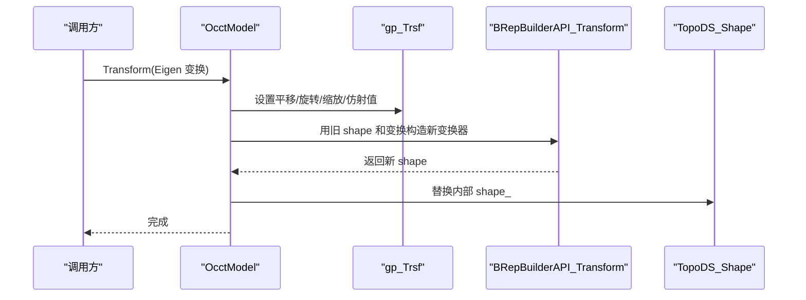
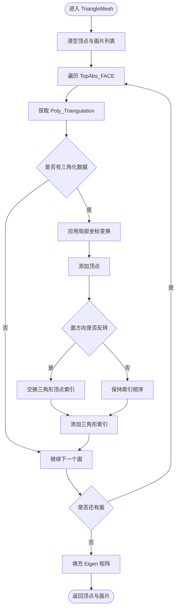
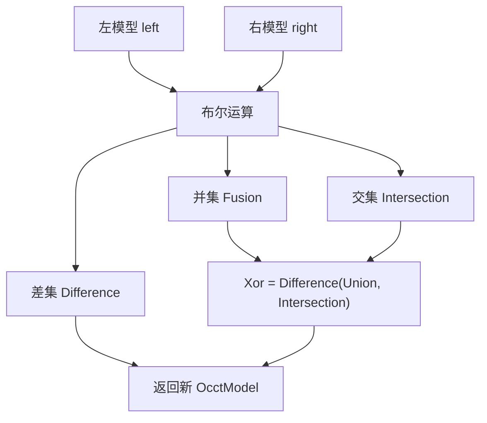
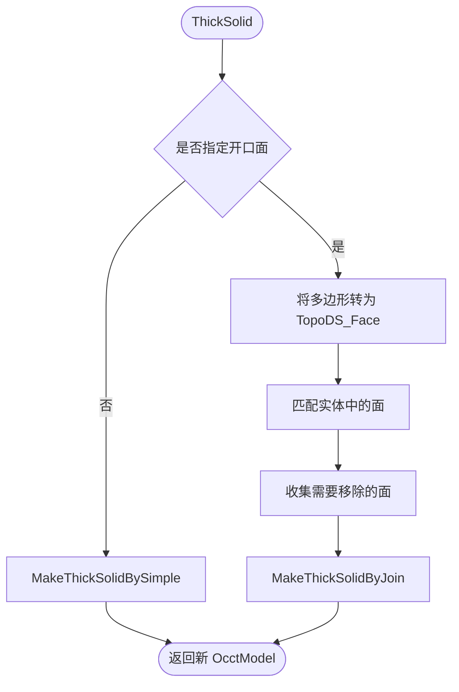
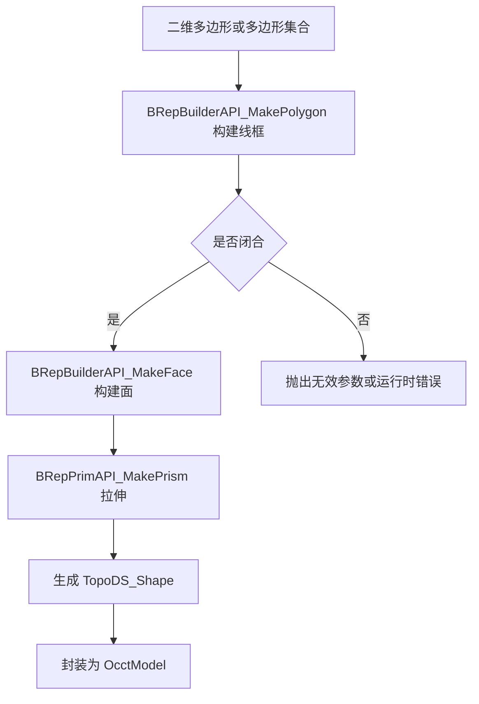
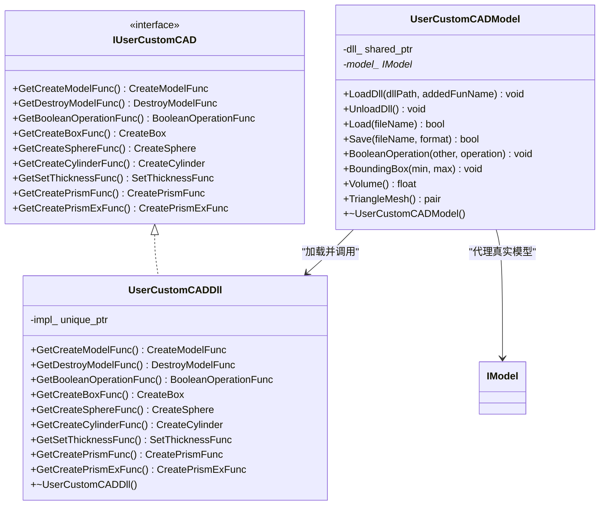
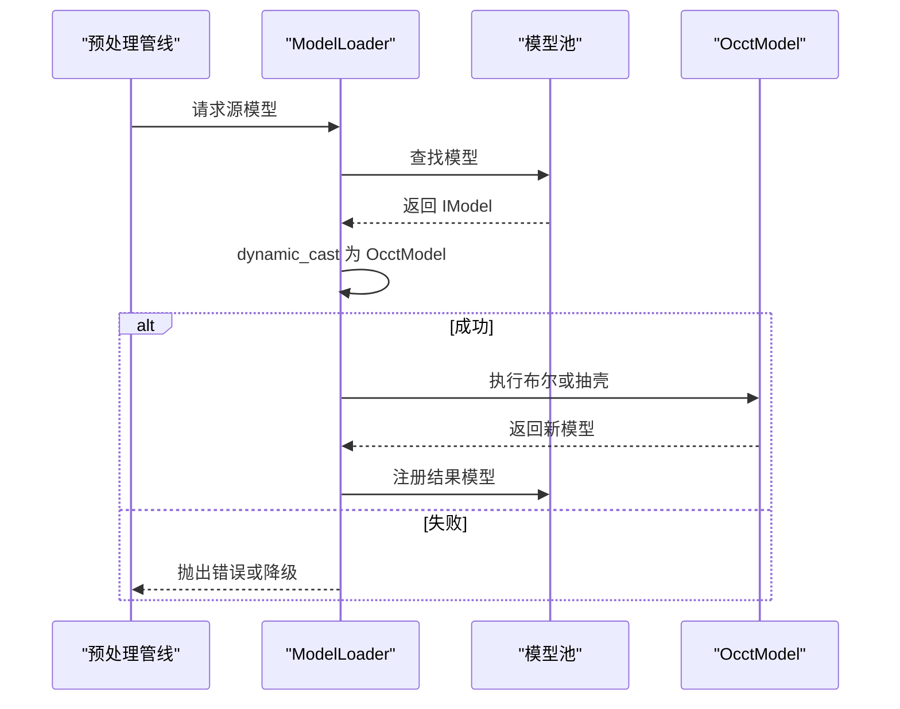
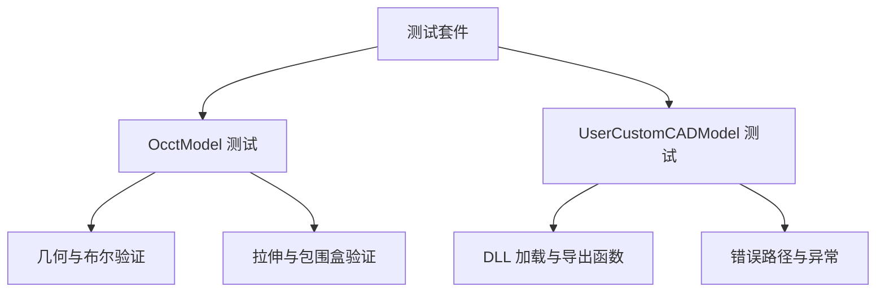

# OcctModel OpenCASCADE CAD 模型

<cite>
**本文引用的文件**   
- [OcctModel.hpp](file://cadmodel/OcctModel.hpp)
- [OcctModel.cpp](file://cadmodel/OcctModel.cpp)
- [OcctTypeAliases.hpp](file://cadmodel/OcctTypeAliases.hpp)
- [UserCustomCADModel.hpp](file://cadmodel/UserCustomCADModel.hpp)
- [UserCustomCADModel.cpp](file://cadmodel/UserCustomCADModel.cpp)
- [IModel.hpp](file://base/IModel.hpp)
- [ModelFormat.cpp](file://base/ModelFormat.cpp)
- [occt_model_test.cpp](file://tests/Models/occt_model_test.cpp)
- [user_custom_cad_model_test.cpp](file://tests/CADModel/user_custom_cad_model_test.cpp)
</cite>

## 目录
1. [项目概述与快速开始](#项目概述与快速开始)
2. [架构总览](#架构总览)
3. [核心概念](#核心概念)
4. [核心模块详解](#核心模块详解)
5. [高级主题](#高级主题)
6. [Lua 脚本系统](#lua-脚本系统)
7. [API 参考文档](#api-参考文档)
8. [集成指南](#集成指南)
9. [开发·测试与贡献](#开发测试与贡献)
10. [扩展开发指南](#扩展开发指南)
11. [示例与教程](#示例与教程)
12. [部署·故障排除与FAQ](#部署故障排除与faq)
13. [附录](#附录)

## 项目概述与快速开始

OcctModel 是 HsBaSlicer 中基于 OpenCASCADE B-Rep 内核的精确 CAD 模型实现。它通过封装 `TopoDS_Shape`，在统一的 `IModel` 接口之上提供：

- 精确 B-Rep 几何建模：轴对齐立方体、球体、圆柱、圆锥、圆环以及多边形拉伸实体。
- 标准 CAD 格式支持：STEP、IGES、VRML、BREP 的读取与保存。
- 精确布尔运算：并集、交集、差集、异或。
- 壳化与壁厚操作：对封闭实体进行等厚度抽壳，或指定需要保留开口的面集合。
- 三角网格导出：将 B-Rep 表面三角化后转换为 libigl 风格的顶点与面片矩阵。
- 仿射变换：平移、旋转、均匀缩放、非均匀缩放、齐次变换和仿射变换。
- 用户自定义 CAD 扩展：通过动态加载外部 DLL/SO，以插件方式接入第三方 CAD 内核。

快速开始建议：

| 场景 | 推荐入口 |
|---|---|
| 从 STEP/IGES/BREP/VRML 加载精确模型 | `OcctModel::Load` |
| 创建基础实体 | `CreateBox`、`CreateSphere`、`CreateCylinder`、`CreateCone`、`CreateTorus` |
| 从二维轮廓生成三维实体 | `CreatePrime` |
| 执行精确布尔运算 | `Union`、`Intersection`、`Difference`、`Xor` |
| 生成壳体或抽壳 | `ThickSolid` |
| 导出为三角网格 | `TriangleMesh` |
| 使用第三方 CAD 插件 | `UserCustomCADModel` + `LoadDll` |

**章节来源**
- [OcctModel.hpp:22-29](file://cadmodel/OcctModel.hpp#L22-L29)
- [IModel.hpp:110-139](file://base/IModel.hpp#L110-L139)

## 架构总览

OcctModel 处于 HsBaSlicer 模型抽象层的核心位置。它向上实现 `IModel`，向下依赖 OpenCASCADE 的 B-Rep API；同时与格式识别、网格模型、预处理管线以及用户自定义 CAD 插件协同工作。



**图表来源**
- [IModel.hpp:110-139](file://base/IModel.hpp#L110-L139)
- [OcctModel.hpp:30-124](file://cadmodel/OcctModel.hpp#L30-L124)
- [UserCustomCADModel.hpp:79-121](file://cadmodel/UserCustomCADModel.hpp#L79-L121)
- [ModelFormat.cpp:46-85](file://base/ModelFormat.cpp#L46-L85)

**章节来源**
- [OcctModel.hpp:30-124](file://cadmodel/OcctModel.hpp#L30-L124)
- [UserCustomCADModel.hpp:79-121](file://cadmodel/UserCustomCADModel.hpp#L79-L121)
- [ModelFormat.cpp:46-85](file://base/ModelFormat.cpp#L46-L85)

## 核心概念

### B-Rep 数据模型与 TopoDS_Shape

OcctModel 内部维护一个 `TopoDS_Shape`，这是 OpenCASCADE 拓扑数据结构的基础类型。所有子形状、边、面、体都通过该结构表达。构造时可以直接拷贝或移动已有 shape，避免在未初始化对象上调用构建器导致内存访问问题。

关键特性：

- 空模型：默认构造得到空 shape。
- 组合体：通过 `AddShape` 将其他模型或原始 OCCT shape 加入当前 compound。
- 只读查询：包围盒、体积、三角网格不修改原始 B-Rep。
- 写操作：布尔运算、变换、抽壳会生成新的 shape 并替换内部状态。



**图表来源**
- [IModel.hpp:110-139](file://base/IModel.hpp#L110-L139)
- [OcctModel.hpp:30-124](file://cadmodel/OcctModel.hpp#L30-L124)
- [UserCustomCADModel.hpp:79-121](file://cadmodel/UserCustomCADModel.hpp#L79-L121)

**章节来源**
- [OcctModel.cpp:63-74](file://cadmodel/OcctModel.cpp#L63-L74)
- [OcctModel.hpp:45-52](file://cadmodel/OcctModel.hpp#L45-L52)

### 文件格式与 B-Rep 分类

HsBaSlicer 使用 `ModelFormat` 枚举统一管理模型格式，并通过扩展名识别具体类型。OcctModel 支持的 B-Rep 相关格式包括：

| 格式类别 | 枚举值 | 扩展名匹配 | 说明 |
|---|---|---|---|
| VRML | `ModelFormat::VRML` | `.vrml`、`.wrl` | 可用于可视化或中间交换，但精度不如原生 CAD 格式 |
| STEP | `ModelFormat::STEP` | `.step`、`.stp` | ISO 标准参数化 CAD 交换格式 |
| IGES | `ModelFormat::IGES` | `.iges` | 早期 CAD 交换格式，常用于曲面与线框 |
| BREP | `ModelFormat::BREP` | `.brep` | OpenCASCADE 原生二进制拓扑格式 |

此外，当保存目标为网格格式时，OcctModel 会自动先执行三角网格转换，再委托给 `IglModel` 保存。

**章节来源**
- [IModel.hpp:65-109](file://base/IModel.hpp#L65-L109)
- [ModelFormat.cpp:26-34](file://base/ModelFormat.cpp#L26-L34)
- [ModelFormat.cpp:46-85](file://base/ModelFormat.cpp#L46-L85)
- [ModelFormat.cpp:119-131](file://base/ModelFormat.cpp#L119-L131)
- [OcctModel.cpp:238-270](file://cadmodel/OcctModel.cpp#L238-L270)

## 核心模块详解

### OcctModel：OpenCASCADE B-Rep 实现

#### 加载流程

`Load` 根据扩展名选择对应读取器，并将多个子形状合并到内部 `shape_` 中。

```mermaid
flowchart TD
Start(["调用 Load"]) --> Detect["根据扩展名识别格式"]
Detect --> Step{"是否 STEP"}
Detect --> Ig es{"是否 IGES"}
Detect --> Vrml{"是否 VRML"}
Detect --> Bre p{"是否 BREP"}
Step --> |是| ReadStep["STEPControl_Reader 读取"]
Ig es --> |是| ReadIGES["IGESControl_Reader 读取"]
Vrml --> |是| ReadVRML["VrmlData_Scene 读取"]
Bre p --> |是| ReadBRep["BRepTools::Read 读取"]
ReadStep --> Merge["BRep_Builder 合并子形状"]
ReadIGES --> Merge
ReadVRML --> SetShape["直接赋值 TopoDS_Shape"]
ReadBRep --> SetShape
Merge --> CheckNull{"shape_ 是否为空"}
SetShape --> CheckNull
CheckNull --> |否| ReturnTrue["返回 true"]
CheckNull --> |是| ReturnFalse["返回 false"]
```

**图表来源**
- [OcctModel.cpp:76-147](file://cadmodel/OcctModel.cpp#L76-L147)
- [OcctModel.cpp:213-237](file://cadmodel/OcctModel.cpp#L213-L237)

#### 保存流程

保存逻辑区分 B-Rep 格式与网格格式。对于网格格式，OcctModel 会先调用 `TriangleMesh` 生成顶点与面片，再交给 `IglModel` 完成实际写入。

```mermaid
flowchart TD
SaveStart(["调用 Save"]) --> ConvertPath["UTF-8 路径转本地编码"]
ConvertPath --> FormatSwitch{"目标格式"}
FormatSwitch --> StepOut{"STEP"}
FormatSwitch --> Ig esOut{"IGES"}
FormatSwitch --> VrmlOut{"VRML"}
FormatSwitch --> Bre pOut{"BREP"}
FormatSwitch --> MeshOut{"网格格式"}
StepOut --> WriteStep["STEPControl_Writer 写入"]
Ig esOut --> WriteIGES["IGESControl_Writer 写入"]
VrmlOut --> WriteVRML["VrmlAPI::Write 写入"]
Bre pOut --> WriteBRep["BRepTools::Write 写入"]
MeshOut --> Tessellate["TriangleMesh 三角网格化"]
Tessellate --> IglSave["IglModel.Save 保存"]
WriteStep --> End(["返回结果"])
WriteIGES --> End
WriteVRML --> End
WriteBRep --> End
IglSave --> End
```

**图表来源**
- [OcctModel.cpp:148-190](file://cadmodel/OcctModel.cpp#L148-L190)
- [OcctModel.cpp:238-270](file://cadmodel/OcctModel.cpp#L238-L270)

#### 变换与包围盒

变换操作将 Eigen 变换矩阵映射到 OpenCASCADE 的 `gp_Trsf`，再通过 `BRepBuilderAPI_Transform` 生成新 shape。包围盒计算遍历所有顶点，取最小最大值。



**图表来源**
- [OcctModel.cpp:272-329](file://cadmodel/OcctModel.cpp#L272-L329)

**章节来源**
- [OcctModel.cpp:76-147](file://cadmodel/OcctModel.cpp#L76-L147)
- [OcctModel.cpp:148-190](file://cadmodel/OcctModel.cpp#L148-L190)
- [OcctModel.cpp:192-211](file://cadmodel/OcctModel.cpp#L192-L211)
- [OcctModel.cpp:213-329](file://cadmodel/OcctModel.cpp#L213-L329)
- [OcctModel.cpp:331-351](file://cadmodel/OcctModel.cpp#L331-L351)

### 三角网格转换算法

`TriangleMesh` 遍历所有面，获取每个面的 `Poly_Triangulation`，应用局部坐标变换，然后按顺序收集顶点和三角形索引。若面没有三角化数据则跳过；若面方向反转，则交换两个顶点索引以保证法向一致。



**图表来源**
- [OcctModel.cpp:353-400](file://cadmodel/OcctModel.cpp#L353-L400)

**章节来源**
- [OcctModel.cpp:353-400](file://cadmodel/OcctModel.cpp#L353-L400)

### 精确布尔运算

OcctModel 暴露四个布尔运算函数，分别对应并集、交集、差集和异或。异或由并集、交集和差集组合而成。

| 函数 | 底层 OCCT API | 语义 |
|---|---|---|
| `Union(left, right)` | `BRepAlgoAPI_Fuse` | 合并两个实体的体积 |
| `Intersection(left, right)` | `BRepAlgoAPI_Common` | 保留重叠部分 |
| `Difference(left, right)` | `BRepAlgoAPI_Cut` | 从左实体中减去右实体 |
| `Xor(left, right)` | 组合 Union、Intersection、Difference | 对称差集 |



**图表来源**
- [OcctModel.cpp:451-469](file://cadmodel/OcctModel.cpp#L451-L469)

**章节来源**
- [OcctModel.cpp:451-469](file://cadmodel/OcctModel.cpp#L451-L469)
- [occt_model_test.cpp:34-48](file://tests/Models/occt_model_test.cpp#L34-L48)

### 壳化与壁厚操作

`ThickSolid` 提供两种重载：

1. 对整个实体进行等厚度抽壳。
2. 对实体进行抽壳，同时允许指定一组需要保留为开口的面。

第二种重载会将输入的多边形顶点序列转换为 `TopoDS_Face`，然后通过距离和变换迹判断是否与实体现有面匹配，从而决定哪些面应被移除。



**图表来源**
- [OcctModel.cpp:471-540](file://cadmodel/OcctModel.cpp#L471-L540)

**章节来源**
- [OcctModel.cpp:471-540](file://cadmodel/OcctModel.cpp#L471-L540)

### 参数化建模与拉伸工厂

OcctModel 提供多种基础实体工厂，以及从二维多边形拉伸成三维实体的能力。

| 工厂方法 | 输入 | 输出 |
|---|---|---|
| `CreateBox` | 长宽高向量 | 轴对齐立方体 |
| `CreateSphere` | 半径、细分段数 | 球体 |
| `CreateCylinder` | 半径、高度、分段数 | 圆柱 |
| `CreateCone` | 底半径、高度、分段数 | 圆锥 |
| `CreateTorus` | 主半径、次半径、主分段、次分段 | 圆环 |
| `CreatePrime` | 单个闭合多边形 + 拉伸方向 | 拉伸实体 |
| `CreatePrime` | 外轮廓 + 孔洞多边形 + 拉伸方向 | 带孔拉伸实体 |



**图表来源**
- [OcctModel.cpp:422-449](file://cadmodel/OcctModel.cpp#L422-L449)
- [OcctModel.cpp:542-663](file://cadmodel/OcctModel.cpp#L542-L663)

**章节来源**
- [OcctModel.cpp:422-449](file://cadmodel/OcctModel.cpp#L422-L449)
- [OcctModel.cpp:542-663](file://cadmodel/OcctModel.cpp#L542-L663)
- [occt_model_test.cpp:50-134](file://tests/Models/occt_model_test.cpp#L50-L134)

### UserCustomCADModel：自定义 CAD 模型扩展机制

UserCustomCADModel 是一个 `IModel` 适配器，负责加载外部 CAD 动态库，并通过函数指针调用其导出的工厂函数、布尔运算、变换和销毁接口。

关键设计点：

- `IUserCustomCAD` 定义插件必须实现的函数签名。
- `UserCustomCADDll` 使用 `boost::dll` 加载 DLL/SO，并按约定名称解析导出函数。
- `UserCustomCADModel` 持有 DLL 实例和被代理的 `IModel*`。
- 所有公共方法在模型未加载时会抛出运行时错误。
- 布尔运算要求左右模型来自同一个 DLL，否则视为不兼容。



**图表来源**
- [UserCustomCADModel.hpp:27-48](file://cadmodel/UserCustomCADModel.hpp#L27-L48)
- [UserCustomCADModel.hpp:53-73](file://cadmodel/UserCustomCADModel.hpp#L53-L73)
- [UserCustomCADModel.hpp:79-121](file://cadmodel/UserCustomCADModel.hpp#L79-L121)
- [UserCustomCADModel.cpp:24-30](file://cadmodel/UserCustomCADModel.cpp#L24-L30)
- [UserCustomCADModel.cpp:31-115](file://cadmodel/UserCustomCADModel.cpp#L31-L115)

**章节来源**
- [UserCustomCADModel.hpp:27-121](file://cadmodel/UserCustomCADModel.hpp#L27-L121)
- [UserCustomCADModel.cpp:24-149](file://cadmodel/UserCustomCADModel.cpp#L24-L149)
- [UserCustomCADModel.cpp:151-325](file://cadmodel/UserCustomCADModel.cpp#L151-L325)
- [user_custom_cad_model_test.cpp:45-188](file://tests/CADModel/user_custom_cad_model_test.cpp#L45-L188)

## 高级主题

### B-Rep 与三角网格的性能权衡

| 阶段 | B-Rep 优势 | 三角网格优势 |
|---|---|---|
| 存储 | 精确数学描述，适合参数化设计和工程交换 | 结构简单，适合渲染和通用网格处理 |
| 布尔运算 | 精确拓扑运算，适合 CAD 级 CSG | 网格布尔容易退化，通常需要 CGAL 或专用库 |
| 切片 | 可结合精确几何减少数值误差 | 切片通常基于网格，速度快但受网格质量影响 |
| 导出 | 适合 STEP/IGES/BREP 等工业格式 | 适合 STL/OBJ/PLY/OFF 等网格格式 |

OcctModel 的设计原则是：**尽可能在 B-Rep 阶段完成精确几何操作，仅在必要时才转换为三角网格**。例如保存网格格式时自动转换，而布尔运算和抽壳优先使用 OCCT。

**章节来源**
- [OcctModel.cpp:238-270](file://cadmodel/OcctModel.cpp#L238-L270)
- [OcctModel.cpp:353-400](file://cadmodel/OcctModel.cpp#L353-L400)

### 精度控制策略

代码中可见的精度相关实现包括：

- 壳化时使用固定容差 `1e-6` 判断面是否匹配。
- 体积计算基于 `GProp_GProps`，返回浮点体积。
- 包围盒遍历顶点坐标，使用 `FLT_MAX` 初始化边界。
- 布尔运算依赖 OCCT 内部容差策略，上层未显式配置。

建议在实际工程中注意：

- 导入 CAD 模型前检查单位与尺寸范围。
- 对复杂布尔运算先做简化或清理。
- 对网格导出可考虑在后端增加三角化密度控制。
- 对壳化开口面匹配，需保证输入多边形顶点顺序和位置合理。

**章节来源**
- [OcctModel.cpp:477-540](file://cadmodel/OcctModel.cpp#L477-L540)
- [OcctModel.cpp:331-351](file://cadmodel/OcctModel.cpp#L331-L351)
- [OcctModel.cpp:402-407](file://cadmodel/OcctModel.cpp#L402-L407)

### OpenCASCADE 版本兼容性

`OcctTypeAliases.hpp` 通过编译期宏检测 OCCT 版本：

- OCCT 8.0 及以上：使用标准 C++ 类型，如 `int`、`bool`、`double`、`uint8_t`、`char`、`char16_t`。
- 更早版本：回退到 `Standard_Integer`、`Standard_Boolean`、`Standard_Real`、`Standard_Byte`、`Standard_Character`、`Standard_ExtCharacter`。

这使得 OcctModel 可以在不同 OCCT 版本下编译，而不必在每个使用处重复条件编译。

**章节来源**
- [OcctTypeAliases.hpp:14-42](file://cadmodel/OcctTypeAliases.hpp#L14-L42)

## Lua 脚本系统

在当前源码中，OcctModel 本身没有直接暴露 Lua API。它与 Lua 系统的关系主要体现在：

- 项目整体支持 Lua 管道与脚本扩展。
- 用户自定义 CAD 插件通过 DLL/SO 暴露 C 风格函数，可由上层系统或脚本间接调用。
- 如果需要在 Lua 中使用 OcctModel，通常应通过 LibHsBaSlicer 或 DllHsBaSlicer 提供的 C/C++ 接口，再由 Lua 绑定层调用。

因此，OcctModel 更适合作为底层 CAD 能力提供者，而不是直接面向 Lua 脚本的对象。

[本节为概念性说明，不直接分析具体源码文件]

## API 参考文档

### IModel 接口摘要

| 方法 | 参数 | 返回值 | 说明 |
|---|---|---|---|
| `Load` | 文件名 | `bool` | 从文件加载模型 |
| `Save` | 文件名、格式 | `bool` | 保存模型到指定格式 |
| `Translate` | 三维平移向量 | `void` | 平移模型 |
| `Rotate` | 四元数旋转 | `void` | 旋转模型 |
| `Scale` | 标量或三维缩放向量 | `void` | 缩放模型 |
| `Transform` | 刚体变换、齐次矩阵、仿射变换 | `void` | 应用变换 |
| `BoundingBox` | 最小值、最大值引用 | `void` | 获取轴对齐包围盒 |
| `Volume` | 无 | `float` | 获取体积 |
| `TriangleMesh` | 无 | 顶点矩阵与面片矩阵 | 获取三角网格 |

**章节来源**
- [IModel.hpp:110-139](file://base/IModel.hpp#L110-L139)

### OcctModel 主要 API

| 类别 | API | 用途 |
|---|---|---|
| 构造 | `OcctModel(const TopoDS_Shape&)`、`OcctModel(TopoDS_Shape&&)` | 从 OCCT shape 构造 |
| 组合 | `AddShape(OcctModel)`、`AddShape(TopoDS_Shape)` | 合并子形状 |
| 文件 | `Load`、`Save` | 加载/保存 STEP/IGES/VRML/BREP 及网格格式 |
| 变换 | `Translate`、`Rotate`、`Scale`、`Transform` | 几何变换 |
| 查询 | `BoundingBox`、`Volume`、`TriangleMesh` | 几何属性与网格导出 |
| 布尔 | `UnionAll`、`Union`、`Intersection`、`Difference`、`Xor` | 精确布尔运算 |
| 壳化 | `ThickSolid` | 抽壳或指定开口面抽壳 |
| 工厂 | `CreateBox`、`CreateSphere`、`CreateCylinder`、`CreateCone`、`CreateTorus` | 基础实体 |
| 拉伸 | `CreatePrime(PolygonD, direction)`、`CreatePrime(PolygonsD, direction)` | 从二维轮廓生成实体 |

**章节来源**
- [OcctModel.hpp:32-110](file://cadmodel/OcctModel.hpp#L32-L110)

### UserCustomCADModel 主要 API

| API | 说明 |
|---|---|
| `LoadDll(dllPath, addedFunName)` | 加载用户 CAD 动态库并解析导出函数 |
| `UnloadDll()` | 卸载已加载的 CAD 库 |
| `Load(fileName)` | 通过插件加载模型 |
| `Save(fileName, format)` | 通过插件保存模型 |
| `BooleanOperation(other, operation)` | 调用插件执行布尔运算 |
| `BoundingBox`、`Volume`、`TriangleMesh` | 代理底层模型的查询接口 |

**章节来源**
- [UserCustomCADModel.hpp:82-116](file://cadmodel/UserCustomCADModel.hpp#L82-L116)
- [UserCustomCADModel.cpp:134-325](file://cadmodel/UserCustomCADModel.cpp#L134-L325)

## 集成指南

### 在预处理管线中集成 OcctModel

预处理管线会根据模型名称获取已注册的模型，并尝试将其作为 `OcctModel` 使用。例如厚实体操作要求源模型必须是 `OcctModel`，否则会抛出运行时错误。

典型集成模式：

1. 使用 `ModelLoader` 加载 STEP/IGES/BREP/VRML 模型。
2. 对布尔运算或抽壳操作，确保模型类型为 `OcctModel`。
3. 如果需要网格输出，调用 `TriangleMesh` 后再交给网格处理模块。
4. 如果平台未启用 OCCT，相关操作应降级或抛出明确错误。



**图表来源**
- [preprocess/ModelLoader.cpp:163-193](file://preprocess/ModelLoader.cpp#L163-L193)

**章节来源**
- [preprocess/ModelLoader.cpp:163-193](file://preprocess/ModelLoader.cpp#L163-L193)

### 在切片流程中的使用建议

虽然本仓库的切片实现更多围绕网格模型展开，但 OcctModel 可作为切片前的精确几何准备阶段：

1. 加载 CAD 模型。
2. 执行布尔运算合并零件、去除干涉。
3. 执行抽壳生成薄壁结构。
4. 转换为三角网格。
5. 将网格交给切片模块进行分层。

这种流程能利用 B-Rep 的精确性减少几何错误，同时让切片阶段继续使用高效的网格算法。

[本节为概念性说明，不直接分析具体源码文件]

## 开发·测试与贡献

### 单元测试覆盖

OcctModel 的测试覆盖了：

- 基础实体创建与体积验证。
- 包围盒边界验证。
- 布尔运算体积一致性。
- 单多边形拉伸。
- 带孔多边形拉伸。
- 斜方向拉伸。

UserCustomCADModel 的测试覆盖了：

- 动态库加载与模型加载。
- 变换转发。
- 工厂函数导出。
- 拉伸工厂跨边界调用。
- 布尔运算字符串参数。
- 未加载模型时的错误行为。



**图表来源**
- [occt_model_test.cpp:8-134](file://tests/Models/occt_model_test.cpp#L8-L134)
- [user_custom_cad_model_test.cpp:45-188](file://tests/CADModel/user_custom_cad_model_test.cpp#L45-L188)

**章节来源**
- [occt_model_test.cpp:8-134](file://tests/Models/occt_model_test.cpp#L8-L134)
- [user_custom_cad_model_test.cpp:45-188](file://tests/CADModel/user_custom_cad_model_test.cpp#L45-L188)

## 扩展开发指南

### 编写用户自定义 CAD 插件

要扩展 UserCustomCADModel，需要实现以下导出函数（命名约定由 `UserCustomCADDll` 解析）：

| 导出函数名 | 原型 | 作用 |
|---|---|---|
| `{addedFunName}_create_model` | `IModel*()` | 创建空模型 |
| `{addedFunName}_destroy_model` | `void(IModel*)` | 销毁模型 |
| `{addedFunName}_boolean_operation` | `bool(IModel*, const IModel*, const char*)` | 执行命名布尔运算 |
| `{addedFunName}_create_box` | `IModel*(float, float, float)` | 创建立方体 |
| `{addedFunName}_create_sphere` | `IModel*(float, int)` | 创建球体 |
| `{addedFunName}_create_cylinder` | `IModel*(float, float, int)` | 创建圆柱 |
| `{addedFunName}_set_thickness` | `void(IModel*, float)` | 设置壁厚 |
| `{addedFunName}_create_prism` | `IModel*(HsBaPoly2D_t, HsBaVector3f_t)` | 单多边形拉伸 |
| `{addedFunName}_create_prism_ex` | `IModel*(HsBaPolys2D_t, HsBaVector3f_t)` | 多多边形拉伸 |

注意事项：

- 所有模型必须由插件自己分配和释放。
- 多边形缓冲区必须在 DLL 边界可读。
- 布尔运算字符串应与插件内部实现一致。
- 未实现的导出函数会返回空指针，调用方应做空检查。

**章节来源**
- [UserCustomCADModel.cpp:35-115](file://cadmodel/UserCustomCADModel.cpp#L35-L115)
- [user_custom_cad_model_test.cpp:88-148](file://tests/CADModel/user_custom_cad_model_test.cpp#L88-L148)

## 示例与教程

### 示例一：加载 CAD 模型并查询几何属性

推荐步骤：

1. 使用 `OcctModel::Load` 加载 STEP 或 IGES 文件。
2. 调用 `Volume` 获取精确体积。
3. 调用 `BoundingBox` 获取包围盒。
4. 如需可视化或切片，调用 `TriangleMesh` 获取三角网格。

参考测试用例中的体积与包围盒断言，可以验证加载后的几何是否正确。

**章节来源**
- [occt_model_test.cpp:8-22](file://tests/Models/occt_model_test.cpp#L8-L22)
- [occt_model_test.cpp:24-30](file://tests/Models/occt_model_test.cpp#L24-L30)

### 示例二：执行精确布尔运算

推荐步骤：

1. 使用 `CreateBox` 创建两个立方体。
2. 对其中一个执行平移。
3. 调用 `Union`、`Intersection`、`Difference`、`Xor`。
4. 通过 `Volume` 验证结果是否符合预期。

该流程体现了 B-Rep 布尔运算的精确性，尤其适合工程装配与干涉检查。

**章节来源**
- [occt_model_test.cpp:34-48](file://tests/Models/occt_model_test.cpp#L34-L48)
- [OcctModel.cpp:451-469](file://cadmodel/OcctModel.cpp#L451-L469)

### 示例三：从二维轮廓生成三维实体

推荐步骤：

1. 定义二维多边形顶点。
2. 使用 `CreatePrime` 沿指定方向拉伸。
3. 对带孔模型，先定义外轮廓，再追加孔洞多边形。
4. 使用 `Volume` 和 `BoundingBox` 验证拉伸结果。

**章节来源**
- [occt_model_test.cpp:50-108](file://tests/Models/occt_model_test.cpp#L50-L108)
- [OcctModel.cpp:542-663](file://cadmodel/OcctModel.cpp#L542-L663)

### 示例四：使用 UserCustomCADModel 加载插件模型

推荐步骤：

1. 准备用户 CAD 动态库。
2. 调用 `LoadDll` 传入库路径和导出函数名前缀。
3. 调用 `Load` 加载模型文件。
4. 调用 `BoundingBox`、`Volume`、`TriangleMesh` 验证插件行为。
5. 调用 `BooleanOperation` 执行插件定义的布尔运算。

**章节来源**
- [user_custom_cad_model_test.cpp:45-70](file://tests/CADModel/user_custom_cad_model_test.cpp#L45-L70)
- [user_custom_cad_model_test.cpp:150-165](file://tests/CADModel/user_custom_cad_model_test.cpp#L150-L165)

## 部署·故障排除与FAQ

### 常见问题与排查

| 现象 | 可能原因 | 处理建议 |
|---|---|---|
| 加载 STEP/IGES/BREP 失败 | 文件损坏、路径编码问题、OCCT 读取器失败 | 检查扩展名、路径编码、文件完整性 |
| 保存网格格式失败 | 模型为空或三角网格化失败 | 先确认 `shape_` 非空，再调用 `TriangleMesh` |
| 布尔运算结果为空或异常 | 输入实体不封闭、拓扑退化、OCCT 内部错误 | 检查实体封闭性，简化模型或分步布尔 |
| 壳化失败 | 开口面匹配失败、面法向不一致 | 检查输入多边形顺序和位置，调整容差策略 |
| UserCustomCADModel 报“模型未加载” | 未调用 `LoadDll` 或 `Load` | 先加载 DLL，再加载模型 |
| UserCustomCADModel 布尔运算失败 | 左右模型来自不同 DLL 或插件不支持该操作 | 确保同一 DLL，并使用插件支持的运算名称 |

**章节来源**
- [OcctModel.cpp:76-147](file://cadmodel/OcctModel.cpp#L76-L147)
- [OcctModel.cpp:238-270](file://cadmodel/OcctModel.cpp#L238-L270)
- [UserCustomCADModel.cpp:151-173](file://cadmodel/UserCustomCADModel.cpp#L151-L173)
- [UserCustomCADModel.cpp:268-289](file://cadmodel/UserCustomCADModel.cpp#L268-L289)

### OpenCASCADE 依赖配置与平台兼容性

- OcctModel 依赖 OpenCASCADE 的 B-Rep、布尔运算、IGES、STEP、VRML、BREP 读写 API。
- 编译时需要链接 OCCT 库，并根据 OCCT 版本使用 `OcctTypeAliases.hpp` 的类型别名。
- Windows、Linux、macOS 等平台均可使用，但动态库加载路径和命名规则需适配。
- 用户自定义 CAD 插件在不同平台上的 DLL/SO 名称和加载方式由 `UserCustomCADDll` 和测试用例中的路径逻辑体现。

**章节来源**
- [OcctTypeAliases.hpp:14-42](file://cadmodel/OcctTypeAliases.hpp#L14-L42)
- [user_custom_cad_model_test.cpp:16-43](file://tests/CADModel/user_custom_cad_model_test.cpp#L16-L43)

## 附录

### 关键实现路径速查

| 功能 | 实现位置 |
|---|---|
| STEP/IGES/VRML/BREP 读取 | [OcctModel.cpp:76-147](file://cadmodel/OcctModel.cpp#L76-L147) |
| STEP/IGES/VRML/BREP 写入 | [OcctModel.cpp:148-190](file://cadmodel/OcctModel.cpp#L148-L190) |
| 文件格式识别 | [ModelFormat.cpp:46-85](file://base/ModelFormat.cpp#L46-L85) |
| 网格格式保存回退 | [OcctModel.cpp:238-270](file://cadmodel/OcctModel.cpp#L238-L270) |
| 变换实现 | [OcctModel.cpp:272-329](file://cadmodel/OcctModel.cpp#L272-L329) |
| 包围盒计算 | [OcctModel.cpp:331-351](file://cadmodel/OcctModel.cpp#L331-L351) |
| 三角网格转换 | [OcctModel.cpp:353-400](file://cadmodel/OcctModel.cpp#L353-L400) |
| 布尔运算 | [OcctModel.cpp:451-469](file://cadmodel/OcctModel.cpp#L451-L469) |
| 壳化与壁厚 | [OcctModel.cpp:471-540](file://cadmodel/OcctModel.cpp#L471-L540) |
| 基础实体工厂 | [OcctModel.cpp:422-449](file://cadmodel/OcctModel.cpp#L422-L449) |
| 拉伸实体工厂 | [OcctModel.cpp:542-663](file://cadmodel/OcctModel.cpp#L542-L663) |
| 用户自定义 CAD 插件接口 | [UserCustomCADModel.hpp:27-121](file://cadmodel/UserCustomCADModel.hpp#L27-L121) |
| 用户自定义 CAD 插件实现 | [UserCustomCADModel.cpp:24-325](file://cadmodel/UserCustomCADModel.cpp#L24-L325) |

**章节来源**
- [OcctModel.cpp:76-663](file://cadmodel/OcctModel.cpp#L76-L663)
- [UserCustomCADModel.cpp:24-325](file://cadmodel/UserCustomCADModel.cpp#L24-L325)
- [ModelFormat.cpp:46-85](file://base/ModelFormat.cpp#L46-L85)