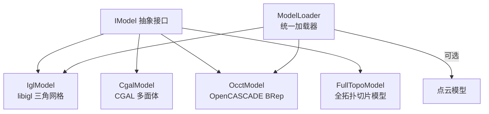
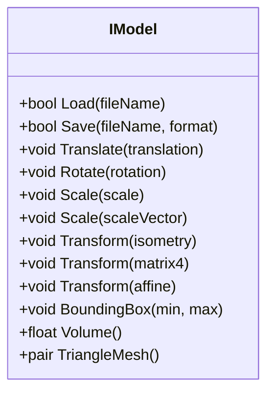
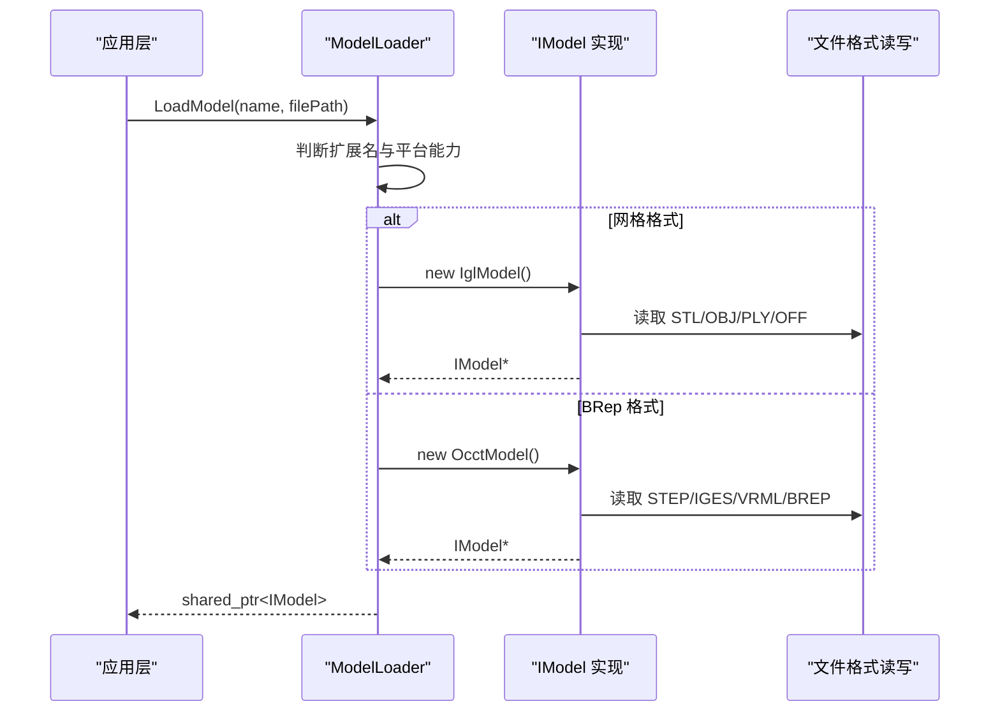
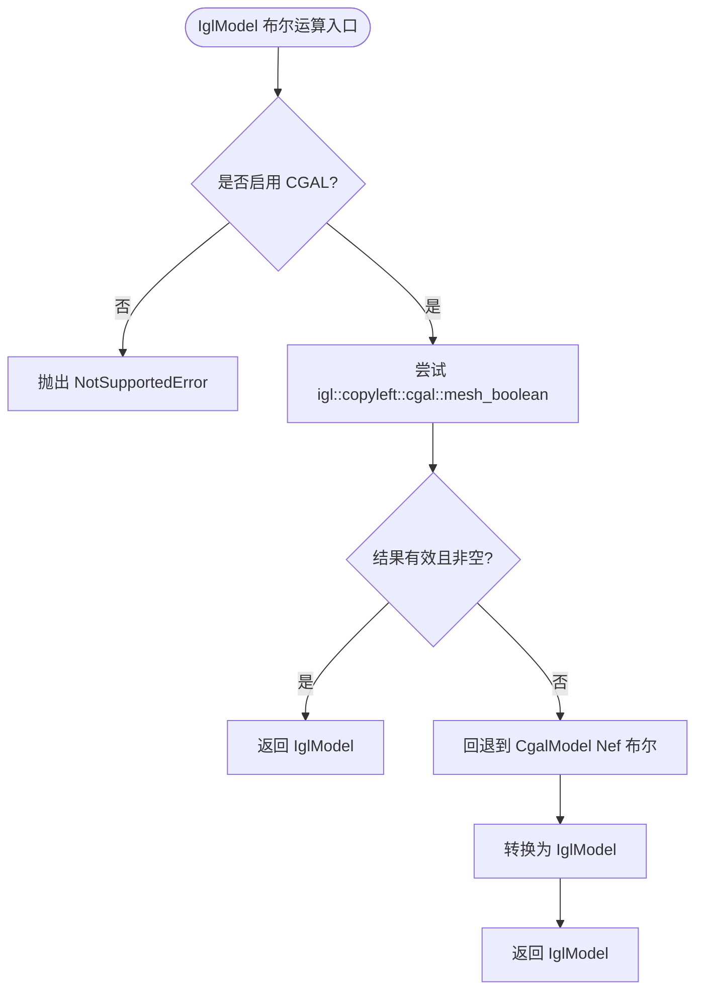
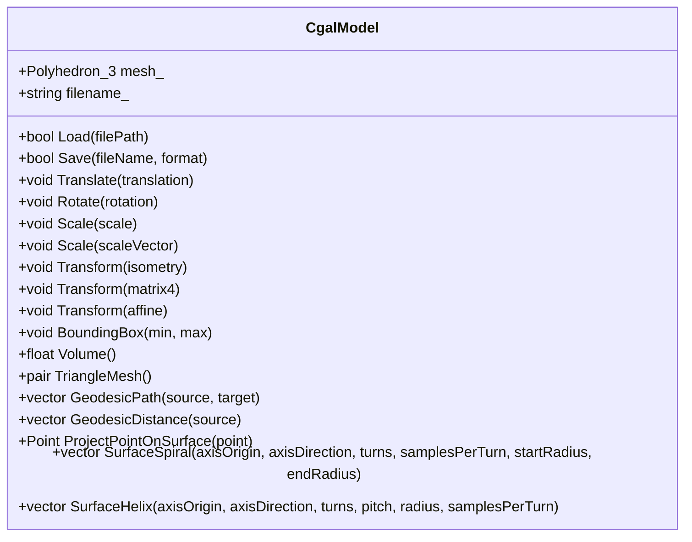
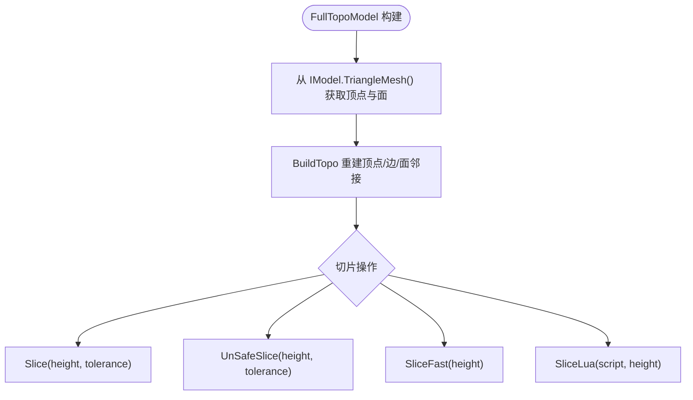
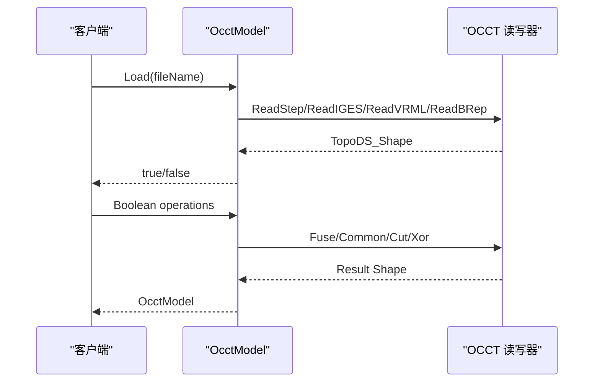
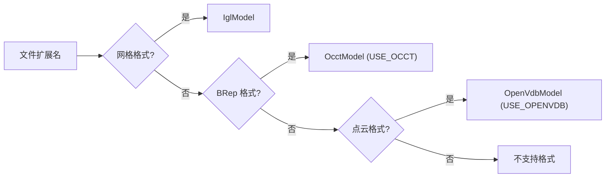

# 模型处理模块

<cite>
**本文引用的文件**   
- [IModel.hpp](file://base/IModel.hpp)
- [IglModel.hpp](file://meshmodel/IglModel.hpp)
- [IglModel.cpp](file://meshmodel/IglModel.cpp)
- [CgalModel.hpp](file://meshmodel/CgalModel.hpp)
- [CgalModel.cpp](file://meshmodel/CgalModel.cpp)
- [FullTopoModel.hpp](file://meshmodel/FullTopoModel.hpp)
- [FullTopoModel.cpp](file://meshmodel/FullTopoModel.cpp)
- [OcctModel.hpp](file://cadmodel/OcctModel.hpp)
- [OcctModel.cpp](file://cadmodel/OcctModel.cpp)
- [ModelLoader.hpp](file://preprocess/ModelLoader.hpp)
- [ModelLoader.cpp](file://preprocess/ModelLoader.cpp)
</cite>

## 目录
1. [引言](#引言)
2. [项目结构](#项目结构)
3. [核心概念：统一模型抽象接口 IModel](#核心概念统一模型抽象接口-imodel)
4. [架构总览](#架构总览)
5. [详细组件分析](#详细组件分析)
6. [依赖关系与转换路径](#依赖关系与转换路径)
7. [性能与内存管理](#性能与内存管理)
8. [API 使用示例与错误处理模式](#api-使用示例与错误处理模式)
9. [故障排除指南](#故障排除指南)
10. [结论](#结论)

## 引言
本文件面向 HsBaSlicer 的模型处理模块，目标是建立从基础概念到高级用法的完整知识体系。文档围绕以下核心目标展开：
- 解释 IModel 抽象接口的设计理念与统一模型抽象机制。
- 详细说明 IglModel、CgalModel、FullTopoModel、OcctModel 的实现细节、算法原理和使用场景。
- 覆盖模型加载、保存、变换、布尔运算等核心操作。
- 给出 API 调用示例、配置选项说明和错误处理模式。
- 对比不同模型类型的适用场景、内存管理策略和转换方法。

该模块通过统一的 IModel 接口屏蔽底层几何内核差异，使上层切片、路径生成、支撑等流程可以以一致的方式处理三角网格、CGAL 多面体、拓扑重建网格以及 OpenCASCADE CAD 实体。

## 项目结构
模型处理相关代码主要分布在以下目录：
- base：定义 IModel 抽象接口、模型格式枚举、通用错误类型等基础能力。
- meshmodel：实现基于 libigl 的 IglModel、基于 CGAL 的 CgalModel、面向切片的全拓扑 FullTopoModel。
- cadmodel：实现基于 OpenCASCADE 的 OcctModel。
- preprocess：提供 ModelLoader，按扩展名自动选择 IglModel、OcctModel 或点云模型，并维护命名模型池。

**图表来源**
- [IModel.hpp:110-139](file://base/IModel.hpp#L110-L139)
- [IglModel.hpp:18-121](file://meshmodel/IglModel.hpp#L18-L121)
- [CgalModel.hpp:24-155](file://meshmodel/CgalModel.hpp#L24-L155)
- [OcctModel.hpp:20-124](file://cadmodel/OcctModel.hpp#L20-L124)
- [FullTopoModel.hpp:43-142](file://meshmodel/FullTopoModel.hpp#L43-L142)
- [ModelLoader.hpp:23-89](file://preprocess/ModelLoader.hpp#L23-L89)

**章节来源**
- [IModel.hpp:110-139](file://base/IModel.hpp#L110-L139)
- [ModelLoader.hpp:23-89](file://preprocess/ModelLoader.hpp#L23-L89)

## 核心概念：统一模型抽象接口 IModel
IModel 是 HsBaSlicer 中所有 3D 模型的统一抽象。它定义了跨内核一致的模型操作语义：
- 加载与保存：Load、Save，支持多种文件格式。
- 几何变换：Translate、Rotate、Scale、Transform（Isometry、Matrix4、Affine）。
- 查询：BoundingBox、Volume、TriangleMesh。
- 模型格式：ModelFormat 枚举包含 PLY、STL、OFF、OBJ、VRML、STEP、IGES、BREP、XYZ、VDB 等。

这种设计让上层逻辑无需关心具体几何内核，只需面向 IModel 编程；同时保留 TriangleMesh 作为“最低公共分母”，便于在需要时转换为三角网格。

**图表来源**
- [IModel.hpp:110-139](file://base/IModel.hpp#L110-L139)

**章节来源**
- [IModel.hpp:65-109](file://base/IModel.hpp#L65-L109)
- [IModel.hpp:110-139](file://base/IModel.hpp#L110-L139)

## 架构总览
HsBaSlicer 的模型处理架构采用“接口 + 多实现 + 统一加载器”的模式：
- IModel 提供统一接口。
- IglModel、CgalModel、OcctModel 分别实现三角网格、CGAL 多面体和 CAD BRep。
- FullTopoModel 不直接继承 IModel，而是从 IModel 构建面向切片的拓扑结构。
- ModelLoader 根据文件扩展名自动选择 IglModel 或 OcctModel，并在启用 CGAL/OpenVDB 时提供布尔运算、点云处理等高级功能。

**图表来源**
- [ModelLoader.cpp:45-84](file://preprocess/ModelLoader.cpp#L45-L84)
- [IglModel.cpp:64-99](file://meshmodel/IglModel.cpp#L64-L99)
- [OcctModel.cpp:213-271](file://cadmodel/OcctModel.cpp#L213-L271)

**章节来源**
- [ModelLoader.cpp:45-84](file://preprocess/ModelLoader.cpp#L45-L84)

## 详细组件分析

### IModel 抽象接口设计理念
IModel 的设计强调三点：
1. **统一性**：所有模型都暴露相同的 Load/Save/Transform/BoundingBox/Volume/TriangleMesh 接口。
2. **可扩展性**：新增几何内核只需实现 IModel，无需改动上层切片与路径逻辑。
3. **可转换性**：TriangleMesh 作为通用输出，允许将 CAD、CGAL、点云等模型转换为三角网格供后续算法使用。

此外，ModelFormat 枚举为不同格式提供统一标识，配合 ModelLoader 实现自动分发。

**章节来源**
- [IModel.hpp:65-109](file://base/IModel.hpp#L65-L109)
- [IModel.hpp:110-139](file://base/IModel.hpp#L110-L139)

### IglModel：基于 libigl 的高效三角网格实现
IglModel 是 HsBaSlicer 中最常用的三角网格模型实现，其特点包括：
- 数据布局：顶点矩阵、面索引矩阵、可选法线矩阵。
- 文件格式：支持 STL、OBJ、PLY、OFF 等网格格式的读写。
- 几何变换：对行主序 Eigen 矩阵进行广播式平移、旋转、缩放和齐次变换，并同步更新法线。
- 体积计算：通过 igl::volume 计算有符号体积的绝对值。
- 布尔运算：当启用 USE_CGAL 时，优先尝试 igl::copyleft::cgal::mesh_boolean；失败后回退到 CgalModel 的 Nef 布尔运算。
- 原语构造：CreateBox、CreateSphere、CreateCylinder、CreateCone、CreateTorus。
- 拉伸建模：CreatePrime 支持单闭合多边形或多轮廓（外轮廓+孔）沿方向拉伸成实体。

**图表来源**
- [IglModel.cpp:195-245](file://meshmodel/IglModel.cpp#L195-L245)
- [IglModel.cpp:248-391](file://meshmodel/IglModel.cpp#L248-L391)
- [IglModel.cpp:392-409](file://meshmodel/IglModel.cpp#L392-L409)

**章节来源**
- [IglModel.hpp:18-121](file://meshmodel/IglModel.hpp#L18-L121)
- [IglModel.cpp:37-62](file://meshmodel/IglModel.cpp#L37-L62)
- [IglModel.cpp:64-99](file://meshmodel/IglModel.cpp#L64-L99)
- [IglModel.cpp:101-150](file://meshmodel/IglModel.cpp#L101-L150)
- [IglModel.cpp:152-168](file://meshmodel/IglModel.cpp#L152-L168)
- [IglModel.cpp:170-193](file://meshmodel/IglModel.cpp#L170-L193)
- [IglModel.cpp:195-409](file://meshmodel/IglModel.cpp#L195-L409)
- [IglModel.cpp:411-596](file://meshmodel/IglModel.cpp#L411-L596)
- [IglModel.cpp:598-800](file://meshmodel/IglModel.cpp#L598-L800)

### CgalModel：CGAL 几何计算支持
CgalModel 封装 CGAL Polyhedron_3，并提供更严格的几何布尔运算和表面几何工具：
- 布尔运算：基于 Nef_polyhedron_3 的 Union、Intersection、Difference、Xor。
- 文件格式：支持 STL、PLY、OBJ、OFF 等网格格式读写。
- 几何变换：通过 CGAL Affine 变换作用于多面体。
- 体积与网格导出：CGAL volume 与 polyhedron_to_mesh。
- 表面几何：GeodesicPath、GeodesicDistance、ProjectPointOnSurface、SurfaceSpiral、SurfaceHelix。
- 原语与拉伸：CreateBox、CreateSphere、CreateCylinder、CreateCone、CreateTorus、CreatePrime。

**图表来源**
- [CgalModel.hpp:24-155](file://meshmodel/CgalModel.hpp#L24-L155)

**章节来源**
- [CgalModel.hpp:24-155](file://meshmodel/CgalModel.hpp#L24-L155)
- [CgalModel.cpp:38-119](file://meshmodel/CgalModel.cpp#L38-L119)
- [CgalModel.cpp:121-237](file://meshmodel/CgalModel.cpp#L121-L237)
- [CgalModel.cpp:238-276](file://meshmodel/CgalModel.cpp#L238-L276)
- [CgalModel.cpp:278-445](file://meshmodel/CgalModel.cpp#L278-L445)
- [CgalModel.cpp:447-621](file://meshmodel/CgalModel.cpp#L447-L621)
- [CgalModel.cpp:623-800](file://meshmodel/CgalModel.cpp#L623-L800)

### FullTopoModel：完整拓扑模型
FullTopoModel 不是 IModel 的直接实现，而是从 IModel 构建面向切片的拓扑结构。它重建顶点、边、面的邻接关系，并提供：
- 拓扑完整性检查：CheckTopo。
- 欧拉特征：EulerCharacteristic。
- 安全切片：Slice（仅闭合轮廓）、UnSafeSlice（含开放轮廓）、SliceFast（快速切片）。
- Lua 脚本切片：SliceLua、UnSafeSliceLua，向脚本暴露 V、E、F、height。
- 三角形网格导出：TriangleMesh。

**图表来源**
- [FullTopoModel.cpp:27-48](file://meshmodel/FullTopoModel.cpp#L27-L48)
- [FullTopoModel.cpp:50-158](file://meshmodel/FullTopoModel.cpp#L50-L158)
- [FullTopoModel.cpp:328-600](file://meshmodel/FullTopoModel.cpp#L328-L600)
- [FullTopoModel.cpp:604-800](file://meshmodel/FullTopoModel.cpp#L604-L800)

**章节来源**
- [FullTopoModel.hpp:43-142](file://meshmodel/FullTopoModel.hpp#L43-L142)
- [FullTopoModel.cpp:27-48](file://meshmodel/FullTopoModel.cpp#L27-L48)
- [FullTopoModel.cpp:50-158](file://meshmodel/FullTopoModel.cpp#L50-L158)
- [FullTopoModel.cpp:160-244](file://meshmodel/FullTopoModel.cpp#L160-L244)
- [FullTopoModel.cpp:246-324](file://meshmodel/FullTopoModel.cpp#L246-L324)
- [FullTopoModel.cpp:328-600](file://meshmodel/FullTopoModel.cpp#L328-L600)
- [FullTopoModel.cpp:604-800](file://meshmodel/FullTopoModel.cpp#L604-L800)

### OcctModel：OpenCASCADE CAD 模型
OcctModel 封装 TopoDS_Shape，提供 CAD 级别的建模与布尔运算：
- 文件格式：支持 STEP、IGES、VRML、BREP 读写；也可导出为网格格式（先 tessellation 再交给 IglModel）。
- 几何变换：Translate、Rotate、Scale、Transform。
- 布尔运算：Union、Intersection、Difference、Xor。
- 实体加厚：ThickSolid（整体或指定面开口）。
- 原语与拉伸：CreateBox、CreateSphere、CreateCylinder、CreateCone、CreateTorus、CreatePrime。
- 网格导出：遍历 Face 的 Triangulation，考虑位置变换与面方向。

**图表来源**
- [OcctModel.cpp:76-147](file://cadmodel/OcctModel.cpp#L76-L147)
- [OcctModel.cpp:213-271](file://cadmodel/OcctModel.cpp#L213-L271)
- [OcctModel.cpp:451-469](file://cadmodel/OcctModel.cpp#L451-L469)
- [OcctModel.cpp:542-663](file://cadmodel/OcctModel.cpp#L542-L663)

**章节来源**
- [OcctModel.hpp:20-124](file://cadmodel/OcctModel.hpp#L20-L124)
- [OcctModel.cpp:63-74](file://cadmodel/OcctModel.cpp#L63-L74)
- [OcctModel.cpp:76-147](file://cadmodel/OcctModel.cpp#L76-L147)
- [OcctModel.cpp:148-190](file://cadmodel/OcctModel.cpp#L148-L190)
- [OcctModel.cpp:192-211](file://cadmodel/OcctModel.cpp#L192-L211)
- [OcctModel.cpp:213-271](file://cadmodel/OcctModel.cpp#L213-L271)
- [OcctModel.cpp:272-329](file://cadmodel/OcctModel.cpp#L272-L329)
- [OcctModel.cpp:331-407](file://cadmodel/OcctModel.cpp#L331-L407)
- [OcctModel.cpp:409-469](file://cadmodel/OcctModel.cpp#L409-L469)
- [OcctModel.cpp:471-540](file://cadmodel/OcctModel.cpp#L471-L540)
- [OcctModel.cpp:542-663](file://cadmodel/OcctModel.cpp#L542-L663)

## 依赖关系与转换路径
ModelLoader 负责根据文件扩展名选择内核，并在启用 CGAL/OpenVDB 时提供布尔运算与点云处理。关键路径如下：
- 网格格式：IglModel。
- BRep 格式：OcctModel（需 USE_OCCT）。
- 布尔运算：优先使用 OcctModel；若不可用则回退到 IglModel（需 USE_CGAL）。
- 点云：OpenVdbModel（需 USE_OPENVDB）。

**图表来源**
- [ModelLoader.cpp:45-84](file://preprocess/ModelLoader.cpp#L45-L84)

**章节来源**
- [ModelLoader.hpp:23-89](file://preprocess/ModelLoader.hpp#L23-L89)
- [ModelLoader.cpp:45-84](file://preprocess/ModelLoader.cpp#L45-L84)
- [ModelLoader.cpp:132-323](file://preprocess/ModelLoader.cpp#L132-L323)

## 性能与内存管理
- IglModel：
  - 使用 Eigen 矩阵存储顶点和面，适合大规模网格的快速访问与批量变换。
  - 布尔运算在启用 CGAL 时优先尝试 igl::copyleft::cgal::mesh_boolean，失败后回退到 CgalModel Nef 布尔，避免 float 精度导致的静默失败。
  - 体积计算通过 igl::volume，时间复杂度与面数线性相关。
- CgalModel：
  - 基于 CGAL Polyhedron_3，布尔运算使用 Nef_polyhedron_3，稳定性更高但开销更大。
  - 表面几何（测地线、螺旋、螺旋线）适用于复杂表面的路径规划。
- FullTopoModel：
  - 构建拓扑时重建顶点、边、面邻接，时间复杂度与面数和边数相关；适合切片算法复用拓扑信息。
  - 切片算法使用整数化坐标与并查集合并邻近节点，提升数值鲁棒性。
- OcctModel：
  - CAD 布尔运算由 OCCT 提供，精度高但可能较慢；适合精确工程建模。
  - Tessellation 导出遍历 Face 的 Triangulation，注意面方向与位置变换。

内存管理方面：
- ModelLoader 使用 NamedObjectPool 管理模型生命周期，容量由 HSBA_MODEL_POOL_SIZE 控制。
- IglModel、CgalModel、OcctModel 均提供移动构造与拷贝构造，便于高效传递。
- FullTopoModel 不修改 IModel，仅在构造时复制数据并重建拓扑。

**章节来源**
- [IglModel.cpp:195-409](file://meshmodel/IglModel.cpp#L195-L409)
- [CgalModel.cpp:238-276](file://meshmodel/CgalModel.cpp#L238-L276)
- [FullTopoModel.cpp:50-158](file://meshmodel/FullTopoModel.cpp#L50-L158)
- [FullTopoModel.cpp:328-600](file://meshmodel/FullTopoModel.cpp#L328-L600)
- [OcctModel.cpp:353-407](file://cadmodel/OcctModel.cpp#L353-L407)
- [ModelLoader.hpp:23-89](file://preprocess/ModelLoader.hpp#L23-L89)

## API 使用示例与错误处理模式

### 模型加载与保存
- 使用 ModelLoader.LoadModel 自动选择内核：
  - 网格格式：IglModel。
  - BRep 格式：OcctModel（需 USE_OCCT）。
  - 点云格式：OpenVdbModel（需 USE_OPENVDB）。
- 直接调用 IModel.Save 保存为指定格式。

示例路径参考：
- [ModelLoader.cpp:45-84](file://preprocess/ModelLoader.cpp#L45-L84)
- [IglModel.cpp:72-99](file://meshmodel/IglModel.cpp#L72-L99)
- [OcctModel.cpp:238-271](file://cadmodel/OcctModel.cpp#L238-L271)

### 几何变换
- 所有 IModel 实现均支持 Translate、Rotate、Scale、Transform。
- IglModel 对行主序矩阵进行广播式变换，并同步更新法线。
- CgalModel 与 OcctModel 分别使用 CGAL 与 OCCT 的变换 API。

示例路径参考：
- [IglModel.cpp:101-150](file://meshmodel/IglModel.cpp#L101-L150)
- [CgalModel.cpp:158-204](file://meshmodel/CgalModel.cpp#L158-L204)
- [OcctModel.cpp:272-329](file://cadmodel/OcctModel.cpp#L272-L329)

### 布尔运算
- ModelLoader.BooleanUnion/Intersection/Difference/Xor：
  - 若左右模型均为 OcctModel，则使用 OCCT 布尔运算。
  - 否则转换为 IglModel 并使用 CGAL 布尔运算。
- IglModel 布尔运算：
  - 优先 igl::copyleft::cgal::mesh_boolean。
  - 失败回退到 CgalModel Nef 布尔。
- CgalModel 布尔运算：
  - 基于 Nef_polyhedron_3。
- OcctModel 布尔运算：
  - 使用 BRepAlgoAPI_Fuse/Common/Cut。

示例路径参考：
- [ModelLoader.cpp:218-323](file://preprocess/ModelLoader.cpp#L218-L323)
- [IglModel.cpp:195-409](file://meshmodel/IglModel.cpp#L195-L409)
- [CgalModel.cpp:238-276](file://meshmodel/CgalModel.cpp#L238-L276)
- [OcctModel.cpp:451-469](file://cadmodel/OcctModel.cpp#L451-L469)

### 切片与拓扑
- FullTopoModel.Slice/UnSafeSlice/SliceFast：
  - 基于拓扑重建的 Z 向切片。
  - 支持容差与快速路径。
- FullTopoModel.SliceLua：
  - 向 Lua 脚本暴露 V、E、F、height，允许自定义切片逻辑。

示例路径参考：
- [FullTopoModel.cpp:328-600](file://meshmodel/FullTopoModel.cpp#L328-L600)
- [FullTopoModel.cpp:604-800](file://meshmodel/FullTopoModel.cpp#L604-L800)
- [FullTopoModel.cpp:274-324](file://meshmodel/FullTopoModel.cpp#L274-L324)

### 错误处理模式
- 不支持格式：NotSupportedError。
- 文件读写失败：RuntimeError 或 IOError。
- 参数非法：InvalidArgumentError。
- 布尔运算未启用 CGAL：NotSupportedError。
- 源模型不存在或类型不符：InvalidArgumentError 或 RuntimeError。

示例路径参考：
- [IglModel.cpp:92-98](file://meshmodel/IglModel.cpp#L92-L98)
- [IglModel.cpp:392-409](file://meshmodel/IglModel.cpp#L392-L409)
- [OcctModel.cpp:232-234](file://cadmodel/OcctModel.cpp#L232-L234)
- [ModelLoader.cpp:47-84](file://preprocess/ModelLoader.cpp#L47-L84)

## 故障排除指南
常见问题与排查建议：
- 布尔运算返回空网格：
  - 检查输入网格是否有效（顶点有限、索引越界）。
  - 确认已启用 USE_CGAL。
  - 若 igl::copyleft::cgal::mesh_boolean 失败，回退到 CgalModel Nef 布尔。
- 文件加载失败：
  - 检查扩展名与 ModelFormat 映射。
  - 确认平台是否启用对应后端（USE_OCCT、USE_OPENVDB）。
- 切片结果异常：
  - 检查 FullTopoModel.CheckTopo 是否通过。
  - 调整 Slice 的 tolerance 参数。
  - 使用 UnSafeSlice 查看开放轮廓。
- CAD 布尔运算缓慢：
  - 考虑简化模型或使用 IglModel 近似。
  - 检查输入形状是否合法（无自相交、无退化面）。

**章节来源**
- [IglModel.cpp:195-409](file://meshmodel/IglModel.cpp#L195-L409)
- [FullTopoModel.cpp:160-244](file://meshmodel/FullTopoModel.cpp#L160-L244)
- [ModelLoader.cpp:45-84](file://preprocess/ModelLoader.cpp#L45-L84)

## 结论
HsBaSlicer 的模型处理模块通过 IModel 抽象接口实现了统一的模型操作语义，并通过 IglModel、CgalModel、FullTopoModel、OcctModel 分别满足高性能网格处理、稳定几何布尔、切片拓扑重建与 CAD 精确建模的需求。ModelLoader 提供了自动分发与命名池管理，结合 CGAL 与 OpenVDB 的能力扩展了布尔运算与点云处理。在实际使用中，应根据模型类型、精度要求与性能约束选择合适的内核，并注意错误处理与内存管理策略。