# 模型抽象接口

<cite>
**本文引用的文件**   
- [IModel.hpp](file://base/IModel.hpp)
- [ModelFormat.hpp](file://base/ModelFormat.hpp)
- [ModelFormat.cpp](file://base/ModelFormat.cpp)
- [OcctModel.hpp](file://cadmodel/OcctModel.hpp)
- [CgalModel.hpp](file://meshmodel/CgalModel.hpp)
- [IglModel.cpp](file://meshmodel/IglModel.cpp)
</cite>

## 目录
1. [引言](#引言)
2. [项目结构](#项目结构)
3. [核心概念](#核心概念)
4. [架构总览](#架构总览)
5. [详细组件分析](#详细组件分析)
6. [依赖关系分析](#依赖关系分析)
7. [性能与内存特性](#性能与内存特性)
8. [API 使用示例](#api-使用示例)
9. [错误处理模式](#错误处理模式)
10. [常见问题排查](#常见问题排查)
11. [结论](#结论)

## 引言
本文件面向 HsBaSlicer 的 IModel 统一 3D 模型抽象接口，目标是帮助读者从基础概念到高级用法全面理解：
- IModel 接口的设计动机、职责边界与扩展方式。
- ModelFormat 枚举对 PLY、STL、OBJ、STEP、IGES、BREP 等格式的分类与识别逻辑。
- Load/Save、Translate/Rotate/Scale/Transform、BoundingBox/Volume、TriangleMesh 等核心方法的语义与实现差异。
- C ABI 数据结构 HsBaVector2f、HsBaVector3f、HsBaQuaternionf、HsBaMatrix4f、HsBaPoly2D、HsBaPolys2D 的定义与使用注意事项。
- 典型 API 调用流程、错误处理模式与性能优化建议。

## 项目结构
围绕 IModel 的核心代码主要分布在 base、cadmodel、meshmodel 三个模块：
- base：定义 IModel 抽象接口、ModelFormat 枚举及格式识别工具函数。
- cadmodel：基于 OpenCASCADE 的 BRep CAD 模型实现 OcctModel。
- meshmodel：基于 libigl/CGAL 的三角网格模型实现 IglModel、CgalModel。

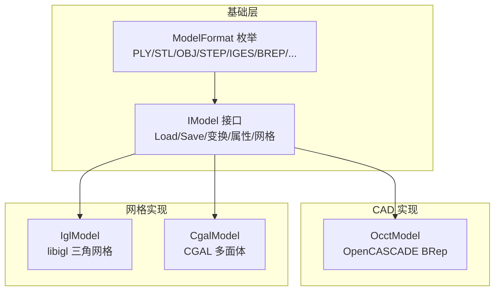

图表来源
- [IModel.hpp:63-139](file://base/IModel.hpp#L63-L139)
- [ModelFormat.hpp:16-114](file://base/ModelFormat.hpp#L16-L114)
- [OcctModel.hpp:20-124](file://cadmodel/OcctModel.hpp#L20-L124)
- [CgalModel.hpp:24-155](file://meshmodel/CgalModel.hpp#L24-L155)
- [IglModel.cpp:64-99](file://meshmodel/IglModel.cpp#L64-L99)

章节来源
- [IModel.hpp:63-139](file://base/IModel.hpp#L63-L139)
- [ModelFormat.hpp:16-114](file://base/ModelFormat.hpp#L16-L114)

## 核心概念
IModel 是 HsBaSlicer 中统一的 3D 模型抽象接口，所有具体模型类型（CAD、网格、点云等）都应实现该接口，从而在切片、路径生成、支撑等上层流程中以统一方式操作模型。其核心职责包括：
- 文件 I/O：Load/Save。
- 几何变换：Translate/Rotate/Scale/Transform。
- 几何属性：BoundingBox/Volume。
- 网格导出：TriangleMesh。

ModelFormat 用于标识不同文件格式，并支持按扩展名推断格式、判断是否为网格/BRep/CSG/点云格式。

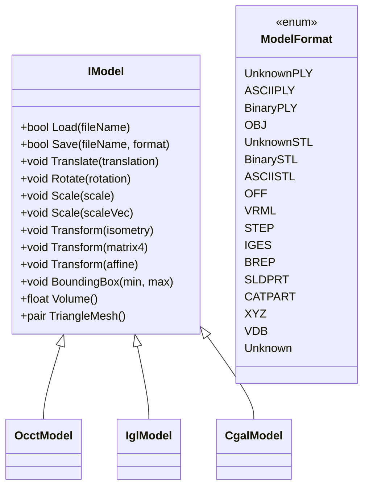

图表来源
- [IModel.hpp:111-139](file://base/IModel.hpp#L111-L139)
- [IModel.hpp:66-109](file://base/IModel.hpp#L66-L109)
- [OcctModel.hpp:30-81](file://cadmodel/OcctModel.hpp#L30-L81)
- [CgalModel.hpp:34-82](file://meshmodel/CgalModel.hpp#L34-L82)
- [IglModel.cpp:64-99](file://meshmodel/IglModel.cpp#L64-L99)

章节来源
- [IModel.hpp:111-139](file://base/IModel.hpp#L111-L139)
- [ModelFormat.hpp:16-114](file://base/ModelFormat.hpp#L16-L114)

## 架构总览
IModel 作为抽象基类，将“如何加载/保存”“如何实现变换”“如何计算体积/包围盒”“如何导出三角网格”等细节交给具体实现类。常见实现：
- OcctModel：面向 BRep CAD 数据，支持 STEP/IGES/VRML/BREP 等格式的读写与布尔运算、实体加厚、基本实体创建等。
- IglModel：面向三角网格，基于 libigl 提供 STL/OFF/OBJ/PLY 等网格格式的读写、法线计算、布尔运算（可选 CGAL）、基本实体创建等。
- CgalModel：面向 CGAL 多面体，提供 Nef 布尔运算、测地线/螺旋/曲线等高级几何算法。

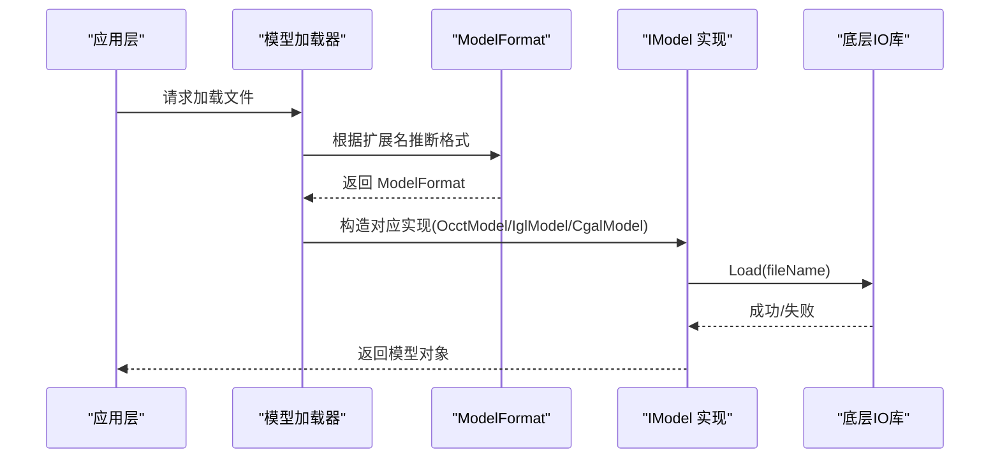

图表来源
- [ModelFormat.cpp:89-99](file://base/ModelFormat.cpp#L89-L99)
- [OcctModel.hpp:54-57](file://cadmodel/OcctModel.hpp#L54-L57)
- [IglModel.cpp:64-70](file://meshmodel/IglModel.cpp#L64-L70)

## 详细组件分析

### IModel 接口设计
IModel 定义了统一的 3D 模型能力集：
- Load/Save：以文件名和格式为参数，负责文件 I/O。
- 变换：支持平移、旋转、缩放、仿射/刚体变换。
- 属性：轴对齐包围盒、体积。
- 网格：返回 libigl 风格的顶点矩阵与面索引矩阵。

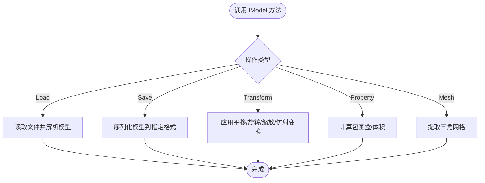

图表来源
- [IModel.hpp:111-139](file://base/IModel.hpp#L111-L139)

章节来源
- [IModel.hpp:111-139](file://base/IModel.hpp#L111-L139)

### ModelFormat 枚举与格式识别
ModelFormat 将文件格式分为几类：
- 网格：PLY（ASCII/Binary/Unknown）、STL（ASCII/Binary/Unknown）、OFF、OBJ。
- BRep：VRML、STEP、IGES、BREP。
- CSG：SLDPRT、CATPART。
- 点云：XYZ、VDB。
- 未知：Unknown。

同时提供：
- ToString：枚举转字符串。
- GetExtName/ModelTypeFromExtName：从文件名推断格式。
- IsMeshFormat/IsBrepFormat/IsCSGFormat/IsPointCloudFormat：判断格式类别。

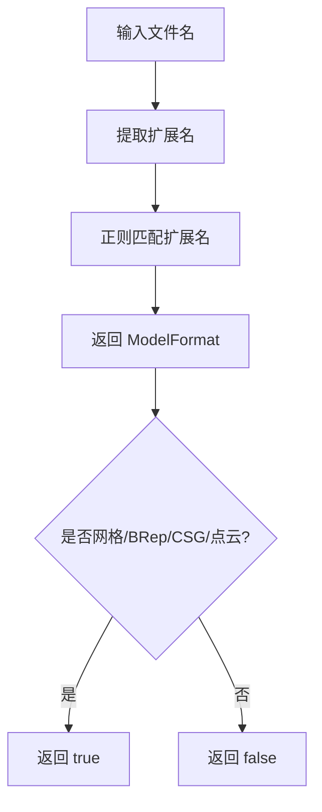

图表来源
- [ModelFormat.cpp:14-85](file://base/ModelFormat.cpp#L14-L85)
- [ModelFormat.cpp:89-99](file://base/ModelFormat.cpp#L89-L99)
- [ModelFormat.cpp:101-175](file://base/ModelFormat.cpp#L101-L175)
- [ModelFormat.hpp:23-93](file://base/ModelFormat.hpp#L23-L93)

章节来源
- [ModelFormat.hpp:16-114](file://base/ModelFormat.hpp#L16-L114)
- [ModelFormat.cpp:14-175](file://base/ModelFormat.cpp#L14-L175)

### OcctModel：BRep CAD 模型实现
OcctModel 基于 OpenCASCADE TopoDS_Shape，提供：
- 加载/保存：STEP/IGES/VRML/BREP。
- 变换：平移、旋转、缩放、仿射/刚体变换。
- 属性：包围盒、体积。
- 网格：Tessellation 导出三角网格。
- 布尔运算与实体工厂：Union/Intersection/Difference/Xor、ThickSolid、CreateBox/Sphere/Cylinder/Cone/Torus/CreatePrime。

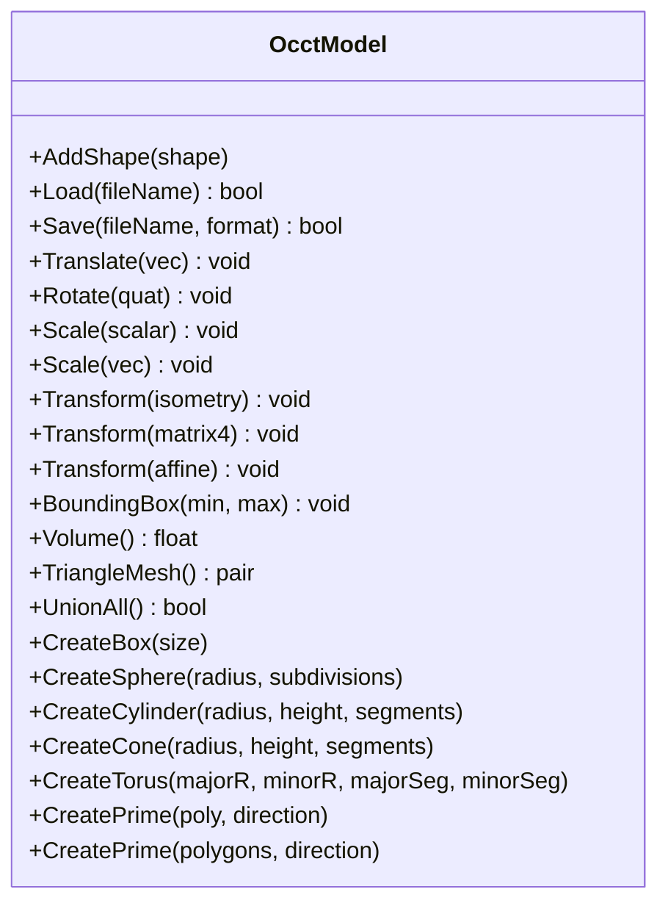

图表来源
- [OcctModel.hpp:30-124](file://cadmodel/OcctModel.hpp#L30-L124)

章节来源
- [OcctModel.hpp:30-124](file://cadmodel/OcctModel.hpp#L30-L124)

### IglModel：libigl 三角网格实现
IglModel 基于 Eigen 存储顶点与面片，并提供：
- 加载/保存：STL/OFF/OBJ/PLY（ASCII/Binary）。
- 变换：平移、旋转、缩放、仿射/刚体变换，注意行主序存储下的矩阵乘法方向。
- 属性：包围盒、体积（基于 igl::volume）。
- 网格：直接返回顶点与面片矩阵。
- 布尔运算：启用 USE_CGAL 时通过 igl::copyleft::cgal::mesh_boolean 或回退到 CgalModel 的 Nef 布尔；未启用则抛出 NotSupportedError。
- 基本实体：CreateBox/Sphere/Cylinder/Cone/Torus/CreatePrime。

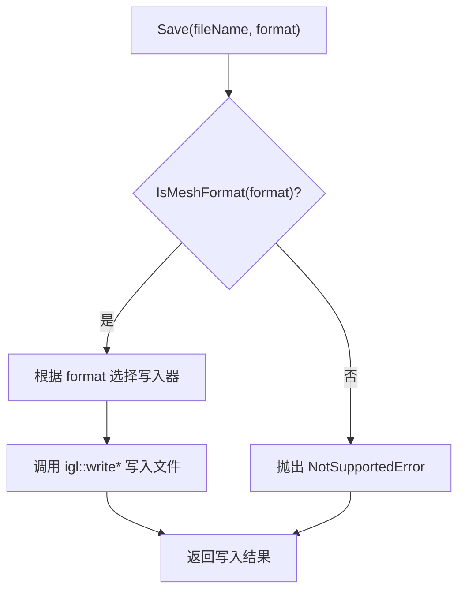

图表来源
- [IglModel.cpp:72-99](file://meshmodel/IglModel.cpp#L72-L99)

章节来源
- [IglModel.cpp:64-99](file://meshmodel/IglModel.cpp#L64-L99)
- [IglModel.cpp:101-168](file://meshmodel/IglModel.cpp#L101-L168)
- [IglModel.cpp:188-193](file://meshmodel/IglModel.cpp#L188-L193)
- [IglModel.cpp:195-409](file://meshmodel/IglModel.cpp#L195-L409)

### CgalModel：CGAL 多面体实现
CgalModel 基于 CGAL Polyhedron_3/Nef_polyhedron_3，提供：
- 加载/保存：STL/OFF 等网格格式。
- 变换：平移、旋转、缩放、仿射/刚体变换。
- 属性：包围盒、体积。
- 网格：返回顶点与面片矩阵。
- 布尔运算：Nef 布尔（Union/Intersection/Difference/Xor）。
- 基本实体：CreateBox/Sphere/Cylinder/Cone/Torus/CreatePrime。
- 表面几何：GeodesicPath/GeodesicDistance/ProjectPointOnSurface/SurfaceSpiral/SurfaceHelix。

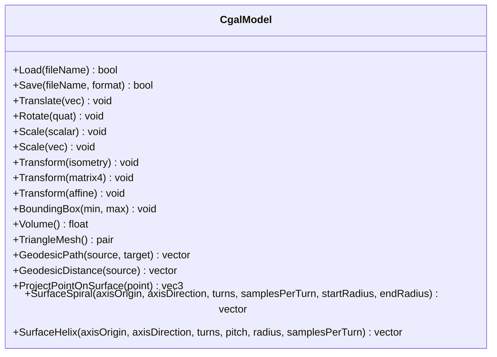

图表来源
- [CgalModel.hpp:34-155](file://meshmodel/CgalModel.hpp#L34-L155)

章节来源
- [CgalModel.hpp:34-155](file://meshmodel/CgalModel.hpp#L34-L155)

### C ABI 数据结构说明
IModel.hpp 暴露了 C ABI 兼容的数据结构，便于非 C++ 语言（如 C、Lua、Python ctypes）调用：
- HsBaVector2f_t：二维浮点向量 (x, y)。
- HsBaVector3f_t：三维浮点向量 (x, y, z)。
- HsBaQuaternionf_t：四元数 (x, y, z, w)。
- HsBaMatrix4f_t：4x4 浮点矩阵 m[4][4]。
- HsBaPoly2D_t：二维多边形，包含顶点指针与顶点数量。
- HsBaPolys2D_t：二维多边形集合，包含多边形数组指针与多边形数量。

使用要点：
- 这些结构体仅用于跨语言数据传递，不包含生命周期管理。
- 调用方需确保传入的指针有效且内存布局与 C ABI 一致。
- 对于 HsBaPoly2D_t/HsBaPolys2D_t，vertexCount/polygonCount 表示元素个数，调用方应据此遍历。

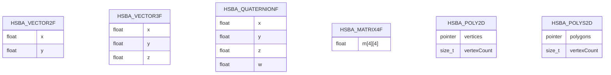

图表来源
- [IModel.hpp:19-61](file://base/IModel.hpp#L19-L61)

章节来源
- [IModel.hpp:19-61](file://base/IModel.hpp#L19-L61)

## 依赖关系分析
- IModel 依赖 Eigen 数学库进行几何变换与矩阵运算。
- ModelFormat 依赖 std::filesystem 与 std::regex 进行扩展名匹配与格式推断。
- IglModel 依赖 libigl 进行网格 I/O、法线计算、体积计算；可选依赖 CGAL 进行布尔运算。
- OcctModel 依赖 OpenCASCADE 进行 BRep 建模与布尔运算。
- CgalModel 依赖 CGAL 进行多面体与 Nef 布尔运算。

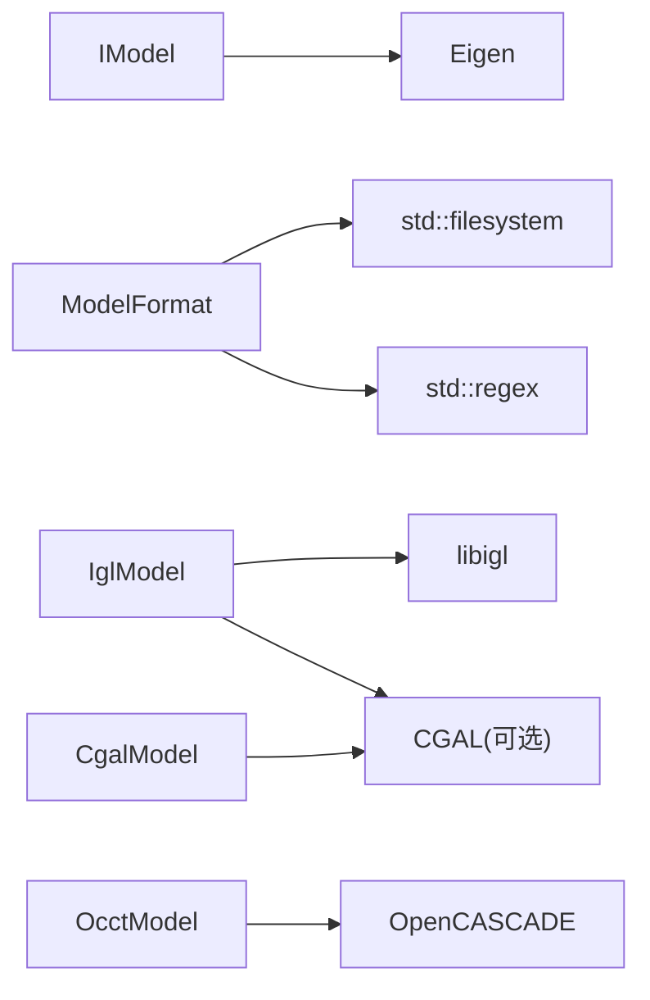

图表来源
- [IModel.hpp:16-17](file://base/IModel.hpp#L16-L17)
- [ModelFormat.cpp:7-8](file://base/ModelFormat.cpp#L7-L8)
- [IglModel.cpp:12-22](file://meshmodel/IglModel.cpp#L12-L22)
- [OcctModel.hpp:11-14](file://cadmodel/OcctModel.hpp#L11-L14)
- [CgalModel.hpp:14-19](file://meshmodel/CgalModel.hpp#L14-L19)

章节来源
- [IModel.hpp:16-17](file://base/IModel.hpp#L16-L17)
- [ModelFormat.cpp:7-8](file://base/ModelFormat.cpp#L7-L8)
- [IglModel.cpp:12-22](file://meshmodel/IglModel.cpp#L12-L22)
- [OcctModel.hpp:11-14](file://cadmodel/OcctModel.hpp#L11-L14)
- [CgalModel.hpp:14-19](file://meshmodel/CgalModel.hpp#L14-L19)

## 性能与内存特性
- 网格存储：IglModel 使用行主序 Eigen 矩阵存储顶点与面片，变换时需考虑右乘转置以避免越界或未定义行为。
- 体积计算：IglModel 通过 igl::volume 计算有符号体积后取绝对值，复杂度与面片数量线性相关。
- 布尔运算：IglModel 在启用 CGAL 时使用 mesh_boolean，若失败则回退到 CgalModel 的 Nef 布尔；未启用 CGAL 时抛出异常。
- 文件格式：ModelFormat 使用正则表达式匹配扩展名，频繁调用时应缓存结果以减少开销。
- 大模型处理：建议在批量处理时复用模型对象、避免重复分配，并使用线程池并行处理多个模型。

章节来源
- [IglModel.cpp:101-168](file://meshmodel/IglModel.cpp#L101-L168)
- [IglModel.cpp:195-409](file://meshmodel/IglModel.cpp#L195-L409)
- [ModelFormat.cpp:14-85](file://base/ModelFormat.cpp#L14-L85)

## API 使用示例
以下为典型调用流程与注意事项（不展示具体代码内容，仅提供步骤与参考路径）：

- 加载模型
  - 步骤：根据文件名推断格式 -> 构造对应 IModel 实现 -> 调用 Load。
  - 参考：[ModelFormat.cpp:89-99](file://base/ModelFormat.cpp#L89-L99)、[IglModel.cpp:64-70](file://meshmodel/IglModel.cpp#L64-L70)、[OcctModel.hpp:54-57](file://cadmodel/OcctModel.hpp#L54-L57)。

- 保存模型
  - 步骤：检查 ModelFormat 是否为网格格式 -> 调用 Save -> 根据格式选择写入器。
  - 参考：[IglModel.cpp:72-99](file://meshmodel/IglModel.cpp#L72-L99)、[ModelFormat.hpp:74-93](file://base/ModelFormat.hpp#L74-L93)。

- 几何变换
  - 平移：Translate(Eigen::Vector3f)。
  - 旋转：Rotate(Eigen::Quaternionf)。
  - 缩放：Scale(float) 或 Scale(Eigen::Vector3f)。
  - 仿射/刚体变换：Transform(Isometry3f/Matrix4f/Affine)。
  - 参考：[IModel.hpp:120-130](file://base/IModel.hpp#L120-L130)、[IglModel.cpp:101-150](file://meshmodel/IglModel.cpp#L101-L150)。

- 几何属性
  - 包围盒：BoundingBox(min, max)。
  - 体积：Volume()。
  - 参考：[IModel.hpp:132-136](file://base/IModel.hpp#L132-L136)、[IglModel.cpp:152-168](file://meshmodel/IglModel.cpp#L152-L168)。

- 网格导出
  - TriangleMesh() 返回 (vertices, faces)。
  - 参考：[IModel.hpp:137-138](file://base/IModel.hpp#L137-L138)、[IglModel.cpp:188-193](file://meshmodel/IglModel.cpp#L188-L193)。

- C ABI 数据结构使用
  - 传递 HsBaVector3f_t/HsBaQuaternionf_t/HsBaMatrix4f_t 等结构体给外部语言。
  - 参考：[IModel.hpp:19-61](file://base/IModel.hpp#L19-L61)。

## 错误处理模式
- 不支持的格式：当 Save 被调用但 ModelFormat 不是网格格式时，IglModel 抛出 NotSupportedError。
- 布尔运算未启用 CGAL：IglModel 的 Union/Intersection/Difference/Xor 在未启用 CGAL 时抛出 NotSupportedError。
- 无效参数：CreatePrime 等方法对输入多边形进行合法性检查，非法输入抛出 InvalidArgumentError 或 RuntimeError。
- 文件 I/O：Load/Save 返回布尔值指示成功与否，调用方应根据返回值进行分支处理。

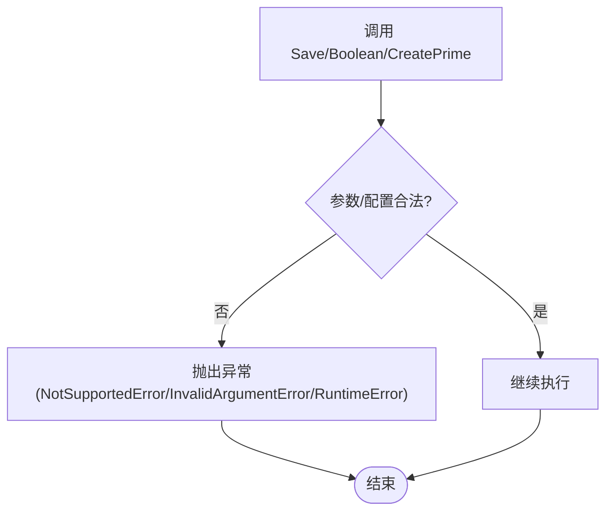

图表来源
- [IglModel.cpp:72-99](file://meshmodel/IglModel.cpp#L72-L99)
- [IglModel.cpp:393-409](file://meshmodel/IglModel.cpp#L393-L409)
- [IglModel.cpp:598-624](file://meshmodel/IglModel.cpp#L598-L624)

章节来源
- [IglModel.cpp:72-99](file://meshmodel/IglModel.cpp#L72-L99)
- [IglModel.cpp:393-409](file://meshmodel/IglModel.cpp#L393-L409)
- [IglModel.cpp:598-624](file://meshmodel/IglModel.cpp#L598-L624)

## 常见问题排查
- 为什么 Save 抛出“不支持的文件格式”？
  - 原因：传入的 ModelFormat 不是网格格式。
  - 解决：使用 IsMeshFormat 判断或使用正确的网格格式（STL/OFF/OBJ/PLY）。
  - 参考：[IglModel.cpp:72-99](file://meshmodel/IglModel.cpp#L72-L99)、[ModelFormat.hpp:74-93](file://base/ModelFormat.hpp#L74-L93)。

- 为什么布尔运算不可用？
  - 原因：未启用 CGAL 编译选项。
  - 解决：启用 USE_CGAL 或在构建系统中链接 CGAL。
  - 参考：[IglModel.cpp:195-409](file://meshmodel/IglModel.cpp#L195-L409)。

- 为什么体积计算结果为负或零？
  - 原因：网格法线方向不一致或拓扑不完整。
  - 解决：确保网格法线向外、闭合且无自交；必要时先进行网格修复。
  - 参考：[IglModel.cpp:157-168](file://meshmodel/IglModel.cpp#L157-L168)。

- 为什么 C ABI 结构体传参失败？
  - 原因：内存布局或指针生命周期不正确。
  - 解决：确保结构体成员顺序与 ABI 一致，并在调用方正确释放内存。
  - 参考：[IModel.hpp:19-61](file://base/IModel.hpp#L19-L61)。

## 结论
IModel 为 HsBaSlicer 提供了统一的 3D 模型抽象，屏蔽了不同后端（CAD、网格、点云）的差异，使上层切片与路径生成流程可以以一致的方式操作模型。ModelFormat 提供了格式识别与分类能力，配合具体实现类（OcctModel、IglModel、CgalModel）实现了丰富的文件格式支持与几何处理能力。在实际使用中，应关注：
- 选择合适的模型实现以满足文件格式与几何需求。
- 正确处理错误与异常，尤其是布尔运算与文件格式限制。
- 注意性能优化，如缓存格式推断结果、合理使用并行与内存池。
- 谨慎使用 C ABI 数据结构，确保跨语言调用的稳定性。