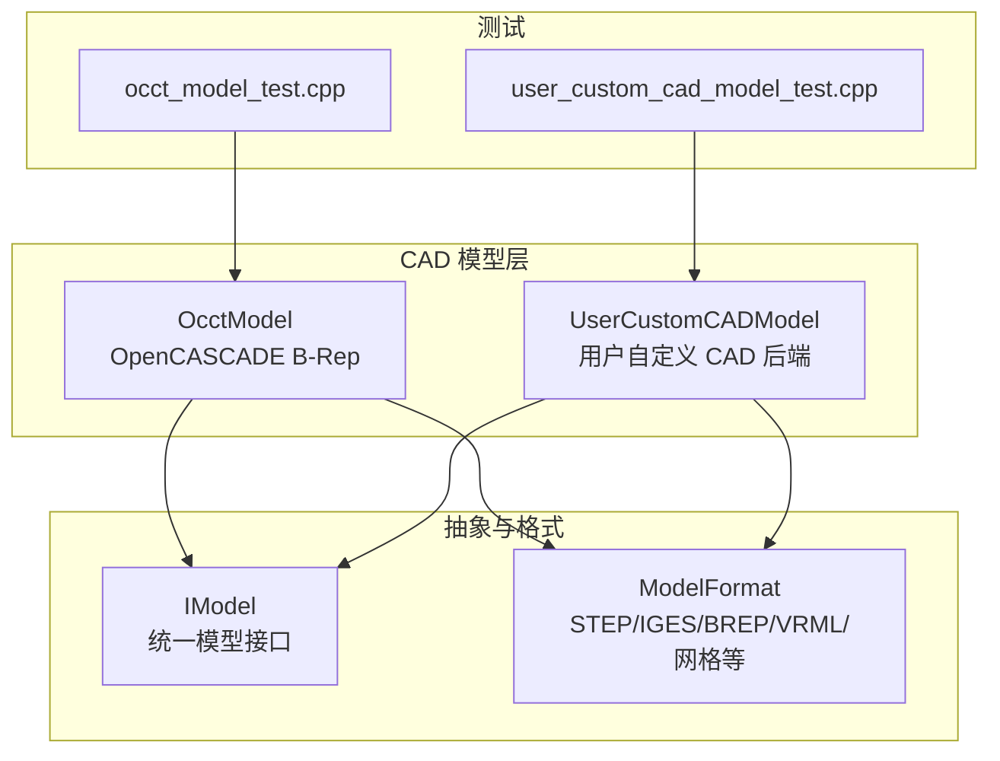
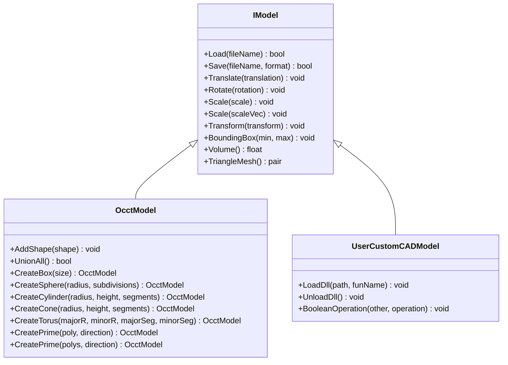
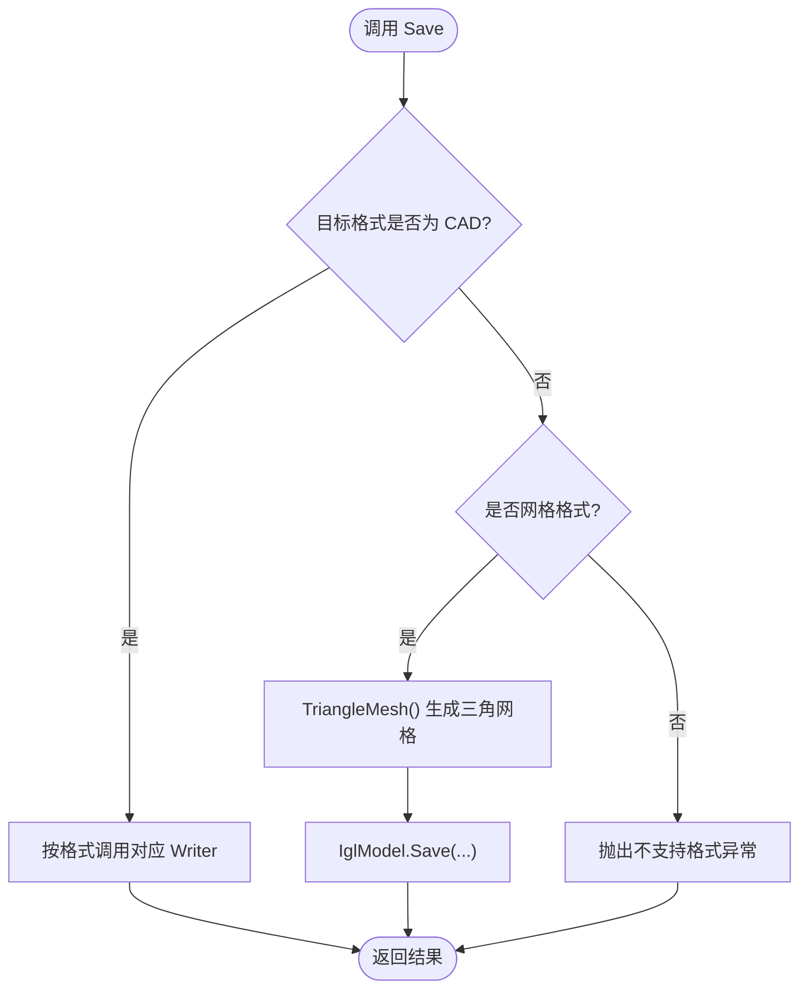
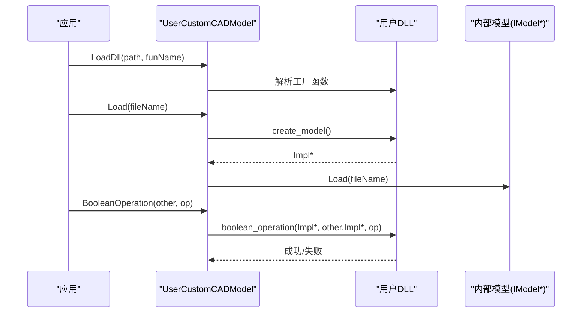
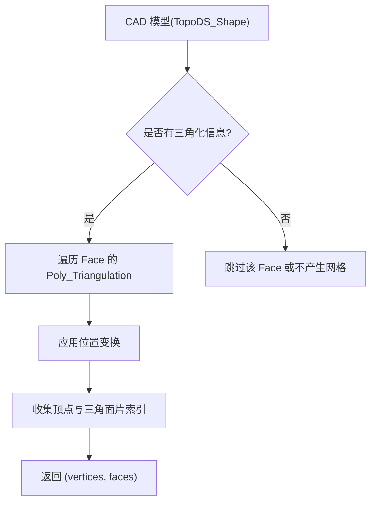
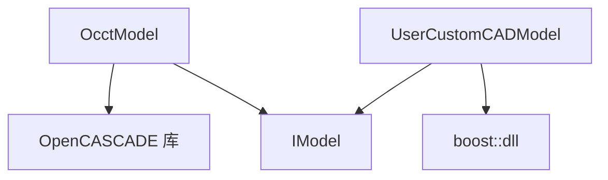

# CAD 模型处理

<cite>
**本文引用的文件**   
- [OcctModel.hpp](file://cadmodel/OcctModel.hpp)
- [OcctModel.cpp](file://cadmodel/OcctModel.cpp)
- [UserCustomCADModel.hpp](file://cadmodel/UserCustomCADModel.hpp)
- [UserCustomCADModel.cpp](file://cadmodel/UserCustomCADModel.cpp)
- [IModel.hpp](file://base/IModel.hpp)
- [occt_model_test.cpp](file://tests/Models/occt_model_test.cpp)
- [user_custom_cad_model_test.cpp](file://tests/CADModel/user_custom_cad_model_test.cpp)
</cite>

## 目录
1. [引言](#引言)
2. [项目结构](#项目结构)
3. [核心组件](#核心组件)
4. [架构总览](#架构总览)
5. [详细组件分析](#详细组件分析)
6. [依赖关系分析](#依赖关系分析)
7. [性能与质量优化](#性能与质量优化)
8. [故障排查指南](#故障排查指南)
9. [结论](#结论)
10. [附录：常用操作示例](#附录常用操作示例)

## 引言
本技术文档聚焦 HsBaSlicer 的 CAD 模型处理子系统，重点说明以下方面：
- OcctModel 基于 OpenCASCADE 内核的 B-Rep 建模能力，包括实体建模、曲面处理、布尔运算、壳化（ThickSolid）、基础几何体与拉伸工厂方法。
- UserCustomCADModel 的用户自定义 CAD 扩展机制，通过动态加载外部 DLL/SO 暴露 IModel 接口，实现可插拔 CAD 后端。
- CAD 模型到网格模型的转换流程，当前实现中 tessellation 参数与质量控制的方式与限制。
- STEP、IGES、VRML、BRep 等格式的读取与保存流程，以及常见问题与解决方案。
- 实际应用示例与性能优化建议，帮助在工程实践中稳定高效地使用 CAD 功能。

## 项目结构
HsBaSlicer 将 CAD 相关代码集中在 cadmodel 模块，并通过 base 层的 IModel 抽象统一不同 CAD 后端；测试用例位于 tests 目录，覆盖 OcctModel 与 UserCustomCADModel 的关键行为。

图表来源
- [OcctModel.hpp:22-124](file://cadmodel/OcctModel.hpp#L22-L124)
- [UserCustomCADModel.hpp:20-121](file://cadmodel/UserCustomCADModel.hpp#L20-L121)
- [IModel.hpp:110-126](file://base/IModel.hpp#L110-L126)

章节来源
- [OcctModel.hpp:1-132](file://cadmodel/OcctModel.hpp#L1-L132)
- [UserCustomCADModel.hpp:1-126](file://cadmodel/UserCustomCADModel.hpp#L1-L126)
- [IModel.hpp:89-126](file://base/IModel.hpp#L89-L126)

## 核心组件
- OcctModel：封装 TopoDS_Shape，提供加载/保存、变换、包围盒、体积、三角网格导出、布尔运算、壳化、基础几何体与拉伸工厂等方法。
- UserCustomCADModel：动态加载用户提供的 CAD 库，转发 IModel 调用，支持布尔运算、工厂函数与厚度设置等扩展能力。
- IModel：定义统一的模型接口，包括 Load/Save、Transform、BoundingBox、Volume、TriangleMesh 等。

章节来源
- [OcctModel.hpp:22-124](file://cadmodel/OcctModel.hpp#L22-L124)
- [UserCustomCADModel.hpp:20-121](file://cadmodel/UserCustomCADModel.hpp#L20-L121)
- [IModel.hpp:110-126](file://base/IModel.hpp#L110-L126)

## 架构总览
下图展示 CAD 模型处理的核心类关系与数据流：

图表来源
- [IModel.hpp:110-126](file://base/IModel.hpp#L110-L126)
- [OcctModel.hpp:22-124](file://cadmodel/OcctModel.hpp#L22-L124)
- [UserCustomCADModel.hpp:20-121](file://cadmodel/UserCustomCADModel.hpp#L20-L121)

## 详细组件分析

### OcctModel：基于 OpenCASCADE 的 B-Rep 建模
- 文件读写
  - 支持 STEP、IGES、VRML、BRep 的读取与写入。
  - 读取时根据扩展名选择对应 Reader，并将多个子形状合并为 Compound。
  - 写入时根据 ModelFormat 选择 Writer；若目标为网格格式，则先转换为三角网格再交由网格模型保存。
- 变换与几何属性
  - 支持平移、旋转、缩放、仿射变换。
  - 计算包围盒与有符号体积。
- 布尔运算与壳化
  - 提供 Union、Intersection、Difference、Xor 等布尔运算。
  - 提供 ThickSolid 壳化，支持整体厚度或指定面集合的局部加厚。
- 基础几何体与拉伸
  - 提供 Box、Sphere、Cylinder、Cone、Torus 等基础几何体创建。
  - 提供单多边形与多路径（含孔）拉伸成实体的工厂方法。
- 网格导出
  - TriangleMesh 遍历所有 Face，获取 Poly_Triangulation，应用位置变换并收集顶点与三角面片索引。

图表来源
- [OcctModel.cpp:238-270](file://cadmodel/OcctModel.cpp#L238-L270)

章节来源
- [OcctModel.cpp:76-147](file://cadmodel/OcctModel.cpp#L76-L147)
- [OcctModel.cpp:148-190](file://cadmodel/OcctModel.cpp#L148-L190)
- [OcctModel.cpp:213-270](file://cadmodel/OcctModel.cpp#L213-L270)
- [OcctModel.cpp:272-329](file://cadmodel/OcctModel.cpp#L272-L329)
- [OcctModel.cpp:331-407](file://cadmodel/OcctModel.cpp#L331-L407)
- [OcctModel.cpp:409-540](file://cadmodel/OcctModel.cpp#L409-L540)
- [OcctModel.cpp:542-663](file://cadmodel/OcctModel.cpp#L542-L663)

### UserCustomCADModel：用户自定义 CAD 扩展机制
- 动态库加载与函数解析
  - 使用 boost::dll 加载用户 DLL/SO，按约定命名规则解析工厂函数与操作方法。
  - 提供 CreateModel、DestroyModel、BooleanOperation、CreateBox/Sphere/Cylinder、SetThickness、CreatePrism/Ex 等函数指针访问器。
- 模型生命周期管理
  - 通过 NamedObjectPool 缓存已加载的 DLL，避免重复加载开销。
  - 析构时调用销毁函数释放跨边界对象。
- 接口转发
  - 对 Load/Save、Transform、BoundingBox、Volume、TriangleMesh 等方法进行转发，确保与 IModel 一致的行为。
- 布尔运算
  - 要求左右模型来自同一 DLL，否则抛出错误；未知操作由 DLL 侧失败并由包装层抛出运行时异常。

图表来源
- [UserCustomCADModel.cpp:31-115](file://cadmodel/UserCustomCADModel.cpp#L31-L115)
- [UserCustomCADModel.cpp:134-173](file://cadmodel/UserCustomCADModel.cpp#L134-L173)
- [UserCustomCADModel.cpp:268-289](file://cadmodel/UserCustomCADModel.cpp#L268-L289)

章节来源
- [UserCustomCADModel.hpp:20-121](file://cadmodel/UserCustomCADModel.hpp#L20-L121)
- [UserCustomCADModel.cpp:24-115](file://cadmodel/UserCustomCADModel.cpp#L24-L115)
- [UserCustomCADModel.cpp:123-173](file://cadmodel/UserCustomCADModel.cpp#L123-L173)
- [UserCustomCADModel.cpp:184-325](file://cadmodel/UserCustomCADModel.cpp#L184-L325)

### CAD 模型与网格模型的转换
- 当前实现中，OcctModel::TriangleMesh 直接遍历已有三角化信息（Poly_Triangulation），并未暴露 tessellation 参数或质量阈值控制。
- 当保存为网格格式时，OcctModel 会调用 TriangleMesh 生成顶点与面片，然后交给 IglModel 保存。
- 这意味着：
  - 网格质量取决于 CAD 模型自身是否包含三角化信息。
  - 如需精细控制 tessellation（如弦高、角度容差、细分等级），需要在更高层或扩展 OcctModel 以引入参数化配置。

图表来源
- [OcctModel.cpp:353-400](file://cadmodel/OcctModel.cpp#L353-L400)
- [OcctModel.cpp:257-266](file://cadmodel/OcctModel.cpp#L257-L266)

章节来源
- [OcctModel.cpp:353-400](file://cadmodel/OcctModel.cpp#L353-L400)
- [OcctModel.cpp:257-266](file://cadmodel/OcctModel.cpp#L257-L266)

### STEP、IGES 等 CAD 格式处理流程与常见问题
- 读取流程
  - STEP：使用 STEPControl_Reader 读取文件，TransferRoot 后逐个添加子形状。
  - IGES：使用 IGESControl_Reader 读取文件，逐个添加子形状。
  - VRML：通过 VrmlData_Scene 读取场景并转换为 TopoDS_Shape。
  - BRep：使用 BRepTools::Read 直接读取 B-Rep 数据。
- 写入流程
  - STEP：STEPControl_Writer 写入。
  - IGES：IGESControl_Writer 写入。
  - VRML：VrmlAPI::Write 写入。
  - BRep：BRepTools::Write 写入。
- 常见问题
  - 文件格式不支持：Load/Save 会抛出“不支持格式”异常。
  - 文件读取失败：IOError 或 Standard_Failure 被捕获并转为 IOError。
  - VRML 打开失败：检查文件路径与权限。
  - BRep 读取失败：可能因版本或损坏导致。

章节来源
- [OcctModel.cpp:76-147](file://cadmodel/OcctModel.cpp#L76-L147)
- [OcctModel.cpp:148-190](file://cadmodel/OcctModel.cpp#L148-L190)
- [OcctModel.cpp:213-270](file://cadmodel/OcctModel.cpp#L213-L270)

## 依赖关系分析
- OcctModel 依赖 OpenCASCADE 的 BRep、IFSelect、StepControl、IGESControl、VrmlAPI 等组件。
- UserCustomCADModel 依赖 boost::dll 进行动态库加载与符号解析。
- 两者均实现 IModel 接口，从而在系统内统一使用。

图表来源
- [OcctModel.cpp:8-59](file://cadmodel/OcctModel.cpp#L8-L59)
- [UserCustomCADModel.cpp:10-17](file://cadmodel/UserCustomCADModel.cpp#L10-L17)
- [IModel.hpp:110-126](file://base/IModel.hpp#L110-L126)

章节来源
- [OcctModel.cpp:8-59](file://cadmodel/OcctModel.cpp#L8-L59)
- [UserCustomCADModel.cpp:10-17](file://cadmodel/UserCustomCADModel.cpp#L10-L17)
- [IModel.hpp:110-126](file://base/IModel.hpp#L110-L126)

## 性能与质量优化
- 布尔运算
  - 大量布尔运算可能导致拓扑复杂化，建议在批量操作前尽量简化输入模型。
  - 优先使用 UnionAll 合并同属一个 Compound 的子实体，减少多次布尔调用。
- 壳化（ThickSolid）
  - 指定面集合加厚时，距离与变换迹线比较用于匹配面，需保证输入面法向与位置合理。
  - 小容差（1e-6）下对数值精度敏感，建议预处理模型消除微小缝隙与重叠。
- 网格导出
  - 当前 TriangleMesh 不暴露 tessellation 参数，质量受限于模型自身三角化。
  - 如需高质量网格，建议在 CAD 源端生成良好三角化，或在后续网格处理阶段进行平滑与重划分。
- 变换与包围盒
  - 频繁变换会复制底层 Shape，建议批量变换后再执行昂贵操作（如布尔、体积）。
  - 包围盒计算遍历顶点，复杂度与顶点数线性相关，大模型应谨慎频繁查询。

[本节为通用指导，不直接分析具体文件]

## 故障排查指南
- 未加载 DLL 即调用 Load/Transform/Volume 等方法
  - 现象：抛出“Dll not loaded”或“Model not loaded”。
  - 解决：先调用 LoadDll 并确认函数解析成功，再执行其他操作。
- 布尔运算失败
  - 现象：抛出“Boolean operation failed”或“Model not loaded or incompatible DLLs”。
  - 解决：确保左右模型来自同一 DLL，且操作名称合法（union/intersection/difference）。
- 文件格式不支持
  - 现象：抛出“Unsupported Model Format”。
  - 解决：确认扩展名与 ModelFormat 匹配，或使用支持的格式。
- VRML 无法打开
  - 现象：抛出“Cannot open VRML file”。
  - 解决：检查路径、编码与权限；必要时转换为 BRep 或 STEP。
- BRep 读取失败
  - 现象：抛出“Read BRep File Error”。
  - 解决：检查文件完整性与版本兼容性。

章节来源
- [UserCustomCADModel.cpp:151-173](file://cadmodel/UserCustomCADModel.cpp#L151-L173)
- [UserCustomCADModel.cpp:268-289](file://cadmodel/UserCustomCADModel.cpp#L268-L289)
- [OcctModel.cpp:213-270](file://cadmodel/OcctModel.cpp#L213-L270)
- [OcctModel.cpp:110-147](file://cadmodel/OcctModel.cpp#L110-L147)

## 结论
HsBaSlicer 的 CAD 模型处理系统以 OcctModel 为核心，依托 OpenCASCADE 提供稳健的 B-Rep 建模能力，并通过 UserCustomCADModel 实现可扩展的用户自定义 CAD 后端。当前网格导出尚未暴露 tessellation 参数，质量依赖于模型自身三角化；在工程应用中，建议结合 CAD 源端质量与后续网格处理策略，以获得稳定高效的输出。对于 STEP/IGES 等格式，遵循现有读写流程并注意常见错误，可有效提升鲁棒性。

[本节为总结性内容，不直接分析具体文件]

## 附录：常用操作示例
- 创建基础几何体并验证体积与包围盒
  - 参考测试用例：创建立方体、球体，验证体积与包围盒范围。
  - 参考路径：[occt_model_test.cpp:8-30](file://tests/Models/occt_model_test.cpp#L8-L30)
- 布尔运算
  - 参考测试用例：两个单位立方体重叠，验证并集、交集、差集、异或体积。
  - 参考路径：[occt_model_test.cpp:34-48](file://tests/Models/occt_model_test.cpp#L34-L48)
- 拉伸工厂方法
  - 单多边形与多路径（含孔）拉伸，验证体积与包围盒。
  - 参考路径：[occt_model_test.cpp:50-108](file://tests/Models/occt_model_test.cpp#L50-L108)
- 用户自定义 CAD 模型
  - 加载 DLL、调用工厂函数、执行布尔运算、校验错误分支。
  - 参考路径：[user_custom_cad_model_test.cpp:45-189](file://tests/CADModel/user_custom_cad_model_test.cpp#L45-L189)

章节来源
- [occt_model_test.cpp:8-135](file://tests/Models/occt_model_test.cpp#L8-L135)
- [user_custom_cad_model_test.cpp:45-189](file://tests/CADModel/user_custom_cad_model_test.cpp#L45-L189)