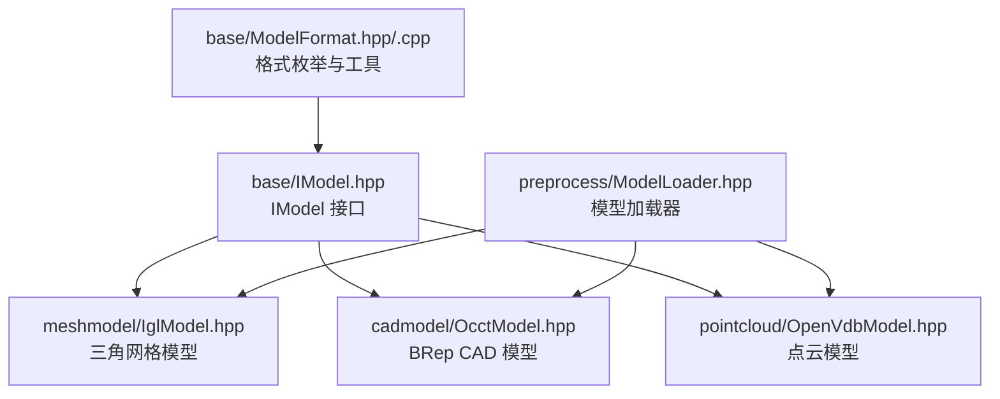
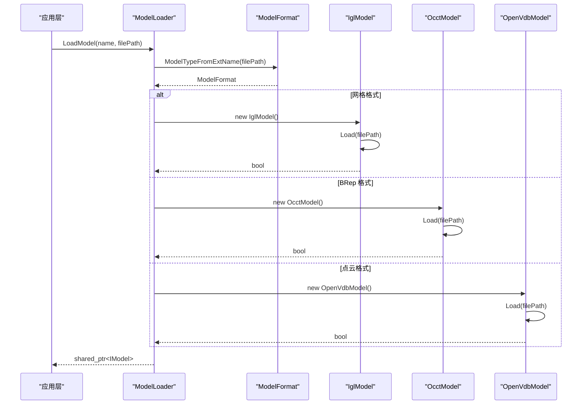
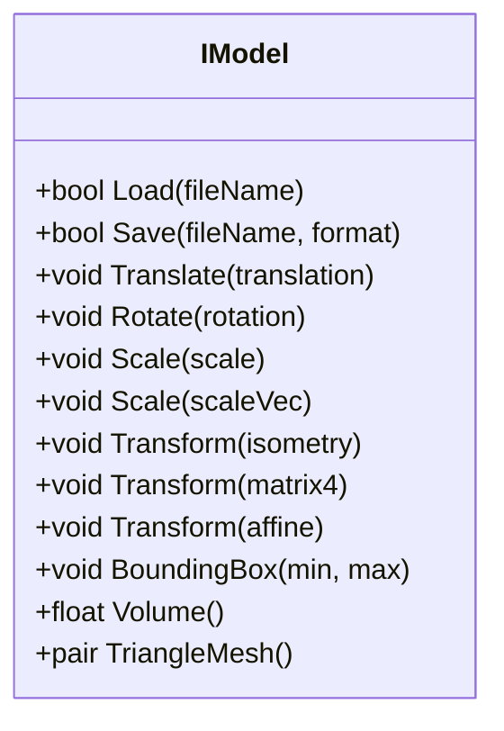
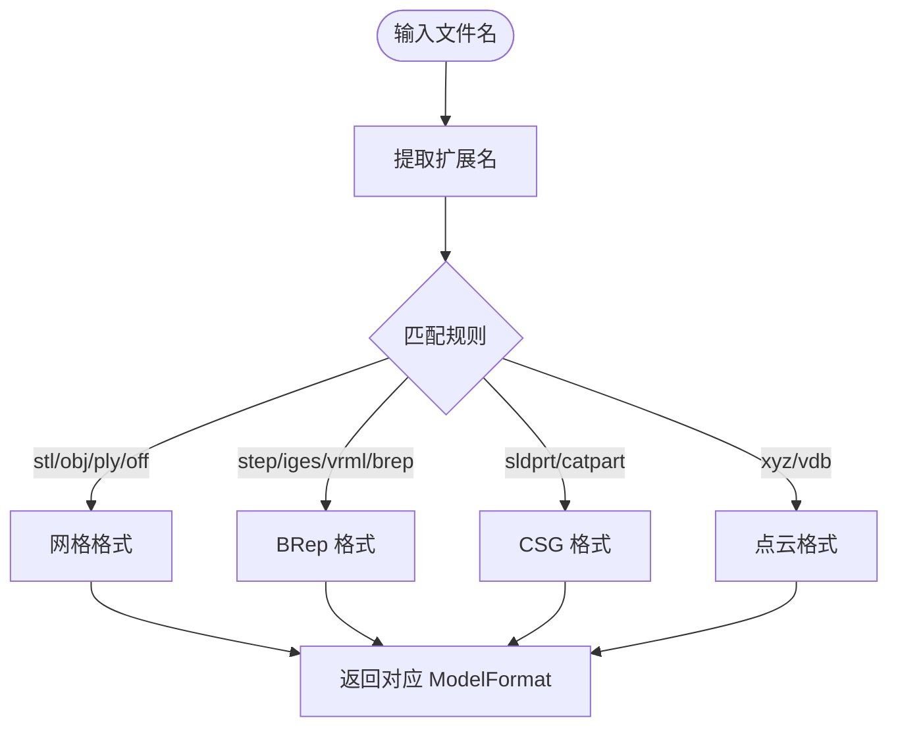
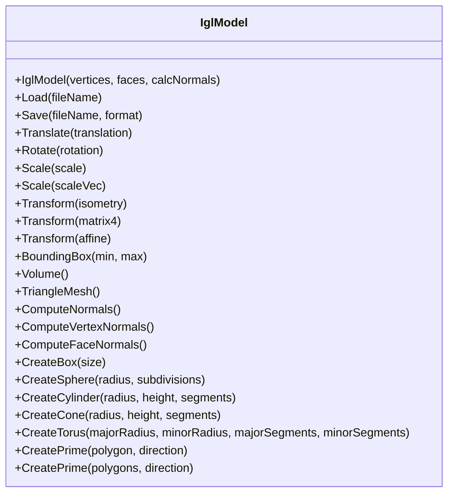
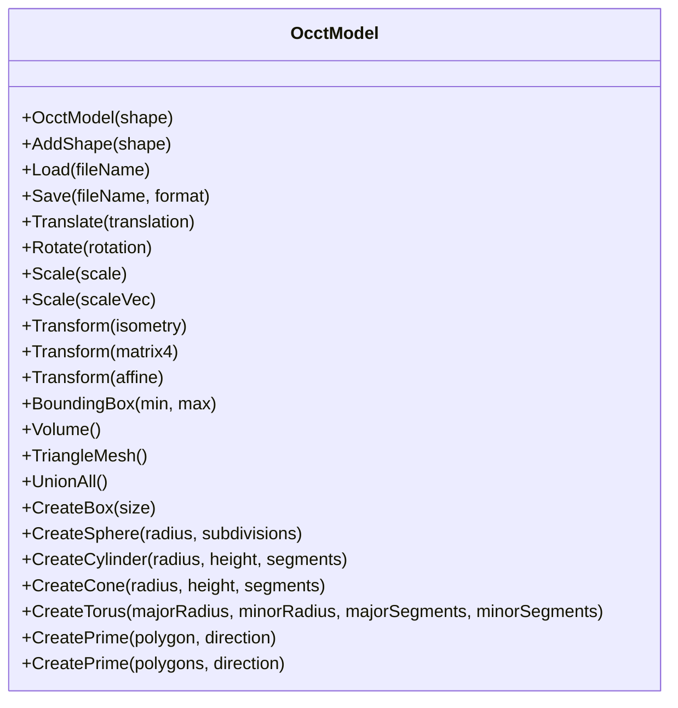
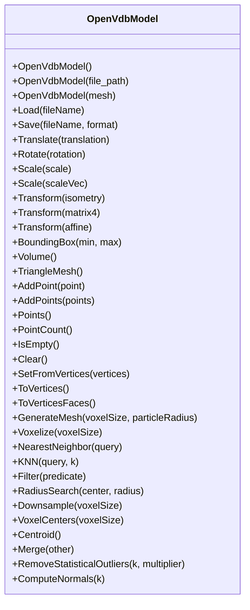
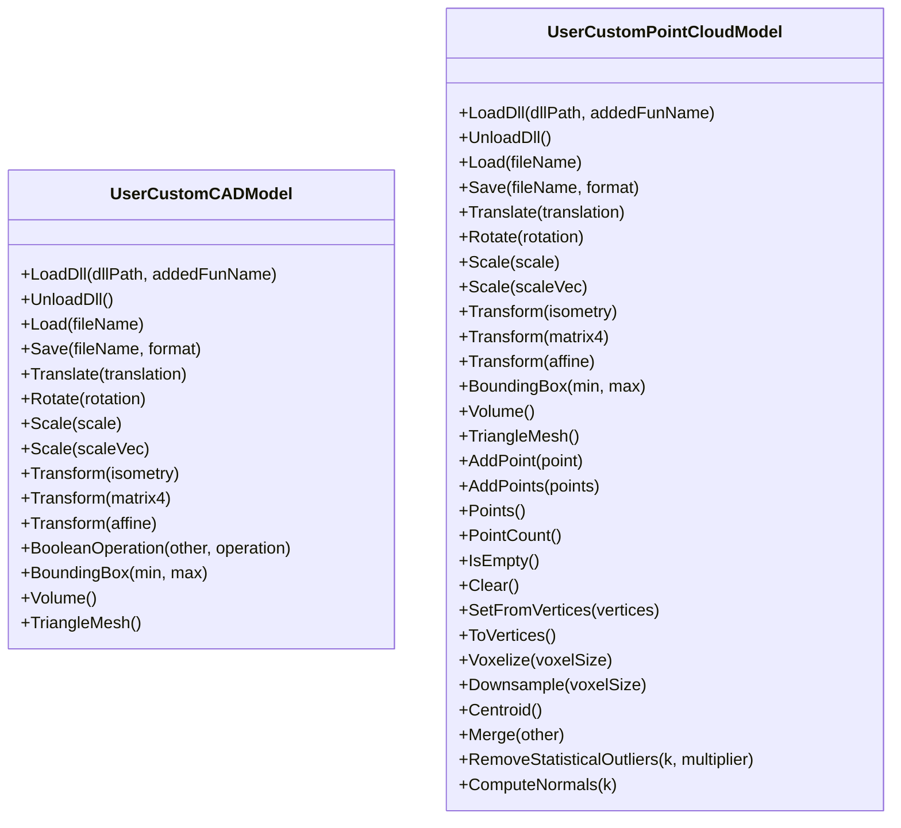
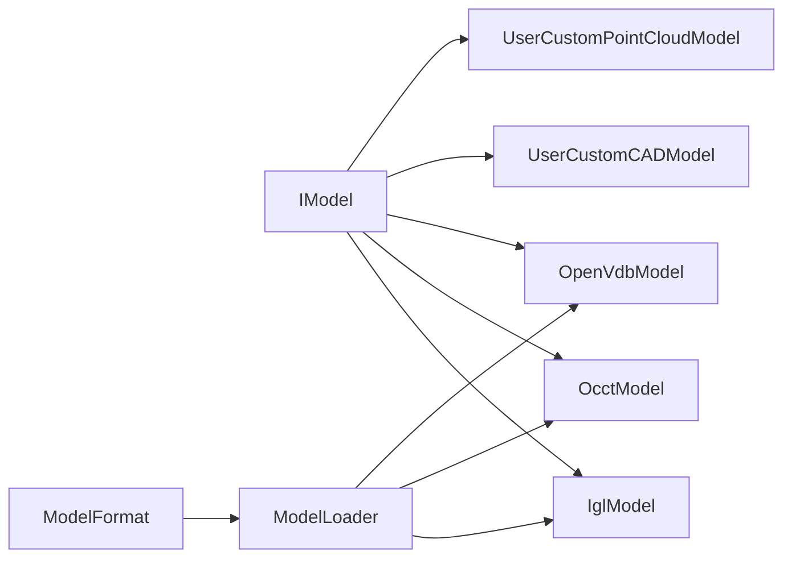

# IModel 统一接口

<cite>
**本文引用的文件**   
- [IModel.hpp](file://base/IModel.hpp)
- [ModelFormat.hpp](file://base/ModelFormat.hpp)
- [ModelFormat.cpp](file://base/ModelFormat.cpp)
- [IglModel.hpp](file://meshmodel/IglModel.hpp)
- [OcctModel.hpp](file://cadmodel/OcctModel.hpp)
- [OpenVdbModel.hpp](file://pointcloud/OpenVdbModel.hpp)
- [UserCustomCADModel.hpp](file://cadmodel/UserCustomCADModel.hpp)
- [UserCustomPointCloudModel.hpp](file://pointcloud/UserCustomPointCloudModel.hpp)
- [ModelLoader.hpp](file://preprocess/ModelLoader.hpp)
- [full_topo_model_test.cpp](file://tests/Models/full_topo_model_test.cpp)
</cite>

## 目录
1. [引言](#引言)
2. [项目结构](#项目结构)
3. [核心组件](#核心组件)
4. [架构总览](#架构总览)
5. [详细组件分析](#详细组件分析)
6. [依赖关系分析](#依赖关系分析)
7. [性能与实现要点](#性能与实现要点)
8. [故障排查指南](#故障排查指南)
9. [结论](#结论)
10. [附录：API 速查与最佳实践](#附录api-速查与最佳实践)

## 引言
本文件面向开发者，系统化说明 HsBaSlicer 的 IModel 统一接口。IModel 抽象了三维模型的加载、保存、几何变换、边界框计算、体积计算以及三角网格提取等通用能力，屏蔽底层具体模型类型（三角网格、BRep CAD、点云等）的差异，使上层切片与路径生成流程可以以统一方式操作任意模型。同时，文档详细说明 ModelFormat 枚举支持的多种文件格式，并给出使用示例、扩展指导与最佳实践。

## 项目结构
围绕 IModel 的核心代码分布在以下模块：
- base：定义 IModel 接口与 ModelFormat 枚举及格式工具函数
- meshmodel：基于 libigl 的三角网格模型 IglModel
- cadmodel：基于 OpenCASCADE 的 BRep CAD 模型 OcctModel，以及用户自定义 CAD 插件桥接 UserCustomCADModel
- pointcloud：基于 OpenVDB 的点云模型 OpenVdbModel，以及用户自定义点云插件桥接 UserCustomPointCloudModel
- preprocess：提供 ModelLoader，按扩展名自动选择具体模型类型进行加载

图表来源
- [IModel.hpp:111-139](file://base/IModel.hpp#L111-L139)
- [IglModel.hpp:26-121](file://meshmodel/IglModel.hpp#L26-L121)
- [OcctModel.hpp:30-124](file://cadmodel/OcctModel.hpp#L30-L124)
- [OpenVdbModel.hpp:28-116](file://pointcloud/OpenVdbModel.hpp#L28-L116)
- [ModelFormat.hpp:19-114](file://base/ModelFormat.hpp#L19-L114)
- [ModelFormat.cpp:12-99](file://base/ModelFormat.cpp#L12-L99)
- [ModelLoader.hpp:47-59](file://preprocess/ModelLoader.hpp#L47-L59)

章节来源
- [IModel.hpp:1-151](file://base/IModel.hpp#L1-L151)
- [ModelFormat.hpp:1-116](file://base/ModelFormat.hpp#L1-L116)
- [ModelFormat.cpp:1-177](file://base/ModelFormat.cpp#L1-L177)
- [IglModel.hpp:1-124](file://meshmodel/IglModel.hpp#L1-L124)
- [OcctModel.hpp:1-132](file://cadmodel/OcctModel.hpp#L1-L132)
- [OpenVdbModel.hpp:1-119](file://pointcloud/OpenVdbModel.hpp#L1-L119)
- [ModelLoader.hpp:41-99](file://preprocess/ModelLoader.hpp#L41-L99)

## 核心组件
- IModel：统一的三维模型抽象接口，包含加载/保存、平移/旋转/缩放/变换、边界框、体积、三角网格等 API
- ModelFormat：模型格式枚举与字符串转换、扩展名识别、格式分类（网格/BRep/CSG/点云）
- IglModel：基于 libigl 的三角网格模型实现
- OcctModel：基于 OpenCASCADE 的 BRep CAD 模型实现
- OpenVdbModel：基于 OpenVDB 的点云模型实现
- UserCustomCADModel / UserCustomPointCloudModel：通过动态库桥接用户自定义 CAD/点云模型，同样实现 IModel

章节来源
- [IModel.hpp:111-139](file://base/IModel.hpp#L111-L139)
- [ModelFormat.hpp:19-114](file://base/ModelFormat.hpp#L19-L114)
- [IglModel.hpp:26-121](file://meshmodel/IglModel.hpp#L26-L121)
- [OcctModel.hpp:30-124](file://cadmodel/OcctModel.hpp#L30-L124)
- [OpenVdbModel.hpp:28-116](file://pointcloud/OpenVdbModel.hpp#L28-L116)
- [UserCustomCADModel.hpp:79-121](file://cadmodel/UserCustomCADModel.hpp#L79-L121)
- [UserCustomPointCloudModel.hpp:96-171](file://pointcloud/UserCustomPointCloudModel.hpp#L96-L171)

## 架构总览
IModel 作为统一入口，上层无需关心具体模型类型；ModelLoader 根据扩展名自动选择 IglModel/OcctModel/OpenVdbModel 进行加载；ModelFormat 提供格式识别与分类工具。

图表来源
- [ModelLoader.hpp:47-59](file://preprocess/ModelLoader.hpp#L47-L59)
- [ModelFormat.cpp:95-99](file://base/ModelFormat.cpp#L95-L99)
- [IglModel.hpp:55-58](file://meshmodel/IglModel.hpp#L55-L58)
- [OcctModel.hpp:54-57](file://cadmodel/OcctModel.hpp#L54-L57)
- [OpenVdbModel.hpp:46-47](file://pointcloud/OpenVdbModel.hpp#L46-L47)

## 详细组件分析

### IModel 接口设计
IModel 定义了统一的模型生命周期与几何操作接口：
- 加载/保存：Load(fileName)、Save(fileName, format)
- 几何变换：Translate、Rotate、Scale(标量/向量)、Transform(Isometry/Matrix4/Affine)
- 查询：BoundingBox(min,max)、Volume()
- 导出：TriangleMesh() 返回 IGL 风格的顶点矩阵与面索引矩阵

设计理念：
- 通过纯虚接口屏蔽底层数据结构差异，便于多后端复用
- 变换接口覆盖常用场景：刚体变换、仿射变换、均匀与非均匀缩放
- 输出 TriangleMesh 为下游切片、可视化、布尔运算等提供统一数据形态

图表来源
- [IModel.hpp:111-139](file://base/IModel.hpp#L111-L139)

章节来源
- [IModel.hpp:111-139](file://base/IModel.hpp#L111-L139)

### ModelFormat 枚举与格式工具
ModelFormat 枚举支持多种文件格式，涵盖：
- 网格：STL（ASCII/Binary）、OBJ、PLY（ASCII/Binary）、OFF
- BRep：STEP、IGES、VRML、BREP
- CSG：SLDPRT、CATPART
- 点云：XYZ、VDB

工具函数：
- ToString(format)：枚举到字符串
- GetExtName(file_name)：获取扩展名
- ModelTypeFromExtName(file_name)：从扩展名推断格式
- IsMeshFormat/IsBrepFormat/IsCSGFormat/IsPointCloudFormat：格式分类判断

图表来源
- [ModelFormat.cpp:12-99](file://base/ModelFormat.cpp#L12-L99)
- [ModelFormat.hpp:19-114](file://base/ModelFormat.hpp#L19-L114)

章节来源
- [ModelFormat.hpp:19-114](file://base/ModelFormat.hpp#L19-L114)
- [ModelFormat.cpp:12-177](file://base/ModelFormat.cpp#L12-L177)

### IglModel（三角网格模型）
职责：
- 存储顶点、面片与可选法线
- 实现 IModel 所有方法：加载/保存（STL/OBJ/PLY/OFF 等）、变换、边界框、体积、三角网格导出
- 提供法线计算、布尔运算、基础几何体创建（Box/Sphere/Cylinder/Cone/Torus）、拉伸工厂

图表来源
- [IglModel.hpp:26-121](file://meshmodel/IglModel.hpp#L26-L121)

章节来源
- [IglModel.hpp:26-121](file://meshmodel/IglModel.hpp#L26-L121)

### OcctModel（BRep CAD 模型）
职责：
- 封装 TopoDS_Shape，支持 STEP/IGES/VRML/BREP 的读写
- 实现 IModel 所有方法：变换、边界框、体积、三角网格化
- 提供布尔运算、壳厚度（ThickSolid）、基础几何体创建、拉伸工厂

图表来源
- [OcctModel.hpp:30-124](file://cadmodel/OcctModel.hpp#L30-L124)

章节来源
- [OcctModel.hpp:30-124](file://cadmodel/OcctModel.hpp#L30-L124)

### OpenVdbModel（点云模型）
职责：
- 基于 OpenVDB 体素网格管理点云
- 实现 IModel 所有方法：变换、边界框、体积、三角网格导出（通过 LevelSet 重建）
- 提供点云专属操作：插入、KNN/半径搜索、体素化、下采样、质心、合并、去噪、法线估计

图表来源
- [OpenVdbModel.hpp:28-116](file://pointcloud/OpenVdbModel.hpp#L28-L116)

章节来源
- [OpenVdbModel.hpp:28-116](file://pointcloud/OpenVdbModel.hpp#L28-L116)

### 用户自定义模型桥接
- UserCustomCADModel：通过动态库加载用户实现的 CAD 模型，暴露与 IModel 一致的接口，包括布尔运算等
- UserCustomPointCloudModel：通过动态库加载用户实现的点云模型，暴露与 OpenVdbModel 一致的高级点云操作

图表来源
- [UserCustomCADModel.hpp:79-121](file://cadmodel/UserCustomCADModel.hpp#L79-L121)
- [UserCustomPointCloudModel.hpp:96-171](file://pointcloud/UserCustomPointCloudModel.hpp#L96-L171)

章节来源
- [UserCustomCADModel.hpp:79-121](file://cadmodel/UserCustomCADModel.hpp#L79-L121)
- [UserCustomPointCloudModel.hpp:96-171](file://pointcloud/UserCustomPointCloudModel.hpp#L96-L171)

## 依赖关系分析
- IModel 是核心抽象，被 IglModel、OcctModel、OpenVdbModel、UserCustomCADModel、UserCustomPointCloudModel 继承
- ModelFormat 提供格式识别与分类，供 ModelLoader 选择具体实现
- ModelLoader 聚合各实现，对外暴露统一的 LoadModel/InsertModel/GetModel 等接口

图表来源
- [IModel.hpp:111-139](file://base/IModel.hpp#L111-L139)
- [IglModel.hpp:26-121](file://meshmodel/IglModel.hpp#L26-L121)
- [OcctModel.hpp:30-124](file://cadmodel/OcctModel.hpp#L30-L124)
- [OpenVdbModel.hpp:28-116](file://pointcloud/OpenVdbModel.hpp#L28-L116)
- [UserCustomCADModel.hpp:79-121](file://cadmodel/UserCustomCADModel.hpp#L79-L121)
- [UserCustomPointCloudModel.hpp:96-171](file://pointcloud/UserCustomPointCloudModel.hpp#L96-L171)
- [ModelFormat.cpp:95-99](file://base/ModelFormat.cpp#L95-L99)
- [ModelLoader.hpp:47-59](file://preprocess/ModelLoader.hpp#L47-L59)

章节来源
- [IModel.hpp:111-139](file://base/IModel.hpp#L111-L139)
- [ModelFormat.cpp:95-99](file://base/ModelFormat.cpp#L95-L99)
- [ModelLoader.hpp:47-59](file://preprocess/ModelLoader.hpp#L47-L59)

## 性能与实现要点
- 变换顺序与数值稳定性：优先使用 Isometry3f 表示刚体变换，避免累积误差；对大规模网格建议批量更新顶点矩阵以减少内存访问开销
- 边界框与体积：IglModel/OcctModel/OpenVdbModel 均提供高效实现；对于复杂 CAD 模型，三角网格化可能带来额外开销，按需调用
- 三角网格导出：TriangleMesh 在 CAD 模型中会触发 tessellation，建议在需要时再调用，避免不必要的计算
- 点云重建网格：OpenVdbModel::GenerateMesh 涉及 LevelSet 重建，参数 voxelSize/particleRadius 影响精度与性能，需根据点云密度调整

[本节为通用性能建议，不直接分析具体文件]

## 故障排查指南
- 加载失败：检查扩展名是否受支持；确认 ModelTypeFromExtName 返回的格式与预期一致
- 不支持的格式：若启用 BRep 功能但缺少 OCCT，则加载 STEP/IGES/VRML/BREP 将抛出运行时错误
- 空模型或无效网格：确保 Load 成功后再调用 Volume/TriangleMesh；对测试用例可参考最小实现验证接口一致性
- 动态库桥接：UserCustom* 系列需正确加载 DLL/SO 并暴露符号；若符号缺失或签名不一致，会导致初始化失败

章节来源
- [ModelLoader.hpp:47-59](file://preprocess/ModelLoader.hpp#L47-L59)
- [full_topo_model_test.cpp:16-53](file://tests/Models/full_topo_model_test.cpp#L16-L53)

## 结论
IModel 为 HsBaSlicer 提供了统一的三维模型抽象，配合 ModelFormat 与 ModelLoader，实现了跨格式的模型加载与统一操作。IglModel、OcctModel、OpenVdbModel 分别覆盖网格、CAD 与点云场景，UserCustom* 系列允许扩展第三方实现。开发者可基于该接口进行模型预处理、切片、路径生成等操作，并通过扩展新实现来支持更多格式或算法。

[本节为总结性内容，不直接分析具体文件]

## 附录：API 速查与最佳实践

### IModel 关键 API 说明
- 加载/保存
  - Load(fileName)：从文件加载模型
  - Save(fileName, format)：以指定格式保存模型
- 几何变换
  - Translate(translation)：平移
  - Rotate(rotation)：绕轴旋转（四元数）
  - Scale(scale)：均匀缩放
  - Scale(scaleVec)：非均匀缩放
  - Transform(isometry/matrix4/affine)：刚体/齐次/仿射变换
- 查询与导出
  - BoundingBox(min, max)：轴对齐包围盒
  - Volume()：有符号体积
  - TriangleMesh()：返回 IGL 风格 (vertices, faces)

章节来源
- [IModel.hpp:111-139](file://base/IModel.hpp#L111-L139)

### ModelFormat 支持的文件格式
- 网格：STL（ASCII/Binary）、OBJ、PLY（ASCII/Binary）、OFF
- BRep：STEP、IGES、VRML、BREP
- CSG：SLDPRT、CATPART
- 点云：XYZ、VDB

章节来源
- [IModel.hpp:66-109](file://base/IModel.hpp#L66-L109)
- [ModelFormat.hpp:19-114](file://base/ModelFormat.hpp#L19-L114)
- [ModelFormat.cpp:12-99](file://base/ModelFormat.cpp#L12-L99)

### 使用示例（步骤式）
- 使用 ModelLoader 加载模型
  - 调用 LoadModel(name, filePath)，内部根据扩展名自动选择 IglModel/OcctModel/OpenVdbModel
- 对模型执行变换
  - 调用 Translate/Rotate/Scale/Transform 完成定位与姿态调整
- 获取几何信息
  - 调用 BoundingBox 获取包围盒，Volume 获取体积
- 导出三角网格
  - 调用 TriangleMesh 获得顶点与面索引，用于切片或可视化

章节来源
- [ModelLoader.hpp:47-59](file://preprocess/ModelLoader.hpp#L47-L59)
- [IglModel.hpp:55-82](file://meshmodel/IglModel.hpp#L55-L82)
- [OcctModel.hpp:54-81](file://cadmodel/OcctModel.hpp#L54-L81)
- [OpenVdbModel.hpp:46-58](file://pointcloud/OpenVdbModel.hpp#L46-L58)

### 最佳实践与扩展指导
- 统一接口优先：尽量通过 IModel 接口操作模型，避免耦合具体实现
- 合理选择模型类型：网格用 IglModel，CAD 用 OcctModel，点云用 OpenVdbModel
- 控制三角网格化：仅在需要时调用 TriangleMesh，避免重复计算
- 扩展新格式：新增 ModelFormat 值并在 ModelFormat.cpp 中添加扩展名匹配规则
- 自定义实现：实现 IModel 接口并通过 UserCustom* 桥接动态库，保持与内置实现一致的语义

章节来源
- [ModelFormat.cpp:12-99](file://base/ModelFormat.cpp#L12-L99)
- [UserCustomCADModel.hpp:79-121](file://cadmodel/UserCustomCADModel.hpp#L79-L121)
- [UserCustomPointCloudModel.hpp:96-171](file://pointcloud/UserCustomPointCloudModel.hpp#L96-L171)