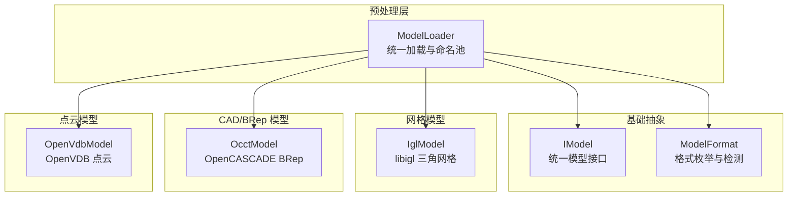
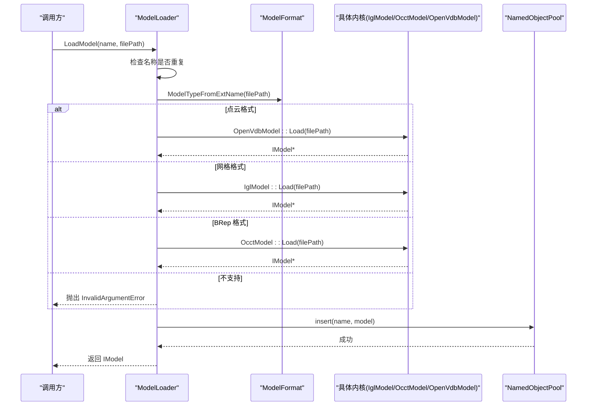
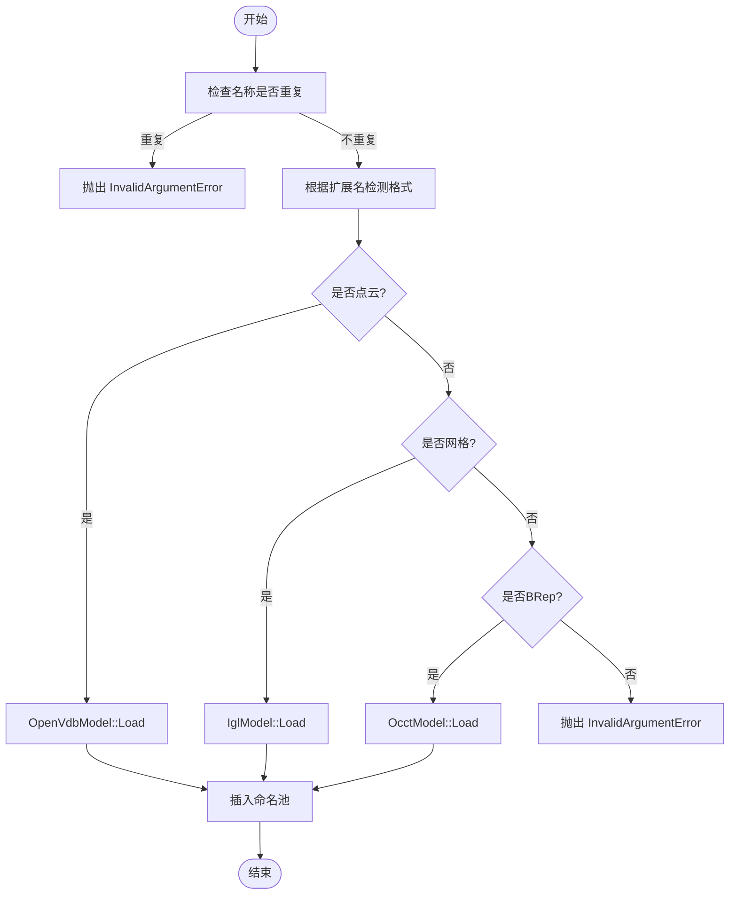
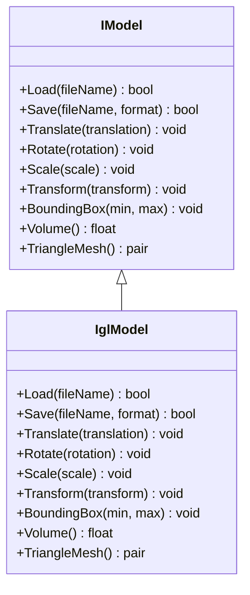
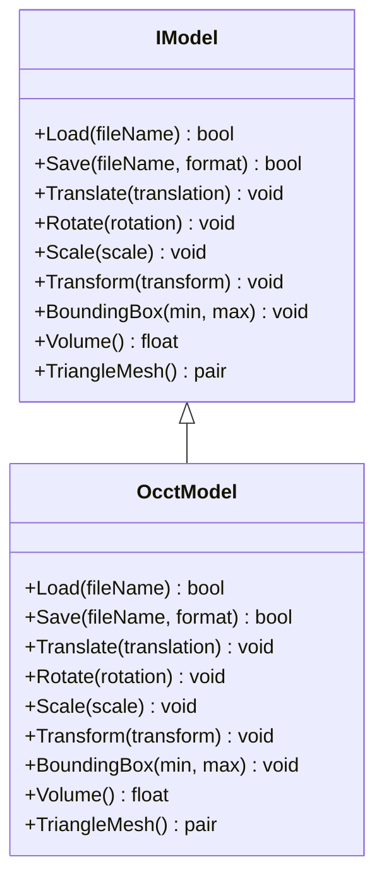
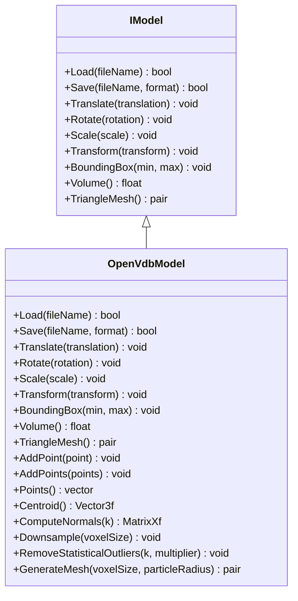
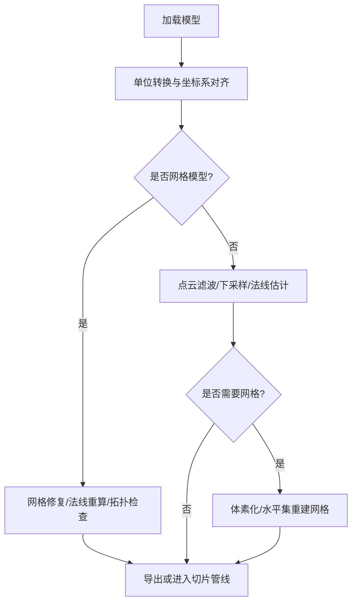
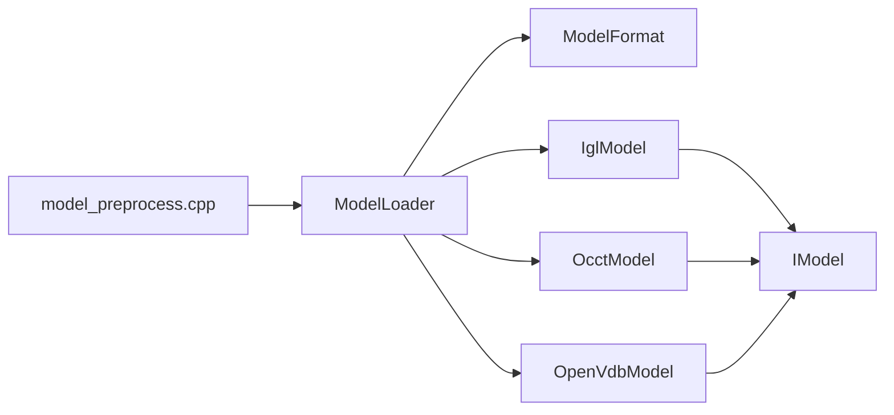

# 模型加载器

<cite>
**本文引用的文件**   
- [preprocess/ModelLoader.hpp](file://preprocess/ModelLoader.hpp)
- [preprocess/ModelLoader.cpp](file://preprocess/ModelLoader.cpp)
- [base/IModel.hpp](file://base/IModel.hpp)
- [base/ModelFormat.hpp](file://base/ModelFormat.hpp)
- [base/ModelFormat.cpp](file://base/ModelFormat.cpp)
- [meshmodel/IglModel.hpp](file://meshmodel/IglModel.hpp)
- [meshmodel/IglModel.cpp](file://meshmodel/IglModel.cpp)
- [cadmodel/OcctModel.cpp](file://cadmodel/OcctModel.cpp)
- [pointcloud/OpenVdbModel.hpp](file://pointcloud/OpenVdbModel.hpp)
- [pointcloud/OpenVdbModel.cpp](file://pointcloud/OpenVdbModel.cpp)
- [LibHsBaSlicer/Preprocess/model_preprocess.cpp](file://LibHsBaSlicer/Preprocess/model_preprocess.cpp)
- [tests/Preprocess/model_loader_test.cpp](file://tests/Preprocess/model_loader_test.cpp)
</cite>

## 目录
1. [简介](#简介)
2. [项目结构](#项目结构)
3. [核心组件](#核心组件)
4. [架构总览](#架构总览)
5. [详细组件分析](#详细组件分析)
6. [依赖关系分析](#依赖关系分析)
7. [性能与扩展性](#性能与扩展性)
8. [故障排查指南](#故障排查指南)
9. [结论](#结论)
10. [附录：使用示例与最佳实践](#附录使用示例与最佳实践)

## 简介
本技术文档围绕 HsBaSlicer 的模型加载器展开，重点解释 ModelLoader 的统一模型加载机制。该机制通过统一接口自动识别模型格式、选择对应内核（网格、BRep、点云）进行解析，并将结果对象放入命名池统一管理。文档还涵盖支持的模型格式、预处理能力、批量加载模式、错误处理、进度反馈建议以及自定义格式加载器的开发指导。

## 项目结构
与模型加载相关的代码主要分布在以下模块：
- preprocess：统一加载器 ModelLoader 及其调度逻辑
- base：IModel 抽象接口与 ModelFormat 枚举及格式检测工具
- meshmodel：基于 libigl 的三角网格模型 IglModel
- cadmodel：基于 OpenCASCADE 的 BRep 模型 OcctModel
- pointcloud：基于 OpenVDB 的点云模型 OpenVdbModel
- LibHsBaSlicer：对外暴露的 C++ 封装层，提供线程局部加载器与异常保护
- tests：覆盖加载器基本行为、布尔运算、厚壳等用例

**图表来源**
- [preprocess/ModelLoader.hpp:23-59](file://preprocess/ModelLoader.hpp#L23-L59)
- [base/IModel.hpp:65-139](file://base/IModel.hpp#L65-L139)
- [base/ModelFormat.hpp:19-114](file://base/ModelFormat.hpp#L19-L114)

**章节来源**
- [preprocess/ModelLoader.hpp:23-59](file://preprocess/ModelLoader.hpp#L23-L59)
- [base/IModel.hpp:65-139](file://base/IModel.hpp#L65-L139)
- [base/ModelFormat.hpp:19-114](file://base/ModelFormat.hpp#L19-L114)

## 核心组件
- ModelLoader：统一入口，负责根据文件扩展名判断格式，并调用具体内核加载；同时维护一个命名模型池，支持插入、查询、删除、清理等操作。
- IModel：所有模型类型的统一抽象，定义 Load/Save、变换、包围盒、体积、三角网格提取等通用能力。
- ModelFormat：格式枚举与字符串转换，并提供按扩展名判断是否为网格、BRep、CSG、点云的辅助函数。
- IglModel：基于 libigl 的三角网格实现，支持 STL/OBJ/PLY/OFF 等网格格式的读写与基础几何操作。
- OcctModel：基于 OpenCASCADE 的 BRep 实现，支持 STEP/IGES/VRML/BREP 等 CAD 格式读写与布尔运算、厚壳等高级操作。
- OpenVdbModel：基于 OpenVDB 的点云实现，支持 .xyz/.txt/.vdb 等点云格式读写，并提供体素化、重建网格、统计滤波等功能。

**章节来源**
- [preprocess/ModelLoader.hpp:30-92](file://preprocess/ModelLoader.hpp#L30-L92)
- [base/IModel.hpp:65-139](file://base/IModel.hpp#L65-L139)
- [base/ModelFormat.hpp:19-114](file://base/ModelFormat.hpp#L19-L114)
- [meshmodel/IglModel.hpp:40-61](file://meshmodel/IglModel.hpp#L40-L61)
- [cadmodel/OcctModel.cpp:76-147](file://cadmodel/OcctModel.cpp#L76-L147)
- [pointcloud/OpenVdbModel.hpp:20-58](file://pointcloud/OpenVdbModel.hpp#L20-L58)

## 架构总览
ModelLoader 的加载流程如下：
1. 检查命名池中是否已存在同名模型，若存在抛出参数错误。
2. 根据文件扩展名调用 ModelTypeFromExtName 获取 ModelFormat。
3. 若为点云格式，则通过 OpenVdbModel 加载；否则若为网格格式，则通过 IglModel 加载；否则若为 BRep 格式，则通过 OcctModel 加载。
4. 将加载得到的 IModel 智能指针插入命名池并返回。

**图表来源**
- [preprocess/ModelLoader.cpp:45-84](file://preprocess/ModelLoader.cpp#L45-L84)
- [base/ModelFormat.cpp:95-99](file://base/ModelFormat.cpp#L95-L99)

**章节来源**
- [preprocess/ModelLoader.cpp:45-84](file://preprocess/ModelLoader.cpp#L45-L84)
- [base/ModelFormat.cpp:95-99](file://base/ModelFormat.cpp#L95-L99)

## 详细组件分析

### 统一加载机制与格式检测
- 格式检测：
  - 通过 ModelTypeFromExtName 从文件名提取扩展名，并使用正则匹配规则映射到 ModelFormat。
  - 支持网格（STL、OBJ、PLY、OFF）、BRep（STEP、IGES、VRML、BREP）、CSG（SLDPRT、CATPART）、点云（XYZ、VDB）。
- 内核选择：
  - 点云 -> OpenVdbModel
  - 网格 -> IglModel
  - BRep -> OcctModel（需要 USE_OCCT）
- 命名池：
  - 使用 NamedObjectPool 管理模型生命周期，支持插入、查询、删除、清理。
  - 容量由编译宏 HSBA_MODEL_POOL_SIZE 控制。

**图表来源**
- [preprocess/ModelLoader.cpp:45-84](file://preprocess/ModelLoader.cpp#L45-L84)
- [base/ModelFormat.cpp:12-99](file://base/ModelFormat.cpp#L12-L99)

**章节来源**
- [preprocess/ModelLoader.cpp:45-84](file://preprocess/ModelLoader.cpp#L45-L84)
- [base/ModelFormat.cpp:12-99](file://base/ModelFormat.cpp#L12-L99)

### 网格模型解析器与转换器（IglModel）
- 支持的网格格式：STL（ASCII/Binary）、OBJ、PLY（ASCII/Binary）、OFF。
- 读取：通过 igl::read_triangle_mesh 统一读取三角网格。
- 写入：根据 ModelFormat 调用对应的 igl 写函数。
- 变换：支持平移、旋转、缩放、仿射变换，保持法向量一致性。
- 几何计算：包围盒、体积、顶点/面法线计算、三角网格导出。

**图表来源**
- [base/IModel.hpp:110-139](file://base/IModel.hpp#L110-L139)
- [meshmodel/IglModel.hpp:40-61](file://meshmodel/IglModel.hpp#L40-L61)

**章节来源**
- [meshmodel/IglModel.cpp:64-99](file://meshmodel/IglModel.cpp#L64-L99)
- [meshmodel/IglModel.cpp:101-168](file://meshmodel/IglModel.cpp#L101-L168)
- [meshmodel/IglModel.cpp:170-193](file://meshmodel/IglModel.cpp#L170-L193)

### BRep 模型解析器与转换器（OcctModel）
- 支持的 BRep 格式：STEP、IGES、VRML、BREP。
- 读取：分别调用 STEPControl_Reader、IGESControl_Reader、VrmlAPI、BRepTools::Read。
- 写入：对应写出 STEP/IGES/VRML/BREP。
- 高级操作：布尔运算（Union/Intersection/Difference/Xor）、厚壳（ThickSolid）、形状组合、几何属性计算。

**图表来源**
- [base/IModel.hpp:110-139](file://base/IModel.hpp#L110-L139)
- [cadmodel/OcctModel.cpp:76-147](file://cadmodel/OcctModel.cpp#L76-L147)

**章节来源**
- [cadmodel/OcctModel.cpp:76-147](file://cadmodel/OcctModel.cpp#L76-L147)
- [cadmodel/OcctModel.cpp:148-190](file://cadmodel/OcctModel.cpp#L148-L190)

### 点云模型解析器与转换器（OpenVdbModel）
- 支持的点云格式：.xyz/.txt（文本坐标），.vdb（OpenVDB 网格）。
- 读取：
  - .vdb：打开文件并读取 Vec3fGrid。
  - .xyz/.txt：逐行解析坐标并加入点集。
- 写入：保存为 .vdb 或 .xyz/.txt。
- 点云处理：合并、下采样、统计离群点去除、质心计算、法线估计、半径搜索、KNN 等。

**图表来源**
- [base/IModel.hpp:110-139](file://base/IModel.hpp#L110-L139)
- [pointcloud/OpenVdbModel.hpp:20-58](file://pointcloud/OpenVdbModel.hpp#L20-L58)
- [pointcloud/OpenVdbModel.cpp:148-217](file://pointcloud/OpenVdbModel.cpp#L148-L217)

**章节来源**
- [pointcloud/OpenVdbModel.cpp:148-217](file://pointcloud/OpenVdbModel.cpp#L148-L217)

### 模型预处理流程
当前 ModelLoader 主要负责“加载+命名池管理”，并未在加载阶段直接执行单位转换、坐标系调整或网格修复。这些预处理通常在上层管线中完成：
- 单位转换与坐标系调整：可在加载后对 IModel 调用 Translate/Rotate/Scale/Transform 等方法进行统一处理。
- 网格修复：对于网格模型，可结合 CGAL/libigl 提供的布尔运算、三角化、法线重算等工具进行修复。
- 点云预处理：可使用 OpenVdbModel 的下采样、离群点去除、法线估计、体素化与网格重建等能力。

[此图为概念流程图，不直接映射具体源码文件]

## 依赖关系分析
- ModelLoader 依赖：
  - base/ModelFormat：格式检测与分类
  - meshmodel/IglModel：网格加载
  - cadmodel/OcctModel：BRep 加载（条件编译 USE_OCCT）
  - pointcloud/OpenVdbModel：点云加载（条件编译 USE_OPENVDB）
- IModel 是所有模型类型的统一抽象，确保上层无需关心具体实现。
- LibHsBaSlicer 层通过 GetLoader 提供线程局部的 ModelLoader 实例，并对第三方库异常进行统一包装。

**图表来源**
- [preprocess/ModelLoader.cpp:13-22](file://preprocess/ModelLoader.cpp#L13-L22)
- [LibHsBaSlicer/Preprocess/model_preprocess.cpp:18-22](file://LibHsBaSlicer/Preprocess/model_preprocess.cpp#L18-L22)

**章节来源**
- [preprocess/ModelLoader.cpp:13-22](file://preprocess/ModelLoader.cpp#L13-L22)
- [LibHsBaSlicer/Preprocess/model_preprocess.cpp:18-22](file://LibHsBaSlicer/Preprocess/model_preprocess.cpp#L18-L22)

## 性能与扩展性
- 命名池容量：HSBA_MODEL_POOL_SIZE 控制最大模型数量，避免内存膨胀。
- 条件编译：USE_OCCT 与 USE_OPENVDB 控制可选功能，减少不必要的依赖与开销。
- 批量加载：可通过循环调用 LoadModel 实现批量加载，注意命名唯一性与错误处理。
- 扩展新格式：
  - 在 ModelFormat 中添加新的格式枚举与扩展名匹配规则。
  - 在 ModelLoader 中增加对应内核的选择分支。
  - 为新内核实现 IModel 接口，并在 ModelLoader 中注册。

[本节为一般性指导，不直接分析具体文件]

## 故障排查指南
常见错误与定位方法：
- 名称重复：LoadModel 或 InsertModel 时若名称已存在，抛出 InvalidArgumentError。
- 不支持的格式：当扩展名无法识别或平台未启用相应后端（如 OCCT/OpenVDB），抛出 InvalidArgumentError 或 RuntimeError。
- 文件读取失败：具体内核的 Load 返回 false 或抛出 IOError/RuntimeError，需检查路径编码与文件格式。
- 类型不匹配：例如 ThickSolid 要求 OcctModel，传入 IglModel 会抛出 RuntimeError。
- 布尔运算为空结果：某些输入可能导致布尔运算结果为空网格，属于可接受情况，需检查输入几何。

参考测试用例：
- 插入与检索、删除、清理、子脚本访问、布尔运算、厚壳、点云加载等。

**章节来源**
- [preprocess/ModelLoader.cpp:45-84](file://preprocess/ModelLoader.cpp#L45-L84)
- [tests/Preprocess/model_loader_test.cpp:25-39](file://tests/Preprocess/model_loader_test.cpp#L25-L39)
- [tests/Preprocess/model_loader_test.cpp:55-69](file://tests/Preprocess/model_loader_test.cpp#L55-L69)
- [tests/Preprocess/model_loader_test.cpp:71-82](file://tests/Preprocess/model_loader_test.cpp#L71-L82)
- [tests/Preprocess/model_loader_test.cpp:100-116](file://tests/Preprocess/model_loader_test.cpp#L100-L116)
- [tests/Preprocess/model_loader_test.cpp:132-149](file://tests/Preprocess/model_loader_test.cpp#L132-L149)
- [tests/Preprocess/model_loader_test.cpp:159-182](file://tests/Preprocess/model_loader_test.cpp#L159-L182)
- [tests/Preprocess/model_loader_test.cpp:184-206](file://tests/Preprocess/model_loader_test.cpp#L184-L206)
- [tests/Preprocess/model_loader_test.cpp:208-230](file://tests/Preprocess/model_loader_test.cpp#L208-L230)
- [tests/Preprocess/model_loader_test.cpp:232-254](file://tests/Preprocess/model_loader_test.cpp#L232-L254)
- [tests/Preprocess/model_loader_test.cpp:256-264](file://tests/Preprocess/model_loader_test.cpp#L256-L264)
- [tests/Preprocess/model_loader_test.cpp:277-303](file://tests/Preprocess/model_loader_test.cpp#L277-L303)
- [tests/Preprocess/model_loader_test.cpp:305-312](file://tests/Preprocess/model_loader_test.cpp#L305-L312)
- [tests/Preprocess/model_loader_test.cpp:314-318](file://tests/Preprocess/model_loader_test.cpp#L314-L318)
- [tests/Preprocess/model_loader_test.cpp:327-347](file://tests/Preprocess/model_loader_test.cpp#L327-L347)
- [tests/Preprocess/model_loader_test.cpp:349-364](file://tests/Preprocess/model_loader_test.cpp#L349-L364)
- [tests/Preprocess/model_loader_test.cpp:366-381](file://tests/Preprocess/model_loader_test.cpp#L366-L381)

## 结论
ModelLoader 提供了统一的模型加载入口，通过扩展名检测与条件编译的后端选择，实现对网格、BRep、点云三类模型的统一接入与管理。配合 IModel 抽象与命名池，上层应用可以以一致的方式处理不同来源的三维数据。对于更复杂的预处理需求，可在加载后调用各内核提供的几何与点云处理能力，或在更高阶管线中进行单位、坐标与拓扑修复。

[本节为总结性内容，不直接分析具体文件]

## 附录：使用示例与最佳实践

### 基本加载与检索
- 使用 LoadModel 加载模型并指定唯一名称。
- 使用 GetModel 或 operator[] 检索模型。
- 使用 InsertModel 插入预构建模型。
- 使用 RemoveModel 与 Cleanup 管理生命周期。

参考测试用例：
- [tests/Preprocess/model_loader_test.cpp:25-39](file://tests/Preprocess/model_loader_test.cpp#L25-L39)
- [tests/Preprocess/model_loader_test.cpp:41-53](file://tests/Preprocess/model_loader_test.cpp#L41-L53)
- [tests/Preprocess/model_loader_test.cpp:71-82](file://tests/Preprocess/model_loader_test.cpp#L71-L82)
- [tests/Preprocess/model_loader_test.cpp:84-98](file://tests/Preprocess/model_loader_test.cpp#L84-L98)

### 批量加载
- 遍历文件列表，依次调用 LoadModel，并为每个文件分配唯一名称。
- 捕获 InvalidArgumentError 与 RuntimeError，记录失败项并继续处理其他文件。
- 完成后调用 Cleanup 释放不再被外部引用的模型。

[本节为一般性指导，不直接分析具体文件]

### 错误处理与进度反馈
- 错误处理：
  - 捕获 InvalidArgumentError（参数错误）与 RuntimeError（运行时错误）。
  - 对 IO 错误（IOError）进行日志记录与重试策略。
- 进度反馈：
  - 在批量加载循环中更新 UI 进度条。
  - 对大型点云或 CAD 文件，可在内核内部添加回调或分块处理（需扩展内核实现）。

[本节为一般性指导，不直接分析具体文件]

### 自定义格式加载器开发指导
- 新增格式枚举：
  - 在 ModelFormat 中添加新的枚举值，并在 ToString 中提供字符串表示。
- 扩展名匹配：
  - 在 ModelFormat.cpp 的 ExtRegexMatch 中添加正则匹配规则。
  - 在 IsMeshFormat/IsBrepFormat/IsCSGFormat/IsPointCloudFormat 中分类新格式。
- 内核实现：
  - 实现 IModel 接口的新类，提供 Load/Save 与几何操作。
  - 在 ModelLoader::LoadModel 中增加对新格式的内核选择分支。
- 条件编译与依赖：
  - 若新内核依赖第三方库，使用 #ifdef 控制编译开关。
- 测试覆盖：
  - 编写单元测试验证加载、保存、变换、布尔运算等关键路径。

[本节为一般性指导，不直接分析具体文件]