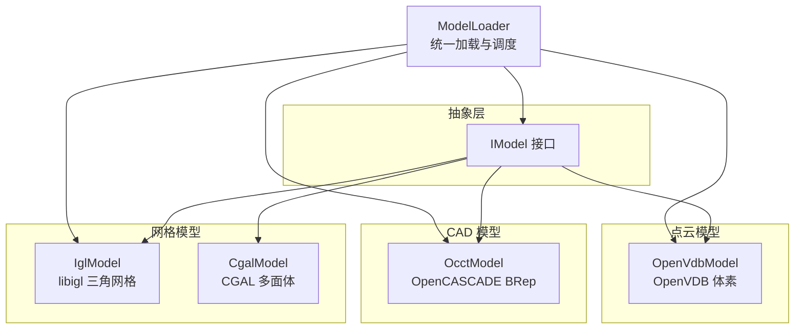
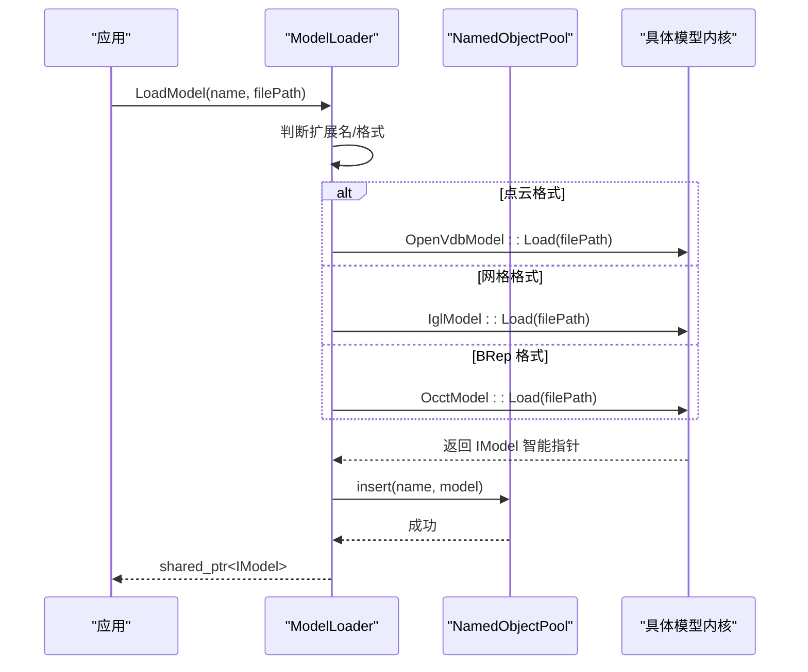
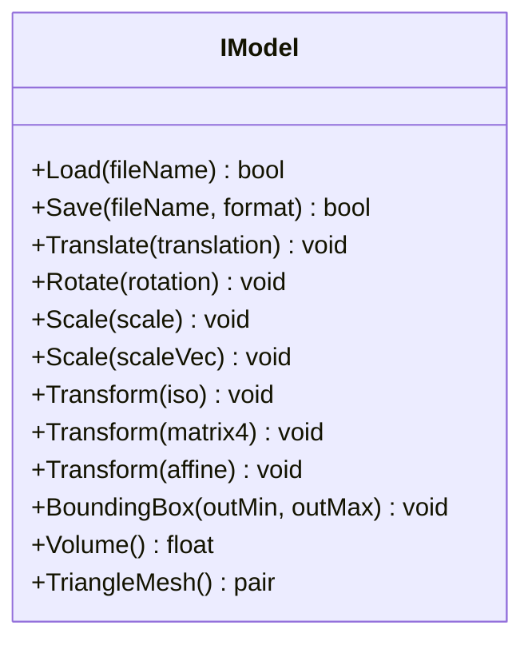
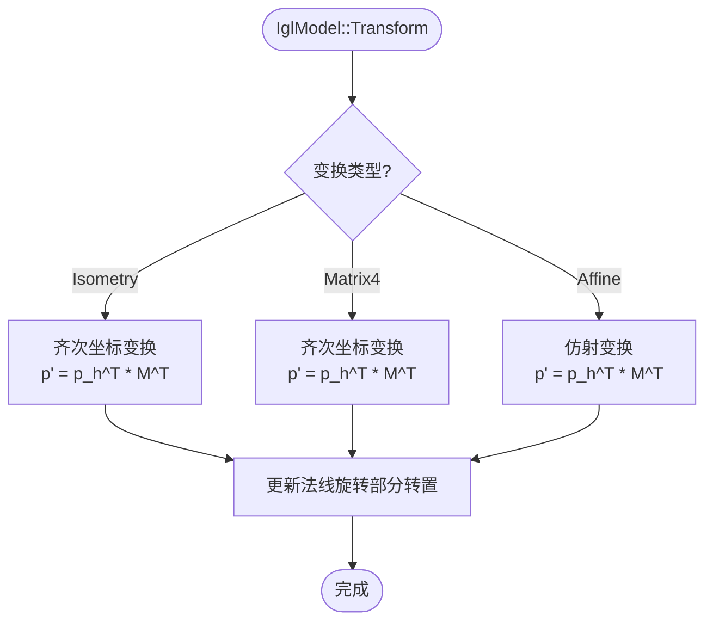
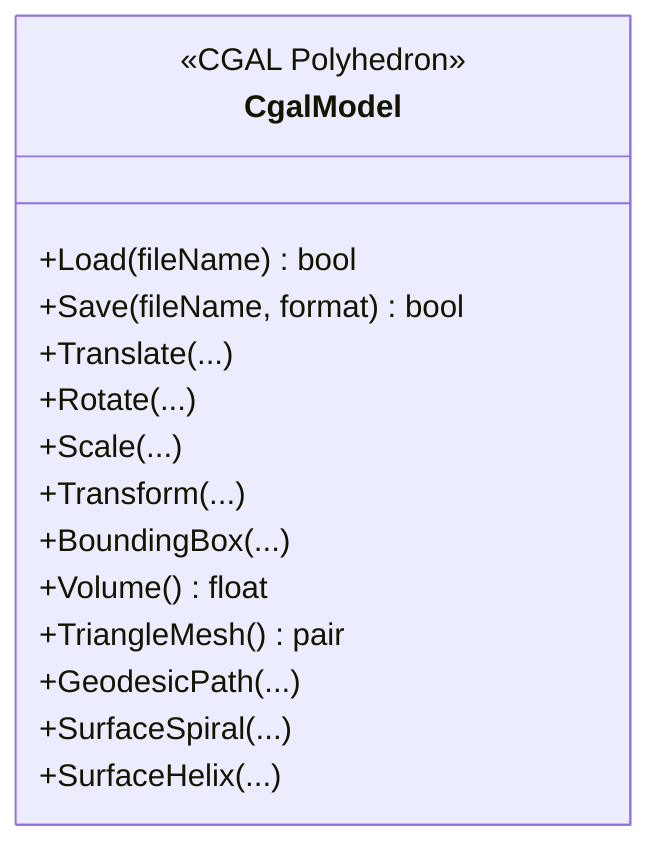
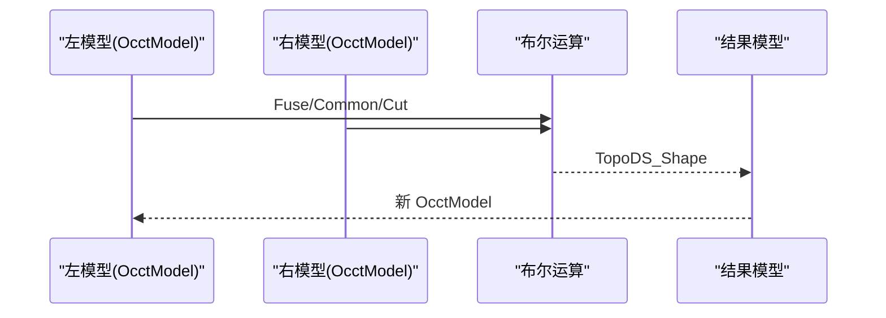
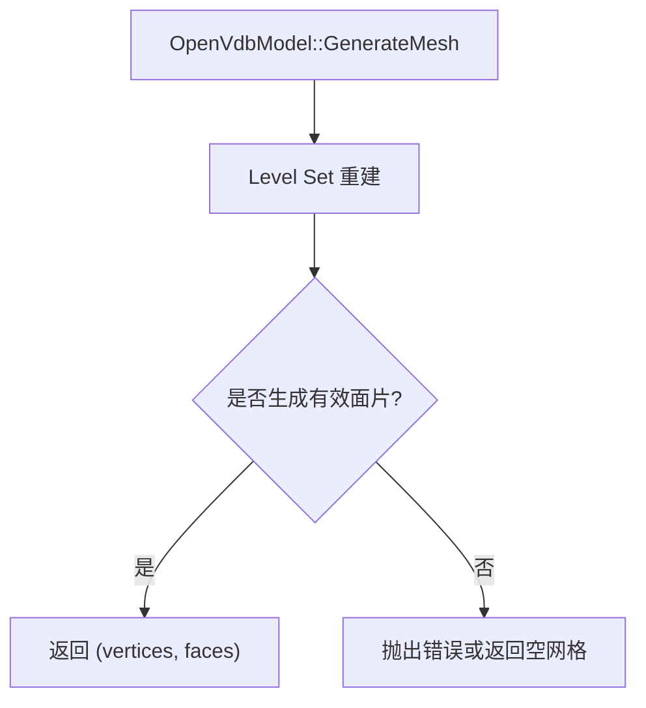
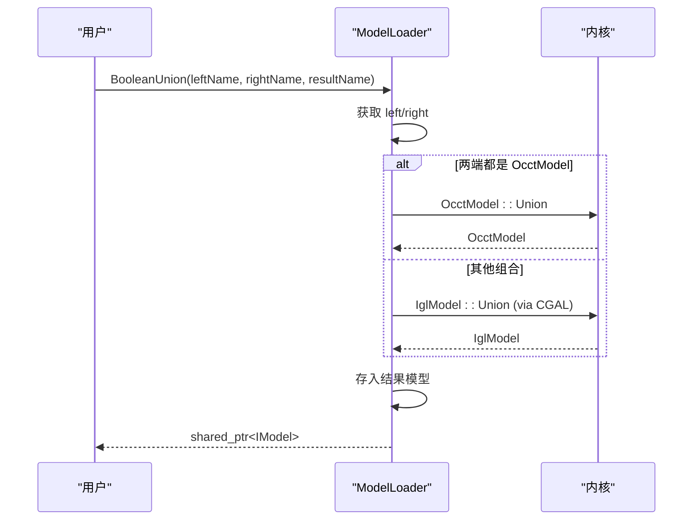
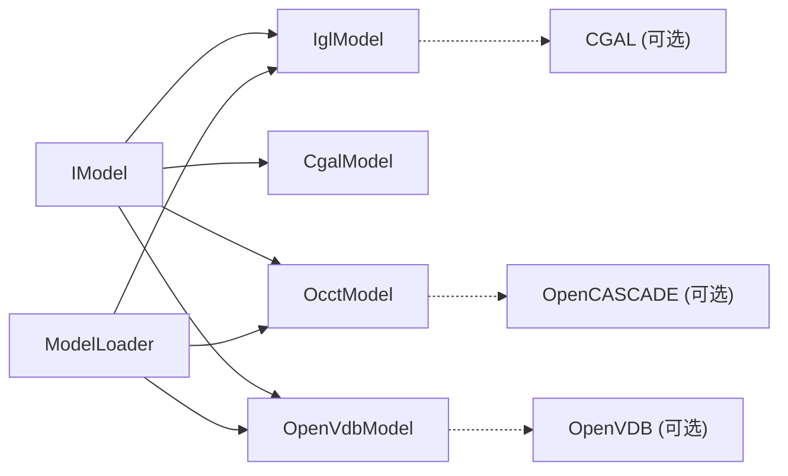

# 模型处理系统

<cite>
**本文引用的文件**   
- [IModel.hpp](file://base/IModel.hpp)
- [CgalModel.hpp](file://meshmodel/CgalModel.hpp)
- [CgalModel.cpp](file://meshmodel/CgalModel.cpp)
- [IglModel.hpp](file://meshmodel/IglModel.hpp)
- [IglModel.cpp](file://meshmodel/IglModel.cpp)
- [OcctModel.hpp](file://cadmodel/OcctModel.hpp)
- [OcctModel.cpp](file://cadmodel/OcctModel.cpp)
- [OpenVdbModel.hpp](file://pointcloud/OpenVdbModel.hpp)
- [OpenVdbModel.cpp](file://pointcloud/OpenVdbModel.cpp)
- [ModelLoader.hpp](file://preprocess/ModelLoader.hpp)
- [ModelLoader.cpp](file://preprocess/ModelLoader.cpp)
</cite>

## 目录
1. [引言](#引言)
2. [项目结构](#项目结构)
3. [核心组件](#核心组件)
4. [架构总览](#架构总览)
5. [详细组件分析](#详细组件分析)
6. [依赖关系分析](#依赖关系分析)
7. [性能与复杂度](#性能与复杂度)
8. [使用示例与最佳实践](#使用示例与最佳实践)
9. [故障排查指南](#故障排查指南)
10. [结论](#结论)

## 引言
本技术文档面向模型开发者与高级用户，系统性解析 HsBaSlicer 的模型处理子系统。重点包括：
- IModel 统一接口的设计理念与能力边界
- 网格模型（CgalModel、IglModel）、CAD 模型（OcctModel）和点云模型（OpenVdbModel）的实现差异与适用场景
- ModelLoader 的统一加载机制、格式分发、布尔运算与点云处理管线
- 模型转换、变换操作、边界计算等核心功能的实现原理
- 错误处理与异常管理机制
- 性能特征分析与优化建议

## 项目结构
HsBaSlicer 将模型抽象为统一的 IModel 接口，并通过不同内核实现具体类型：
- base/IModel.hpp：定义统一接口与模型格式枚举
- meshmodel：基于 libigl 与 CGAL 的三角网格模型
- cadmodel：基于 OpenCASCADE 的 BRep CAD 模型
- pointcloud：基于 OpenVDB 的点云体素模型
- preprocess/ModelLoader：按扩展名自动选择内核并管理命名模型池

图表来源
- [IModel.hpp:63-139](file://base/IModel.hpp#L63-L139)
- [IglModel.hpp:16-121](file://meshmodel/IglModel.hpp#L16-L121)
- [CgalModel.hpp:24-155](file://meshmodel/CgalModel.hpp#L24-L155)
- [OcctModel.hpp:20-124](file://cadmodel/OcctModel.hpp#L20-L124)
- [OpenVdbModel.hpp:18-116](file://pointcloud/OpenVdbModel.hpp#L18-L116)
- [ModelLoader.hpp:21-202](file://preprocess/ModelLoader.hpp#L21-L202)

章节来源
- [IModel.hpp:63-139](file://base/IModel.hpp#L63-L139)
- [ModelLoader.hpp:21-202](file://preprocess/ModelLoader.hpp#L21-L202)

## 核心组件
本节聚焦 IModel 接口与各具体实现的职责划分与关键能力。

- IModel 接口
  - 统一加载/保存：Load/Save
  - 统一几何变换：Translate/Rotate/Scale/Transform
  - 统一查询：BoundingBox/Volume/TriangleMesh
  - 支持多种文件格式枚举 ModelFormat

- IglModel（libigl 三角网格）
  - 存储顶点、面片与可选法线
  - 支持 STL/OBJ/PLY/OFF 读写
  - 提供法线计算、体积估算、布尔运算（需启用 CGAL）
  - 基础几何原语与拉伸工厂方法

- CgalModel（CGAL 多面体）
  - 基于 Polyhedron_3/Nef_polyhedron_3
  - 支持更稳健的布尔运算与表面测地线/螺旋/路径工具
  - 支持 STL/OBJ/PLY/OFF 读写
  - 提供几何原语与拉伸工厂方法

- OcctModel（OpenCASCADE BRep）
  - 支持 STEP/IGES/VRML/BREP 读写
  - 布尔运算、抽壳（ThickSolid）、UnionAll
  - 通过三角化导出为三角网格
  - 提供几何原语与拉伸工厂方法

- OpenVdbModel（OpenVDB 点云）
  - 支持 VDB/XYZ 读写
  - 点云插入、查询（KNN/半径搜索）、体素化、下采样、统计去噪
  - 基于 Level Set 的重构生成三角网格
  - 质心、法线估计、合并等点云专用操作

章节来源
- [IModel.hpp:63-139](file://base/IModel.hpp#L63-L139)
- [IglModel.hpp:16-121](file://meshmodel/IglModel.hpp#L16-L121)
- [CgalModel.hpp:24-155](file://meshmodel/CgalModel.hpp#L24-L155)
- [OcctModel.hpp:20-124](file://cadmodel/OcctModel.hpp#L20-L124)
- [OpenVdbModel.hpp:18-116](file://pointcloud/OpenVdbModel.hpp#L18-L116)

## 架构总览
ModelLoader 根据文件扩展名自动选择内核：
- 点云格式（XYZ/VDB）→ OpenVdbModel
- 网格格式（STL/OBJ/PLY/OFF）→ IglModel
- BRep 格式（STEP/IGES/VRML/BREP）→ OcctModel（需要 USE_OCCT）

布尔运算策略：
- 若两端均为 OcctModel → 直接调用 OCCT 布尔算子
- 否则降级为 IglModel + CGAL 布尔运算（需要 USE_CGAL）

点云处理：
- 提供点云到网格重建、合并、下采样、离群点去除、质心与法线估计等

图表来源
- [ModelLoader.cpp:45-84](file://preprocess/ModelLoader.cpp#L45-L84)
- [ModelLoader.hpp:47-89](file://preprocess/ModelLoader.hpp#L47-L89)

章节来源
- [ModelLoader.cpp:45-84](file://preprocess/ModelLoader.cpp#L45-L84)
- [ModelLoader.hpp:47-89](file://preprocess/ModelLoader.hpp#L47-L89)

## 详细组件分析

### IModel 统一接口
- 设计目标
  - 屏蔽底层内核差异，向上暴露一致的加载/保存、变换、查询接口
  - 以 TriangleMesh() 作为通用网格输出，便于下游切片与路径生成
- 关键方法
  - Load/Save：按 ModelFormat 控制读写
  - Translate/Rotate/Scale/Transform：统一几何变换
  - BoundingBox/Volume/TriangleMesh：统一查询

图表来源
- [IModel.hpp:63-139](file://base/IModel.hpp#L63-L139)

章节来源
- [IModel.hpp:63-139](file://base/IModel.hpp#L63-L139)

### 网格模型：IglModel（libigl）
- 数据表示
  - vertices_: N×3 顶点矩阵（行主序）
  - faces_: M×3 三角形索引
  - normals_: 可选的法线矩阵
- 核心功能
  - 读取/写入 STL/OBJ/PLY/OFF
  - 平移/旋转/缩放/仿射变换（注意行主序矩阵乘法）
  - AABB 边界框、体积估算
  - 法线计算（面法线/顶点法线）
  - 布尔运算（USE_CGAL 时优先 igl::copyleft::cgal::mesh_boolean，失败回退至 CgalModel Nef 布尔）
  - 几何原语与拉伸工厂（CreateBox/Sphere/Cylinder/Cone/Torus/CreatePrime）

图表来源
- [IglModel.cpp:126-150](file://meshmodel/IglModel.cpp#L126-L150)

章节来源
- [IglModel.hpp:16-121](file://meshmodel/IglModel.hpp#L16-L121)
- [IglModel.cpp:64-193](file://meshmodel/IglModel.cpp#L64-L193)
- [IglModel.cpp:195-409](file://meshmodel/IglModel.cpp#L195-L409)

### 网格模型：CgalModel（CGAL）
- 数据表示
  - 内部使用 CGAL::Polyhedron_3 与 Nef_polyhedron_3
- 核心功能
  - 从 Eigen 网格构造（含修复流程：定向、合并重复顶点、检查体积符号）
  - 读取/写入 STL/OBJ/PLY/OFF
  - 变换（平移/旋转/缩放/仿射）
  - 边界框、体积、三角网格导出
  - 布尔运算（Nef 布尔）
  - 几何原语与拉伸工厂（包含复杂的多边形三角剖分与孔洞识别）
  - 表面测地线、距离、投影、螺旋/螺旋线生成

图表来源
- [CgalModel.hpp:24-155](file://meshmodel/CgalModel.hpp#L24-L155)

章节来源
- [CgalModel.cpp:42-119](file://meshmodel/CgalModel.cpp#L42-L119)
- [CgalModel.cpp:121-237](file://meshmodel/CgalModel.cpp#L121-L237)
- [CgalModel.cpp:238-276](file://meshmodel/CgalModel.cpp#L238-L276)
- [CgalModel.cpp:278-445](file://meshmodel/CgalModel.cpp#L278-L445)
- [CgalModel.cpp:625-800](file://meshmodel/CgalModel.cpp#L625-L800)

### CAD 模型：OcctModel（OpenCASCADE）
- 数据表示
  - TopoDS_Shape（BRep 拓扑形状）
- 核心功能
  - 读取/写入 STEP/IGES/VRML/BREP
  - 变换（平移/旋转/缩放/仿射）
  - 边界框（遍历顶点）、体积（GProp_GProps）
  - 三角化导出（遍历 Face 的 Triangulation）
  - 布尔运算（Fuse/Common/Cut/Xor）
  - 抽壳 ThickSolid（整体或指定开口面）
  - UnionAll（合并所有 Solid）
  - 几何原语与拉伸工厂（单轮廓/多轮廓含孔）

图表来源
- [OcctModel.cpp:451-469](file://cadmodel/OcctModel.cpp#L451-L469)

章节来源
- [OcctModel.hpp:20-124](file://cadmodel/OcctModel.hpp#L20-L124)
- [OcctModel.cpp:76-147](file://cadmodel/OcctModel.cpp#L76-L147)
- [OcctModel.cpp:213-271](file://cadmodel/OcctModel.cpp#L213-L271)
- [OcctModel.cpp:272-329](file://cadmodel/OcctModel.cpp#L272-L329)
- [OcctModel.cpp:331-407](file://cadmodel/OcctModel.cpp#L331-L407)
- [OcctModel.cpp:451-540](file://cadmodel/OcctModel.cpp#L451-L540)
- [OcctModel.cpp:542-663](file://cadmodel/OcctModel.cpp#L542-L663)

### 点云模型：OpenVdbModel（OpenVDB）
- 数据表示
  - openvdb::Vec3fGrid（体素网格），每个激活体素存储三维点坐标
- 核心功能
  - 读取/写入 VDB/XYZ
  - 点增删、查询（最近邻/KNN/半径搜索）、过滤
  - 体素化、下采样、体素中心提取
  - 统计去噪、质心、法线估计
  - 基于 Level Set 的重构生成三角网格
  - 统一变换（逐点变换）

图表来源
- [OpenVdbModel.cpp:318-326](file://pointcloud/OpenVdbModel.cpp#L318-L326)

章节来源
- [OpenVdbModel.hpp:18-116](file://pointcloud/OpenVdbModel.hpp#L18-L116)
- [OpenVdbModel.cpp:148-217](file://pointcloud/OpenVdbModel.cpp#L148-L217)
- [OpenVdbModel.cpp:219-321](file://pointcloud/OpenVdbModel.cpp#L219-L321)
- [OpenVdbModel.cpp:328-412](file://pointcloud/OpenVdbModel.cpp#L328-L412)
- [OpenVdbModel.cpp:414-557](file://pointcloud/OpenVdbModel.cpp#L414-L557)

### 统一加载器：ModelLoader
- 功能要点
  - 按扩展名自动选择内核：点云→OpenVdbModel，网格→IglModel，BRep→OcctModel
  - 命名模型池 NamedObjectPool 管理生命周期
  - 布尔运算：优先 OCCT；否则降级 IglModel+CGAL
  - 点云处理：到网格、合并、下采样、去噪、质心、法线、计数
- 异常与校验
  - 名称冲突、不支持格式、内核不可用（编译开关）等抛出相应异常

图表来源
- [ModelLoader.cpp:218-243](file://preprocess/ModelLoader.cpp#L218-L243)

章节来源
- [ModelLoader.hpp:47-202](file://preprocess/ModelLoader.hpp#L47-L202)
- [ModelLoader.cpp:45-84](file://preprocess/ModelLoader.cpp#L45-L84)
- [ModelLoader.cpp:132-323](file://preprocess/ModelLoader.cpp#L132-L323)
- [ModelLoader.cpp:325-453](file://preprocess/ModelLoader.cpp#L325-L453)

## 依赖关系分析
- 模块耦合
  - IModel 为松耦合抽象，各内核独立实现
  - ModelLoader 对内核有选择性依赖（编译开关 USE_OCCT、USE_CGAL、USE_OPENVDB）
- 外部库
  - Eigen：线性代数与几何变换
  - libigl：网格 IO、法线、体积、布尔（可选）
  - CGAL：稳健布尔、测地线、几何构造
  - OpenCASCADE：CAD 拓扑、布尔、抽壳
  - OpenVDB：体素网格、Level Set 重建

图表来源
- [IModel.hpp:63-139](file://base/IModel.hpp#L63-L139)
- [ModelLoader.hpp:17-22](file://preprocess/ModelLoader.hpp#L17-L22)

章节来源
- [ModelLoader.hpp:17-22](file://preprocess/ModelLoader.hpp#L17-L22)
- [IglModel.cpp:24-27](file://meshmodel/IglModel.cpp#L24-L27)
- [OcctModel.cpp:18-58](file://cadmodel/OcctModel.cpp#L18-L58)
- [OpenVdbModel.cpp:17-20](file://pointcloud/OpenVdbModel.cpp#L17-L20)

## 性能与复杂度
- IglModel
  - 变换：O(N)，N 为顶点数；法线更新 O(F)，F 为面片数
  - 体积：O(F)，基于四面体分解
  - 布尔：取决于 CGAL 实现，通常 O(V+F) 级别但受几何复杂度影响显著
- CgalModel
  - 布尔：Nef 布尔较稳健但开销较大，适合中小规模或高精度需求
  - 测地线/螺旋：额外几何计算，复杂度与网格规模相关
- OcctModel
  - 布尔：OCCT 布尔在大规模 CAD 上稳健，但内存与时间开销较高
  - 三角化导出：O(F_tri)，F_tri 为三角面片数量
- OpenVdbModel
  - 点云查询：当前 KNN/最近邻为线性扫描 O(P)，P 为点数
  - 体素化/下采样：O(P)
  - Level Set 重建：与体素分辨率和粒子半径相关

优化建议
- 对大规模点云，优先使用体素化与下采样减少点数
- 布尔运算前尽量进行网格清理与法线一致性检查
- CAD 布尔优先使用 OcctModel；仅在必要时回退到 IglModel+CGAL

[本节为通用性能讨论，不直接分析具体文件]

## 使用示例与最佳实践

- 加载模型
  - 使用 ModelLoader::LoadModel(name, path) 自动选择内核
  - 推荐先检查 ContainsModel(name) 避免名称冲突

- 布尔运算
  - 若两端为 CAD 模型，优先使用 OcctModel 以获得更好的拓扑稳定性
  - 网格模型布尔建议使用 IglModel+CGAL，并确保网格封闭、法线一致

- 点云处理
  - 使用 DownsamplePointCloud 降低密度
  - RemovePointCloudOutliers 去除噪声
  - PointCloudToMesh 进行 Level Set 重建，合理设置 voxelSize 与 particleRadius

- 变换与边界
  - 使用 Transform 统一应用变换，再调用 BoundingBox/Volume 获取属性
  - 对点云模型，Volume 恒为 0，应使用 GenerateMesh 后再计算体积

- 最佳实践
  - 在布尔之前进行网格修复（如 CgalModel 的三角化与方向修正）
  - 对 CAD 模型，使用 UnionAll 合并多个实体后再做布尔
  - 对点云，先体素化/下采样再进行重建，平衡精度与性能

[本节为概念性指导，不直接分析具体文件]

## 故障排查指南
常见问题与定位思路：
- 加载失败
  - 检查扩展名与支持的格式映射
  - 确认平台是否启用了对应内核（USE_OCCT/USE_CGAL/USE_OPENVDB）
- 布尔结果为空或异常
  - 检查输入网格是否封闭、法线方向是否一致
  - 尝试使用 CgalModel 的三角化与方向修正
  - 对于 CAD 模型，确保布尔对象为有效实体
- 点云重建失败
  - 调整 voxelSize 与 particleRadius
  - 先进行体素化与下采样，去除离群点
- 变换后体积/法线异常
  - 确认使用的是正确的变换重载（Isometry/Matrix4/Affine）
  - 对 IglModel，注意法线仅随旋转更新

章节来源
- [ModelLoader.cpp:45-84](file://preprocess/ModelLoader.cpp#L45-L84)
- [IglModel.cpp:195-409](file://meshmodel/IglModel.cpp#L195-L409)
- [CgalModel.cpp:42-119](file://meshmodel/CgalModel.cpp#L42-L119)
- [OcctModel.cpp:213-271](file://cadmodel/OcctModel.cpp#L213-L271)
- [OpenVdbModel.cpp:148-217](file://pointcloud/OpenVdbModel.cpp#L148-L217)

## 结论
HsBaSlicer 的模型处理系统通过 IModel 统一接口屏蔽了不同内核的差异，结合 ModelLoader 实现了按格式的自动调度与命名池管理。网格模型（IglModel/CgalModel）、CAD 模型（OcctModel）与点云模型（OpenVdbModel）各自发挥优势：
- IglModel 轻量高效，适合快速网格处理与可视化
- CgalModel 提供稳健布尔与高级几何工具
- OcctModel 擅长 CAD 拓扑与工程级布尔/抽壳
- OpenVdbModel 提供强大的点云体素处理能力与 Level Set 重建

在实际工程中，建议依据数据类型与任务需求选择合适的内核，并在布尔与重建前做好数据清洗与参数调优，以获得稳定且高效的模型处理流水线。