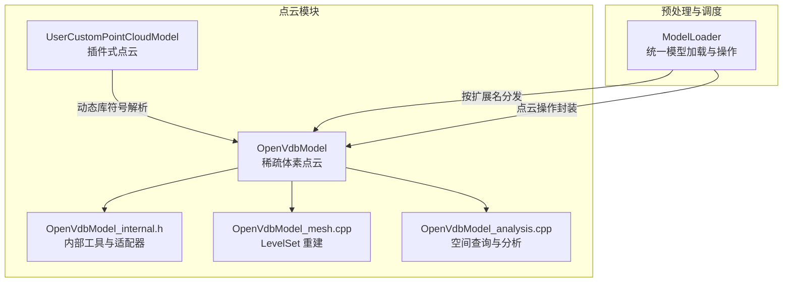
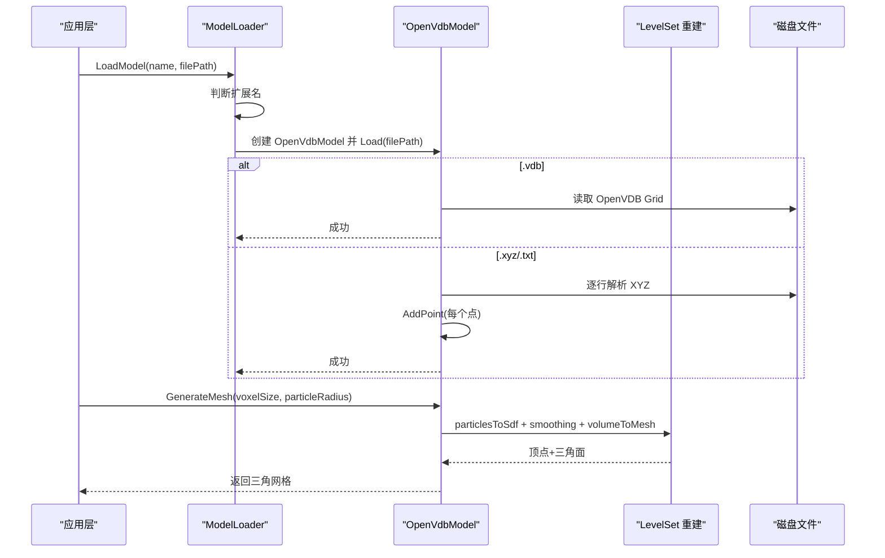
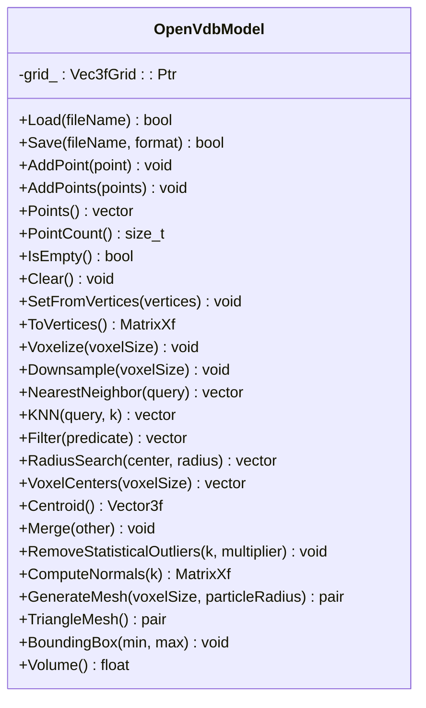
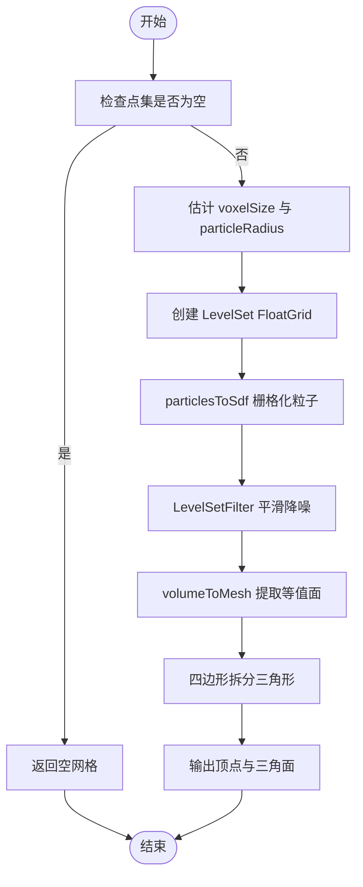
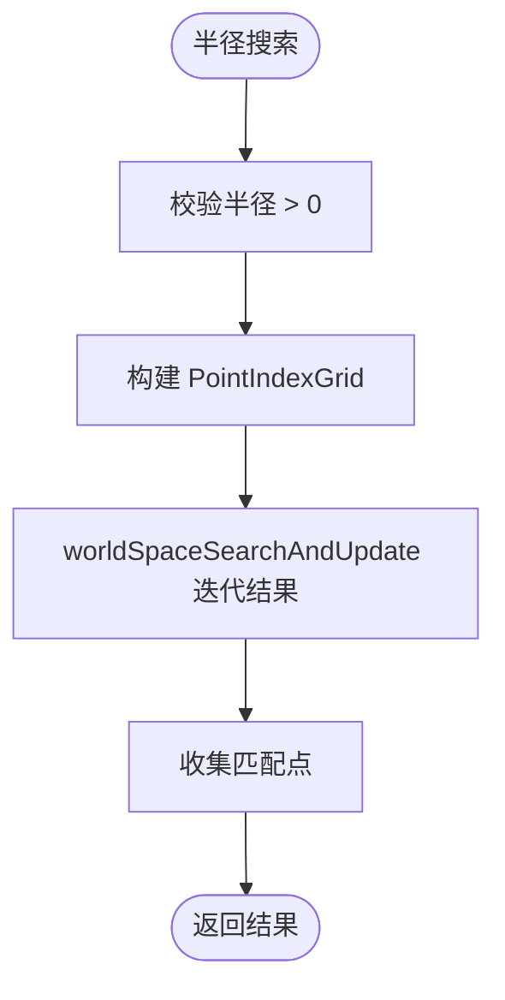
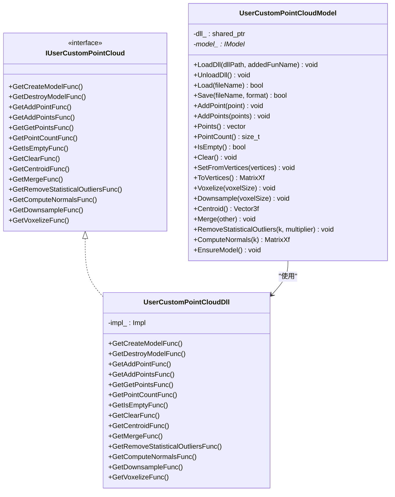
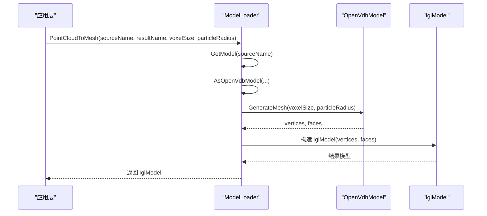
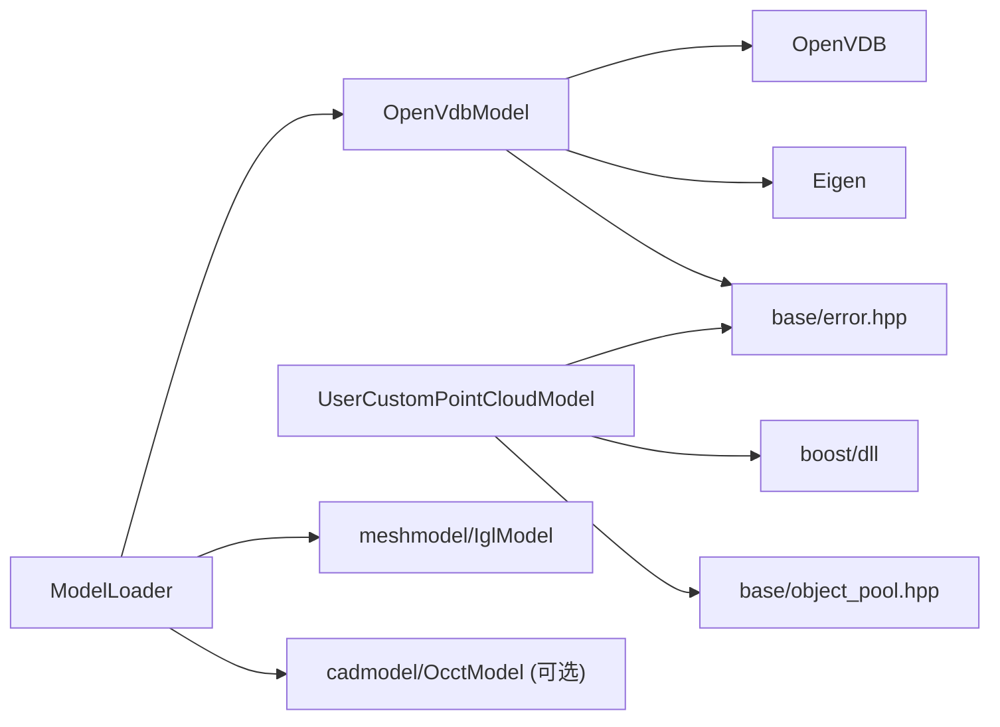

# 点云模型处理

<cite>
**本文引用的文件**   
- [OpenVdbModel.hpp](file://pointcloud/OpenVdbModel.hpp)
- [OpenVdbModel.cpp](file://pointcloud/OpenVdbModel.cpp)
- [OpenVdbModel_internal.h](file://pointcloud/OpenVdbModel_internal.h)
- [OpenVdbModel_mesh.cpp](file://pointcloud/OpenVdbModel_mesh.cpp)
- [OpenVdbModel_analysis.cpp](file://pointcloud/OpenVdbModel_analysis.cpp)
- [UserCustomPointCloudModel.hpp](file://pointcloud/UserCustomPointCloudModel.hpp)
- [UserCustomPointCloudModel.cpp](file://pointcloud/UserCustomPointCloudModel.cpp)
- [ModelLoader.hpp](file://preprocess/ModelLoader.hpp)
- [ModelLoader.cpp](file://preprocess/ModelLoader.cpp)
</cite>

## 目录
1. [简介](#简介)
2. [项目结构](#项目结构)
3. [核心组件](#核心组件)
4. [架构总览](#架构总览)
5. [详细组件分析](#详细组件分析)
6. [依赖关系分析](#依赖关系分析)
7. [性能与调优](#性能与调优)
8. [故障排查](#故障排查)
9. [结论](#结论)
10. [附录：高级算法示例](#附录高级算法示例)

## 简介
本技术文档聚焦 HsBaSlicer 的点云模型处理系统，重点说明以下能力：
- OpenVdbModel 基于 OpenVDB 的大规模点云处理能力：稀疏体素表示、八叉树结构与高效存储机制。
- UserCustomPointCloudModel 的用户自定义点云模型扩展接口：通过 DLL/SO 插件实现可插拔的底层点云内核。
- 点云数据的加载、处理、分析与输出流程。
- 点云分割、配准、重建等高级算法的应用示例（以现有 API 为支撑）。
- 点云数据处理的最佳实践与性能调优指南。

## 项目结构
点云相关代码主要位于 pointcloud 目录，并通过 preprocess/ModelLoader 暴露统一的模型加载与操作入口。关键文件职责如下：
- OpenVdbModel.hpp/.cpp：定义并实现基于 OpenVDB Vec3fGrid 的点云模型，提供增删改查、变换、体素化、下采样、统计去噪、法线估计、网格重建等能力。
- OpenVdbModel_internal.h：内部工具函数与适配器（坐标转换、PointIndexGrid 适配、LevelSet 粒子适配）。
- OpenVdbModel_mesh.cpp：基于 Level Set 的重建管线（粒子栅格化、平滑、Marching Cubes 提取三角面）。
- OpenVdbModel_analysis.cpp：空间查询（半径搜索）、下采样、法线估计等分析逻辑。
- UserCustomPointCloudModel.hpp/.cpp：通过动态库加载用户自定义点云内核，对外暴露与 OpenVdbModel 一致的点云 API。
- ModelLoader.hpp/.cpp：统一模型加载器，按扩展名分发到点云、网格或 BRep 模型；在启用 OpenVDB 时提供点云专用操作封装。

图表来源
- [OpenVdbModel.hpp:28-116](file://pointcloud/OpenVdbModel.hpp#L28-L116)
- [OpenVdbModel.cpp:148-217](file://pointcloud/OpenVdbModel.cpp#L148-L217)
- [OpenVdbModel_mesh.cpp:21-117](file://pointcloud/OpenVdbModel_mesh.cpp#L21-L117)
- [OpenVdbModel_analysis.cpp:28-117](file://pointcloud/OpenVdbModel_analysis.cpp#L28-L117)
- [UserCustomPointCloudModel.hpp:96-171](file://pointcloud/UserCustomPointCloudModel.hpp#L96-L171)
- [ModelLoader.hpp:135-192](file://preprocess/ModelLoader.hpp#L135-L192)
- [ModelLoader.cpp:29-43](file://preprocess/ModelLoader.cpp#L29-L43)

章节来源
- [OpenVdbModel.hpp:28-116](file://pointcloud/OpenVdbModel.hpp#L28-L116)
- [ModelLoader.hpp:135-192](file://preprocess/ModelLoader.hpp#L135-L192)

## 核心组件
- OpenVdbModel：基于 openvdb::Vec3fGrid 的稀疏体素点云模型，支持点插入、批量添加、遍历、最近邻/KNN/半径搜索、体素化、下采样、质心、合并、统计去噪、法线估计、LevelSet 网格重建等。
- UserCustomPointCloudModel：面向用户的可插拔点云模型，通过 IUserCustomPointCloud 抽象与 UserCustomPointCloudDll 动态加载 DLL/SO，暴露与 OpenVdbModel 一致的操作接口。
- ModelLoader：统一模型加载与操作入口，根据文件扩展名选择 IglModel/OcctModel/OpenVdbModel，并在启用 OpenVDB 时提供点云专用方法（如点云转网格、合并、下采样、去噪、质心、法线）。

章节来源
- [OpenVdbModel.hpp:28-116](file://pointcloud/OpenVdbModel.hpp#L28-L116)
- [UserCustomPointCloudModel.hpp:18-171](file://pointcloud/UserCustomPointCloudModel.hpp#L18-L171)
- [ModelLoader.hpp:135-192](file://preprocess/ModelLoader.hpp#L135-L192)

## 架构总览
整体数据流从文件加载开始，经 ModelLoader 分发到具体模型类型，再由 OpenVdbModel 完成点云处理，最终可输出为 VDB/XYZ 文件或转换为三角网格。

图表来源
- [ModelLoader.cpp:29-43](file://preprocess/ModelLoader.cpp#L29-L43)
- [OpenVdbModel.cpp:148-217](file://pointcloud/OpenVdbModel.cpp#L148-L217)
- [OpenVdbModel_mesh.cpp:21-117](file://pointcloud/OpenVdbModel_mesh.cpp#L21-L117)

## 详细组件分析

### OpenVdbModel：稀疏体素点云与八叉树存储
- 数据结构
  - 使用 openvdb::Vec3fGrid 作为稀疏体素容器，内部为八叉树结构，仅存储非空体素，适合大规模点云的高效存储与访问。
  - 通过 ToCoord/ToEigen/ToVec3d 等内部工具进行 Eigen 与 OpenVDB 类型互转。
- 核心能力
  - 点集管理：AddPoint/AddPoints/Points/PointCount/Clear/SetFromVertices/ToVertices。
  - 几何变换：Translate/Rotate/Scale/Transform（Isometry/Matrix4/Affine）。
  - 边界与体积：BoundingBox/Volume（点云体积恒为 0）。
  - 体素化与下采样：Voxelize/Downsample/VoxelCenters。
  - 空间查询：NearestNeighbor/KNN/Filter/RadiusSearch。
  - 统计分析：Centroid/RemoveStatisticalOutliers/ComputeNormals。
  - 网格重建：GenerateMesh（LevelSet 重建）与 ToVerticesFaces/TriangleMesh。
- 复杂度与性能要点
  - 遍历活跃体素的时间复杂度近似 O(N)，N 为活跃点数。
  - KNN 当前实现为全量排序，时间复杂度 O(N log N)。
  - RadiusSearch 借助 PointIndexGrid 加速空间搜索，时间复杂度与局部密度相关。
  - Voxelize/Downsample 会重建新 Grid，注意内存峰值。

图表来源
- [OpenVdbModel.hpp:28-116](file://pointcloud/OpenVdbModel.hpp#L28-L116)
- [OpenVdbModel.cpp:116-557](file://pointcloud/OpenVdbModel.cpp#L116-L557)
- [OpenVdbModel_internal.h:23-94](file://pointcloud/OpenVdbModel_internal.h#L23-L94)

章节来源
- [OpenVdbModel.hpp:28-116](file://pointcloud/OpenVdbModel.hpp#L28-L116)
- [OpenVdbModel.cpp:148-217](file://pointcloud/OpenVdbModel.cpp#L148-L217)
- [OpenVdbModel.cpp:328-412](file://pointcloud/OpenVdbModel.cpp#L328-L412)
- [OpenVdbModel.cpp:414-557](file://pointcloud/OpenVdbModel.cpp#L414-L557)
- [OpenVdbModel_internal.h:23-94](file://pointcloud/OpenVdbModel_internal.h#L23-L94)

### OpenVdbModel：LevelSet 网格重建流程
- 自动参数估计
  - voxelSize：若未指定，则取包围盒最大边长的 1/100。
  - particleRadius：若未指定，则按平均间距估算（extent / cbrt(count) * 1.5）。
- 重建步骤
  - 构建 LevelSetParticleAdapter，设置粒子半径。
  - 创建 FloatGrid（LevelSet），调用 particlesToSdf 将粒子栅格化为 SDF。
  - 使用 LevelSetFilter 进行均值与高斯平滑降噪。
  - 使用 volumeToMesh 提取等值面（marching cubes），得到三角面与四边形面。
  - 将四边形面拆分为两个三角形，最终输出顶点与三角面。

图表来源
- [OpenVdbModel_mesh.cpp:21-117](file://pointcloud/OpenVdbModel_mesh.cpp#L21-L117)

章节来源
- [OpenVdbModel_mesh.cpp:21-117](file://pointcloud/OpenVdbModel_mesh.cpp#L21-L117)

### OpenVdbModel：空间查询与分析
- RadiusSearch：基于 PointIndexGrid 的空间索引，按半径检索邻近点。
- Downsample：基于体素网格的去重下采样，去除同一体素内的重复点。
- ComputeNormals：对每个点使用 KNN 协方差分析估计单位法向量。

图表来源
- [OpenVdbModel_analysis.cpp:28-65](file://pointcloud/OpenVdbModel_analysis.cpp#L28-L65)

章节来源
- [OpenVdbModel_analysis.cpp:28-117](file://pointcloud/OpenVdbModel_analysis.cpp#L28-L117)

### UserCustomPointCloudModel：插件式扩展接口
- 设计目标
  - 通过 IUserCustomPointCloud 抽象与 UserCustomPointCloudDll 动态加载 DLL/SO，暴露 create_model/destroy_model/add_point/add_points/get_points/point_count/is_empty/clear/centroid/merge/remove_statistical_outliers/compute_normals/downsample/voxelize 等 C ABI 符号。
  - UserCustomPointCloudModel 对外提供与 OpenVdbModel 一致的点云 API，使插件与内置内核可互换。
- 生命周期
  - LoadDll：加载动态库并缓存于 NamedObjectPool，避免重复加载。
  - EnsureModel：首次使用时通过 _create_model 构造底层 IModel*。
  - 析构：调用 _destroy_model 释放底层对象。
- 数据 ABI
  - 使用 HsBaVector3f_t 作为跨语言/跨模块的三维浮点向量 ABI，确保与 Eigen::Vector3f 内存布局兼容。

图表来源
- [UserCustomPointCloudModel.hpp:18-171](file://pointcloud/UserCustomPointCloudModel.hpp#L18-L171)
- [UserCustomPointCloudModel.cpp:175-208](file://pointcloud/UserCustomPointCloudModel.cpp#L175-L208)

章节来源
- [UserCustomPointCloudModel.hpp:18-171](file://pointcloud/UserCustomPointCloudModel.hpp#L18-L171)
- [UserCustomPointCloudModel.cpp:175-547](file://pointcloud/UserCustomPointCloudModel.cpp#L175-L547)

### ModelLoader：统一模型加载与点云操作封装
- 文件加载
  - 根据扩展名判断模型类型：点云（.vdb/.xyz/.txt）、网格（.obj/.stl 等）、BRep（OCCT）。
  - 点云路径：创建 OpenVdbModel 并调用其 Load，失败抛出异常。
- 点云操作
  - PointCloudToMesh：调用 OpenVdbModel.GenerateMesh 生成三角网格。
  - MergePointClouds：复制左点云并合并右点云。
  - DownsamplePointCloud：复制源点云并执行 Downsample。
  - RemovePointCloudOutliers：复制源点云并执行 RemoveStatisticalOutliers。
  - PointCloudCentroid/PointCloudNormals：直接委托给 OpenVdbModel。

图表来源
- [ModelLoader.cpp:343-362](file://preprocess/ModelLoader.cpp#L343-L362)

章节来源
- [ModelLoader.cpp:29-43](file://preprocess/ModelLoader.cpp#L29-L43)
- [ModelLoader.cpp:343-451](file://preprocess/ModelLoader.cpp#L343-L451)

## 依赖关系分析
- OpenVdbModel 依赖
  - OpenVDB：Vec3fGrid、IO、tools::PointIndexGrid、tools::ParticlesToLevelSet、tools::LevelSetFilter、tools::VolumeToMesh。
  - Eigen：矩阵与向量运算。
  - base/error.hpp：异常类型。
- UserCustomPointCloudModel 依赖
  - boost/dll：动态库加载与符号解析。
  - base/object_pool.hpp：NamedObjectPool 用于 DLL 实例池化。
  - base/error.hpp：运行时异常。
- ModelLoader 依赖
  - meshmodel/IglModel：网格模型。
  - cadmodel/OcctModel：BRep 模型（可选）。
  - pointcloud/OpenVdbModel：点云模型（可选，USE_OPENVDB）。

图表来源
- [OpenVdbModel.cpp:1-21](file://pointcloud/OpenVdbModel.cpp#L1-L21)
- [OpenVdbModel_mesh.cpp:1-17](file://pointcloud/OpenVdbModel_mesh.cpp#L1-L17)
- [UserCustomPointCloudModel.cpp:1-13](file://pointcloud/UserCustomPointCloudModel.cpp#L1-L13)
- [ModelLoader.cpp:1-22](file://preprocess/ModelLoader.cpp#L1-L22)

章节来源
- [OpenVdbModel.cpp:1-21](file://pointcloud/OpenVdbModel.cpp#L1-L21)
- [OpenVdbModel_mesh.cpp:1-17](file://pointcloud/OpenVdbModel_mesh.cpp#L1-L17)
- [UserCustomPointCloudModel.cpp:1-13](file://pointcloud/UserCustomPointCloudModel.cpp#L1-L13)
- [ModelLoader.cpp:1-22](file://preprocess/ModelLoader.cpp#L1-L22)

## 性能与调优
- 体素大小与粒子半径
  - 建议先根据场景尺度设置 voxelSize（例如包围盒最大边长的 1/100~1/200），再根据点密度调整 particleRadius（约为平均间距的 1.2~2.0 倍）。
- 下采样与去噪
  - 在大规模点云上优先执行 Downsample 降低点数，再进行 RemoveStatisticalOutliers 提升法线与重建质量。
- 空间查询
  - 使用 RadiusSearch 替代全量 KNN，尤其在大范围邻域查询时显著减少计算量。
- 内存与并发
  - Voxelize/Downsample 会重建 Grid，建议在批处理中复用已分配缓冲区，避免频繁分配。
  - 点云重建与 IO 可并行化（不同模型独立），但同一模型的写入需串行。
- 插件开发
  - 尽量在 DLL 内实现批量操作（add_points/get_points），减少跨边界调用次数。
  - 保持 HsBaVector3f_t 与 Eigen::Vector3f 内存布局一致，避免拷贝与对齐问题。

[本节为通用指导，不直接分析具体文件]

## 故障排查
- 无法加载点云格式
  - 现象：Load 返回 false 或抛出异常。
  - 排查：确认文件扩展名为 .vdb/.xyz/.txt；检查文件可读性与内容格式。
- 点云转网格失败
  - 现象：PointCloudToMesh 抛出“重建失败”。
  - 排查：检查 voxelSize/particleRadius 是否合理；确认点云非退化（包围盒尺寸不为 0）。
- 插件符号缺失
  - 现象：RuntimeError 提示“函数未在 DLL 中找到”。
  - 排查：确认 DLL 导出符号命名符合约定（如 xxx_create_model、xxx_add_point 等）。
- 模型未加载
  - 现象：调用 Transform/BoundingBox 等方法抛出“Model not loaded”。
  - 排查：确保先调用 LoadDll 与 Load，或使用 EnsureModel 前置条件。

章节来源
- [OpenVdbModel.cpp:148-217](file://pointcloud/OpenVdbModel.cpp#L148-L217)
- [ModelLoader.cpp:343-362](file://preprocess/ModelLoader.cpp#L343-L362)
- [UserCustomPointCloudModel.cpp:192-208](file://pointcloud/UserCustomPointCloudModel.cpp#L192-L208)

## 结论
HsBaSlicer 的点云模型处理系统以 OpenVdbModel 为核心，依托 OpenVDB 的稀疏体素与八叉树结构，提供了高效的大规模点云存储与处理能力；同时通过 UserCustomPointCloudModel 实现了可插拔的自定义内核扩展，满足多样化算法需求。ModelLoader 统一了模型加载与操作入口，便于上层应用组合点云与网格处理流程。结合本文提供的最佳实践与调优建议，可在保证精度的前提下显著提升处理效率与稳定性。

[本节为总结性内容，不直接分析具体文件]

## 附录：高级算法示例
以下示例基于现有 API 展示常见点云处理流程，供参考与扩展：

- 点云分割（基于半径搜索与连通性）
  - 步骤：对每个点执行 RadiusSearch，构建邻接图；对图进行连通分量划分，得到若干子点云。
  - 关键点：选择合适的半径阈值；对噪声点进行预过滤（RemoveStatisticalOutliers）。
  - 参考 API：OpenVdbModel::RadiusSearch、OpenVdbModel::RemoveStatisticalOutliers。

- 点云配准（ICP 简化流程）
  - 步骤：对源点云与目标点云分别估计法线；使用 KNN 建立对应点对；求解最小二乘变换；迭代更新直至收敛。
  - 关键点：初始对齐（Centroid 平移）；法线方向一致性；K 值与距离阈值的选择。
  - 参考 API：OpenVdbModel::ComputeNormals、OpenVdbModel::KNN、OpenVdbModel::Transform。

- 点云重建（LevelSet 网格化）
  - 步骤：设置 voxelSize 与 particleRadius；调用 GenerateMesh 获取三角网格；必要时进行网格后处理（平滑/修复）。
  - 关键点：参数自适应估计；对空洞区域适当增大 particleRadius。
  - 参考 API：OpenVdbModel::GenerateMesh、ModelLoader::PointCloudToMesh。

[本节为概念性示例，不直接分析具体文件]