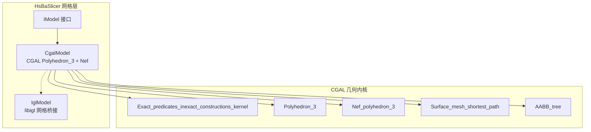
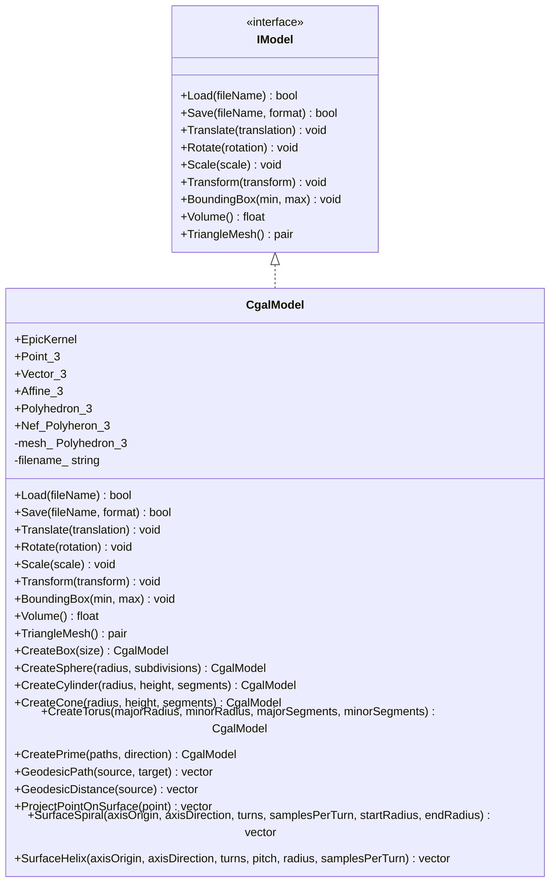
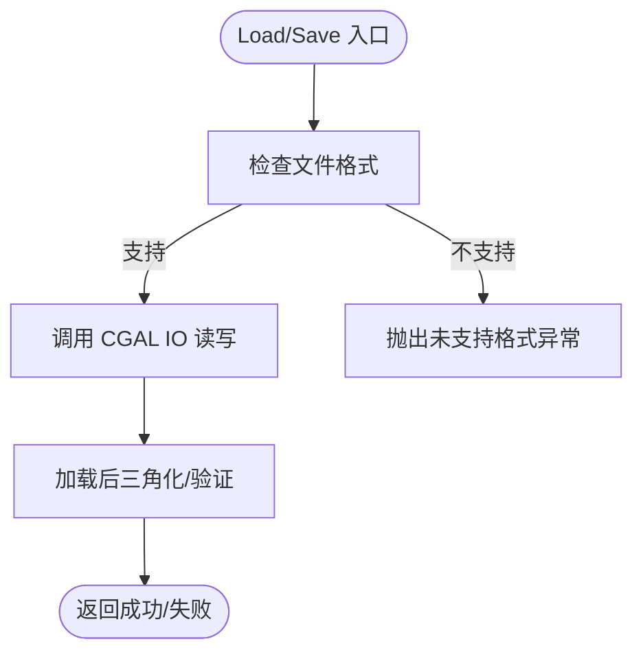
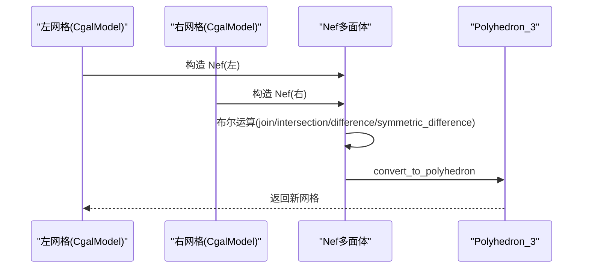
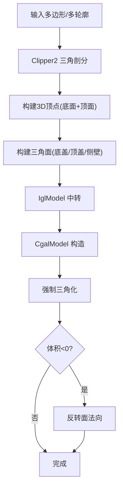
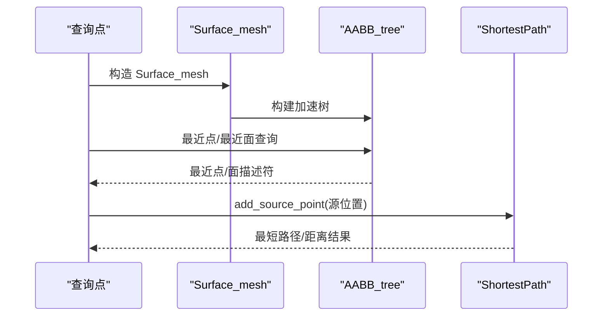
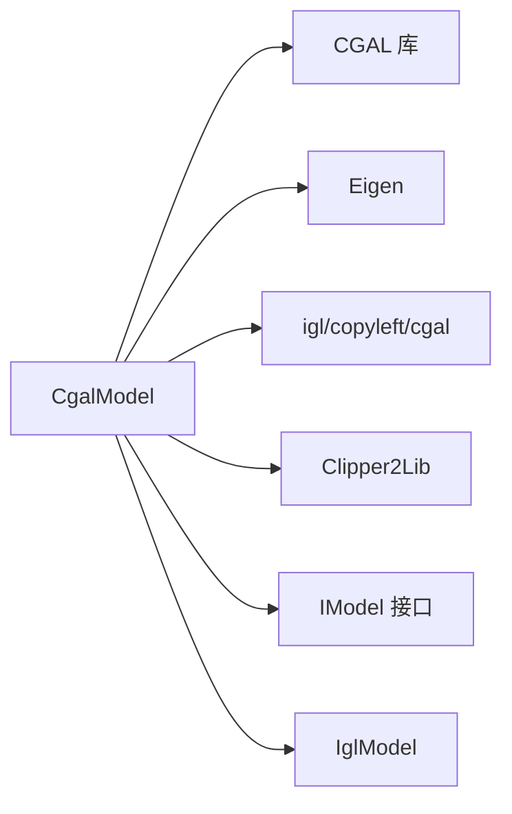

# CGAL网格模型

<cite>
**本文引用的文件**   
- [CgalModel.hpp](file://meshmodel/CgalModel.hpp)
- [CgalModel.cpp](file://meshmodel/CgalModel.cpp)
- [IglModel.cpp](file://meshmodel/IglModel.cpp)
- [IModel.hpp](file://base/IModel.hpp)
- [ModelFormat.hpp](file://base/ModelFormat.hpp)
</cite>

## 目录
1. [简介](#简介)
2. [项目结构](#项目结构)
3. [核心组件](#核心组件)
4. [架构总览](#架构总览)
5. [详细组件分析](#详细组件分析)
6. [依赖关系分析](#依赖关系分析)
7. [性能与优化建议](#性能与优化建议)
8. [故障排查指南](#故障排查指南)
9. [结论](#结论)
10. [附录：使用示例路径](#附录使用示例路径)

## 简介
本文件为 HsBaSlicer 中基于 CGAL Polyhedron_3 的网格模型 CgalModel 类提供完整技术文档。内容涵盖几何内核选择、Nef多面体布尔运算、网格加载保存、仿射变换、包围盒与体积计算、以及高级表面几何算法（测地线、点投影、螺旋/螺旋线生成）等。文档同时给出代码级流程图与调用序列图，帮助读者快速理解实现细节并指导实际使用与优化。

## 项目结构
CgalModel 位于 meshmodel 模块，作为 IModel 接口的一个具体实现，封装了 CGAL 的 Polyhedron_3 与 Nef_polyhedron_3，并提供面向上层管线（如切片、路径生成、支撑等）的统一网格操作接口。

图表来源
- [CgalModel.hpp:24-52](file://meshmodel/CgalModel.hpp#L24-L52)
- [CgalModel.cpp:12-25](file://meshmodel/CgalModel.cpp#L12-L25)

章节来源
- [CgalModel.hpp:24-52](file://meshmodel/CgalModel.hpp#L24-L52)
- [CgalModel.cpp:12-25](file://meshmodel/CgalModel.cpp#L12-L25)

## 核心组件
- 几何内核与类型别名
  - EpicKernel：CGAL::Exact_predicates_inexact_constructions_kernel
  - Point_3 / Vector_3 / Affine_3 / Polyhedron_3 / Nef_Polyheron_3
- 网格生命周期
  - Load/Save：支持 STL/PLY/OBJ/OFF 等格式；加载后强制三角化
  - TriangleMesh：导出为 libigl 风格的 (顶点, 面)
- 几何变换
  - Translate/Rotate/Scale/Transform：统一通过 CGAL::Aff_transformation_3 与 Polygon_mesh_processing::transform 应用
- 几何查询
  - BoundingBox：遍历顶点求最小/最大包围盒
  - Volume：返回有符号体积
- 布尔运算
  - Union/Intersection/Difference/Xor：基于 Nef_polyhedron_3 的 join/intersection/difference/symmetric_difference
- 基础实体工厂
  - CreateBox/CreateSphere/CreateCylinder/CreateCone/CreateTorus
- 拉伸建模
  - CreatePrime(PolygonD/PolygonsD, direction)：将二维闭合多边形沿方向拉伸成封闭实体，自动处理内外环方向与三角剖分
- 高级表面几何
  - GeodesicPath/GeodesicDistance：基于 Surface_mesh_shortest_path 的测地线
  - ProjectPointOnSurface：基于 AABB_tree 的最近点投影
  - SurfaceSpiral/SurfaceHelix：在表面上按轴生成螺旋/螺旋线路径

章节来源
- [CgalModel.hpp:34-155](file://meshmodel/CgalModel.hpp#L34-L155)
- [CgalModel.cpp:121-237](file://meshmodel/CgalModel.cpp#L121-L237)
- [CgalModel.cpp:238-276](file://meshmodel/CgalModel.cpp#L238-L276)
- [CgalModel.cpp:278-445](file://meshmodel/CgalModel.cpp#L278-L445)
- [CgalModel.cpp:625-955](file://meshmodel/CgalModel.cpp#L625-L955)
- [CgalModel.cpp:957-1210](file://meshmodel/CgalModel.cpp#L957-L1210)

## 架构总览
CgalModel 以 Polyhedron_3 为核心存储结构，对外暴露 IModel 接口；内部借助 CGAL 的多项工具库完成 IO、布尔、网格处理与表面几何计算。对外的数值类型多为 Eigen 的 float 向量/矩阵，内部与 CGAL 之间进行 double 精度转换以保证几何稳定性。

图表来源
- [CgalModel.hpp:24-155](file://meshmodel/CgalModel.hpp#L24-L155)

## 详细组件分析

### 几何内核与类型系统
- 内核选择 Exact_predicates_inexact_constructions_kernel：保证谓词精确性，构造采用浮点近似，兼顾性能与鲁棒性。
- 类型别名集中定义于类内，便于复用与扩展。

章节来源
- [CgalModel.hpp:34-42](file://meshmodel/CgalModel.hpp#L34-L42)

### 网格加载与保存
- Load：读取多种网格格式，并在成功后强制三角化，确保下游逻辑稳定。
- Save：根据 ModelFormat 枚举输出 BinarySTL/ASCIISTL/BinaryPLY/ASCIIPLY/OBJ/OFF。
- 异常与错误：不支持的格式抛出未支持异常；IO失败返回 false。

图表来源
- [CgalModel.cpp:121-157](file://meshmodel/CgalModel.cpp#L121-L157)

章节来源
- [CgalModel.cpp:121-157](file://meshmodel/CgalModel.cpp#L121-L157)
- [ModelFormat.hpp](file://base/ModelFormat.hpp)

### 仿射变换
- Translate/Rotate/Scale/Transform：统一转换为 CGAL::Affine_3 并通过 Polygon_mesh_processing::transform 原地更新网格。
- 支持从 Eigen::Isometry3f/Eigen::Matrix4f/Eigen::Transform<float,3,Eigen::Affine> 直接构造。

章节来源
- [CgalModel.cpp:158-204](file://meshmodel/CgalModel.cpp#L158-L204)

### 包围盒与体积
- BoundingBox：线性扫描所有顶点，计算 min/max。
- Volume：调用 CGAL 的 volume 函数，返回有符号体积（单位取决于输入坐标）。

章节来源
- [CgalModel.cpp:206-226](file://meshmodel/CgalModel.cpp#L206-L226)

### 布尔运算（Nef多面体）
- Union/Intersection/Difference/Xor：将两个 Polyhedron_3 转为 Nef_polyhedron_3，执行 join/intersection/difference/symmetric_difference，再转回 Polyhedron_3。
- 注意：Nef 布尔运算对输入网格拓扑质量敏感，建议先确保网格闭合且法向一致。

图表来源
- [CgalModel.cpp:238-276](file://meshmodel/CgalModel.cpp#L238-L276)

章节来源
- [CgalModel.cpp:238-276](file://meshmodel/CgalModel.cpp#L238-L276)

### 基础实体工厂
- CreateBox：基于 Iso_cuboid_3 生成六面体，随后三角化。
- CreateSphere/CreateCylinder/CreateCone/CreateTorus：参数化生成顶点与三角面，构造 CgalModel。

章节来源
- [CgalModel.cpp:278-445](file://meshmodel/CgalModel.cpp#L278-L445)

### 拉伸建模 CreatePrime
- 单多边形版本：使用 Clipper2 三角剖分底面，构建上下盖与侧壁，再通过 IglModel 中转并转回 CgalModel；最后强制三角化并校正法向以确保体积为正。
- 多轮廓版本：通过嵌套深度判定内外环，规范化方向，三角化后构建拉伸体；同样进行三角化与法向校正。

图表来源
- [CgalModel.cpp:625-733](file://meshmodel/CgalModel.cpp#L625-L733)
- [CgalModel.cpp:735-955](file://meshmodel/CgalModel.cpp#L735-L955)

章节来源
- [CgalModel.cpp:625-733](file://meshmodel/CgalModel.cpp#L625-L733)
- [CgalModel.cpp:735-955](file://meshmodel/CgalModel.cpp#L735-L955)

### 高级表面几何算法
- 测地线 GeodesicPath：
  - 将 Polyhedron_3 转为 Surface_mesh，构建 AABB_tree 加速最近点查询。
  - 使用 Surface_mesh_shortest_path 添加源点，目标点取最近顶点，提取路径点集。
- 测地距离 GeodesicDistance：
  - 同上，但遍历所有顶点查询到源点的测地距离。
- 表面投影 ProjectPointOnSurface：
  - 基于 AABB_tree 的 closest_point 返回最近点。
- 表面螺旋 SurfaceSpiral：
  - 围绕给定轴生成螺旋候选点，逐点投影到表面。
- 表面螺旋线 SurfaceHelix：
  - 围绕给定轴生成等螺距螺旋候选点，逐点投影到表面。

图表来源
- [CgalModel.cpp:957-1073](file://meshmodel/CgalModel.cpp#L957-L1073)
- [CgalModel.cpp:1075-1128](file://meshmodel/CgalModel.cpp#L1075-L1128)

章节来源
- [CgalModel.cpp:957-1210](file://meshmodel/CgalModel.cpp#L957-L1210)

## 依赖关系分析
- 外部依赖
  - CGAL：Polyhedron_3、Nef_polyhedron_3、Polygon_mesh_processing、Surface_mesh_shortest_path、AABB_tree、IO 等
  - Eigen：数值类型与变换
  - igl：mesh/polyhedron 互转（用于三角化与布尔回退）
  - Clipper2：二维多边形三角剖分与面积/包含判断
- 内部耦合
  - CgalModel 与 IModel：实现关系
  - CgalModel 与 IglModel：在 CreatePrime 中作为中间表示进行三角化与重建
  - 与 base 模块：ModelFormat、错误类型、编码转换等

图表来源
- [CgalModel.cpp:12-33](file://meshmodel/CgalModel.cpp#L12-L33)
- [CgalModel.cpp:27-33](file://meshmodel/CgalModel.cpp#L27-L33)

章节来源
- [CgalModel.cpp:12-33](file://meshmodel/CgalModel.cpp#L12-L33)
- [IModel.hpp](file://base/IModel.hpp)
- [ModelFormat.hpp](file://base/ModelFormat.hpp)

## 性能与优化建议
- 布尔运算
  - 优先保证输入网格闭合、无自交、法向一致；必要时先运行网格修复或重定向。
  - 大模型布尔运算内存与时间开销较高，建议分块或简化后再运算。
- 测地线与投影
  - Surface_mesh 与 AABB_tree 每次调用都会重建，若需多次查询，可缓存 Surface_mesh 与 AABB_tree。
  - 控制采样数（samplesPerTurn）与圈数（turns），避免过密采样导致大量最近点查询。
- 网格导出
  - 导出前确保三角化，避免下游解析器期望三角面而遇到多边形面。
- 数值精度
  - 内部与 CGAL 交互使用 double，外部 API 使用 float；避免极端尺度差异导致的精度问题。

[本节为通用指导，不直接分析具体文件]

## 故障排查指南
- 空网格构造
  - 从空顶点/面构造 CgalModel 会抛出运行时异常；请检查上游数据。
- 三角化失败
  - 当 mesh_to_polyhedron 失败时，实现尝试通过 Polygon_mesh_processing 修复；仍失败则抛出异常。
- 拉伸建模失败
  - 多边形点数不足或三角剖分失败会抛出异常；请检查二维轮廓是否闭合与有效。
- 布尔运算为空
  - 若布尔结果为空网格，检查输入网格拓扑与法向；必要时先修复网格。
- 文件格式不支持
  - Save 时传入不支持的 ModelFormat 会抛出未支持异常；请确认枚举值。

章节来源
- [CgalModel.cpp:42-118](file://meshmodel/CgalModel.cpp#L42-L118)
- [CgalModel.cpp:133-157](file://meshmodel/CgalModel.cpp#L133-L157)
- [CgalModel.cpp:625-733](file://meshmodel/CgalModel.cpp#L625-L733)
- [CgalModel.cpp:735-955](file://meshmodel/CgalModel.cpp#L735-L955)

## 结论
CgalModel 提供了以 CGAL 为核心的稳健网格实现，覆盖从基础 IO、变换、布尔运算到高级表面几何算法的全链路能力。其设计强调几何鲁棒性与易用性，适合在切片、路径生成、支撑等复杂流程中作为底层网格载体。使用时应关注输入网格质量、布尔运算复杂度与采样参数，以获得稳定高效的计算结果。

[本节为总结性内容，不直接分析具体文件]

## 附录：使用示例路径
以下为常见用法的“代码片段路径”，便于定位参考实现：
- 创建立方体并保存为二进制 STL
  - [CgalModel.cpp:278-291](file://meshmodel/CgalModel.cpp#L278-L291)
  - [CgalModel.cpp:133-157](file://meshmodel/CgalModel.cpp#L133-L157)
- 从 Eigen 顶点/面构造网格
  - [CgalModel.cpp:42-118](file://meshmodel/CgalModel.cpp#L42-L118)
- 执行布尔并集
  - [CgalModel.cpp:238-246](file://meshmodel/CgalModel.cpp#L238-L246)
- 计算两点间测地线
  - [CgalModel.cpp:1075-1101](file://meshmodel/CgalModel.cpp#L1075-L1101)
- 表面投影
  - [CgalModel.cpp:1122-1128](file://meshmodel/CgalModel.cpp#L1122-L1128)
- 生成表面螺旋
  - [CgalModel.cpp:1130-1177](file://meshmodel/CgalModel.cpp#L1130-L1177)
- 生成表面螺旋线
  - [CgalModel.cpp:1179-1210](file://meshmodel/CgalModel.cpp#L1179-L1210)
- 从二维多边形拉伸建模
  - [CgalModel.cpp:625-733](file://meshmodel/CgalModel.cpp#L625-L733)
  - [CgalModel.cpp:735-955](file://meshmodel/CgalModel.cpp#L735-L955)