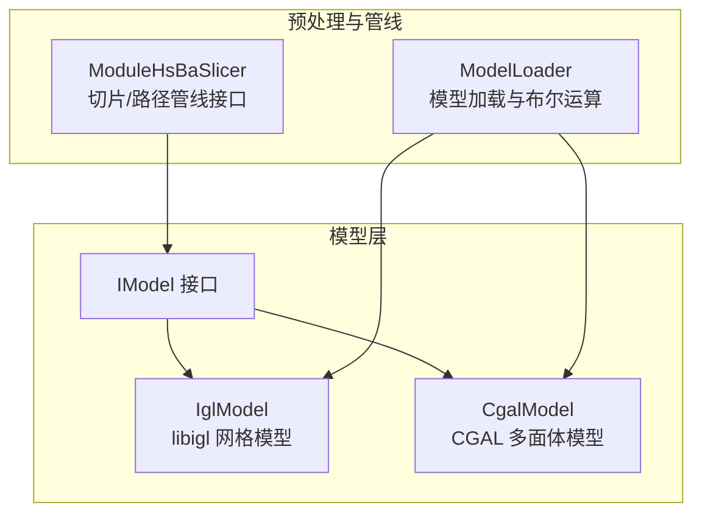
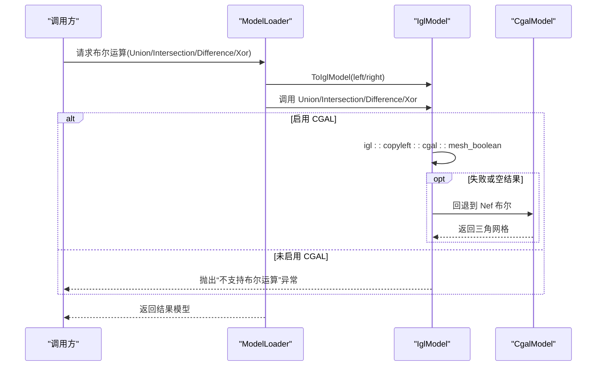
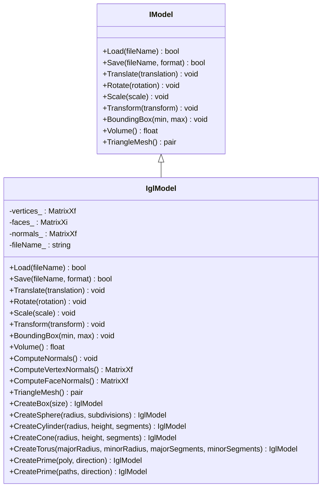
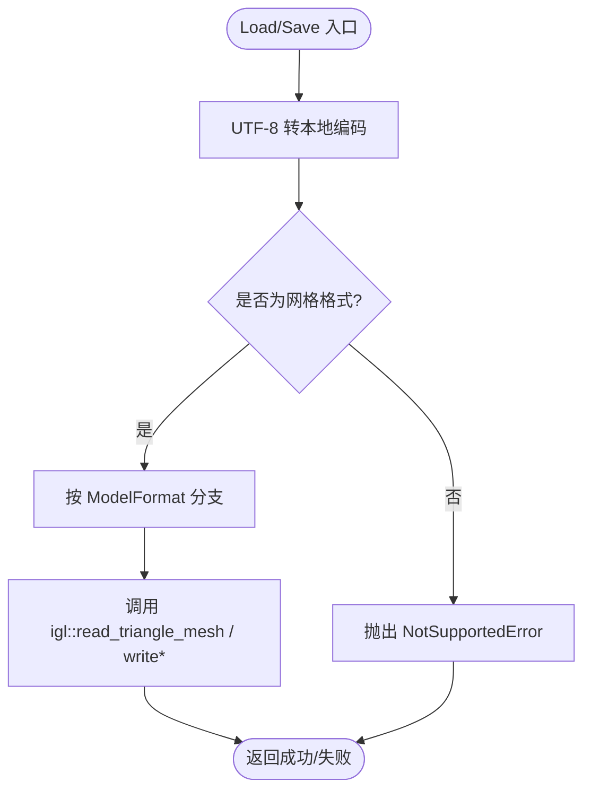
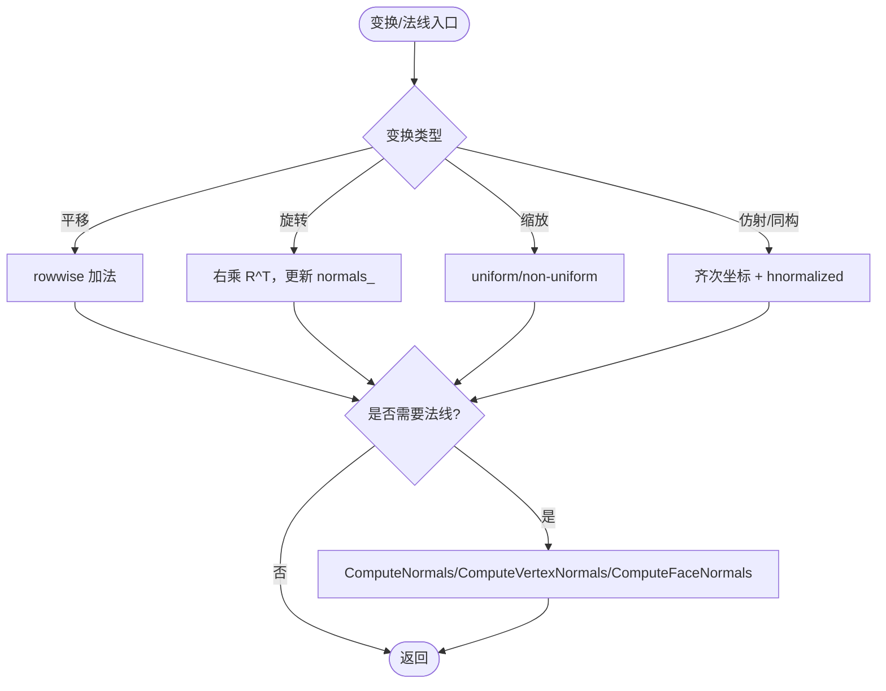
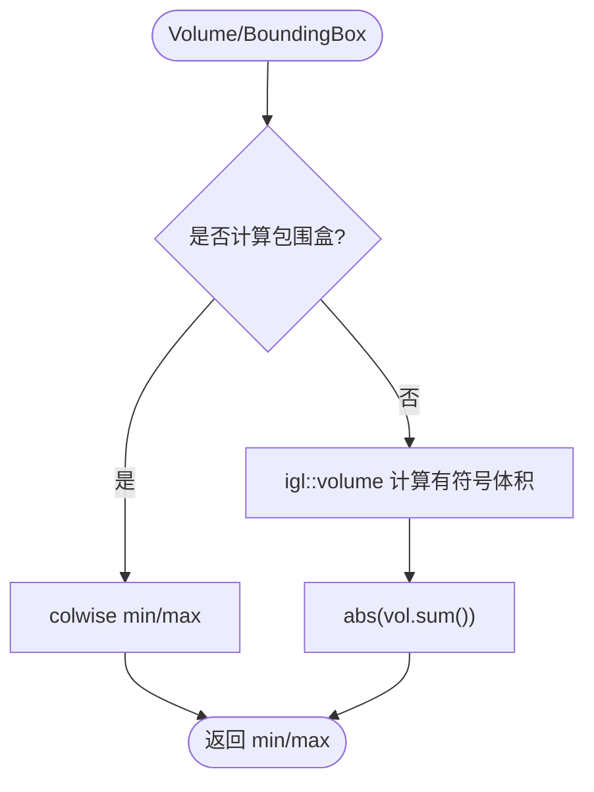
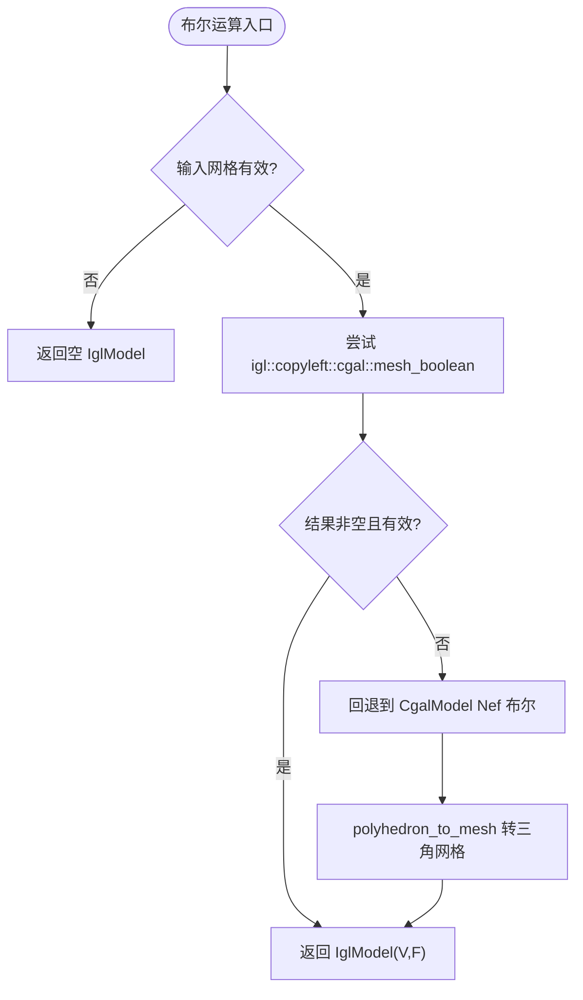
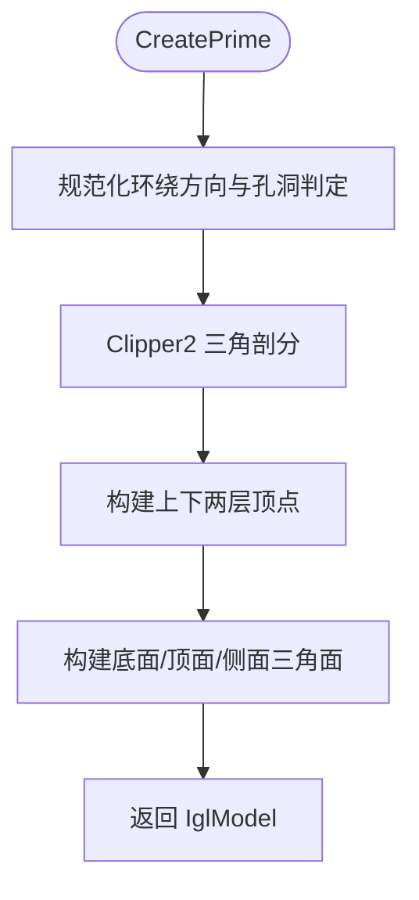
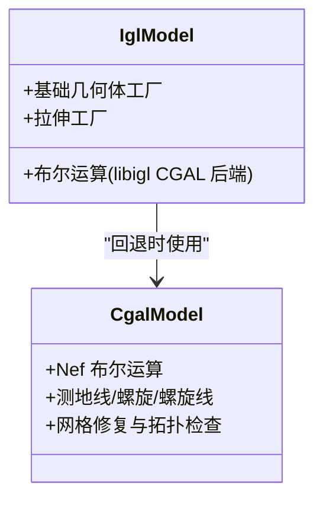
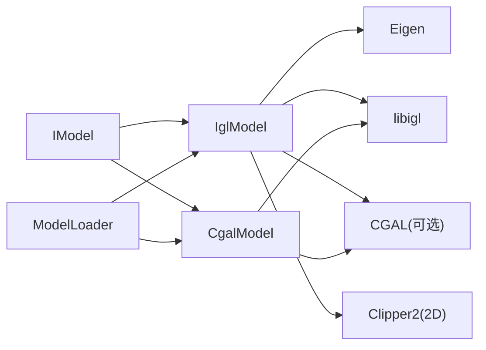

# libigl网格模型

<cite>
**本文引用的文件**   
- [IglModel.hpp](file://meshmodel/IglModel.hpp)
- [IglModel.cpp](file://meshmodel/IglModel.cpp)
- [CgalModel.hpp](file://meshmodel/CgalModel.hpp)
- [CgalModel.cpp](file://meshmodel/CgalModel.cpp)
- [IModel.hpp](file://base/IModel.hpp)
- [ModelLoader.cpp](file://preprocess/ModelLoader.cpp)
- [hsba_slicer.cppm](file://ModuleHsBaSlicer/hsba_slicer.cppm)
- [model_loader_test.cpp](file://tests/Preprocess/model_loader_test.cpp)
</cite>

## 目录
1. [引言](#引言)
2. [项目结构](#项目结构)
3. [核心组件](#核心组件)
4. [架构总览](#架构总览)
5. [详细组件分析](#详细组件分析)
6. [依赖关系分析](#依赖关系分析)
7. [性能与互操作性](#性能与互操作性)
8. [使用示例与模式](#使用示例与模式)
9. [故障排查](#故障排查)
10. [结论](#结论)

## 引言
本技术文档聚焦于 HsBaSlicer 中的 IglModel 类，该类基于 libigl 提供高效、现代的三角形网格建模能力。IglModel 实现了统一的 IModel 接口，封装了顶点与面索引的存储、几何变换、包围盒与体积计算、法线计算、布尔运算以及基础几何体与拉伸（Extrude）工厂方法。在启用 CGAL 时，IglModel 通过 libigl 的 CGAL 后端执行网格布尔运算；未启用 CGAL 时则提供明确的“不支持”语义。

在现代图形学与切片系统中，IglModel 的优势在于：
- 以 Eigen 矩阵为底层存储，便于向量化计算与与其他数值库无缝集成。
- 面向行主序的顶点矩阵设计，避免常见的广播与维度错误，提升稳定性与性能。
- 提供丰富的几何构造与布尔运算入口，便于在切片、路径生成等管线中复用。
- 与 CgalModel 形成互补：IglModel 侧重轻量高效的网格数据与算法，CgalModel 侧重精确几何内核与高级表面操作。

## 项目结构
与 IglModel 直接相关的代码位于 meshmodel 模块，并通过 base 模块的 IModel 接口统一抽象。上层管线通过 ModelLoader 将不同模型类型转换为 IglModel 进行布尔运算，并在 ModuleHsBaSlicer 中暴露给更高层的切片与路径生成流程。

图表来源
- [IModel.hpp:1-44](file://base/IModel.hpp#L1-L44)
- [IglModel.hpp:16-124](file://meshmodel/IglModel.hpp#L16-L124)
- [CgalModel.hpp:24-166](file://meshmodel/CgalModel.hpp#L24-L166)
- [ModelLoader.cpp:136-146](file://preprocess/ModelLoader.cpp#L136-L146)
- [hsba_slicer.cppm:179-219](file://ModuleHsBaSlicer/hsba_slicer.cppm#L179-L219)

章节来源
- [IModel.hpp:1-44](file://base/IModel.hpp#L1-L44)
- [IglModel.hpp:16-124](file://meshmodel/IglModel.hpp#L16-L124)
- [CgalModel.hpp:24-166](file://meshmodel/CgalModel.hpp#L24-L166)
- [ModelLoader.cpp:136-146](file://preprocess/ModelLoader.cpp#L136-L146)
- [hsba_slicer.cppm:179-219](file://ModuleHsBaSlicer/hsba_slicer.cppm#L179-L219)

## 核心组件
- IModel 接口：定义统一的模型抽象，包括加载/保存、几何变换、包围盒/体积查询、三角网格导出等。
- IglModel：基于 libigl 的高效网格实现，支持 STL/OBJ/PLY/OFF 等格式读写、仿射变换、法线计算、布尔运算（可选）、基础几何体创建与多边形拉伸。
- CgalModel：基于 CGAL 的多面体模型，提供 Nef 布尔运算与表面测地线、螺旋、螺旋线等高级几何操作。

章节来源
- [IModel.hpp:1-44](file://base/IModel.hpp#L1-L44)
- [IglModel.hpp:16-124](file://meshmodel/IglModel.hpp#L16-L124)
- [CgalModel.hpp:24-166](file://meshmodel/CgalModel.hpp#L24-L166)

## 架构总览
IglModel 作为 IModel 的具体实现之一，向上层管线提供一致的 API。当需要布尔运算时，ModelLoader 会将任意 IModel 转换为 IglModel，再调用 IglModel 的布尔函数；若启用 CGAL，则优先使用 libigl 的 CGAL 后端，否则回退到 CgalModel 的 Nef 布尔实现。

图表来源
- [ModelLoader.cpp:136-146](file://preprocess/ModelLoader.cpp#L136-L146)
- [ModelLoader.cpp:317-320](file://preprocess/ModelLoader.cpp#L317-L320)
- [IglModel.cpp:195-246](file://meshmodel/IglModel.cpp#L195-L246)
- [CgalModel.cpp:238-276](file://meshmodel/CgalModel.cpp#L238-L276)

## 详细组件分析

### IglModel 类设计与数据结构
IglModel 内部维护三个核心成员：
- vertices_：N×3 的行主序浮点矩阵，存储顶点坐标。
- faces_：M×3 的整型矩阵，存储三角形面片索引。
- normals_：可选的法线矩阵，用于加速渲染或后续处理。

这种设计具有以下优势：
- 与 libigl 和 Eigen 生态天然契合，便于批量向量化计算。
- 行主序布局避免了常见广播错误，例如 Translate 中对 vertices_.rowwise() 的使用。
- 通过 TriangleMesh() 暴露标准 (V,F) 对，便于与其他库互操作。

图表来源
- [IModel.hpp:1-44](file://base/IModel.hpp#L1-L44)
- [IglModel.hpp:16-124](file://meshmodel/IglModel.hpp#L16-L124)

章节来源
- [IglModel.hpp:16-124](file://meshmodel/IglModel.hpp#L16-L124)

### 网格数据加载与保存
IglModel 通过 libigl 的读取/写入函数支持多种网格格式：
- 读取：STL/OBJ/PLY/OFF 等由 igl::read_triangle_mesh 解析。
- 保存：根据 ModelFormat 枚举选择对应的 igl::write* 函数。

路径编码转换通过 utf8_to_local 完成，确保跨平台兼容性。

图表来源
- [IglModel.cpp:64-99](file://meshmodel/IglModel.cpp#L64-L99)

章节来源
- [IglModel.cpp:64-99](file://meshmodel/IglModel.cpp#L64-L99)

### 几何变换与法线计算
IglModel 的变换实现充分考虑了行主序存储：
- Translate：使用 rowwise() 广播加法。
- Rotate：右乘旋转矩阵的转置，同时更新 normals_（若存在）。
- Scale：均匀与非均匀缩放分别处理。
- Transform：Isometry3f/Matrix4f/Affine 三种重载均通过齐次坐标与 hnormalized 保证正确性。

法线计算：
- ComputeNormals：计算面法线并缓存。
- ComputeVertexNormals/ComputeFaceNormals：按需返回顶点/面法线。

图表来源
- [IglModel.cpp:101-150](file://meshmodel/IglModel.cpp#L101-L150)
- [IglModel.cpp:170-185](file://meshmodel/IglModel.cpp#L170-L185)

章节来源
- [IglModel.cpp:101-150](file://meshmodel/IglModel.cpp#L101-L150)
- [IglModel.cpp:170-185](file://meshmodel/IglModel.cpp#L170-L185)

### 包围盒与体积
- BoundingBox：对 vertices_ 列方向求最小/最大，得到 AABB。
- Volume：通过 igl::volume 计算有符号体积，取绝对值。

图表来源
- [IglModel.cpp:152-168](file://meshmodel/IglModel.cpp#L152-L168)

章节来源
- [IglModel.cpp:152-168](file://meshmodel/IglModel.cpp#L152-L168)

### 布尔运算与 CGAL 回退
IglModel 的布尔运算在启用 USE_CGAL 时优先使用 libigl 的 CGAL 后端：
- 先将 float 顶点提升到 double，调用 igl::copyleft::cgal::mesh_boolean。
- 若结果为空或不一致，回退到 CgalModel 的 Nef 布尔运算，再将结果转回三角网格。

未启用 CGAL 时，布尔运算直接抛出“不支持”异常。

图表来源
- [IglModel.cpp:195-246](file://meshmodel/IglModel.cpp#L195-L246)
- [CgalModel.cpp:238-276](file://meshmodel/CgalModel.cpp#L238-L276)

章节来源
- [IglModel.cpp:195-246](file://meshmodel/IglModel.cpp#L195-L246)
- [CgalModel.cpp:238-276](file://meshmodel/CgalModel.cpp#L238-L276)

### 基础几何体与拉伸（Extrude）
IglModel 提供多种基础几何体工厂：
- CreateBox/CreateSphere/CreateCylinder/CreateCone/CreateTorus：参数化生成三角网格，并确保外法线方向一致。
- CreatePrime：将二维闭合多边形沿方向拉伸成三维实体。单多边形版本使用 Clipper2 三角剖分，多边形版本先判定孔洞与环绕方向，再进行三角剖分与侧壁构建。

图表来源
- [IglModel.cpp:598-713](file://meshmodel/IglModel.cpp#L598-L713)
- [IglModel.cpp:715-930](file://meshmodel/IglModel.cpp#L715-L930)

章节来源
- [IglModel.cpp:598-713](file://meshmodel/IglModel.cpp#L598-L713)
- [IglModel.cpp:715-930](file://meshmodel/IglModel.cpp#L715-L930)

### 与 CgalModel 的关系与对比
- IglModel：轻量、快速、面向网格数据与常用算法；布尔运算依赖 libigl 的 CGAL 后端，具备回退机制。
- CgalModel：基于 CGAL 的精确几何内核，提供 Nef 布尔运算与表面测地线、螺旋、螺旋线等高级功能；构造时会尝试修复网格拓扑。

图表来源
- [IglModel.cpp:195-246](file://meshmodel/IglModel.cpp#L195-L246)
- [CgalModel.cpp:42-119](file://meshmodel/CgalModel.cpp#L42-L119)
- [CgalModel.cpp:238-276](file://meshmodel/CgalModel.cpp#L238-L276)

章节来源
- [IglModel.cpp:195-246](file://meshmodel/IglModel.cpp#L195-L246)
- [CgalModel.cpp:42-119](file://meshmodel/CgalModel.cpp#L42-L119)
- [CgalModel.cpp:238-276](file://meshmodel/CgalModel.cpp#L238-L276)

## 依赖关系分析
- IModel 接口：所有模型类型的统一抽象。
- IglModel：依赖 Eigen、libigl、可选 CGAL（布尔运算），以及项目内部的 2D 多边形工具（Clipper2）。
- CgalModel：依赖 CGAL 的几何内核与网格处理工具，并通过 libigl 的 copyleft 工具与 IglModel 互通。
- ModelLoader：负责在不同模型类型之间转换，并将布尔运算委托给 IglModel。

图表来源
- [IModel.hpp:1-44](file://base/IModel.hpp#L1-L44)
- [IglModel.cpp:12-31](file://meshmodel/IglModel.cpp#L12-L31)
- [CgalModel.cpp:12-33](file://meshmodel/CgalModel.cpp#L12-L33)
- [ModelLoader.cpp:136-146](file://preprocess/ModelLoader.cpp#L136-L146)

章节来源
- [IModel.hpp:1-44](file://base/IModel.hpp#L1-L44)
- [IglModel.cpp:12-31](file://meshmodel/IglModel.cpp#L12-L31)
- [CgalModel.cpp:12-33](file://meshmodel/CgalModel.cpp#L12-L33)
- [ModelLoader.cpp:136-146](file://preprocess/ModelLoader.cpp#L136-L146)

## 性能与互操作性
- 存储与计算：IglModel 使用行主序 Eigen 矩阵，配合 rowwise/homogeneous/hnormalized 等向量化操作，减少内存拷贝与维度错误，提高性能与稳定性。
- 布尔运算：优先使用 libigl 的 CGAL 后端，必要时回退到 CgalModel 的 Nef 布尔，兼顾速度与鲁棒性。
- 文件格式：广泛支持 STL/OBJ/PLY/OFF，便于与外部工具链互操作。
- 与 CgalModel 的对比：
  - IglModel：适合快速网格处理、基础几何构造与常规布尔运算。
  - CgalModel：适合高精度布尔与复杂表面几何（测地线、螺旋等）。
- 选择建议：
  - 若仅需高效网格数据与常用算法，优先使用 IglModel。
  - 若需要精确几何布尔或高级表面操作，使用 CgalModel。
  - 在混合场景中，可通过 ModelLoader 自动转换与回退。

[本节为通用指导，不直接分析具体文件]

## 使用示例与模式
以下示例展示典型用法与调用模式（不包含具体代码内容，仅给出路径参考）：

- 从顶点/面构造 IglModel：
  - 参考：[IglModel.cpp:37-62](file://meshmodel/IglModel.cpp#L37-L62)
- 加载/保存网格文件：
  - 参考：[IglModel.cpp:64-99](file://meshmodel/IglModel.cpp#L64-L99)
- 应用几何变换与计算法线：
  - 参考：[IglModel.cpp:101-150](file://meshmodel/IglModel.cpp#L101-L150)
  - 参考：[IglModel.cpp:170-185](file://meshmodel/IglModel.cpp#L170-L185)
- 计算包围盒与体积：
  - 参考：[IglModel.cpp:152-168](file://meshmodel/IglModel.cpp#L152-L168)
- 布尔运算（启用 CGAL）：
  - 参考：[IglModel.cpp:195-246](file://meshmodel/IglModel.cpp#L195-L246)
  - 参考：[model_loader_test.cpp:188-233](file://tests/Preprocess/model_loader_test.cpp#L188-L233)
- 基础几何体与拉伸：
  - 参考：[IglModel.cpp:411-596](file://meshmodel/IglModel.cpp#L411-L596)
  - 参考：[IglModel.cpp:598-930](file://meshmodel/IglModel.cpp#L598-L930)
- 在管线中使用 IglModel：
  - 参考：[ModelLoader.cpp:136-146](file://preprocess/ModelLoader.cpp#L136-L146)
  - 参考：[hsba_slicer.cppm:179-219](file://ModuleHsBaSlicer/hsba_slicer.cppm#L179-L219)

章节来源
- [IglModel.cpp:37-62](file://meshmodel/IglModel.cpp#L37-L62)
- [IglModel.cpp:64-99](file://meshmodel/IglModel.cpp#L64-L99)
- [IglModel.cpp:101-150](file://meshmodel/IglModel.cpp#L101-L150)
- [IglModel.cpp:152-168](file://meshmodel/IglModel.cpp#L152-L168)
- [IglModel.cpp:170-185](file://meshmodel/IglModel.cpp#L170-L185)
- [IglModel.cpp:195-246](file://meshmodel/IglModel.cpp#L195-L246)
- [IglModel.cpp:411-596](file://meshmodel/IglModel.cpp#L411-L596)
- [IglModel.cpp:598-930](file://meshmodel/IglModel.cpp#L598-L930)
- [ModelLoader.cpp:136-146](file://preprocess/ModelLoader.cpp#L136-L146)
- [hsba_slicer.cppm:179-219](file://ModuleHsBaSlicer/hsba_slicer.cppm#L179-L219)
- [model_loader_test.cpp:188-233](file://tests/Preprocess/model_loader_test.cpp#L188-L233)

## 故障排查
- 布尔运算未启用 CGAL：
  - 现象：调用 Union/Intersection/Difference/Xor 抛出“不支持布尔运算”异常。
  - 解决：启用 USE_CGAL 编译选项，或改用 CgalModel。
  - 参考：[IglModel.cpp:392-409](file://meshmodel/IglModel.cpp#L392-L409)
- 布尔运算结果为空：
  - 现象：mesh_boolean 返回空网格或无效结果。
  - 解决：检查输入网格有效性（顶点有限、索引越界），必要时回退到 CgalModel。
  - 参考：[IglModel.cpp:195-246](file://meshmodel/IglModel.cpp#L195-L246)
- 文件格式不支持：
  - 现象：Save 抛出“不支持的文件格式”。
  - 解决：确认 ModelFormat 枚举值与目标格式匹配。
  - 参考：[IglModel.cpp:72-99](file://meshmodel/IglModel.cpp#L72-L99)
- 拉伸失败：
  - 现象：CreatePrime 抛出“三角剖分失败”或“顶点未找到”。
  - 解决：检查输入多边形闭合性与环绕方向，确保 Clipper2 三角剖分成功。
  - 参考：[IglModel.cpp:598-713](file://meshmodel/IglModel.cpp#L598-L713)
  - 参考：[IglModel.cpp:715-930](file://meshmodel/IglModel.cpp#L715-L930)

章节来源
- [IglModel.cpp:72-99](file://meshmodel/IglModel.cpp#L72-L99)
- [IglModel.cpp:195-246](file://meshmodel/IglModel.cpp#L195-L246)
- [IglModel.cpp:392-409](file://meshmodel/IglModel.cpp#L392-L409)
- [IglModel.cpp:598-713](file://meshmodel/IglModel.cpp#L598-L713)
- [IglModel.cpp:715-930](file://meshmodel/IglModel.cpp#L715-L930)

## 结论
IglModel 在 HsBaSlicer 中扮演高效网格模型的核心角色，结合 libigl 与 Eigen 提供了稳定、快速的网格数据处理能力。其行主序存储、向量化变换、广泛的文件格式支持与可选的 CGAL 布尔运算，使其在现代图形学与切片管线中具有显著优势。对于高精度几何需求，可与 CgalModel 协同工作，通过 ModelLoader 自动转换与回退，兼顾性能与鲁棒性。在实际应用中，建议根据场景选择合适的模型类型，并充分利用 IglModel 的基础几何与拉伸工厂，简化建模与处理流程。

[本节为总结性内容，不直接分析具体文件]