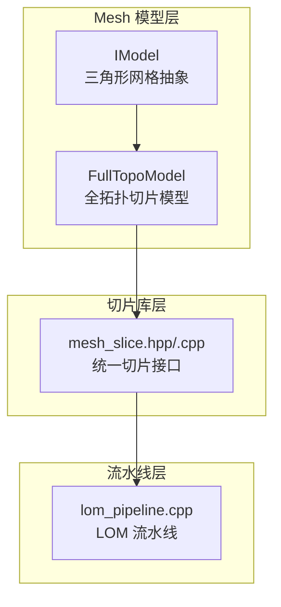
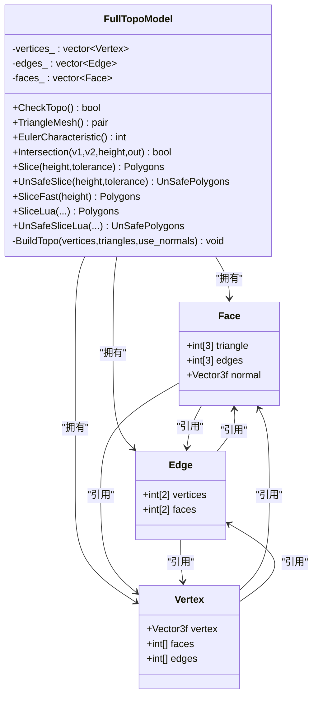
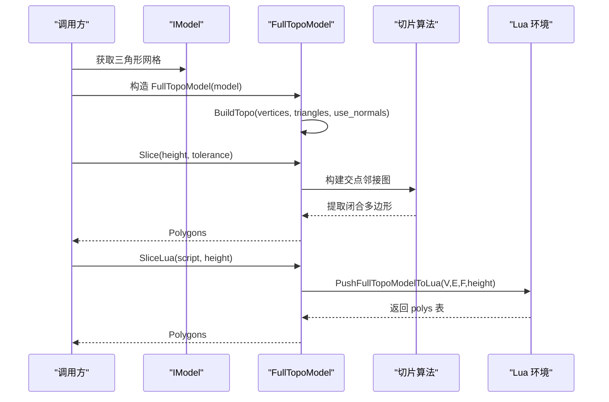
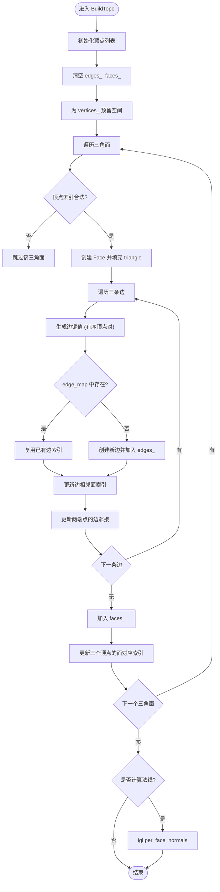
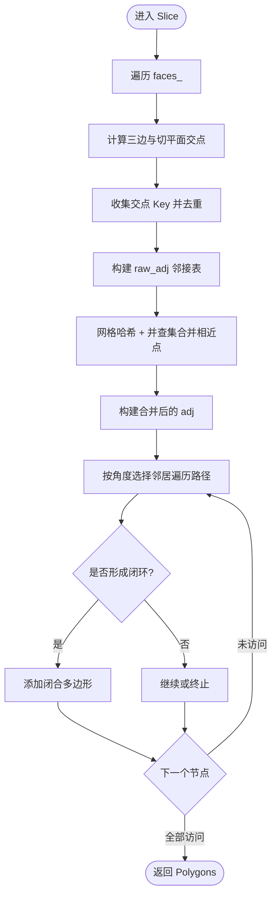
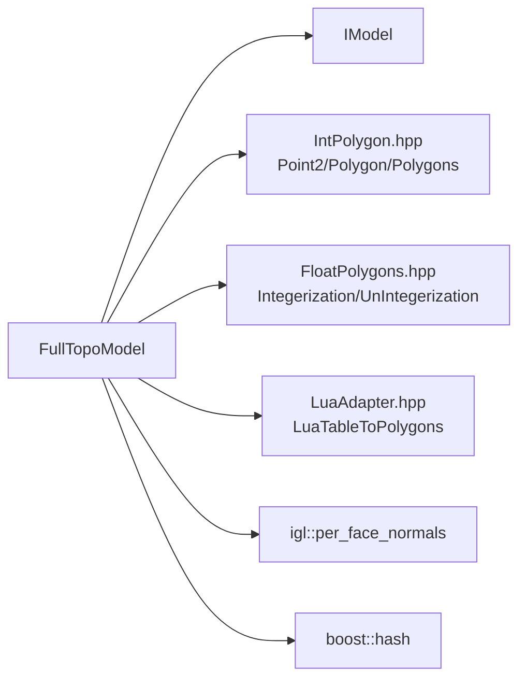
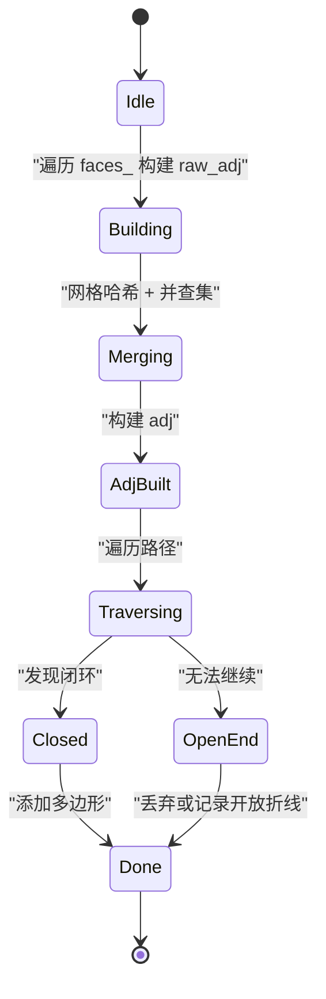
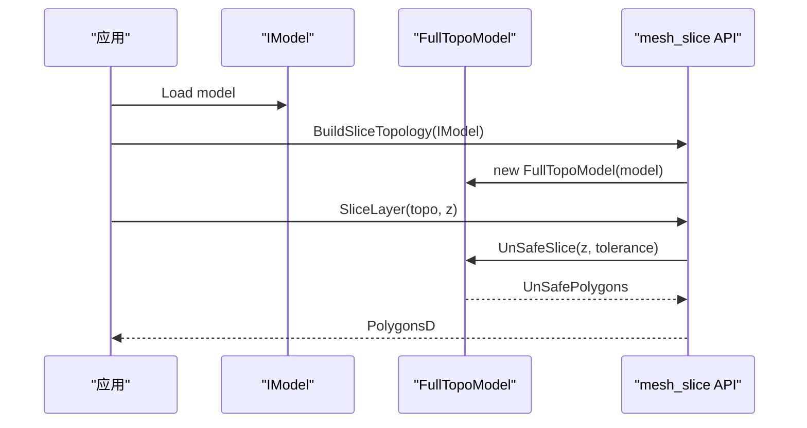

# 全拓扑网格模型

<cite>
**本文引用的文件**   
- [FullTopoModel.hpp](file://meshmodel/FullTopoModel.hpp)
- [FullTopoModel.cpp](file://meshmodel/FullTopoModel.cpp)
- [IntPolygon.hpp](file://2D/IntPolygon.hpp)
- [FloatPolygons.hpp](file://2D/FloatPolygons.hpp)
- [IModel.hpp](file://base/IModel.hpp)
- [mesh_slice.hpp](file://LibHsBaSlicer/Slice/mesh_slice.hpp)
- [mesh_slice.cpp](file://LibHsBaSlicer/Slice/mesh_slice.cpp)
- [lom_pipeline.cpp](file://DllHsBaSlicer/lom_pipeline.cpp)
- [full_topo_model_test.cpp](file://tests/Models/full_topo_model_test.cpp)
</cite>

## 目录
1. [引言](#引言)
2. [项目结构定位](#项目结构定位)
3. [核心数据结构与拓扑关系](#核心数据结构与拓扑关系)
4. [架构总览](#架构总览)
5. [详细组件分析](#详细组件分析)
6. [依赖关系分析](#依赖关系分析)
7. [性能与复杂度](#性能与复杂度)
8. [切片算法与状态管理](#切片算法与状态管理)
9. [可视化与调试技巧](#可视化与调试技巧)
10. [与其他模型的转换接口](#与其他模型的转换接口)
11. [故障排查](#故障排查)
12. [结论](#结论)

## 引言
本技术文档围绕 HsBaSlicer 中的 FullTopoModel 类展开，目标是帮助读者深入理解“全拓扑网格模型”的设计动机、数据结构和实现细节。FullTopoModel 面向切片场景，在构造阶段重建顶点、边、面的完整拓扑关系，从而为后续切片、邻接遍历和复杂拓扑操作提供稳定基础。文档将重点说明：
- 全拓扑数据结构的设计理念与实现机制
- 顶点、边、面之间的双向关联维护方式
- 拓扑查询接口与邻接遍历策略
- 切片算法如何利用拓扑信息进行精确几何计算与状态管理
- 拓扑可视化和调试方法
- 与其他网格模型的转换接口及性能考量

## 项目结构定位
FullTopoModel 位于 meshmodel 模块中，是切片管线的重要数据载体。其上层通过 LibHsBaSlicer::Slice 暴露统一切片 API，并在 DllHsBaSlicer 的 LOM 等流水线中复用预构建的全拓扑对象进行逐层切片。

**图表来源**
- [IModel.hpp:1-200](file://base/IModel.hpp#L1-L200)
- [FullTopoModel.hpp:43-142](file://meshmodel/FullTopoModel.hpp#L43-L142)
- [mesh_slice.hpp:97-117](file://LibHsBaSlicer/Slice/mesh_slice.hpp#L97-L117)
- [mesh_slice.cpp:45-115](file://LibHsBaSlicer/Slice/mesh_slice.cpp#L45-L115)
- [lom_pipeline.cpp:231-266](file://DllHsBaSlicer/lom_pipeline.cpp#L231-L266)

**章节来源**
- [FullTopoModel.hpp:43-142](file://meshmodel/FullTopoModel.hpp#L43-L142)
- [mesh_slice.cpp:45-115](file://LibHsBaSlicer/Slice/mesh_slice.cpp#L45-L115)
- [lom_pipeline.cpp:231-266](file://DllHsBaSlicer/lom_pipeline.cpp#L231-L266)

## 核心数据结构与拓扑关系
FullTopoModel 的核心由三类实体组成：Face（面）、Edge（边）、Vertex（顶点），并通过索引数组维护双向拓扑关系。

- Face
  - triangle：三个顶点的索引
  - edges：三条边的索引
  - normal：可选的面法线（启用时通过 igl 计算）
- Edge
  - vertices：两个端点顶点索引
  - faces：相邻的两个面索引（边界边仅有一个有效面）
- Vertex
  - vertex：三维坐标
  - faces：包含该顶点的所有面索引
  - edges：与该顶点相连的所有边索引

这种设计使得任意一个元素都能快速访问与其相关的其他元素，满足切片过程中频繁邻接查询的需求。

**图表来源**
- [FullTopoModel.hpp:56-72](file://meshmodel/FullTopoModel.hpp#L56-L72)
- [FullTopoModel.hpp:74-142](file://meshmodel/FullTopoModel.hpp#L74-L142)

**章节来源**
- [FullTopoModel.hpp:56-72](file://meshmodel/FullTopoModel.hpp#L56-L72)
- [FullTopoModel.hpp:74-142](file://meshmodel/FullTopoModel.hpp#L74-L142)

## 架构总览
FullTopoModel 的构建过程从 IModel 或原始顶点/三角面片数据开始，调用 BuildTopo 完成拓扑重建；随后提供多种切片接口：
- Slice：安全切片，丢弃开放轮廓
- UnSafeSlice：允许开放折线并标记闭合性
- SliceFast：基于已建拓扑的快速切片，要求拓扑完整性检查通过
- SliceLua / UnSafeSliceLua：通过 Lua 脚本自定义切片逻辑

**图表来源**
- [FullTopoModel.cpp:32-48](file://meshmodel/FullTopoModel.cpp#L32-L48)
- [FullTopoModel.cpp:50-158](file://meshmodel/FullTopoModel.cpp#L50-L158)
- [FullTopoModel.cpp:328-600](file://meshmodel/FullTopoModel.cpp#L328-L600)
- [FullTopoModel.cpp:1027-1073](file://meshmodel/FullTopoModel.cpp#L1027-L1073)

**章节来源**
- [FullTopoModel.cpp:32-48](file://meshmodel/FullTopoModel.cpp#L32-L48)
- [FullTopoModel.cpp:328-600](file://meshmodel/FullTopoModel.cpp#L328-L600)
- [FullTopoModel.cpp:1027-1073](file://meshmodel/FullTopoModel.cpp#L1027-L1073)

## 详细组件分析

### 拓扑重建 BuildTopo
BuildTopo 负责从输入顶点与三角面片构建全拓扑：
- 初始化顶点列表，并为每个顶点预留 faces 与 edges 容器
- 使用哈希表 edge_map 去重边，确保每条边只创建一次
- 对每个三角面，记录其三个顶点索引、三条边索引，并更新对应顶点和边的邻接信息
- 可选地计算面法线（通过 igl::per_face_normals）

关键点：
- 边键值采用有序顶点对 (min,max)，保证无向边一致性
- 顶点到边、顶点到面的反向索引用于后续邻接遍历
- 若输入三角面存在非法索引，直接跳过，避免崩溃

**图表来源**
- [FullTopoModel.cpp:50-158](file://meshmodel/FullTopoModel.cpp#L50-L158)

**章节来源**
- [FullTopoModel.cpp:50-158](file://meshmodel/FullTopoModel.cpp#L50-L158)

### 拓扑完整性检查 CheckTopo
CheckTopo 验证拓扑完整性：
- 检查所有面的顶点与边索引是否在范围内且覆盖全部顶点与边
- 检查所有边的顶点与面索引是否在范围内且覆盖全部顶点与面

用途：
- SliceFast 在开始前强制调用，若失败则抛出异常
- 可用于诊断模型是否为拓扑流形（不完整通常意味着非流形）

**章节来源**
- [FullTopoModel.cpp:160-218](file://meshmodel/FullTopoModel.cpp#L160-L218)

### 几何工具 Intersection
Intersection 计算线段与水平切平面 z=height 的交点：
- 处理完全在平面上方或下方的情况
- 处理线段平行于平面的退化情况
- 返回交点坐标或指示无交点

这是所有切片算法的基础几何原语。

**章节来源**
- [FullTopoModel.cpp:246-272](file://meshmodel/FullTopoModel.cpp#L246-L272)

### 安全切片 Slice
Slice 的工作流程：
1. 对每个三角面，计算其与切平面的交点，得到最多两个交点
2. 将交点坐标整数化后作为 Key，建立原始邻接表 raw_adj
3. 使用并查集 UnionFind 与网格哈希合并相近点，消除浮点误差导致的断点
4. 构建合并后的邻接表 adj
5. 按入射方向最小偏转角选择下一个邻居，沿邻接图追踪路径，提取闭合多边形

特点：
- 自动丢弃开放轮廓
- 使用 integerization 常量提升数值稳定性
- 时间复杂度主要受邻接图大小影响，通常为 O(E) 级别

**图表来源**
- [FullTopoModel.cpp:328-600](file://meshmodel/FullTopoModel.cpp#L328-L600)
- [IntPolygon.hpp:17](file://2D/IntPolygon.hpp#L17)

**章节来源**
- [FullTopoModel.cpp:328-600](file://meshmodel/FullTopoModel.cpp#L328-L600)
- [IntPolygon.hpp:17](file://2D/IntPolygon.hpp#L17)

### 不安全切片 UnSafeSlice
UnSafeSlice 与 Slice 类似，但保留开放折线，并以 UnSafePolygon 形式输出，包含 path 与 closed 标志：
- 同样构建 raw_adj、合并相近点、构建 adj
- 遍历路径时记录是否回到起点以判断闭合性
- 输出可能包含长度小于 3 的开放折线

适用场景：
- 需要检测开放轮廓或进行更精细的几何后处理

**章节来源**
- [FullTopoModel.cpp:604-873](file://meshmodel/FullTopoModel.cpp#L604-L873)

### 快速切片 SliceFast
SliceFast 利用已构建的拓扑信息直接进行切片：
- 先调用 CheckTopo，若失败立即抛出异常
- 对每条边计算是否与切平面相交，记录交点 Key
- 根据每个三角面内两条相交边连接交点，构建邻接表
- 按角度选择邻居遍历，提取闭合多边形

优势：
- 避免重复构建邻接图的开销
- 适合多次切片同一模型的场景

风险：
- 对拓扑完整性要求严格，不完整的模型会直接报错

**章节来源**
- [FullTopoModel.cpp:875-1025](file://meshmodel/FullTopoModel.cpp#L875-L1025)

### Lua 切片接口 SliceLua / UnSafeSliceLua
Lua 接口允许用户通过脚本自定义切片逻辑：
- PushFullTopoModelToLua 将 V、E、F 全局变量与 height 推送到 Lua 环境
- 支持加载内存脚本或外部脚本文件
- 支持注册扩展函数（例如 3D 工具函数）
- 返回结果通过 LuaAdapter 转换为 Polygons 或 UnSafePolygons

典型用法：
- 在脚本中遍历 F 面片，计算边与切平面交点
- 自行排序或计算凸包，返回 polys 表

**章节来源**
- [FullTopoModel.cpp:274-324](file://meshmodel/FullTopoModel.cpp#L274-L324)
- [FullTopoModel.cpp:1027-1241](file://meshmodel/FullTopoModel.cpp#L1027-L1241)

## 依赖关系分析
FullTopoModel 依赖以下关键组件：
- IModel：提供三角形网格数据
- IntPolygon/FloatPolygons：定义整数化坐标与多边形类型
- LuaAdapter：Lua 与 C++ 多边形数据转换
- igl：可选的法线计算
- boost::hash：哈希函数支持

**图表来源**
- [FullTopoModel.hpp:11-16](file://meshmodel/FullTopoModel.hpp#L11-L16)
- [FullTopoModel.cpp:8-23](file://meshmodel/FullTopoModel.cpp#L8-L23)
- [IntPolygon.hpp:17-26](file://2D/IntPolygon.hpp#L17-L26)
- [FloatPolygons.hpp:200-221](file://2D/FloatPolygons.hpp#L200-L221)

**章节来源**
- [FullTopoModel.hpp:11-16](file://meshmodel/FullTopoModel.hpp#L11-L16)
- [FullTopoModel.cpp:8-23](file://meshmodel/FullTopoModel.cpp#L8-L23)
- [IntPolygon.hpp:17-26](file://2D/IntPolygon.hpp#L17-L26)
- [FloatPolygons.hpp:200-221](file://2D/FloatPolygons.hpp#L200-L221)

## 性能与复杂度
- 拓扑重建 BuildTopo
  - 时间复杂度：O(F + E)，其中 F 为三角面数量，E 为边数量
  - 空间复杂度：O(V + E + F)，存储顶点、边、面及其邻接信息
- 切片算法 Slice / UnSafeSlice
  - 构建邻接图：O(F)
  - 合并相近点：O(N log N) 或近似线性，取决于哈希与并查集效率
  - 路径遍历：O(N)，N 为交点数量
- SliceFast
  - 避免重复构建邻接图，适合多次切片
  - 对拓扑完整性敏感，失败时立即抛错

优化建议：
- 对于大量切片任务，优先使用 BuildSliceTopology 构建一次 FullTopoModel，然后多次调用 SliceLayer 或 SliceFast
- 调整 tolerance 参数平衡精度与性能
- 在不需要法线时关闭 use_normals，减少 igl 计算开销

**章节来源**
- [FullTopoModel.cpp:50-158](file://meshmodel/FullTopoModel.cpp#L50-L158)
- [FullTopoModel.cpp:328-600](file://meshmodel/FullTopoModel.cpp#L328-L600)
- [FullTopoModel.cpp:875-1025](file://meshmodel/FullTopoModel.cpp#L875-L1025)
- [mesh_slice.cpp:105-115](file://LibHsBaSlicer/Slice/mesh_slice.cpp#L105-L115)

## 切片算法与状态管理
切片算法的核心状态包括：
- 原始邻接表 raw_adj：记录每个交点 Key 与其相邻交点
- 并查集 parent：用于合并相近点
- 网格哈希 grid：加速邻近点查找
- 合并后邻接表 adj：供路径遍历使用
- visited：记录已访问节点，防止重复遍历
- path：当前路径节点序列
- prev：前驱节点，用于计算入射方向角

状态流转：
- 初始：raw_adj 为空，parent 自映射，grid 为空
- 构建：遍历 faces_，计算交点，填充 raw_adj
- 合并：通过 grid 与 is_same_point 判定，执行 unite
- 构建 adj：将 raw_adj 映射到代表元 key_to_rep
- 遍历：pick_next 选择最小偏转角的邻居，直到闭环或无法继续

**图表来源**
- [FullTopoModel.cpp:328-600](file://meshmodel/FullTopoModel.cpp#L328-L600)
- [FullTopoModel.cpp:604-873](file://meshmodel/FullTopoModel.cpp#L604-L873)

**章节来源**
- [FullTopoModel.cpp:328-600](file://meshmodel/FullTopoModel.cpp#L328-L600)
- [FullTopoModel.cpp:604-873](file://meshmodel/FullTopoModel.cpp#L604-L873)

## 可视化与调试技巧
- 使用 DumpPolygon / DumpPolygons 将多边形导出为 SVG（需编译时启用 HSBA_POLYGON_DUMP）
- 在 Lua 脚本中打印 V、E、F 与 height，辅助验证切片输入
- 使用 CheckTopo 验证拓扑完整性，结合 EulerCharacteristic 检测孔洞或非流形
- 在测试用例中对比面积与点数，验证切片正确性

示例参考：
- full_topo_model_test.cpp 中对立方体在 z=0 处的切片断言
- Lua 脚本中计算交点并返回凸包

**章节来源**
- [IntPolygon.hpp:194-210](file://2D/IntPolygon.hpp#L194-L210)
- [full_topo_model_test.cpp:55-75](file://tests/Models/full_topo_model_test.cpp#L55-L75)
- [full_topo_model_test.cpp:77-142](file://tests/Models/full_topo_model_test.cpp#L77-L142)

## 与其他模型的转换接口
- TriangleMesh：将 FullTopoModel 转换为 Eigen 矩阵形式的顶点与三角面片
- 与 IModel 的互转：构造函数接受 IModel，内部调用其 TriangleMesh 获取数据
- 与 mesh_slice 的统一接口：BuildSliceTopology 返回共享指针，便于流水线复用

**图表来源**
- [FullTopoModel.cpp:220-239](file://meshmodel/FullTopoModel.cpp#L220-L239)
- [mesh_slice.cpp:105-115](file://LibHsBaSlicer/Slice/mesh_slice.cpp#L105-L115)

**章节来源**
- [FullTopoModel.cpp:220-239](file://meshmodel/FullTopoModel.cpp#L220-L239)
- [mesh_slice.cpp:105-115](file://LibHsBaSlicer/Slice/mesh_slice.cpp#L105-L115)

## 故障排查
常见问题与解决思路：
- 拓扑不完整导致 SliceFast 抛错
  - 使用 CheckTopo 检查，必要时回退到 Slice 或 UnSafeSlice
- 切片结果为空或异常
  - 检查 tolerance 是否过小或过大
  - 确认模型是否封闭，是否存在悬垂边或重复顶点
- Lua 脚本错误
  - 检查脚本语法与返回值格式
  - 确认 V、E、F 与 height 是否正确推送
- 性能问题
  - 避免重复构建 FullTopoModel，使用 BuildSliceTopology 复用
  - 关闭 use_normals 以减少 igl 计算

**章节来源**
- [FullTopoModel.cpp:875-880](file://meshmodel/FullTopoModel.cpp#L875-L880)
- [FullTopoModel.cpp:1027-1073](file://meshmodel/FullTopoModel.cpp#L1027-L1073)
- [full_topo_model_test.cpp:55-75](file://tests/Models/full_topo_model_test.cpp#L55-L75)

## 结论
FullTopoModel 为 HsBaSlicer 提供了面向切片的全拓扑网格模型，通过顶点、边、面的双向索引维护，实现了高效的邻接查询与稳定的切片算法。其设计兼顾了通用性与性能，既支持标准的安全切片，也允许通过 Lua 脚本进行高度定制化的切片逻辑。在实际工程中，建议优先构建一次全拓扑对象并复用，同时结合 CheckTopo 与测试用例进行质量保障。