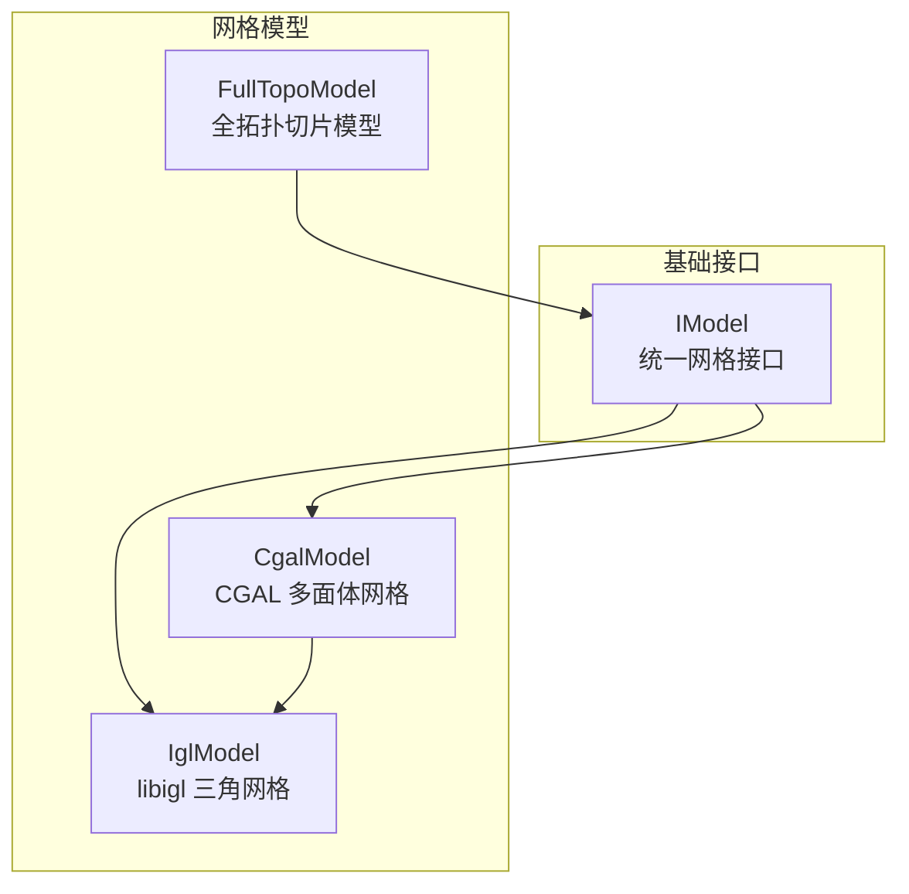
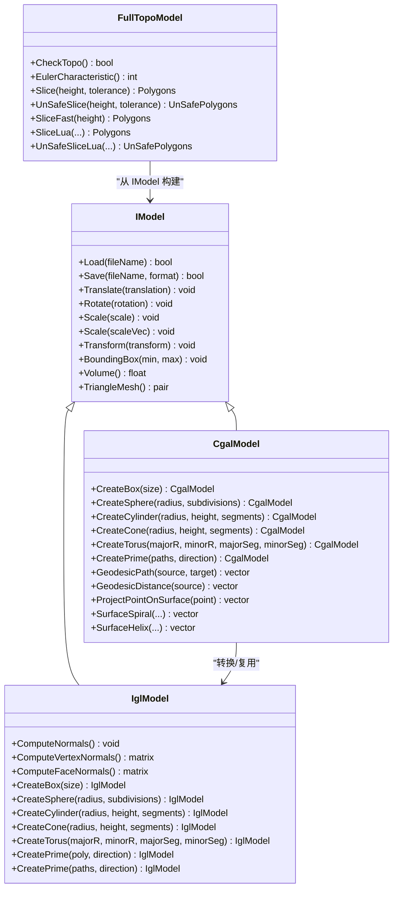
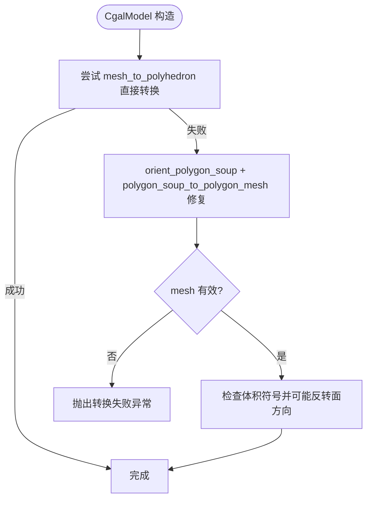
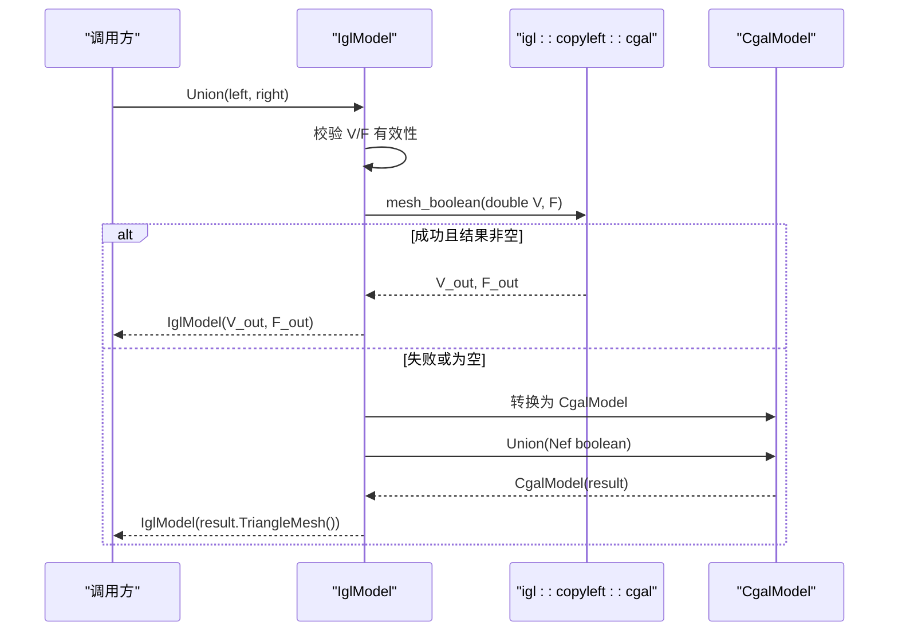
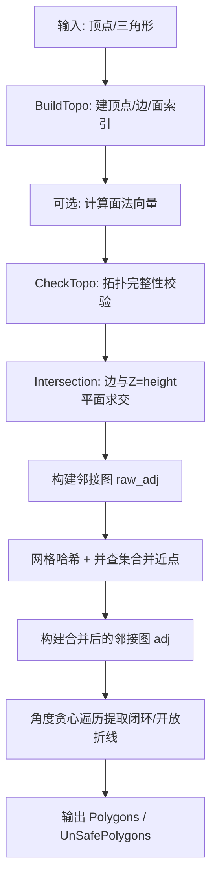
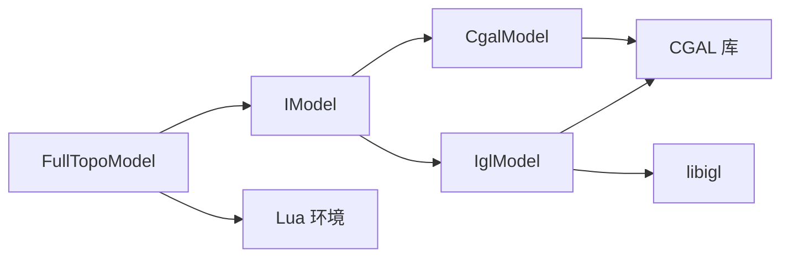

# 网格模型实现

<cite>
**本文引用的文件**   
- [CgalModel.hpp](file://meshmodel/CgalModel.hpp)
- [CgalModel.cpp](file://meshmodel/CgalModel.cpp)
- [IglModel.hpp](file://meshmodel/IglModel.hpp)
- [IglModel.cpp](file://meshmodel/IglModel.cpp)
- [FullTopoModel.hpp](file://meshmodel/FullTopoModel.hpp)
- [FullTopoModel.cpp](file://meshmodel/FullTopoModel.cpp)
- [IModel.hpp](file://base/IModel.hpp)
</cite>

## 目录
1. [引言](#引言)
2. [项目结构](#项目结构)
3. [核心组件](#核心组件)
4. [架构总览](#架构总览)
5. [详细组件分析](#详细组件分析)
6. [依赖关系分析](#依赖关系分析)
7. [性能与内存特性](#性能与内存特性)
8. [高级功能与使用示例](#高级功能与使用示例)
9. [故障排查指南](#故障排查指南)
10. [结论](#结论)

## 引言
本技术文档聚焦 HsBaSlicer 的网格模型实现，围绕三类核心模型展开：
- CgalModel：基于 CGAL 的多面体网格模型，提供布尔运算、几何内核、表面测地线等高级能力。
- IglModel：基于 libigl 的高效三角网格模型，侧重矩阵化数据、快速读写、法向量计算与布尔运算（可选 CGAL）。
- FullTopoModel：面向切片的全拓扑重建模型，显式维护顶点、边、面的双向邻接关系，支持安全/不安全切片及 Lua 扩展。

文档将解释各模型的适用场景、性能特点、内存模式，并给出网格验证、修复、简化等高级功能的实践建议。

## 项目结构
HsBaSlicer 在 meshmodel 目录下提供三种网格模型实现，统一通过 base/IModel.hpp 定义的 IModel 接口暴露通用能力（加载/保存、变换、包围盒、体积、三角网格导出）。

**图表来源**
- [IModel.hpp:110-139](file://base/IModel.hpp#L110-L139)
- [CgalModel.hpp:34-155](file://meshmodel/CgalModel.hpp#L34-L155)
- [IglModel.hpp:26-121](file://meshmodel/IglModel.hpp#L26-L121)
- [FullTopoModel.hpp:53-142](file://meshmodel/FullTopoModel.hpp#L53-L142)

**章节来源**
- [IModel.hpp:110-139](file://base/IModel.hpp#L110-L139)
- [CgalModel.hpp:34-155](file://meshmodel/CgalModel.hpp#L34-L155)
- [IglModel.hpp:26-121](file://meshmodel/IglModel.hpp#L26-L121)
- [FullTopoModel.hpp:53-142](file://meshmodel/FullTopoModel.hpp#L53-L142)

## 核心组件
- IModel：定义统一的网格抽象，包括 Load/Save、Translate/Rotate/Scale/Transform、BoundingBox、Volume、TriangleMesh。
- CgalModel：封装 CGAL::Polyhedron_3，提供布尔运算（Nef）、几何构造、表面测地线/螺旋/路径投影等。
- IglModel：以 Eigen 矩阵存储顶点/面/法向量，提供快速 IO、法向量计算、布尔运算（可选 CGAL）和多种基本体生成。
- FullTopoModel：从 IModel 或原始顶点/三角形构建全拓扑结构（Vertex/Edge/Face），提供切片、欧拉特征、Lua 脚本扩展。

**章节来源**
- [IModel.hpp:110-139](file://base/IModel.hpp#L110-L139)
- [CgalModel.hpp:34-155](file://meshmodel/CgalModel.hpp#L34-L155)
- [IglModel.hpp:26-121](file://meshmodel/IglModel.hpp#L26-L121)
- [FullTopoModel.hpp:53-142](file://meshmodel/FullTopoModel.hpp#L53-L142)

## 架构总览
下图展示三个模型之间的关系以及它们与 IModel 的集成方式。

**图表来源**
- [IModel.hpp:110-139](file://base/IModel.hpp#L110-L139)
- [CgalModel.hpp:34-155](file://meshmodel/CgalModel.hpp#L34-L155)
- [IglModel.hpp:26-121](file://meshmodel/IglModel.hpp#L26-L121)
- [FullTopoModel.hpp:53-142](file://meshmodel/FullTopoModel.hpp#L53-L142)

## 详细组件分析

### CgalModel：基于 CGAL 的网格处理与拓扑支持
- 内部数据结构：CGAL::Polyhedron_3<EpicKernel>，使用精确谓词/非精确构造内核，保证几何判断稳定性。
- 主要能力：
  - 文件 IO：STL/OFF/PLY/OBJ 等格式读写；加载后强制三角化以保证下游一致性。
  - 变换：平移、旋转、缩放、仿射/刚体变换均通过 CGAL 的仿射变换作用于网格。
  - 查询：包围盒遍历点集；体积通过 CGAL 计算。
  - 布尔运算：Union/Intersection/Difference/Xor 基于 Nef_polyhedron_3，返回新的 CgalModel。
  - 几何构造：CreateBox/Sphere/Cylinder/Cone/Torus 直接生成闭合、定向正确的多面体。
  - 拉伸 CreatePrime：对单个或多个二维轮廓进行三角化与拉伸，确保底面/顶面/侧面法向一致，必要时反转面方向以保持正体积。
  - 表面操作：测地线路径、测地距离、最近点投影、螺旋/螺旋线生成。
- 错误处理与修复：
  - 从 (V,F) 构造时若直接转换失败，会尝试 orient_polygon_soup + polygon_soup_to_polygon_mesh 修复，并检查 volume 符号以修正面方向。
  - 空网格输入抛出运行时异常。

**图表来源**
- [CgalModel.cpp:42-118](file://meshmodel/CgalModel.cpp#L42-L118)

**章节来源**
- [CgalModel.hpp:34-155](file://meshmodel/CgalModel.hpp#L34-L155)
- [CgalModel.cpp:42-118](file://meshmodel/CgalModel.cpp#L42-L118)
- [CgalModel.cpp:121-237](file://meshmodel/CgalModel.cpp#L121-L237)
- [CgalModel.cpp:238-276](file://meshmodel/CgalModel.cpp#L238-L276)
- [CgalModel.cpp:278-445](file://meshmodel/CgalModel.cpp#L278-L445)
- [CgalModel.cpp:625-733](file://meshmodel/CgalModel.cpp#L625-L733)
- [CgalModel.cpp:735-955](file://meshmodel/CgalModel.cpp#L735-L955)

### IglModel：基于 libigl 的高效网格算法
- 内部数据结构：Eigen::MatrixXf vertices_、Eigen::MatrixXi faces_、Eigen::MatrixXf normals_（可选）。
- 主要能力：
  - 文件 IO：STL/OBJ/PLY/OFF 等格式的读取与写入。
  - 变换：行主序矩阵下的平移、旋转、缩放、齐次变换，同时更新法向量。
  - 查询：包围盒列极值；体积通过添加原点四面体求和绝对值。
  - 法向量：ComputeNormals/ComputeVertexNormals/ComputeFaceNormals。
  - 布尔运算：优先调用 igl::copyleft::cgal::mesh_boolean（需 double 精度），失败则回退到 CgalModel 的 Nef 布尔。
  - 几何构造：CreateBox/Sphere/Cylinder/Cone/Torus 生成外法向一致的网格。
  - 拉伸 CreatePrime：对单/多轮廓三角化并构建顶/底/侧面，保持法向一致。
- 错误处理与健壮性：
  - 布尔运算前校验顶点有限性与索引范围，避免无效网格。
  - 未启用 CGAL 时布尔函数抛出“不支持”异常。

**图表来源**
- [IglModel.cpp:195-246](file://meshmodel/IglModel.cpp#L195-L246)
- [IglModel.cpp:248-294](file://meshmodel/IglModel.cpp#L248-L294)
- [CgalModel.cpp:238-276](file://meshmodel/CgalModel.cpp#L238-L276)

**章节来源**
- [IglModel.hpp:26-121](file://meshmodel/IglModel.hpp#L26-L121)
- [IglModel.cpp:37-62](file://meshmodel/IglModel.cpp#L37-L62)
- [IglModel.cpp:64-99](file://meshmodel/IglModel.cpp#L64-L99)
- [IglModel.cpp:101-150](file://meshmodel/IglModel.cpp#L101-L150)
- [IglModel.cpp:152-193](file://meshmodel/IglModel.cpp#L152-L193)
- [IglModel.cpp:195-246](file://meshmodel/IglModel.cpp#L195-L246)
- [IglModel.cpp:248-391](file://meshmodel/IglModel.cpp#L248-L391)
- [IglModel.cpp:411-596](file://meshmodel/IglModel.cpp#L411-L596)
- [IglModel.cpp:598-713](file://meshmodel/IglModel.cpp#L598-L713)
- [IglModel.cpp:715-932](file://meshmodel/IglModel.cpp#L715-L932)

### FullTopoModel：全拓扑数据结构与切片
- 数据结构设计：
  - Vertex：位置 + 关联的面/边列表。
  - Edge：两端点 + 相邻两面（边界一面为 -1）。
  - Face：三角形三顶点 + 三条边 + 法向量（可选）。
- 拓扑重建 BuildTopo：
  - 初始化顶点数组。
  - 使用哈希表按无序端点对归一化边键，合并重复边，建立边索引。
  - 为每个面记录 edges 三元组，并反向填充边的 faces 与顶点的 faces/edges 列表。
  - 可选计算面法向量。
- 完整性检查 CheckTopo：
  - 验证所有面的顶点/边索引有效且覆盖全部顶点/边集合。
  - 验证所有边的顶点/面索引有效且覆盖全部顶点/面集合。
- 切片算法：
  - Intersection：线段与 Z=height 平面相交计算。
  - Slice/UnSafeSlice：遍历面边交点，构建邻接图，网格哈希+并查集合并近点，角度贪心选择下一邻接点提取闭环（Safe）或开放折线（Unsafe）。
  - SliceFast：先检查拓扑完整性再快速构建结果。
  - SliceLua/UnSafeSliceLua：将 V/E/F 与 height 注入 Lua 环境，由脚本输出多边形。

**图表来源**
- [FullTopoModel.cpp:50-158](file://meshmodel/FullTopoModel.cpp#L50-L158)
- [FullTopoModel.cpp:160-218](file://meshmodel/FullTopoModel.cpp#L160-L218)
- [FullTopoModel.cpp:246-272](file://meshmodel/FullTopoModel.cpp#L246-L272)
- [FullTopoModel.cpp:328-600](file://meshmodel/FullTopoModel.cpp#L328-L600)
- [FullTopoModel.cpp:604-800](file://meshmodel/FullTopoModel.cpp#L604-L800)

**章节来源**
- [FullTopoModel.hpp:53-142](file://meshmodel/FullTopoModel.hpp#L53-L142)
- [FullTopoModel.cpp:27-48](file://meshmodel/FullTopoModel.cpp#L27-L48)
- [FullTopoModel.cpp:50-158](file://meshmodel/FullTopoModel.cpp#L50-L158)
- [FullTopoModel.cpp:160-218](file://meshmodel/FullTopoModel.cpp#L160-L218)
- [FullTopoModel.cpp:220-244](file://meshmodel/FullTopoModel.cpp#L220-L244)
- [FullTopoModel.cpp:246-272](file://meshmodel/FullTopoModel.cpp#L246-L272)
- [FullTopoModel.cpp:274-324](file://meshmodel/FullTopoModel.cpp#L274-L324)
- [FullTopoModel.cpp:328-600](file://meshmodel/FullTopoModel.cpp#L328-L600)
- [FullTopoModel.cpp:604-800](file://meshmodel/FullTopoModel.cpp#L604-L800)

## 依赖关系分析
- IModel 作为抽象基类被 CgalModel 与 IglModel 继承，提供统一 API。
- CgalModel 依赖 CGAL 库（Polyhedron_3、Nef_polyhedron_3、Polygon_mesh_processing、Surface_mesh_shortest_path 等）。
- IglModel 依赖 libigl（IO、法向量、体积、布尔运算），并在启用 USE_CGAL 时依赖 CGAL 进行布尔运算回退。
- FullTopoModel 依赖 IModel 获取三角网格，并使用 igl 计算法向量；同时与 Lua 交互以支持脚本化切片。

**图表来源**
- [CgalModel.hpp:14-22](file://meshmodel/CgalModel.hpp#L14-L22)
- [IglModel.hpp:9-14](file://meshmodel/IglModel.hpp#L9-L14)
- [FullTopoModel.hpp:11-16](file://meshmodel/FullTopoModel.hpp#L11-L16)

**章节来源**
- [CgalModel.hpp:14-22](file://meshmodel/CgalModel.hpp#L14-L22)
- [IglModel.hpp:9-14](file://meshmodel/IglModel.hpp#L9-L14)
- [FullTopoModel.hpp:11-16](file://meshmodel/FullTopoModel.hpp#L11-L16)

## 性能与内存特性
- CgalModel：
  - 优点：CGAL 内核稳定，布尔运算与几何构造能力强；适合需要高鲁棒性的几何处理。
  - 缺点：内存占用较高（Polyhedron_3/Nef 结构复杂）；大量几何操作开销较大。
  - 优化点：避免频繁复制；批量布尔运算；仅在必要时执行表面测地线/螺旋等昂贵操作。
- IglModel：
  - 优点：矩阵化数据缓存友好；IO 与常规算法高效；布尔运算有双路径（libigl CGAL + Nef 回退）。
  - 缺点：浮点误差可能导致布尔不稳定；需确保顶点坐标精度与法向一致性。
  - 优化点：合理使用 move 语义；按需计算法向量；布尔前先做简单有效性校验。
- FullTopoModel：
  - 优点：显式拓扑便于切片与自定义处理；一次构建多次切片可复用拓扑。
  - 缺点：内存开销高于纯 (V,F) 表示；构建拓扑时间不可忽略。
  - 优化点：仅在使用切片/Lua 时构建；合理设置 tolerance 控制网格合并粒度。

[本节为一般性指导，不直接分析具体文件]

## 高级功能与使用示例

### 网格验证与修复
- CgalModel 构造时的自动修复流程：
  - 先尝试直接转换；失败则 orient_polygon_soup + polygon_soup_to_polygon_mesh；最后根据体积符号修正面方向。
- IglModel 布尔前的有效性校验：
  - 检查顶点有限性与索引范围，避免无效网格导致布尔失败。
- FullTopoModel 拓扑完整性检查：
  - CheckTopo 验证顶点/边/面索引一致性与覆盖度。

**章节来源**
- [CgalModel.cpp:42-118](file://meshmodel/CgalModel.cpp#L42-L118)
- [IglModel.cpp:248-294](file://meshmodel/IglModel.cpp#L248-L294)
- [FullTopoModel.cpp:160-218](file://meshmodel/FullTopoModel.cpp#L160-L218)

### 网格简化与质量控制
- 建议在进入布尔或切片前：
  - 对 CgalModel：确保三角化与面方向正确（CreatePrime 中已强制三角化与方向校正）。
  - 对 IglModel：ComputeNormals 并确保法向外向一致（CreateBox/Sphere 等构造器已保证）。
  - 对 FullTopoModel：使用 CheckTopo 后再进行 SliceFast。

**章节来源**
- [CgalModel.cpp:121-132](file://meshmodel/CgalModel.cpp#L121-L132)
- [CgalModel.cpp:721-733](file://meshmodel/CgalModel.cpp#L721-L733)
- [IglModel.cpp:170-185](file://meshmodel/IglModel.cpp#L170-L185)
- [FullTopoModel.cpp:160-218](file://meshmodel/FullTopoModel.cpp#L160-L218)

### 布尔运算最佳实践
- IglModel：
  - 优先使用 igl::copyleft::cgal::mesh_boolean（double 精度），失败则回退到 CgalModel 的 Nef 布尔。
  - 输入网格应无自交、法向外向一致。
- CgalModel：
  - 直接使用 Nef 布尔，适合复杂形状组合。

**章节来源**
- [IglModel.cpp:195-246](file://meshmodel/IglModel.cpp#L195-L246)
- [CgalModel.cpp:238-276](file://meshmodel/CgalModel.cpp#L238-L276)

### 切片与拓扑重建
- FullTopoModel：
  - 使用 Slice 获取封闭轮廓；UnSafeSlice 允许开放折线；SliceFast 要求拓扑完整。
  - 通过 Lua 脚本自定义切片逻辑，传入 V/E/F 与 height。

**章节来源**
- [FullTopoModel.cpp:328-600](file://meshmodel/FullTopoModel.cpp#L328-L600)
- [FullTopoModel.cpp:604-800](file://meshmodel/FullTopoModel.cpp#L604-L800)
- [FullTopoModel.cpp:274-324](file://meshmodel/FullTopoModel.cpp#L274-L324)

## 故障排查指南
- 布尔运算结果为空：
  - 检查输入网格是否有效（顶点有限、索引合法、法向外向）。
  - 若使用 IglModel 布尔失败，确认是否启用 CGAL 并回退到 CgalModel。
- 体积为负或面方向异常：
  - CgalModel 会在构造与拉伸后检查体积符号并可能反转面方向。
  - IglModel 构造器生成的基本体已保证外法向一致。
- 切片结果异常：
  - 调整 tolerance 参数以控制近点合并阈值。
  - 使用 CheckTopo 验证拓扑完整性，必要时重新构建 FullTopoModel。
- 文件格式不支持：
  - 确认 ModelFormat 枚举与对应 IO 实现是否匹配。

**章节来源**
- [IglModel.cpp:248-391](file://meshmodel/IglModel.cpp#L248-L391)
- [CgalModel.cpp:121-157](file://meshmodel/CgalModel.cpp#L121-L157)
- [CgalModel.cpp:721-733](file://meshmodel/CgalModel.cpp#L721-L733)
- [FullTopoModel.cpp:160-218](file://meshmodel/FullTopoModel.cpp#L160-L218)

## 结论
- CgalModel 适合需要强几何内核与布尔能力的场景，但内存与计算成本较高。
- IglModel 适合高性能矩阵化网格处理，配合 libigl 与可选 CGAL 回退，兼顾效率与鲁棒性。
- FullTopoModel 面向切片应用，显式拓扑便于复杂处理与脚本扩展，但构建开销与内存占用更高。
- 在实际工程中，建议：
  - 预处理阶段使用 IglModel 快速 IO 与变换；
  - 复杂布尔与几何构造使用 CgalModel；
  - 切片与拓扑敏感算法使用 FullTopoModel，并在构建后执行 CheckTopo。

[本节为总结性内容，不直接分析具体文件]