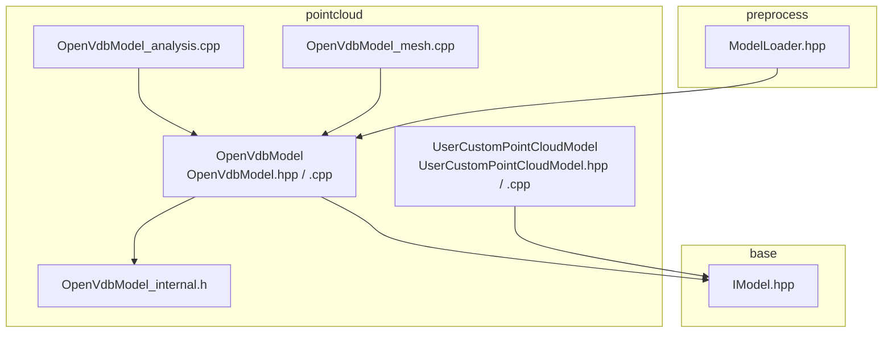
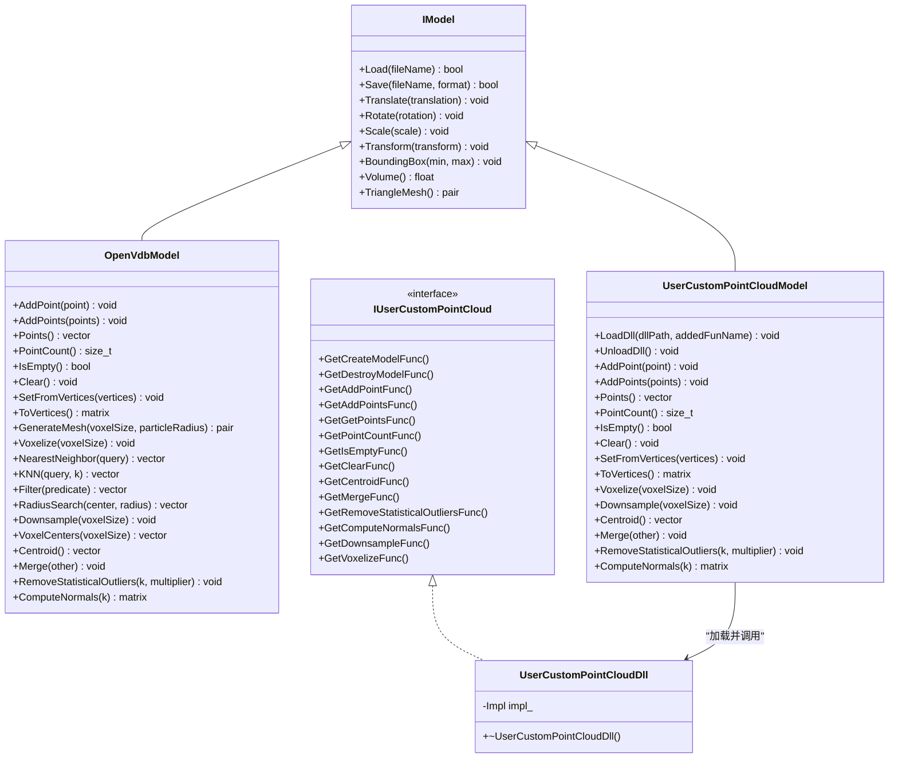
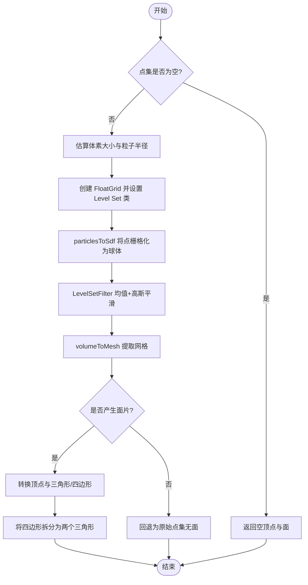
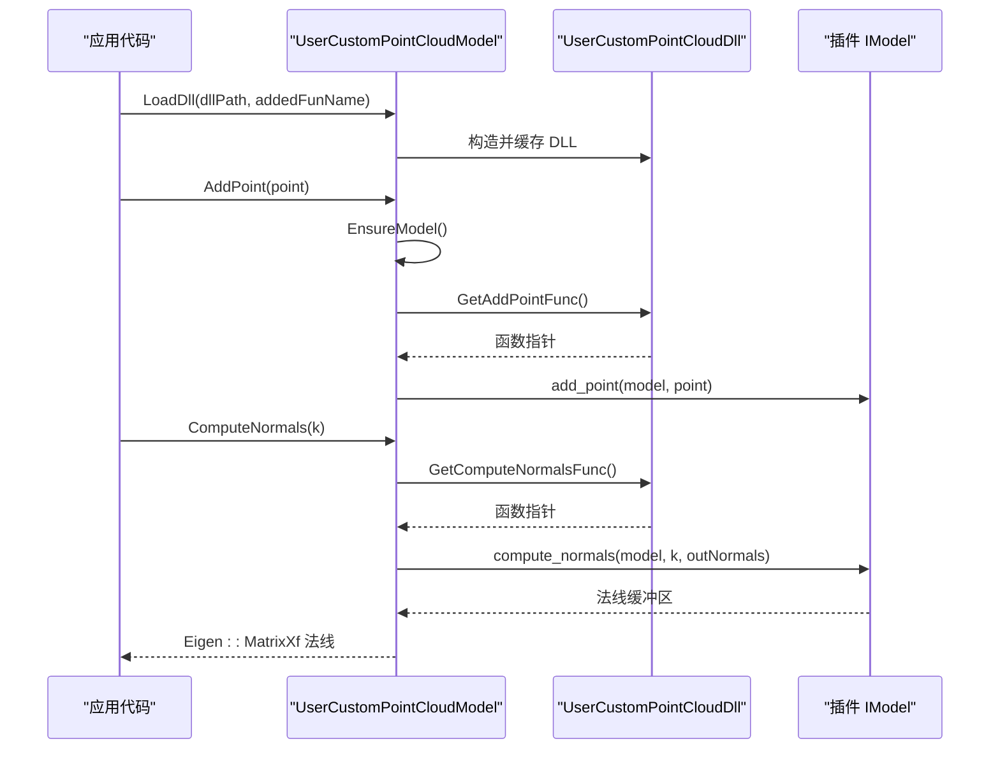
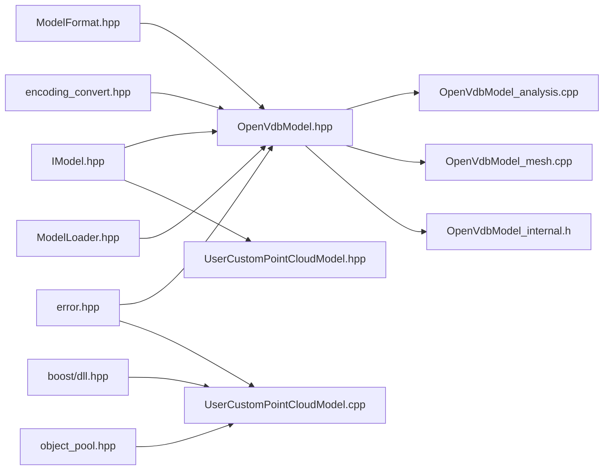

# 点云处理 (Point Cloud Processing)

<cite>
**本文引用的文件**   
- [OpenVdbModel.hpp](file://pointcloud/OpenVdbModel.hpp)
- [OpenVdbModel.cpp](file://pointcloud/OpenVdbModel.cpp)
- [OpenVdbModel_analysis.cpp](file://pointcloud/OpenVdbModel_analysis.cpp)
- [OpenVdbModel_mesh.cpp](file://pointcloud/OpenVdbModel_mesh.cpp)
- [OpenVdbModel_internal.h](file://pointcloud/OpenVdbModel_internal.h)
- [UserCustomPointCloudModel.hpp](file://pointcloud/UserCustomPointCloudModel.hpp)
- [UserCustomPointCloudModel.cpp](file://pointcloud/UserCustomPointCloudModel.cpp)
- [IModel.hpp](file://base/IModel.hpp)
- [ModelLoader.hpp](file://preprocess/ModelLoader.hpp)
</cite>

## 目录
1. [简介](#简介)
2. [项目结构](#项目结构)
3. [核心组件](#核心组件)
4. [架构总览](#架构总览)
5. [详细组件分析](#详细组件分析)
6. [依赖关系分析](#依赖关系分析)
7. [性能与内存管理](#性能与内存管理)
8. [API 参考](#api-参考)
9. [使用示例与最佳实践](#使用示例与最佳实践)
10. [故障排除](#故障排除)
11. [结论](#结论)

## 简介
本模块提供 HsBaSlicer 的点云处理能力，核心围绕两个实现：
- OpenVdbModel：基于 OpenVDB 体素网格的内置点云模型，支持加载、变换、查询、体素化、降采样、统计去噪、法线估计和基于水平集的网格重建。
- UserCustomPointCloudModel：通过外部 DLL/SO 插件加载用户自定义点云内核，暴露与 OpenVdbModel 一致的 C ABI 接口，便于替换或扩展底层实现。

该模块同时为上层预处理管线（如 ModelLoader）提供统一的 IModel 抽象，使点云数据能够无缝参与后续切片、路径生成等流程。

## 项目结构
pointcloud 目录包含点云模型的核心实现与内部辅助类型；base 中的 IModel 定义统一模型接口；preprocess 中的 ModelLoader 将点云能力集成到通用模型加载管线中。

**图表来源**
- [OpenVdbModel.hpp:20-116](file://pointcloud/OpenVdbModel.hpp#L20-L116)
- [UserCustomPointCloudModel.hpp:18-171](file://pointcloud/UserCustomPointCloudModel.hpp#L18-L171)
- [IModel.hpp:110-139](file://base/IModel.hpp#L110-L139)
- [ModelLoader.hpp:166-192](file://preprocess/ModelLoader.hpp#L166-L192)

**章节来源**
- [OpenVdbModel.hpp:1-119](file://pointcloud/OpenVdbModel.hpp#L1-L119)
- [UserCustomPointCloudModel.hpp:1-177](file://pointcloud/UserCustomPointCloudModel.hpp#L1-L177)
- [IModel.hpp:1-151](file://base/IModel.hpp#L1-L151)
- [ModelLoader.hpp:166-192](file://preprocess/ModelLoader.hpp#L166-L192)

## 核心组件
- OpenVdbModel：以 openvdb::Vec3fGrid 存储点坐标，提供点增删、批量读取、最近邻/KNN、半径搜索、体素化、降采样、质心、合并、统计去噪、法线估计以及基于 SDF 的三角网格生成。
- UserCustomPointCloudModel：封装动态库加载与函数符号解析，对外暴露与 OpenVdbModel 一致的方法集，所有点云操作委托给插件实现的 IModel 实例。
- IUserCustomPointCloud / UserCustomPointCloudDll：定义并加载用户插件的 C ABI 函数表，包括 create_model、add_point、compute_normals、voxelize 等。
- IModel：统一模型接口，定义 Load/Save、几何变换、包围盒、体积、三角网格等基础能力。

**章节来源**
- [OpenVdbModel.hpp:20-116](file://pointcloud/OpenVdbModel.hpp#L20-L116)
- [UserCustomPointCloudModel.hpp:18-171](file://pointcloud/UserCustomPointCloudModel.hpp#L18-L171)
- [IModel.hpp:110-139](file://base/IModel.hpp#L110-L139)

## 架构总览
点云处理在 HsBaSlicer 中的位置如下：
- 上层管线通过 IModel 抽象访问点云。
- OpenVdbModel 是默认实现，直接调用 OpenVDB 工具链进行空间索引、SDF 重建与网格提取。
- UserCustomPointCloudModel 作为插件代理层，允许第三方内核替换 OpenVDB 实现。

**图表来源**
- [IModel.hpp:110-139](file://base/IModel.hpp#L110-L139)
- [OpenVdbModel.hpp:20-116](file://pointcloud/OpenVdbModel.hpp#L20-L116)
- [UserCustomPointCloudModel.hpp:18-171](file://pointcloud/UserCustomPointCloudModel.hpp#L18-L171)

## 详细组件分析

### OpenVdbModel：OpenVDB 点云模型
OpenVdbModel 以 openvdb::Vec3fGrid 为存储后端，提供完整的点云生命周期管理与几何分析能力。

- 数据组织
  - 点坐标存储在 Vec3fGrid 的激活体素中，每个激活体素值即为一个三维点。
  - PointCount 返回 activeVoxelCount，Empty 判断为空集合。
- 文件 I/O
  - Load：自动识别 .vdb 与 .xyz/.txt；VDB 文件通过 openvdb::io::File 读取第一个 Vec3fGrid；文本点列表按行解析 x y z。
  - Save：支持 VDB 格式与 XYZ 文本格式；非点云格式会抛出异常。
- 几何变换
  - Translate/Rotate/Scale/Transform：遍历激活体素更新点坐标，支持多种 Eigen 变换类型。
- 查询与分析
  - NearestNeighbor：线性扫描最近点。
  - KNN：计算距离排序后取前 k。
  - RadiusSearch：基于 OpenVDB PointIndexGrid 的空间半径搜索。
  - Filter：按谓词过滤点集。
  - Centroid：点集均值。
  - Merge：合并另一个 OpenVdbModel 的点集。
  - RemoveStatisticalOutliers：基于 KNN 平均距离的统计离群点剔除。
  - ComputeNormals：对每个点的邻域协方差矩阵做特征分解，最小特征值方向作为法线。
- 体素化与网格重建
  - Voxelize：按 voxelSize 重新映射点到体素中心。
  - Downsample：基于 PointIndexGrid 去重体素内点。
  - GenerateMesh：将点集转换为 Level Set，平滑后 marching cubes 提取三角面片，并将四边形三角化。

**图表来源**
- [OpenVdbModel_mesh.cpp:21-118](file://pointcloud/OpenVdbModel_mesh.cpp#L21-L118)

**章节来源**
- [OpenVdbModel.hpp:20-116](file://pointcloud/OpenVdbModel.hpp#L20-L116)
- [OpenVdbModel.cpp:154-227](file://pointcloud/OpenVdbModel.cpp#L154-L227)
- [OpenVdbModel.cpp:229-331](file://pointcloud/OpenVdbModel.cpp#L229-L331)
- [OpenVdbModel.cpp:338-422](file://pointcloud/OpenVdbModel.cpp#L338-L422)
- [OpenVdbModel.cpp:424-564](file://pointcloud/OpenVdbModel.cpp#L424-L564)
- [OpenVdbModel_analysis.cpp:27-212](file://pointcloud/OpenVdbModel_analysis.cpp#L27-L212)
- [OpenVdbModel_mesh.cpp:21-118](file://pointcloud/OpenVdbModel_mesh.cpp#L21-L118)
- [OpenVdbModel_internal.h:23-94](file://pointcloud/OpenVdbModel_internal.h#L23-L94)

### UserCustomPointCloudModel：用户自定义点云模型
UserCustomPointCloudModel 通过 UserCustomPointCloudDll 加载外部 DLL/SO，并以 IUserCustomPointCloud 定义的函数指针表调用插件实现的点云内核。

- 插件加载
  - LoadDll：从 NamedObjectPool 获取或创建 dll 实例，缓存以避免重复加载。
  - EnsureModel：首次使用时调用插件的 create_model 函数构造 IModel*。
- 接口代理
  - 所有点云方法（AddPoint/AddPoints/Points/PointCount/IsEmpty/Clear/SetFromVertices/ToVertices/Voxelize/Downsample/Centroid/Merge/RemoveStatisticalOutliers/ComputeNormals）均转发至插件 IModel。
  - 数据 ABI：Eigen::Vector3f 与 HsBaVector3f_t 布局一致，可直接 reinterpret_cast 传递。
- 错误处理
  - 未加载 DLL 或未找到对应函数时抛出 RuntimeError。
  - Merge 要求两个模型来自同一 DLL，否则抛出不兼容错误。

**图表来源**
- [UserCustomPointCloudModel.cpp:175-209](file://pointcloud/UserCustomPointCloudModel.cpp#L175-L209)
- [UserCustomPointCloudModel.cpp:344-381](file://pointcloud/UserCustomPointCloudModel.cpp#L344-L381)
- [UserCustomPointCloudModel.cpp:521-541](file://pointcloud/UserCustomPointCloudModel.cpp#L521-L541)

**章节来源**
- [UserCustomPointCloudModel.hpp:18-171](file://pointcloud/UserCustomPointCloudModel.hpp#L18-L171)
- [UserCustomPointCloudModel.cpp:1-546](file://pointcloud/UserCustomPointCloudModel.cpp#L1-L546)

### IModel 与 ModelFormat
IModel 定义了统一的模型抽象，包括文件 I/O、几何变换、包围盒、体积与三角网格。ModelFormat 枚举中包含点云相关格式：
- XYZ：ASCII 文本点列表。
- VDB：OpenVDB 体素网格。

**章节来源**
- [IModel.hpp:65-109](file://base/IModel.hpp#L65-L109)
- [IModel.hpp:110-139](file://base/IModel.hpp#L110-L139)

## 依赖关系分析
- OpenVdbModel 依赖：
  - base/IModel.hpp：继承 IModel。
  - base/ModelFormat.hpp：判断点云格式。
  - base/encoding_convert.hpp：UTF-8 与本地编码转换。
  - base/error.hpp：抛出 InvalidArgumentError/IOError/NotSupportedError。
  - openvdb/*：Vec3fGrid、tools/PointIndexGrid、tools/ParticlesToLevelSet、tools/LevelSetFilter、tools/VolumeToMesh。
- UserCustomPointCloudModel 依赖：
  - boost/dll.hpp：动态库加载与符号解析。
  - base/object_pool.hpp：NamedObjectPool 缓存 DLL。
  - base/error.hpp：RuntimeError。
- preprocess/ModelLoader.hpp：
  - 提供 RemovePointCloudOutliers、PointCloudCentroid、PointCloudNormals 等高层 API，内部将 IModel 下转为 OpenVdbModel 调用点云专用方法。

**图表来源**
- [OpenVdbModel.hpp:9-16](file://pointcloud/OpenVdbModel.hpp#L9-L16)
- [OpenVdbModel.cpp:18-22](file://pointcloud/OpenVdbModel.cpp#L18-L22)
- [OpenVdbModel_analysis.cpp:15-19](file://pointcloud/OpenVdbModel_analysis.cpp#L15-L19)
- [OpenVdbModel_mesh.cpp:12-16](file://pointcloud/OpenVdbModel_mesh.cpp#L12-L16)
- [UserCustomPointCloudModel.cpp:9-13](file://pointcloud/UserCustomPointCloudModel.cpp#L9-L13)
- [ModelLoader.hpp:166-192](file://preprocess/ModelLoader.hpp#L166-L192)

**章节来源**
- [OpenVdbModel.hpp:9-16](file://pointcloud/OpenVdbModel.hpp#L9-L16)
- [OpenVdbModel.cpp:18-22](file://pointcloud/OpenVdbModel.cpp#L18-L22)
- [OpenVdbModel_analysis.cpp:15-19](file://pointcloud/OpenVdbModel_analysis.cpp#L15-L19)
- [OpenVdbModel_mesh.cpp:12-16](file://pointcloud/OpenVdbModel_mesh.cpp#L12-L16)
- [UserCustomPointCloudModel.cpp:9-13](file://pointcloud/UserCustomPointCloudModel.cpp#L9-L13)
- [ModelLoader.hpp:166-192](file://preprocess/ModelLoader.hpp#L166-L192)

## 性能与内存管理
- 点存储与遍历
  - OpenVdbModel 使用 Vec3fGrid 的激活体素存储点，PointCount 直接返回 activeVoxelCount，避免额外计数结构。
  - Points()/ToVertices() 会复制全部点，建议在大数据量场景下谨慎调用，优先使用迭代器或局部查询。
- 空间索引
  - RadiusSearch 使用 PointIndexGrid，体素大小取 radius*0.25 且不低于 1e-3，适合大规模半径查询。
  - Downsample 使用 PointIndexGrid 去重体素内点，时间复杂度近似 O(n)，但存在 set 键字符串开销。
- 法线估计
  - ComputeNormals 对每个点执行 KNN 与协方差特征分解，复杂度约 O(n·k log k) 或更高，建议合理选择 k（默认 12）。
- 网格重建
  - GenerateMesh 先估算 voxelSize 与 particleRadius，再构建 SDF、平滑、marching cubes，最后三角化四边形。
  - 当无面片输出时回退为原始点集，避免空网格。
- 插件机制
  - UserCustomPointCloudModel 使用 NamedObjectPool 缓存 DLL，减少重复加载成本。
  - 跨 ABI 数据传递使用 HsBaVector3f_t，避免拷贝 Eigen 对象。

[本节为通用性能指导，不直接分析具体文件]

## API 参考

### OpenVdbModel 主要 API
- 构造与赋值
  - OpenVdbModel()
  - OpenVdbModel(const std::string& file_path)
  - OpenVdbModel(const std::pair<Eigen::MatrixXf, Eigen::MatrixXi>& mesh)
  - operator=(const std::pair<Eigen::MatrixXf, Eigen::MatrixXi>& mesh)
- 文件 I/O
  - Load(std::string_view fileName) -> bool
  - Save(std::string_view fileName, const ModelFormat format) -> bool
- 几何变换
  - Translate(Eigen::Vector3f)
  - Rotate(Eigen::Quaternionf)
  - Scale(float)
  - Scale(Eigen::Vector3f)
  - Transform(Eigen::Isometry3f)
  - Transform(Eigen::Matrix4f)
  - Transform(Eigen::Transform<float, 3, Eigen::Affine>)
- 几何属性
  - BoundingBox(Eigen::Vector3f&, Eigen::Vector3f&)
  - Volume() -> float
  - TriangleMesh() -> pair
- 点云操作
  - AddPoint(Eigen::Vector3f)
  - AddPoints(std::vector<Eigen::Vector3f>)
  - Points() -> std::vector<Eigen::Vector3f>
  - PointCount() -> size_t
  - IsEmpty() -> bool
  - Clear()
  - SetFromVertices(Eigen::MatrixXf)
  - ToVertices() -> Eigen::MatrixXf
  - ToVerticesFaces() -> pair
  - GenerateMesh(float voxelSize = 0.0f, float particleRadius = 0.0f) -> pair
  - Voxelize(float voxelSize)
  - NearestNeighbor(Eigen::Vector3f) -> std::vector<Eigen::Vector3f>
  - KNN(Eigen::Vector3f, size_t k) -> std::vector<Eigen::Vector3f>
  - Filter(std::function<bool(const Eigen::Vector3f&)>) -> std::vector<Eigen::Vector3f>
  - RadiusSearch(Eigen::Vector3f center, float radius) -> std::vector<Eigen::Vector3f>
  - Downsample(float voxelSize)
  - VoxelCenters(float voxelSize) -> std::vector<Eigen::Vector3f>
  - Centroid() -> Eigen::Vector3f
  - Merge(const OpenVdbModel& other)
  - RemoveStatisticalOutliers(size_t k, float multiplier = 1.0f)
  - ComputeNormals(size_t k = 12) -> Eigen::MatrixXf

**章节来源**
- [OpenVdbModel.hpp:30-111](file://pointcloud/OpenVdbModel.hpp#L30-L111)

### UserCustomPointCloudModel 主要 API
- 插件管理
  - LoadDll(std::string_view dllPath, std::string_view addedFunName)
  - UnloadDll()
- 文件 I/O
  - Load(std::string_view fileName) -> bool
  - Save(std::string_view fileName, const ModelFormat format) -> bool
- 几何变换
  - Translate/Eigen::Vector3f
  - Rotate/Eigen::Quaternionf
  - Scale(float)/Scale(Eigen::Vector3f)
  - Transform(Eigen::Isometry3f)/Transform(Eigen::Matrix4f)/Transform(Eigen::Transform<float, 3, Eigen::Affine>)
- 几何属性
  - BoundingBox(Eigen::Vector3f&, Eigen::Vector3f&)
  - Volume() -> float
  - TriangleMesh() -> pair
- 点云操作
  - AddPoint/AddPoints/Points/PointCount/IsEmpty/Clear
  - SetFromVertices/ToVertices
  - Voxelize/Downsample
  - Centroid/Merge
  - RemoveStatisticalOutliers(k, multiplier)
  - ComputeNormals(k) -> Eigen::MatrixXf

**章节来源**
- [UserCustomPointCloudModel.hpp:96-165](file://pointcloud/UserCustomPointCloudModel.hpp#L96-L165)

### IUserCustomPointCloud 与 UserCustomPointCloudDll
- IUserCustomPointCloud：定义 C ABI 函数指针类型及 getter。
- UserCustomPointCloudDll：加载 DLL 并解析符号，返回各函数指针。

**章节来源**
- [UserCustomPointCloudModel.hpp:26-88](file://pointcloud/UserCustomPointCloudModel.hpp#L26-L88)

## 使用示例与最佳实践

### 加载与保存点云
- 从 VDB 文件加载：
  - 使用 OpenVdbModel::Load 传入 .vdb 路径，内部会自动打开并读取第一个 Vec3fGrid。
- 从 XYZ/TXT 文本加载：
  - 使用 OpenVdbModel::Load 传入 .xyz 或 .txt 路径，逐行解析 x y z。
- 保存到 VDB：
  - 使用 OpenVdbModel::Save 指定 .vdb 路径，内部写入 grid_。
- 保存到 XYZ：
  - 使用 OpenVdbModel::Save 指定 .xyz 或 .txt 路径，内部逐点写出。

**章节来源**
- [OpenVdbModel.cpp:154-227](file://pointcloud/OpenVdbModel.cpp#L154-L227)

### 点云分析与处理
- 最近邻与 KNN：
  - NearestNeighbor 用于单点最近邻；KNN 返回排序后的 k 个邻居。
- 半径搜索：
  - RadiusSearch 使用 PointIndexGrid 加速，适合大规模点集的空间范围查询。
- 体素化与降采样：
  - Voxelize 将点映射到体素中心；Downsample 去除同体素内的重复点。
- 统计去噪：
  - RemoveStatisticalOutliers 基于 KNN 平均距离阈值剔除离群点。
- 法线估计：
  - ComputeNormals 对每个点邻域协方差矩阵求最小特征向量作为法线。

**章节来源**
- [OpenVdbModel.cpp:424-564](file://pointcloud/OpenVdbModel.cpp#L424-L564)
- [OpenVdbModel_analysis.cpp:27-212](file://pointcloud/OpenVdbModel_analysis.cpp#L27-L212)

### 网格重建
- 调用 GenerateMesh：
  - 可传入 voxelSize 与 particleRadius；若为 0，则根据包围盒尺寸与点密度自动估算。
  - 内部流程：创建 SDF -> 栅格化 -> 平滑 -> marching cubes -> 三角化四边形。
- 若无面片输出，回退为原始点集。

**章节来源**
- [OpenVdbModel_mesh.cpp:21-118](file://pointcloud/OpenVdbModel_mesh.cpp#L21-L118)

### 使用用户自定义插件
- 加载插件：
  - UserCustomPointCloudModel::LoadDll 指定 DLL 路径与 addedFunName。
- 使用点云 API：
  - 所有点云方法与 OpenVdbModel 一致，内部通过 IUserCustomPointCloud 函数指针调用插件实现。
- 注意事项：
  - 确保插件导出符合约定的 C ABI 函数名（如 _create_model、_add_point 等）。
  - Merge 仅支持相同 DLL 的两个模型。

**章节来源**
- [UserCustomPointCloudModel.cpp:175-209](file://pointcloud/UserCustomPointCloudModel.cpp#L175-L209)
- [UserCustomPointCloudModel.cpp:344-541](file://pointcloud/UserCustomPointCloudModel.cpp#L344-L541)

## 故障排除
- 文件格式不支持：
  - Save 非点云格式会抛出 NotSupportedError。
- 参数非法：
  - RadiusSearch/Downsample/Voxelize 等需要正数参数，否则抛出 InvalidArgumentError。
- 插件问题：
  - 未加载 DLL 或未找到函数符号会抛出 RuntimeError。
  - Merge 不同 DLL 的模型会抛出不兼容错误。
- 空点集：
  - BoundingBox 对空点集返回零向量；Volume 返回 0；Centroid 返回零向量。

**章节来源**
- [OpenVdbModel.cpp:206-227](file://pointcloud/OpenVdbModel.cpp#L206-L227)
- [OpenVdbModel_analysis.cpp:27-71](file://pointcloud/OpenVdbModel_analysis.cpp#L27-L71)
- [UserCustomPointCloudModel.cpp:193-209](file://pointcloud/UserCustomPointCloudModel.cpp#L193-L209)
- [UserCustomPointCloudModel.cpp:490-504](file://pointcloud/UserCustomPointCloudModel.cpp#L490-L504)

## 结论
HsBaSlicer 的点云处理模块通过 OpenVdbModel 提供了强大的内置点云能力，并通过 UserCustomPointCloudModel 实现了可扩展的插件机制。两者共同遵循 IModel 抽象，使得点云数据可以无缝接入更广泛的切片与路径生成流程。对于大规模点云，推荐优先使用空间索引查询（RadiusSearch）、体素化与降采样、以及合理的网格重建参数，以获得更好的性能与内存占用表现。

[本节为总结性内容，不直接分析具体文件]