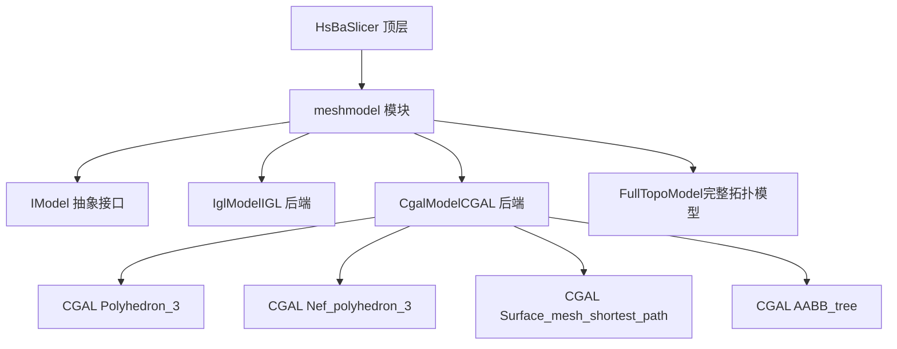
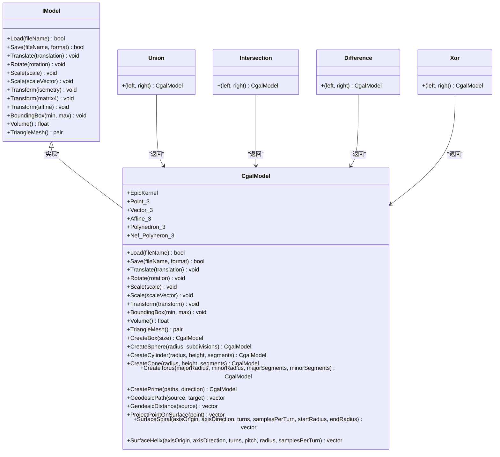
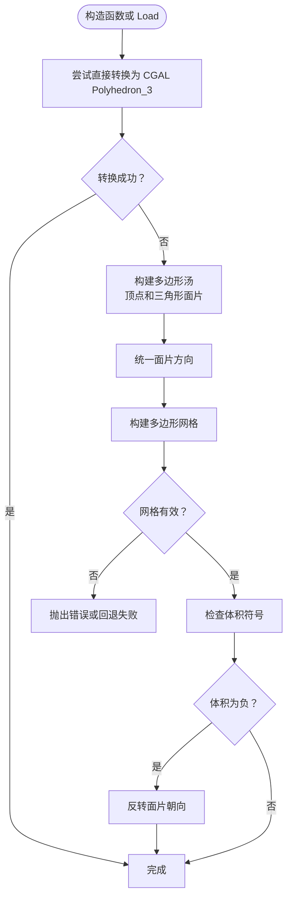
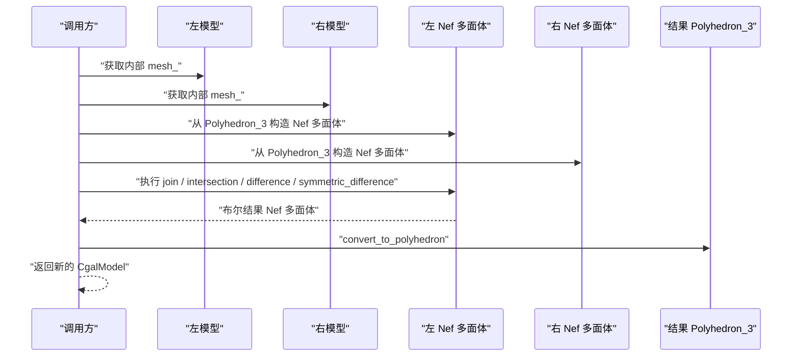
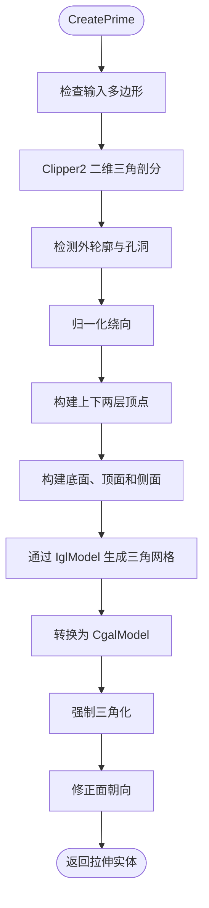
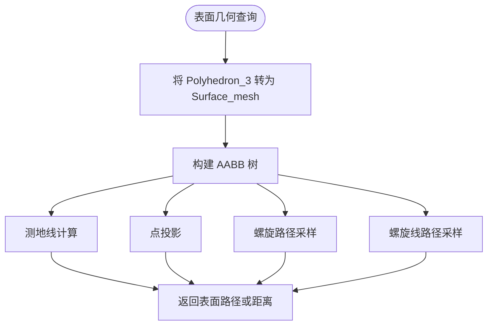
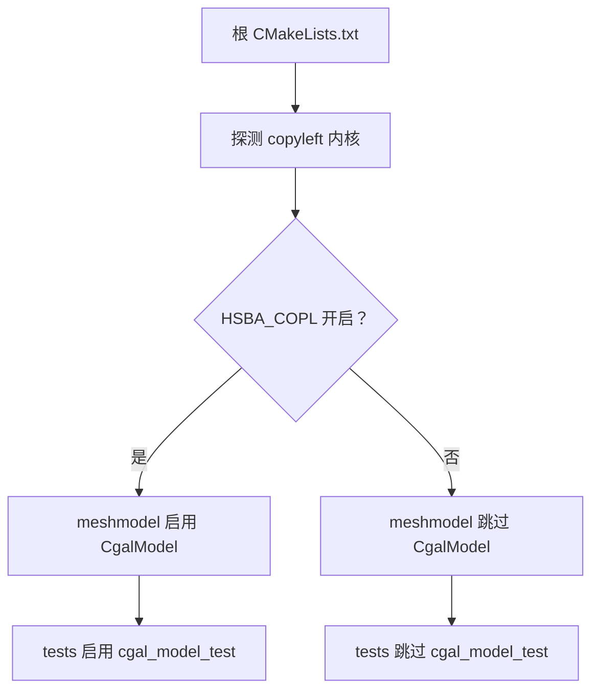

# CgalModel CGAL 几何内核

<cite>
**本文引用的文件**   
- [CgalModel.hpp](file://meshmodel/CgalModel.hpp)
- [CgalModel.cpp](file://meshmodel/CgalModel.cpp)
- [IModel.hpp](file://base/IModel.hpp)
- [IglModel.cpp](file://meshmodel/IglModel.cpp)
- [CMakeLists.txt（meshmodel）](file://meshmodel/CMakeLists.txt)
- [CMakeLists.txt（根目录）](file://CMakeLists.txt)
- [CMakeLists.txt（tests）](file://tests/CMakeLists.txt)
- [cgal_model_test.cpp](file://tests/Models/cgal_model_test.cpp)
</cite>

## 目录
1. [简介](#简介)
2. [项目结构定位](#项目结构定位)
3. [核心组件总览](#核心组件总览)
4. [架构与接口适配](#架构与接口适配)
5. [详细实现分析](#详细实现分析)
6. [依赖关系与构建开关](#依赖关系与构建开关)
7. [性能与精度特性](#性能与精度特性)
8. [使用示例与最佳实践](#使用示例与最佳实践)
9. [故障排除](#故障排除)
10. [结论](#结论)

## 简介
CgalModel 是 HsBaSlicer 中基于 CGAL 的三角网格几何内核实现。它通过 `CGAL::Polyhedron_3` 存储封闭多面体表面，并在其之上提供：
- 模型加载与保存；
- 平移、旋转、缩放和仿射变换；
- 包围盒与体积查询；
- 基于 Nef 多面体的布尔运算；
- 基本几何体创建与二维轮廓拉伸；
- 表面测地线、点投影、螺旋与螺旋线等高级几何操作。

该实现同时实现了统一的 `IModel` 接口，使上层切片管线可以以统一方式调用不同后端模型。

## 项目结构定位
CgalModel 位于 `meshmodel` 模块中，属于“模型处理”相关代码的一部分。它与 IGL 模型、完整拓扑模型并列，作为可选的 CGAL 后端存在。

**图示来源**
- [CgalModel.hpp:24-50](file://meshmodel/CgalModel.hpp#L24-L50)
- [CgalModel.cpp:12-33](file://meshmodel/CgalModel.cpp#L12-L33)

**章节来源**
- [CgalModel.hpp:1-33](file://meshmodel/CgalModel.hpp#L1-L33)
- [CgalModel.cpp:1-33](file://meshmodel/CgalModel.cpp#L1-L33)

## 核心组件总览
CgalModel 的核心职责可以分为五类：

| 类别 | 主要能力 | 关键位置 |
|---|---|---|
| 数据表示 | 内部使用 `CGAL::Polyhedron_3<EpicKernel>` 存储三角化多面体 | [CgalModel.hpp:37-42](file://meshmodel/CgalModel.hpp#L37-L42)、[CgalModel.hpp:151-154](file://meshmodel/CgalModel.hpp#L151-L154) |
| 输入输出 | 读取 STL/OFF/OBJ/PLY 等网格格式，并保证载入后为三角面 | [CgalModel.cpp:121-131](file://meshmodel/CgalModel.cpp#L121-L131)、[CgalModel.cpp:133-157](file://meshmodel/CgalModel.cpp#L133-L157) |
| 几何变换 | 支持平移、旋转、均匀与非均匀缩放、多种 Eigen 变换类型 | [CgalModel.cpp:158-204](file://meshmodel/CgalModel.cpp#L158-L204) |
| 几何查询 | 轴对齐包围盒、有符号体积、三角网格导出 | [CgalModel.cpp:206-236](file://meshmodel/CgalModel.cpp#L206-L236) |
| 高级几何 | 布尔运算、基本体创建、二维轮廓拉伸、测地线、点投影、螺旋与螺旋线 | [CgalModel.cpp:238-276](file://meshmodel/CgalModel.cpp#L238-L276)、[CgalModel.cpp:278-445](file://meshmodel/CgalModel.cpp#L278-L445)、[CgalModel.cpp:625-955](file://meshmodel/CgalModel.cpp#L625-L955)、[CgalModel.cpp:1075-1210](file://meshmodel/CgalModel.cpp#L1075-L1210) |

**章节来源**
- [CgalModel.hpp:34-155](file://meshmodel/CgalModel.hpp#L34-L155)
- [CgalModel.cpp:121-236](file://meshmodel/CgalModel.cpp#L121-L236)

## 架构与接口适配
CgalModel 继承自 `IModel`，从而在 HsBaSlicer 中成为可替换的 3D 模型后端之一。

**图示来源**
- [IModel.hpp:110-139](file://base/IModel.hpp#L110-L139)
- [CgalModel.hpp:34-155](file://meshmodel/CgalModel.hpp#L34-L155)
- [CgalModel.cpp:238-276](file://meshmodel/CgalModel.cpp#L238-L276)

### IModel 适配层设计要点
- `IModel` 定义了与具体几何内核无关的统一 API，包括加载、保存、变换、包围盒、体积和三角网格导出。
- CgalModel 将 CGAL 的 `Polyhedron_3` 封装为对外暴露的 `Eigen` 风格顶点与面片矩阵，便于与 libigl、路径生成、切片等下游模块协作。
- 布尔运算函数 `Union`、`Intersection`、`Difference`、`Xor` 被声明为友元，以便直接访问内部 `mesh_`。

**章节来源**
- [IModel.hpp:110-139](file://base/IModel.hpp#L110-L139)
- [CgalModel.hpp:84-87](file://meshmodel/CgalModel.hpp#L84-L87)
- [CgalModel.hpp:151-154](file://meshmodel/CgalModel.hpp#L151-L154)

## 详细实现分析

### 几何内核与精度配置
CgalModel 使用的 CGAL 内核类型为 `Exact_predicates_inexact_constructions_kernel`，即精确谓词、近似构造内核。

| 类型别名 | 含义 | 作用 |
|---|---|---|
| `EpicKernel` | `CGAL::Exact_predicates_inexact_constructions_kernel` | 提供稳定且高效的几何判断，如共面、包含、相交等 |
| `Point_3` | 三维点类型 | 用于顶点坐标、空间查询和最短路径计算 |
| `Vector_3` | 三维向量类型 | 用于方向、位移和仿射变换参数 |
| `Affine_3` | 三维仿射变换类型 | 承载平移、旋转、缩放和一般仿射变换 |
| `Polyhedron_3` | 三角多面体表面 | 主存储结构 |
| `Nef_Polyheron_3` | Nef 多面体 | 布尔运算底层数据结构 |

这种内核选择适合大多数工程网格：谓词部分使用精确算术避免误判，构造部分使用浮点提高性能。

**章节来源**
- [CgalModel.hpp:37-42](file://meshmodel/CgalModel.hpp#L37-L42)
- [CgalModel.cpp:968-977](file://meshmodel/CgalModel.cpp#L968-L977)

### 网格加载与修复
加载流程会：
1. 将 UTF-8 文件名转换为本地编码；
2. 调用 CGAL IO 读取多边形网格；
3. 对载入结果强制三角化，确保后续算法只面对三角形面。

从 Eigen 顶点与面片构造时，如果直接转换失败，实现会尝试：
1. 将顶点与三角形面片转为 CGAL 多边形汤；
2. 统一面片方向；
3. 合并重复顶点并构建合法网格；
4. 检查体积符号并翻转朝向；
5. 若仍失败则抛出运行时错误。

**图示来源**
- [CgalModel.cpp:42-119](file://meshmodel/CgalModel.cpp#L42-L119)
- [CgalModel.cpp:121-131](file://meshmodel/CgalModel.cpp#L121-L131)

**章节来源**
- [CgalModel.cpp:42-119](file://meshmodel/CgalModel.cpp#L42-L119)
- [CgalModel.cpp:121-131](file://meshmodel/CgalModel.cpp#L121-L131)

### 网格变换
所有变换最终都通过 `CGAL::Polygon_mesh_processing::transform` 作用于内部 `mesh_`。支持的变换包括：
- 平移；
- 四元数旋转；
- 均匀缩放；
- 非均匀缩放；
- 刚体变换；
- 齐次矩阵变换；
- 通用仿射变换。

这些重载允许上层直接使用 Eigen 的不同变换类型，而不必关心 CGAL 的 `Affine_3` 构造细节。

**章节来源**
- [CgalModel.cpp:158-204](file://meshmodel/CgalModel.cpp#L158-L204)

### 布尔运算
布尔运算通过 CGAL 的 Nef 多面体实现，分别对应：
- 并集：`join`
- 交集：`intersection`
- 差集：`difference`
- 异或：`symmetric_difference`

每个运算都会将左右两个模型的 `Polyhedron_3` 转换为 `Nef_Polyheron_3`，执行布尔操作后再转回 `Polyhedron_3`。

**图示来源**
- [CgalModel.cpp:238-276](file://meshmodel/CgalModel.cpp#L238-L276)

**章节来源**
- [CgalModel.cpp:238-276](file://meshmodel/CgalModel.cpp#L238-L276)

### 基本几何体创建
CgalModel 提供以下工厂方法：
- `CreateBox`：基于 CGAL 立方体生成器创建六面体，并强制三角化；
- `CreateSphere`：按栈和切片数量生成球面网格；
- `CreateCylinder`：带底面和侧面的圆柱；
- `CreateCone`：带底面和尖点的圆锥；
- `CreateTorus`：环面。

这些方法均返回可直接用于布尔运算和拉伸的封闭三角网格。

**章节来源**
- [CgalModel.cpp:278-445](file://meshmodel/CgalModel.cpp#L278-L445)

### 二维轮廓拉伸
`CreatePrime` 有两个重载：
1. 单条闭合多边形拉伸；
2. 多条路径拉伸，支持外轮廓与孔洞。

核心流程包括：
1. 使用 Clipper2 进行二维三角剖分；
2. 确定外轮廓与孔洞；
3. 归一化绕向，使外轮廓为正面积、孔洞为负面积；
4. 构建底部三角面、顶部三角面和侧面四边形；
5. 先通过 IglModel 生成三角网格，再转换为 CgalModel；
6. 强制三角化并修正面朝向，保证体积为正。

**图示来源**
- [CgalModel.cpp:625-733](file://meshmodel/CgalModel.cpp#L625-L733)
- [CgalModel.cpp:735-955](file://meshmodel/CgalModel.cpp#L735-L955)

**章节来源**
- [CgalModel.cpp:625-733](file://meshmodel/CgalModel.cpp#L625-L733)
- [CgalModel.cpp:735-955](file://meshmodel/CgalModel.cpp#L735-L955)

### 表面几何与拓扑分析
CgalModel 提供了面向表面的高级几何功能：

| 功能 | 输入 | 输出 | 说明 |
|---|---|---|---|
| 测地线路径 | 源点、目标点 | 表面上的点序列 | 基于 CGAL 最短路径算法 |
| 测地距离 | 源点 | 每个顶点的距离数组 | 从源点到所有顶点的表面最短距离 |
| 点投影 | 空间点 | 最近表面点 | 基于 AABB 树最近点查询 |
| 表面螺旋 | 轴原点、轴方向、圈数、采样数、起始半径、结束半径 | 表面点序列 | 沿轴螺旋并在表面上投影 |
| 表面螺旋线 | 轴原点、轴方向、圈数、螺距、半径、采样数 | 表面点序列 | 固定半径螺旋并在表面上投影 |

**图示来源**
- [CgalModel.cpp:959-1073](file://meshmodel/CgalModel.cpp#L959-L1073)
- [CgalModel.cpp:1075-1210](file://meshmodel/CgalModel.cpp#L1075-L1210)

**章节来源**
- [CgalModel.cpp:959-1073](file://meshmodel/CgalModel.cpp#L959-L1073)
- [CgalModel.cpp:1075-1210](file://meshmodel/CgalModel.cpp#L1075-L1210)

## 依赖关系与构建开关

### 编译期开关
CgalModel 不是默认始终启用的模块。是否启用取决于 `HSBA_COPL`：
- 根 CMake 会探测 vcpkg manifest feature、系统安装的 CGAL 或 OpenCASCADE；
- 若检测到 copyleft 内核，则启用 `HSBA_COPL`；
- `meshmodel/CMakeLists.txt` 在 `HSBA_COPL` 开启时才加入 `CgalModel.hpp` 和 `CgalModel.cpp`；
- 测试目标 `cgal_model_test` 也仅在 `HSBA_COPL` 下构建。

**图示来源**
- [CMakeLists.txt（根目录）:181-204](file://CMakeLists.txt#L181-L204)
- [CMakeLists.txt（meshmodel）:17-26](file://meshmodel/CMakeLists.txt#L17-L26)
- [CMakeLists.txt（tests）:401-404](file://tests/CMakeLists.txt#L401-L404)

**章节来源**
- [CMakeLists.txt（根目录）:181-204](file://CMakeLists.txt#L181-L204)
- [CMakeLists.txt（meshmodel）:1-42](file://meshmodel/CMakeLists.txt#L1-L42)
- [CMakeLists.txt（tests）:401-404](file://tests/CMakeLists.txt#L401-L404)
- [CMakeLists.txt（tests）:792-815](file://tests/CMakeLists.txt#L792-L815)

### 外部依赖
CgalModel 依赖的主要库包括：
- CGAL：几何内核、Nef 多面体、网格处理、IO、最短路径、AABB 树；
- libigl copyleft：在 IGL 后端与 CgalModel 之间做布尔回退和网格转换；
- Eigen：数学与几何变换；
- Clipper2：二维多边形三角剖分和孔洞处理；
- HsBaSlicerBase：错误类型、模型格式、编码转换等基础能力。

**章节来源**
- [CgalModel.cpp:12-33](file://meshmodel/CgalModel.cpp#L12-L33)
- [CgalModel.cpp:633-636](file://meshmodel/CgalModel.cpp#L633-L636)
- [CMakeLists.txt（meshmodel）:17-26](file://meshmodel/CMakeLists.txt#L17-L26)

## 性能与精度特性

### 精度策略
- 内核使用精确谓核，有助于减少共面、包含、相交等判断中的数值误差；
- 构造过程使用浮点，兼顾性能；
- 布尔运算基于 Nef 多面体，通常比纯浮点网格布尔更稳健；
- 表面几何查询将 Eigen 的 `float` 转换为 CGAL 的 `double` 点类型，以提高投影和最短路径计算的稳定性。

### 性能特征
- 布尔运算涉及 Nef 多面体构造与转换，复杂度较高，不适合频繁小对象循环调用；
- 表面几何操作需要构建 `Surface_mesh` 和 AABB 树，单次查询成本随网格规模增长；
- 拉伸操作会进行二维三角剖分、顶点去重、面片构建和两次网格转换，复杂度和输入顶点数、孔洞数量相关；
- 包围盒遍历所有顶点，时间复杂度为 O(V)。

### 优化建议
- 对大型网格，优先复用已构建的 AABB 树或缓存中间结果；
- 对布尔运算，尽量在变换完成后执行，避免多次重复布尔；
- 对拉伸操作，尽量保证二维轮廓简单、无退化边；
- 对表面螺旋和螺旋线，合理设置采样数，避免过密采样导致大量最近点查询。

**章节来源**
- [CgalModel.cpp:238-276](file://meshmodel/CgalModel.cpp#L238-L276)
- [CgalModel.cpp:959-1073](file://meshmodel/CgalModel.cpp#L959-L1073)
- [CgalModel.cpp:1075-1210](file://meshmodel/CgalModel.cpp#L1075-L1210)
- [CgalModel.cpp:625-955](file://meshmodel/CgalModel.cpp#L625-L955)

## 使用示例与最佳实践

### 示例一：创建网格并进行布尔运算
推荐流程：
1. 使用 `CreateBox`、`CreateSphere`、`CreateCylinder` 等工厂方法创建基础实体；
2. 使用 `Translate`、`Rotate`、`Scale` 调整位置和尺寸；
3. 使用 `Union`、`Intersection`、`Difference`、`Xor` 进行布尔组合；
4. 使用 `Volume` 和 `TriangleMesh` 验证结果。

参考测试用例：
- [cgal_model_test.cpp:42-62](file://tests/Models/cgal_model_test.cpp#L42-L62)

### 示例二：二维轮廓拉伸
推荐流程：
1. 准备二维闭合多边形或多段路径；
2. 指定拉伸方向；
3. 调用 `CreatePrime`；
4. 检查体积、包围盒和三角网格；
5. 如需布尔运算，可将拉伸结果与其他 CgalModel 组合。

参考测试用例：
- [cgal_model_test.cpp:65-101](file://tests/Models/cgal_model_test.cpp#L65-L101)
- [cgal_model_test.cpp:105-149](file://tests/Models/cgal_model_test.cpp#L105-L149)
- [cgal_model_test.cpp:151-179](file://tests/Models/cgal_model_test.cpp#L151-L179)

### 示例三：表面测地线与点投影
推荐流程：
1. 确保模型是封闭三角网格；
2. 将查询点限制在模型附近；
3. 调用 `GeodesicPath` 或 `GeodesicDistance`；
4. 使用 `ProjectPointOnSurface` 将空间点投影到表面；
5. 对螺旋和螺旋线，先确定合理的轴方向和半径范围。

参考实现：
- [CgalModel.cpp:1075-1210](file://meshmodel/CgalModel.cpp#L1075-L1210)

### 与 IGL 后端的协作
当 IGL 的布尔运算因浮点顶点导致不稳定时，`IglModel` 会回退到 CgalModel 的 Nef 布尔实现。这说明 CgalModel 不仅是独立后端，也是 IGL 布尔运算的可靠后备方案。

**章节来源**
- [cgal_model_test.cpp:42-62](file://tests/Models/cgal_model_test.cpp#L42-L62)
- [cgal_model_test.cpp:65-179](file://tests/Models/cgal_model_test.cpp#L65-L179)
- [CgalModel.cpp:1075-1210](file://meshmodel/CgalModel.cpp#L1075-L1210)
- [IglModel.cpp:195-230](file://meshmodel/IglModel.cpp#L195-L230)

## 故障排除

| 问题 | 可能原因 | 处理建议 |
|---|---|---|
| 构造 CgalModel 时报空网格错误 | 输入的顶点或面片为空 | 检查上游网格生成逻辑，确保至少有一个三角形面 |
| 从 Eigen 网格构造失败 | 输入网格不合法、面片未三角化或拓扑不一致 | 让实现尝试多边形汤修复；若仍失败，检查面片索引和顶点顺序 |
| 布尔运算结果为空或体积异常 | 输入网格共面、法向不一致或拓扑退化 | 先规范化网格，避免完全共面面重叠，必要时增加微小偏移 |
| 拉伸后体积为负 | 面朝向不一致 | 实现会自动检查体积并反转朝向；若仍异常，检查二维轮廓绕向 |
| 表面几何查询性能低 | 网格过大或采样过多 | 降低采样数，或使用简化网格进行初步分析 |
| 构建时找不到 CGAL | 未启用 copyleft 内核或未安装 CGAL | 启用 vcpkg manifest 的 copyleft feature，或安装 CGAL |

**章节来源**
- [CgalModel.cpp:42-119](file://meshmodel/CgalModel.cpp#L42-L119)
- [CgalModel.cpp:625-733](file://meshmodel/CgalModel.cpp#L625-L733)
- [CgalModel.cpp:735-955](file://meshmodel/CgalModel.cpp#L735-L955)
- [CMakeLists.txt（根目录）:181-204](file://CMakeLists.txt#L181-L204)

## 结论
CgalModel 是 HsBaSlicer 中一个功能完整、面向工程应用的 CGAL 几何内核实现。它以 `IModel` 接口为基础，将 CGAL 的精确几何能力与上层切片管线解耦，同时提供布尔运算、网格修复、二维拉伸和表面几何分析等高级功能。

在实际使用中，应重点关注：
- 输入网格的合法性与三角化状态；
- 布尔运算前的几何预处理；
- 表面几何查询的性能开销；
- copyleft 内核的构建开关与依赖管理。

对于大规模网格和复杂布尔场景，建议结合单元测试与体积、包围盒、三角网格规模等指标进行回归验证。